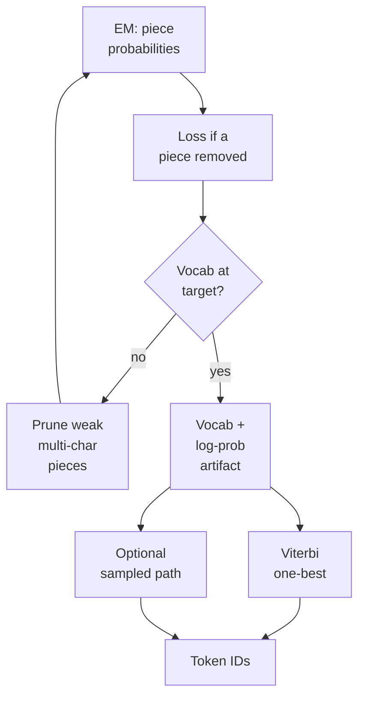

A **unigram language model** (Unigram LM) for tokenization is a subword segmenter that scores every piece independently and picks (or samples) a segmentation by product of piece probabilities. Training starts with a large candidate vocabulary, estimates $p(x)$ for each piece with EM, then prunes pieces that hurt corpus likelihood the least until a target size remains. Taku Kudo introduced the algorithm for subword regularization (ACL 2018). SentencePiece implements it as `model_type="unigram"`; models such as T5, ALBERT, XLNet, mBART, and many multilingual checkpoints use that path.

Unlike BPE, which grows merges from the bottom up, Unigram is top-down: start large, remove weak pieces. Encode time is a global search over legal piece paths (usually Viterbi), not playback of a merge rank list. That probabilistic view is the point: multiple segmentations of the same string are first-class, so training can sample them.

## Formula

Pieces are independent under the unigram assumption. For a segmentation $\mathbf{x} = (x_1,\ldots,x_M)$ over vocabulary $\mathcal{V}$:

$$
P(\mathbf{x}) = \prod_{i=1}^{M} p(x_i),\qquad
\sum_{x \in \mathcal{V}} p(x) = 1,\quad x_i \in \mathcal{V}
$$

The one-best (Viterbi) segmentation of raw string $X$ is:

$$
\mathbf{x}^{*} = \operatorname*{arg\,max}_{\mathbf{x} \in \mathcal{S}(X)} P(\mathbf{x})
$$

where $\mathcal{S}(X)$ is the set of segmentations whose pieces all lie in $\mathcal{V}$ and concatenate to $X$.

Given a fixed $\mathcal{V}$, piece probabilities maximize the marginal likelihood of the training corpus $D$ (summing over all segmentations of each sentence):

$$
\mathcal{L} = \sum_{s=1}^{|D|} \log\Biggl(\sum_{\mathbf{x} \in \mathcal{S}(X^{(s)})} P(\mathbf{x})\Biggr)
$$

That inner sum is computed with the forward algorithm (dynamic programming over string positions). Expected piece counts for the M-step come from the forward-backward algorithm. In log space you add $\log p(x_i)$ instead of multiplying tiny products.

For subword regularization, training draws $\mathbf{x} \sim P(\mathbf{x}|X)$ (via $l$-best sampling or Forward-Filtering Backward-Sampling) rather than always using $\mathbf{x}^{*}$. A temperature $\alpha$ smooths the distribution:

$$
P(\mathbf{x}_i \mid X) \propto P(\mathbf{x}_i)^{\alpha}
$$

Smaller $\alpha$ samples more uniformly; large $\alpha$ concentrates on Viterbi.

## How it works

**Training** (Kudo 2018; SentencePiece `UnigramModelTrainer`):

1. **Seed vocabulary.** Build a large candidate set: retained base characters plus frequent substrings, often via enhanced suffix arrays, or a large BPE-style seed. Strings made from those retained characters remain segmentable; unseen or excluded characters need an unknown-token or byte-fallback policy. Seed size is much larger than the final vocab (for example $100$k candidates toward a $32$k target).
2. **EM fit.** Holding $\mathcal{V}$ fixed, run EM so $p(x)$ maximizes $\mathcal{L}$. E-step: expected counts of each piece under all segmentations. M-step: renormalize those counts into probabilities. SentencePiece also drops pieces whose expected count is near zero during EM (early prune).
3. **Loss-based prune.** For each multi-character piece $x_i$, estimate $\mathrm{loss}_i$: how much $\mathcal{L}$ would drop if $x_i$ were removed (SentencePiece approximates this by re-segmenting with the remaining vocab rather than full re-EM per piece). Sort by $\mathrm{loss}_i$, keep the top $\eta\%$ (paper example: keep about $80\%$, drop about $20\%$). Never remove single-character pieces.
4. **Iterate** steps 2-3 until $|\mathcal{V}|$ hits the target size (plus special tokens).

**Encoding** (serve / default train path):

1. Normalize and pre-process text the same way the artifact was trained (SentencePiece often marks spaces as `▁` and folds Unicode forms).
2. Build a lattice of vocabulary pieces that match spans of the string.
3. Run Viterbi: for each end position, keep the best score of any piece ending there plus the best score before its start. Backtrack for $\mathbf{x}^{*}$.
4. Map pieces to integer IDs.

Optional **sampling** during training uses the same lattice with forward probabilities, then draws a path (or samples from $l$-best). Serving almost always freezes to one-best Viterbi so token IDs stay deterministic.

## Example

Toy frequencies after counting substrings on the Hugging Face teaching corpus (`hug`×10, `pug`×5, `pun`×12, `bun`×4, `hugs`×5). Full seed vocab mass is $210$; the rows below are the pieces that matter for `pug` (other pieces fill out the remaining mass):

| Piece | Count | $p(x)$ |
|---|---:|---:|
| `u` | 36 | $36/210$ |
| `g` | 20 | $20/210$ |
| `ug` | 20 | $20/210$ |
| `p` | 17 | $17/210$ |
| `pu` | 17 | $17/210$ |

(`p` and `pu` each appear 17 times across `pug`×5 and `pun`×12; `pug` itself appears five times.)

Segment the word `pug`. Three legal paths and their unigram products:

$$
\begin{align*}
P(\texttt{p},\texttt{u},\texttt{g}) &= \frac{17}{210}\cdot\frac{36}{210}\cdot\frac{20}{210} \approx 0.00132 \\
P(\texttt{p},\texttt{ug}) &= \frac{17}{210}\cdot\frac{20}{210} \approx 0.00771 \\
P(\texttt{pu},\texttt{g}) &= \frac{17}{210}\cdot\frac{20}{210} \approx 0.00771
\end{align*}
$$

Viterbi returns `p ug` or `pu g` (tie under this mass). The character-only path loses because every extra factor divides by $210$ again: longer piece sequences pay unless pieces are extremely likely.

During prune, a piece like `hug` that is the unique best cover for many training words can contribute strongly to likelihood and survive. Removing a piece with an equal-score alternative can leave the best-path score unchanged, but can still lower the marginal likelihood by removing probability mass from alternative paths. The full model and pruning approximation decide the loss change. This gives Unigram a different training rule from BPE: BPE merges the frequent pair next, while Unigram asks how much corpus likelihood falls when a piece is removed.

At production scale, the same math runs on lattices over full sentences. SentencePiece training sketch:

```python
import sentencepiece as spm

spm.SentencePieceTrainer.train(
    input="corpus.txt",
    model_prefix="tok",
    model_type="unigram",
    vocab_size=32000,
    character_coverage=0.9995,  # high for CJK; 1.0 for small alphabets
)
sp = spm.SentencePieceProcessor(model_file="tok.model")
print(sp.encode("tokenized", out_type=str))  # one-best pieces
# Training-time sampling (subword regularization), not default serve path:
# sp.SampleEncodeAsPieces("tokenized", nbest_size=-1, alpha=0.1)
```

## Diagram



## Intuition

Treat segmentation as compression under Shannon coding: the ideal code length of piece $x$ is $-\log p(x)$. Viterbi finds the shortest code for the string under that codebook. BPE is a dictionary coder that invents merges greedily; Unigram is closer to an entropy coder that re-estimates piece prices and throws away symbols that do not pay for themselves. Because prices are probabilities, alternate "spellings" of the same word receive scores and remain available. Subword regularization feeds those alternate segmentations to the neural model so it sees `book`+`s` and `books` as related views of one surface form.

## Trade-offs

- **Multiple segmentations are power and risk.** Sampling during training can help rare morphology, typos, and domain shift (Kudo reported larger gains on low-resource and out-of-domain NMT). If you sample at train and never at serve (the usual setup), that is intentional train-time noise. If train and serve disagree on sampling or $\alpha$, eval drifts.
- **Determinism at serve.** Production pipelines almost always use one-best Viterbi. Changing vocab, probabilities, normalization, or training `character_coverage` can change segmentation and IDs; it need not change every token. Pin the [tokenizer artifact](glossary://tokenizer-artifact) with the checkpoint.
- **Cost of training.** Each prune round needs EM and loss estimates over the corpus. SentencePiece approximates leave-one-out loss so training stays practical; naive "recompute full loss without each piece" is only for teaching toys.
- **Vs BPE at encode time.** Unigram needs a lattice + DP (linear in length times max piece length with a trie). BPE applies ranked merges. Both are fast enough for LLMs; Unigram's edge is probabilistic sampling, not raw encode throughput.
- **What fails in production.** (1) Retraining Unigram on a new domain silently remaps IDs while embeddings stay frozen. (2) Missing characters when `character_coverage` was too low yields unknown pieces or forced splits. (3) Debugging "the model cannot spell this identifier" without printing pieces and scores hides that Viterbi chose a bad path of common short pieces. (4) Enabling sample-encode in an online API makes token streams non-reproducible for caching and audit logs.

| Family | Build style | Encode time | Multiple segmentations |
|---|---|---|---|
| BPE | Grow merges by frequency | Deterministic merge ranks | Not native (needs BPE-dropout style hacks) |
| WordPiece | Likelihood-aware merges; greedy longest match common | Longest-match / WordPiece decode | Rarely used as a full distribution |
| Unigram | Seed large, EM + prune by likelihood | Viterbi (or sample) on lattice | Native; used for subword regularization |

## Why it matters here

Unigram is the other major subword family next to BPE in the LLM curriculum, and it is the model behind many SentencePiece checkpoints (T5-family, several multilingual models). It teaches three production lessons at once: tokenization is a learned probabilistic model, train/serve segmentation policy is part of the recipe, and token IDs represent one scored path through a lattice for the surface text. When length, cost, or robustness surprises you on non-English or noisy text, print Unigram pieces and compare one-best vs sampled paths before blaming the transformer.

## Related terms

- [SentencePiece](glossary://sentencepiece)
- [BPE](glossary://bpe)
- [WordPiece](glossary://wordpiece)
- [Subword tokenization](glossary://subword-tokenization)
- [Tokenizer artifact](glossary://tokenizer-artifact)
