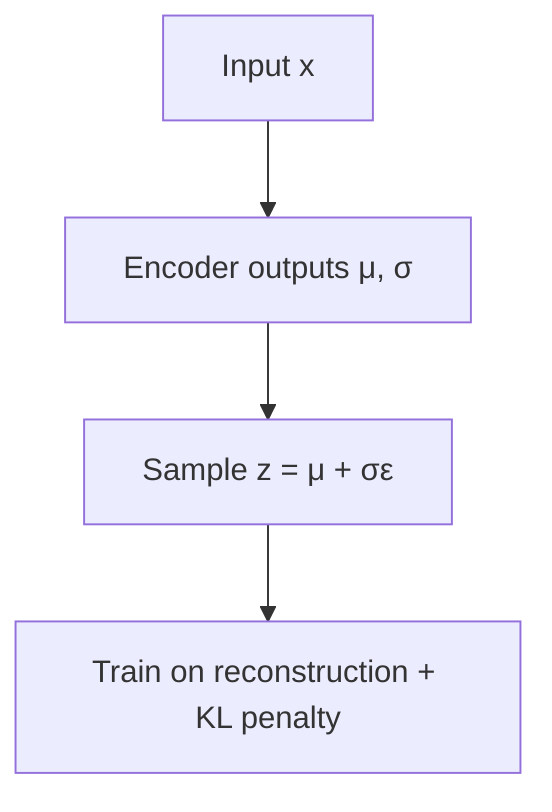

A variational autoencoder (VAE) is a generative encoder-decoder model that learns a distribution over latent codes. A deterministic encoder maps each input to one point; a VAE encoder approximates a posterior $q_\phi(z\mid x)$, and its decoder models reconstruction from a sampled latent variable $z$.

## Reconstruction competes with prior matching

A standard VAE objective combines reconstruction quality with a Kullback-Leibler divergence penalty:

$$
\mathcal L=\mathcal L_{reconstruction}+D_{KL}(q_\phi(z\mid x)\Vert p(z))
$$

Here $\mathcal L_{reconstruction}=-\mathbb E_{q_\phi(z\mid x)}[\log p_\theta(x\mid z)]$, so minimizing the sum maximizes the standard [ELBO](https://arxiv.org/abs/1312.6114). MSE or cross-entropy corresponds to particular decoder likelihood assumptions; choose a metric that matches the observation model. The prior $p(z)$ is often a standard normal distribution. The divergence term encourages encoded examples to occupy a latent region from which new prior samples can decode. Sample quality depends on decoder capacity and training, while excessive regularization can cause posterior collapse, where the decoder largely ignores latent information.

Training commonly uses the reparameterization $z=\mu+\sigma\odot\epsilon$ with $\epsilon\sim\mathcal N(0,I)$. Randomness stays in $\epsilon$ while gradients still flow through learned $\mu$ and $\sigma$.

## Diagram

## Example

For one latent dimension, let $\mu=2$, $\sigma=0.5$, and sampled noise $\epsilon=-1$. The latent sample is $z=2+0.5(-1)=1.5$. Reconstruction encourages that sample to preserve input information; the KL penalty discourages moving the entire encoded distribution arbitrarily far from its prior.

## Why it matters here

The preparation lesson contrasts deterministic compression with prior-sample generation. Recognizing reconstruction, approximate posterior, prior, and reparameterization as distinct objects prevents the common mistake of assuming every autoencoder is automatically generative.

## Related terms

- [Autoencoder](glossary://autoencoder)
- [KL divergence](glossary://kl-divergence)
- [Loss function](glossary://loss-function)
- [Embedding](glossary://embedding)
