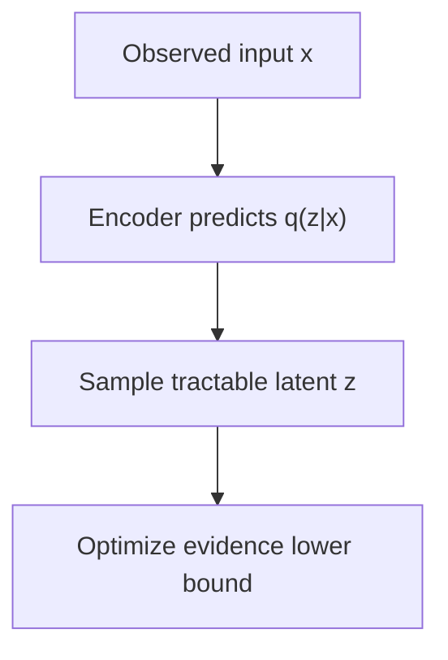

Variational inference approximates an intractable posterior distribution with a simpler, adjustable distribution. Given observed data $x$ and latent variables $z$, the true Bayesian posterior $p_\theta(z\mid x)$ may be expensive to normalize or sample. Variational inference instead chooses a tractable approximation $q_\phi(z\mid x)$ and fits its parameters through optimization.

## Replace posterior integration with optimization

The approximation is selected from a restricted family, such as diagonal Gaussian distributions. Fitting it usually maximizes an [evidence lower bound](glossary://evidence-lower-bound), which balances expected log likelihood against divergence from a prior. For a fixed generative model, $\log p_\theta(x)=\mathrm{ELBO}+D_{KL}(q_\phi(z\mid x)\Vert p_\theta(z\mid x))$, so maximizing the bound minimizes that posterior KL. Jointly changing $\theta$ also changes the evidence and target posterior; track the KL term or another posterior-error estimate to assess approximation quality.

In amortized inference, one encoder network predicts approximate-posterior parameters for each input instead of solving a separate optimization problem from scratch for every observation. The restriction matters: a diagonal Gaussian can miss correlations or multiple posterior modes even when the optimization succeeds. Validate the approximation against the downstream inference task and the posterior structure that matters.

## Diagram

## Example

A VAE encoder reads a screenshot patch and produces $\mu=2$ and $\sigma=0.5$ for one latent coordinate. Those values define $q(z\mid x)=\mathcal N(2,0.25)$. Draw $\epsilon=-1$ from a standard normal fixture and reparameterize $z=\mu+\sigma\epsilon=1.5$. Reconstruction gradients still flow into both encoder outputs.

## Why it matters here

The VAE preparation lesson already computes posterior means, variances, reconstruction loss, and KL penalties. Naming variational inference explains why those pieces form a coherent approximation method rather than an arbitrary collection of regularizers.

## Related terms

- [Evidence lower bound](glossary://evidence-lower-bound)
- [Variational autoencoder](glossary://variational-autoencoder)
- [KL divergence](glossary://kl-divergence)
- [Autoencoder](glossary://autoencoder)
