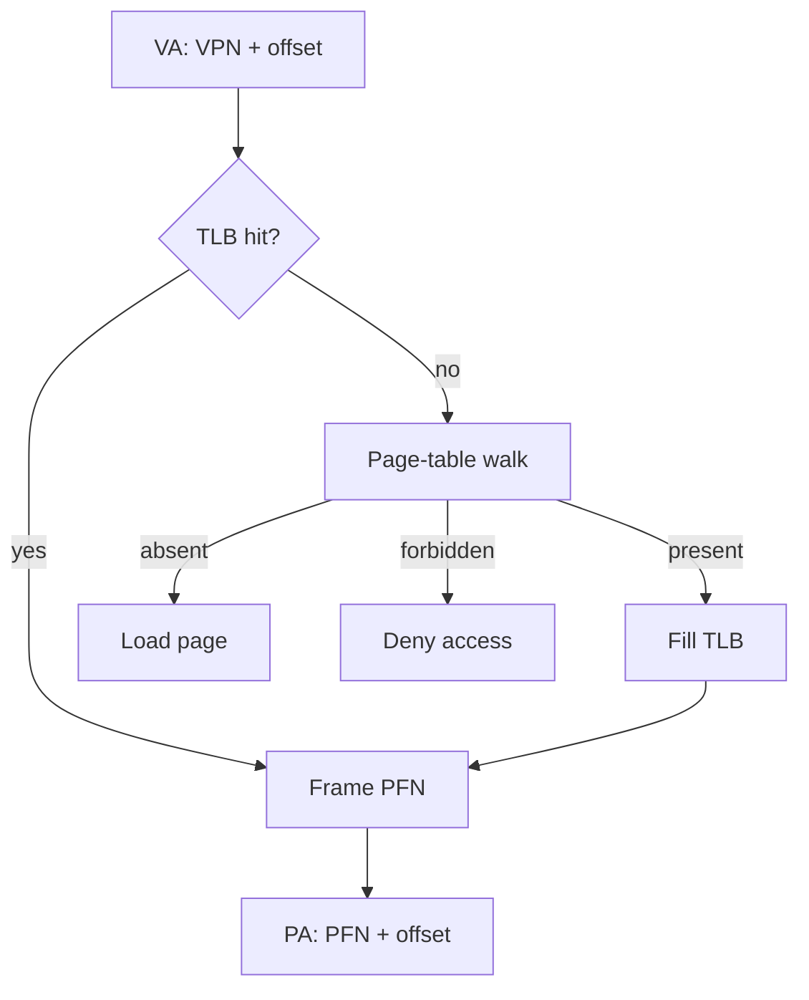

**Virtual memory** is the hardware-and-operating-system abstraction that gives a process a virtual address space and maps its virtual pages to physical memory frames. Code uses virtual addresses; a memory management unit (MMU), page tables, and a translation lookaside buffer (TLB) perform or cache translation and enforce permissions.

Virtual-memory address translation and isolation apply even when every mapped page is resident in RAM. **Demand paging** may load an absent page when first touched; **swapping** may move page contents to secondary storage under pressure. Those are policies built on virtual-memory machinery.

AI systems borrow the same indirection idea. [PagedAttention](glossary://pagedattention) maps logical [KV cache](glossary://kv-cache) blocks for each sequence onto non-contiguous physical GPU blocks. Agent-memory systems use "virtual memory" more loosely as an analogy for keeping a small working context while paging older information to external storage. Both separate logical order from physical placement; the host operating system performs virtual address translation through its page table.

## Address translation

For page size $P=2^k$, virtual address $v$ splits into a virtual page number and offset:

$$
\mathrm{VPN} = \left\lfloor \frac{v}{P} \right\rfloor,
\qquad
\mathrm{offset} = v \bmod P
$$

If the page table maps virtual page $\mathrm{VPN}$ to physical frame $\mathrm{PFN}$, then:

$$
p = \mathrm{PFN} \cdot P + \mathrm{offset}
$$

The offset is unchanged. Only page identity is translated. A TLB caches recent VPN-to-PFN mappings; a miss may trigger a page-table walk. An invalid or nonresident mapping can trap to the operating system, which either maps/loads a page or raises an access fault.

## Diagram



## Example

### Tiny page-table model

```python
PAGE_SIZE = 4096
page_table = {
    0: 12,  # virtual page 0 -> physical frame 12
    1: 4,
    2: 19,
}

def translate(virtual_address: int) -> int:
    vpn, offset = divmod(virtual_address, PAGE_SIZE)
    if vpn not in page_table:
        raise MemoryError(f"unmapped virtual page {vpn}")
    pfn = page_table[vpn]
    return pfn * PAGE_SIZE + offset

assert translate(4096 + 37) == 4 * 4096 + 37
```

Real systems use multi-level page tables, permissions, accessed/dirty bits, shared mappings, huge pages, NUMA placement, and architecture-specific TLB behavior. The toy model captures the stable contract: logical pages need not occupy contiguous physical frames.

## Why paging helps LLM serving

Autoregressive sequences grow at different rates and finish unpredictably. Requiring one contiguous KV allocation per request causes fragmentation and forces conservative reservation. PagedAttention divides KV storage into fixed-size blocks and gives each sequence a block table:

$$
\text{logical block } j
\longrightarrow
\text{physical GPU block } b_j
$$

Logical blocks stay ordered for attention while physical blocks may sit anywhere in the pool. New blocks can be allocated as a sequence grows; finished sequences release their references. Preempted sequences may release KV for recomputation or offload it, according to the runtime's policy. Shared prefixes can point at shared physical blocks with reference counting and copy-on-write-style handling.

The analogy has limits. A GPU KV block miss should not casually page to a slow disk inside a latency-critical decode loop. Serving runtimes usually manage explicit device/host pools and scheduling policies, not transparent general-purpose demand paging.

## Failure modes across layers

| Layer | Failure | Symptom |
| --- | --- | --- |
| CPU virtual memory | Page thrashing | High fault rate, disk I/O, severe latency |
| GPU allocation | Fragmentation | Free bytes exist but large contiguous allocation fails |
| Paged KV | Block exhaustion | Preemption, recompute, admission stalls |
| Agent memory analogy | Bad retrieval | Relevant old fact exists externally but isn't paged into context |

Virtual address space provides indirection and policy choices over finite physical capacity. Monitor resident memory, page faults or block churn, allocation failures, evictions, recompute, and working-set size.

## Why it matters here

Virtual memory supplies the mental model behind PagedAttention and several agent-memory designs: logical continuity doesn't require physical contiguity. Understanding page tables, blocks, and faults makes it easier to reason about KV fragmentation, prefix sharing, memory pools, and why a large logical context still needs finite physical storage.

## Related terms

- [PagedAttention](glossary://pagedattention)
- [KV cache](glossary://kv-cache)
- [GPU](glossary://gpu)
- [HBM](glossary://hbm)
- [Prefix cache](glossary://prefix-cache)
- [Agent scaffold](glossary://agent-scaffold)
- [Context window](glossary://context-window)
