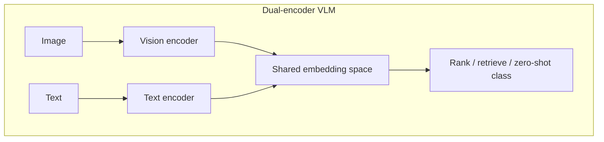
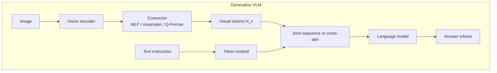

A **vision-language model (VLM)** is a neural system that takes visual inputs (images, sometimes video or page screenshots) together with text and produces text, scores, or both. It can ground answers in pixels to read a chart, describe a UI, match screenshots against a phrase, or answer a question about what is on the page. The term covers two related families that learn from image-text data and serve different product jobs:

| Family | Output | Typical use |
| --- | --- | --- |
| Dual-encoder / contrastive (e.g. [CLIP](glossary://clip)) | Shared [image embedding](glossary://image-embedding) and text embedding for similarity | Retrieval, zero-shot classification, open-vocabulary tagging |
| Generative / multimodal LLM (e.g. Flamingo, BLIP-2, LLaVA) | Autoregressive text conditioned on vision features | Captioning, visual Q&A, document chat, agents that "see" |

Both are VLMs. Production stacks often use a dual encoder for search and a generative VLM for answering; each model handles a distinct job.

## Intuition

Pixels and words start in different spaces. A VLM learns a bridge so language can refer to visual evidence.

Contrastive models learn one shared geometry: "a cracked equipment panel" and a matching photo land near each other; mismatched pairs are pushed apart. At inference, score similarity between image and text embeddings.

Generative models learn to *speak while looking*. A vision encoder turns the image into a sequence of visual vectors. A connector maps those vectors into the language model's residual stream (as projected "visual tokens," as a fixed set of query tokens, or via [cross-attention](glossary://cross-attention)). The LLM then continues with next-token prediction as usual, but every answer token can attend to what was seen.

Separate three product layers:

1. **See** (encode pixels into features).
2. **Align** (make those features usable by language).
3. **Act** (rank candidates, generate text, or call tools).

Most engineering pain is in layer 2 (token budget, resolution, OCR) and in evaluation of layer 3 (did the answer use the image, or invent a fluent guess?).

## How it works

### 1. Dual-encoder path (CLIP-style)

1. Encode image $I$ and text $T$ with separate towers.
2. L2-normalize embeddings $v$ and $u$; score $\mathrm{sim}(v,u) = v^\top u$.
3. Train with a batch of $N$ pairs so true pairs beat in-batch negatives (symmetric InfoNCE; see [CLIP](glossary://clip) and [contrastive learning](glossary://contrastive-learning)).
4. At serving time: embed the gallery offline, embed the query online, retrieve by cosine / MIPS. Classification scores class-name prompts, with the top-ranked prompt supplying the label.

This path is cheap at query time for large corpora and strong for open-vocabulary search. Use a generative VLM when the product needs grounded multi-sentence answers.

### 2. Generative path (modern multimodal LLMs)

A common recipe, popularized by LLaVA (Liu et al., 2023) and related work:

1. **Vision encode.** A frozen or lightly updated backbone (often CLIP ViT-L/14 or a stronger successor) maps image $X_v$ to a grid of features $Z_v = g(X_v) \in \mathbb{R}^{N_v \times d_v}$.
2. **Connect.** Map $Z_v$ into the LLM width $d$:
   - **Linear / MLP projector** (LLaVA): $H_v = Z_v W$ with row-token layout (or a two-layer MLP in LLaVA-1.5). Visual tokens are concatenated with text token embeddings ([early fusion](glossary://early-fusion) into one sequence).
   - **Resampler** (Flamingo Perceiver Resampler): compress a variable feature map to a fixed $K$ visual tokens (e.g. $K=64$).
   - **Q-Former** (BLIP-2): learnable queries cross-attend image features and produce a small fixed set of vectors for the LLM.
   - **Gated cross-attention** (Flamingo): keep the base LM weights frozen; insert new layers that let text states attend to visual tokens.
3. **Decode.** Run the language model autoregressively. Training minimizes next-token loss on the *answer* tokens, conditioned on image and instruction.
4. **Often two-stage train.** Stage A: freeze vision + LLM, train only the connector on caption-style pairs (feature alignment). Stage B: unfreeze the LLM (and sometimes more of the connector) on visual instruction data (chat, VQA, reasoning).

Flamingo (Alayrac et al., 2022) stressed few-shot interleaved image-text conditioning with a frozen LM. BLIP-2 (Li et al., 2023) stressed bootstrapping from frozen unimodal models with a lightweight Q-Former. LLaVA stressed instruction tuning: connect CLIP vision to Vicuna with a simple projector and fine-tune on GPT-4-generated multimodal instructions.

### 3. What "looking" costs at inference

In concatenative architectures such as LLaVA, visual tokens sit in the same [context window](glossary://context-window) as text. A $336\times336$ ViT with patch size $14$ yields $(336/14)^2 = 576$ patches before any pooling. Higher resolution, multi-crop "any-res" schemes, or multi-page PDFs multiply that count. Language-model prefill and [KV cache](glossary://kv-cache) then grow with $n = N_v + N_t$. Cross-attention architectures such as Flamingo keep visual states in a separate memory and have different attention/cache accounting. Resamplers and Q-Formers can bound how many visual states reach the language model.

## Formula

**LLaVA-style projection** of vision features into the LLM embedding space (row-token layout, right multiply, same as $Z_v @ W$ in NumPy/PyTorch):

$$
H_v = Z_v W, \qquad Z_v = g(X_v)
$$

with $Z_v \in \mathbb{R}^{N_v \times d_v}$ ($N_v$ visual tokens of vision width $d_v$), $W \in \mathbb{R}^{d_v \times d}$ (maps vision width to LLM width $d$), and $H_v \in \mathbb{R}^{N_v \times d}$ matching word embedding width. Slot count stays $N_v$; only feature width changes. Papers sometimes write $H_v = W Z_v$ under a left-multiply / column-token convention. Then $W$ is $d \times d_v$ and $Z_v$ is $d_v \times N_v$: same linear map, different matrix orientation.

**Autoregressive answer likelihood** (instruction tokens and previous answer tokens as conditioning; image $X_v$ grounded throughout):

$$
p(X_a \mid X_v, X_{\mathrm{instruct}})
=
\prod_{i=1}^{L}
p_\theta\!\left(
x_i \mid X_v,\ X_{\mathrm{instruct}},\ X_{a,<i}
\right)
$$

The full preceding instruction conditions each answer token; $i$ indexes answer tokens. In instruction-tuning examples, only answer-side tokens typically contribute to the loss.

**CLIP-style dual-encoder score** (for the retrieval VLM family), with temperature $\tau$:

$$
\mathcal{L}_{i\to t}
=
-\frac{1}{N}\sum_{i=1}^{N}
\log
\frac{\exp(\mathrm{sim}(v_i,u_i)/\tau)}
{\sum_{j=1}^{N}\exp(\mathrm{sim}(v_i,u_j)/\tau)}
$$

and the symmetric $\mathcal{L}_{t\to i}$; train on $\frac{1}{2}(\mathcal{L}_{i\to t}+\mathcal{L}_{t\to i})$.

## Diagram





## Example

**Training screenshot helper.** A learner uploads a screenshot of a CUDA out-of-memory error. The product needs two subsystems:

1. **Retrieval VLM.** Embed the screenshot with a dual encoder; find the five closest known error states and troubleshooting notes in a vector index. Fast, cacheable, good for "have we seen this before?"
2. **Generative VLM.** Feed the screenshot plus the retrieved notes into a multimodal chat model:

```text
System: You are a support assistant. Cite only what is visible
in the image or in the provided docs. If text is unreadable, say so.
User: <image> What error code is shown, and what should I try next?
```

Concrete failure modes on the same ticket:

| Failure | What happened | Fix path |
| --- | --- | --- |
| Unreadable image | Blurry phone photo, glare on the phone | Request retake; lower confidence; fall back to human |
| Missed region | Error banner is tiny at the top; model describes the main form | Crop / higher resolution / any-res tiling; ask "zoom the banner" |
| OCR miss | Model invents a wrong code from similar digits | Run a dedicated [OCR](glossary://ocr) path; compare strings |
| Language ignore vision | Fluent steps that do not match the screenshot | Groundedness checks; require quoting visible text; separate eval slice |

Save crop coordinates, OCR string, retrieved doc ids, prompt, and answer as one evidence bundle alongside the chat transcript. When the user disputes the answer, inspect the full evidence bundle.

## Worked numbers

**Visual token budget.** CLIP ViT-L/14 at $224\times224$ uses $(224/14)^2 = 256$ patches. At $336\times336$: $576$ patches. If each projected patch is one LLM token and the question is $40$ tokens:

| Setup | $N_v$ | $N_t$ | Total $n$ | vs text-only |
| --- | ---: | ---: | ---: | --- |
| Text only | $0$ | $40$ | $40$ | $1\times$ |
| $224$ image + question | $256$ | $40$ | $296$ | $\approx 7.4\times$ length |
| $336$ image + question | $576$ | $40$ | $616$ | $\approx 15.4\times$ length |
| Resampler to $K=64$ | $64$ | $40$ | $104$ | $\approx 2.6\times$ length |

Naive attention cost scales roughly with $n^2$ for prefill. Moving from text-only $40$ to $616$ is about $(616/40)^2 \approx 237\times$ the quadratic term before kernel optimizations. That is why resolution, multi-image chats, and PDF page dumps dominate VLM latency and GPU memory long before answer length does.

**Rough prefill KV bytes** (keys + values, all layers, FP16/BF16), illustrative:

$$
\text{bytes} \approx 2 \cdot L \cdot H_{\mathrm{kv}} \cdot d_{\mathrm{head}} \cdot n \cdot 2
$$

For $L=32$, $H_{\mathrm{kv}}=8$, $d_{\mathrm{head}}=128$, $n=616$: $2\cdot32\cdot8\cdot128\cdot616\cdot2 = 80{,}740{,}352$ bytes, about $81$ MB of KV for one request before paging overhead. Ten concurrent high-res images blow past a naive per-request memory budget quickly.

```python
def patch_tokens(side_px: int, patch: int = 14) -> int:
    return (side_px // patch) ** 2

assert patch_tokens(224) == 256
assert patch_tokens(336) == 576
```

## Trade-offs

| Strength | Limit |
| --- | --- |
| One interface for "see + ask" without a custom CV head per task | Hallucinated details that sound confident when vision is weak |
| Dual encoders scale retrieval; generative VLMs handle free-form tasks | Capability is task-sliced: good captioning $\neq$ good chart reading |
| Frozen towers + small connector train cheaply (BLIP-2 / early LLaVA) | Connector and resolution choices set a hard ceiling on fine detail |
| Instruction-tuned chat matches product UX | Small text, dense UI, domain symbols, and low contrast fail quietly |
| Shared research path from CLIP $\to$ Flamingo $\to$ BLIP-2 $\to$ LLaVA-class models | Eval must match the job (OCR, grounding, retrieval, safety), not generic caption quality |

Architectural choice in one line: use **dual encoders** when you need searchable geometry; use **generative VLMs** when you need language answers grounded in an image; use **both** when the product must find candidates and explain them.

## Why it matters here

VLMs turn LLM systems into multimodal products: document AI, UI automation, moderation, multimodal RAG over screenshots and scans, accessibility, and agents that act on what they see. Curriculum topics on [CLIP](glossary://clip), [early fusion](glossary://early-fusion), [cross-attention](glossary://cross-attention), [OCR](glossary://ocr), and context/KV sizing all land here. In production, separate "can it retrieve?", "can it read text?", "can it localize?", and "does the answer use the image?" as different eval slices, and treat vision token count as a first-class capacity limit next to text context.

## Related terms

- [CLIP](glossary://clip)
- [Image embedding](glossary://image-embedding)
- [Cross-attention](glossary://cross-attention)
- [Early fusion](glossary://early-fusion)
- [OCR](glossary://ocr)
