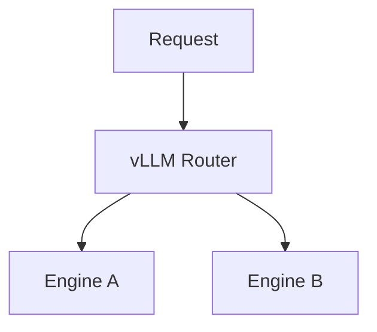

**vLLM Router** is a separate routing layer for distributing requests across model-serving endpoints. It can apply load-balancing policies, health checks, retries, and prefill/decode-aware routing.

## Boundary

The vLLM engine schedules tokens inside each serving deployment. The router decides which deployment receives a request. Ray actor placement or an application queue can route work through other paths.

Confirm the router process, configuration, metrics, and request path before attributing behavior to vLLM Router. Router can improve admission and fleet balance. Slow model kernels and checkpoint-parity failures need engine-level fixes.

## Routing signals

Policy can consider queue depth, active tokens, cache affinity, model/adapter identity, endpoint health, request priority, and prefill/decode role. Stable policy must handle retries without duplicating streamed responses or crossing weight versions. Monitor admission latency, retry rate, endpoint imbalance, unhealthy duration, and version distribution. Use router metrics alongside engine TTFT, TPOT, and KV telemetry.

## Diagram

## Example

In prefill/decode mode, the router selects prefill and decode endpoints and coordinates the request. The engines' configured KV connector transfers the cache between endpoints. The [vLLM Router repository](https://github.com/vllm-project/router) documents its current routing policies and deployment modes.

## Why it matters here

Multiple rollout engines need fleet-level admission and health decisions. Trace the configured request path to confirm whether Ray placement uses vLLM Router.

## Related terms

- [vLLM](glossary://vllm)
- [Routing policy](glossary://routing-policy)
- [Prefill-decode disaggregation](glossary://prefill-decode-disaggregation)
- [TTFT](glossary://ttft)
