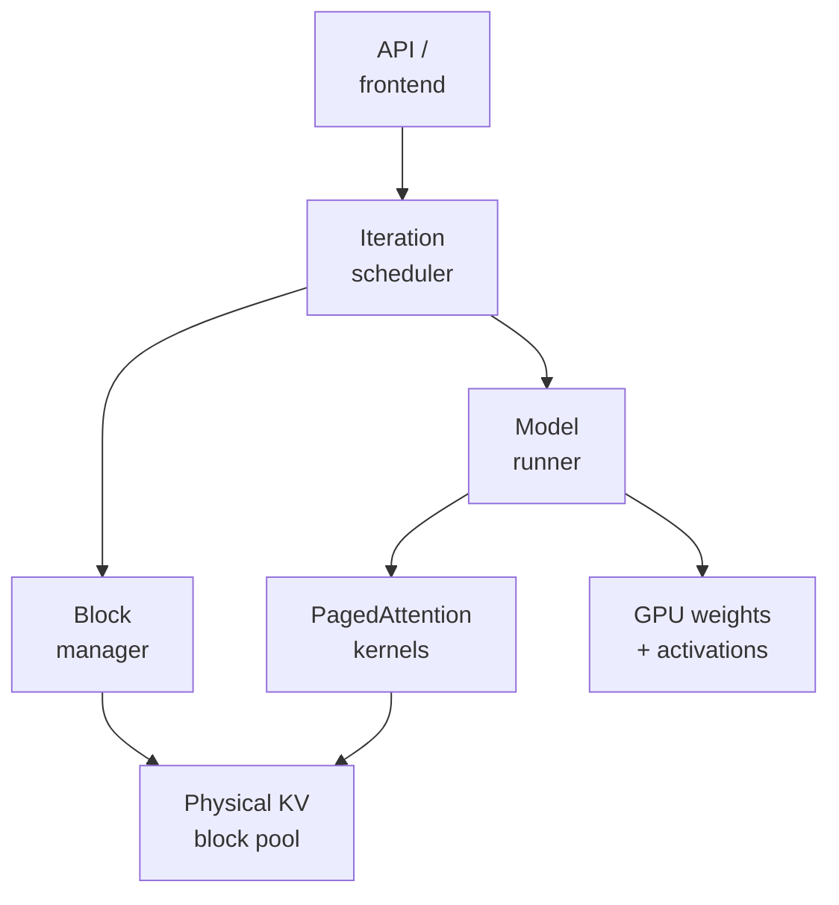
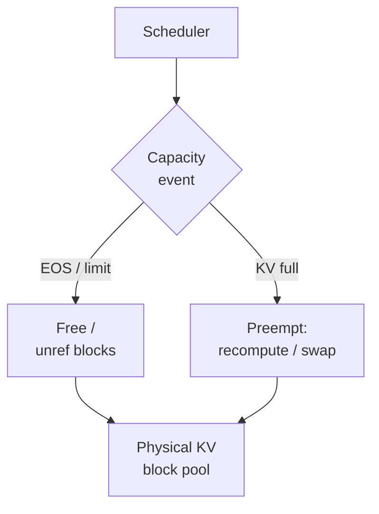

**vLLM** is an open-source high-throughput LLM inference and serving engine. It schedules many concurrent generations on a GPU (or multi-GPU) worker, keeps autoregressive [KV cache](glossary://kv-cache) in fixed-size blocks via [PagedAttention](glossary://pagedattention), and admits or retires requests at *iteration* granularity ([continuous batching](glossary://continuous-batching)). The system was introduced with PagedAttention by Kwon et al. (SOSP 2023) and is maintained as a community project with an OpenAI-compatible HTTP server, offline `LLM` API, multi-LoRA, quantization, and distributed execution.

The engine owns model loading, tokenization hooks, scheduling, paged KV memory, sampling, and token streaming. Applications provide auth, routing, prompts, retrieval, safety, and fallbacks.

## Intuition

Autoregressive decode is memory-bound: each step loads large weights and a growing KV tensor to emit roughly one token per sequence. Throughput rises when you keep many live sequences in one forward pass, amortizing weight loads. The hard limit is usually **how much KV you can fit**, not FLOPs.

Older engines often reserved a *contiguous* KV buffer sized to each request's max length. Real prompts and answers are much shorter and uneven, so most of that reservation sat empty (internal fragmentation), and uneven max lengths also created external fragmentation. Kwon et al. measured only about **20–38%** of reserved KV space holding actual token state under those designs.

vLLM's fix is the OS virtual-memory idea applied to KV:

- Treat tokens like bytes and sequences like processes.
- Store $K$/$V$ in fixed-size **blocks** (logical pages) of $B$ tokens each (often $B=16$).
- Map logical blocks to physical GPU blocks through a **block table**.
- Allocate physical blocks on demand; free them when a sequence finishes.
- Share physical blocks across sequences (shared prompt, beam candidates, automatic [prefix cache](glossary://prefix-cache)) with reference counts and copy-on-write when paths diverge.

PagedAttention is the attention kernel that can score a query against $K$/$V$ stored in non-contiguous physical blocks. Continuous batching is the scheduler loop that rebuilds the live set after every model step so finished work frees blocks immediately for new arrivals.

## How it works

At a high level each engine iteration does this:

1. **Schedule.** Choose waiting and running sequences under budgets: free KV blocks, `max_num_seqs`, `max_num_batched_tokens`, and (in modern V1) chunked-prefill policy that usually prioritizes decode then fills remaining token budget with prefill chunks.
2. **Allocate.** Map any new logical blocks to free physical blocks; grow the last partially filled block in place.
3. **Execute.** Run one model step. Prefill (or a prefill chunk) writes many $K$/$V$ slots; decode writes one new slot per live sequence and samples the next token.
4. **Retire.** Sequences that hit EOS or `max_tokens` free their blocks (or leave shared blocks with lowered refcounts). Waiting work can enter on the next step.
5. **Preempt if needed.** When free blocks run out mid-generation, vLLM can preempt newer sequences (FCFS fairness in the paper design). As of vLLM V1's documented defaults, preemption prefers **recompute** rather than CPU swap: drop KV and redo prefill when capacity returns (confirm the active engine config; flags and defaults evolve). Frequent preemption consumes GPU time and lowers throughput.

Distributed runs share one logical block map across tensor-parallel workers: each GPU holds the same block IDs for its attention-head shard; NCCL all-reduce still glues the layer math together.

### PagedAttention math (primary paper)

Standard causal attention at position $i$ uses past keys and values. PagedAttention groups those past states into blocks of size $B$. Write key block $K_j = (k_{(j-1)B+1},\ldots,k_{jB})$ and value block $V_j$ similarly (columns are per-token vectors; the last block may be partial). With head dimension $d$, block-wise scores and outputs are:

$$
A_{ij}
=
\frac{\exp\!\left(q_i^{\top} K_j / \sqrt{d}\right)}
{\sum_{t=1}^{\lceil i/B\rceil}
\exp\!\left(q_i^{\top} K_t / \sqrt{d}\right)\mathbf{1}},
\qquad
o_i
=
\sum_{j=1}^{\lceil i/B\rceil} V_j A_{ij}^{\top}
$$

Here $A_{ij}$ is the length-$B$ (or shorter) row of attention weights on block $j$; $\exp$ is elementwise and right multiplication by the all-ones column sums those weights so the denominator is the **global** partition function over every allowed token. Mask padding and future slots in a partial block. The model math is ordinary transformer attention; only layout and lookup change. Per-sequence internal waste is at most the unused slots in its **last** block; its fraction can still be large for very short sequences.

## Worked numbers

Paper example for OPT-13B in FP16: one token's full-stack KV is

$$
2 \times 5120 \times 40 \times 2\ \text{bytes} = 819{,}200\ \text{bytes} = 800\ \text{KiB}
$$

($K$ and $V$, hidden size $5120$, $40$ layers, $2$ bytes per FP16). A request that could grow to $2048$ tokens needs $1.5625$ GiB (about $1.68$ decimal GB) of KV if fully reserved. On a 40 GB A100, the paper's layout puts weights near **~65%** of memory; the remaining ~30% for KV (plus a small activation slice) decides concurrency.

With block size $B=16$, a live sequence of length $T=1000$ needs $\lceil 1000/16\rceil = 63$ logical blocks in its block table. If twenty chats average $500$ tokens of active context instead of $2048$, paged allocation can keep roughly $4\times$ more concurrent sequences in the same KV pool (order-of-magnitude; exact headroom depends on weights, activations, and `gpu_memory_utilization`).

Kwon et al. reported **2–4×** throughput versus FasterTransformer and Orca-style baselines at matched latency on their ShareGPT/Alpaca-derived traces, with larger gains for long sequences, large models, and multi-sequence decoding (parallel sampling, beam search) where block sharing helps. Treat published multipliers as workload-dependent: length variance and baseline quality matter more than a single magic number.

## Diagram

The first view separates compute from KV storage ownership. The second isolates scheduler events that return capacity to the pool.





## Example

Serve a chat model with the OpenAI-compatible server (pin versions in production; flags evolve between V0 and V1):

```bash
vllm serve Qwen/Qwen2.5-1.5B-Instruct \
  --host 0.0.0.0 --port 8000 \
  --max-model-len 8192 \
  --gpu-memory-utilization 0.90
```

Query chat completions:

```bash
curl http://localhost:8000/v1/chat/completions \
  -H 'Content-Type: application/json' \
  -d '{
    "model": "Qwen/Qwen2.5-1.5B-Instruct",
    "messages": [
      {"role": "system", "content": "You are a helpful assistant."},
      {"role": "user", "content": "Explain KV cache in one sentence."}
    ],
    "max_tokens": 64,
    "temperature": 0
  }'
```

Offline batch path (same engine, no HTTP):

```python
from vllm import LLM, SamplingParams

llm = LLM(model="Qwen/Qwen2.5-1.5B-Instruct", max_model_len=8192)
params = SamplingParams(temperature=0.0, max_tokens=64)
outputs = llm.chat(
    [[{"role": "user", "content": "Explain KV cache in one sentence."}]],
    sampling_params=params,
)
print(outputs[0].outputs[0].text)
```

What you should see under load: many in-flight sequences share one GPU; KV occupancy tracks **active blocks**, not max-seq reservations; short chats leave as soon as they finish so long generations no longer pin empty slots. Shared system prompts and multi-turn prefixes can hit automatic prefix caching so only the new suffix pays full prefill cost.

For a larger model that does not fit one GPU:

```python
from vllm import LLM

llm = LLM(
    model="meta-llama/Llama-3.1-70B-Instruct",
    tensor_parallel_size=4,
    max_num_batched_tokens=8192,  # tune TTFT vs ITL under chunked prefill
)
```

## Trade-offs

| Pressure | What breaks | What to change |
|---|---|---|
| KV pool exhausted | Preemption storms, recompute thrash, rising p95 latency | Raise `gpu_memory_utilization`, lower `max_num_seqs` / context, add GPUs (TP/PP), or quantize |
| Giant prefills in a decode-heavy fleet | Spikes in [TTFT](glossary://ttft) and [TPOT](glossary://tpot) for everyone | Chunked prefill + lower/higher `max_num_batched_tokens` depending on TTFT vs ITL goals |
| Wrong chat template / tokenizer / dtype | A visible slowdown signals a performance issue; silent quality drift signals a correctness issue | Diff against a Transformers reference; pin revision and generation config |
| Prefix cache miss rate high | Prefill dominates cost despite shared instructions | Normalize templates, keep system prompts identical, measure hit rate |
| Single-request microbench only | You never exercise continuous batching or paged packing | Load-test with real prompt/output length mix and concurrency |

vLLM optimizes **serving economics and latency under concurrency** while keeping model parameters and attention equations intact. After migration from Transformers, investigate the chat template, tokenizer, sampling defaults (`generation_config.json` versus engine defaults), stop tokens, and precision when quality changes.

## Debug path

Split the request path before tuning random flags:

1. **Queue / admission:** time from HTTP accept to first scheduled step.
2. **Prefill:** [TTFT](glossary://ttft), prompt length, chunked-prefill chunk size, prefix-cache hits.
3. **Decode:** [TPOT](glossary://tpot) / [ITL](glossary://itl), concurrent sequences, tokens/s.
4. **Memory:** GPU free memory, KV utilization, block free count, preemption counter.
5. **Correctness:** same checkpoint revision, chat template, EOS rules, and temperature as your golden path.

If preemption logs appear often, fix capacity (memory or concurrency limits) before chasing kernel tweaks. If throughput is high but interactive p95 is bad, the scheduler may be optimizing aggregate tokens/s at the expense of short chats; separate pools or priority policies may be needed outside pure default FCFS.

## Why it matters here

vLLM is the default mental model for modern open LLM serving: paged KV, continuous batching, prefill/decode interference, prefix reuse, and multi-GPU sharding show up in system design, interviews, and production incidents. Understanding it connects [KV cache](glossary://kv-cache) math to real GPU capacity and to metrics you can measure under load.

## Related terms

- [PagedAttention](glossary://pagedattention)
- [Continuous batching](glossary://continuous-batching)
- [KV cache](glossary://kv-cache)
- [Prefix cache](glossary://prefix-cache)
- [TTFT](glossary://ttft)
