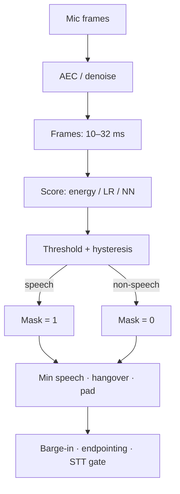

Voice activity detection (VAD) classifies short audio frames as **speech** or **non-speech**. Speech-to-text transcribes words, and endpointing decides when a conversational turn is finished. VAD answers the real-time question: *is someone speaking in this frame?* Voice systems use that binary (or probabilistic) signal to start capture, skip silence, feed [barge-in](glossary://barge-in), and start the silence clock that [endpointing](glossary://endpointing) later interprets as a possible end of turn.

VAD labels speech presence. Measure accuracy across the languages, accents, microphones, and noise conditions in your workload. [Speech-to-text](glossary://speech-to-text) turns speech into text; endpointing decides when the *user is done talking enough to act*. Confusing those three layers is a common source of "the agent cuts me off" bugs that look like model failures when the root cause is acoustic policy.

## Intuition

VAD assigns each short audio frame a speech probability or binary label. Downstream code can mute the speaker, open an STT window, or start a hangover timer without understanding the words. Non-speech includes HVAC hum and keyboard clicks. TV dialogue and residual [echo](glossary://echo-cancellation) from the agent's own TTS may count as acoustic speech while the target user stays silent. Use a separate speaker or source signal when the system must identify the target user.

| Layer | Question | Typical latency budget |
|---|---|---|
| VAD | Speech present *now*? | Tens of ms (one or a few frames) |
| Endpointing | User turn complete? | Hundreds of ms of silence / model patience |
| STT | What was said? | Streaming partials then a final |

## How it works

Production VADs share a pipeline even when the classifier differs:

1. **Frame the waveform.** Common frame lengths are $10$–$30$ ms (WebRTC-style) or $32$ ms at $16$ kHz for Silero ($512$ samples). Overlap or stateful context (Silero keeps a short past context) stabilizes decisions.
2. **Optional front-end.** Noise reduction, high-pass filtering, automatic gain control, and especially AEC so the loudspeaker is not labeled as the user.
3. **Features.** Classical systems use full-band energy, zero-crossing rate, band energies, or MFCCs. Neural VADs take raw waveform or spectrogram features inside a small network.
4. **Classify.** Compare a score $s_t$ (energy, likelihood ratio, or neural probability) to a threshold $\tau$, often with hysteresis: enter speech when $s_t > \tau_{\text{on}}$, leave when $s_t < \tau_{\text{off}}$ with $\tau_{\text{off}} < \tau_{\text{on}}$.
5. **Temporal post-process.** Hangover / min silence, min speech duration, and speech padding reduce chatter from single-frame flips. These knobs clean the speech mask. Endpointing separately decides when to commit a turn.

### Classical energy gate

For a frame of $N$ samples $x[0],\ldots,x[N-1]$:

$$
E = \sum_{n=0}^{N-1} x[n]^2
\quad\text{(or log-energy } \ell = \log(E+\varepsilon)\text{)}
$$

Decide speech if $E > \tau$ (or $\ell > \tau_\ell$). Adaptive $\tau$ tracks a noise floor estimate so decisions stay stable as room level changes. Energy alone fails when noise is speech-like (TV, other talkers) or when true speech is quiet relative to the floor.

### Statistical likelihood-ratio VAD (Sohn et al., 1999)

A widely cited DSP baseline treats DFT bins under two hypotheses. Let $X_k$ be the complex spectrum at frequency bin $k$, $N_k$ noise, and $S_k$ speech. Under complex-Gaussian models for speech and noise:

$$
H_0:\ X_k = N_k \quad\text{(speech absent)}, \qquad
H_1:\ X_k = S_k + N_k \quad\text{(speech present)}
$$

With a priori SNR $\xi_k = \lambda_{s,k}/\lambda_{n,k}$ and a posteriori SNR $\gamma_k = |X_k|^2 / \lambda_{n,k}$, the per-bin likelihood ratio under those models is

$$
\Lambda_k = \frac{1}{1+\xi_k}
\exp\left(\frac{\gamma_k \xi_k}{1+\xi_k}\right).
$$

The geometric mean over $L$ bins (what you threshold in practice, usually in the log domain) is

$$
\Lambda =
\left(\prod_{k=1}^{L} \Lambda_k\right)^{1/L}
=
\exp\left(\frac{1}{L}\sum_{k=1}^{L}\log\Lambda_k\right).
$$

Decide speech when $\Lambda > \eta$, i.e. $\frac{1}{L}\sum_k \log\Lambda_k > \log\eta$. Noise variances $\lambda_{n,k}$ and speech SNRs $\xi_k$ are estimated online (classically decision-directed estimation). Hangover schemes keep the flag high briefly after $\Lambda$ drops so weak trailing consonants are not clipped (front-end / mid-speech clipping metrics in codec literature: FEC, MSC, OVER, NDS).

### GMM and neural detectors used in agents

- **WebRTC VAD.** Fixed-point GMM over log energies in six bands roughly $80$–$4000$ Hz. Frames must be $10$, $20$, or $30$ ms; supported sample rates are $8$/$16$/$32$/$48$ kHz. Aggressiveness modes $0$–$3$ trade false accepts for false rejects ($0$ least aggressive about labeling non-speech, $3$ most aggressive). Extremely cheap; measure its accuracy on your noise conditions rather than assuming a universal ranking against DNNs.
- **Silero VAD.** Small pretrained network (JIT ~$2$ MB) for $8$ kHz and $16$ kHz. At $16$ kHz it expects $512$-sample chunks ($\approx 32$ ms) and returns a speech probability $p_t \in [0,1]$. The project reports sub-ms CPU processing for a chunk under its benchmark conditions; actual latency depends on hardware and runtime. Default operational threshold is often $p_t \ge 0.5$. Used widely in voice-agent stacks (for example LiveKit's Silero plugin).
- **Server / semantic modes.** Hosted realtime APIs still expose acoustic VAD (OpenAI Realtime `server_vad` with `threshold`, `prefix_padding_ms`, `silence_duration_ms`) and optional semantic turn detectors that wait differently when the partial text looks incomplete. Semantic models sit above frame VAD; barge-in still needs a fast speech/non-speech signal.

## Formula (streaming decision)

Per frame $t$, a practical streaming rule combines score and hangover:

$$
\hat{y}_t =
\begin{cases}
1 & \text{if } s_t \ge \tau \text{ for speech-onset, or still inside hangover after speech}\\
0 & \text{if silence has lasted } \ge d_{\text{sil}} \text{ after speech ended}
\end{cases}
$$

For a neural score, $s_t = p(\text{speech}\mid \mathbf{x}_t)$. For Silero-style chunking of a long file, helpers also enforce minimum speech length, minimum silence between segments, and padding so cuts do not shave phonemes:

```text
# Illustrative Silero-style defaults (tune on your mics)
threshold               = 0.5      # p_speech gate
min_speech_duration_ms  = 250      # drop short blips
min_silence_duration_ms = 100      # segment split hangover (file mode)
speech_pad_ms           = 30       # pad each segment
# LiveKit Silero plugin conversational defaults (seconds)
min_speech_duration     = 0.05
min_silence_duration    = 0.55
activation_threshold    = 0.5
prefix_padding_duration = 0.5
# OpenAI Realtime server_vad example
threshold           = 0.5
prefix_padding_ms   = 300
silence_duration_ms = 500
```

Note the split of concerns: `threshold` / `activation_threshold` are **VAD sensitivity**. `silence_duration_ms` / `min_silence_duration` start to act as **endpointing patience** when the product commits a turn on that timer alone. Keep the names straight when debugging.

## Example

A laptop agent plays TTS while listening for barge-in. Capture is $16$ kHz mono. Local Silero-style VAD runs every $32$ ms frame.

Timeline while the assistant is mid-sentence:

| Time | Event | VAD $p_t$ | System action |
|---|---|---|---|
| $t=0.00$ s | TTS playing, good AEC | $0.05$–$0.12$ | Stay in "agent speaking" |
| $t=1.20$ s | User starts "stop" | rises past $0.5$ | Speech onset candidate |
| $t\approx1.30$ s | $3$ consecutive $32$ ms speech frames, min speech ok | high | Confirm barge-in, mute speakers |
| $t=1.55$ s | User finishes "stop" | drops below $\tau_{\text{off}}$ | Start silence clock (endpointing) |
| $t=2.05$ s | $500$ ms silence | non-speech | Commit turn, STT final, LLM reply |

Worked numbers for one $32$ ms frame at $16$ kHz: $N = 512$ samples. Suppose RMS amplitude after AEC is $0.02$ (normalized full scale). Frame energy $E \approx N \cdot (0.02)^2 \approx 0.20$. Without a calibrated noise floor that absolute energy is meaningless for speech detection; the neural score $p_t$ is preferred because it was trained across noise conditions. With residual echo (AEC off), the same TTS phrase can push $p_t$ above $0.5$ even though the human is silent: false barge-in that looks like "the agent interrupted itself."

If you only use a fixed $400$ ms silence endpoint after VAD, a learner saying "batch size... thirty-two" with a $700$ ms thinking pause will be cut after "batch size." That is an **endpointing** failure built on a correct VAD silence label. VAD did its job (speech stopped); the product policy was too impatient.

## Diagram



VAD owns the score and the speech mask. [Barge-in](glossary://barge-in) owns mute + cancel while the agent is speaking. [Endpointing](glossary://endpointing) owns when `speech → silence` becomes "commit this turn."

## What fails in production

- **False positives (noise as speech).** Keyboard, HVAC, TV, multi-party rooms, and residual echo trigger barge-in or keep endpointing from ever seeing silence. Raise $\tau$, require min speech duration, fix AEC, or move to a stronger DNN; measure false barge-in rate on speakerphone and open offices.
- **False negatives (missed speech).** Soft talkers, far-field mics, aggressive WebRTC mode $3$, or thresholds tuned only on clean headsets. Users repeat themselves; STT never opens. Measure miss rate and onset latency on quiet speech slices.
- **Clipping.** Front-end clipping (FEC) drops leading consonants if onset is slow or padding is zero; mid-speech clipping (MSC) drops weak frames inside words. Prefer a few tens of ms of prefix padding (`prefix_padding_ms` / `speech_pad_ms`) over razor cuts.
- **Confusing VAD with turn-taking.** Silence after speech marks a VAD boundary; endpointing separately decides when to commit the turn. Digit strings, lists, and thinking pauses need longer patience or a semantic end-of-turn model on top of VAD.
- **Wrong sample rate or frame size.** Silero expects $8$/$16$ kHz and fixed chunk lengths; WebRTC expects $10$/$20$/$30$ ms frames. Resampling bugs produce garbage scores that look random.
- **Self-speech without AEC.** The assistant's TTS re-enters the mic; VAD and STT treat it as the user. Debug the capture path before tuning thresholds.

Metrics that matter: speech-onset latency (true speech start → flag high), false speech rate during pure noise and during TTS-only playout, false non-speech rate on soft speech, and how often endpointing timers fire from VAD silence on ID-entry and open-ended chat slices separately.

## Trade-offs

| Choice | Gain | Cost |
|---|---|---|
| Lower $\tau$ / less aggressive mode | Catches soft speech, faster onset | More false barge-ins and noise segments |
| Higher $\tau$ / aggressive mode | Stable in noise | Missed onsets, sluggish feel |
| Classical energy / WebRTC GMM | Microsecond–sub-ms CPU, tiny binary | Weaker under non-stationary noise |
| Neural VAD (Silero-class) | Better accuracy under varied noise | Larger binary, still need post-process and tuning |
| Local VAD for barge-in | Mute without round trip | Must run on-device with clean AEC path |
| Server-only VAD | Simple client | Mute latency includes network RTT |

Choose thresholds from recordings that represent your users' microphones, rooms, accents, and playback volumes. Keep barge-in sensitivity separate from end-of-turn patience.

## Why it matters here

On LeetLLM, VAD is the acoustic primitive under real-time voice agents. It is the input to barge-in mute, the speech mask that controls when STT should work hard, and the silence signal endpointing policies interpret. Engineers who only optimize LLM TTFT while shipping an untuned frame gate will still ship agents that interrupt on echo, miss soft "yes," or cut technical phrases mid-answer. Measure VAD as a subsystem with onset latency and error rates, then retune it as audio conditions change.

## Related terms

- [Endpointing](glossary://endpointing)
- [Barge-in](glossary://barge-in)
- [Speech-to-text](glossary://speech-to-text)
- [Echo cancellation](glossary://echo-cancellation)
- [Text-to-speech](glossary://text-to-speech)
