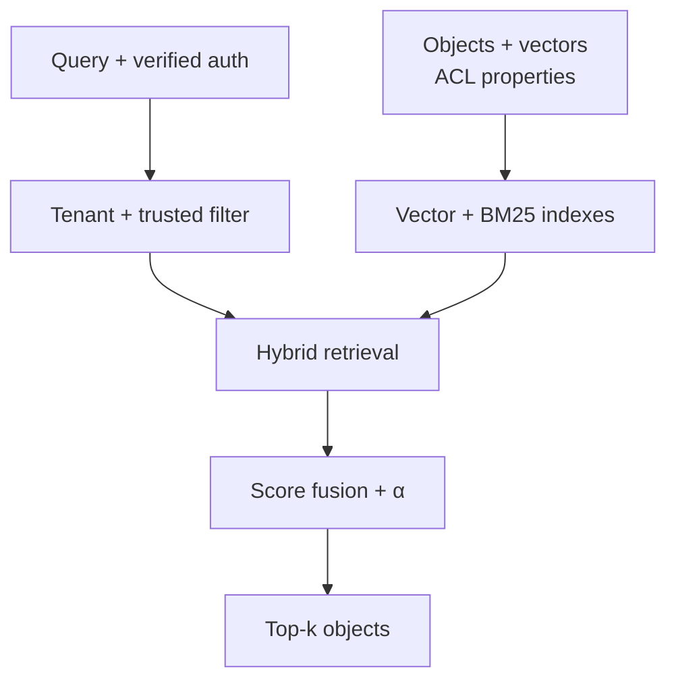

**Weaviate** is an open-source, cloud-native vector database that stores **objects and vectors together**, then serves [ANN](glossary://ann-search) similarity search, [BM25](glossary://bm25) keyword search, [hybrid search](glossary://hybrid-search), structured [metadata filters](glossary://metadata-filter), and multi-tenant isolation from one query surface. You define a **collection** (schema of properties), attach a **vectorizer** (built-in module) or import **self-provided** embeddings, index vectors (default [HNSW](glossary://hnsw)), and query with GraphQL, REST, or gRPC clients. Deployments run self-hosted (Docker/Kubernetes) or on Weaviate Cloud.

Weaviate supplies retrieval infrastructure for [RAG](glossary://rag) and semantic search. The application still owns embedding quality and authorization. A high-scoring neighbor with the wrong tenant, stale document version, or filter bug still ships a bad or unsafe answer.

## Intuition

Separate three layers you always own in production retrieval:

1. **Geometry.** An [embedding](glossary://embedding) model maps chunks into $\mathbb{R}^d$. Similar meaning means nearby vectors under a chosen distance.
2. **Object store + indexes.** Weaviate keeps the raw properties (text, labels, timestamps), builds a vector index for ANN, and builds an inverted index for BM25 and `where` filters.
3. **Product constraints.** Tenant shards, property filters, ACLs, and freshness rules decide which objects are *allowed* to enter the candidate set.

FAISS-style libraries solve (2) as an in-process index. Weaviate makes (2)+(3) a durable service: schema, CRUD, hybrid fusion, multi-tenancy, replication, and RBAC live next to the graph walk. Compared with [Pinecone](glossary://pinecone) (managed-first API) or [Qdrant](glossary://qdrant) (payload + HNSW focus), Weaviate's distinctive teaching surface is **schema + modules + hybrid BM25F + native multi-tenant shards** in one product.

## How it works

### Resource model

| Object | Role |
| --- | --- |
| **Collection** | Named schema: properties, vector config, inverted-index flags, multi-tenancy |
| **Object** | One stored record: UUID, properties, optional vector(s), optional references |
| **Vector index** | Per-collection (or named-vector) ANN structure: `hnsw`, `flat`, `dynamic`, or `hfresh` |
| **Inverted index** | Token/value → object ids for BM25 and property filters |
| **Tenant** | Isolated shard inside a multi-tenant collection; queries must name the tenant |
| **Module / vectorizer** | Optional server-side embedding (OpenAI, Cohere, local models, …) at import and query |

### Write path

1. **Create the collection** with property types, distance metric, and index type. Enable multi-tenancy if each customer needs a private shard.
2. **Choose vectors.** Either configure a vectorizer module so Weaviate embeds text on insert, or set self-provided vectors and send $x \in \mathbb{R}^d$ from your pipeline.
3. **Insert / update / delete** objects. Insert rejects a duplicate UUID; use `update` for a partial change or `replace` for a complete replacement. Deletes mark HNSW nodes; cleanup later rewires the graph (async work under load).
4. **Optional compression.** Product quantization (PQ), binary/scalar/rotational quantization reduce memory for large HNSW graphs; HFresh keeps most postings on disk.

With **async indexing** enabled, object store writes return while HNSW/HFresh updates queue in the background. Vectors may lag briefly after insert; monitor queue depth if freshness SLOs are tight.

### Read path

1. Build the query embedding with the **same** model and normalization as the corpus (client-side or via `nearText` when a vectorizer is configured).
2. Scope to a **tenant** when multi-tenancy is on. Build a **filter** only from trusted auth context (never from free-form model text alone).
3. Choose an operator:
   - `nearVector` / `nearText`: dense ANN only
   - `bm25`: keyword only
   - `hybrid`: BM25 + vector in parallel, then fusion
4. Optionally rerank or run generative modules; pack surviving chunks into the LLM context.

### Multi-tenancy

With multi-tenancy enabled, **each tenant is a separate shard**. A query scoped to tenant A searches its own shard. The application still authorizes that scope. Native shards add isolation beyond a `tenant_id` property filter and simplify per-tenant lifecycle management. Tenants can be `ACTIVE`, `INACTIVE` (on disk, not queryable), or `OFFLOADED` (cold tier). Backup coverage is version-sensitive: active and inactive tenants are included from local disk starting in 1.37.0, with backports to 1.35.17 and 1.36.10; offloaded tenants remain excluded. Earlier versions include only active tenants. Check the [current backup documentation](https://docs.weaviate.io/deploy/configuration/backups) and your exact cluster release.

### Vector index choices

| Index | When it fits |
| --- | --- |
| **HNSW** (default) | Large corpora, high QPS, RAM available for graph + vectors |
| **Flat** | Small per-tenant sets; brute-force exact search, tiny memory overhead |
| **Dynamic** | Starts flat, auto-promotes to HNSW past a threshold (default around $10^4$ objects); useful when tenants grow unevenly |
| **HFresh** | Memory-tight deployments: in-memory centroid HNSW + on-disk postings (SPFresh-style); trades peak QPS for lower RAM |

Tune HNSW with `ef` / `efConstruction` / `maxConnections` the same way you would any HNSW store: higher `ef` improves recall and latency cost at query time.

### Filters and hybrid

Property filters use the inverted index to build an allow-list, then ANN (or BM25) runs over eligible candidates. Hybrid search runs **vector** and **BM25** in parallel, normalizes or rank-fuses scores, and applies $\alpha$ so you can lean dense or sparse. As of Weaviate `v1.24` docs, **relative score fusion** became the default fusion method; older defaults used rank-based fusion. Index type names (`hnsw`, `flat`, `dynamic`, `hfresh`, …) and defaults also move with releases, so pin the server version in ops notes.

## Formula

**Filtered dense nearest neighbor** under distance $d$ and predicate $f$ (what ANN approximates):

$$
j^\star = \arg\min_{i:\, f(x_i)=\mathrm{true}} d(q, x_i)
$$

For cosine-trained dual encoders, L2-normalize once and use inner product so geometry matches training:

$$
j^\star = \arg\max_{i:\, f(x_i)=\mathrm{true}} \langle q, x_i \rangle
$$

**Hybrid score (relative score fusion).** Let $s_{\mathrm{vec}}(i)$ and $s_{\mathrm{bm25}}(i)$ be higher-is-better scores for object $i$; convert vector distance to a similarity-oriented value first. Min-max normalize each retrieval list over its own candidates $C$:

$$
\tilde{s}(i) = \frac{s(i) - \min_{j \in C} s(j)}{\max_{j \in C} s(j) - \min_{j \in C} s(j)}
\quad (\text{or } 1 \text{ if a nonempty list's range is zero})
$$

An object absent from a list contributes zero from that side. The equal-score rule, including a singleton result, matches Weaviate's [fusion implementation](https://github.com/weaviate/weaviate/blob/main/usecases/traverser/hybrid/hybrid_fusion.go). With blend weight $\alpha \in [0,1]$ on the **vector** side (Weaviate's convention: $\alpha = 1$ pure vector, $\alpha = 0$ pure BM25):

$$
\mathrm{score}(i) = \alpha \, \tilde{s}_{\mathrm{vec}}(i) + (1-\alpha)\, \tilde{s}_{\mathrm{bm25}}(i)
$$

**Ranked fusion** (legacy default) instead scores by weighted rank position, roughly $\sum w/(k + \mathrm{rank})$, discarding raw score magnitudes. Relative fusion preserves within-list score *shape*; a clear BM25 lead can still be outweighed by the vector contribution. Confirm the $\alpha$ default for your server and client version; treat it as a tuned knob.

## Diagram



## Example

Multi-tenant policy assistant. One collection, multi-tenancy on, self-provided 1024-d cosine vectors (same model at query time). Each chunk is one object with ACL and version properties.

```python
import weaviate
from weaviate.classes.config import Configure, DataType, Property
from weaviate.classes.query import Filter, HybridFusion, MetadataQuery
from weaviate.classes.tenants import Tenant

client = weaviate.connect_to_local()  # or connect_to_weaviate_cloud(...)

name = "PolicyChunk"
if not client.collections.exists(name):
    client.collections.create(
        name=name,
        properties=[
            Property(name="text", data_type=DataType.TEXT),
            Property(name="document_id", data_type=DataType.TEXT),
            Property(name="document_type", data_type=DataType.TEXT),
            Property(name="security_label", data_type=DataType.TEXT),
            Property(name="region", data_type=DataType.TEXT),
            Property(name="version", data_type=DataType.INT),
            Property(name="is_current", data_type=DataType.BOOL),
        ],
        # Bring-your-own embeddings; swap for Configure.Vectors.text2vec_* if desired
        vector_config=Configure.Vectors.self_provided(),
        multi_tenancy_config=Configure.multi_tenancy(enabled=True),
    )

col = client.collections.use(name)
col.tenants.create([Tenant(name="tenant_acme")])
acme = col.with_tenant("tenant_acme")

acme.data.insert(
    properties={
        "text": "GPU training jobs longer than eight hours must checkpoint at least every 30 minutes.",
        "document_id": "doc_training_policy_v3",
        "document_type": "policy",
        "security_label": "support",
        "region": "us",
        "version": 3,
        "is_current": True,
    },
    vector=embedding_1024,  # list[float], same model as query
)

query_vec = embed_query("Can an eleven-hour training job run without checkpoints?")
result = acme.query.hybrid(
    query="long GPU job checkpoint requirement",
    vector=query_vec,
    alpha=0.75,  # lean dense; set 0 for pure BM25, 1 for pure vector
    fusion_type=HybridFusion.RELATIVE_SCORE,
    limit=40,
    filters=Filter.by_property("document_type").equal("policy")
    & Filter.by_property("region").equal("us")
    & Filter.by_property("security_label").contains_any(["public", "support"])
    & Filter.by_property("is_current").equal(True),
    return_metadata=MetadataQuery(score=True),
)

for obj in result.objects:
    # properties + uuid + score → rerank / pack into RAG prompt
    print(obj.uuid, obj.properties["document_id"], obj.metadata.score)

client.close()
```

Failure mode that still "looks green": hybrid returns a high score on `doc_training_policy_v2` because `is_current` stayed true after v3 published, or the query used a different embedding model than ingest. Geometry and fusion worked; the product contract did not.

## What fails in production

| Failure | What you see | Fix direction |
| --- | --- | --- |
| **Embedding contract drift** | Stable ANN self-similarity, weak task recall | Lock model id, dimension, metric, prefixes; re-embed and rebuild after any change |
| **Filter / ACL bugs** | Cross-label leaks or empty top-$k$ | Build filters only from authz; fail closed on missing labels; measure filtered recall@k |
| **Wrong tenancy model** | One shared bag + `tenant_id` filter under multi-customer load | Prefer native multi-tenant shards when isolation and per-tenant lifecycle matter |
| **Stale objects** | Answers cite withdrawn policies | Version + `is_current`; delete or update old ids; verify delete visibility after HNSW cleanup |
| **Hybrid $\alpha$ / fusion untested** | IDs and error codes lost, or keyword spam wins | Tune $\alpha$ and fusion on labeled queries; keep BM25 property boosts intentional |
| **HNSW memory blowups** | OOM, slow import | Enable quantization or HFresh; right-size `vectorCacheMaxObjects`; use flat/dynamic for tiny tenants |
| **Async index lag** | Inserts succeed, nearVector misses for seconds | Watch indexing queues; gate critical reads if SLO requires immediate searchability |
| **Backup gaps on cold tenants** | Restore missing inactive/offloaded data | Verify inactive coverage on 1.37.0+, 1.35.17, or 1.36.10 backports; onload offloaded tenants, and activate required inactive tenants on unsupported releases |
| **Schema / re-embed ops** | New fields or models without migration plan | Treat collection config and embedding model as versioned deployables |

## Trade-offs

| Choice | Strength | Cost |
| --- | --- | --- |
| **Weaviate (self-host or Cloud)** | Objects + vectors, hybrid BM25F, modules, multi-tenant shards, filters, open source | You (or Cloud) still own capacity, upgrades, re-embed, and evals |
| **Pinecone** | Managed serverless ANN, namespaces, less cluster ops | Less control of index internals; vendor pricing |
| **Qdrant** | Strong filtered HNSW + payload model | Different ops surface; hybrid story is product-specific |
| **pgvector** | Same DB as rows and SQL ACLs | ANN + OLTP contention; hybrid often DIY |
| **FAISS (library)** | Fast offline experiments and custom codecs | No multi-writer DB, no tenant/ACL service |

Compare systems on **filtered hybrid recall**, tenant isolation, update/delete visibility, memory and disk index options, cold-tenant backups, and cost at your QPS alongside happy-path top-$k$ latency.

## Why it matters here

Weaviate is a concrete place where RAG design stops being "call an embedding API" and becomes a database problem: schema, indexes, fusion weights, multi-tenant shards, filter safety, and operational freshness. Curriculum work on dense retrieval, hybrid search, HNSW, metadata filters, and ACLs all land on the same boundary: the vector database serves geometry and constraints; the application still owns embedding quality, authorization metadata, and evaluation.

## Related terms

- [Hybrid search](glossary://hybrid-search)
- [HNSW](glossary://hnsw)
- [Dense retrieval](glossary://dense-retrieval)
- [Metadata filter](glossary://metadata-filter)
- [RAG](glossary://rag)
