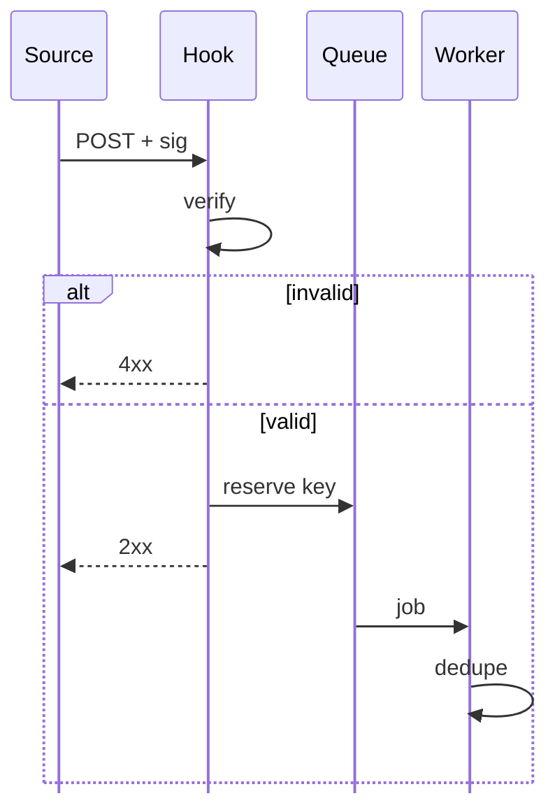

A **webhook** is an HTTP callback one system sends to another when an event happens. The producer POSTs a [payload](glossary://payload) to a URL the consumer registered for that event type. Industry docs often call this a "reverse API": the consumer registers a URL and the producer pushes each event when it is ready.

The Standard Webhooks specification frames the same idea: webhooks are server-to-server notifications ("a user has paid", "task has finished") and usually coexist with a REST or gRPC API, though some systems only push events.

## Intuition

Polling asks every few seconds, "any new labels?" A webhook answers once: "batch 482 finished." That cuts idle traffic and shortens reaction time. The cost is that your endpoint becomes a public-facing handler for untrusted traffic. Treat the body as hostile until signature, timestamp, tenant, and payload shape all check out.

Many producers retry delivery, so consumers must expect duplicates and out-of-order events. Finite retry windows can leave events undelivered. Make duplicate processing a no-op for business state, and use the producer API or a replay mechanism to recover missed events. Durable receipt tracking supports at-least-once processing.

## How it works

A production path usually has four phases:

1. **Register.** The consumer gives the producer an HTTPS URL and chooses event types (for example `label.batch.completed`, `batch.completed`, `fine_tuning.job.succeeded`). Prefer narrow subscriptions so unused events never hit your workers.
2. **Deliver.** On each event the producer POSTs JSON (or another body) to that URL, plus metadata headers (delivery id, signature, timestamp).
3. **Admit.** The consumer verifies authenticity on the **raw request body**, validates schema and tenant ownership, then enqueues work and returns `2xx` quickly.
4. **Act asynchronously.** A worker performs model, index, or billing side effects. Long work inside the HTTP handler causes timeouts, retries, and duplicate side effects.

Success is almost always any `2xx` status. Stripe and the Standard Webhooks guidance treat redirects (`3xx`), most other non-`2xx` codes, connection failures, and timeouts as delivery failures that may be retried. Live systems often retry for hours or days with exponential [retry backoff](glossary://retry-backoff). Standard Webhooks specially calls out `410 Gone` (disable the endpoint), `429` (throttle), and `502`/`504` (back off under load).

### Signature verification

Verify each delivery before it can trigger expensive or irreversible work. Anyone who discovers the URL could otherwise forge events such as "payment succeeded" or "labels ready." Producers sign each delivery with a shared secret (or, less often, an asymmetric key). Consumers recompute the signature and reject mismatches.

Common schemes all use HMAC-SHA256 over exact bytes, but the **signed string** differs:

| Producer style | Typical header | Signed content |
|---|---|---|
| GitHub-style | `X-Hub-Signature-256: sha256=<hex>` | raw body only |
| Stripe-style | `Stripe-Signature: t=<ts>,v1=<hex>` | `timestamp + "." + raw body` |
| Standard Webhooks (OpenAI and others) | `webhook-id`, `webhook-timestamp`, `webhook-signature: v1,<b64>` | `msg_id + "." + timestamp + "." + raw body` |

GitHub documents the HMAC hex digest of the payload with prefix `sha256=`, compared with a constant-time equality check. Stripe documents a default **5-minute** timestamp tolerance to blunt replay attacks; libraries re-sign on each retry with a fresh timestamp. Standard Webhooks signs `msg_id.timestamp.payload` and recommends treating `webhook-id` as the [idempotency](glossary://idempotency) key.

A timestamp check prevents replays only when the timestamp is **inside** the signed string. Body-only schemes (GitHub-style) need application idempotency or reconciliation for replay safety. An unsigned delivery-id header helps tracing, while application idempotency protects a replayed body signature. Bind `X-Timestamp` into the signature to use it for replay protection.

Generic form for the body-only (GitHub-style) case:

$$
\sigma = \mathrm{HMAC\text{-}SHA256}(K,\; B)
$$

where $K$ is the endpoint signing secret and $B$ is the raw request body bytes. For Stripe-style:

$$
\sigma = \mathrm{HMAC\text{-}SHA256}(K,\; t \,\|\, \texttt{.} \,\|\, B)
$$

with unix timestamp $t$ taken from the signature header. Reject when $|\mathrm{now} - t| > \tau$ (Stripe libraries default $\tau = 300$ seconds). Always hash the **unparsed** body; JSON parse-then-re-serialize changes whitespace and key order and breaks signatures.

Store signing secrets with [secrets management](glossary://secrets-management). Prefer one secret per endpoint, rotate after suspected leak, and support dual-secret windows during rotation (Stripe and Standard Webhooks both allow multiple concurrent signatures).

## Diagram



## Example

A labeling tool notifies your training service that batch `482` is done. The producer POSTs (Stripe-style signed content: timestamp bound into the HMAC):

```http
POST /webhooks/labels-complete HTTP/1.1
Host: api.example.com
Content-Type: application/json
X-Signature: t=1710000000,v1=9f86d08…  (example shape)
X-Delivery-Id: del_7c1a

{
  "type": "label.batch.completed",
  "batch_id": "482",
  "tenant_id": "ten_9f2",
  "status": "done",
  "idempotency_key": "lbl-482-v1",
  "labeled_count": 1200
}
```

Handler sketch (verify first, enqueue second, never train in-request):

```python title="webhook-labels-complete.py"
import hashlib
import hmac
import os
import time

SECRET = os.environ["LABEL_WEBHOOK_SECRET"].encode()
TOLERANCE_S = 300


def verify(raw_body: bytes, signature_header: str) -> bool:
    # X-Signature: t=<unix>,v1=<hex>  (t is part of the signed string)
    parts = dict(p.split("=", 1) for p in (signature_header or "").split(",") if "=" in p)
    try:
        ts = int(parts["t"])
        sig = parts["v1"]
    except (KeyError, ValueError):
        return False
    if abs(time.time() - ts) > TOLERANCE_S:
        return False
    if len(sig) != 64 or any(c not in "0123456789abcdef" for c in sig):
        return False
    signed = parts["t"].encode() + b"." + raw_body
    expected = hmac.new(SECRET, signed, hashlib.sha256).hexdigest()
    return hmac.compare_digest(expected, sig)


def handle(raw_body: bytes, headers: dict) -> int:
    if not verify(raw_body, headers.get("x-signature", "")):
        return 401  # fail closed: do not enqueue
    event = parse_and_validate(raw_body)  # schema + tenant ownership
    # Reserve idempotency_key before side effects; duplicate keys no-op
    enqueue_job(
        name="refresh_split_and_eval",
        key=event["idempotency_key"],
        batch_id=event["batch_id"],
        tenant_id=event["tenant_id"],
    )
    return 200  # ack before the worker runs
```

If the same `idempotency_key` arrives three times after producer retries, the second and third deliveries verify successfully but an atomic durable queue reservation makes duplicate enqueueing a no-op. Scope that key by producer and tenant. Queue workers can receive a job more than once, so each side effect needs its own idempotency or transactional protection for exactly-once execution. Leave an [audit trail](glossary://audit-trail) for accept, reject, enqueue, and dead-letter outcomes so operators can distinguish missing automation from an agent bug.

The same pattern applies to OpenAI-style async jobs (`batch.completed`, fine-tune finished), GitHub `push` / `pull_request` events that kick agent scaffolds, and Stripe `invoice.paid` events that unlock metered plan tiers.

## Boundary behavior

Validate signature, timestamp window (when signed), payload schema, tenant ownership, and replay / idempotency keys **before** any model work or durable write. Out-of-order delivery is possible: handle `dataset.validated` arriving before `dataset.uploaded`. Cap body size at the gateway. Log delivery id, signature result, and job id; do not log full secrets or unredacted PII from the payload.

For **producers** of webhooks (your product calling customer URLs), guard against SSRF: customers can register any URL, so egress must block link-local and internal ranges (Standard Webhooks and OWASP API7 call this out explicitly).

## Debug path

When automation "did not run," compare these fields across producer delivery logs and your receiver:

| Field | Why it matters |
|---|---|
| Delivery / webhook id | Ties producer attempt to consumer log line |
| Signature result | Failures often mean body middleware re-encoded JSON |
| Event timestamp vs receive time | Clock skew or replay outside $\tau$ |
| HTTP status returned | Non-`2xx` and timeouts drive retries |
| Idempotency key + job id | Shows accept-but-deduped vs never-enqueued |
| Downstream job state | Separates webhook path from worker / model failure |

These fields distinguish dropped deliveries, duplicate training jobs, and signature failures from unrelated agent or data bugs.

## Trade-offs

| Choice | Benefit | Cost |
|---|---|---|
| Webhook vs poll | Lower lag, less idle traffic | Public endpoint, security and idempotency burden |
| Full payload | Fewer follow-up API calls | Larger bodies, harder versioning, more PII in flight |
| Thin payload (ids only) | Smaller, fetch-on-need, clearer access audit | Extra read after each event; need API auth and freshness |
| Sync handle in HTTP | Simple for tiny side effects | Timeouts under load → retry storms |
| Ack + queue | Scales; isolates model work | Requires durable queue and dedupe storage |
| IP allowlist only | Extra belt | Use signatures to authenticate content, and expect allowlisted IPs to change |

## Why it matters here

Webhooks are how AI systems meet product time: uploads finish, labels land, batches complete, repos change, payments clear. Security, [idempotency](glossary://idempotency), and observability belong in the model workflow. A forged or double-processed webhook can retrain on the wrong split, double-charge a tenant, or fire an agent against the wrong repository. A correct one keeps eval and training pipelines event-driven instead of laggy and chatty.

## Related terms

- [Idempotency](glossary://idempotency)
- [Payload](glossary://payload)
- [Retry backoff](glossary://retry-backoff)
- [Audit trail](glossary://audit-trail)
- [Secrets management](glossary://secrets-management)
