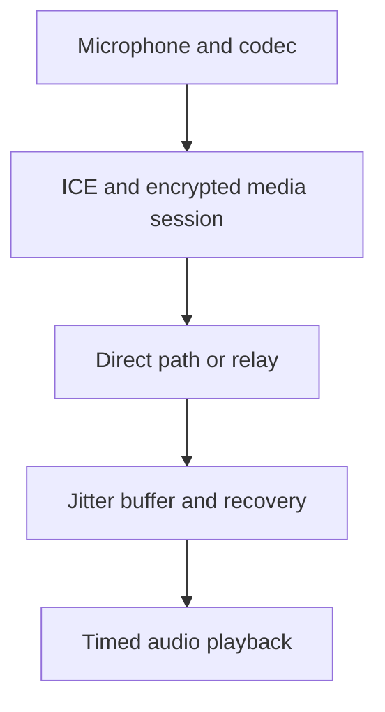

WebRTC is a family of browser and native APIs plus media protocols for interactive audio, video, and data exchange. A real-time voice agent can use it to capture microphone audio, negotiate a connection, encrypt media, adapt to packet loss, and play low-latency synthesized speech. A WebRTC session combines connection establishment, relays, encryption, codecs, congestion control, and jitter handling; UDP is one transport detail inside that stack.

## Media transport and session ownership

An application obtains local media, exchanges session descriptions through an application-owned signaling channel, and gathers candidate network paths. Interactive Connectivity Establishment selects a usable direct or relayed route. Audio packets are protected and carried with media timing information, while receiver-side buffering and packet-loss handling keep playback moving when a packet arrives late or never arrives.

A media endpoint, including a gateway that terminates the WebRTC connection, owns session keys and media-processing state such as packet sequencing and jitter buffering. A TURN relay forwards packets while media keys remain at the terminating endpoint. Routing later packets to a different terminating worker without transferring that state can break decryption or continuity even if the model backend itself is healthy. Sticky routing, failover behavior, and relay cost therefore belong in the system design.

## Example

A user interrupts an assistant while synthesized speech is playing. Browser echo cancellation reduces the assistant's own speaker output in the microphone signal, local voice activity detection notices the user's speech, and the client mutes playback immediately. Echo cancellation is imperfect, so the interruption policy must tolerate residual echo. The media gateway forwards the new audio while preserving the existing encrypted session. Sending raw audio over a generic WebSocket instead would require the application to own chunk timing, buffering, and backpressure. WebSocket's reliable, ordered transport can also delay newer audio behind retransmission of lost data.

## Why it matters here

The real-time voice capstone separates media transport from speech recognition, language-model inference, and speech synthesis. WebRTC explains which failures belong to the network and session layer, why first-audio latency includes client playout as well as server generation, and why interruptibility depends on client-side audio controls as much as model speed.

## Related terms

- [Voice activity detection](glossary://voice-activity-detection)
- [Echo cancellation](glossary://echo-cancellation)
- [Barge-in](glossary://barge-in)
- [Time to first audio](glossary://time-to-first-audio)
