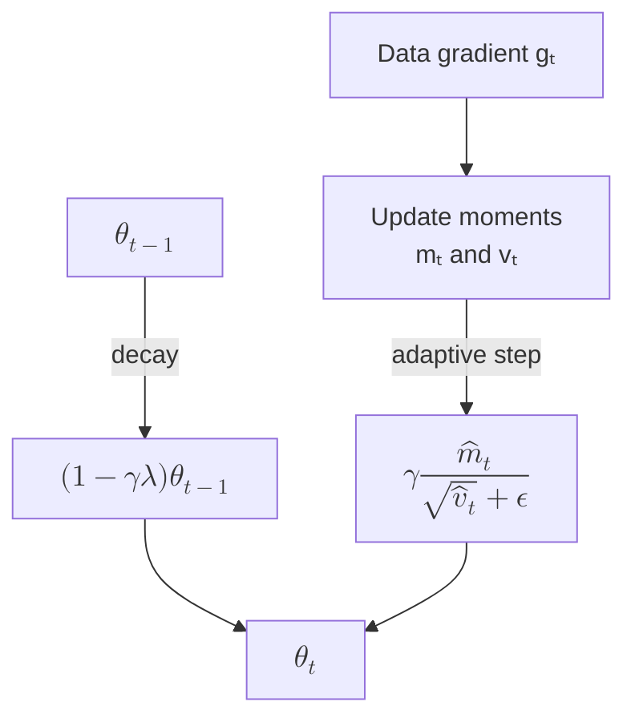

**Weight decay** multiplies parameters by a factor slightly less than one on every optimizer step (or an equivalent shrink), gently pulling weights toward zero. Hanson and Pratt (1988) wrote the classic form combining a shrink of the old parameters by $(1-\lambda)$ with the gradient update shown below. That continuous shrink is a regularizer: a per-step pull toward zero can trade train fit for better holdout behavior when capacity and data size allow overfitting.

People often say "weight decay" for any L2-style penalty. That is only exact for plain SGD, with the coefficient conversion shown below. For adaptive optimizers such as Adam, adding $\frac{\lambda}{2}\|\theta\|_2^2$ to the loss is **not** the same as true weight decay. Loshchilov and Hutter (2017) restored the original decay by *decoupling* the shrink from the adaptive gradient path; that is AdamW, common in modern LLM recipes.

## Intuition

Optimization only sees the finite training sample. With enough capacity and enough steps, weights can grow and specialize to residual noise. Weight decay is a soft capacity control: every step, the optimizer pays a small tax proportional to current parameter magnitude, independent of the mini-batch gradient (in the decoupled form). The tax is small, so useful signal still moves weights; useless large coordinates slowly shrink.

Two knobs set the practical strength:

- $\lambda$: the decay coefficient in the config (`weight_decay`).
- Learning rate $\gamma$ (and its schedule): in PyTorch AdamW, the multiplicative shrink per step is $(1 - \gamma\lambda)$, so peak LR, warmup, and cosine annealing change how hard decay bites over a run.

Which tensors pay the tax also matters. Many recipes decay multi-dimensional matrix weights and leave biases, LayerNorm / RMSNorm scales and shifts, and sometimes embeddings at $\lambda = 0$; check the actual parameter groups.

## Formula

**Classical weight decay** (Hanson and Pratt; Loshchilov and Hutter Eq. 1):

$$
\theta_{t+1} = (1 - \lambda)\,\theta_t - \alpha\,\nabla f_t(\theta_t)
$$

Here $\alpha$ is the base learning rate and $\nabla f_t$ is the mini-batch gradient of the *task* loss only. The $\lambda$ in this equation is a **per-step** shrink factor. Config knobs named `weight_decay` (LLaMA-scale $0.1$, PyTorch default $0.01$) are *not* that $\lambda$: under PyTorch AdamW the per-step factor is $(1-\gamma\lambda_{\mathrm{cfg}})$, so a config value of $0.1$ with $\gamma=3\cdot 10^{-4}$ shrinks by about $3\cdot 10^{-5}$ per step, not $10\%$.

**L2 regularization** instead optimizes a penalized objective:

$$
f_t^{\mathrm{reg}}(\theta) = f_t(\theta) + \frac{\lambda'}{2}\,\|\theta\|_2^2
$$

so the gradient becomes $\nabla f_t(\theta) + \lambda'\theta$.

**Equivalence for plain SGD** (Loshchilov and Hutter, Prop. 1): SGD with weight decay $\lambda$ matches SGD without decay on the L2-penalized loss when $\lambda' = \lambda / \alpha$. Same trajectory; different parameterization.

**Inequivalence for adaptive methods** (Prop. 2): if the optimizer applies a non-scalar preconditioner $M_t$ (Adam's $1/\sqrt{\hat{v}}$, etc.), no single L2 coefficient $\lambda'$ reproduces true weight decay. Coupled L2 rides through $M_t$, so coordinates with historically large gradients are regularized less than coordinates with small gradients. Decoupled decay shrinks every decayed weight at the same rate $\lambda$ (scaled by the schedule).

**PyTorch AdamW** (docs; default $\lambda = 0.01$) applies decoupled decay first, then the Adam step. Moments $m_t, v_t$ see the **data** gradient only:

$$
\begin{aligned}
\theta_t &\leftarrow \theta_{t-1} - \gamma\lambda\,\theta_{t-1} \\
m_t &\leftarrow \beta_1 m_{t-1} + (1-\beta_1)\,g_t \\
v_t &\leftarrow \beta_2 v_{t-1} + (1-\beta_2)\,g_t^2 \\
\hat{m}_t &\leftarrow \frac{m_t}{1-\beta_1^t},\quad
\hat{v}_t \leftarrow \frac{v_t}{1-\beta_2^t} \\
\theta_t &\leftarrow \theta_t - \gamma\,\frac{\hat{m}_t}{\sqrt{\hat{v}_t}+\epsilon}
\end{aligned}
$$

One-line form:

$$
\theta_t \leftarrow (1 - \gamma\lambda)\,\theta_{t-1} - \gamma\,\frac{\hat{m}_t}{\sqrt{\hat{v}_t}+\epsilon}
$$

The paper writes the same idea with an explicit schedule multiplier $\eta_t$:

$$
\theta_t \leftarrow \theta_{t-1} - \eta_t\left(\alpha\,\frac{\hat{m}_t}{\sqrt{\hat{v}_t}+\epsilon} + \lambda\,\theta_{t-1}\right)
$$

Library code usually folds $\eta_t\alpha$ into the current $\gamma$. The coefficient normalization also differs: matching this paper equation to the PyTorch equation requires $\lambda_{\mathrm{cfg}}=\lambda_{\mathrm{paper}}/\alpha$. In both forms, decay is additive in parameter space, not mixed into $m$ and $v$.

## Diagram



Coupled L2 (what many libraries still call `weight_decay` on plain Adam) instead does $g_t \leftarrow \nabla f_t + \lambda\theta$ *before* the moments, so the penalty is rescaled by the same adaptive denominator as the data gradient.

## Worked numbers

Scalar weight $\theta = 10$, a **zero-valued gradient tensor** $g = 0$, zero initial moments, learning rate $\gamma = 0.1$, decay $\lambda = 0.01$. Existing momentum could still move the weight despite today's zero gradient. In PyTorch, `grad=None` skips the parameter's step, including decay, and is different from a zero tensor.

**Decoupled AdamW:** only the shrink fires:

$$
\theta \leftarrow 10 - 0.1\cdot 0.01\cdot 10 = 9.99
$$

or equivalently $\theta \leftarrow (1 - 0.001)\cdot 10 = 9.99$.

**Coupled L2 into Adam** on a cold start with default betas ($\beta_1=0.9$, $\beta_2=0.999$) treats $g=\lambda\theta=0.1$. Then $m=(1-\beta_1)g=0.01$, $v=(1-\beta_2)g^2=10^{-5}$, so $\hat{m}=0.1$ and $\hat{v}=0.01$. The adaptive step is $\gamma\cdot\hat{m}/(\sqrt{\hat{v}}+\epsilon)=0.1$, and $\theta$ lands at $9.9$, not $9.99$. Same config label (`weight_decay=0.01`), different update rules; trajectories keep diverging once moments warm up.

Over a long schedule, product $\gamma_t\lambda$ integrates the total multiplicative shrink. Warmup (small $\gamma$) applies almost no decay early; peak LR applies the strongest shrink; cosine anneal to a small floor weakens decay again near the end.

## Example

LLM-style parameter groups: decay 2-D (and higher) weights, not 1-D biases or norm scales.

```python
import torch
from torch import nn

model = nn.Sequential(
    nn.Linear(768, 768),
    nn.LayerNorm(768),
    nn.Linear(768, 10),
)

decay, no_decay = [], []
for name, p in model.named_parameters():
    if not p.requires_grad:
        continue
    # Common heuristic: ndim <= 1 catches bias and LayerNorm weight/bias
    if p.ndim <= 1 or name.endswith(".bias"):
        no_decay.append(p)
    else:
        decay.append(p)

optimizer = torch.optim.AdamW(
    [
        {"params": decay, "weight_decay": 0.1},   # LLaMA-scale pretrain default
        {"params": no_decay, "weight_decay": 0.0},
    ],
    lr=3e-4,
    betas=(0.9, 0.95),
)
```

A supervised fine-tune or LoRA run often uses a smaller $\lambda$ (for example $0.01$ or even $0$) because the trainable set is small and the base model is already regularized by pretraining. Blindly copying $\lambda = 0.1$ onto tiny adapter matrices can erase the adaptation signal while the frozen base stays intact.

Do **not** swap this for `torch.optim.Adam(..., weight_decay=0.1)` and assume equivalence: PyTorch Adam defaults to coupled L2. Current PyTorch also offers `Adam(..., decoupled_weight_decay=True)`, which uses AdamW's decay rule. Inspect that flag as well as the optimizer class. [PyTorch Adam documentation](https://docs.pytorch.org/docs/stable/generated/torch.optim.Adam.html)

## Parameter groups and sizing

| Choice | Typical practice |
| --- | --- |
| Matrix weights (attention, MLP, embeddings in some stacks) | Decay on; $\lambda \in [0.01, 0.1]$ for full pretrain |
| Bias, LayerNorm / RMSNorm $\gamma,\beta$ | $\lambda = 0$ (norm scales should not be pulled to zero) |
| LoRA / PEFT adapters | Often $\lambda = 0$ or a mild value; high decay can wipe $A,B$ |
| Pretrain (LLaMA-class recipes) | $\lambda = 0.1$ with AdamW is a widely published default |
| Small SFT / classification head | Start lower ($0$–$0.01$); raise if train/val gap opens |
| Schedule interaction | Effective per-step shrink $\propto \gamma_t\lambda$; log both |

More steps or smaller batches increase how often the shrink applies for a fixed $\lambda$. The AdamW paper notes that longer runs often prefer smaller optimal $\lambda$; some recipes normalize decay by budget. In practice, fix the optimizer (AdamW) and no-decay groups, then sweep $\lambda$ jointly with peak LR.

## Debug path

When a run overfits, underfits, or "does nothing" after a config change, inspect decay as a first-class hyperparameter:

1. **Optimizer rule.** Is decay decoupled (`AdamW`, or `Adam` with `decoupled_weight_decay=True`) or coupled into the gradient?
2. **Param groups.** Print `optimizer.param_groups` and a few tensor names: confirm biases and norms sit at `weight_decay=0`.
3. **Logged $\lambda$ and $\gamma$.** Effective shrink per step is $\gamma\lambda$ under PyTorch AdamW; a $10\times$ LR mistake is a $10\times$ decay mistake.
4. **Train vs validation.** Train improves, validation worsens: more decay (or earlier stop) may help. Both stall or train collapses: $\lambda$ may be too high or applied to the wrong tensors (adapters, norms).
5. **Weight norms over time.** Compare the decay contribution with the adaptive update. Norms can grow when the task update outweighs the shrink, even with decay applied correctly.
6. **Resume.** If a checkpoint restores weights alone, optimizer moments restart while the decay path continues. That is usually fine for decay itself, but a bad LR restore can confuse ablations.

## Why it matters here

Every LLM training stack is roughly "AdamW + schedule + grad clip + param groups." Weight decay is the regularizer half of that recipe: it is how pretraining and fine-tuning control capacity without only relying on dropout (often set to $0$ at large scale). Misreading "weight decay" as interchangeable L2 under Adam, applying pretrain $\lambda$ to LoRA, or decaying LayerNorm scales produces silent quality and stability bugs that look like "bad learning rate." Knowing the Hanson–Pratt shrink, the AdamW decoupling, and which tensors pay $\lambda$ is required to read configs, debug train/val gaps, and transfer recipes across model sizes.

## Related terms

- [AdamW](glossary://adamw)
- [Optimizer](glossary://optimizer)
- [Learning rate](glossary://learning-rate)
- [Learning rate schedule](glossary://learning-rate-schedule)
- [Overfitting](glossary://overfitting)
