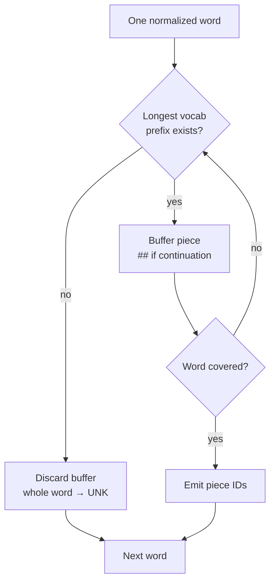

WordPiece is a subword tokenization family that learns a fixed vocabulary of reusable pieces and, at encode time, segments each pre-tokenized word with **greedy longest-match** lookup. Continuation pieces usually carry a `##` prefix (BERT style). If that greedy walk gets stuck, the whole word collapses to `[UNK]`, even when a shorter first choice could have completed it.

Schuster and Nakajima introduced WordPiece for Google's Japanese and Korean voice search (ICASSP 2012) as a data-driven way to grow a word-unit inventory that maximizes language-model likelihood on training text. Google's NMT system (Wu et al., 2016) carried the method into neural MT; BERT (Devlin et al., 2019) made it mainstream in NLP with a ~30k-piece English vocab. DistilBERT, MobileBERT, and many multilingual BERT-style encoders still ship WordPiece. RoBERTa uses BPE, and most decoder-only LLMs later moved to byte-level BPE or Unigram/SentencePiece. WordPiece remains the contract you must match when serving or fine-tuning a WordPiece checkpoint.

## How it works

WordPiece has two stages with different objectives. **Training** chooses which pieces enter the vocabulary. **Encoding** applies MaxMatch to the final vocabulary; BPE encoding follows an ordered merge list.

### Training (vocabulary growth)

The 2012 WordPieceModel procedure, in outline:

1. Start from a base alphabet (Unicode characters for the language, plus ASCII and special tokens).
2. Greedily add a new unit formed by combining two existing units.
3. Prefer the combination that raises likelihood on the language-model training data the most.
4. Stop at a target inventory size or when likelihood gains fall below a threshold. The original paper reports often using 200k units; its starting character inventories were about 22k for Japanese and 11k for Korean.

The 2012 system describes segmenting through the learned combination tree. The runtime below describes the later BERT-style WordPiece contract, which uses greedy vocabulary matching. The shared historical name covers versions with distinct encoding contracts. [Original WordPiece paper, page 2](https://static.googleusercontent.com/media/research.google.com/en//pubs/archive/37842.pdf)

Google never fully open-sourced the production trainer. Teaching and open reimplementations use a practical **association score** that approximates "how much more often these two pieces co-occur than independence would predict":

$$
\mathrm{score}(A,B) = \frac{\mathrm{freq}(AB)}{\mathrm{freq}(A)\,\mathrm{freq}(B)}
$$

Pairs that always travel together score high even if absolute frequency is modest. High-frequency but loosely associated pairs (for example many words containing `the` next to something common) score low. This is the standard classroom proxy for WordPiece's likelihood motivation. Check each historical trainer's implementation before attributing this exact ratio to it.

Initial splits put the WordPiece continuation marker on non-initial characters of a word. The string `word` is represented as pieces like `w` / `##o` / `##r` / `##d` before merges grow longer units such as `##ing` or whole stems.

### Encoding (runtime)

BPE encoders replay merge ranks at inference. WordPiece keeps the final vocabulary and runs **longest-match-first** (maximum matching) on each word after pre-tokenization:

1. Normalize and pre-tokenize (BERT splits on whitespace and punctuation; CJK is often spaced so each character is its own word).
2. For the remaining suffix of a word, take the **longest** vocabulary piece that matches as a prefix (using `##` for non-initial spans).
3. Advance the cursor and repeat until the word is consumed.
4. If any position has no matching piece, discard the provisional pieces and map the **entire word** to `[UNK]`. MaxMatch does not backtrack to try shorter earlier matches.

Song et al. (EMNLP 2021) formalize this MaxMatch behavior and give linear-time algorithms; the semantics stay "longest prefix in vocab, then continue."

## Intuition

BPE asks "which pair is most frequent?" WordPiece asks "which new piece helps explain the corpus best?" At serve time BPE is "apply merges in training order." WordPiece is "always bite the longest known piece from the left."

The `##` marker is a structural signal: `play` and `##ing` are different vocabulary rows from free-standing `ing`. That lets the model learn "word-initial" vs "continuation" behavior without treating every substring as ambiguous across word boundaries.

## Formula

Proxy merge score used in standard tutorials (Hugging Face course and common teaching code):

$$
\mathrm{score}(A,B) = \frac{\mathrm{freq}(AB)}{\mathrm{freq}(A)\,\mathrm{freq}(B)}
$$

A high score means $A$ and $B$ co-occur more than the product of their marginals suggests. Worked comparison on toy counts:

| Candidate pair | $\mathrm{freq}(AB)$ | $\mathrm{freq}(A)$, $\mathrm{freq}(B)$ | Proxy score | Lesson |
|---|---:|---|---:|---|
| `code` + `##base` | 42 | 50, 44 | $0.0191$ | Rare-ish but tightly coupled |
| `the` + `##model` | 90 | 900, 300 | $0.0003$ | Common pieces that co-occur by chance |

Frequency alone would prefer the second pair; the score prefers the first.

## Example

BERT-style vocabulary (subset):

```text
vocab contains: code, ##base, token, ##ized, [UNK]
```

Greedy longest-match on three words:

| Input word | Steps | Result |
|---|---|---|
| `code` | longest match is `code` | `code` |
| `codebase` | `code`, then remaining `base` as `##base` | `code` `##base` |
| `tokenized` | `token`, then `##ized` | `token` `##ized` |

Sketch of the encoder (same contract as curriculum labs and Hugging Face teaching code):

```python
def wordpiece_tokenize(word: str, vocabulary: set[str]) -> list[str]:
    """Greedy WordPiece sketch; omits production word-length limits."""
    result: list[str] = []
    start = 0
    while start < len(word):
        chosen = None
        for end in range(len(word), start, -1):
            candidate = word[start:end]
            if start > 0:
                candidate = "##" + candidate
            if candidate in vocabulary:
                chosen = candidate
                start = end
                break
        if chosen is None:
            return ["[UNK]"]  # emit one unknown token for the whole word
        result.append(chosen)
    return result

vocabulary = {"code", "##base", "token", "##ized", "b", "##u", "##g", "##s"}
assert wordpiece_tokenize("codebase", vocabulary) == ["code", "##base"]
assert wordpiece_tokenize("bugs", vocabulary) == ["b", "##u", "##g", "##s"]
assert wordpiece_tokenize("mug", vocabulary) == ["[UNK]"]  # no path to the end
assert wordpiece_tokenize("abc", {"ab", "a", "##bc"}) == ["[UNK]"]
```

In the last case, the encoder chooses `ab`, then cannot match `##c`. It emits `[UNK]` despite the valid alternative `a` + `##bc`, because MaxMatch does not backtrack. Production implementations also reject words over a configured character limit; Google's original BERT code defaults to 200, while Hugging Face Tokenizers 0.22.2 defaults to 100. Match the deployed artifact's setting rather than assuming either value. [BERT tokenizer source](https://github.com/google-research/bert/blob/master/tokenization.py), [Hugging Face WordPiece source](https://github.com/huggingface/tokenizers/blob/v0.22.2/tokenizers/src/models/wordpiece/mod.rs)

## Diagram



## Compared with BPE and Unigram

| Family | How vocabulary grows | What is stored | Runtime segmentation | Unknown handling |
|---|---|---|---|---|
| **BPE** | Merge most frequent pairs | Ordered merge ranks + vocab | Replay merges by rank | Character/byte base often avoids whole-word UNK |
| **WordPiece** | Likelihood / association score | Final vocabulary (no merge list required) | Greedy longest match | Often whole word $\to$ `[UNK]` if stuck |
| **Unigram** | Start large, prune by likelihood | Pieces + probabilities | Best (or sampled) segmentation | Coverage depends on unknown-token or byte-fallback configuration |

Same surface string can become different ID sequences under each family even at similar vocab sizes. Always use the [tokenizer artifact](glossary://tokenizer-artifact) that was trained with the weights.

## What fails in production

- **`[UNK]` destroys distinctions.** Two different rare product codes that both fail segmentation become the same id. Retrieval, NER, and entity matching then cannot recover the original string from the model input alone.
- **Alphabet coverage.** Classic BERT WordPiece uses vocabulary matching rather than byte fallback. Unusual scripts, emoji, or corrupted Unicode can trigger high UNK rates. Measure UNK rate on real traffic, including text outside Wikipedia-style eval sets.
- **Pre-tokenizer coupling.** Changing casing, accent stripping, or punctuation splitting changes word boundaries before MaxMatch runs. A "compatible" vocab with a different BasicTokenizer is still a contract break.
- **Continuations and detokenization.** Forgetting `##` when inspecting tokens misleads debugging. Detokenizers strip the marker and join pieces; logging must show both surface pieces and IDs.
- **Length and cost skew.** Names, code identifiers, and low-resource languages often fragment into many short `##` pieces, inflating sequence length relative to English prose of the same character count.

When quality or cost surprises you, print pieces and ids with the exact production tokenizer. Many "model fails on this identifier" incidents are `[UNK]` or over-fragmentation, not attention.

## Why it matters here

WordPiece is the concrete tokenizer contract behind BERT-line models in the curriculum's tokenization lesson. It teaches three ideas that transfer to every LLM system: vocabulary growth is a learning problem, encode-time algorithms differ even when both systems are "subword," and information can be lost **before** any neural layer runs. If you fine-tune, distill, or serve a WordPiece checkpoint, the vocab, `##` rules, special tokens, and pre-tokenizer are part of the model, not optional plumbing.

## Related terms

- [BPE](glossary://bpe)
- [Unigram language model](glossary://unigram-language-model)
- [SentencePiece](glossary://sentencepiece)
- [Byte fallback](glossary://byte-fallback)
- [Tokenizer artifact](glossary://tokenizer-artifact)
