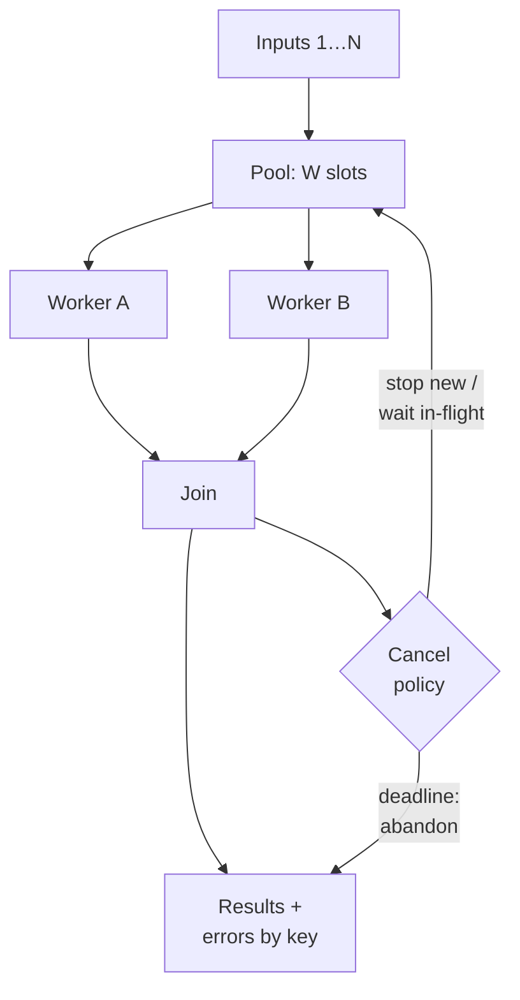

**Worker fanout** splits a batch of independent tasks across a bounded set of workers, then **joins** their outcomes with enough identity and error information that the caller can say which inputs succeeded, which failed, and whether work was cancelled. The classic pair of moves is **fan-out** (distribute work) and **fan-in** (merge results). Unbounded "one thread per task" is still a fanout shape; production systems almost always fix the concurrency budget first.

In the Go concurrency literature, fan-out means multiple workers reading the same work stream; fan-in means multiplexing several result streams into one. In Python, the same design shows up as `ThreadPoolExecutor` / `ProcessPoolExecutor` plus `submit`, `map`, or `as_completed` (see [PEP 3148](https://peps.python.org/pep-3148/) and the [stdlib docs](https://docs.python.org/3/library/concurrent.futures.html)).

## Intuition

A serial loop over $N$ independent I/O calls pays roughly

$$
T_{\mathrm{serial}} \approx \sum_{i=1}^{N} t_i
$$

where $t_i$ is the wall time of item $i$. With $W$ workers and no shared bottleneck, wall time collapses toward the slowest wave of work:

$$
T_{\mathrm{parallel}} \approx \left\lceil\frac{N}{W}\right\rceil t
\quad\text{when every task takes equal time }t
$$

With unequal task durations, use the makespan of a schedule with $W$ parallel slots. Amdahl-style limits still apply: shared locks, rate limits, DB pools, and provider QPS caps re-serialize the "parallel" path.

The **join contract** is central to a reliable fanout:

| Join style | Order | Best when |
|---|---|---|
| Completion order (`as_completed`) | Whoever finishes next | Partial progress, first-$k$, streaming UI |
| Input order (`Executor.map`) | Same as submission | Consumers need index $i$ before $i+1$ |
| Keyed dict | By id / url / row key | Retries, logs, partial maps |

Every submitted item must produce **exactly one observed outcome**: success value, recorded exception, or explicit cancel. A keyed dictionary requires a unique key per submitted item; repeated document IDs need a chunk ID or input index, or later results overwrite earlier ones. Losing identity ("something failed") is how fanout becomes undebuggable.

## How it works

1. **Partition.** Enumerate independent units: URLs, document ids, eval rows, tool names, embedding chunks. When items depend on each other for correctness, use a DAG scheduler.
2. **Bound concurrency and buffering.** `max_workers` caps active executions, not queued submissions. Use a bounded queue or producer-side admission to cap outstanding work too. Bound $W$ from the real bottleneck (provider concurrency, file descriptors, DB connections), and enforce RPM/QPS separately.
3. **Submit.** Hand each unit to a worker. Map each future/task back to its input key.
4. **Execute.** Workers run the side-effecting call. Lock shared **claim** state (visited sets, counters), then release the lock before slow I/O.
5. **Join.** Collect results in completion order or rebuild input order. Record per-task exceptions to keep collection running; choose fail-fast when the caller needs it.
6. **Shutdown.** Wait, cancel pending, or abandon with a deadline. Know which policy you chose; thread work already inside blocking I/O usually cannot be interrupted.

Two common pool shapes:

- **Submit-all:** enqueue every future up front (simple; can over-buffer large $N$).
- **Worker pool + queue:** fixed $W$ workers pull from a bounded queue (backpressure on producers; better for huge or streaming workloads).

## Diagram

Two representative workers are shown. The pool can have W slots; every result or error retains its input key.



## Example

Embed 4 document chunks with at most 4 concurrent HTTP calls. Keep identity for retries, isolate one timeout, and join in completion order so early chunks can stream to the UI:

```python title="worker-fanout.py"
from concurrent.futures import ThreadPoolExecutor, as_completed
from dataclasses import dataclass

@dataclass(frozen=True)
class Chunk:
    doc_id: str
    text: str

def embed(chunk: Chunk) -> tuple[str, list[float]]:
    # pretend provider call; raise on poison ids
    if chunk.doc_id == "doc-bad":
        raise TimeoutError(f"provider timeout for {chunk.doc_id}")
    return chunk.doc_id, [float(len(chunk.text))]

chunks = [
    Chunk("doc-1", "alpha"),
    Chunk("doc-2", "beta gamma"),
    Chunk("doc-bad", "never finishes cleanly"),
    Chunk("doc-3", "delta"),
]

results: dict[str, list[float]] = {}
errors: dict[str, str] = {}
assert len({c.doc_id for c in chunks}) == len(chunks), "join keys must be unique"

with ThreadPoolExecutor(max_workers=4) as pool:
    futures = {pool.submit(embed, c): c.doc_id for c in chunks}
    for future in as_completed(futures):
        doc_id = futures[future]
        try:
            key, vector = future.result()
            assert key == doc_id, "worker returned the wrong input identity"
            results[key] = vector
        except Exception as exc:
            errors[doc_id] = type(exc).__name__ + ": " + str(exc)

assert set(results) | set(errors) == {c.doc_id for c in chunks}
print(sorted(results), sorted(errors))
```

This mirrors the stdlib URL-fetch example: `future_to_url = {executor.submit(...): url ...}` then `as_completed` with per-future `try/except`. For crawlers, protect the **claim** step only:

```python title="claim-then-fetch.py"
from threading import Lock

visited: set[str] = set()
lock = Lock()

def claim(url: str) -> bool:
    with lock:
        if url in visited:
            return False
        visited.add(url)
        return True
# fetch runs outside the lock after claim succeeds
```

## Worked numbers

Suppose $N=100$ embedding calls, each $t=200\,\mathrm{ms}$ on average, provider allows $W=10$ concurrent requests, and serial setup costs $50\,\mathrm{ms}$:

$$
T_{\mathrm{serial}} \approx 100 \times 0.2 = 20\,\mathrm{s}
$$

$$
T_{\mathrm{fanout}} \approx 0.05 + \frac{100}{10}\times 0.2 = 2.05\,\mathrm{s}
$$

This estimate assumes no additional rate limit. A separate 10 QPS limit changes the budget to about 10 seconds for 100 requests at a sustained rate, even with $W=10$: ten 200 ms workers could otherwise attempt about 50 requests per second. Use a [token bucket](glossary://token-bucket) to admit requests at the allowed rate, plus the concurrency cap. At 10 QPS and 200 ms average service time, mean active concurrency is only about $10\times0.2=2$; allow measured headroom for latency variation. Raising $W$ to 100 without rate admission invites `429`s and retry amplification.

## Sizing

| Workload | Typical bound | Failure if too high |
|---|---|---|
| HTTP / tool calls | Provider concurrency or RPM | `429` storms, FD exhaustion |
| Embeddings / rerank | Batch API size × in-flight batches | GPU/queue overload, cost spikes |
| Eval harness rows | CPU for judges + provider cap | Flaky timeouts, noisy p95 |
| Same-host crawl | Polite per-host limit (often 1-4) | IP bans, ToS violations |
| CPU-heavy parse | $\approx$ process CPU count | Context thrash, GIL contention |

Since Python 3.13, default `ThreadPoolExecutor` `max_workers` is `min(32, (os.process_cpu_count() or 1) + 4)` when unset; explicitly bound concurrency when workers share an API key. Python 3.14 adds `Executor.map(..., buffersize=...)` to limit submitted tasks whose results have not yet been yielded. `submit()` still needs its own bounded producer policy.

## Trade-offs

| Choice | Gain | Cost |
|---|---|---|
| Completion-order join | Lower time-to-first-result | Must re-key for stable lists |
| Input-order join | Simple API for callers | Slowest item gates early outputs |
| Threads (I/O) | Easy blocking libraries | GIL; weak cancel of running work |
| Async tasks | Cheap concurrency, structured cancel | Blocking calls freeze the loop |
| Processes | True multi-core CPU work | Pickle cost, higher memory |
| Submit-all futures | Simple code | Large $N$ buffers all futures |
| Queue + fixed workers | Natural backpressure | More plumbing |

Choose another execution model when tasks share mutable ordering constraints, require exactly-once side effects without idempotency keys, or compete for a single GPU decode slot instead of independent I/O capacity.

## Debug path

When production fanout misbehaves, check in this order:

1. **Cardinality.** Submitted count vs success count vs error count vs cancel count. Missing mass means dropped futures or swallowed exceptions.
2. **Identity.** Can you name the input for every failure? If not, fix the future→key map first.
3. **Concurrency and backlog under load.** Active executions must stay at or below $W$. Track queued work separately: that backlog can grow under submit-all even when the pool correctly caps running tasks.
4. **Shared state races.** Duplicate crawl visits, double tool charges, corrupted counters: claim steps need locks or atomic CAS.
5. **Cancel semantics.** Did you stop *scheduling*, wait for in-flight, or abandon? Thread `Future.cancel()` only drops work that has not started.
6. **Downstream limits.** Correlate worker errors with provider `429`, DB pool timeouts, and FD limits before raising $W$.

## Why it matters here

AI systems constantly fan out independent I/O: multi-source retrieval, batch embeddings, eval harness rows, agent tool probes, document crawls, and candidate reranking. Speed is cheap; **bounded concurrency, per-item errors, and a named cancel policy** are what keep a faster pipeline debuggable and safe under provider limits. Lab interviews and production incidents fail in the same places: unprotected claim steps, silent lost exceptions, and "cancel" that leaves orphan work still burning quota.

## Related terms

- [as_completed](glossary://as-completed)
- [ThreadPoolExecutor](glossary://thread-pool-executor)
- [asyncio.Queue](glossary://asyncio-queue)
- [Backpressure](glossary://backpressure)
- [Token bucket](glossary://token-bucket)
