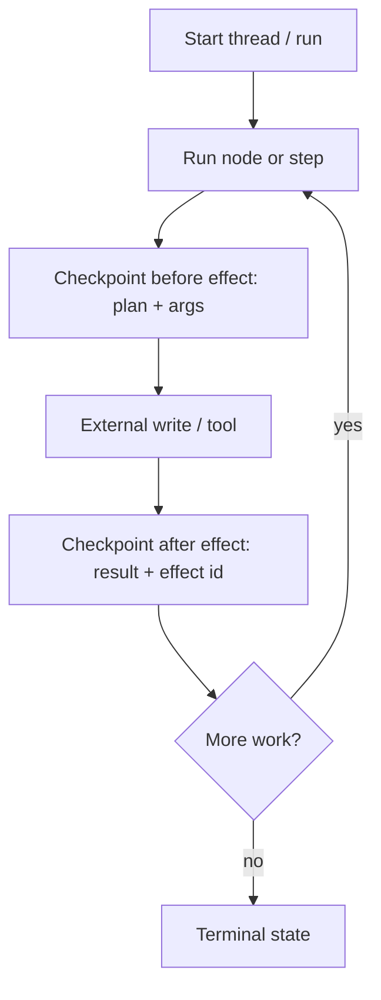
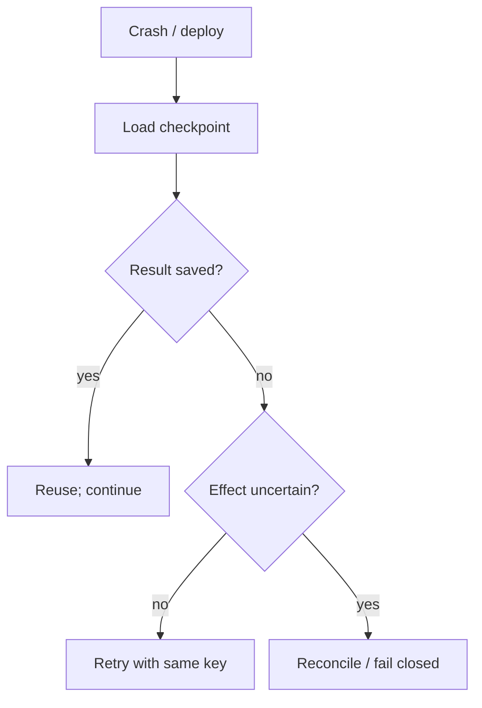

A **workflow checkpoint** is a durable snapshot of *execution state* at a well-defined boundary so long-running work can pause, crash, or wait for a human and still resume from saved progress. It records where the graph or orchestrator was. A model checkpoint stores model weights and training state.

Distinguish it from a [model checkpoint](glossary://model-checkpoint) (saved parameters and training state) and [activation checkpointing](glossary://activation-checkpointing) (recomputing activations to save memory). A workflow checkpoint freezes *control flow and business state*: thread or run id, channel values, completed steps, pending tool results, approval flags, schema or code version, and enough metadata to decide what is safe to retry.

Production LLM agents need durable recovery across worker restarts, deploys, and timeouts. A release agent that evaluates a checkpoint, waits for approval, then promotes a model alias can stop mid-flight during any of those events. A checkpoint restores the last committed boundary so recovery can reuse recorded work, retry idempotent effects, and reconcile ambiguous promotions.

## Intuition

Networks, workers, and humans are unreliable; multi-step agents are not atomic. Real delivery is usually *at-least-once*: timeouts, queue redelivery, and scaffold retries will re-enter a step. A checkpoint turns that chaos into a small set of recovery contracts:

1. **Restore** enough state to know what already happened.
2. **Skip or reuse** completed expensive work (model calls, retrieval, prior tool results).
3. **Retry safely** steps whose external effects are [idempotent](glossary://idempotency), or reconcile an ambiguous effect before retrying. A missing checkpoint does not prove the external write never happened.
4. **Version** the snapshot so incompatible code or schema changes can be detected and handled before resume.

Two durability styles dominate production systems. **State-snapshot checkpointing** (LangGraph checkpointers, many agent runtimes) writes a full graph-state blob after each super-step (sequential nodes usually land on separate super-steps; parallel nodes share one). **Event-history / durable execution** (Temporal, Azure Durable Functions, and similar) appends immutable events and reconstructs state by replaying deterministic workflow code against that log. Both answer the same question: *after a crash, what is the last trusted truth, and what must not run again?*

## Diagram

### Commit the side effect



### Recover after a crash



## How it works

### Snapshot style (graph agents)

Frameworks such as [LangGraph](glossary://langgraph) treat a checkpoint as a snapshot of graph state at a super-step boundary: channel values, channel versions, next nodes, pending writes, and a checkpoint id ordered within its history. Checkpoints for one logical conversation or job live under a **thread** keyed by `thread_id`. Compile the graph with a durable checkpointer (Postgres in production; in-memory only for tests). The thread id identifies saved state; the invocation input determines whether to resume pending work or start a new turn using that state. Resume an interruption with its saved state and `thread_id`; a fresh input dictionary starts a new turn.

Typical payload fields (names vary by framework):

| Field | Role |
| --- | --- |
| Thread / run id | Identity of the long-lived execution |
| Checkpoint id | Ordered position in the thread history |
| Channel values | Messages, plan, tool results, flags, budgets |
| Next / tasks | Which node(s) should run after resume |
| Parent config | Link for time-travel / inspect prior states |
| Pending writes | Results from nodes that finished when siblings failed |
| Version metadata | Graph, prompt, tool-schema, or app build id |

LangGraph also uses checkpoints for [human-in-the-loop](glossary://human-in-the-loop): `interrupt()` saves state and returns control; resume with `Command(resume=decision)` and the same `thread_id`. Nodes often re-enter from the top after resume, so work *before* the interrupt must be idempotent or live in an earlier node. [LangGraph interrupts documentation](https://docs.langchain.com/oss/python/langgraph/interrupts)

### Event-history style (durable execution)

Durable execution platforms persist an append-only **event history** (workflow started, activity scheduled, activity completed, timer fired, signal received). After a crash, a new worker **replays** deterministic workflow code against that history. Recorded activity completions supply their saved results during replay. An activity whose external write succeeded but whose completion was not recorded may still execute again, so activities need idempotent effects. Workflow code must stay deterministic: no wall-clock branching, no free random UUIDs, no unrecorded I/O inside the orchestration function. Non-deterministic work lives in activities (or equivalent steps) whose completed outcomes are memoized in the history. [Temporal activity definition](https://docs.temporal.io/activity-definition)

Conceptually both styles maintain a recoverable state $S_t$ after step $t$:

$$
S_t = \mathrm{Commit}(S_{t-1}, u_t)
$$

where $u_t$ is the update from step $t$ (node writes, activity result, or interrupt payload) and $\mathrm{Commit}$ is an atomic durable write. Resume loads the largest $t$ for which $\mathrm{Commit}$ succeeded, then continues with $S_t$. If the process dies after a side effect but before $\mathrm{Commit}$, recovery may re-enter that step: use an [idempotency](glossary://idempotency) key enforced by the destination, an atomic effect-and-state transaction, or reconciliation before retry. A stored effect id helps only once its checkpoint has committed.

### Boundary choice

Checkpoint where **replay has a clear meaning**:

| Boundary | On retry | Typical use |
| --- | --- | --- |
| Before side effect | Action may run (must be keyed) | Charge, email, ticket create |
| After side effect (result stored) | Reuse durable result | Skip re-billing model or re-calling tool |
| Mid side effect (no result id) | Ambiguous | Needs compensation or manual review |

A checkpoint that records only `"step": 4` lacks the context needed for recovery. Store what step 4 *means*: tool name, args hash, provider response id, validation status, and next node.

## Example

A model-release agent runs as a small [state machine](glossary://state-machine). After each node the runtime writes a checkpoint. Thread `release-reranker-v7`:

1. **plan** stores messages and proposed `promote_model(candidate=reranker-v7, alias=champion)`.
2. **eval_gate** stores `passed=true`, suite version `retrieval-gold-v4`, and result hash.
3. **await_approval** checkpoints a pending action hash and interrupts for a human.
4. On approve, **promote_model** calls the registry with `Idempotency-Key: promote-reranker-v7-champion` and then checkpoints `{promotion_id: "pr_91", status: "active"}`.
5. **notify** publishes the release result only if `status == "active"` and no prior `notification_id` is stored, using a stable key such as `notify-release-reranker-v7`. The notification service must deduplicate that key, and the node checkpoints the returned notification id.

Crash after step 4's HTTP 200 but before the checkpoint: recovery sees no `promotion_id`, retries with the **same** idempotency key, the registry returns the original `pr_91`, and the checkpoint is written. Crash after the checkpoint: recovery skips promotion and continues to notify. A crash after notification but before storing its id needs the same protection at step 5; a stored id alone leaves that gap open. Use a deduplicating service, reconciliation, or duplicate-tolerant delivery.

Sketch of illustrative snapshot JSON; confirm provider-specific fields separately:

```json
{
  "thread_id": "release-reranker-v7",
  "checkpoint_id": "1ef0-...",
  "graph_version": "model-release-graph@2026.04.12",
  "values": {
    "candidate_id": "reranker-v7",
    "target_alias": "champion",
    "eval_suite": "retrieval-gold-v4",
    "approved": true,
    "promotion_id": "pr_91",
    "notification_id": null
  },
  "next": ["notify"],
  "side_effects": {
    "promote_model": {
      "idempotency_key": "promote-reranker-v7-champion",
      "status": "active"
    }
  }
}
```

## Trade-offs

| Choice | Benefit | Cost |
| --- | --- | --- |
| Checkpoint every node / super-step | Fine-grained resume; good for HITL and debug | Storage growth; serialize large message lists carefully |
| Coarse checkpoints (only after external writes) | Smaller store | More recompute of pure steps after crash |
| Full state snapshot | Simple mental model; easy inspect / time travel | Large blobs; schema migrations on resume |
| Event-history replay | Compact log of decisions; strong "do not re-run activity" semantics | Determinism discipline; versioning of workflow code |
| In-memory checkpointer | Fast local demos | Lost on process restart; not production |
| Durable store (Postgres, etc.) | Survives deploys and worker death | Latency, retention, encryption of sensitive channels |

Long threads need retention or pruning: unbounded checkpoint history becomes a latency and storage tax. Encrypt or omit secrets and raw PII from channel values when the store is multi-tenant.

## Debug path

When resume misbehaves, inspect in this order:

1. **Which checkpoint loaded?** Thread id, checkpoint id, `next` nodes, parent chain.
2. **What side effects are already recorded?** Effect ids, idempotency keys, provider response bodies.
3. **Did code or schema change since the snapshot?** Graph version, tool contract, reducer behavior.
4. **Is re-entry replaying non-idempotent work?** Model sampling, emails, creates without keys.
5. **Crash-test deliberately.** Kill the worker after every expensive model call and every external write; assert no duplicate charges, emails, tickets, or index updates.

Treat saved-state logs as evidence only after kill-and-resume drills pass.

## Why it matters here

Agent scaffolds, RAG pipelines, evaluation batches, and multi-day HITL reviews all span process lifetimes longer than a single HTTP request. Workflow checkpoints bring distributed-systems recovery to LLM systems: resume from committed state, reuse completed work, gate irreversible tools, and leave an inspectable history for [audit trails](glossary://audit-trail). Retries then follow recorded recovery rules instead of replaying blindly.

## Related terms

- [Idempotency](glossary://idempotency)
- [State machine](glossary://state-machine)
- [LangGraph](glossary://langgraph)
- [Human-in-the-loop](glossary://human-in-the-loop)
- [Audit trail](glossary://audit-trail)
