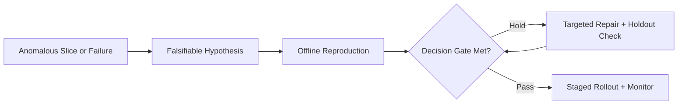

---
{
  "id": "ai-lab-behavioral-interview",
  "title": "AI Lab Behavioral Interview",
  "slug": "ai-lab-behavioral-interview",
  "section": "AI Lab Interviewing",
  "category": "MLOps & Deployment",
  "difficulty": "Hard",
  "order": 3,
  "companies": [
    "Frontier AI Labs",
    "Anthropic",
    "OpenAI",
    "Google DeepMind",
    "Meta AI"
  ],
  "shortDescription": "Weak behavioral answers recite slogans about speed and safety. Strong ones trace an evaluation failure to a concrete mechanism, separate personal ownership from team outcome, and cite honest baselines.",
  "keyConceptsTested": [
    "Mission fit without slogans",
    "Evaluation and rollout judgment",
    "Evidence-based technical disagreement",
    "AI safety as inspectable engineering mechanisms",
    "Explicit ownership scoping under ambiguity",
    "Story portfolios with real baselines and consequences"
  ],
  "prerequisites": [
    "observability-monitoring-llm-systems",
    "responsible-ai-governance-ethics-compliance",
    "model-versioning-continuous-deployment",
    "ai-lab-system-design-interview"
  ],
  "relatedQuestions": [
    "llm-as-judge-automated-evaluation",
    "guardrails-safety-filters-production",
    "agent-failure-states-retry-fallback",
    "ab-testing-online-evaluation-llms"
  ]
}
---

Imagine it is Friday morning before a model serving update for a long-context retrieval assistant. Aggregate offline pass rates rose by 2.4 percentage points across the standard evaluation suite, and product stakeholders want to move immediately to a 5 percent live traffic ramp. When you inspect the per-slice breakdown, however, multi-hop reasoning accuracy between 32k and 64k tokens dropped by 8.5 points, and human reviewers flagged truncated context chunks in nearly every failing trace. A polished but hollow interview answer claims you "balanced velocity with safety." A credible engineering answer identifies the specific regression slice, describes how you reproduced the serving configuration bug offline, explains why traffic stayed paused, and distinguishes your direct work from the team's broader release decision.

Strong behavioral interviews at frontier AI laboratories reward technical precision over rehearsed culture slogans. Interviewers want to inspect how you reason under ambiguity, how accurately you state what a metric actually measures, and whether teammates can trust you when headline numbers look good for the wrong reason. The worked scenarios in this guide demonstrate narrative structure and claim discipline; when preparing your own story bank, ground every example in research replications, open-source contributions, coursework, or production systems whose tradeoffs and denominators you personally verified.

Public interviewing guidance across leading labs reinforces these same habits. OpenAI emphasizes collaboration, clear communication, openness to critical feedback, and ownership under changing evidence.[^openai2026interview][^openai2026careers] Anthropic highlights direct, low-ego communication alongside selecting simple, inspectable designs that meet the bar.[^frontier2026careers] Google DeepMind advises candidates to structure experiences concisely using Situation, Task, Action, and Result (STAR) while grounding impact in clear quantitative evidence.[^deepmind2026interviewing] Because individual teams tailor interviews to specific engineering or research roles, use published guidance to sharpen your reflection rather than mimicking corporate phrasing.

## Turning abstract values into engineering mechanisms

Values become believable only when translated into architectural choices, diagnostic habits, and measurable outcomes. Saying that you care about rigor or safety tells an interviewer almost nothing until you walk through a time that commitment changed what code merged, which evaluation blocked promotion, or how you responded when a shortcut tempted the team. Framing values as concrete engineering mechanisms lets an interviewer probe your technical depth directly through behavioral follow-ups.



Notice how each transition in the workflow separates diagnosis from deployment. Rather than skipping straight from a promising headline score to production exposure, disciplined teams isolate the suspect slice, reproduce the mechanism offline, verify the repair against an untouched holdout set, and only then stage live traffic with continuous observability. Mapping broad cultural themes onto those concrete behaviors makes every story easier to audit under skeptical questioning.

| Value theme | Concrete engineering translation | Verifiable evidence an interviewer looks for |
|---|---|---|
| Reliability | Explicit timeouts, deterministic fallbacks, and debuggable trace logs | Latency percentiles with sample sizes, error budgets, and post-incident regressions added to CI |
| Scientific rigor | Per-slice error analysis and separation of tuning vs. holdout evaluation sets | Held-out delta after fixing a training or serving defect, plus documentation of negative results |
| High-trust collaboration | Fair summary of opposing constraints paired with a shared, decisive test | One-page design memo, pre-registered acceptance criteria, and clear owner accountability |
| Ownership | Carrying a problem from ambiguous symptom to durable prevention without overclaiming | Clear line separating your patch or benchmark from downstream changes landed by teammates |
| AI safety & alignment | Concrete capability bounds, scoped tool permissions, and adversarial red-team suites | Rejection of unsafe heuristics, measurable drop in jailbreak or exfiltration pass rate |

When interviewers probe an answer, they routinely test whether your story reflects genuine hands-on ownership or merely proximity to a successful launch. Separating what you diagnosed, built, or measured from what teammates or release managers decided builds immediate credibility. If you observed a bug and built the automated regression check while another engineer patched the inference config, state both halves cleanly instead of claiming you "rebuilt the serving stack."

```checkpoint
How do you distinguish an engineering story grounded in mechanism from one relying on vague slogans?
---
A slogan-driven answer names an intent ("I prioritized model quality and reliability"), whereas a mechanism-driven answer names the specific invariant checked, the slice or trace that contradicted the headline number, what changed in code or evaluation criteria, and the exact scope of what the follow-up measurement covered.
```

## Structuring stories for rapid clarity

In a typical 45- to 60-minute behavioral interview, an interviewer asks three or four core prompts plus several minutes of unplanned technical follow-ups on each. Long preambles starve the most informative parts of your answer: the technical tradeoff you faced, why alternative options fell short, and what failed or changed afterward. Adapting STAR with explicit risk, mechanism, and baseline fields ensures the interviewer hears decision-making signal within the first minute.

| Story element | Target duration | Core questions the listener needs answered |
|---|---|---|
| Context & goal | 15–20 seconds | What system were you building or operating, who depended on it, and why did timing matter? |
| Risk & constraint | 15 seconds | What concrete failure mode, cost bottleneck, or conflicting metric prevented a naive fix? |
| Mechanism & judgment | 45 seconds | Which options did you compare, what exact change or evaluation did you run, and who owned what? |
| Measured outcome | 20 seconds | What shifted afterward relative to a recorded baseline, over what sample window or denominator? |
| Honest limitation & learning | 15 seconds | What remained unmeasured or fragile, and what engineering practice did you adopt afterward? |

Suppose an interviewer probes a long-context serving incident using a concise structure like this. You open with the objective: shipping a faster KV-cache paging configuration before weekly usage peaked. You name the risk immediately: while overall throughput rose 18 percent and headline QA looked flat, long-context multi-hop accuracy fell by 8.5 points on 32k–64k traces. Then you explain the mechanism: you bisected the serving configuration, traced the bug to mismatched rotary position scaling across evicted blocks, wrote a 60-prompt long-context regression suite, and aligned with the inference lead to pause the rollout until tail accuracy matched baseline on an untouched holdout set. Ending with an honest scope note, acknowledging that automated grading covered offline prompts while live user satisfaction still needed staggered telemetry, invites constructive follow-up rather than skepticism.

## Building a versatile story portfolio

Trying to memorize ten rigid scripts leaves you brittle whenever an interviewer blends themes or interrupts with a "what if that metric was noisy?" follow-up. Instead, build a tight portfolio of four to six deeply understood technical experiences drawn from different parts of the software and ML lifecycle. Because real engineering projects combine architecture, disagreement, debugging, and iteration, one well-documented project often answers three or four distinct prompt angles when you keep the underlying timeline clear.

Before writing full prose, outline each experience as a compact decision packet showing every handoff, alternative option, and empirical check. Keeping context, your specific implementation role, the alternative you rejected, the deciding measurement, and unresolved limitations in separate bullets prevents accidental exaggeration when speaking under pressure.

| Story archetype | Primary interview signals | Essential technical details to verify beforehand |
|---|---|---|
| ML architecture or modeling tradeoff | System judgment, resource awareness, iterative experimentation | Model/data alternatives rejected, compute or latency budget, ablation table on held-out split |
| Evaluation failure or negative result | Scientific honesty, slice debugging, refusal to ship misleading metrics | Metric flaw (label leakage, judge bias, cohort skew), preserved regression slice, revised gate |
| Cross-team technical disagreement | Low-ego communication, fair framing, decision closure | Exact point of contention, opponent's strongest rationale, mutually agreed falsifying experiment |
| Production incident or training instability | Debugging speed, hypothesis discipline, durable prevention | Initial blast radius, root cause (loss spike, OOM, bad batch), mitigation vs. permanent CI guard |
| Ambiguous scope or tool ownership | Initiative, API clarity, mentoring and unblocking others | Initial unstructured problem, interface or workflow chosen, measurable adoption or friction drop |

Think carefully through common prompt families across AI labs and verify that your four to six packets cover all of them without forcing a single incident to answer every question. Practice answering each prompt from a cold start while stating upfront when numbers reflect small debugging samples rather than large-scale benchmarks.

- Why are you interested in working on frontier AI systems or infrastructure at this specific lab?
- Tell me about a time an aggregate metric or benchmark looked promising, yet closer inspection revealed a serious flaw.
- Describe a technical disagreement with a strong researcher or staff engineer, and explain how it resolved.
- Walk through the hardest training run failure, serving bottleneck, or production outage you helped diagnose.
- Tell me about a time you slowed down or canceled an approach that stakeholders initially wanted to ship.
- Give an example of choosing a markedly simpler baseline or architecture over a complex proposal.
- Describe an engineering habit or technical assumption you had to unlearn after a costly mistake.
- What failure mode in agentic or frontier-scale AI systems concerns you most right now, and how would you bound it in practice?

## Handling technical disagreements with evidence

Interviewers ask about disagreements to inspect two behaviors simultaneously: whether you understand strong counterarguments without caricaturing teammates, and whether you resolve stalemates with testable evidence rather than rank or stubbornness. Treating a product manager or researcher as reckless because they pushed for a faster rollout signals poor collaboration. Two sharp, well-intentioned colleagues can share the exact same reliability goals while disagreeing honestly about acceptable uncertainty or experiment cost.

Consider a realistic debate over launching the long-context RAG configuration described earlier. Product leadership wants a 5 percent live traffic ramp immediately because aggregate pass rates gained 2.4 points and two-thirds of customer queries fall below 8k tokens. You argue for holding live exposure at zero until the 32k–64k regression disappears. Both sides share the same product goal: delivering lower latency before Monday's traffic surge without degrading complex synthesis queries.

<details>
<summary>Walk through an evidence-first disagreement answer</summary>

Open by articulating both shared intent and the specific point of divergence: "We both wanted the throughput improvement live before peak traffic. We disagreed on whether a 5 percent canary was safe when offline multi-hop accuracy above 32k tokens dropped 8.5 points." Next, represent the strongest version of your teammate's argument: most traffic fell under 8k tokens, so a small canary could surface latency telemetry quickly. Then explain your diagnostic mechanism: instead of debating abstract risk, you pulled 15 concrete failure traces showing mid-prompt context truncation caused by a misaligned KV-cache window parameter, and agreed on a narrow objective check: if restoring the RoPE scaling config recovered parity across a held-out 32k–64k slice without losing the latency win, the rollout could proceed immediately. Conclude with the outcome: fixing the parameter recovered accuracy while retaining a 14 percent throughput gain, the canary launched safely a day later, and the team added long-context slice parity as a standard pre-deployment gate.

</details>

Sometimes a team rejects your preferred option even after you present clear evidence, or an urgent deadline forces an imperfect compromise. In those cases, explain who held decision ownership, what assumptions tipped the scale, how you executed the agreed path cleanly without passive resistance, and what rollback trigger or monitoring check you installed so everyone could update quickly if live telemetry proved your concern right.

## Reasoning clearly about evaluation failures, negative results, and misuse risk

Frontier AI teams treat misleading evaluations as serious engineering bugs because flawed metrics quietly steer months of training compute or product engineering in the wrong direction. Having at least one packet centered on stopping a bad promotion, or killing a deceptive positive result, demonstrates the intellectual honesty researchers and infrastructure engineers depend on. When aggregate offline accuracy looks green while a critical slice breaks, explain how you caught the discrepancy, stopped premature promotion, separated tuning examples from an untouched holdout set so later numbers stayed uncontaminated, and preserved failing cases as permanent regressions.[^sklearn2026leakage]

| Narrative beat | Weak phrasing to avoid | Strong, inspectable engineering account |
|---|---|---|
| Initial symptom | "I felt the eval score seemed a bit off." | "Overall MMLU-style QA passed at 81.4%, up 2.4 points, yet 32k–64k multi-hop accuracy dropped 8.5 points." |
| Root cause | "The model hallucinated on edge cases." | "Pairwise judge scores rewarded verbose partial answers while KV eviction clipped middle citations." |
| Corrective decision | "I told everyone to improve eval quality." | "Paused promotion, froze the 60 failed traces as a regression slice, and added an untouched 200-item holdout." |
| Post-fix scope | "Fixed the bug and proved the system generalizes." | "Repaired chunk eviction and hit parity on both development and holdout slices; long-horizon agent chains remained out of scope." |

Questions about high-impact AI risks follow the same engineering discipline. Rather than delivering an abstract lecture on existential threats or copying a lab's safety blog post, pick a concrete failure surface you can connect directly to inspectable systems: tool-calling agents with excessive write permissions, indirect prompt injection over retrieved enterprise documents, reward hacking against automated judges, or silent failure amplification in multi-step workflows. Distinguish technical safeguards you can build and evaluate immediately (least-privilege credential scoping, dry-run diff previews before destructive tool writes, deterministic schema checks, red-team regression harnesses, and staged traffic ramps with automated rollback) from broader governance questions that exceed single-team tooling.[^deepmind2026responsibility]

## Presenting weaknesses, mission fit, and honest claim limits

When asked about a personal weakness or past failure, resist the cliché of turning a strength like perfectionism into false modesty. Choose a genuine engineering habit that carried a real cost for teammates or compute budgets, describe the structural change you adopted afterward, and note truthfully where you still monitor yourself or lack long-term follow-up data.

Suppose an engineer spent two extra weeks polishing a custom distributed checkpointing wrapper alone before inviting peer design review, only to discover during integration that the training harness already handled asynchronous sharding cleanly and expected a different recovery format. The delay cost four days of cluster idle time and teammate rework. Afterward, the engineer adopted a strict habit of circulating a one-page interface sketch with exact failure modes before writing more than 100 lines of integration code. When telling that story, report accurately that the next two pipeline tasks cleared design review cleanly without claiming the habit permanently solved scheduling friction across an entire organization.

Mission-fit questions require the same specificity. Connect a real problem class you care deeply about (such as inference latency under long context, faithful automated evaluation, deterministic debugging tools for agent trajectories, or distributed training stability) to concrete code or experiments you have personally driven, then close with an informed technical question about the team's current bottleneck.

> "I care most about making multi-step model evaluation reliable enough that teams catch silent regressions before scaling training or rollout. My clearest hands-on example was diagnosing our 32k–64k retrieval drop and replacing verbose judge heuristics with slice-level holdouts. Next, I want to understand how your team separates noisy online user signals from genuine capability regressions as agent trajectories grow longer."

## Rehearsing answers and validating claims against notes

Written rehearsal exposes inflated claims and missing denominators long before you step into an interview room. For each story in your portfolio, run three rapid passes before recording yourself aloud: first verify that risk, personal action, baseline, and outcome are each populated; second compress the entire narrative to two minutes by trimming background until your diagnostic action appears within the first 40 seconds; and third answer skeptical follow-ups challenging your denominator, teammate overlap, or unverified counterfactuals.

Notice how easily an imprecise summary creeps into rushed speech. Consider raw notes from a caching optimization project: you profiled token latency, implemented prefix KV-cache reuse across shared system prompts, another engineer wired request routing to sticky workers, and post-change median time-to-first-token (TTFT) measured 310 ms on 120 replay prompts against a 400 ms latency target, with no recorded baseline latency before the change. Saying "I rebuilt prompt routing and cut TTFT by 22 percent" commits three distinct factual errors: claiming another engineer's routing work, comparing against a target budget rather than a pre-change baseline, and omitting sample size.

<details>
<summary>Compare the inflated draft with a crisp, defensible revision</summary>

A clean, fully auditable revision states: "I profiled prefill compute and implemented shared system-prompt KV-cache reuse, while a teammate updated sticky worker routing. On 120 held-out replay prompts afterward, median TTFT measured 310 ms against our 400 ms launch target. Because we lacked a matched before-change replay log on identical hardware, we measured target headroom rather than an exact latency speedup." Separating personal code from teammate routing and distinguishing threshold headroom from before-after delta protects you immediately under follow-up probing.

</details>

You can also use an AI assistant during preparation as a strict factual auditor rather than an inventor of experience, provided you sanitize confidential metrics and project names and follow every employer's live-interview policy. OpenAI notes that permitted tools differ across interview stages and are clarified by preparation materials or recruiters.[^openai2026interview] Google DeepMind permits AI for rehearsal while disallowing it during live interviews and take-home assessments unless explicitly authorized.[^deepmind2026interviewing] Anthropic encourages candidate rehearsal and prose tightening with AI while requiring first drafts of written applications to be your own and prohibiting unauthorized AI during live or take-home evaluations.[^anthropic2026candidateai] Never paste private logs, internal model scores, or proprietary architectures into third-party prompts.

```text title="Claim-audit rehearsal prompt"
Act as a skeptical staff ML interviewer. Ask one probing question at a time and wait for my reply.

Project notes: I isolated a 32k-64k multi-hop accuracy drop (-8.5 points) in a long-context RAG config, traced it to mismatched RoPE scaling during KV eviction, and wrote a 60-trace regression check. A teammate patched the serving config and deployed the 5% rollout after parity on a 200-trace untouched holdout. Post-rollout p95 latency was 420 ms against a 500 ms limit across 1,500 requests, with no pre-change p95 baseline logged.

Challenge me whenever I claim teammate work as my own, confuse a target threshold with a speedup, omit sample counts, or generalize beyond the 200 holdout traces.
```

Regularly auditing stories against the table below closes the remaining weak spots across your portfolio before live interviews begin.

| Interview symptom | Why interviewers discount it | Concrete repair |
|---|---|---|
| Borrowed mission slogans | Reads as generic preparation rather than authentic motivation | Anchor motivation to a real failure mode you debugged or measured yourself |
| Ambiguous "we" throughout | Obscures what you actually designed, coded, or proved | Name your exact module, experiment, or decision clearly alongside teammates' contributions |
| Missing baseline or denominator | Percentage claims like "improved 30%" or "rare failures" collapse under probing | Pair every rate with both before/after snapshots and exact sample counts or observation windows |
| Target limit cited as speedup | Mistaking headroom under a 500 ms SLA for latency reduction | Report target compliance honestly when matched pre-change traces are missing |
| Eval tuning treated as generalization | Re-testing on cases that guided your fix measures memorization | Retain failing examples as fixed regressions and evaluate final parity on an untouched holdout |
| Safety framed solely as intent | Good intentions fail silently under tool misuse or prompt injection | Pair risks with inspectable controls: scoped tokens, dry-run gates, red-team evals, and rollbacks |

```mastery-quiz
[
  {
    "question": "Before a model serving update, headline QA improves by 2.4 percentage points across the main suite, while the 32k-64k multi-hop slice drops 8.5 points with truncated mid-context traces. A colleague wants a 5% live traffic canary immediately because long queries are rare. Which response best demonstrates behavioral rigor?",
    "options": [
      "Launch the 5% canary immediately so live production traffic resolves whether the long-context drop matters.",
      "State the launch goal, mirror the traffic point, reproduce truncation offline, and achieve holdout slice parity.",
      "Escalate directly over your colleague without reviewing their claim because an 8.5-point drop settles release risk.",
      "Strip failing 32k-64k traces from the release dashboard since aggregate averages still rise 2.4 percentage points."
    ],
    "answer": "State the launch goal, mirror the traffic point, reproduce truncation offline, and achieve holdout slice parity.",
    "explanation": "Strong collaboration keeps shared goals intact, states the counterargument accurately, and resolves risk disagreements using falsifiable offline evidence rather than exposing users to a known regression or bypassing teammates."
  },
  {
    "question": "Notes from a caching rollout record median TTFT = 310 ms across 120 held-out replay prompts against a 400 ms SLA target, with you writing the prefix KV-cache reuse module and a teammate updating worker routing. No pre-change replay log exists on the same hardware. Which summary is completely defensible?",
    "options": [
      "Rebuilt sticky routing and cut inference tail latency by 22.5 percent on production hardware.",
      "Delivered 310 ms tail latency across customer workloads, keeping future traffic under target.",
      "Built prefix KV reuse with teammate routing; median TTFT is 310 ms without a matched baseline.",
      "Achieved a 29 percent router speedup measured directly from the 90 ms gap under our SLA goal."
    ],
    "answer": "Built prefix KV reuse with teammate routing; median TTFT is 310 ms without a matched baseline.",
    "explanation": "90 ms represents headroom relative to the 400 ms SLA target, not an observed speedup without a matched baseline. Separating your KV-cache module from teammate routing work also keeps ownership accurate."
  },
  {
    "question": "An automated LLM judge scores a prompt update 94% passing overall, yet 12 critical tool-argument extraction cases fail silently. You inspect those 12 failures to guide prompt repairs. Which evaluation workflow avoids metric leakage before promotion?",
    "options": [
      "Re-run the 12 repaired cases cleanly; a 12/12 pass score establishes prompt generalization.",
      "Filter those 12 rare extraction errors out of scoring so the 94% summary tracks normal traffic.",
      "Keep the 12 failures as regression items, iterate on dev, and score final quality on holdout.",
      "Ship a 20% live production experiment first and log regressions if support tickets arrive later."
    ],
    "answer": "Keep the 12 failures as regression items, iterate on dev, and score final quality on holdout.",
    "explanation": "Cases used directly to guide repairs become part of the development loop and cannot measure out-of-sample generalization. Preserving them as permanent regressions while grading against an untouched holdout avoids data leakage."
  },
  {
    "question": "In an agent incident review, a teammate claims, \"Because only 2 examples failed out of our spot check, production failure risk is negligible.\" Which follow-up flaw does that claim commit?",
    "options": [
      "Mistaking a target latency threshold for a controlled pre-change production measurement.",
      "Treating an ad-hoc sample count as an unbiased denominator for production rate and risk.",
      "Computing nearest-rank tail statistics over more than forty sorted telemetry latency logs.",
      "Validating prompt regressions offline prior to requesting approval for canary rollouts."
    ],
    "answer": "Treating an ad-hoc sample count as an unbiased denominator for production rate and risk.",
    "explanation": "A small count from an ad-hoc spot check carries no population denominator or severity weighting, and live traffic mixes often concentrate failure modes within specific customer workflows."
  },
  {
    "question": "During a debugging sprint, an engineer writes a data-loader patch, a colleague authors the unit regression test, and the training lead signs off on launching a 70B pretraining run whose checkpoint stability has only been observed for the first 2,000 steps. Which statement accurately describes the engineer's ownership?",
    "options": [
      "Patched the loader stall and confirmed clean checkpoint stability across the multi-week 70B training run.",
      "Patched the loader stall, ran my colleague's test locally, and handed launch off after 2,000 steps.",
      "Authored the regression unit suite, patched the loader stall, and signed off to launch 70B training.",
      "Diagnosed the step-50,000 loss spike early and resolved checkpoint stalling across long training loops."
    ],
    "answer": "Patched the loader stall, ran my colleague's test locally, and handed launch off after 2,000 steps.",
    "explanation": "Exact scoping credits the colleague who wrote the unit test, credits the lead who authorized launch, and limits stability claims to the 2,000-step window actually observed."
  },
  {
    "question": "An interviewer asks, \"What worries you most about deploying autonomous coding or tool-using AI agents today?\" Which answer best balances engineering realism with humility?",
    "options": [
      "Quote frontier safety manifesto principles on responsible scaling without naming concrete failure surfaces.",
      "Point to existing regex filters and unit assertions as complete coverage against autonomous agent abuse.",
      "Pair prompt-injection write risks with scoped permissions and dry-runs, while noting open alignment gaps.",
      "Conclude broadly that stochastic model behavior blocks building reliable agentic developer workflows."
    ],
    "answer": "Pair prompt-injection write risks with scoped permissions and dry-runs, while noting open alignment gaps.",
    "explanation": "Strong answers connect specific technical failure paths to testable engineering controls while distinguishing what code can bound from broader societal or alignment questions."
  },
  {
    "question": "After delaying an integration due to late peer review, an engineer adopts early one-page design sketches on three subsequent tasks: two get reviewed before coding and ship smoothly, the third still receives late review, and delivery timestamps were never logged across projects. Which reflection is honest?",
    "options": [
      "Introducing early design sketches removed late review delays and raised delivery velocity across projects.",
      "Shared early sketches on two of three tasks; one lagged, and delivery speed lacks logged timestamps.",
      "Cycle speed rose by 66 percent because two out of three peer design reviews moved prior to coding.",
      "Skipping early design alignment added negligible rework time once integration started on the third task."
    ],
    "answer": "Shared early sketches on two of three tasks; one lagged, and delivery speed lacks logged timestamps.",
    "explanation": "Honest reflection reports mixed compliance accurately (two of three tasks) and avoids fabricating velocity improvements when delivery timestamps were not recorded."
  },
  {
    "question": "When preparing for a live engineering loop at a lab that encourages AI rehearsal for story structuring but disallows AI tools during live interviews unless explicitly permitted, you practiced phrasing a sanitized story with an AI critic. During the live technical call, the interviewer asks an unexpected follow-up. What is the right action?",
    "options": [
      "Consult an AI assistant off-screen for structure hints after disclosing prep usage during application.",
      "Reason directly from personal engineering experience unless the interviewer authorized live assistant use.",
      "Paste an AI assistant's rounded latency estimate when time pressure limits recalling exact numbers.",
      "Carry over written live-coding tool permissions granted during an interview at a previous company."
    ],
    "answer": "Reason directly from personal engineering experience unless the interviewer authorized live assistant use.",
    "explanation": "Rehearsal permission does not carry over into live evaluation rounds, nor do policies from previous employers apply. Every interview stage requires explicit confirmation under that lab's policy."
  },
  {
    "question": "An engineer inspects 40 sorted inference latencies under a nearest-rank definition where `ceil(0.95 * 40) = 38`. Rank 38 measures 470 ms (under a 500 ms limit), rank 39 measures 810 ms, and rank 40 measures 940 ms. Which conclusion is accurate?",
    "options": [
      "Sample p95 equals 810 ms since ranks 39 and 40 cross the 500 ms boundary.",
      "Sample p95 equals 470 ms while fulfilling the 500 ms limit across logs.",
      "Sample p95 equals 470 ms while two higher tail values remain above 800 ms.",
      "Exclude ranks 39 and 40 as warm-up noise so p95 stays near 470 ms."
    ],
    "answer": "Sample p95 equals 470 ms while two higher tail values remain above 800 ms.",
    "explanation": "Nearest-rank p95 picks the 38th value out of 40 (470 ms), yet ranks 39 and 40 remain real user-facing tail latencies that must not be discarded or misrepresented as compliant."
  },
  {
    "question": "Why should a behavioral STAR+M story state your personal action, opposing constraints, and baseline numbers within roughly the first 45 to 60 seconds?",
    "options": [
      "Rapid speech delivery without early constraints signals senior execution pace.",
      "Reaching mechanism early opens space for follow-up probing on real engineering judgment.",
      "Front-loading team background avoids spending remaining slots on edge cases.",
      "Compact opening summaries close off questions about gaps left in metrics."
    ],
    "answer": "Reaching mechanism early opens space for follow-up probing on real engineering judgment.",
    "explanation": "Compressing setup puts your concrete judgment and technical mechanism at the center of the conversation so follow-up probing strengthens rather than crowds out your evidence."
  }
]
```

> **Next:** Continue to [AI Lab Technical Presentation](/learn/ai-lab-technical-presentation). Expand one defensible project into a talk where a listener can question the decision, the mechanism, and what the numbers actually prove.
