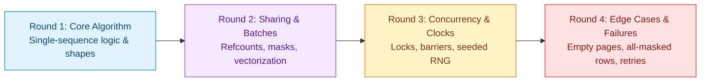

---
{
  "id": "ai-lab-coding-interview-python-systems",
  "title": "AI Lab Coding Interview: Python Systems",
  "slug": "ai-lab-coding-interview-python-systems",
  "section": "AI System Design & Interviewing",
  "category": "MLOps & Deployment",
  "difficulty": "Hard",
  "order": 6,
  "coverImage": "illustrations/_generated/paged_kv_allocator_dark.png",
  "companies": [
    "Frontier AI Labs",
    "OpenAI",
    "Google DeepMind",
    "Meta AI"
  ],
  "shortDescription": "Master ML systems coding in Python: paged KV-cache allocators, masked NumPy attention, nucleus sampling, and thread-safe batching loops.",
  "keyConceptsTested": [
    "Paged KV-cache reference counting and copy-on-write",
    "Batched scaled dot-product and grouped-query attention",
    "Top-k and top-p nucleus truncation without off-by-one bias",
    "Continuous batching token-budget scheduling",
    "Thread safety with locks and deterministic clocks",
    "Async streaming, executors, and Python concurrency limits"
  ],
  "prerequisites": [
    "pytorch-training-loops",
    "agent-failure-states-retry-fallback"
  ],
  "relatedQuestions": [
    "code-generation-agents-sandboxing",
    "continuous-batching-request-scheduling",
    "llm-deployment-gpu-serving-autoscaling"
  ]
}
---

Two forked beams share a physical KV-cache page, and one appends a new token. If your allocator mutates that page in place, the sibling beam silently reads corrupted history. Forty minutes into a frontier-lab coding round, bugs like that are the entire interview. Instead of abstract array puzzles, systems interviewers hand you a compact Python problem modeled directly on LLM training and serving: a paged KV-cache allocator, batched grouped-query attention in NumPy without `NaN` propagation, top-k and nucleus token sampling, or a continuous batching scheduler with retries and async streaming.

Requirements arrive incrementally in three or four rounds so the interviewer can see whether your state model extends cleanly without breaking correctness. Raw typing speed rarely decides the round. Strong candidates build from explicit data invariants: separating physical page ownership from logical token positions, stabilizing exponentials before normalizing, isolating side effects behind injectable clocks and seeded generators, and running small targeted checks on race conditions or off-by-one masks as soon as a function works.

## How Lab Coding Rounds Unfold

Most ML systems coding interviews start with a minimal working slice that fits in 30 lines of Python, then layer on extensions that stress shared state, vectorization, or concurrency. Jumping immediately into over-engineered abstractions wastes ten minutes before you know where round two will push the API, while dumping raw dictionaries everywhere collapses the moment beam sharing or worker threads enter in round three.



Anchor each round around one explicit invariant and verify it locally before moving on. Write down what each object owns, trace how the next requirement mutates that ownership, and test boundary inputs right after implementing a helper. The table below maps the four archetypes interviewers rotate through most often and the specific failure mode each prompt is built to trigger.

| Archetype | Typical Prompt Evolution | Primary Data Invariant | Classic Trap Under Pressure |
| --- | --- | --- | --- |
| Paged KV Allocator | Single append -> beam fork -> multi-thread decode | `len(seq.blocks) * block_size` capacity matches `token_count` and refcounts equal total references | Mutating a shared block in place instead of performing copy-on-write on `ref_count > 1` |
| Attention Kernel | Vanilla QKV -> causal mask -> padding mask + GQA | Masked positions contribute zero weight before value weighted sum | Softmax across an all-`-inf` query padding row produces `0 / 0 = NaN` |
| Token Sampler | Greedy / temperature -> top-k -> top-p -> batched RNG | Cumulative mass stays at least `top_p` after truncation | Filtering strictly on `cumsum <= top_p` drops the boundary token and creates an empty mask |
| Batch Scheduler | FIFO queue -> token budget -> backoff + async stream | Running prefill chunks plus active decode steps never exceed step token cap | Calling `time.sleep` or live `time.monotonic()` directly inside scheduler logic |

## Paged KV-Cache Allocator with Copy-on-Write

Serving engines such as vLLM eliminate contiguous allocation waste by splitting each sequence's KV cache into fixed-size physical blocks mapped through per-sequence logical block tables.[^kwon2023] When two prompts share a system prefix or one sequence branches into parallel beam-search candidates, both sequences point to the same physical prefix blocks with a reference count greater than one. Appending a new token to a trailing block whose `ref_count > 1` must never overwrite the shared storage in place: the allocator pops a fresh physical page from the free list, copies the existing tokens into the private page, decrements the old block's reference count, and updates the sequence's block table.

<figure>

<figcaption>Paged KV-cache ownership under beam forking. Shared prefix block B0 remains read-only while `ref_count == 2`; appending divergent tokens acquires private blocks B2 and B3 from the thread-safe free pool.</figcaption>
</figure>

Two details determine whether a Python implementation survives concurrent worker threads. First, block tables hold integer block identifiers pointing into a central pool rather than duplicating token buffers inside each sequence object. Second, mutating `_free` and reference counts happens inside a single `threading.Lock` so concurrent decode steps or beam forks cannot pop the same physical block twice or decrement a counter below zero. Synchronizing two test threads on a `threading.Barrier` forces both workers to race into `append_token` at the exact same instant so you can watch copy-on-write isolate their trailing blocks cleanly:

<!-- leetllm: test, output=show -->
```python title="kv_cache_allocator.py"
from collections import deque
from dataclasses import dataclass, field
import threading


@dataclass
class PhysicalBlock:
    block_id: int
    tokens: list[int] = field(default_factory=list)
    ref_count: int = 0


class PagedKVCacheAllocator:
    """Thread-safe block allocator with copy-on-write prefix sharing."""

    def __init__(self, num_blocks: int, block_size: int) -> None:
        if num_blocks <= 0 or block_size <= 0:
            raise ValueError("num_blocks and block_size must be positive")
        self.block_size = block_size
        self._lock = threading.Lock()
        self._pool = {i: PhysicalBlock(block_id=i) for i in range(num_blocks)}
        self._free: deque[int] = deque(range(num_blocks))
        self._seq_tables: dict[str, list[int]] = {}

    def _pop_free_block(self) -> int:
        if not self._free:
            raise MemoryError("KV cache exhausted: no free physical blocks")
        bid = self._free.popleft()
        block = self._pool[bid]
        block.tokens.clear()
        block.ref_count = 1
        return bid

    def _release_block(self, bid: int) -> None:
        block = self._pool[bid]
        block.ref_count -= 1
        if block.ref_count == 0:
            block.tokens.clear()
            self._free.append(bid)

    def create_sequence(self, seq_id: str, prompt_tokens: list[int]) -> list[int]:
        with self._lock:
            if seq_id in self._seq_tables:
                raise ValueError(f"Sequence {seq_id!r} already exists")
            table: list[int] = []
            try:
                for start in range(0, len(prompt_tokens), self.block_size):
                    bid = self._pop_free_block()
                    self._pool[bid].tokens.extend(
                        prompt_tokens[start : start + self.block_size]
                    )
                    table.append(bid)
            except Exception:
                for bid in table:
                    self._release_block(bid)
                raise
            self._seq_tables[seq_id] = table
            return list(table)

    def fork_sequence(self, src_seq_id: str, dst_seq_id: str) -> list[int]:
        with self._lock:
            if src_seq_id not in self._seq_tables:
                raise KeyError(f"Unknown sequence {src_seq_id!r}")
            if dst_seq_id in self._seq_tables:
                raise ValueError(f"Sequence {dst_seq_id!r} already exists")
            src_table = self._seq_tables[src_seq_id]
            for bid in src_table:
                self._pool[bid].ref_count += 1
            self._seq_tables[dst_seq_id] = list(src_table)
            return list(src_table)

    def append_token(self, seq_id: str, token_id: int) -> None:
        with self._lock:
            table = self._seq_tables[seq_id]
            if not table or len(self._pool[table[-1]].tokens) == self.block_size:
                bid = self._pop_free_block()
                self._pool[bid].tokens.append(token_id)
                table.append(bid)
                return

            last_bid = table[-1]
            last_block = self._pool[last_bid]
            if last_block.ref_count > 1:
                new_bid = self._pop_free_block()
                self._pool[new_bid].tokens.extend(last_block.tokens)
                self._pool[new_bid].tokens.append(token_id)
                table[-1] = new_bid
                self._release_block(last_bid)
            else:
                last_block.tokens.append(token_id)

    def free_sequence(self, seq_id: str) -> None:
        with self._lock:
            table = self._seq_tables.pop(seq_id)
            for bid in table:
                self._release_block(bid)

    def read_tokens(self, seq_id: str) -> list[int]:
        with self._lock:
            return [
                tok
                for bid in self._seq_tables[seq_id]
                for tok in self._pool[bid].tokens
            ]

    def stats(self) -> tuple[int, int]:
        with self._lock:
            used = len(self._pool) - len(self._free)
            return used, len(self._free)


alloc = PagedKVCacheAllocator(num_blocks=12, block_size=4)
alloc.create_sequence("beam_a", [101, 102, 103, 104, 105])
alloc.fork_sequence("beam_a", "beam_b")
print("after fork (used, free):", alloc.stats())

# Two threads race to append divergent tokens onto the shared trailing block.
barrier = threading.Barrier(2)


def worker(seq_id: str, tok: int) -> None:
    barrier.wait()
    alloc.append_token(seq_id, tok)


t1 = threading.Thread(target=worker, args=("beam_a", 201))
t2 = threading.Thread(target=worker, args=("beam_b", 301))
t1.start()
t2.start()
t1.join()
t2.join()

print("beam_a tokens:", alloc.read_tokens("beam_a"))
print("beam_b tokens:", alloc.read_tokens("beam_b"))
print("after concurrent CoW append (used, free):", alloc.stats())

alloc.free_sequence("beam_a")
print("beam_b after freeing beam_a:", alloc.read_tokens("beam_b"), "stats:", alloc.stats())
alloc.free_sequence("beam_b")
print("after freeing both (used, free):", alloc.stats())
```

<!-- leetllm: output:start -->
```text title="Output" output compact
after fork (used, free): (2, 10)
beam_a tokens: [101, 102, 103, 104, 105, 201]
beam_b tokens: [101, 102, 103, 104, 105, 301]
after concurrent CoW append (used, free): (3, 9)
beam_b after freeing beam_a: [101, 102, 103, 104, 105, 301] stats: (2, 10)
after freeing both (used, free): (0, 12)
```
<!-- leetllm: output:end -->

Trace why `used` moves from `2` to `3` rather than `4` after both concurrent appends: the first thread to enter the lock sees `ref_count == 2` on the partial trailing block, copies it into a fresh page, and drops the original block's `ref_count` to `1`. When the second thread acquires the lock, that original trailing block now belongs exclusively to it (`ref_count == 1`), so it appends in place without wasting an extra page.

> **Key insight:** Look at the cleanup loop inside `create_sequence`. If a 64-block prefill exhausts free pages on block 50, catching `MemoryError` and releasing blocks `0..49` prevents leaked physical blocks from stranding the allocator permanently. Keeping `self._lock` strictly around fast metadata updates rather than GPU tensor copies also prevents unrelated sequences from stalling on memory movement.

## Batched Grouped-Query Attention in NumPy

When interviewers ask for scaled dot-product attention from scratch in NumPy without PyTorch autograd helpers, they are testing tensor broadcasting, scaling, numerical stability, and mask edge cases.[^vaswani2017] Modern LLMs also replace full multi-head keys and values with Grouped-Query Attention (GQA), where $H_q$ query heads share $H_{kv}$ key/value heads with group ratio $g = H_q / H_{kv}$.

For queries $Q \in \mathbb{R}^{B \times H_q \times S_q \times D}$, keys $K \in \mathbb{R}^{B \times H_{kv} \times S_k \times D}$, and values $V \in \mathbb{R}^{B \times H_{kv} \times S_k \times D}$, repeating each KV head $g$ times aligns every head axis before scaling and normalization. In production serving kernels, that repetition happens logically via head indexing rather than copying key/value buffers in HBM, while NumPy tests verify the exact tensor algebra first. Computing the scaled similarity scores then passes into masked row softmax:

$$
\text{Attention}(Q, K, V, M) = \text{softmax}\!\left(\frac{Q K^\top}{\sqrt{D}} + M\right) V
$$

Two edge cases trip candidates up every week. First, subtracting the per-row maximum before calling `np.exp` keeps logits at or below zero so large positive inner products never overflow to `inf`. Second, when combined causal and padding masks block every key for a padded query row, the additive mask leaves an entire row at $-\infty$. Subtracting `max = -inf` yields `-inf - (-inf) = NaN` inside `np.exp`. A clean NumPy kernel explicitly flags rows where no keys are valid, skips normalizing those rows (`0.0` probability everywhere), and returns clean zero vectors instead of corrupting downstream batch reductions. Production fused kernels such as FlashAttention follow this same safe-softmax convention while tiling keys and queries in GPU SRAM.[^dao2022]

<!-- leetllm: test, deps=numpy, output=show -->
```python title="batched_causal_attention.py"
import numpy as np


def grouped_query_attention(
    q: np.ndarray,
    k: np.ndarray,
    v: np.ndarray,
    key_padding_mask: np.ndarray | None = None,
    causal: bool = True,
) -> tuple[np.ndarray, np.ndarray]:
    """Batched GQA in NumPy: q (B, Hq, Sq, D), k/v (B, Hkv, Sk, D)."""
    bsz, h_q, s_q, head_dim = q.shape
    _, h_kv, s_k, _ = k.shape
    if h_q % h_kv != 0:
        raise ValueError(f"Query heads ({h_q}) must be divisible by KV heads ({h_kv})")

    repeats = h_q // h_kv
    k_rep = np.repeat(k, repeats, axis=1)
    v_rep = np.repeat(v, repeats, axis=1)

    scores = np.matmul(q, np.swapaxes(k_rep, -1, -2)) / np.sqrt(float(head_dim))

    allowed = np.ones((bsz, 1, s_q, s_k), dtype=bool)
    if key_padding_mask is not None:
        # key_padding_mask has shape (B, Sk), True where token is real.
        allowed &= key_padding_mask[:, None, None, :]
    if causal:
        # Allow attention to positions <= current offset when Sq <= Sk.
        offset = s_k - s_q
        q_pos = np.arange(s_q)[:, None] + offset
        k_pos = np.arange(s_k)[None, :]
        allowed &= k_pos <= q_pos

    has_valid_key = np.any(allowed, axis=-1, keepdims=True)
    masked_scores = np.where(allowed, scores, -np.inf)
    row_max = np.where(has_valid_key, np.max(masked_scores, axis=-1, keepdims=True), 0.0)

    exp_scores = np.where(allowed, np.exp(masked_scores - row_max), 0.0)
    denom = np.sum(exp_scores, axis=-1, keepdims=True)
    probs = np.where(has_valid_key, exp_scores / np.maximum(denom, 1e-12), 0.0)
    output = np.matmul(probs, v_rep)
    return output, probs


rng = np.random.default_rng(7)
q = rng.normal(size=(2, 4, 3, 8))
k = rng.normal(size=(2, 2, 4, 8))
v = rng.normal(size=(2, 2, 4, 8))

# Batch 0 attends to all 4 tokens; Batch 1 has only the first 2 tokens valid.
pad_mask = np.array([[True, True, True, True], [True, True, False, False]])
out, probs = grouped_query_attention(q, k, v, key_padding_mask=pad_mask, causal=True)
print(
    f"GQA out={out.shape}, row_sum_range=({probs.sum(axis=-1).min():.3f}, "
    f"{probs.sum(axis=-1).max():.3f}), batch1_pad_prob_max={probs[1, :, :, 2:].max():.1e}"
)

# Fully masked batch item must emit clean zeros instead of NaN.
empty_mask = np.array([[True, True, True, True], [False, False, False, False]])
out_safe, probs_safe = grouped_query_attention(q, k, v, key_padding_mask=empty_mask, causal=True)
print(
    f"all-masked batch1: nan_count={int(np.isnan(out_safe).sum())}, "
    f"max_abs_out={np.abs(out_safe[1]).max():.1e}, max_prob={probs_safe[1].max():.1e}"
)
```

<!-- leetllm: output:start -->
```text title="Output" output compact
GQA out=(2, 4, 3, 8), row_sum_range=(1.000, 1.000), batch1_pad_prob_max=0.0e+00
all-masked batch1: nan_count=0, max_abs_out=0.0e+00, max_prob=0.0e+00
```
<!-- leetllm: output:end -->

> **Common mistake:** Forgetting the `offset = s_k - s_q` shift in the causal mask. During cached autoregressive decoding, `s_k` holds the entire prefix length while `s_q = 1` holds only the newest query token; indexing relative to `s_k - s_q` lets that query attend across all cached history instead of masking everything past position zero. During chunked prefill, the same expression generalizes seamlessly to `s_q > 1` chunks appended after an existing prefix cache.

## Top-k and Top-p Nucleus Token Sampling

Autoregressive decoding turns raw vocabulary logits into a discrete token choice at every generation step. Temperature $T > 0$ rescales logits before softmax, top-$k$ truncates the distribution to the $k$ highest-scoring candidates,[^fan2018] and top-$p$ (nucleus) sampling keeps the smallest sorted set whose cumulative probability reaches $p \in (0, 1]$.[^holtzman2020]

<figure>

<figcaption>Top-p (nucleus) filtering for p = 0.85. Shifting the cumulative probability array right by one slot preserves token #3 (which lifts cumulative mass from 0.70 across 0.85 to 0.86) and renormalizes the surviving nucleus cleanly.</figcaption>
</figure>

The single most common interview bug happens right at the cumulative threshold. Suppose five sorted token probabilities are `[0.42, 0.28, 0.16, 0.08, 0.06]` and `top_p = 0.85`. Cumulative sums are `[0.42, 0.70, 0.86, 0.94, 1.00]`. Checking `cumsum <= 0.85` drops token `#3`, leaving only `0.70` total mass. Worse, if the top token alone has probability `0.92`, naive filtering drops every token and triggers division by zero. The fix is to filter on the **exclusive prefix sum** `(cumsum - sorted_probs) >= top_p`: any token whose predecessors already reached or exceeded `top_p` gets discarded, while the first token that pushes cumulative mass across `top_p` stays in the nucleus.

<!-- leetllm: test, deps=numpy, output=show -->
```python title="nucleus_sampling.py"
import numpy as np


def filter_and_renormalize(
    logits: np.ndarray,
    temperature: float = 1.0,
    top_k: int = 0,
    top_p: float = 1.0,
) -> np.ndarray:
    """Apply temperature, top-k, and top-p filtering along the vocab axis."""
    if temperature < 0.0:
        raise ValueError("temperature must be non-negative")
    if not 0.0 < top_p <= 1.0:
        raise ValueError("top_p must lie in (0, 1]")

    batch_size, vocab_size = logits.shape
    if temperature == 0.0:
        out = np.zeros_like(logits, dtype=np.float64)
        greedy_idx = np.argmax(logits, axis=-1)
        out[np.arange(batch_size), greedy_idx] = 1.0
        return out

    scaled = logits.astype(np.float64) / temperature
    if 0 < top_k < vocab_size:
        kth_vals = np.partition(scaled, -top_k, axis=-1)[:, [-top_k]]
        scaled = np.where(scaled >= kth_vals, scaled, -np.inf)

    shifted = scaled - np.max(scaled, axis=-1, keepdims=True)
    probs = np.exp(shifted)
    probs = probs / np.sum(probs, axis=-1, keepdims=True)

    if top_p < 1.0:
        order = np.argsort(-probs, axis=-1, kind="stable")
        sorted_probs = np.take_along_axis(probs, order, axis=-1)
        cum_probs = np.cumsum(sorted_probs, axis=-1)
        # Exclusive prefix keeps the boundary token pushing mass past top_p.
        drop_sorted = (cum_probs - sorted_probs) >= top_p
        sorted_probs = np.where(drop_sorted, 0.0, sorted_probs)
        sorted_probs = sorted_probs / np.sum(sorted_probs, axis=-1, keepdims=True)

        inv_order = np.argsort(order, axis=-1)
        probs = np.take_along_axis(sorted_probs, inv_order, axis=-1)

    return probs


def sample_tokens(
    logits: np.ndarray,
    rng: np.random.Generator,
    temperature: float = 1.0,
    top_k: int = 0,
    top_p: float = 1.0,
) -> np.ndarray:
    probs = filter_and_renormalize(logits, temperature=temperature, top_k=top_k, top_p=top_p)
    cdf = np.cumsum(probs, axis=-1)
    cdf[:, -1] = 1.0
    u = rng.random((logits.shape[0], 1))
    return (u >= cdf).sum(axis=-1)


raw_probs = np.array([[0.42, 0.28, 0.16, 0.08, 0.06], [0.92, 0.05, 0.02, 0.01, 0.00]])
logits = np.log(np.maximum(raw_probs, 1e-12))
kept = filter_and_renormalize(logits, temperature=1.0, top_p=0.85)

rng = np.random.default_rng(42)
draws = np.array([sample_tokens(logits, rng, top_p=0.85) for _ in range(1000)])
counts_row0 = np.bincount(draws[:, 0], minlength=5)

print("row 0 nucleus probs:", np.round(kept[0], 4).tolist())
print("row 1 dominant-token probs:", np.round(kept[1], 4).tolist())
print("row 0 draws (1000 seeded samples):", counts_row0.tolist())
```

<!-- leetllm: output:start -->
```text title="Output" output compact
row 0 nucleus probs: [0.4884, 0.3256, 0.186, 0.0, 0.0]
row 1 dominant-token probs: [1.0, 0.0, 0.0, 0.0, 0.0]
row 0 draws (1000 seeded samples): [497, 307, 196, 0, 0]
```
<!-- leetllm: output:end -->

Separating `filter_and_renormalize` from `sample_tokens` turns probabilistic sampling into two straightforward test layers: deterministic checks on the renormalized nucleus weights (notice row 1 stays `[1.0, 0.0, 0.0, 0.0, 0.0]` even though its top token already exceeds `0.85`), plus a seeded `np.random.default_rng` draw loop confirming zero samples land in the truncated tail (`counts_row0[3:] == [0, 0]`).

> **Key insight:** `top_k` filtering uses `np.partition` ($O(V)$ average work instead of full $O(V \log V)$ sorting) whenever `top_p == 1.0`. Across a 128k-token vocabulary and a batch of 64 sequences, skipping redundant full sorts cuts sampling overhead noticeably.

## Continuous Batching, Retries, and Python Concurrency

The fourth core coding archetype pairs a stateful loop scheduler with realistic time progression, retries, or Python async dispatch. In Orca-style continuous batching, each forward step combines decode steps (1 token per active sequence) with chunked prefill slices from waiting requests up to a fixed step token cap, freeing slots the moment an end-of-sequence token or length cap hits.[^yu2022] Whenever you test timeouts, TTL expiration, or exponential backoff with jitter, inject `clock` and `rng` dependencies rather than calling `time.sleep` or live clocks directly.[^awsbackoff]

Choosing the right concurrency primitive matters just as much as the scheduling logic itself. Under classic GIL-enabled CPython, CPU-heavy preprocessing does not scale across threads; move pure-Python tokenizers or multi-process parsers onto `ProcessPoolExecutor` while keeping network streaming, bounded backpressure queues, and upstream LLM HTTP dispatches inside `asyncio` tasks.[^python2026asyncioTasks][^python314Executors2026] Crossing process boundaries requires top-level picklable callables rather than inline lambdas or nested closures,[^pythonPickle2026] and closing async clients or locks cleanly inside `contextlib` exit stacks avoids leaked file descriptors.[^pythonContextlib2026] Free-threaded CPython builds let pure-Python threads run across CPU cores without the GIL, turning explicit locking over shared block pools from good hygiene into a hard correctness requirement.[^python_free_threading2026]

| Workload Type | Recommended Primitive | Why It Wins | Subtle Pitfall |
| --- | --- | --- | --- |
| Token SSE streaming / RPC fan-out | `asyncio` tasks + `asyncio.Queue(maxsize)` | Thousands of sockets on one event loop with explicit backpressure | Blocking `time.sleep` or sync HTTP calls stall the entire event loop |
| Shared in-process state (KV pool, batch map) | `threading.Lock` protecting short critical sections | Safe on both GIL and free-threaded CPython builds | Holding a lock across network I/O deadlocks or kills throughput |
| Parallel CPU preprocessing / parsing | `ProcessPoolExecutor` (module-level functions) | Bypasses GIL for Python-heavy work across CPU cores | Closures, lambdas, or open sockets fail serialization under `pickle` |

<!-- leetllm: test, output=show -->
```python title="continuous_batch_scheduler.py"
import asyncio
from collections import deque
from collections.abc import Callable
from dataclasses import dataclass, field
import random


@dataclass
class InferenceRequest:
    req_id: str
    prompt_tokens: int
    max_new_tokens: int
    prefilled: int = 0
    generated: int = 0
    attempts: int = 0
    next_retry_at: float = 0.0
    history: list[str] = field(default_factory=list)


class ContinuousBatchScheduler:
    """Step-level scheduler combining chunked prefill, decode, and jittered retry backoff."""

    def __init__(
        self,
        max_tokens_per_step: int,
        max_active: int,
        clock: Callable[[], float],
        rng: random.Random,
        base_backoff_s: float = 0.5,
    ) -> None:
        self.max_tokens_per_step = max_tokens_per_step
        self.max_active = max_active
        self.clock = clock
        self.rng = rng
        self.base_backoff_s = base_backoff_s
        self.waiting: deque[InferenceRequest] = deque()
        self.active: list[InferenceRequest] = []
        self.finished: list[InferenceRequest] = []

    def submit(self, req: InferenceRequest) -> None:
        self.waiting.append(req)

    def requeue_after_preemption(self, req: InferenceRequest) -> float:
        req.attempts += 1
        cap = self.base_backoff_s * (2 ** (req.attempts - 1))
        delay = self.rng.uniform(0.0, cap)
        req.next_retry_at = self.clock() + delay
        if req in self.active:
            self.active.remove(req)
        self.waiting.append(req)
        return req.next_retry_at

    def step(self) -> tuple[int, list[str]]:
        now = self.clock()
        budget = self.max_tokens_per_step
        events: list[str] = []

        # Promote eligible requests up to max_active before budgeting step tokens.
        deferred: deque[InferenceRequest] = deque()
        while self.waiting and len(self.active) < self.max_active:
            candidate = self.waiting.popleft()
            if candidate.next_retry_at <= now:
                self.active.append(candidate)
            else:
                deferred.append(candidate)
        while deferred:
            self.waiting.appendleft(deferred.pop())

        # Prioritize active decode tokens so in-flight generations finish quickly.
        still_active: list[InferenceRequest] = []
        for req in self.active:
            if req.prefilled == req.prompt_tokens and budget > 0:
                req.generated += 1
                budget -= 1
                events.append(f"{req.req_id}:decode({req.generated}/{req.max_new_tokens})")
                if req.generated >= req.max_new_tokens:
                    self.finished.append(req)
                    continue
            still_active.append(req)

        # Spend remaining step token budget chunking prefills.
        for req in still_active:
            if req.prefilled < req.prompt_tokens and budget > 0:
                chunk = min(budget, req.prompt_tokens - req.prefilled)
                req.prefilled += chunk
                budget -= chunk
                events.append(f"{req.req_id}:prefill({req.prefilled}/{req.prompt_tokens})")

        self.active = still_active
        used = self.max_tokens_per_step - budget
        return used, events


async def run_async_stream_demo(scheduler: ContinuousBatchScheduler) -> list[str]:
    stream_queue: asyncio.Queue[str | None] = asyncio.Queue(maxsize=4)
    delivered: list[str] = []

    async def producer() -> None:
        while scheduler.active or scheduler.waiting:
            _, step_events = scheduler.step()
            for ev in step_events:
                await stream_queue.put(ev)
            await asyncio.sleep(0)
        await stream_queue.put(None)

    async def consumer() -> None:
        while True:
            item = await stream_queue.get()
            if item is None:
                return
            delivered.append(item)

    await asyncio.gather(producer(), consumer())
    return delivered


now_t = [0.0]
sched = ContinuousBatchScheduler(
    max_tokens_per_step=8,
    max_active=2,
    clock=lambda: now_t[0],
    rng=random.Random(11),
)
r1 = InferenceRequest(req_id="r1", prompt_tokens=6, max_new_tokens=2)
r2 = InferenceRequest(req_id="r2", prompt_tokens=6, max_new_tokens=1)
sched.submit(r1)
sched.submit(r2)

# Step 0 budgets 6 prefill tokens for r1 and 2 partial prefill tokens for r2 (8 total).
used0, ev0 = sched.step()
print(f"step 0 (used={used0}): {ev0}")

# Preempt r2 with deterministic jitter backoff; r2 stays deferred until the clock advances.
retry_at = sched.requeue_after_preemption(r2)
used1, ev1 = sched.step()
print(f"step 1 while r2 deferred until {retry_at:.3f}s (used={used1}): {ev1}")

now_t[0] = retry_at + 0.01
trace = asyncio.run(run_async_stream_demo(sched))
print(f"remaining stream after clock jump: {trace}")
print(f"finished requests: {[req.req_id for req in sched.finished]}")
```

<!-- leetllm: output:start -->
```text title="Output" output compact
step 0 (used=8): ['r1:prefill(6/6)', 'r2:prefill(2/6)']
step 1 while r2 deferred until 0.226s (used=1): ['r1:decode(1/2)']
remaining stream after clock jump: ['r1:decode(2/2)', 'r2:prefill(6/6)', 'r2:decode(1/1)']
finished requests: ['r1', 'r2']
```
<!-- leetllm: output:end -->

Keeping `now_t` as a controllable mock clock lets you verify exact prefill chunk sizes, preemption deferral, jitter wakeup timing, and async streaming completion in milliseconds with zero flaky sleeps. In an interview, that same pattern isolates bug fixes immediately: if a scheduler bug breaks retry backoff ordering, you reproduce the exact millisecond trace in one line instead of waiting seconds per iteration. Passing an explicit `random.Random` instance makes jittered schedules completely reproducible across repeated runs.

## Practice Labs and Verification Habit

Before writing implementation code in an interview, spend two minutes confirming input shapes, edge cases (empty prompts, all-masked rows, cache exhaustion), and whether state lives per sequence or across threads. As soon as one phase works, run three targeted checks covering the happy path, a boundary condition, and a concurrency or masking edge case so later refactors never silently regress earlier invariants. Keeping code modular and small makes the final 15 minutes calm even when requirements stack up.

Work through these companion implementation exercises to build fluency across stateful data invariants, parsing, retries, and bounded queues. Each drill isolates one recurring systems mechanism so you can build reliable reflexes before stacking multiple components under interview time limits:

- [TTL Key/Value Store](/practice/ttl-key-value-store) for deterministic injectable-clock expiration and ordered eviction
- [Dependency Scheduler With Retries](/practice/dependency-scheduler-retries) for topological ready queues, retry budgets, and state transitions
- [SSE Event Parser](/practice/sse-event-parser) for incremental streaming chunk boundaries similar to token SSE parsing
- [Bounded Worker Queue](/practice/bounded-worker-queue) for lock discipline, queue backpressure, and clean worker shutdown

```mastery-quiz
[
  {
    "question": "Two active sequences, A and B, share physical block B0 with ref_count = 2 after beam forking. Sequence B generates a new token while B0 still has two free token slots. What must the paged KV allocator do?",
    "options": [
      "Allocate a fresh block B1, copy B0's tokens plus the new token into B1, point B to B1, and decrement B0's ref_count to 1",
      "Write directly into B0 at Sequence B's logical offset while storing separate per-sequence token counters on the side",
      "Keep writing into B0 until all slots fill up, then perform copy-on-write across the completed physical page boundary",
      "Move Sequence A's prefix copy onto host memory so Sequence B retains sole write access to physical block B0"
    ],
    "answer": "Allocate a fresh block B1, copy B0's tokens plus the new token into B1, point B to B1, and decrement B0's ref_count to 1",
    "explanation": "Mutating a shared physical block in place corrupts Sequence A's cached prefix whenever both beams read B0. Performing copy-on-write on any write while ref_count > 1 isolates B's private tail immediately."
  },
  {
    "question": "In PagedKVCacheAllocator.create_sequence, a 64-block prompt raises MemoryError after popping 49 blocks from the free deque. Why must the allocator release those 49 blocks inside the except handler?",
    "options": [
      "Reclaiming the temporary integer block IDs stored in the local list through CPython cyclic garbage collection",
      "Restoring those 49 popped blocks to _free with zero reference counts so failures never leak GPU cache pages",
      "Offloading the remaining 15 prompt blocks into pinned host staging buffers while active decodes complete",
      "Unlocking self._lock earlier so concurrent worker threads proceed immediately onto downstream fork_sequence calls"
    ],
    "answer": "Restoring those 49 popped blocks to _free with zero reference counts so failures never leak GPU cache pages",
    "explanation": "Physical blocks popped from _free stay permanently invisible to future requests unless released back to _free with ref_count reset to zero."
  },
  {
    "question": "Why does an attention implementation track has_valid_key = np.any(allowed, axis=-1, keepdims=True) before running row-wise softmax in NumPy?",
    "options": [
      "Grouped-query repetition requires every query head group to align with an odd count of unmasked key tokens",
      "Floating-point summation inside NumPy matrix multiplication rejects padded zero tensors unless normalized beforehand",
      "A fully masked row has max = -inf, causing (-inf) - (-inf) = NaN in np.exp unless empty rows are explicitly zeroed",
      "Standard float64 subtraction underflows positive exponentials to negative zero whenever causal masking is enabled"
    ],
    "answer": "A fully masked row has max = -inf, causing (-inf) - (-inf) = NaN in np.exp unless empty rows are explicitly zeroed",
    "explanation": "When every entry in a row is -inf, np.max returns -inf, so (-inf) - (-inf) yields NaN and propagates across every downstream layer unless empty rows are masked to zero."
  },
  {
    "question": "How does Grouped-Query Attention (Hq = 8, Hkv = 2) align keys and values before computing scaled dot-product attention?",
    "options": [
      "Dropping six excess query heads from each projection step before taking inner products",
      "Averaging each group of four query heads together prior to multiplying against shared key heads",
      "Swapping sequence length and hidden head dimension axes across the query tensor batch",
      "Repeating each of the two KV heads four times along the head axis to match the eight query heads"
    ],
    "answer": "Repeating each of the two KV heads four times along the head axis to match the eight query heads",
    "explanation": "Each KV head serves Hq // Hkv = 4 query heads; repeating KV tensors along the head dimension matches shapes without changing shared KV cache memory."
  },
  {
    "question": "In causal cached decoding where cached keys have length S_k = 128 and the new decode query slice has length S_q = 1, how should query position indices align in the causal mask?",
    "options": [
      "Assign index 0 to the query token so it attends exclusively to the initial system prompt token",
      "Disable causal masking completely during autoregressive decoding because keys arrive sequentially",
      "Offset the query index by S_k - S_q = 127 so the decode query attends across keys 0..127",
      "Slice the key tensor down to the single most recent token before forming attention logits"
    ],
    "answer": "Offset the query index by S_k - S_q = 127 so the decode query attends across keys 0..127",
    "explanation": "Using k_pos <= q_pos + (S_k - S_q) ensures the trailing query token can attend across the entire cached prefix rather than stopping at key 0."
  },
  {
    "question": "Sorted probabilities for a vocabulary are [0.42, 0.28, 0.16, 0.08, 0.06] and top_p = 0.85. Which mask condition preserves tokens #1, #2, and #3 without truncating below 0.85?",
    "options": [
      "Drop tokens where (cumsum(probs) - sorted_probs) >= 0.85, preserving #3 at 0.86",
      "Discard every sorted vocabulary candidate whose running cumulative sum exceeds 0.85",
      "Retain only individual candidate tokens whose standalone uncumulative probability beats 0.85",
      "Zero out the top candidate probability before summing so tail choices clear 0.85"
    ],
    "answer": "Drop tokens where (cumsum(probs) - sorted_probs) >= 0.85, preserving #3 at 0.86",
    "explanation": "Token #3 has cumsum = 0.86 and exclusive prefix sum = 0.70 < 0.85. Using the exclusive prefix preserves token #3 (total kept mass 0.86) and handles single dominant tokens whose probability already exceeds top_p."
  },
  {
    "question": "Why should top_k filtering use np.partition instead of full np.argsort when top_p = 1.0?",
    "options": [
      "np.argsort throws value errors when negative logits appear in the input array",
      "np.partition rescales raw logits through temperature division and softmax in one call",
      "np.argsort drops equal logit scores silently while losing stable tie ordering",
      "np.partition locates the k-th cutoff in O(V) average time, skipping full O(V log V) sorts"
    ],
    "answer": "np.partition locates the k-th cutoff in O(V) average time, skipping full O(V log V) sorts",
    "explanation": "Finding the k-th threshold only needs partial selection in O(V) average time, avoiding full O(V log V) sorting over 128k-token vocabularies."
  },
  {
    "question": "Why does ContinuousBatchScheduler spend step token budget on active decode tokens before chunking waiting prefills?",
    "options": [
      "Prefill operations fail inside PyTorch whenever KV cache tables hold active entries",
      "Advancing active decodes one token per step frees finished requests and KV blocks sooner",
      "Decode tokens require floating-point scaling while prompt prefills remain strictly integer ops",
      "Waiting prefills stay locked behind retry timers until every active batch empties"
    ],
    "answer": "Advancing active decodes one token per step frees finished requests and KV blocks sooner",
    "explanation": "Advancing active requests first lets short generations finish and release their KV blocks immediately while leftover step capacity chunks longer prompt prefills."
  },
  {
    "question": "An interview suite tests retry jitter and timeout logic by sleeping 2 seconds between iterations. Why does that design hurt both correctness signals and iteration speed?",
    "options": [
      "Python integer clocks overflow signed 32-bit counters once multiplied by backoff scales",
      "Real sleeps waste suite minutes and couple checks to OS noise while injected clocks stay exact",
      "Thread locks silently expire waiting acquisition after one full second of blocking wall-clock sleep",
      "Async event loops reject coroutines that accept numeric timestamp values across yield boundaries"
    ],
    "answer": "Real sleeps waste suite minutes and couple checks to OS noise while injected clocks stay exact",
    "explanation": "Injecting a controllable clock callable and a seeded random.Random instance lets tests jump deterministically to exact retry deadlines in microseconds."
  },
  {
    "question": "Under standard GIL-bound CPython, when should an engineer choose ProcessPoolExecutor instead of asyncio or threading?",
    "options": [
      "Dispatching hundreds of concurrent streaming HTTP requests toward remote inference servers",
      "Mutating a shared in-process paged KV block table across worker threads concurrently",
      "Executing pure-Python CPU parsing or tokenization using module-level picklable callables",
      "Passing live socket handles and inline lambda closures cleanly between concurrent tasks"
    ],
    "answer": "Executing pure-Python CPU parsing or tokenization using module-level picklable callables",
    "explanation": "Standard threads share one GIL during pure-Python CPU computation, while asyncio handles I/O concurrency on one thread; ProcessPoolExecutor gains true CPU parallelism as long as callables and arguments are picklable."
  }
]
```

> **Next:** Continue to [AI Lab System Design Interview](/learn/ai-lab-system-design-interview).
