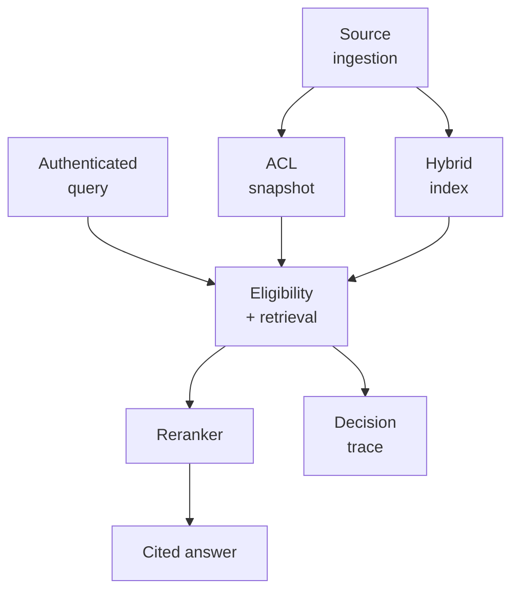

---
{
  "id": "ai-lab-system-design-interview",
  "title": "AI Lab System Design Interview",
  "slug": "ai-lab-system-design-interview",
  "section": "AI System Design & Interviewing",
  "category": "System Design",
  "difficulty": "Hard",
  "order": 7,
  "companies": [
    "Frontier AI Labs",
    "OpenAI",
    "Google DeepMind",
    "Meta AI"
  ],
  "shortDescription": "Design multi-model LLM gateways, paged GPU serving fleets, ACL-enforced retrieval, and reversible canary deployments under strict tail-latency SLOs.",
  "keyConceptsTested": [
    "AI/backend requirement discovery",
    "Scale and token math",
    "API and data model design",
    "Backpressure and overload behavior",
    "Permission-aware tool and data access",
    "Observability, release checks, and eval-driven launches"
  ],
  "prerequisites": [
    "design-multi-tenant-llm-serving-platform",
    "design-llm-powered-search-engine",
    "design-production-rag-pipeline",
    "llm-deployment-gpu-serving-autoscaling",
    "ai-lab-coding-interview-python-systems"
  ],
  "relatedQuestions": [
    "function-calling-tool-use-llms",
    "llm-deployment-gpu-serving-autoscaling",
    "llm-cost-engineering-token-economics",
    "agent-failure-states-retry-fallback"
  ]
}
---

At minute twelve of an AI lab system design round, your whiteboard holds an API gateway, GPU workers, and a vector index. Then the interviewer asks: an under-quota tenant hits a queue that will miss its first-token SLO. What status code returns, which stage owns that call, and what trace lets on-call engineers inspect it? Giving every box a numeric budget, an owner, a decision trace, and a recovery path turns boxes into an architecture.

In [AI Lab Coding Interview: Python Systems](/learn/ai-lab-coding-interview-python-systems), we built single-node KV allocators and batch loops; here that ownership scales to distributed inference. We carry one product throughout: an internal multi-provider model gateway, then layer on permission-aware retrieval and a long-running coding agent as follow-ups. OpenAI's public interviewing guidance emphasizes clear reasoning adapted to the role, so confirm scope with your recruiter.[^openai2026interview]

> **Key insight:** Separate the control plane (entitlements, routing rules, quotas, canary weights) from the data plane (live routing, retrieval, inference, agent execution). State what fails closed whenever a control store is stale or unreachable.

## Start with a constraint

Begin with one dominant constraint and earn every box: keep the first sketch small, size the main bottleneck early, and add queues, caches, or sharding only when required. Walk ten beats in order:

1. **Goal:** caller and success metric.
2. **Requirements:** behavior plus latency, freshness, and privacy targets.
3. **Scale:** <span data-glossary="qps">QPS</span>, <span data-glossary="token-budget">tokens</span>, tenants, docs, latency, retention.
4. **API:** external <span data-glossary="api-contract">API schema</span> and internal interfaces.
5. **<span data-glossary="data-model">Data model</span>:** durable entities, indexes, tenant isolation.
6. **Architecture:** smallest working <span data-glossary="request-path">request path</span>.
7. **Reliability:** retries, <span data-glossary="idempotency">idempotency</span>, <span data-glossary="backpressure">backpressure</span>, load shedding, failover.
8. **Security and safety:** permissions, traces, abuse limits, fast reverts.
9. **<span data-glossary="observability">Observability</span>:** metrics, logs, traces, support lookup.
10. **Deployment:** beta flags, <span data-glossary="canary-rollout">canaries</span>, eval checks, <span data-glossary="kill-switch">kill switches</span>.

## Let the pressure choose the pattern

One dominant pressure anchors the first sketch:

| Pattern | Signal | Core moves | Follow-up pressure |
|---|---|---|---|
| Model gateway | multi-provider, keys, <span data-glossary="quota">quotas</span> | auth, entitlements, routing, quota buckets, trace | streaming, fallback opt-in, spend caps |
| Inference scheduler | latency, GPUs, overload | bounded queue, batcher, KV accounting | tail latency, preemption, `429`/`503` |
| Enterprise retrieval | docs, ACLs, citations | connectors, ACL snapshots, pre-retrieval filter | revocation lag, fail closed, tombstones |
| Agent platform | long tasks, repo writes | state machine, sandbox, tool allowlist | cancellation, retries, secret redaction |
| Eval and release | launch checks, red team | offline suites, canary controller, rollback | slice drops, typed metric checks |

Our gateway earns retrieval only when private documents enter the prompt, and an agent state machine only when tasks run repository side effects.

## Let follow-ups move a boundary

Name what shifted, which stage owns it, and how telemetry verifies it:

| Follow-up | Strong move | Weak move |
|---|---|---|
| "Traffic spikes 10x" | rate limits, wait cap, tier fairness, `429`/`503` | unbounded queues |
| "Permissions change fast" | ACL freshness cap, tombstones, fail-closed sources | retrieve then filter |
| "Provider is down" | opted-in fallback, circuit breaker, degraded notice | silent model swap |
| "Users cancel mid-run" | durable cancel intent, cooperative stop, sandbox kill | UI-only stop button |
| "Support asks why" | request ID, config version, route, retrieved IDs | raw unstructured logs |
| "Eval passes, users complain" | slice analysis, canary metrics, regression case | trust offline average |

## Put one number on the board

Write one load-bearing calculation with explicit units, note what it omits, and state which layer changes at 5x load: gateway (RPM, TPM, max output), retrieval (docs, chunks, index bytes, ACL refresh), scheduler (arrival rate, service time, queue wait, HBM), or agent service (concurrent sandboxes, duration, artifact bytes).

## Size model memory before drawing workers

Once self-hosted GPUs enter, put fixed weights ($M_\text{weights} = P \times b$) and linear KV cache ($M_\text{token} = 2 \times n_\text{layers} \times n_\text{KV heads} \times d_\text{head} \times p_\text{bytes}$, summed across active lengths $\sum_i S_i$) on the board. For the full memory and bandwidth derivation, see [Inference Mechanics: TTFT, TPS, and KV Cache](/learn/inference-mechanics-ttft-tps-kv-cache). Keep decimal GB ($10^9$) distinct from GiB ($2^{30}$), and leave headroom for activations, workspaces, and block rounding.

For an 8B <span data-glossary="bf16">BF16</span> model (32 layers, $d_\text{head}=128$) at batch 16 and 2,048 tokens, weights occupy **16.0 GB**, multi-head attention (32 KV heads, 524,288 B/token) needs **17.2 GB**, and Llama 3 8B's <span data-glossary="grouped-query-attention">GQA</span> (8 KV heads, 131,072 B/token) cuts KV to **4.3 GB** (an architecture choice, not a runtime flag).[^dubey2024][^ainslie2023]

<figure>

<figcaption>At batch 16 and 2K tokens, MHA KV (17.2 GB) exceeds weights (16.0 GB); 8-head GQA drops KV to 4.3 GB.</figcaption>
</figure>

## Leave a decision trail

| Decision | Chosen | Rejected | Reversal signal |
|---|---|---|---|
| Queue placement | before provider call | inside each adapter | adapter-specific SLO |
| Retrieval ACL | before rerank/generation | post-generation filter | none for sensitive docs |
| Fallback model | explicit opt-in | silent auto-swap | customer opt-in |
| Agent repo writes | patch + human review | direct branch push | reversible narrow scope |

## Rehearse the board as a sequence

Front-load the dominant constraint and bottleneck math so the second half covers failure modes rather than basic boxes.

<details>
<summary>Deep dive: 45-minute whiteboard pacing</summary>

| Window | Output |
|---:|---|
| 0-9 min | goal, users, success metric, functional/non-functional bounds |
| 9-14 min | one scale calculation exposing the main bottleneck |
| 14-28 min | API, durable data model, smallest working request path |
| 28-40 min | overload (`429`/`503`), ACLs, support trace, eval/canary release |
| 40-45 min | tradeoffs, reversal signals, follow-ups |

</details>

## Turn requirements into boundaries

Name the user, promise, and clarifying questions that alter architecture before expanding each blueprint.

### Prompt 1: model gateway for enterprise teams

Internal multi-provider LLM gateway enforcing API keys, entitlements, RPM/TPM/spend caps, beta flags, and support request IDs under 10x spikes. **Ask:** streaming vs. batch mix, hard vs. soft spend caps, top support failure.

<details>
<summary>Deep dive: Model gateway blueprint</summary>

- **API & data:** `POST /v1/responses`, `GET /v1/requests/{id}`; org, workspace, key, routing config, entitlement, usage bucket, request trace.
- **Path & overload:** gateway -> auth -> atomic quota reservation -> routing -> bounded queue -> adapter -> stream; `429` caller quota, `503` shared saturation, grounded `Retry-After`.

</details>

### Prompt 2: permission-aware enterprise retrieval

Internal Q&A over heterogeneous ACL sources with fast revocations, citations, zero post-generation filtering, and admin eligibility traces. **Ask:** revocation freshness target, tenant index isolation, fail-closed sensitive sources.

<details>
<summary>Deep dive: Retrieval blueprint</summary>

- **Index & query:** immutable doc versions + ACL snapshots + immediate deletion tombstones; query runs auth -> freshness + eligible filter -> hybrid search -> rerank -> cited answer, failing closed on stale ACLs.

</details>

### Prompt 3: long-running coding agent service

Async coding agent (up to 30 min) with live progress streams, cancellation, diff review, and isolated secrets. **Ask:** patch artifact vs. direct push, network egress, mid-tool cancellation.

<details>
<summary>Deep dive: Coding agent blueprint</summary>

- **State & isolation:** `queued -> provisioning -> running -> blocked / review -> failed / canceled / complete`; scoped <span data-glossary="sandbox">sandbox</span>, short-lived creds, log redaction; reconcile timed-out writes unless receiver idempotency is verified;[^awsIdempotentApis2026] separate cancel intent from confirmed exit.

</details>

## Request admission owns overload

Mint a server-generated `request_id` *before* auth so rejected calls stay traceable. Authenticate, check entitlements, atomically reserve quota, and check shared capacity: over-quota callers get `429` even on idle GPUs; eligible callers hitting a full fleet get `503`.[^rfc6585RateLimit2012][^rfc9110ServiceUnavailable2022]


Aggregate demand sizes the fleet, while hard spend caps require **per-request atomic reservations** (input + max output at upper-bound tariffs, since prompt cache writes can cost more than uncached input[^openai2026promptcaching]), reconciling confirmed usage strictly once per `request_id` and holding disconnected reservations pending until settlement:

<!-- leetllm: test, output=show -->
```python title="gateway-quota-budget.py"
tpm = 4_000 * (1_200 + 450)
tps, cap = tpm / 60, 125_000
bal, res, actual = 10_000, 1_800, 1_520
print(f"tpm={tpm:,} tps={round(tps):,} headroom={round(cap - tps):,} ({(cap - tps) / cap * 100:.1f}% unused)")
print(f"quota: after_reserve={bal - res:,} refund=+{res - actual} final={bal - actual:,}")
```

<!-- leetllm: output:start -->
```text title="Output" output compact
tpm=6,600,000 tps=110,000 headroom=15,000 (12.0% unused)
quota: after_reserve=8,200 refund=+280 final=8,480
```
<!-- leetllm: output:end -->

## Queueing changes the latency promise

Letting long prompts onto a busy worker stalls active streams; bound queue depth to protect tail latency. For full queueing and scheduling mechanics, see [Inference Mechanics: TTFT, TPS, and KV Cache](/learn/inference-mechanics-ttft-tps-kv-cache) and [Continuous Batching & Request Scheduling](/learn/continuous-batching-request-scheduling).

### Separate prefill from decode

<span data-glossary="prefill">Prefill</span> (compute-bound, driving <span data-glossary="ttft">TTFT</span>, skipping cached prefixes[^openai2026promptcaching]) and decode (bandwidth-bound, driving <span data-glossary="itl">ITL</span> and <span data-glossary="tpot">TPOT</span>) contend on shared GPUs. Chunked prefill caps prompt tokens per step; DistServe defines **goodput** (requests/s meeting both TTFT and TPOT) and disaggregates prefill and decode pools at the cost of KV transfer bandwidth.[^zhong2024]

### Name the metric that can fail

Always specify metric, percentile, unit, and hardware/workload setup: **TTFT** (arrival to first token), **ITL / TBT** (individual inter-token gaps, tracked at p95/p99), **TPOT** (`(t_last - t_first) / (N - 1)` for $N > 1$, undefined for 1 token), and **goodput / <span data-glossary="tokens-per-second">TPS</span>** (explicitly per-request vs. fleet aggregate, paired with `429`/`503` rates and <span data-glossary="p95-latency">p95</span>/p99 latency).

### Choose a serving lever by failure mode

| Lever | Fixes | Reach for it when |
|---|---|---|
| <span data-glossary="pagedattention">PagedAttention</span> | KV fragmentation | Long contexts exhaust contiguous KV |
| <span data-glossary="continuous-batching">Continuous batching</span> | Idle batch slots | Mixed lengths stall static batches[^nvidia2026tensorrtllmifb] |
| Prefix / radix cache | Repeated prefill | Shared system prompts or history |
| Speculative decoding | Bandwidth-bound decode | Cheap draft yields high acceptance |
| Chunked prefill | Prefill pausing decode | Long prompts spike ITL |
| Disaggregation | Prefill/decode contention | Shared pool misses TTFT + ITL |

Continuous batching governs *when* sequences join/exit; paged attention governs *how* KV blocks allocate. Prefix cache hits require both **numerical compatibility** (exact tokens, positions, model, adapter, layout) and **current read access** to the private source document.

### Model-fit scale math

Map sharding to physical links: <span data-glossary="tensor-parallelism">TP</span> needs NVLink bandwidth for all-reduces, <span data-glossary="pipeline-parallelism">PP</span> crosses slower links with pipeline bubbles, and <span data-glossary="expert-parallelism">EP</span> shards <span data-glossary="mixture-of-experts">MoE</span> experts.

At `125,000` tok/s, `20,000` queued tokens clear in `0.16 s` (<= `0.25 s` cap) while `50,000` wait `0.40 s` and return `503`. Check prefill wait, active decode slots (`< max_decode`), and free KV blocks (`>= needed`) atomically before claiming resources (since queue wait is only part of TTFT and concurrent passing checks against one slot must serialize):

<figure>

<figcaption>Load shedding caps accepted wait under 0.25 s with 503; caller quota returns 429 at zero queue wait.</figcaption>
</figure>

<!-- leetllm: test, output=show -->
```python title="scheduler-capacity.py"
can_wait = lambda q, tps, cap: (q / tps) <= cap
can_accept = lambda b, ptps, act, mdec, fkv, nkv, cap: can_wait(b, ptps, cap) and act < mdec and fkv >= nkv

print("20k@125k:", can_wait(20_000, 125_000, 0.25), "| 50k@125k:", can_wait(50_000, 125_000, 0.25))
print("ok:", can_accept(10_000, 80_000, 48, 64, 120, 16, 0.25),
      "full:", can_accept(10_000, 80_000, 64, 64, 120, 16, 0.25),
      "low_kv:", can_accept(10_000, 80_000, 48, 64, 10, 16, 0.25))
```

<!-- leetllm: output:start -->
```text title="Output" output compact
20k@125k: True | 50k@125k: False
ok: True full: False low_kv: False
```
<!-- leetllm: output:end -->

## Permissions belong before retrieval

Post-generation filtering cannot undo a leak once a revoked doc enters an external reranker or prompt. Pair a strict ACL snapshot freshness limit with authoritative revocations (overriding cached grants) and deletion tombstones, failing closed when snapshot age is stale or unknown:



<!-- leetllm: test, output=show -->
```python title="acl-eligibility.py"
fresh = lambda age, lim: age is not None and 0 <= age <= lim
docs = [
    {"id": "public-access-policy", "g": {"employees"}, "del": False, "s": 0.82},
    {"id": "finance-plan", "g": {"finance"}, "del": False, "s": 0.99},
    {"id": "old-handbook", "g": {"employees"}, "del": True, "s": 0.95},
]
eligible = [d["id"] for d in sorted(docs, key=lambda x: x["s"], reverse=True) if not d["del"] and (d["g"] & {"employees"})]
print("fresh(20,90,None):", [fresh(a, 60) for a in (20, 90, None)], "| eligible:", eligible)
```

<!-- leetllm: output:start -->
```text title="Output" output compact
fresh(20,90,None): [True, False, False] | eligible: ['public-access-policy']
```
<!-- leetllm: output:end -->

<figure>

<figcaption>High similarity never overrides missing access or tombstones; only public-access-policy reaches reranking.</figcaption>
</figure>

## Durable state bounds agent side effects

Persist legal transitions with atomic expected-state claims (CAS) so terminal states (`failed`, `canceled`, `complete`) never reopen; follow-up work opens a new attempt ID. Separate cancel intent from confirmed sandbox exit and enforce <span data-glossary="permission-boundary">tool scopes</span>. Pure reads (`repo_read`) retry automatically; writes (`sandbox_provision`, `create_commit`, `post_comment`) replay only when verified receiver config guarantees idempotency with literal boolean `True` (`is True`, rejecting strings like `"False"` or `"True"`).[^awsIdempotentApis2026]

<!-- leetllm: test, output=show -->
```python title="agent-state-and-retry.py"
NEXT = {
    "queued": {"provisioning", "canceled"}, "provisioning": {"running", "failed", "canceled"},
    "running": {"blocked", "review", "failed", "canceled"}, "blocked": {"running", "review", "failed", "canceled"},
    "review": {"running", "complete", "canceled"}, "failed": set(), "canceled": set(), "complete": set(),
}

def retry_mode(act: str, idemp: object = False) -> str:
    if act == "repo_read":
        return "automatic"
    if act in {"sandbox_provision", "create_commit", "post_comment"} and idemp is True:
        return "automatic-with-idempotency"
    return "reconcile-or-review"

print("transitions:", [(a, b, b in NEXT[a]) for a, b in (("running", "review"), ("review", "failed"), ("complete", "running"))])
for act, flg in [("repo_read", False), ("create_commit", False), ("post_comment", True), ("create_commit", "False")]:
    print(f"{act:14s} idemp={flg!r:7s} -> {retry_mode(act, flg)}")
```

<!-- leetllm: output:start -->
```text title="Output" output compact
transitions: [('running', 'review', True), ('review', 'failed', False), ('complete', 'running', False)]
repo_read      idemp=False   -> automatic
create_commit  idemp=False   -> reconcile-or-review
post_comment   idemp=True    -> automatic-with-idempotency
create_commit  idemp='False' -> reconcile-or-review
```
<!-- leetllm: output:end -->

## Evaluation becomes a release boundary

Every failed or missing required check blocks launch, and postmortem cases join the regression suite.[^neurips2026paperChecklist] Verify echoed evaluator minima against the host's `REQUIRED_MINIMA`, and check `type(leaks) is int and leaks == 0` because Python treats `False == 0` as `True`. For online canaries, any confirmed leak (`> 0`) triggers immediate `"rollback"` even while perf metrics are pending; missing metrics, `error_rate > 0.01`, or `p95 > 900` return `"hold"`; clean windows within inclusive limits return `"expand"`.

<!-- leetllm: test, output=show -->
```python title="release-and-canary.py"
MINIMA = {"retrieval_recall": 0.92, "citation_faithfulness": 0.95}

def launch_failures(checks: dict[str, tuple[float, float]], leaks: object) -> list[str]:
    fails = [k for k, req in MINIMA.items()
             if not (r := checks.get(k)) or len(r) != 2 or not (0 <= r[0] <= 1 and 0 <= r[1] <= 1) or r[1] != req or r[0] < req]
    if type(leaks) is not int or leaks != 0:
        fails.append("permission_leaks")
    return fails

def canary(err: float | None, p95: float | None, leaks: int | None) -> str:
    if type(leaks) is not int or leaks < 0:
        return "hold"
    if leaks > 0:
        return "rollback"
    if err is None or p95 is None or not (0 <= err <= 1) or p95 < 0 or err > 0.01 or p95 > 900:
        return "hold"
    return "expand"

print("altered:", launch_failures({"retrieval_recall": (0.94, 0.92), "citation_faithfulness": (0.93, 0.0)}, 0))
print("bool:   ", launch_failures({"retrieval_recall": (0.94, 0.92), "citation_faithfulness": (0.97, 0.95)}, False))
print("canary: ", [canary(*x) for x in [(0.004, 720, 0), (None, None, 1), (None, 720, 0), (0.0104, 780, 0)]])
```

<!-- leetllm: output:start -->
```text title="Output" output compact
altered: ['citation_faithfulness']
bool:    ['permission_leaks']
canary:  ['expand', 'rollback', 'hold', 'hold']
```
<!-- leetllm: output:end -->

## Test attractive shortcuts

| Shortcut | Missing condition | Stronger answer |
|---|---|---|
| "Static batching suffices" | Mixed lengths idle slots | Continuous batching schedules mid-flight; paged attention fixes KV fragmentation.[^nvidia2026tensorrtllmifb][^kwon2023] |
| "Only Slurm schedules GPUs" | Serving needs dynamic autoscaling | Kubernetes + <span data-glossary="kuberay">KubeRay</span> unifies training and inference.[^ray2026kuberay] |
| "Quantization ruins quality" | Calibrated AWQ/GPTQ preserves tasks | FP8 halves BF16 weights; validate quality and kernels on target GPUs.[^lin2023][^gptq2023] |

## Make failure visible on the board

Check six blind spots before stepping back: **technology before goal** (size the user promise first), **unbounded caches** (add invalidation, freshness, tenant isolation), **vague monitoring** (exact metrics, units, percentiles, owners), **silent overload** (`429`/`503` with request IDs and traces), **safety as a slogan** (pre-retrieval ACLs, regressions, reversible canaries), and **unbounded agent retries** (durable CAS + verified idempotency). If every arrow answers *"what happens when this fails?"*, your board is ready.

```mastery-quiz
[
  {
    "question": "A replica has 6B weights (2 B each), 24 layers, 4 KV heads, d_head=128, 2 B/element. Three requests retain 512, 1,536, and 2,048 tokens with no sharing. Weights (decimal GB) and KV cache (GiB)?",
    "options": ["12 GB; 0.09375 GiB", "36 GB; 0.1875 GiB", "12 GB; 0.1875 GiB", "36 GB; 0.09375 GiB"],
    "answer": "12 GB; 0.1875 GiB",
    "explanation": "Shared weights = 12 GB. KV/tok = 2*24*4*128*2 = 49,152 B; 4,096 tok = 201,326,592 B / 2^30 = 0.1875 GiB."
  },
  {
    "question": "Bucket starts at 7,000. Request r7 reserves 1,200, uses 930, and webhook arrives twice. Independently from 7,000, r8 reserves 1,200 and disconnects unsettled. Available tokens?",
    "options": ["6,340 / 5,800", "6,070 / 5,800", "6,070 / 7,000", "6,340 / 7,000"],
    "answer": "6,070 / 5,800",
    "explanation": "r7 refunds 270 once (6,070); r8 stays pending at 5,800 until provider usage settles."
  },
  {
    "question": "Request A is under quota (18k backlog at 90k/s <=0.25s, 64/64 decode slots full, 10/10 KV free). Request B exceeds caller quota on idle GPUs. Status codes?",
    "options": ["A queued; B 429.", "A 503; B 503.", "A 429; B 503.", "A 503; B 429."],
    "answer": "A 503; B 429.",
    "explanation": "A hits full decode slots (503 shared saturation); B exceeds caller quota (429)."
  },
  {
    "question": "Stream starts at 60 ms; four output tokens arrive at 240, 345, 465, 480 ms. TTFT, TPOT, and max ITL?",
    "options": ["180, 80, 120 ms", "420, 60, 120 ms", "420, 80, 105 ms", "180, 60, 105 ms"],
    "answer": "180, 80, 120 ms",
    "explanation": "TTFT = 180 ms; gaps 105, 120, 15 ms give TPOT = 240/3 = 80 ms and max ITL = 120 ms."
  },
  {
    "question": "Payroll ACL snapshot arrives at 0 s (granted), refreshes at 52 s (granted), and authority revokes + notifies at 60 s. Max age 30 s. Searches at 20, 50, 70 s. When may payroll reach reranking?",
    "options": ["20 s and 70 s", "20 s only", "20 s and 50 s", "20, 50, 70 s"],
    "answer": "20 s only",
    "explanation": "20 s is fresh/granted; 50 s is stale (>30 s); 70 s is overridden by the 60 s revocation."
  },
  {
    "question": "Private prefix entry for doc D4 stores tokens [13,5,21] at positions [8,9,10]. With matching tenant/model/layout, which lookup may reuse it?",
    "options": [
      "Positions [7,8,9], access {D4,D6}",
      "Positions [8,9,10], access {D6}",
      "Positions [8,9,10], access {D4,D6}",
      "Positions [7,8,9], access {D6}"
    ],
    "answer": "Positions [8,9,10], access {D4,D6}",
    "explanation": "Reuse requires exact positions [8,9,10] and current read access to D4."
  },
  {
    "question": "Attempt r21 is `review` (legal: running, complete, canceled). W1 expects `running`->`canceled`; W2 expects `review`->`failed`. Attempt r22 is `complete`. Which commit, and how is later r22 work tracked?",
    "options": ["W1 only; new attempt.", "Neither; new attempt.", "W2 only; reopen r22.", "Neither; reopen r22."],
    "answer": "Neither; new attempt.",
    "explanation": "W1 fails expected-state match; W2 is an illegal transition; terminal r22 stays closed and later work uses a new attempt."
  },
  {
    "question": "Replies are lost for four transient calls with verified idempotency settings (quoted values are strings). Which requires reconciliation/review before retry?",
    "options": ["repo_read, \"True\"", "sandbox_provision, True", "repo_read, True", "sandbox_provision, \"True\""],
    "answer": "sandbox_provision, \"True\"",
    "explanation": "sandbox_provision mutates state and string \"True\" is not literal boolean True."
  },
  {
    "question": "Host requires recall >=0.94, faithfulness >=0.96, exact echoed minima, and integer 0 leaks. Packet format: recall (obs,min), faithfulness (obs,min), leaks. Which passes?",
    "options": [
      "(0.98,0.94), (0.97,0.96), False",
      "(0.98,0.96), (0.97,0.96), 0",
      "(0.98,0.94), (0.97,0.96), 0",
      "(0.98,0.96), (0.97,0.96), False"
    ],
    "answer": "(0.98,0.94), (0.97,0.96), 0",
    "explanation": "Scores pass, echoed minima match 0.94/0.96, and 0 is integer rather than boolean False."
  },
  {
    "question": "Canary expands at <=1% errors, <=900 ms p95, 0 leaks; >0 leaks rolls back. East: 26/2,500 err, 780 ms, 0 leaks. North: 24/2,400 err, 900 ms, 0 leaks. West: pending perf, 2 leaks. Proposed: expand East/North, rollback West. Fix?",
    "options": [
      "Hold North; keep others.",
      "Keep all three.",
      "Hold East; keep others.",
      "Hold East and West; keep North."
    ],
    "answer": "Hold East; keep others.",
    "explanation": "East is 1.04% (>1%) so hold; North sits at inclusive 1.00% and 900 ms (expand); West rolls back on leaks."
  }
]
```

> **Next:** Continue to [Deep Dive - PyTorch](/learn/deep-dive-pytorch).
