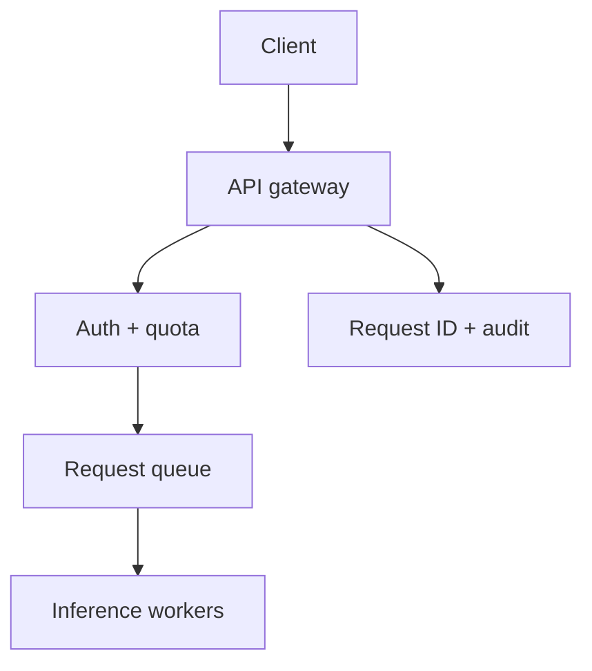
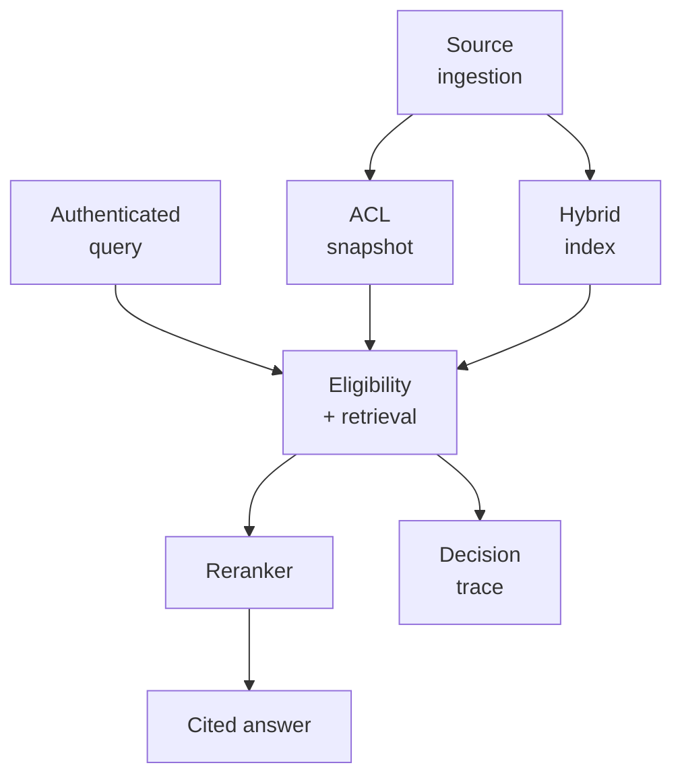

---
{
  "id": "ai-lab-system-design-interview",
  "title": "AI Lab System Design Interview",
  "slug": "ai-lab-system-design-interview",
  "section": "AI Lab Interviewing",
  "category": "System Design",
  "difficulty": "Hard",
  "order": 2,
  "companies": [
    "Frontier AI Labs",
    "OpenAI",
    "Google DeepMind",
    "Meta AI"
  ],
  "shortDescription": "Design multi-model LLM gateways, paged GPU serving fleets, ACL-enforced retrieval, and reversible canary rollouts under strict tail-latency SLOs.",
  "keyConceptsTested": [
    "AI/backend requirement discovery",
    "Scale and token math",
    "API and data model design",
    "Backpressure and overload behavior",
    "Permission-aware tool and data access",
    "Observability, rollout gates, and eval-driven launch"
  ],
  "prerequisites": [
    "design-multi-tenant-llm-serving-platform",
    "design-llm-powered-search-engine",
    "enterprise-rag-security-rbac-access-control",
    "llm-deployment-gpu-serving-autoscaling",
    "ai-lab-coding-interview-python-systems"
  ],
  "relatedQuestions": [
    "mcp-tool-protocol-standards",
    "observability-monitoring-llm-systems",
    "model-gateways-routing-fallbacks",
    "agent-failure-states-retry-fallback"
  ]
}
---

At minute twelve, your board already has an API gateway, GPU workers, and a vector index. The interviewer asks a question those boxes leave open. An under-quota tenant faces a queue that will miss its first-token SLO. What does the client receive, who owns that decision, and what can support inspect afterward? Give each component a numeric target, an owner, a decision trace, and a recovery path so the diagram explains the running system.

In [AI Lab Coding Interview: Python Systems](/learn/ai-lab-coding-interview-python-systems), we built single-node KV-cache allocators, masked attention, nucleus sampling, and bounded batch loops. Here that ownership scales up into distributed inference architecture. We'll keep one running product: an internal model gateway that teams use to call multiple LLM providers. Later follow-ups add permission-aware retrieval and a long-running coding agent, so the first sketch has to survive privacy, latency, cancellation, and rollout pressure.

Use these cases to practice. OpenAI's public guide, checked October 10, 2026, emphasizes clear reasoning and communication, while assessment format depends on the role and team. Confirm the duration and scope with your recruiter; use the rehearsal schedule below as an adjustable exercise.[^openai2026interview]

Keep the control plane separate from the data plane in your explanation. Entitlements, route policy, model registry, quota configuration, and rollout state change relatively slowly; request routing, retrieval, provider calls, and agent execution carry traffic. When a policy changes or its control store is unavailable, point to how the data plane receives the decision and what fails closed. That question turns a diagram box into a verifiable operating stage.

## Start with a constraint

Begin with a constraint, then add components as the requirements call for them:

> I'll keep the first design simple, size the constraints early, then add queues, caches, sharding, model routing, or eval gates only when the requirement forces them.

Treat the board as a chain of commitments. Each step supplies a fact for the next: a latency SLO bounds queue and GPU capacity, while a retrieval requirement earns an index. Say what artifact will prove each commitment when the system runs.

1. Goal: who uses it and what success means.
2. Requirements: functional and non-functional.
3. Scale: <span data-glossary="qps">QPS</span>, <span data-glossary="token-budget">tokens</span>, tenants, documents, latency, retention.
4. API: external <span data-glossary="api-contract">API schema</span> and important internal interfaces.
5. <span data-glossary="data-model">Data model</span>: entities, indexes, isolation, retention.
6. Architecture: simplest <span data-glossary="request-path">request path</span> first.
7. Reliability: retries, <span data-glossary="idempotency">idempotency</span>, <span data-glossary="backpressure">backpressure</span>, overload, failover.
8. Safety/security: permissions, audit, abuse controls, <span data-glossary="rollback">rollback</span>.
9. <span data-glossary="observability">Observability</span>: metrics, logs, traces, support views.
10. <span data-glossary="rollout">Rollout</span>: beta gates, <span data-glossary="canary-rollout">canaries</span>, eval gates, <span data-glossary="kill-switch">kill switches</span>.

The order also gives you a way to communicate under interruption. If the interviewer jumps to sharding, tie it back to the model, traffic shape, and SLO; if they jump to safety, tie it back to the actor, permission scope, and audit record. The answer stays understandable because each new box has a reason to exist.

```checkpoint
Why start with the goal instead of Kafka, GPUs, or vector databases?
---
Because the right infrastructure depends on the product goal and constraints. A support lookup, a long-running coding task, and a model-serving scheduler have different latency, reliability, privacy, and eval requirements.
```

## Let the pressure choose the pattern

An AI/backend design can combine several patterns, but one constraint usually deserves attention first. A quota problem calls for rate and queue control, an access-control list (ACL) calls for eligibility checks, and an irreversible action calls for durable state plus explicit authorization.

| Pattern | Prompt signal | Architecture moves | Follow-up pressure |
|---|---|---|---|
| Model gateway | multi-provider, teams, API keys, <span data-glossary="quota">quotas</span> | auth, entitlements, route policy, quota buckets, request log | streaming, fallback semantics, budget caps, support replay |
| Inference scheduler | latency, batching, GPUs, overload | request queue, batcher, worker pool, KV/cache accounting, fairness | tail latency, starvation, preemption, 429 vs 503 policy |
| Permission-aware retrieval | enterprise docs, ACLs, deletion, citations | source connectors, ACL snapshots, filtered retrieval, audit trail | revocation SLO, fail closed, hybrid search, stale index |
| Agent execution platform | long-running tasks, tools, repo access | task state machine, sandbox, tool policy, event log, artifacts | cancellation, retries, secret handling, human review |
| Eval and rollout gate | quality launch, regressions, red team | offline evals, golden sets, canary gates, rollback triggers | slice failures, noisy judges, metric ownership |
| Data ingestion platform | connectors, freshness, normalization | ingestion jobs, versioned records, dead-letter queue, backfill | schema drift, reprocessing, dedupe, deletion |
| Observability and support | request IDs, incidents, "why did this happen?" | traces, decision records, support views, replayable metadata | privacy-safe debugging, retention, sampling |
| Abuse and safety control | policy, misuse, irreversible actions | policy engine, rate limits, review queues, kill switches | false positives, bypass attempts, emergency disable |

Use the table to keep the first design narrow. A model gateway earns a vector database only when retrieval enters the product. Retrieval earns agent planning only when the user asks the system to act. Our running product crosses the first four rows in that order, so each follow-up adds a pressure instead of invalidating the original interface. What should move when the interviewer changes the requirement?

## Adapt the architecture to follow-ups

Treat each follow-up as a changed requirement. Name what changed, adjust the owning stage, and state the telemetry or rollback signal that proves the move worked.

| Follow-up | Good move | Bad move |
|---|---|---|
| "Traffic spikes 10x" | rate limits, queue SLO, tier fairness, explicit `429` or `503` cause | unlimited queues |
| "Permissions change quickly" | ACL freshness SLO, tombstones, fail-closed sensitive sources | retrieve first, filter after generation |
| "Provider is down" | policy-approved fallback, circuit breaker, surfaced degraded mode | silently change model behavior |
| "Users need cancellation" | durable cancel flag, cooperative checks, sandbox termination | best-effort UI button only |
| "Support asks why" | request ID, policy version, route decision, retrieved IDs, trace | raw logs with no decision record |
| "Eval passes but users complain" | slice analysis, online canary metrics, incident cases into regression suite | argue offline eval is enough |
| "Costs doubled" | token accounting, cache hit tracking, model route policy, budget alerts | vague autoscaling |

That three-part answer keeps the design conversational. The interviewer can challenge a trade-off, and you can point to the queue, policy record, metric, or recovery action that would settle it. Which number makes that stage load-bearing?

## Put one number on the board

One back-of-the-envelope calculation gives the diagram a load-bearing assumption. Keep units visible, name what the estimate leaves out, and say which component changes when the number moves.

| System | Minimum math |
|---|---|
| Gateway | requests/minute, tokens/minute, worst-case output cap |
| Retrieval | documents, chunks/document, embedding storage, update rate |
| Scheduler | arrival rate, average service time, queue wait, GPU memory |
| Agent service | concurrent jobs, sandbox time, log/artifact storage, retry budget |
| Eval platform | examples per suite, runs per release, judge/model cost |
| Voice/chat | p95 latency budget split across network, model, tools, synthesis |
| Ingestion | source QPS, backfill duration, dedupe key cardinality |

Use this phrasing when an assumption is still rough:

> I'll size the constraint that most affects the design. If that assumption changes, the architecture layer I would revisit is `X`.

For a gateway that only calls hosted models, the load-bearing number is often a provider quota or a measured latency. What has to go on the board when the interviewer asks you to run the model yourself?

## Size model memory before drawing workers

The gateway might call hosted providers only. In that case, provider quotas and latency measurements matter more than GPU sizing. If the interviewer adds self-hosted inference, put two budgets on the board: fixed weight memory and per-request key/value (KV) cache growth. These are storage estimates, not throughput benchmarks.

Eight billion parameters at two bytes each occupy 16 billion bytes, or 16 decimal GB. Double the concurrent requests and those loaded weights stay the same size. That fixed term is the parameter count times the bytes per parameter:

$$
M_\text{weights} = P \times b
$$

Here $P$ is the parameter count and $b$ is bytes per stored parameter: 2 for <span data-glossary="fp16">16-bit floating point (FP16)</span> or <span data-glossary="bf16">brain floating point (BF16)</span>, 1 for <span data-glossary="fp8">8-bit floating point (FP8)</span>. Quantization scales, unquantized tensors, and runtime allocations add overhead. Decimal GB uses $10^9$ bytes; GiB uses $2^{30}$ bytes.

The cache grows as requests retain more tokens. In a 32-layer model with 8 KV heads, each 128 values wide, one BF16 token needs $2 \times 32 \times 8 \times 128 \times 2 = 131{,}072$ bytes: 128 KiB. Count keys and values in each layer to generalize that calculation:

$$
M_\text{token} = 2 \times n_\text{layers} \times n_\text{KV heads} \times d_\text{head} \times p_\text{bytes}
$$

The leading 2 counts key and value; $n_\text{layers}$ counts layers, $n_\text{KV heads}$ counts stored KV heads, $d_\text{head}$ is values per head, and $p_\text{bytes}$ is bytes per value. For $B$ requests each retaining $S$ tokens, multiply by $B S$:

$$
M_\text{KV} = 2 \times B \times S \times n_\text{layers} \times n_\text{KV heads} \times d_\text{head} \times p_\text{bytes}
$$

For unequal request lengths, replace $B S$ with their sum. This full-attention estimate covers independent full histories; prefix sharing, sliding-window eviction, compression, and cache sharding change the allocation. Block allocation also rounds storage upward. Count retained prompt and generated tokens, including generated output.

Use a Llama 3 8B-shaped sketch so the scale is concrete: 32 layers, 32 query heads, head dimension 128, BF16. The first KV line is a multi-head-attention counterfactual with 32 key/value heads. Llama 3 8B uses <span data-glossary="grouped-query-attention">grouped-query attention (GQA)</span>, sharing 8 key/value heads across those 32 query heads, which is the memory lever to test.[^dubey2024][^ainslie2023]

Compare weights against KV allocations as concurrency scales: the weight bar stays fixed for a loaded replica, whereas KV consumption grows linearly with batch size and retained sequence length, turning HBM capacity directly into a queueing limit.

<!-- leetllm: test, output=show -->
```python title="serving-memory-math.py"
params = 8_000_000_000
bytes_per_param = 2  # FP16 or BF16
weights_gb = params * bytes_per_param / 1e9

n_layers, d_head, p_bytes = 32, 128, 2
n_kv_heads_mha = 32  # MHA counterfactual: one KV head per query head
kv_bytes_per_token = 2 * n_layers * n_kv_heads_mha * d_head * p_bytes
batch, seq = 16, 2048
kv_gb = kv_bytes_per_token * batch * seq / 1e9

n_kv_heads_gqa = 8  # Llama 3 8B GQA
kv_bytes_per_token_gqa = 2 * n_layers * n_kv_heads_gqa * d_head * p_bytes
kv_gb_gqa = kv_bytes_per_token_gqa * batch * seq / 1e9

print("weights_gb:", weights_gb)
print("kv_bytes_per_token:", kv_bytes_per_token)
print("kv_mb_per_token:", round(kv_bytes_per_token / 1e6, 2))
print("kv_gb:", round(kv_gb, 1))
print("kv_gb_gqa:", round(kv_gb_gqa, 1))
assert weights_gb == 16.0
assert kv_bytes_per_token == 524288
assert round(kv_gb, 1) == 17.2
assert round(kv_gb_gqa, 1) == 4.3
```

<!-- leetllm: output:start -->
```text title="Output" output compact
weights_gb: 16.0
kv_bytes_per_token: 524288
kv_mb_per_token: 0.52
kv_gb: 17.2
kv_gb_gqa: 4.3
```
<!-- leetllm: output:end -->

<figure>

<figcaption>At batch 16 and 2K context, the MHA cache (17.2 GB) is already taller than the 16 GB of weights. Switching to Llama 3 8B's 8 KV heads drops that cache to 4.3 GB, which is the room you spend on batch size and context.</figcaption>
</figure>

The figure compares two separately trained architectures. Changing a checkpoint's KV-head count changes its learned computation, so confirm the architecture before serving it. First confirm that weights and runtime overhead fit; then KV cache often sets marginal batch and context capacity. Activations and workspace also need <span data-glossary="hbm">high-bandwidth memory (HBM)</span>, so leave headroom in the device budget.

The numbers describe a model shape and workload sizing target. A measured serving result also needs GPU and software versions, model and precision, prompt/output distribution, batch or concurrency, warmup, baseline, and correctness criteria. This calculation supports a memory argument; throughput requires measurements under the intended serving workload.

```checkpoint
A serving prompt asks whether you can raise batch size to improve throughput. Which memory term should you check first, and why?
---
After confirming that weights and runtime overhead fit, check KV cache. Weight memory is fixed for a loaded model, while KV memory grows with batch size, sequence length, layers, and key/value heads. Doubling batch or context can exhaust remaining HBM.
```

## Leave a decision trail

Architecture choices become useful when a follow-up changes one assumption. Keep a visible decision log that records the chosen interface, the rejected alternative, the reason, and the signal that would make you reverse it:

| Decision | Chosen | Rejected | Why | Reversal signal |
|---|---|---|---|---|
| Queue placement | before provider call | inside every adapter | one overload policy | adapter-specific SLO needed |
| Retrieval filter | before rerank/generation | post-generation filter | privacy fails closed | none for sensitive docs |
| Fallback model | policy-gated | automatic on any error | behavior may change | explicit customer opt-in |
| Agent writes | human-reviewed | direct writes | irreversible action risk | narrow, reversible tool scope |

This leaves the interviewer something concrete to challenge. They can disagree with the choice and still see its owner, trade-off, and reversal signal. In a running system, the same record lets support explain why the path behaved that way. The remaining problem is the clock. Which of those commitments do you make before the interviewer changes the subject?

## Rehearse the board as a sequence

Make the promise and the bottleneck testable before you draw the rest. In a 45-minute rehearsal, the early minutes do that work, and the later minutes show what happens when the promise fails. Treat this allocation as a practice aid and adjust it to the interview format.

| Time | Output |
|---:|---|
| 0-4 min | goal, users, success metric, top risks |
| 4-9 min | functional and non-functional requirements |
| 9-14 min | one scale calculation that exposes the bottleneck |
| 14-20 min | API and durable data model |
| 20-28 min | request path with the smallest architecture that works |
| 28-35 min | reliability, overload, permissions, and support/debug flow |
| 35-40 min | rollout, eval gate, and rollback path |
| 40-45 min | tradeoffs, reversal signals, and interviewer follow-ups |

If the interviewer interrupts early, jump to the dominant constraint:

> The part that most changes the design is `constraint`. I'll size that first, then show the request path it forces.

## Turn requirements into concrete stages

Use each prompt as a short design case. State the user, promise, dominant constraint, and audit record first; ask only questions that could shift the architecture. Read the solution guide as an evidence trail, then choose components that follow from it.

### Prompt 1: model gateway for enterprise teams

Design an API gateway for teams calling multiple LLM providers through one company platform.

Start with this situation:

- Each organization has workspaces, users, API keys, and model access rules.
- The gateway must enforce requests/minute, tokens/minute, and monthly spend limits.
- Support needs a request ID that can explain which route, model, policy decision, and overload state happened.
- Some models are beta-only and must be gated.
- Traffic can spike 10x during customer-support incidents.

Ask questions that change the design:

- Are clients streaming responses, batch jobs, or both?
- Should spend limits be hard stops, soft alerts, or tier-dependent?
- Which decision must support explain first: auth failure, quota failure, route choice, or provider failure?

<details>
<summary>Decision trail</summary>

A defensible board leaves these artifacts:

1. Goal: reliable multi-model access with debuggable controls.
2. API: `POST /v1/responses`, `GET /v1/requests/{id}`, admin endpoints for keys and limits.
3. Data model: organization, workspace, key, route policy, model entitlement, usage bucket, request log.
4. Request path: gateway -> auth -> quota estimate -> route policy -> scheduler queue -> provider adapter -> stream.
5. Overload: return `429` when this tenant, key, or client exceeds its limit. Return `503` when eligible callers cannot enter because shared capacity is exhausted. Include `Retry-After` only when there's a defensible estimate. Route to an approved fallback only when product policy allows the behavior change.
6. Observability: request ID, model, token estimate, queue wait, provider latency, error class, policy version.
7. Rollout: canary new routes, kill switch beta models, regression tests for auth and quota bypass.

If the board has no support path, versioned policy record, overload rejection, or authentication/authorization split, a single rejected request has no explanation.

#### Follow-up: revise one stage

If asked about streaming, reserve quota from an estimate before queueing, cap output length, then reconcile actual tokens at the end of the stream. If asked about fairness during a 10x spike, split queues by organization or tier so one incident can't starve everyone else. If asked about beta models, answer with a versioned entitlement check and a kill switch:

> The gateway should log `policy_version`, `entitlement_id`, `route_id`, and `quota_bucket_id` on every request so support can explain both accepted and rejected traffic.
</details>

The gateway case defines the audit record: request ID, policy version, route, quota, and provider outcome. Carry that context into retrieval, where the most dangerous failure is an eligible-looking document that should never enter model context.

### Prompt 2: permission-aware enterprise retrieval

Design retrieval for an internal assistant that answers employee questions from company documents.

Start with this situation:

- Documents come from multiple systems with different ACL formats.
- Permission changes and deletions must take effect quickly.
- Answers must cite sources.
- The assistant must not retrieve and then filter private documents after generation.
- Admins need auditability for "why did this answer use this document?"

Ask questions that change the design:

- What is the revocation target: seconds, minutes, or hours?
- Can indexes be physically separated by tenant, or must filters enforce isolation?
- Should the assistant fail closed when ACL freshness is unknown?

<details>
<summary>Decision trail</summary>

A defensible board leaves these artifacts:

1. Ingestion: connector workers pull content plus ACL snapshots and write immutable document versions.
2. Indexing: tenant or workspace isolation plus ACL metadata filters; deleted docs move to a tombstone state.
3. Query path: auth context -> eligible corpus filter -> hybrid retrieval -> rerank -> answer with citations.
4. Freshness: connector lag metric, ACL refresh jobs, deletion queue, and emergency purge path.
5. Audit: query ID, user identity, eligible filters, retrieved doc IDs, citation IDs, policy version.
6. Evals: recall slices by source, permission-denied tests, deletion tests, faithfulness checks.
7. Failure mode: if ACL state is stale or unknown, fail closed for sensitive sources.

If filtering happens after generation, or if deletion, citation IDs, and eligibility evidence are missing, the design has no proof that its answer was safe.

#### Follow-up: revise one stage

If asked about deletion, describe a fast tombstone path first, then slower compaction of embeddings and chunks. If asked about stale permissions, define a freshness SLO per source and fail closed for sensitive sources when the ACL snapshot is too old.

For auditability, store enough to replay the eligibility decision: user identity, groups, source ACL version, query filters, retrieved chunks, citations shown, and model response ID. That lets an admin answer "why this document?" without exposing unrelated private documents.
</details>

Here the request trace gains an eligibility decision: user identity, ACL version, filters, retrieved IDs, and citations. The same discipline matters when the “request” runs for thirty minutes and can write to a repository.

### Prompt 3: long-running coding agent service

Design a service that accepts repository tasks and runs a coding agent asynchronously.

Start with this situation:

- Users submit a repo, branch, task prompt, and tool permissions.
- Jobs can run for 30 minutes and may need retries or human review.
- The agent can create commits, run tests, and leave artifacts.
- Users need live progress, cancellation, logs, and final diff review.
- Secrets and production systems must be protected.

Ask questions that change the design:

- Is the service allowed to push branches, or should it only produce a patch artifact?
- Which tools need network access, and which should run offline?
- What happens when a user cancels during a tool call or test run?

<details>
<summary>Decision trail</summary>

A defensible board leaves these artifacts:

1. API: create task, get task status, stream events, cancel task, list artifacts.
2. State machine: queued, provisioning, running, blocked, review, failed, canceled, complete.
3. Execution sandbox: <span data-glossary="sandbox">sandbox</span> with scoped repo checkout, network policy, secret redaction, time and disk limits.
4. Persistence: task row, run attempts, tool calls, logs, artifacts, branch/commit refs, cancellation flag.
5. Recovery: checkpoint workspace state, retry transient infra failures, never replay unsafe writes without idempotency.
6. Observability: per-tool latency, test results, token use, queue time, sandbox exits, reviewer actions.
7. Rollout and safety: permission presets, allowlisted tools, audit log, kill switch by tool or model route.

If cancellation, sandbox scope, artifact state, or read-versus-write retry semantics are vague, side effects remain unbounded.

#### Follow-up: revise one stage

If asked about retries, classify the operation by its side effects. A timed-out sandbox provision may already have created a resource. Reconcile its task/attempt identity or use a provisioning API with enforced idempotency before retrying. Commits, comments, and other external writes need the same care.[^awsIdempotentApis2026]

If asked about cancellation, persist the request, stop scheduling new tool calls, and terminate the sandbox after a grace window. Report `canceled` only after execution has stopped; keep partial logs and mark artifacts incomplete. Cancellation can't undo an already accepted external write, so reconcile pending calls and revoke credentials where appropriate. Give the sandbox scoped, short-lived credentials and redact secrets before log storage.
</details>

```checkpoint
Why should support and debugging shape the design from the start?
---
Production AI products fail in ways users and operators need to inspect. Request IDs, traces, eligible documents, model choice, policy decisions, and overload state let support debug without guessing.
```

## Load shedding protects tail latency

Start with one request at the front door. Assign a server-generated request ID before authentication so rejected requests remain traceable. Then authenticate the key, authorize model access, check workspace and organization limits, reserve budget, and check fleet capacity. Contrast two failure paths: an over-quota tenant arriving while GPUs sit idle, and an eligible tenant hitting a saturated fleet. Our gateway policy keeps those rejection causes distinct.



What this gateway layer handles:

- API keys map to workspace and organization.
- Limits apply across requests/minute, tokens/minute, model, and tier.
- Request IDs appear in responses and logs.
- Under this gateway policy, caller rate limits return `429`; shared capacity exhaustion returns `503`. Both carry a request ID and a machine-readable cause. Include a retry hint only when there's a defensible estimate.
- Beta features are gated by explicit version or feature flags.
- Rollout has canaries, kill switches, and regression checks.

Use Python to sanity-check rate math before drawing capacity boxes. The values below work through a concrete token demand budget for an assumed request mix. Measure production throughput with a representative workload and the evidence packet described below.

<!-- leetllm: test, output=show -->
```python title="gateway-token-budget.py"
requests_per_minute = 4_000
avg_input_tokens = 1_200
avg_output_tokens = 450
tokens_per_minute = requests_per_minute * (avg_input_tokens + avg_output_tokens)
tokens_per_second = tokens_per_minute / 60

print("tokens_per_minute:", tokens_per_minute)
print("tokens_per_second:", round(tokens_per_second))
```

<!-- leetllm: output:start -->
```text title="Output" output compact
tokens_per_minute: 6600000
tokens_per_second: 110000
```
<!-- leetllm: output:end -->

That 6.6-million-token figure is fleet-wide aggregate demand. Enforce a hard spend cap with per-request reservations: reserve each request's tokenized input plus its maximum output.

A money reservation also needs the route's full tariff: ordinary input, cache reads and writes where priced separately, generated tokens including billable hidden reasoning, and tool charges. Use conservative bounds when the cache hit or tool count is unknown, and reserve any authorized retry or fallback separately. OpenAI's current cache-write rate can exceed its ordinary input rate, so pricing only an uncached input/output pair can underreserve.[^openai2026promptcaching] The reconciliation check below uses a single token budget and shows a refund when actual use is smaller:

<!-- leetllm: test, output=show -->
```python title="streaming-quota-reconciliation.py"
remaining_before = 10_000
reserved_tokens = 1_800
actual_tokens = 1_520

remaining_after_reserve = remaining_before - reserved_tokens
remaining_after_reconcile = remaining_after_reserve + (reserved_tokens - actual_tokens)

print("after reserve:", remaining_after_reserve)
print("after reconcile:", remaining_after_reconcile)
assert remaining_after_reserve == 8_200
assert remaining_after_reconcile == 8_480
```

<!-- leetllm: output:start -->
```text title="Output" output compact
after reserve: 8200
after reconcile: 8480
```
<!-- leetllm: output:end -->

The subtraction above assumes one request. A real quota ledger must atomically check and reserve across concurrent callers, then reconcile once per request ID. Duplicate completion events must not refund twice. If a stream disconnects before usage arrives, keep the reservation pending and reconcile from provider accounting. Treating missing usage as zero would bypass the cap. Request-count limits, token limits, and monetary limits need separate accounting windows.

A reserved budget still doesn't decide whether this request should wait. What happens to first-token latency when a long prompt joins short responses that are already streaming?

## Queueing changes the latency promise

Accepting a long prompt can raise utilization and still delay short responses already streaming. Rejecting it protects their first token and can leave the GPU with unused room. NVIDIA documents in-flight batching as a way to interleave context and generation work, with token and batch limits that still need tuning against latency.[^nvidia2026tensorrtllmifb]

### Separate prefill from decode

Contrast how the two execution phases contend on shared GPUs. Prefill builds prompt KV and first-token logits, reusing a matching prefix cache when available and computing only the uncached suffix.[^openai2026promptcaching] Ordinary autoregressive decode then extends the sequence one token per step. Measure both with <span data-glossary="ttft">time to first token (TTFT)</span>, <span data-glossary="itl">inter-token latency (ITL)</span>, and <span data-glossary="tpot">time per output token (TPOT)</span>.

| Phase | What happens | Typical bound | Metric it drives |
|---|---|---|---|
| <span data-glossary="prefill">Prefill</span> | Reuse eligible prefix KV; process remaining prompt tokens | Often compute-bound | TTFT (with queue wait) |
| Decode | Emit one token at a time using cached KV | Often memory-bandwidth-bound | ITL / TBT and TPOT |

That split gives you two promises to test. A fleet can report high mean tokens/sec while first-token UX or stream feel fails in the tail. DistServe defines goodput using TTFT and per-request TPOT constraints, then separates resource allocation for the phases.[^zhong2024] A long colocated prefill can delay ongoing decode. Chunked prefill limits the prefill work per step; disaggregation separates compute but adds KV transfer, network contention, and pool-balancing costs. Neither guarantees that the SLO will pass.

### Name the metric that can fail

When someone says “throughput improved,” ask which user-visible promise moved. Name the metric, percentile, unit, and operating window before accepting the comparison:

- Time to first token (TTFT): arrival → first output token (queue + prefill + first token).
- Inter-token latency (ITL) / time between tokens (TBT): each gap after the first token; use the distribution (including tail) for stream feel.
- Time per output token (TPOT): for $N>1$ output tokens, time from first to last token divided by $N-1$. This per-request average can hide a long individual ITL; it's undefined for a one-token response.
- Queue wait time before queueing enters active execution.
- <span data-glossary="p95-latency">p95</span> and p99 end-to-end latency, plus p95/p99 of TTFT and ITL when the product streams.
- Fleet goodput: successful requests per second satisfying the chosen latency constraints. Count rejections separately, and verify that accepted requests meet the SLO. Choose explicitly whether decode pacing is evaluated by TPOT, ITL, or both.
- <span data-glossary="tokens-per-second">Tokens per second</span> with a label: per-request decode rate, fleet aggregate, or prefill rate. Report ITL or TPOT when describing decode timing.
- GPU utilization.
- Error rate and overload rejections.
- Cost per successful request.

Attach an evidence packet to any capacity or performance number: GPU and software versions, model and precision, serving algorithm, prompt and output distribution, arrival rate, batch or concurrency, warmup, baseline, and correctness criteria. A naked TPS value leaves unclear whether the batch, sequence mix, implementation, or acceptance rule changed.

### Choose a serving lever by failure mode

Once the failing metric is named, choose the smallest mechanism that changes it. The toolkit table distinguishes memory layout, queue scheduling, caching, and phase placement:

| Lever | What it fixes | Reach for it when |
|---|---|---|
| <span data-glossary="pagedattention">PagedAttention</span> / paged KV | KV fragmentation and rigid block allocation | Long contexts or high concurrency thrash contiguous KV slots |
| <span data-glossary="continuous-batching">Continuous (iteration-level) batching</span> | Mid-flight join and finish without waiting for the slowest sequence | Static batches waste GPU on finished or padded slots |
| Prefix / radix cache | Reuse compatible prompt-prefix KV | Many requests share system prompts or multi-turn history |
| Speculative decoding | Extra draft tokens validated in parallel | Decode is bandwidth-bound and a smaller draft model is cheap |
| Chunked prefill | Cap prefill burst length so decode keeps streaming | Long prompts spike TTFT and stall in-flight decode |
| Prefill/decode disaggregation | Separate pools for the two phases | One pool fails to meet dual TTFT and ITL SLOs together |

Continuous batching and paged attention solve different failures. Continuous batching decides *when* sequences join or leave the batch; paged attention decides *how* KV blocks are laid out and freed. State both mechanisms separately, then say which measured metric should move.

A self-hosted prefix cache must match token IDs and positions, model/adapter revision, and relevant cache configuration. Put tenant and authorization scope in the lookup policy too: identical text doesn't authorize sharing private state. Hosted providers have their own matching and retention rules; changing a route doesn't carry its old cache hit with it. A cache miss changes both prefill work and the billing estimate.

### Model-fit scale math

If weights plus KV don't fit one GPU, name two decisions separately. The logical shard plan can use <span data-glossary="tensor-parallelism">tensor parallelism (TP)</span> for layer shards, <span data-glossary="pipeline-parallelism">pipeline parallelism (PP)</span> across stages, or <span data-glossary="expert-parallelism">expert parallelism</span> when <span data-glossary="mixture-of-experts">mixture-of-experts (MoE)</span> routing requires it. The physical route decides whether those exchanges cross high-bandwidth NVLink, PCIe, or a network link. TP can fit a model and still miss latency if the route is slow; PP can fit across nodes and still pay pipeline bubbles. Say which communication cost the SLO can afford.

Use a measured workload-specific fleet capacity and describe how it was measured. The following 125,000-token value is an example capacity baseline. A production result needs the evidence packet described above:

<!-- leetllm: test, output=show -->
```python title="scheduler-headroom.py"
assumed_capacity_tokens_per_second = 125_000
expected_demand_tokens_per_second = 110_000

headroom = assumed_capacity_tokens_per_second - expected_demand_tokens_per_second
headroom_percent = headroom / assumed_capacity_tokens_per_second * 100

print("headroom_tokens_per_second:", headroom)
print("headroom_percent:", round(headroom_percent, 1))
```

<!-- leetllm: output:start -->
```text title="Output" output compact
headroom_tokens_per_second: 15000
headroom_percent: 12.0
```
<!-- leetllm: output:end -->

Here 12% is unused capacity divided by assumed capacity, not spare capacity divided by demand. Input and output tokens have different costs, so the combined rate is useful only for a fixed request mix. The next approximation treats queued tokens as homogeneous work; a real scheduler tracks prefill backlog, active decode sequences, free KV blocks, and measured latency tails separately.

HTTP defines `429 Too Many Requests` for rate limiting and `503 Service Unavailable` for temporary inability to serve, including overload or maintenance. HTTP leaves `Retry-After` optional; clients should treat its value as a delay hint and use bounded backoff with jitter.[^rfc6585RateLimit2012][^rfc9110ServiceUnavailable2022] Our gateway maps caller limits to 429 and shared capacity exhaustion to 503. Document this API policy because providers may use different conventions. Preserve upstream error details internally and expose a stable cause code; retry only safe operations.

<figure>

<figcaption>Queue saturation explodes tail wait time unless load shedding caps queue depth at 0.25 s. Caller RPM exhaustion fails fast with 429 at zero queue time, while shared backlog beyond the budget returns 503 with an explicit error cause.</figcaption>
</figure>

The figure uses concrete gateway numbers at 125,000 tokens/s: 20,000 queued tokens clear a 0.25 s budget in 0.16 s, whereas 50,000 queued tokens reach 0.40 s and trigger 503 load shedding so active requests stay within SLO. Adding decode slot and free KV-block limits prevents a single large backlog or memory spike from stalling ongoing generations. Validate production thresholds directly against live traffic distributions.

<!-- leetllm: test, output=show -->
```python title="scheduler-capacity.py"
def can_accept_wait(queued_tokens: int, service_tokens_per_second: int, max_queue_wait_seconds: float) -> bool:
    if queued_tokens < 0 or service_tokens_per_second <= 0 or max_queue_wait_seconds < 0:
        raise ValueError("invalid queue capacity parameters")
    estimated_wait = queued_tokens / service_tokens_per_second
    return estimated_wait <= max_queue_wait_seconds


def has_serving_capacity(
    prefill_backlog_tokens: int,
    prefill_tokens_per_second: int,
    active_decode_sequences: int,
    max_decode_sequences: int,
    free_kv_blocks: int,
    kv_blocks_needed: int,
    max_prefill_wait_seconds: float,
) -> bool:
    """Check prefill queue wait, active decode slots, and free KV blocks together."""
    if min(active_decode_sequences, max_decode_sequences, free_kv_blocks, kv_blocks_needed) < 0:
        raise ValueError("resource counts must be non-negative")
    prefill_ok = can_accept_wait(prefill_backlog_tokens, prefill_tokens_per_second, max_prefill_wait_seconds)
    decode_ok = active_decode_sequences < max_decode_sequences
    kv_ok = free_kv_blocks >= kv_blocks_needed
    return prefill_ok and decode_ok and kv_ok


print(can_accept_wait(queued_tokens=20_000, service_tokens_per_second=125_000, max_queue_wait_seconds=0.25))
print(can_accept_wait(queued_tokens=50_000, service_tokens_per_second=125_000, max_queue_wait_seconds=0.25))
print(
    has_serving_capacity(
        prefill_backlog_tokens=10_000,
        prefill_tokens_per_second=80_000,
        active_decode_sequences=48,
        max_decode_sequences=64,
        free_kv_blocks=120,
        kv_blocks_needed=16,
        max_prefill_wait_seconds=0.25,
    )
)
assert not has_serving_capacity(10_000, 80_000, 64, 64, 120, 16, 0.25)
assert not has_serving_capacity(10_000, 80_000, 48, 64, 10, 16, 0.25)
```

<!-- leetllm: output:start -->
```text title="Output" output compact
True
False
True
```
<!-- leetllm: output:end -->

The predicate estimates backlog wait, not complete TTFT: the new request's own prefill, routing, and network time still consume the latency budget. It also doesn't reserve resources. A concurrent scheduler must check and claim decode/KV capacity atomically, then release it on completion or cancellation; otherwise two individually passing requests can oversubscribe the same slots.

```checkpoint
When should the system return 429 or 503 instead of queueing more work?
---
Reject before queueing violates latency or fairness. Under this gateway's policy, use `429` when the caller's rate limit blocks entry and `503` for shared capacity exhaustion. Include `Retry-After` when there's a reasonable estimate, plus a cause code and request ID. A retry remains subject to its deadline and side-effect policy.
```

A status code tells the client why it waited or why it was rejected. It doesn't say whether the documents behind the answer were allowed. What if this user's finance access was revoked a few seconds ago?

## Permissions belong before retrieval

Filtering the final answer can't undo that exposure. If a private chunk already reached an unauthorized model service, the revocation is too late. Enforce eligibility before content crosses a trust zone, including before an external reranker or generator. A trusted search engine may compute internal similarity scores before its ACL filter. The requirement is that unauthorized content never escapes that authorized zone.

Draw the data path and the control decision together:

- Connector ingestion workers with backpressure.
- Per-document ACLs or delegated auth checks.
- Tenant-isolated indexes or strict metadata filters.
- Hybrid retrieval plus reranking.
- Citation output with source IDs.
- Deletion and retention jobs.
- Offline evals for recall and answer faithfulness.
- Support traces that show which documents were eligible.



The ACL snapshot and hybrid index both feed candidate selection. A snapshot alone still leaves a revocation window: a permission removed one second ago may remain in a 20-second-old snapshot. For immediate revocation, check an authoritative source at the service perimeter or enforce an invalidation protocol with a documented delay. Apply the same policy to cached answers, shared prefixes, and support traces; those are also data access paths.

For sensitive data sources, stale or missing ACL snapshots must fail closed before retrieval executes:

<!-- leetllm: test, output=show -->
```python title="acl-freshness-policy.py"
def snapshot_is_usable(snapshot_age_seconds: float | None, max_age_seconds: float) -> bool:
    if max_age_seconds < 0:
        raise ValueError("invalid freshness budget")
    if snapshot_age_seconds is None or snapshot_age_seconds < 0:
        return False
    return snapshot_age_seconds <= max_age_seconds


print(snapshot_is_usable(snapshot_age_seconds=20, max_age_seconds=60))
print(snapshot_is_usable(snapshot_age_seconds=90, max_age_seconds=60))
print(snapshot_is_usable(snapshot_age_seconds=None, max_age_seconds=60))
```

<!-- leetllm: output:start -->
```text title="Output" output compact
True
False
False
```
<!-- leetllm: output:end -->

Passing that freshness check doesn't grant access. The caller must still pass tenant, user/group, and document policy checks. Public sources may use a different explicit freshness policy; unknown ACL state should never silently turn private content into public content.

Now verify eligibility ordering inside one tenant. The sample scores below come from a trusted hybrid index before filtering: high similarity cannot unlock a restricted document, and tombstones drop deleted documents before results reach the reranker:

<!-- leetllm: test, output=show -->
```python title="acl-filter-before-rank.py"
documents = [
    {"id": "public-access-policy", "groups": {"employees"}, "deleted": False, "score": 0.82},
    {"id": "finance-plan", "groups": {"finance"}, "deleted": False, "score": 0.99},
    {"id": "old-handbook", "groups": {"employees"}, "deleted": True, "score": 0.95},
]
user_groups = {"employees"}

eligible = [
    document
    for document in documents
    if not document["deleted"] and document["groups"] & user_groups
]
ranked_ids = [document["id"] for document in sorted(eligible, key=lambda item: item["score"], reverse=True)]

print(ranked_ids)
assert ranked_ids == ["public-access-policy"]
```

<!-- leetllm: output:start -->
```text title="Output" output compact
['public-access-policy']
```
<!-- leetllm: output:end -->

<figure>

<figcaption>finance-plan scores 0.99 and still never reaches the reranker: the user isn't in finance. old-handbook is tombstoned. Only public-access-policy (0.82) is eligible. Rank after the filter, not before it.</figcaption>
</figure>

## Durable state bounds agent side effects

Consider a worker restarting after an agent created a commit but before it reported completion. If intent, tool calls, artifacts, checkpoints, logs, and permissions lived only in process memory, support has no way to tell whether a retry will duplicate the write. Durable state turns long-running work into an inspectable record; scoped execution keeps that record from becoming uncontrolled execution.

Make the state and permission scopes explicit:

- Task states: queued, provisioning, running, blocked, review, failed, canceled, complete.
- Checkpoints for resumability.
- <span data-glossary="permission-boundary">Tool permission scopes</span> and audit logs.
- Secret redaction.
- Git branch and conflict handling.
- Streaming progress.
- Cancellation and deadlines.
- Evals for task success and regression.

Write legal transitions down explicitly before discussing worker count so terminal states like `complete` never transition back into `running`:

<!-- leetllm: test, output=show -->
```python title="agent-task-state-machine.py"
ALLOWED_TRANSITIONS = {
    "queued": {"provisioning", "canceled"},
    "provisioning": {"running", "failed", "canceled"},
    "running": {"blocked", "review", "failed", "canceled"},
    "blocked": {"running", "review", "failed", "canceled"},
    "review": {"running", "complete", "canceled"},
    "failed": set(),
    "canceled": set(),
    "complete": set(),
}


def can_transition(current: str, target: str) -> bool:
    return target in ALLOWED_TRANSITIONS.get(current, set())


print(can_transition("running", "review"))
print(can_transition("complete", "running"))
```

<!-- leetllm: output:start -->
```text title="Output" output compact
True
False
```
<!-- leetllm: output:end -->

This predicate checks whether a transition is allowed. Workers must persist it with an atomic expected-state update or lease so two workers can't both claim the same attempt. Keep cancellation intent separate from confirmed termination, and record a new attempt rather than silently reopening a terminal result.

Retry policy follows side effects. A key helps only if the receiver durably deduplicates that key, rejects changed payloads, and retains the record throughout the retry window. Provisioning is a write too. The policy below assumes a transient error, an authorized action, and remaining retry budget; it chooses a recovery method, not permission to retry forever.[^awsIdempotentApis2026] The idempotency flag comes from verified receiver configuration. A nonempty string such as `"False"` is truthy in Python, so only the actual boolean `True` enables automatic write replay.

<!-- leetllm: test, output=show -->
```python title="agent-retry-policy.py"
def retry_mode(action: str, receiver_enforces_idempotency: bool = False) -> str:
    if action == "repo_read":
        return "automatic"
    if action in {"sandbox_provision", "create_commit", "post_comment"} and receiver_enforces_idempotency is True:
        return "automatic-with-idempotency"
    return "reconcile-or-review"


print(retry_mode("repo_read"))
print(retry_mode("create_commit"))
print(retry_mode("post_comment", receiver_enforces_idempotency=True))
print(retry_mode("sandbox_provision"))
print(retry_mode("create_commit", receiver_enforces_idempotency="False"))
assert retry_mode("create_commit", receiver_enforces_idempotency="False") == "reconcile-or-review"
```

<!-- leetllm: output:start -->
```text title="Output" output compact
automatic
reconcile-or-review
automatic-with-idempotency
reconcile-or-review
reconcile-or-review
```
<!-- leetllm: output:end -->

A retry policy can stop a duplicate commit. It still doesn't say whether the candidate behavior is good enough to expose to users. What should a failed quality check do to the launch?

## Evaluation guards every release

A failed or missing required check blocks launch rather than disappearing inside an aggregate average. Fixed regression suites and incident findings turn postmortems into permanent deployment checks whenever an evaluation fails.[^neurips2026paperChecklist]

Here recall measures the fraction of labeled relevant documents retrieved, and citation faithfulness measures the fraction of scored citations supporting their claim. A failing citation score must block launch even when retrieval recall exceeds target, and an empty result dictionary with zero completed checks must never silently approve a build:

<!-- leetllm: test, output=show -->
```python title="eval-launch-gate.py"
REQUIRED_MINIMA = {"retrieval_recall": 0.92, "citation_faithfulness": 0.95}


def launch_failures(checks: dict[str, tuple[float, float]], permission_leaks: int | None) -> list[str]:
    failures = []
    for name, required_minimum in REQUIRED_MINIMA.items():
        result = checks.get(name)
        if not result or len(result) != 2:
            failures.append(name)
            continue
        observed, minimum = result
        valid = 0.0 <= observed <= 1.0 and 0.0 <= minimum <= 1.0
        if not valid or minimum != required_minimum or observed < required_minimum:
            failures.append(name)
    if permission_leaks != 0 or permission_leaks is True or permission_leaks is False:
        failures.append("permission_leaks")
    return failures


checks = {
    "retrieval_recall": (0.94, 0.92),
    "citation_faithfulness": (0.93, 0.95),
}
failures = launch_failures(checks, permission_leaks=0)

print("launch_allowed:", not failures)
print("failures:", failures)

missing = launch_failures({}, permission_leaks=None)
print("missing results:", missing)
assert missing == ["retrieval_recall", "citation_faithfulness", "permission_leaks"]

altered_policy = launch_failures({
    "retrieval_recall": (0.94, 0.92),
    "citation_faithfulness": (0.93, 0.0),
}, permission_leaks=0)
print("altered policy:", altered_policy)
assert altered_policy == ["citation_faithfulness"]
```

<!-- leetllm: output:start -->
```text title="Output" output compact
launch_allowed: False
failures: ['citation_faithfulness']
missing results: ['retrieval_recall', 'citation_faithfulness', 'permission_leaks']
altered policy: ['citation_faithfulness']
```
<!-- leetllm: output:end -->

Changing the citation tuple from `(0.93, 0.95)` to `(0.93, 0.0)` would make the evaluator approve its own failing score if the release gate trusted the incoming minimum. The host owns `REQUIRED_MINIMA`; the tuple only echoes that policy. In production, load a versioned policy independently of the evaluator payload and bind the release record to that policy version.

A passing evaluation slice with zero observed leaks describes only that sample. Estimate the leak rate on representative data and report uncertainty before making a low-risk claim. Specify dataset versions, critical slices, sample sizes, uncertainty, and judge calibration before promoting any thresholds to production deployment.

Keep online canaries reversible. The policy below evaluates a validated canary window with adequate sample counts and fresh metrics. A confirmed permission leak blocks expansion and triggers immediate containment regardless of latency. Rollback stops further exposure without retracting already leaked data, so combine rollback with access revocation and root-cause triage.

<!-- leetllm: test, output=show -->
```python title="canary-rollout-decision.py"
def rollout_decision(error_rate: float | None, p95_latency_ms: float | None, permission_leaks: int | None) -> str:
    if permission_leaks is None or permission_leaks < 0:
        return "hold"
    if permission_leaks > 0:
        return "rollback"
    if error_rate is None or p95_latency_ms is None:
        return "hold"
    if not (0.0 <= error_rate <= 1.0) or p95_latency_ms < 0:
        return "hold"
    if error_rate > 0.01 or p95_latency_ms > 900:
        return "hold"
    return "expand"


print(rollout_decision(error_rate=0.004, p95_latency_ms=720, permission_leaks=0))
print(rollout_decision(error_rate=0.004, p95_latency_ms=720, permission_leaks=1))
print(rollout_decision(error_rate=None, p95_latency_ms=720, permission_leaks=0))
```

<!-- leetllm: output:start -->
```text title="Output" output compact
expand
rollback
hold
```
<!-- leetllm: output:end -->

## Test attractive shortcuts

Shortcut questions help only when they expose a mechanism and its operating cost. Use the table to replace each appealing claim with a failure mode, then ask what measurement would prove the replacement works.

| Shortcut claim | Missing condition | More defensible answer |
|---|---|---|
| "Static batching is always enough" | A fixed group of varied-length requests can leave slots idle as short outputs finish; naive padding adds another cost. Similar-length offline batches may still be adequate | Continuous batching joins and finishes sequences mid-flight. Paged attention separately addresses KV allocation and sharing. Choose from measurements, not an assumption that every fixed batch is obsolete.[^nvidia2026tensorrtllmifb][^kwon2023] |
| "Slurm is the only scheduler for multi-node GPU clusters" | Slurm remains a strong fit for bare-metal HPC training. Serving and enterprise platforms have other options | Kubernetes with <span data-glossary="kuberay">KubeRay</span> deploys Ray clusters that can run training and inference on the same substrate.[^ray2026kuberay] |
| "Quantization always wrecks quality" | Naive low-bit schemes can reduce quality; calibrated methods such as AWQ and GPTQ preserve more quality for suitable workloads | FP8 roughly halves BF16 weight bytes; 4-bit methods can reduce weight memory further. Quality and speed remain workload- and runtime-dependent, so evaluate both before release.[^lin2023][^gptq2023] |

For each row, name the old approach's failure and explain how the new mechanism addresses it. An operating argument for vLLM should identify which metric, workload, and correctness check moved.

## Make failure visible on the board

A convincing diagram can still be an unsafe system. Before you stop, check it against six omissions:

- Implementation technology appears before user value, so scale math can optimize the wrong product.
- A cache has no invalidation, privacy, or freshness limit, so fast answers can become stale or unauthorized.
- Monitoring names dashboards without exact metrics, units, percentiles, or owners, so regressions stay ambiguous.
- Overload and support/debug paths are missing, so callers retry blindly and operators lack an explanation for a rejection.
- Safety is a slogan instead of evals, permissions, staged rollout, and rollback, so a policy violation reaches users.
- Agent actions are not reversible and auditable, so retries can duplicate side effects without a reviewable record.

One request still has to travel from the promise to a number, an owner, and the trace record support would need when that promise fails.

```mastery-quiz
[
  {
    "question": "One loaded replica has 6 billion weights at 2 bytes each. Its full-history KV cache has 24 layers and 4 KV heads per layer. Each key and each value has 128 elements at 2 bytes per element. Three requests retain 512, 1,536 and 2,048 tokens with no prefix sharing. Ignoring overhead, how much memory do the weights and cache occupy, in decimal GB and GiB respectively?",
    "options": [
      "12 GB and 0.09375 GiB",
      "36 GB and 0.1875 GiB",
      "12 GB and 0.1875 GiB",
      "36 GB and 0.09375 GiB"
    ],
    "answer": "12 GB and 0.1875 GiB",
    "explanation": "The three requests use the same 12 billion bytes of weights. A weight estimate of 36 GB loads a copy per request. Each retained token needs 2 × 24 × 4 × 128 × 2 = 49,152 bytes for keys and values. The histories total 4,096 tokens, so the cache uses 201,326,592 bytes. Dividing by 2³⁰ gives 0.1875 GiB. Counting just one of the two vectors gives 0.09375 GiB."
  },
  {
    "question": "A token bucket starts with 7,000 tokens. Request r7 reserves 1,200 and uses 930. The gateway receives its confirmed usage record twice. In an independent run from the same starting balance, r8 reserves 1,200 and disconnects before the gateway receives a usage record. The ledger reserves atomically and settles confirmed usage once per request ID. How many tokens are available in each run?",
    "options": [
      "6,340 for r7 and 5,800 for r8",
      "6,070 for r7 and 5,800 for r8",
      "6,070 for r7 and 7,000 for r8",
      "6,340 for r7 and 7,000 for r8"
    ],
    "answer": "6,070 for r7 and 5,800 for r8",
    "explanation": "Each reservation leaves 5,800 tokens available. The ledger refunds 1,200 − 930 = 270 tokens for r7, bringing its balance to 6,070. A balance of 6,340 credits both deliveries of the same record. For r8, the reservation stays pending until usage is known. Restoring all 7,000 would treat the disconnect as evidence of zero usage."
  },
  {
    "question": "Under a gateway policy mapping caller limits to 429 and shared capacity to 503, request A is under quota. Its prefill backlog is 18,000 tokens at 90,000/s with a 0.25s wait limit; 64 of 64 decode slots are occupied, and 10 free KV blocks exactly meet its need. Request B is over its caller quota while the fleet is idle. Which responses follow?",
    "options": [
      "A queued; B 429.",
      "A 503; B 503.",
      "A 429; B 503.",
      "A 503; B 429."
    ],
    "answer": "A 503; B 429.",
    "explanation": "A has 0.2s estimated prefill wait and enough cache, but active_decode_sequences must be strictly less than 64. Shared decode capacity therefore denies A with 503. B fails the caller limit and gets 429 even though hardware is idle. The arithmetic predicate alone does not reserve capacity."
  },
  {
    "question": "On the client clock, a streaming request starts at 60 ms and its four output tokens arrive at 240, 345, 465 and 480 ms. Which summary gives the time to first token (TTFT), per-request time per output token (TPOT) and maximum inter-token latency (ITL), in that order?",
    "options": [
      "180 ms, 80 ms, 120 ms",
      "420 ms, 60 ms, 120 ms",
      "420 ms, 80 ms, 105 ms",
      "180 ms, 60 ms, 105 ms"
    ],
    "answer": "180 ms, 80 ms, 120 ms",
    "explanation": "The first token takes 240 − 60 = 180 ms. Using 420 ms measures the entire response. The gaps between successive tokens are 105, 120 and 15 ms. Their mean is 240 ÷ 3 = 80 ms. Dividing by four tokens gives 60 ms and counts one extra interval. Reporting the median gap of 105 ms hides the 120 ms pause between the second and third tokens."
  },
  {
    "question": "At 0 s a gateway receives an ACL snapshot granting an employee access to payroll. It refreshes the snapshot at 52 s and sees the same grant. At 60 s the grant authority revokes access and immediately informs the gateway. For payroll, the gateway requires a snapshot at most 30 s old and enforces current grants. The employee searches at 20, 50 and 70 s. At which times may the gateway send the payroll document to the reranker?",
    "options": [
      "At 20 s and 70 s",
      "At 20 s only",
      "At 20 s and 50 s",
      "At 20 s, 50 s and 70 s"
    ],
    "answer": "At 20 s only",
    "explanation": "At 20 s the original snapshot is fresh and the grant is current. Including the 50 s request trusts a 50-second-old snapshot even though the limit is 30 seconds. At 70 s the refreshed snapshot is just 18 seconds old. Including that request would let the stored grant override the revocation at 60 s."
  },
  {
    "question": "A tenant has a private prefix cache entry for document D4. It stores tokens [13, 5, 21] at positions [8, 9, 10]. Four lookups from that tenant use the same token IDs, model revision, adapter and cache configuration as the entry. Each lookup record gives the requested positions and the complete set of documents its caller can currently read. Which lookup can reuse the entry?",
    "options": [
      "Positions [7, 8, 9] with access to D4 and D6",
      "Positions [8, 9, 10] with access to D6 only",
      "Positions [8, 9, 10] with access to D4 and D6",
      "Positions [7, 8, 9] with access to D6 only"
    ],
    "answer": "Positions [8, 9, 10] with access to D4 and D6",
    "explanation": "The caller needs the cached computation and current access to its source. Positions [7, 8, 9] describe a different computation even when the tokens match and the caller can read D4. Access to D6 alone leaves D4 outside the caller’s scope even at the stored positions. The lookup with shifted positions and D6 alone fails both checks."
  },
  {
    "question": "Consider two worker claims independently against attempt r21 in review. W1 expects running and tries to cancel the attempt. W2 expects review and tries to mark it failed. A claim commits only if the expected state matches and the transition is legal. From review, the allowed destinations are running, complete and canceled. A separate attempt, r22, is complete, a terminal state. Which claims can commit, and how should later work on r22’s task be recorded?",
    "options": [
      "Only W1 can commit. Start a new attempt.",
      "Neither claim can commit. Start a new attempt.",
      "Only W2 can commit. Reopen r22.",
      "Neither claim can commit. Reopen r22."
    ],
    "answer": "Neither claim can commit. Start a new attempt.",
    "explanation": "Canceling from review is legal, but W1 expects running. Accepting W1 would let a stale worker update the attempt. W2 expects the stored state, but failed is outside the allowed destinations from review. Accepting W2 would skip the transition check. Reopening r22 would change a terminal outcome. Give later work a new attempt ID under the same task so the completed attempt keeps its history."
  },
  {
    "question": "A worker loses the replies to four independent calls. The failures are transient, the calls are authorized and retry budget remains. Each record gives the operation and a setting from the receiver’s verified configuration. The setting should be a Boolean that says whether the receiver enforces idempotency. Quoted text is a string. For any write it replays, the worker will send the original key and payload within the retention window. Which call needs reconciliation or review before another attempt?",
    "options": [
      "repo_read, \"True\"",
      "sandbox_provision, True",
      "repo_read, True",
      "sandbox_provision, \"True\""
    ],
    "answer": "sandbox_provision, \"True\"",
    "explanation": "Provisioning can create a second sandbox. Text spelling \"True\" supplies no verified receiver guarantee, so the worker must first check whether the sandbox was created or send the case for review. With Boolean True, the provisioning receiver deduplicates the replay. A repository read can retry with either field value because repeating the read creates no external write."
  },
  {
    "question": "A release host requires recall of at least 0.94 and citation faithfulness of at least 0.96. For each metric the evaluator sends (observed score, minimum used). The host requires both scores to pass and both reported minima to match its policy. It also requires a measured integer count of zero permission leaks. Each packet below gives recall, citation faithfulness and the leak field in that order. Which packet qualifies for a canary?",
    "options": [
      "(0.98, 0.94), (0.97, 0.96), False",
      "(0.98, 0.96), (0.97, 0.96), 0",
      "(0.98, 0.94), (0.97, 0.96), 0",
      "(0.98, 0.96), (0.97, 0.96), False"
    ],
    "answer": "(0.98, 0.94), (0.97, 0.96), 0",
    "explanation": "The observed scores of 0.98 and 0.97 clear the host minima. An echoed recall minimum of 0.96 records a different policy, even though it is stricter and the score clears it. Boolean False reports a flag where the host needs an integer count. A packet with both defects fails both checks. The matching minima and integer zero qualify the candidate for this canary."
  },
  {
    "question": "A candidate canary expands with at most 1% errors, p95 latency at most 900 ms and zero measured permission leaks. A missed performance limit or missing evidence puts expansion on hold. A confirmed permission leak requires immediate rollback. Three regions report independent, fresh windows with adequate samples. East has 26 errors in 2,500 requests and p95 of 780 ms. North has 24 errors in 2,400 requests and p95 of 900 ms. Both report zero leaks. West reports two confirmed leaks while its performance metrics are pending. The dashboard proposes expanding East and North and rolling back West. Which update should the release owner make?",
    "options": [
      "Hold North and keep the other decisions.",
      "Keep all three proposed decisions.",
      "Hold East and keep the other decisions.",
      "Hold East and West and keep the North expansion."
    ],
    "answer": "Hold East and keep the other decisions.",
    "explanation": "East has 26 ÷ 2,500 = 1.04% errors, so keeping the dashboard’s East expansion would exceed the error budget. North has exactly 1% errors and its p95 meets the inclusive 900 ms limit. Holding North would delay an eligible expansion. West needs immediate rollback to contain confirmed exposure. Holding West for performance data would leave the candidate serving traffic."
  }
]
```

> **Next:** Continue to [AI Lab Behavioral Interview](/learn/ai-lab-behavioral-interview). Use the decision log and failure cases as prompts to recall real examples of your own judgment. The next lesson turns those experiences into specific stories, with a clear distinction between what you proposed, implemented, and verified.
