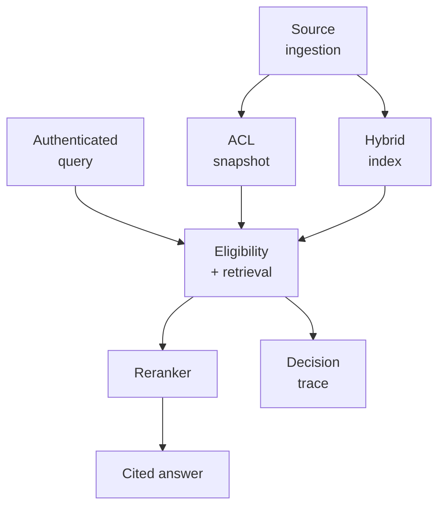

---
{
  "id": "ai-lab-system-design-interview",
  "title": "AI Lab System Design Interview",
  "slug": "ai-lab-system-design-interview",
  "section": "AI Lab Interviewing",
  "category": "System Design",
  "difficulty": "Hard",
  "order": 2,
  "companies": [
    "Frontier AI Labs",
    "OpenAI",
    "Google DeepMind",
    "Meta AI"
  ],
  "shortDescription": "Design multi-model LLM gateways, paged GPU serving fleets, ACL-enforced retrieval, and reversible canary deployments under strict tail-latency SLOs.",
  "keyConceptsTested": [
    "AI/backend requirement discovery",
    "Scale and token math",
    "API and data model design",
    "Backpressure and overload behavior",
    "Permission-aware tool and data access",
    "Observability, release checks, and eval-driven launches"
  ],
  "prerequisites": [
    "design-multi-tenant-llm-serving-platform",
    "design-llm-powered-search-engine",
    "enterprise-rag-security-rbac-access-control",
    "llm-deployment-gpu-serving-autoscaling",
    "ai-lab-coding-interview-python-systems"
  ],
  "relatedQuestions": [
    "mcp-tool-protocol-standards",
    "observability-monitoring-llm-systems",
    "model-gateways-routing-fallbacks",
    "agent-failure-states-retry-fallback"
  ]
}
---

At minute twelve of an AI lab system design round, your whiteboard already holds an API gateway, GPU workers, and a vector index. Then the interviewer asks a question those boxes cannot answer: an under-quota tenant hits a queue that will miss its first-token SLO. What status code does the client receive, which stage owns that decision, and what record lets on-call engineers inspect it afterward? Giving each box a numeric budget, a clear owner, a decision trace, and a recovery path turns a generic diagram into a running system.

In [AI Lab Coding Interview: Python Systems](/learn/ai-lab-coding-interview-python-systems), we built single-node KV-cache allocators, masked attention, nucleus sampling, and bounded batch loops. Here that same ownership scales into distributed inference architecture. We will carry one running product through the entire lesson: an internal model gateway that company teams call to reach multiple LLM providers. Follow-ups then layer on permission-aware retrieval and a long-running coding agent, testing whether the initial interfaces survive privacy, latency, cancellation, and deployment pressure. OpenAI's public interviewing guidance emphasizes clear reasoning and communication while tailoring format to the role and team, so confirm scope with your recruiter and adapt these patterns to your prompt.[^openai2026interview]

> **Key insight:** Separate the control plane from the data plane early. Entitlements, routing rules, model registries, quota limits, and canary weights change slowly; request routing, retrieval, model inference, and agent execution carry live traffic. Whenever a control store is unavailable or stale, state explicitly how the data plane handles in-flight traffic and what fails closed.

## Start with a constraint

Begin with one dominant constraint, then earn every box on the board:

> I will keep the initial design simple, size the main bottleneck early, and add queues, caches, sharding, routing rules, or eval checks only when a requirement demands them.

Treat your walkthrough as a chain of commitments where each step supplies a concrete fact for the next. A latency SLO bounds queue depth and GPU concurrency; a private-document requirement earns an access-controlled index. Walk through ten compact beats in order:

1. **Goal:** who calls the system and what success looks like.
2. **Requirements:** functional behavior and non-functional latency, freshness, or privacy targets.
3. **Scale:** <span data-glossary="qps">QPS</span>, <span data-glossary="token-budget">tokens</span>, tenants, documents, latency, and retention.
4. **API:** external <span data-glossary="api-contract">API schema</span> and critical internal interfaces.
5. **<span data-glossary="data-model">Data model</span>:** durable entities, indexes, tenant isolation, and retention.
6. **Architecture:** the smallest working <span data-glossary="request-path">request path</span> first.
7. **Reliability:** retries, <span data-glossary="idempotency">idempotency</span>, <span data-glossary="backpressure">backpressure</span>, load shedding, and failover.
8. **Security and safety:** permissions, request traces, abuse limits, and fast reverts.
9. **<span data-glossary="observability">Observability</span>:** metrics, logs, traces, and operator views.
10. **Deployment:** beta flags, <span data-glossary="canary-rollout">canaries</span>, eval checks, and <span data-glossary="kill-switch">kill switches</span>.

This sequence also absorbs interruptions smoothly. If the interviewer jumps straight to sharding, anchor it to model size, traffic shape, and latency target; if they jump to security, anchor it to actor identity, permission scope, and request traces.

```checkpoint
Why start with the goal instead of Kafka, GPUs, or vector databases?
---
Because the right infrastructure depends on the product goal and constraints. A support lookup, a long-running coding task, and a model-serving scheduler have different latency, reliability, privacy, and eval requirements.
```

## Let the pressure choose the pattern

Most AI systems combine several patterns, yet one constraint almost always dominates the first sketch. Quota pressure calls for rate and queue control; enterprise access-control lists (ACLs) call for pre-retrieval eligibility checks; irreversible repository actions call for durable state machines and explicit human review.

| Pattern | Prompt signal | Core architecture moves | Typical follow-up pressure |
|---|---|---|---|
| Model gateway | multi-provider, teams, API keys, <span data-glossary="quota">quotas</span> | auth, entitlements, routing rules, quota buckets, request trace | streaming, fallback behavior, budget caps, support replay |
| Inference scheduler | latency, batching, GPUs, overload | request queue, batcher, worker pool, KV accounting, fairness | tail latency, starvation, preemption, 429 vs 503 rules |
| Permission-aware retrieval | enterprise docs, ACLs, deletion, citations | connectors, ACL snapshots, filtered retrieval, eligibility trace | revocation lag, fail closed, hybrid search, stale index |
| Agent execution platform | long-running tasks, tools, repo access | task state machine, sandbox, tool allowlist, event log, artifacts | cancellation, retries, secret redaction, human review |
| Eval and release checks | quality launch, regressions, red team | offline evals, golden sets, canary checks, revert triggers | slice failures, noisy judges, metric ownership |
| Data ingestion platform | connectors, freshness, normalization | ingestion jobs, versioned records, dead-letter queue, backfill | schema drift, reprocessing, dedupe, deletion |
| Observability and support | request IDs, incidents, "why did this happen?" | traces, decision logs, support views, replayable metadata | privacy-safe debugging, retention, sampling |
| Abuse and safety control | misuse, irreversible actions | rules engine, rate limits, review queues, kill switches | false positives, bypass attempts, emergency disable |

Keep the first drawing narrow. Our model gateway earns a vector index only when retrieval enters the prompt, and retrieval earns an agent state machine only when users ask the system to execute repository changes.

## Adapt the architecture to follow-ups

Treat every follow-up as a changed constraint. Name what shifted, update the owning stage, and name the telemetry or revert trigger that verifies the change.

| Follow-up | Strong architectural move | Weak move |
|---|---|---|
| "Traffic spikes 10x" | rate limits, queue wait cap, tier fairness, explicit `429` or `503` cause | unbounded queues |
| "Permissions change quickly" | ACL freshness target, tombstones, fail-closed sensitive sources | retrieve first, filter after generation |
| "Provider is down" | explicitly opted-in fallback, circuit breaker, surfaced degraded mode | silently swap model behavior |
| "Users need cancellation" | durable cancel flag, cooperative checks, sandbox termination | UI-only stop button |
| "Support asks why" | request ID, config version, route choice, retrieved IDs, trace | raw logs with no decision context |
| "Eval passes but users complain" | slice analysis, online canary metrics, incident cases in regression suite | claim offline eval suffices |
| "Costs doubled" | token accounting, cache hit tracking, routing rules, budget alerts | vague autoscaling |

## Put one number on the board

One back-of-the-envelope calculation gives the diagram a load-bearing assumption. Keep units visible, state what the rough calculation excludes, and name which component changes if the assumption doubles.

| System | Minimum math to put on the board |
|---|---|
| Gateway | requests/minute, tokens/minute, worst-case output cap |
| Retrieval | documents, chunks/document, embedding storage, update rate |
| Scheduler | arrival rate, average service time, queue wait, GPU memory |
| Agent service | concurrent jobs, sandbox duration, log/artifact storage, retry budget |
| Eval platform | examples per suite, runs per release, judge/model cost |
| Voice/chat | p95 latency budget split across network, model, tools, synthesis |
| Ingestion | source QPS, backfill duration, dedupe key cardinality |

When an assumption is rough, make the dependency explicit: *"I am sizing the constraint that shapes the board most. If that number moves by 5x, the layer I revisit is X."*

## Size model memory before drawing workers

If the gateway calls hosted providers only, provider quotas and measured latency dominate. The moment an interviewer adds self-hosted inference, put two memory budgets on the board: fixed model weights and per-request key/value (KV) cache growth.

Eight billion parameters at two bytes each occupy 16 billion bytes, or 16 decimal GB. Doubling concurrent requests leaves loaded weights unchanged:

$$
M_\text{weights} = P \times b
$$

Here $P$ is parameter count and $b$ is bytes per stored parameter: 2 for <span data-glossary="fp16">FP16</span> or <span data-glossary="bf16">BF16</span>, 1 for <span data-glossary="fp8">FP8</span> (plus small overhead for quantization scales, unquantized layers, and runtime workspaces). Remember the unit convention: decimal GB uses $10^9$ bytes, while GiB uses $2^{30}$ bytes.

Unlike weights, KV cache grows linearly with active tokens. In a 32-layer model with 8 KV heads and 128 values per head in BF16, one token occupies $2 \times 32 \times 8 \times 128 \times 2 = 131{,}072$ bytes (128 KiB). Counting both keys and values across all layers gives:

$$
M_\text{token} = 2 \times n_\text{layers} \times n_\text{KV heads} \times d_\text{head} \times p_\text{bytes}
$$

For $B$ requests each retaining $S$ prompt plus generated tokens (or summing individual retained lengths $\sum_i S_i$ when histories differ):

$$
M_\text{KV} = 2 \times \left(\sum_{i=1}^{B} S_i\right) \times n_\text{layers} \times n_\text{KV heads} \times d_\text{head} \times p_\text{bytes}
$$

Prefix sharing, sliding-window eviction, cache sharding, and block-size rounding alter exact allocation, and activations plus runtime buffers also consume <span data-glossary="hbm">high-bandwidth memory (HBM)</span>, so leave headroom in the device budget.

Take a Llama 3 8B-shaped model (32 layers, 32 query heads, head dimension 128, BF16) to make the numbers concrete. Compare a multi-head attention (MHA) baseline with 32 KV heads against Llama 3 8B's actual <span data-glossary="grouped-query-attention">grouped-query attention (GQA)</span> with 8 KV heads:[^dubey2024][^ainslie2023]

<!-- leetllm: test, output=show -->
```python title="serving-memory-math.py"
params = 8_000_000_000
bytes_per_param = 2  # FP16 or BF16
weights_gb = params * bytes_per_param / 1e9

n_layers, d_head, p_bytes = 32, 128, 2
batch, seq = 16, 2048

kv_bytes_mha = 2 * n_layers * 32 * d_head * p_bytes  # 32 KV heads (MHA)
kv_gb_mha = kv_bytes_mha * batch * seq / 1e9

kv_bytes_gqa = 2 * n_layers * 8 * d_head * p_bytes   # 8 KV heads (Llama 3 8B GQA)
kv_gb_gqa = kv_bytes_gqa * batch * seq / 1e9

print(f"BF16 weights:             {weights_gb:.1f} GB")
print(f"MHA KV per token:         {kv_bytes_mha:,} bytes ({kv_bytes_mha / 1e6:.2f} MB)")
print(f"MHA KV (batch=16, 2K):    {kv_gb_mha:.1f} GB")
print(f"GQA KV (batch=16, 2K):    {kv_gb_gqa:.1f} GB")
```

<!-- leetllm: output:start -->
```text title="Output" output compact
BF16 weights:             16.0 GB
MHA KV per token:         524,288 bytes (0.52 MB)
MHA KV (batch=16, 2K):    17.2 GB
GQA KV (batch=16, 2K):    4.3 GB
```
<!-- leetllm: output:end -->

<figure>

<figcaption>At batch 16 and 2K context, the MHA cache (17.2 GB) is already taller than the 16 GB of weights. Switching to Llama 3 8B's 8 KV heads drops that cache to 4.3 GB, freeing HBM for larger batches or longer contexts.</figcaption>
</figure>

Notice that MHA and GQA are separately trained model architectures, not a runtime flag you toggle on an existing checkpoint. First verify that weights and runtime overhead fit on the GPU; after that, KV cache growth usually sets marginal batch and context limits.

```checkpoint
A serving prompt asks whether you can raise batch size to improve throughput. Which memory term should you check first, and why?
---
After confirming that weights and runtime overhead fit, check KV cache. Weight memory is fixed for a loaded model, while KV memory grows with batch size, sequence length, layers, and key/value heads. Doubling batch or context can exhaust remaining HBM.
```

## Leave a decision trail

Architecture choices hold up under follow-ups when each major call records its rejected alternative, its rationale, and the concrete signal that would make you change course:

| Decision | Chosen | Rejected | Why | Reversal signal |
|---|---|---|---|---|
| Queue placement | before provider call | inside every adapter | one unified overload rule | adapter-specific SLO needed |
| Retrieval filter | before rerank/generation | post-generation filter | privacy fails closed | none for sensitive docs |
| Fallback model | explicitly opted-in | automatic on any error | model behavior changes | explicit customer opt-in |
| Agent writes | human-reviewed | direct pushes | irreversible side-effect risk | narrow, reversible tool scope |

This table gives the interviewer an explicit handle to challenge. They can push on a tradeoff and immediately see its owner and reversal condition.

## Rehearse the board as a sequence

Front-load the dominant constraint and bottleneck math so the second half of the interview covers failure modes rather than basic boxes. If an interviewer interrupts early, pivot directly to the constraint that reshapes the architecture: *"The constraint that changes this design most is X. Let me size that first, then draw the request path it forces."*

<details>
<summary>Deep dive: 45-minute rehearsal pacing guide</summary>

| Time | Target output on the board |
|---:|---|
| 0-4 min | goal, users, success metric, top risks |
| 4-9 min | functional and non-functional requirements |
| 9-14 min | one scale calculation exposing the bottleneck |
| 14-20 min | API and durable data model |
| 20-28 min | smallest working request path |
| 28-35 min | reliability, overload, permissions, and support/debug flow |
| 35-40 min | staged deployment, eval checks, and fast revert path |
| 40-45 min | tradeoffs, reversal signals, and interviewer follow-ups |

</details>

## Turn requirements into concrete stages

Work through these three recurring lab prompts by naming the user, the latency or privacy promise, and the clarifying questions that actually alter the architecture. Expand each deep dive to compare your board against a compact engineering blueprint.

### Prompt 1: model gateway for enterprise teams

Design an API gateway for internal teams calling multiple LLM providers through one shared platform.

- Each organization owns workspaces, users, API keys, and model access rules.
- The gateway enforces requests/minute, tokens/minute, and monthly spend caps.
- Support needs a request ID showing which route, model, config decision, and overload state occurred.
- Beta models stay restricted to opted-in teams, and traffic can spike 10x during customer incidents.

**Questions that change the board:** Are clients streaming, running batch jobs, or both? Are spend limits hard stops or soft alerts? Which failure must support explain first (auth, quota, routing, or upstream provider)?

<details>
<summary>Deep dive: Model gateway blueprint and follow-up moves</summary>

1. **API:** `POST /v1/responses`, `GET /v1/requests/{id}`, plus admin endpoints for keys and limits.
2. **Data model:** organization, workspace, API key, routing config, model entitlement, usage bucket, request log.
3. **Request path:** gateway -> auth -> quota reservation -> routing rules -> scheduler queue -> provider adapter -> stream.
4. **Overload:** return `429` when a caller exceeds its own limit and `503` when shared fleet capacity is saturated, including `Retry-After` only when a grounded estimate exists. Route to a fallback model only when the caller opted in to behavior changes.
5. **Trace fields:** `request_id`, `config_version`, `entitlement_id`, `route_id`, `quota_bucket_id`, token estimate, queue wait, provider latency, and error class.
6. **Follow-ups:** For streaming, reserve estimated input plus max output upfront and reconcile actual tokens once on completion. For 10x spikes, split queues by tenant or tier so one incident cannot starve other teams. Put beta models behind versioned entitlement flags and a kill switch.

</details>

### Prompt 2: permission-aware enterprise retrieval

Design retrieval for an internal assistant answering employee questions over company documents.

- Documents arrive from multiple sources with heterogeneous ACL formats.
- Permission revocations and deletions must take effect quickly, and answers must cite sources.
- Private documents must never be retrieved first and filtered after generation.
- Admins need to trace why a given answer used a specific document.

**Questions that change the board:** Is the revocation target seconds, minutes, or hours? Can indexes be physically separated per tenant, or must metadata filters enforce isolation? Should sensitive sources fail closed when ACL freshness is unknown?

<details>
<summary>Deep dive: Permission-aware retrieval blueprint and follow-up moves</summary>

1. **Ingestion and indexing:** connector workers pull content plus ACL snapshots into immutable document versions; tenant isolation and ACL metadata filters sit inside the index, and deletions mark tombstones immediately before background compaction cleans embeddings and chunks.
2. **Query path:** auth context -> freshness check and eligible corpus filter -> hybrid retrieval -> rerank -> cited answer.
3. **Failure mode:** track connector lag per source, run ACL refresh jobs plus an emergency purge path, and fail closed for sensitive sources whenever ACL state is stale or missing.
4. **Traceability:** record query ID, user identity and groups, source ACL version, applied filters, retrieved chunk IDs, citations shown, and response ID so admins can replay eligibility without exposing unrelated private docs.

</details>

### Prompt 3: long-running coding agent service

Design an asynchronous service that accepts repository tasks and runs a coding agent for up to 30 minutes.

- Users submit a repo, branch, task prompt, and tool permissions.
- The agent can edit files, run tests, create commits, and produce artifacts while streaming live progress and supporting cancellation and final diff review.
- Secrets and production systems must remain isolated from agent execution.

**Questions that change the board:** Can the agent push branches directly or only emit a patch artifact? Which tools need network egress vs offline execution? What happens when a user cancels mid-tool-call?

<details>
<summary>Deep dive: Coding agent blueprint and follow-up moves</summary>

1. **API and state machine:** create task, get status, stream events, cancel task, list artifacts across states `queued -> provisioning -> running -> blocked / review -> failed / canceled / complete`.
2. **Isolation:** run inside an isolated <span data-glossary="sandbox">sandbox</span> with scoped repo checkout, explicit network egress rules, short-lived credentials, disk/time limits, and secret redaction before logs hit storage.
3. **Retries:** classify operations by side effects. A timed-out sandbox provision or commit may already have succeeded, so reconcile task/attempt state or require receiver-enforced idempotency before replaying any write.[^awsIdempotentApis2026]
4. **Cancellation:** persist the cancel intent, stop scheduling new tool calls, terminate the sandbox after a short grace window, mark `canceled` only after execution actually stops, keep partial logs, and revoke short-lived credentials.

</details>

```checkpoint
Why should support and debugging shape the design from the start?
---
Production AI products fail in ways users and operators need to inspect. Request IDs, traces, eligible documents, model choice, routing decisions, and overload state let support debug without guessing.
```

## Load shedding protects tail latency

Trace a single request arriving at the front door. Mint a server-generated `request_id` *before* authentication so even rejected requests remain traceable. Next, authenticate the key, verify model entitlements, check workspace and organization limits, reserve token/spend budget, and verify shared fleet capacity. Keep two failure paths cleanly separated: an over-quota tenant arriving while GPUs sit idle receives `429`, while an eligible tenant hitting a saturated fleet receives `503`.


Start by calculating aggregate token demand before sizing workers or rate limits:

<!-- leetllm: test, output=show -->
```python title="gateway-token-budget.py"
requests_per_minute = 4_000
avg_input_tokens = 1_200
avg_output_tokens = 450
tokens_per_minute = requests_per_minute * (avg_input_tokens + avg_output_tokens)
tokens_per_second = tokens_per_minute / 60

print(f"tokens_per_minute: {tokens_per_minute:,}")
print(f"tokens_per_second: {round(tokens_per_second):,}")
```

<!-- leetllm: output:start -->
```text title="Output" output compact
tokens_per_minute: 6,600,000
tokens_per_second: 110,000
```
<!-- leetllm: output:end -->

Aggregate demand sizes the fleet, while hard spend caps require **per-request reservations**: reserve each request's tokenized prompt plus its maximum allowed output before queueing. For dollar caps, price the full tariff (input tokens, cache reads/writes where billed separately, output tokens including hidden reasoning, and tool calls) using conservative upper bounds when cache hits are uncertain, because prompt cache writes can cost more than uncached input.[^openai2026promptcaching] When the stream finishes, refund the unused difference once:

<!-- leetllm: test, output=show -->
```python title="streaming-quota-reconciliation.py"
remaining_before = 10_000
reserved_tokens = 1_800
actual_tokens = 1_520

remaining_after_reserve = remaining_before - reserved_tokens
refund = reserved_tokens - actual_tokens
remaining_after_reconcile = remaining_after_reserve + refund

print(f"after reserve:   {remaining_after_reserve:,} tokens")
print(f"refund unused:   +{refund:,} tokens")
print(f"after reconcile: {remaining_after_reconcile:,} tokens")
```

<!-- leetllm: output:start -->
```text title="Output" output compact
after reserve:   8,200 tokens
refund unused:   +280 tokens
after reconcile: 8,480 tokens
```
<!-- leetllm: output:end -->

> **Common mistake:** Treating a disconnected stream as zero usage, or crediting duplicate completion webhooks twice. A real quota store checks and reserves atomically across concurrent callers, reconciles confirmed usage strictly once per `request_id`, and leaves reservations pending on disconnect until provider accounting settles. Keep request-count, token, and dollar limits in separate accounting windows.

## Queueing changes the latency promise

Even after a request clears quota, admitting a long prompt into a busy GPU worker can stall short responses already streaming. Rejecting excess arrivals protects active latency at the cost of some unused headroom. Modern serving engines use in-flight batching to interleave prompt processing and token generation, yet token and batch caps still have to be tuned against tail latency.[^nvidia2026tensorrtllmifb]

### Separate prefill from decode

LLM inference runs in two distinct phases that contend on shared hardware. Prefill builds prompt KV state and first-token logits (reusing a matching prefix cache when available and computing only the uncached suffix),[^openai2026promptcaching] while decode emits one token per step from cached KV.

| Phase | What happens | Typical bound | User-visible metric |
|---|---|---|---|
| <span data-glossary="prefill">Prefill</span> | Reuse eligible prefix KV; process remaining prompt tokens | Usually compute-bound | <span data-glossary="ttft">TTFT</span> (with queue wait) |
| Decode | Emit one token per step reading cached KV | Usually memory-bandwidth-bound | <span data-glossary="itl">ITL</span> / TBT and <span data-glossary="tpot">TPOT</span> |

A cluster can report high mean tokens/sec while first-token wait or streaming stutter fails in the tail. DistServe formalizes this with **goodput** (successful requests/sec meeting both TTFT and per-request TPOT targets) and separates prefill and decode pools.[^zhong2024] Chunked prefill caps how many prompt tokens run per step so decode keeps moving; disaggregation isolates compute completely at the cost of KV-cache transfer bandwidth and pool balancing.

### Name the metric that can fail

Whenever someone claims "throughput improved," pin down the exact metric, percentile, unit, and measurement context:

- **Time to first token (TTFT):** request arrival to first output token (queue wait + prefill + first token).
- **Inter-token latency (ITL / TBT):** each individual gap between consecutive output tokens; track p95/p99 for smooth streaming.
- **Time per output token (TPOT):** for $N > 1$ output tokens, `(t_last - t_first) / (N - 1)`. Because TPOT is a per-request mean, a single long stall can hide inside a reasonable average; it is undefined for a one-token response.
- **Fleet goodput:** completed requests/sec satisfying both latency targets, tracked alongside rejection rates (`429`/`503`) and error rates.
- **<span data-glossary="tokens-per-second">Tokens per second</span>:** always label whether you mean per-request decode speed, prefill rate, or fleet aggregate.
- **<span data-glossary="p95-latency">p95</span> / p99 end-to-end latency, queue wait, GPU utilization, and cost per successful request.**

Whenever you quote or compare serving benchmarks in a design review, attach the operating setup once: GPU SKU, software stack, model and precision, prompt/output length distribution, concurrency, and correctness check. A naked TPS number hides whether the workload or acceptance bar changed.

### Choose a serving lever by failure mode

Match the smallest serving mechanism to the failing metric instead of listing buzzwords:

| Lever | Failure mode it fixes | Reach for it when |
|---|---|---|
| <span data-glossary="pagedattention">PagedAttention</span> / paged KV | KV fragmentation and rigid contiguous buffers | Long contexts or high concurrency exhaust contiguous KV slots |
| <span data-glossary="continuous-batching">Continuous batching</span> | Idle slots waiting for the slowest sequence in a batch | Static batches waste GPU cycles on finished or padded requests |
| Prefix / radix cache | Recomputing identical prompt prefixes | Workloads share system prompts or multi-turn conversation history |
| Speculative decoding | Memory-bandwidth-bound single-token decode | A cheap draft model has high acceptance on your domain |
| Chunked prefill | Long prompts pausing active decode streams | Mixed short/long prompts cause ITL spikes during prefill bursts |
| Prefill/decode disaggregation | Contention between compute-heavy prefill and bandwidth-heavy decode | One shared pool cannot meet dual TTFT and ITL targets together |

Keep continuous batching and paged attention distinct: continuous batching decides *when* sequences join or exit a step, while paged attention decides *how* KV blocks are stored and freed.

> **Key insight:** A prefix cache hit requires both numerical compatibility and authorization compatibility. Matching token IDs at shifted positions produces different attention outputs, and identical text never authorizes reusing a private cached prefix across callers who lack current read access to the source document.

### Model-fit scale math

When weights plus KV cache outgrow one GPU, separate the **logical sharding plan** from the **physical interconnect**: <span data-glossary="tensor-parallelism">tensor parallelism (TP)</span> splits layers with frequent all-reduces that demand NVLink-class bandwidth; <span data-glossary="pipeline-parallelism">pipeline parallelism (PP)</span> spans slower links across nodes at the cost of pipeline bubbles; <span data-glossary="expert-parallelism">expert parallelism</span> distributes <span data-glossary="mixture-of-experts">MoE</span> experts across devices. State which communication cost your latency budget can absorb.

Now check fleet headroom against our `110,000` tokens/s demand assuming a measured cluster capacity of `125,000` tokens/s:

<!-- leetllm: test, output=show -->
```python title="scheduler-headroom.py"
assumed_capacity_tps = 125_000
expected_demand_tps = 110_000

headroom = assumed_capacity_tps - expected_demand_tps
unused_capacity_pct = headroom / assumed_capacity_tps * 100

print(f"headroom:        {headroom:,} tokens/s")
print(f"unused capacity: {unused_capacity_pct:.1f}%")
```

<!-- leetllm: output:start -->
```text title="Output" output compact
headroom:        15,000 tokens/s
unused capacity: 12.0%
```
<!-- leetllm: output:end -->

Notice that `12.0%` is unused capacity divided by total capacity (`15,000 / 125,000`), not spare capacity divided by demand. Because input and output tokens carry different compute and memory costs, aggregate token rate works only for a fixed request mix; a real scheduler tracks prefill backlog, active decode slots, and free KV blocks independently.

HTTP defines `429 Too Many Requests` for caller rate limits and `503 Service Unavailable` for temporary capacity overload, leaving `Retry-After` as an optional hint that clients pair with bounded jittered backoff.[^rfc6585RateLimit2012][^rfc9110ServiceUnavailable2022]

<figure>

<figcaption>Queue saturation explodes tail wait time unless load shedding caps queue depth at 0.25 s. Caller RPM exhaustion fails fast with 429 at zero queue time, while shared backlog beyond the budget returns 503 with an explicit error cause.</figcaption>
</figure>

At `125,000` tokens/s, `20,000` queued tokens clear in `0.16 s` (within a `0.25 s` wait cap), while `50,000` queued tokens would wait `0.40 s` and trigger `503` load shedding. Combining prefill wait, active decode slots (strictly `< max_decode_sequences`), and free KV blocks (`>= kv_blocks_needed`) into one admission check protects all three resources at once:

<!-- leetllm: test, output=show -->
```python title="scheduler-capacity.py"
def can_accept_wait(queued_tokens: int, service_tps: int, max_wait_s: float) -> bool:
    if queued_tokens < 0 or service_tps <= 0 or max_wait_s < 0:
        raise ValueError("invalid queue capacity parameters")
    return (queued_tokens / service_tps) <= max_wait_s


def has_serving_capacity(
    prefill_backlog_tokens: int,
    prefill_tps: int,
    active_decode_sequences: int,
    max_decode_sequences: int,
    free_kv_blocks: int,
    kv_blocks_needed: int,
    max_prefill_wait_s: float,
) -> bool:
    """Check prefill queue wait, active decode slots, and free KV blocks together."""
    if min(active_decode_sequences, max_decode_sequences, free_kv_blocks, kv_blocks_needed) < 0:
        raise ValueError("resource counts must be non-negative")
    prefill_ok = can_accept_wait(prefill_backlog_tokens, prefill_tps, max_prefill_wait_s)
    decode_ok = active_decode_sequences < max_decode_sequences
    kv_ok = free_kv_blocks >= kv_blocks_needed
    return prefill_ok and decode_ok and kv_ok


print("20k queued at 125k tok/s (<=0.25s):", can_accept_wait(20_000, 125_000, 0.25))
print("50k queued at 125k tok/s (<=0.25s):", can_accept_wait(50_000, 125_000, 0.25))
print("headroom available (48/64 slots, 120 blocks):", has_serving_capacity(10_000, 80_000, 48, 64, 120, 16, 0.25))
print("decode slots full (64/64 slots):             ", has_serving_capacity(10_000, 80_000, 64, 64, 120, 16, 0.25))
print("KV blocks short (10 < 16 needed):            ", has_serving_capacity(10_000, 80_000, 48, 64, 10, 16, 0.25))
```

<!-- leetllm: output:start -->
```text title="Output" output compact
20k queued at 125k tok/s (<=0.25s): True
50k queued at 125k tok/s (<=0.25s): False
headroom available (48/64 slots, 120 blocks): True
decode slots full (64/64 slots):              False
KV blocks short (10 < 16 needed):             False
```
<!-- leetllm: output:end -->

Remember two subtleties when explaining this check on the whiteboard. First, queue wait is only part of TTFT; the request's own prefill, routing, and network hop still consume latency budget. Second, a pure predicate does not reserve anything: under concurrency, check and claim the decode slot and KV blocks atomically, then release them on completion or cancellation so two simultaneous requests cannot oversubscribe the last slot.

```checkpoint
When should the system return 429 or 503 instead of queueing more work?
---
Reject before queueing violates latency or fairness. Map caller rate limits to `429` and shared fleet capacity exhaustion to `503`, returning a request ID, machine-readable cause code, and `Retry-After` only when a grounded wait estimate exists.
```

## Permissions belong before retrieval

Suppose an employee's finance access was revoked ten seconds ago. Filtering the final answer cannot undo the leak once a private chunk has already crossed into an external reranker or generator. Enforce eligibility *before* content leaves the trusted search boundary.



An ACL snapshot alone still creates a revocation window: a grant revoked one second ago can persist in a 20-second-old snapshot. For sensitive sources, pair a strict snapshot freshness limit with authoritative revocation checks (or immediate push invalidations) that override any cached grant, and apply the same rule to cached answers and shared KV prefixes. When snapshot freshness is unknown or stale, fail closed:

<!-- leetllm: test, output=show -->
```python title="acl-freshness-policy.py"
def snapshot_is_usable(snapshot_age_seconds: float | None, max_age_seconds: float) -> bool:
    if max_age_seconds < 0:
        raise ValueError("invalid freshness budget")
    if snapshot_age_seconds is None or snapshot_age_seconds < 0:
        return False
    return snapshot_age_seconds <= max_age_seconds


for age in (20, 90, None):
    print(f"age={age!s:<4} (max=60s) -> usable={snapshot_is_usable(age, 60)}")
```

<!-- leetllm: output:start -->
```text title="Output" output compact
age=20   (max=60s) -> usable=True
age=90   (max=60s) -> usable=False
age=None (max=60s) -> usable=False
```
<!-- leetllm: output:end -->

Passing freshness only means the snapshot is safe to consult; the caller still has to satisfy tenant, user/group, active-revocation, and tombstone checks. Watch how high similarity cannot override missing group access or a deletion tombstone before candidates reach the reranker:

<!-- leetllm: test, output=show -->
```python title="acl-filter-before-rank.py"
documents = [
    {"id": "public-access-policy", "groups": {"employees"}, "deleted": False, "score": 0.82},
    {"id": "finance-plan", "groups": {"finance"}, "deleted": False, "score": 0.99},
    {"id": "old-handbook", "groups": {"employees"}, "deleted": True, "score": 0.95},
]
user_groups = {"employees"}

eligible = [
    doc for doc in documents
    if not doc["deleted"] and (doc["groups"] & user_groups)
]
ranked_ids = [doc["id"] for doc in sorted(eligible, key=lambda d: d["score"], reverse=True)]

print("eligible ranked IDs:", ranked_ids)
```

<!-- leetllm: output:start -->
```text title="Output" output compact
eligible ranked IDs: ['public-access-policy']
```
<!-- leetllm: output:end -->

<figure>

<figcaption>finance-plan scores 0.99 yet never reaches the reranker because the caller lacks finance access; old-handbook is tombstoned. Only public-access-policy (0.82) passes the filter.</figcaption>
</figure>

## Durable state bounds agent side effects

Now consider a coding-agent worker restarting right after creating a commit but before reporting completion. If task state, tool calls, checkpoints, and <span data-glossary="permission-boundary">tool permission scopes</span> lived only in process memory, a blind retry could duplicate commits or leave orphaned sandboxes running.

Write legal state transitions down explicitly so terminal states (`failed`, `canceled`, `complete`) never reopen silently:

<!-- leetllm: test, output=show -->
```python title="agent-task-state-machine.py"
ALLOWED_TRANSITIONS = {
    "queued": {"provisioning", "canceled"},
    "provisioning": {"running", "failed", "canceled"},
    "running": {"blocked", "review", "failed", "canceled"},
    "blocked": {"running", "review", "failed", "canceled"},
    "review": {"running", "complete", "canceled"},
    "failed": set(),
    "canceled": set(),
    "complete": set(),
}


def can_transition(current: str, target: str) -> bool:
    return target in ALLOWED_TRANSITIONS.get(current, set())


for cur, tgt in (("running", "review"), ("review", "failed"), ("complete", "running")):
    print(f"{cur} -> {tgt}: {can_transition(cur, tgt)}")
```

<!-- leetllm: output:start -->
```text title="Output" output compact
running -> review: True
review -> failed: False
complete -> running: False
```
<!-- leetllm: output:end -->

In storage, pair that transition check with an atomic expected-state update (compare-and-swap or lease token) so a stale worker expecting `running` cannot overwrite an attempt that already moved to `review`. Keep cancellation intent separate from confirmed sandbox exit, and create a new attempt ID under the same task rather than reopening a terminal attempt.

Retry behavior follows side effects. Pure reads (`repo_read`) retry safely on transient failures. Writes (`sandbox_provision`, `create_commit`, `post_comment`) may replay automatically only when the receiver's verified config explicitly guarantees durable idempotency (deduplicating the key, rejecting mutated payloads, and retaining records across the retry window).[^awsIdempotentApis2026] Watch a classic Python trap too: any non-empty string like `"False"` or `"True"` is truthy, so require literal boolean `True` (`is True`) before enabling automatic write replay:

<!-- leetllm: test, output=show -->
```python title="agent-retry-policy.py"
def retry_mode(action: str, receiver_enforces_idempotency: object = False) -> str:
    if action == "repo_read":
        return "automatic"
    if action in {"sandbox_provision", "create_commit", "post_comment"} and receiver_enforces_idempotency is True:
        return "automatic-with-idempotency"
    return "reconcile-or-review"


cases = [
    ("repo_read", False),
    ("create_commit", False),
    ("post_comment", True),
    ("sandbox_provision", False),
    ("create_commit", "False"),
]
for action, flag in cases:
    print(f"{action:<18} idempotent={flag!r:<7} -> {retry_mode(action, flag)}")
```

<!-- leetllm: output:start -->
```text title="Output" output compact
repo_read          idempotent=False   -> automatic
create_commit      idempotent=False   -> reconcile-or-review
post_comment       idempotent=True    -> automatic-with-idempotency
sandbox_provision  idempotent=False   -> reconcile-or-review
create_commit      idempotent='False' -> reconcile-or-review
```
<!-- leetllm: output:end -->

## Evaluation guards every release

A failed or missing required check blocks launch instead of disappearing inside an aggregate score, and every postmortem case belongs in a permanent regression suite.[^neurips2026paperChecklist]

Two subtle bugs undermine automated launch checks. First, if the evaluator echoes both the observed score and the minimum threshold it checked against, the release host must verify that the echoed threshold matches its own `REQUIRED_MINIMA` so a misconfigured evaluator cannot approve its own lower bar. Second, in Python `False == 0` is `True`, so checking `permission_leaks != 0` alone would accept a boolean flag `False` in place of a measured integer count of zero leaks:

<!-- leetllm: test, output=show -->
```python title="eval-launch-gate.py"
REQUIRED_MINIMA = {"retrieval_recall": 0.92, "citation_faithfulness": 0.95}


def launch_failures(checks: dict[str, tuple[float, float]], permission_leaks: object) -> list[str]:
    failures = []
    for name, required_minimum in REQUIRED_MINIMA.items():
        result = checks.get(name)
        if not result or len(result) != 2:
            failures.append(name)
            continue
        observed, minimum = result
        valid = 0.0 <= observed <= 1.0 and 0.0 <= minimum <= 1.0
        if not valid or minimum != required_minimum or observed < required_minimum:
            failures.append(name)
    if type(permission_leaks) is not int or permission_leaks != 0:
        failures.append("permission_leaks")
    return failures


below_bar = launch_failures(
    {"retrieval_recall": (0.94, 0.92), "citation_faithfulness": (0.93, 0.95)},
    permission_leaks=0,
)
missing_all = launch_failures({}, permission_leaks=None)
altered_bar = launch_failures(
    {"retrieval_recall": (0.94, 0.92), "citation_faithfulness": (0.93, 0.0)},
    permission_leaks=0,
)
bool_leak = launch_failures(
    {"retrieval_recall": (0.94, 0.92), "citation_faithfulness": (0.97, 0.95)},
    permission_leaks=False,
)

print("below bar:   ", below_bar)
print("missing all: ", missing_all)
print("altered bar: ", altered_bar)
print("boolean flag:", bool_leak)
```

<!-- leetllm: output:start -->
```text title="Output" output compact
below bar:    ['citation_faithfulness']
missing all:  ['retrieval_recall', 'citation_faithfulness', 'permission_leaks']
altered bar:  ['citation_faithfulness']
boolean flag: ['permission_leaks']
```
<!-- leetllm: output:end -->

Keep online canaries reversible as well. Evaluate each fresh, adequate canary window with ordered severity: any confirmed permission leak (`> 0`) triggers immediate `"rollback"` regardless of latency or pending perf data (paired with access revocation and triage, since reverting traffic stops new exposure without retracting data already leaked). Missing metrics, `error_rate > 0.01`, or `p95_latency_ms > 900` return `"hold"`, while clean windows within inclusive limits (`<= 0.01` and `<= 900`) return `"expand"`:

<!-- leetllm: test, output=show -->
```python title="canary-rollout-decision.py"
def canary_decision(
    error_rate: float | None,
    p95_latency_ms: float | None,
    permission_leaks: int | None,
) -> str:
    if type(permission_leaks) is not int or permission_leaks < 0:
        return "hold"
    if permission_leaks > 0:
        return "rollback"
    if error_rate is None or p95_latency_ms is None:
        return "hold"
    if not (0.0 <= error_rate <= 1.0) or p95_latency_ms < 0:
        return "hold"
    if error_rate > 0.01 or p95_latency_ms > 900:
        return "hold"
    return "expand"


print("healthy window:       ", canary_decision(0.004, 720, 0))
print("confirmed leak:       ", canary_decision(None, None, 1))
print("missing perf metrics: ", canary_decision(None, 720, 0))
print("error budget exceeded:", canary_decision(0.0104, 780, 0))
```

<!-- leetllm: output:start -->
```text title="Output" output compact
healthy window:        expand
confirmed leak:        rollback
missing perf metrics:  hold
error budget exceeded: hold
```
<!-- leetllm: output:end -->

## Test attractive shortcuts

Shortcut claims in interviews are useful only when you expose their missing condition and name the measurement that settles them:

| Shortcut claim | Missing condition | Stronger engineering answer |
|---|---|---|
| "Static batching is always enough" | Mixed request lengths idle slots as short outputs finish; uniform offline batches may still work fine | Continuous batching joins and exits sequences mid-flight; paged attention separately fixes KV fragmentation. Measure on your real length distribution.[^nvidia2026tensorrtllmifb][^kwon2023] |
| "Slurm is the only multi-node GPU scheduler" | Slurm excels for bare-metal HPC training, while serving platforms often need dynamic autoscaling | Kubernetes with <span data-glossary="kuberay">KubeRay</span> runs Ray training and online inference on one unified substrate.[^ray2026kuberay] |
| "Quantization always wrecks quality" | Naive low-bit rounding degrades accuracy, whereas calibrated methods like AWQ and GPTQ preserve quality on many workloads | FP8 roughly halves BF16 weight bytes and 4-bit cuts further; validate both task quality and kernel speed on your target hardware.[^lin2023][^gptq2023] |

## Make failure visible on the board

Before stepping back from the whiteboard, check your design against six classic blind spots:

- **Technology before goal:** drawing Kafka or a vector database before sizing the user promise optimizes the wrong bottleneck.
- **Unbounded caches:** any prefix or response cache without invalidation, freshness, and tenant isolation leaks stale or unauthorized data.
- **Vague monitoring:** naming "dashboards" without exact metrics, units, percentiles, and owners hides regressions.
- **Silent overload:** missing `429`/`503` causes, request IDs, and support traces leave callers retrying blindly and on-call engineers guessing.
- **Safety as a slogan:** without pre-retrieval ACLs, offline regression checks, and reversible canaries, violations reach users quietly.
- **Unbounded agent retries:** without durable state transitions and idempotency checks, worker restarts duplicate external writes.

Trace one final request end to end from SLO promise to capacity number, stage owner, and debug trace. If every transition answers "what happens when this fails?", your board is ready.

```mastery-quiz
[
  {
    "question": "One loaded replica has 6 billion weights at 2 bytes each. Its full-history KV cache has 24 layers and 4 KV heads per layer. Each key and each value has 128 elements at 2 bytes per element. Three requests retain 512, 1,536 and 2,048 tokens with no prefix sharing. Ignoring overhead, how much memory do the weights and cache occupy, in decimal GB and GiB respectively?",
    "options": [
      "12 GB and 0.09375 GiB",
      "36 GB and 0.1875 GiB",
      "12 GB and 0.1875 GiB",
      "36 GB and 0.09375 GiB"
    ],
    "answer": "12 GB and 0.1875 GiB",
    "explanation": "The three requests share the same 12 billion bytes of weights (12 decimal GB). Each retained token needs 2 x 24 x 4 x 128 x 2 = 49,152 bytes for keys and values. The histories total 4,096 tokens, so the cache uses 201,326,592 bytes. Dividing by 2^30 gives 0.1875 GiB. Counting only one of keys or values gives 0.09375 GiB."
  },
  {
    "question": "A token bucket starts with 7,000 tokens. Request r7 reserves 1,200 and uses 930. The gateway receives its confirmed usage record twice. In an independent run from the same starting balance, r8 reserves 1,200 and disconnects before the gateway receives a usage record. The quota store reserves atomically and settles confirmed usage once per request ID. How many tokens are available in each run?",
    "options": [
      "6,340 for r7 and 5,800 for r8",
      "6,070 for r7 and 5,800 for r8",
      "6,070 for r7 and 7,000 for r8",
      "6,340 for r7 and 7,000 for r8"
    ],
    "answer": "6,070 for r7 and 5,800 for r8",
    "explanation": "Each reservation leaves 5,800 tokens available. Settling r7 refunds 1,200 - 930 = 270 tokens once, bringing its balance to 6,070 (6,340 double-counts the duplicate webhook). For r8, the reservation stays pending until usage is confirmed; restoring 7,000 would treat disconnect as zero usage."
  },
  {
    "question": "Under a gateway mapping caller limits to 429 and shared capacity exhaustion to 503, request A is under quota. Its prefill backlog is 18,000 tokens at 90,000/s with a 0.25s wait limit; 64 of 64 decode slots are occupied, and 10 free KV blocks exactly meet its need. Request B is over its caller quota while the fleet is idle. Which responses follow?",
    "options": [
      "A queued; B 429.",
      "A 503; B 503.",
      "A 429; B 503.",
      "A 503; B 429."
    ],
    "answer": "A 503; B 429.",
    "explanation": "A has 0.2s estimated prefill wait and enough KV blocks, but active_decode_sequences must be strictly less than 64. Shared decode capacity therefore rejects A with 503. B exceeds its caller limit and receives 429 even though hardware is idle."
  },
  {
    "question": "On the client clock, a streaming request starts at 60 ms and its four output tokens arrive at 240, 345, 465 and 480 ms. Which summary gives the time to first token (TTFT), per-request time per output token (TPOT) and maximum inter-token latency (ITL), in that order?",
    "options": [
      "180 ms, 80 ms, 120 ms",
      "420 ms, 60 ms, 120 ms",
      "420 ms, 80 ms, 105 ms",
      "180 ms, 60 ms, 105 ms"
    ],
    "answer": "180 ms, 80 ms, 120 ms",
    "explanation": "TTFT is 240 - 60 = 180 ms (420 ms is total duration). The three inter-token gaps are 105, 120, and 15 ms, giving TPOT = 240 / 3 = 80 ms (dividing by 4 gives 60 ms) and max ITL = 120 ms."
  },
  {
    "question": "At 0 s a gateway receives an ACL snapshot granting an employee access to payroll. It refreshes the snapshot at 52 s and sees the same grant. At 60 s the grant authority revokes access and immediately informs the gateway. For payroll, the gateway requires a snapshot at most 30 s old and enforces current grants. The employee searches at 20, 50 and 70 s. At which times may the gateway send the payroll document to the reranker?",
    "options": [
      "At 20 s and 70 s",
      "At 20 s only",
      "At 20 s and 50 s",
      "At 20 s, 50 s and 70 s"
    ],
    "answer": "At 20 s only",
    "explanation": "At 20 s the snapshot is fresh and the grant is active. At 50 s the snapshot is 50 s old, exceeding the 30 s freshness limit. At 70 s the refreshed snapshot is only 18 s old, but the authoritative revocation at 60 s overrides it."
  },
  {
    "question": "A tenant has a private prefix cache entry for document D4. It stores tokens [13, 5, 21] at positions [8, 9, 10]. Four lookups from that tenant use the same token IDs, model revision, adapter and cache configuration as the entry. Each lookup record gives the requested positions and the complete set of documents its caller can currently read. Which lookup can reuse the entry?",
    "options": [
      "Positions [7, 8, 9] with access to D4 and D6",
      "Positions [8, 9, 10] with access to D6 only",
      "Positions [8, 9, 10] with access to D4 and D6",
      "Positions [7, 8, 9] with access to D6 only"
    ],
    "answer": "Positions [8, 9, 10] with access to D4 and D6",
    "explanation": "Reuse requires both identical computation (same tokens at exact positions [8, 9, 10]) and current authorization to read D4. Shifted positions change the attention computation, and lacking D4 fails the access check."
  },
  {
    "question": "Consider two worker claims independently against attempt r21 in review. W1 expects running and tries to cancel the attempt. W2 expects review and tries to mark it failed. A claim commits only if the expected state matches and the transition is legal. From review, the allowed destinations are running, complete and canceled. A separate attempt, r22, is complete, a terminal state. Which claims can commit, and how should later work on r22's task be recorded?",
    "options": [
      "Only W1 can commit. Start a new attempt.",
      "Neither claim can commit. Start a new attempt.",
      "Only W2 can commit. Reopen r22.",
      "Neither claim can commit. Reopen r22."
    ],
    "answer": "Neither claim can commit. Start a new attempt.",
    "explanation": "W1 expects running rather than review, so its expected-state check fails. W2 matches review, but failed is not a legal transition from review. Terminal attempt r22 stays closed; record follow-up work under a new attempt ID."
  },
  {
    "question": "A worker loses the replies to four independent calls. The failures are transient, the calls are authorized and retry budget remains. Each record gives the operation and a setting from the receiver's verified configuration. The setting should be a Boolean that says whether the receiver enforces idempotency. Quoted text is a string. For any write it replays, the worker will send the original key and payload within the retention window. Which call needs reconciliation or review before another attempt?",
    "options": [
      "repo_read, \"True\"",
      "sandbox_provision, True",
      "repo_read, True",
      "sandbox_provision, \"True\""
    ],
    "answer": "sandbox_provision, \"True\"",
    "explanation": "Provisioning is a write that can create a duplicate sandbox. The string \"True\" is not a verified boolean True guarantee, so the worker must reconcile or route for review. Boolean True allows idempotent replay, and repo_read has no side effects."
  },
  {
    "question": "A release host requires recall of at least 0.94 and citation faithfulness of at least 0.96. For each metric the evaluator sends (observed score, minimum used). The host requires both scores to pass and both reported minima to match its thresholds. It also requires a measured integer count of zero permission leaks. Each packet below gives recall, citation faithfulness and the leak field in that order. Which packet qualifies for a canary?",
    "options": [
      "(0.98, 0.94), (0.97, 0.96), False",
      "(0.98, 0.96), (0.97, 0.96), 0",
      "(0.98, 0.94), (0.97, 0.96), 0",
      "(0.98, 0.96), (0.97, 0.96), False"
    ],
    "answer": "(0.98, 0.94), (0.97, 0.96), 0",
    "explanation": "Observed scores 0.98 and 0.97 clear the host minima, and both echoed minima match (0.94 and 0.96). An echoed recall minimum of 0.96 mismatches the configured bar, and boolean False is a flag rather than a measured integer count of 0."
  },
  {
    "question": "A candidate canary expands with at most 1% errors, p95 latency at most 900 ms and zero measured permission leaks. A missed performance limit or missing evidence puts expansion on hold. A confirmed permission leak requires immediate rollback. Three regions report independent, fresh windows with adequate samples. East has 26 errors in 2,500 requests and p95 of 780 ms. North has 24 errors in 2,400 requests and p95 of 900 ms. Both report zero leaks. West reports two confirmed leaks while its performance metrics are pending. The dashboard proposes expanding East and North and rolling back West. Which update should the release owner make?",
    "options": [
      "Hold North and keep the other decisions.",
      "Keep all three proposed decisions.",
      "Hold East and keep the other decisions.",
      "Hold East and West and keep the North expansion."
    ],
    "answer": "Hold East and keep the other decisions.",
    "explanation": "East has 26 / 2,500 = 1.04% errors, exceeding the 1% cap, so East must hold. North sits exactly at 1.00% errors and 900 ms p95 (both inclusive limits), so it expands. West has confirmed leaks and rolls back immediately without waiting for perf metrics."
  }
]
```

> **Next:** Continue to [AI Lab Behavioral Interview](/learn/ai-lab-behavioral-interview). Use the decision log and failure cases as prompts to recall real examples of your own judgment. The next lesson turns those experiences into specific stories, with a clear distinction between what you proposed, implemented, and verified.
