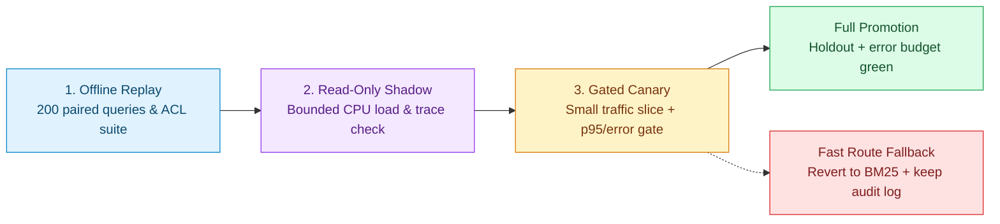

---
{
  "id": "ai-lab-technical-presentation",
  "title": "AI Lab Technical Presentation",
  "slug": "ai-lab-technical-presentation",
  "section": "AI Lab Interviewing",
  "category": "System Design",
  "difficulty": "Hard",
  "order": 4,
  "coverImage": "social_banner.png",
  "companies": [
    "Frontier AI Labs",
    "OpenAI",
    "Google DeepMind",
    "Meta AI"
  ],
  "shortDescription": "You have fifteen minutes. Make one architectural choice, one failure case, and one paired evaluation defensible with clear scope and limits.",
  "keyConceptsTested": [
    "Role-specific project selection",
    "Architecture and ownership scopes",
    "Tradeoff defense under follow-ups",
    "Paired evaluation and McNemar statistics",
    "Measurement versus causal claims",
    "Technical Q&A and uncertainty"
  ],
  "prerequisites": [
    "ai-lab-behavioral-interview",
    "design-code-completion-system",
    "mcp-tool-protocol-standards",
    "model-versioning-continuous-deployment"
  ],
  "relatedQuestions": [
    "ai-lab-system-design-interview",
    "design-reasoning-agent-test-time-compute",
    "agent-evaluation-benchmarks",
    "observability-monitoring-llm-systems"
  ]
}
---

You have fifteen minutes to walk senior engineers through a project you built. Opening with a directory tree or a list of frameworks forces listeners to guess why any box exists, whereas opening with an architectural failure immediately gives every component a job to do. For example, asking why top-ranked enterprise RAG answers kept leaking stale finance drafts or timing out during cross-encoder spikes sets up a clear problem, design constraint, and measurable tradeoff within the first thirty seconds.

In [AI Lab Behavioral Interview](/learn/ai-lab-behavioral-interview), we practiced isolating your personal engineering decisions from team-wide outcomes. A technical presentation pushes that same rigor deeper into code, statistics, and system tradeoffs so an interviewer can interrogate every diagram box and evaluation metric directly. Preparing for that questioning turns a slide deck from a status summary into an engineering defense.

AI-lab presentation formats vary by team and role. OpenAI's public guide notes that assessments emphasize clear reasoning and technical communication while adapting format by role, and Google DeepMind encourages data-backed walkthroughs aligned to role-specific expectations.[^openai2026interview][^deepmind2026interviewing] Confirm exact timing, slide expectations, Q&A allocation, and permitted materials with your recruiter ahead of time, then treat the fifteen-minute walkthrough below as an adaptable template.

## Choose a project you can explain honestly

Start from the engineering depth expected for your target role. Infrastructure interviews reward clear failure modes, resource isolation, backpressure, and operational telemetry, whereas research or modeling talks center on crisp hypotheses, ablation baselines, negative results, and experimental controls. A prototype or unsuccessful experiment can anchor a great presentation whenever it reveals genuine technical judgment, provided you distinguish tested scope from unverified production scale.

Share only sanitized evidence and metrics you are permitted to discuss outside your employer. Redact customer identifiers, swap raw payloads for anonymized query slices, state clearly when numbers are rounded or sampled, and avoid pasting proprietary logs or artifacts into external rehearsal tools. If confidentiality restrictions prevent explaining the core failure mode or architecture honestly, pick an open-source, personal, or cleanly abstracted project instead.

To ground every principle concretely, this lesson follows a representative **Two-Stage Hybrid Retrieval + Cross-Encoder Reranker Migration** for an internal technical support assistant:

- Engineers query internal runbooks, architecture docs, and ticket resolutions that carry workspace and department access controls.
- A legacy single-stage BM25 retriever fails on semantic paraphrases (`hit@5 = 74%`) and lacks fast pre-ranking deletion filtering, while lookups must stay below an `800 ms` p95 latency target.
- Your personal scope covers the query ACL filter, hybrid BM25 + dense candidate merger, in-process cross-encoder reranker wrapper, paired offline evaluation suite, and rollout telemetry. Another platform team maintains the underlying document store and ingestion index.

Defining that scope upfront keeps shared ownership crystal clear while leaving rich technical choices to defend under questioning. Every architectural decision in your talk should trace back to one of those six core claims.

## Build the argument before the slides

Before opening slide software, distill your project into six falsifiable sentences that a skeptical listener can test line by line. Writing those six sentences first prevents spending six slides on peripheral helpers while starving the central tradeoff or causal caveats of oxygen.

```text
Problem:    Single-stage BM25 missed semantic queries (148/200 hit@5) and risked leaking tombstoned docs.
Constraint: Enforce tenant ACLs before cross-encoder scoring while staying under 800 ms p95 latency.
Decision:   Enforce ACL filters ahead of top-50 hybrid retrieval, running an INT8 cross-encoder in-process.
Alternative: Hosting a remote GPU reranker service isolates heavy batches cleanly but adds RPC network tail and retry states.
Evidence:   200-query paired evaluation raises hit@5 to 162/200 (+7 pp, 8 regressions, McNemar p = 0.0161).
Limit:      Paired offline queries and unmatched incident windows do not prove uniform gains across unseen tenants.
```

Once those six sentences stand on their own, include implementation specifics only where they illuminate correctness, tail latency, or reversal cost. Explaining why an ACL check executes before dense vector scoring prevents unauthorized leaks, whereas listing DTO class names adds clutter. Research talks follow the exact same discipline by substituting baseline ablations and error taxonomy for serving architecture, matching experimental claim-scoping principles such as the NeurIPS checklist.[^neurips2026paperChecklist]

```checkpoint
A research prototype or internal tool never shipped to full production. Should you avoid presenting it?
---
No. Follow your recruiter's role instructions, because a focused prototype often exposes cleaner hypotheses, controlled ablations, and failure analyses than a vague team-wide launch. Label offline replay, shadow checks, and production traffic separately rather than blurring tested behavior with projected impact.
```

## Budget time around interruptions

Senior interviewers frequently pause mid-slide to probe capacity math, lock contention, or metric denominators, so pacing your talk tightly matters as much as slide craft. Planning explicit buffers rather than filling every minute to the brim ensures you reach your evaluation metrics and limitations even after four minutes of deep Q&A. Keep an emergency pivot ready after minute six so you can skip auxiliary setup and jump straight from your core mechanism to the hardest tradeoff and quantitative evidence.

| Window | Segment | Target Output | Cut Plan If Interrupted |
|---|---|---|---|
| 0 to 2 min | Problem & SLO | State bottleneck, `800 ms` p95 target, personal ownership | Keep under 90 seconds if audience jumps ahead |
| 2 to 6 min | Request Path | Trace ACL pre-filter, hybrid top-50, and failure modes | Summarize helper boxes into one dataflow pass |
| 6 to 9 min | Key Tradeoff | Defend in-process INT8 reranker vs remote RPC service | Deliver chosen constraint, downside, reversal signal |
| 9 to 12 min | Paired Evidence | Walk through `148 -> 162 / 200` gains, 8 drops, p95 vs timeouts | Lead immediately with McNemar `p` and worst slices |
| 12 to 13 min | Claim Limits | Name fixed corpus bias, shadow-only risks, next evals | Never cut limitations even under heavy time compression |
| 13 to 15 min | Slack & Q&A | Handle follow-ups or show sanitized appendix traces | Spend buffer absorbing earlier deep-dive questions |

Rehearse a compressed 90-second executive version alongside the full 15-minute talk. In 90 seconds, state the bottleneck you owned, the primary design change, the hardest alternative rejected, and the bounded headline outcome with its main caveat. Live demos work best when you tell listeners which invariant to verify first and keep a captured sanitized trace ready if a staging service stalls.

## Draw the request and ownership path

An architecture slide earns its screen time when it makes a concrete failure obvious at a glance. Listeners immediately ask three questions: where could unauthorized documents slip into prompt context, where does tail latency accumulate, and which boxes did you build yourself? Naming components around execution roles rather than internal team acronyms keeps those answers intuitive for any interviewer.

<figure>
  
  <figcaption>Two-stage retrieval request path showing fail-closed ACL filtering ahead of hybrid search and cross-encoder scoring, paired with request-level telemetry capturing doc IDs, filter versions, and latency splits.</figcaption>
</figure>

Pair every normal execution diagram with at least one explicit error path. When the cross-encoder batch exceeds a `250 ms` compute deadline or returns malformed scores, the stage aborts reranking cleanly, emits a degraded-mode flag onto the audit trace, and falls back to ACL-filtered hybrid scores rather than stalling downstream answer synthesis or leaking unfiltered chunks. Distinguishing clearly between your owned components (ACL gate, hybrid ranker wrapper, degraded fallback, telemetry schema) and another team's storage index lets interviewers evaluate your actual systems judgment fairly.

## Defend a choice without making it permanent

Strong candidates never present a design as universally optimal, because senior interviewers test whether you recognize the regime where your choice breaks down. Keeping the quantized INT8 cross-encoder inside the retrieval worker eliminates network serialization, connection-pool queueing, and cross-service retry multiplication while memory fits comfortably on the host. The accepted downside is shared CPU/memory contention: heavy concurrent long-document batches can spike latency for neighbor queries in the same worker pool.

Instead of arguing defensively when challenged on worker saturation, walk through your diagnostic steps. Locate where queue time grows first: if upstream ACL checks or vector-store scans dominate wait time, splitting the cross-encoder onto remote GPU workers wastes network hops while leaving the bottleneck untouched. Once telemetry isolates cross-encoder scoring as the bottleneck, weigh bounded worker semaphores against extracting a dedicated reranker pool alongside explicit batch-size caps and reversal cost. Framing tradeoffs around constraint, rejected alternative, accepted downside, and reversal signal turns follow-up pressure into a collaborative engineering conversation.

## Make each number carry only the claim it supports

Quantitative slides sink more technical presentations than weak diagrams, because imprecise metrics invite immediate interrogation on denominators and attribution. When reporting latency, always distinguish percentile metrics cleanly, pair aggregates with sample denominators and measurement windows, and never present observational before-and-after telemetry as isolated causal proof when traffic volume or model configs shifted concurrently.

| Observation | Defensible Claim | Context Still Needed |
|---|---|---|
| Query `hit@5`: `148 -> 162` of `200` | `+7 pp` net improvement (`74% -> 81%`) on this fixed evaluation slice | Query selection criteria, labeler agreement, breakdown of `8` regressions |
| Successful lookup p95: `720 -> 680 ms` | Successful completions meet the `800 ms` target on this run | Overall p95 including timeouts, concurrency level, hardware SKU |
| Quarterly alerts: `5 -> 1` | Raw incident count dropped across those two reporting periods | Request exposure (`5/5M = 1.0/M` vs `1/500k = 2.0/M`), severity definitions |
| ACL stale leaks: `0` on `200` test queries | Zero unauthorized hits surfaced inside the replay sample | Production revocation lag distribution and tombstone sweep guarantees |

Google SRE guidance emphasizes separating latency measurements for successful and failed attempts and monitoring error behavior explicitly rather than relying on combined averages.[^sreMonitoringDistributedSystems] Suppose successful requests log a `680 ms` p95 inside an `800 ms` threshold while `20` of `200` lookups time out completely at `1.5 s`. Reporting only the `680 ms` success figure hides a `90%` availability failure that violates a `99%` reliability SLO. Always show completion rate and timeout counts right alongside latency percentiles on your evidence slide.

### Inspect the cases behind the average

Single aggregate averages hide asymmetric regressions that matter hugely in enterprise search and agent workflows. Suppose each of `200` frozen technical-support queries has one labeled canonical document, and we score `hit@5` (whether that canonical target appears in the top five results returned to the LLM context window). Keeping query text, labels, corpus snapshots, ACL context, and index configurations strictly locked satisfies the core reproducibility hygiene highlighted in ML evaluation checklists.[^neurips2026paperChecklist]

Across our paired run, the baseline solves `148` queries (`74%`) and the candidate solves `162` (`81%`), yielding a net `+7 percentage-point` improvement. Inspecting the two-by-two contingency table exposes the `30` discordant queries hidden behind that net delta: `22` queries gained a hit while `8` previously passing queries regressed into misses. Those `8` regressions could cluster inside critical failure modes such as exact error-code lookups where dense embeddings dilute literal lexical matches.

<figure>
  
  <figcaption>McNemar contingency breakdown (22 improvements vs 8 regressions across 30 discordant pairs, two-sided p = 0.0161) alongside overall hit@5 shift (74% to 81%). Reviewing the 8 regressions directly prevents silent critical-query drops.</figcaption>
</figure>

The Python script below computes the exact paired counts, runs McNemar's exact binomial test via `scipy.stats.binomtest` across the `30` discordant outcomes, checks how shifting traffic volume inverts raw vs per-million incident rates, and evaluates combined latency and availability pass gates together:

<!-- leetllm: test, id=presentation-evidence, deps=scipy, output=show -->
```python title="paired_retrieval_audit.py"
from collections import Counter
from scipy.stats import binomtest


def paired_hit_summary(baseline: dict[str, bool], candidate: dict[str, bool]) -> dict[str, float | int]:
    if not baseline or baseline.keys() != candidate.keys():
        raise ValueError("baseline and candidate must evaluate identical non-empty query IDs")
    counts = Counter((baseline[qid], candidate[qid]) for qid in baseline)
    n = len(baseline)
    both_hit = counts[(True, True)]
    regressed = counts[(True, False)]
    improved = counts[(False, True)]
    both_miss = counts[(False, False)]
    discordant = improved + regressed
    p_value = binomtest(improved, discordant, p=0.5, alternative="two-sided").pvalue if discordant else 1.0
    base_rate = (both_hit + regressed) / n
    cand_rate = (both_hit + improved) / n
    return {
        "n": n,
        "base_rate": base_rate,
        "cand_rate": cand_rate,
        "delta_pp": 100.0 * (cand_rate - base_rate),
        "improved": improved,
        "regressed": regressed,
        "mcnemar_p": p_value,
    }


def incidents_per_million(incidents: int, requests: int) -> float:
    if incidents < 0 or requests <= 0:
        raise ValueError("incidents must be non-negative and requests positive")
    return incidents / requests * 1_000_000.0


# 200 paired queries aligned strictly by query ID.
pairs = [(True, True)] * 140 + [(True, False)] * 8 + [(False, True)] * 22 + [(False, False)] * 30
baseline = {f"q{i}": b for i, (b, _) in enumerate(pairs)}
candidate = {f"q{i}": c for i, (_, c) in enumerate(pairs)}

summary = paired_hit_summary(baseline, dict(reversed(list(candidate.items()))))
assert summary["improved"] - summary["regressed"] == 14
assert round(summary["delta_pp"], 6) == 7.0
assert summary["mcnemar_p"] < 0.02

rate_before = incidents_per_million(5, 5_000_000)
rate_after = incidents_per_million(1, 500_000)

attempted, timed_out, successful_p95_ms = 200, 20, 680
success_fraction = (attempted - timed_out) / attempted
latency_ok = successful_p95_ms < 800
release_ready = latency_ok and success_fraction >= 0.99
assert not release_ready

print(
    f"hit@5: {summary['base_rate']:.0%} -> {summary['cand_rate']:.0%} "
    f"(+{summary['delta_pp']:.1f} pp, {summary['improved']} improved, "
    f"{summary['regressed']} regressed, McNemar p={summary['mcnemar_p']:.4f})"
)
print(f"incidents per million: {rate_before:.1f} -> {rate_after:.1f}")
print(f"success_rate={success_fraction:.0%}, p95_ms={successful_p95_ms}, release_ready={release_ready}")
```

<!-- leetllm: output:start -->
```text title="Output" output compact
hit@5: 74% -> 81% (+7.0 pp, 22 improved, 8 regressed, McNemar p=0.0161)
incidents per million: 1.0 -> 2.0
success_rate=90%, p95_ms=680, release_ready=False
```
<!-- leetllm: output:end -->

Even with a clean `p = 0.0161` McNemar test on the `200`-query slice, never overclaim generalization beyond what your sample covers. Clarify whether those `200` queries came from an untouched holdout split or historical tuning bugs, and acknowledge that repeated runs measure judge or sampler variance rather than new independent users.

## Explain how you controlled the rollout

When presenting a migration or new ML component, listeners care far more about how you gated risk than about the final launch date. Separating offline replay, read-only shadow comparison, and canary traffic promotion shows you treated model quality and serving stability as decoupled failure surfaces, matching Google Cloud's MLOps distinction between offline checks and live online validation.[^google2026mlops]



Each stage catches bugs the earlier stage misses. Offline replay checks exact ACL filtering and `hit@5` regressions on frozen labels, whereas a bounded read-only shadow exposes live query length distributions, unexpected cross-encoder latency spikes, and cache eviction pressure without risking user-visible quality. Only after latency, saturation, and error metrics stay clean does a canary route expose real users behind a reversible traffic switch and automated rollback criteria.

## Answer questions at the edge of your knowledge

Technical Q&A tests intellectual honesty as sharply as technical breadth, and Google DeepMind's preparation advice explicitly recommends articulating reasoning steps while acknowledging missing data.[^deepmind2026interviewing] Rather than bluffing past an unfamiliar bottleneck or another team's storage layer, separate confirmed observation, plausible hypothesis, and the concrete measurement you would run next:

> I owned the ACL filter, hybrid ranker wrapper, and telemetry tags. The traces point to elevated CPU queueing inside cross-encoder scoring under long queries, though I haven't captured per-batch sequence lengths yet. I would profile batch token distribution and cap context length to 512 tokens per candidate before sizing remote GPU workers.

Respect each interview's AI-assistant policy as strictly as its technical scope. OpenAI specifies that tool permissions depend on format, while Google DeepMind permits AI tools during personal preparation yet prohibits live interview use unless explicitly allowed.[^openai2026interview][^deepmind2026interviewing] Confirm rules before the session starts rather than carrying assumptions between companies.

### Rehearse with skepticism

Run one mock presentation where a peer interrupts right after the request-path diagram and asks what single assumption would invalidate your rollout decision. Verify your numbers, failure modes, and personal ownership answers directly against the checklist below before stepping into the room.

| Presentation Pitfall | Concrete Fix |
|---|---|
| Diagram lists library names instead of execution | Trace one query through auth, ACL filter, failure fallback, and trace logging |
| Percentages omit denominators or time windows | Pair every metric with sample counts (`N=200`), window dates, and failure counts |
| Team-wide outcomes sound like solo work | State the specific modules, eval tests, and telemetry you built alongside partner teams |
| Observational deltas presented as causal proof | Isolate paired controlled deltas separately from traffic-volume shifts |
| Simulation or shadow outputs framed as prod wins | Tag offline replay, shadow checks, canary traffic, and full rollout on separate rows |
| Follow-up questions trigger an unguided appendix tour | Answer directly in two sentences first, then open one targeted backup chart |

```checkpoint
The panel asks whether the 74% to 81% improvement proves the cross-encoder helps every customer department. How do you answer?
---
State clearly that the +7 percentage-point gain holds on the fixed 200-query slice (with 22 gains and 8 regressions, McNemar p = 0.0161), and inspect the 8 regressed queries alongside unseen department slices before claiming uniform cross-tenant improvement.
```

```checkpoint
Questions consume four extra minutes on your architecture slide, leaving only five minutes for the rest of the talk. What stays and what gets cut?
---
Answer the active question cleanly, deliver the central tradeoff, walk through the paired retrieval evidence with its 8 regressions and timeout caveats, and never skip your limitation slide. Offer backup appendix traces strictly for follow-up Q&A.
```

```mastery-quiz
[
  {
    "question": "In a fifteen-minute technical presentation of a research quantization study, a baseline solves 48 of 80 public eval tasks while your candidate solves 42 of the same 80 tasks. How should you state the result on your slide?",
    "options": [
      "Report a 12.5 percentage-point drop in solved tasks across the entire evaluation slice",
      "Report a 7.5 percentage-point drop on the 80-task study slice alongside failing failure buckets",
      "Report a 7.5 percentage-point regression across deployed production customer traffic globally",
      "Report a 6 percentage-point decrease measured across the shared public benchmark slice"
    ],
    "answer": "Report a 7.5 percentage-point drop on the 80-task study slice alongside failing failure buckets",
    "explanation": "48/80 = 60.0% and 42/80 = 52.5%, a 7.5 percentage-point drop (6 raw cases, or 12.5% relative decline). Offline benchmark slices never establish production traffic behavior without deployment validation."
  },
  {
    "question": "During your request-path slide, why must the tenant ACL and tombstone filter execute ahead of the hybrid index and cross-encoder stage?",
    "options": [
      "Dense embedding models return undefined cosine scores when indexing public employee manuals",
      "Running ACL checks pre-retrieval prevents deleted or restricted chunks from reaching external scorers",
      "Cross-encoder batch inference requires strictly alphabetically sorted document identifiers first",
      "Vector stores automatically drop expired tombstone entries immediately during candidate reranking"
    ],
    "answer": "Running ACL checks pre-retrieval prevents deleted or restricted chunks from reaching external scorers",
    "explanation": "Once a private or deleted document reaches an external reranker or prompt generator, downstream output filtering arrives too late to stop unauthorized model exposure."
  },
  {
    "question": "Your in-process cross-encoder migration improves hit@5 while overall tail latency rises. An engineer asks whether moving the reranker to a separate GPU microservice cuts latency. If traces show 1,200 ms waiting on an upstream document store and 200 ms inside the reranker, what happens after splitting?",
    "options": [
      "Adding a 15 ms RPC network hop leaves total lookup latency at 1,415 ms behind the store wait",
      "Moving the reranker removes the 1,200 ms store wait completely and drops end-to-end latency to 215 ms",
      "Parallelizing RPC headers shrinks upstream document store latency down below 200 ms immediately",
      "Eliminating local process memory drops total serialized request runtime down to 1,215 ms"
    ],
    "answer": "Adding a 15 ms RPC network hop leaves total lookup latency at 1,415 ms behind the store wait",
    "explanation": "Extracting a separate service leaves sequential upstream waiting untouched (1,200 + 200 + 15 = 1,415 ms) while introducing network hops and extra retry states."
  },
  {
    "question": "Across 50 frozen evaluation queries, 30 succeed on both systems, 7 succeed only on the baseline, 10 succeed only on the candidate, and 3 miss on both. What are the paired rates, net delta, and regression count?",
    "options": [
      "37 to 40 successes, representing an 8.1 percentage-point absolute rise with 7 regressions",
      "30 to 40 successes, representing a 20.0 percentage-point absolute gain with 3 regressions",
      "37 to 40 successes, representing a 6.0 percentage-point absolute gain with 7 regressions",
      "37 to 40 successes, representing a 6.0 percentage-point absolute gain with 10 regressions"
    ],
    "answer": "37 to 40 successes, representing a 6.0 percentage-point absolute gain with 7 regressions",
    "explanation": "Baseline solved 30 + 7 = 37 (74%) and candidate solved 30 + 10 = 40 (80%), a +6.0 pp gain (+8.1% relative) accompanied by 7 baseline-only regressions."
  },
  {
    "question": "A before-and-after rollout note reports 6 incidents over 3,000,000 queries pre-migration and 2 incidents over 500,000 queries post-migration with no held-out control group. What conclusion holds?",
    "options": [
      "Exposure-adjusted rates climbed from 2 to 4 per million, proving the reranker introduced new instability",
      "Exposure-adjusted rates rose from 2 to 4 per million, while causal attribution remains unresolved",
      "Observed failure density stayed flat at 2 per million across both periods without attribution bias",
      "Raw incident drops from 6 down to 2 prove safer query routing despite lower sample size"
    ],
    "answer": "Exposure-adjusted rates rose from 2 to 4 per million, while causal attribution remains unresolved",
    "explanation": "6 / 3M = 2 per million and 2 / 0.5M = 4 per million; raw counts dropped only because volume fell 6x, and unmatched windows cannot isolate single causes."
  },
  {
    "question": "In paired_hit_summary, why does the audit join baseline and candidate results strictly by explicit query IDs rather than dictionary iteration order or positional arrays?",
    "options": [
      "Dictionary iteration reverses boolean types silently whenever string keys vary across platforms",
      "Joining by query ID prevents mismatched queries or shuffled logs from corrupting discordant McNemar pairs",
      "Positional indexing discards common miss pairs before scipy.stats.binomtest inspects discordant totals",
      "Query ID alignment automatically repairs missing evaluation labels across mismatched benchmark suites"
    ],
    "answer": "Joining by query ID prevents mismatched queries or shuffled logs from corrupting discordant McNemar pairs",
    "explanation": "McNemar's test depends strictly on per-query pairing (improved vs regressed on identical inputs); shuffling order or evaluating different IDs invalidates discordant counts."
  },
  {
    "question": "With 6 minutes left in an 18-minute talk (after 3 min context, 4 min architecture, and 5 min Q&A), you still need 2 minutes for your key tradeoff and at least 1 minute for limitations. What allocation preserves the strongest talk?",
    "options": [
      "Spend 2 minutes on the key tradeoff, 4 minutes on paired eval evidence, and skip claim limits",
      "Spend 2 minutes on the key tradeoff, 3 minutes on paired evidence, and 1 minute on claim limits",
      "Spend 1 minute on the key tradeoff, 4 minutes on appendix code traces, and 1 minute on limits",
      "Race through every planned architectural box in 2 minutes so zero slides stay unshown"
    ],
    "answer": "Spend 2 minutes on the key tradeoff, 3 minutes on paired evidence, and 1 minute on claim limits",
    "explanation": "Reserving 2 minutes for the decision and 1 minute explicitly for limitations leaves 3 clean minutes for quantitative evidence without skipping critical caveats."
  },
  {
    "question": "While serving live traffic A-D via BM25, a shadow pipeline scores queries A-D and records 2 telemetry audit rows on B and D. An operator stops the shadow, and a 5% canary later serves query E without writing a shadow audit row. Across A-E, how many user answers did the candidate serve and how many shadow entries remain?",
    "options": [
      "The candidate served 5 user answers while 2 shadow audit rows remain stored in logs",
      "The candidate served 1 user answer while 0 shadow audit rows remain after stopping shadow",
      "The candidate served 1 user answer while 2 shadow audit rows remain stored in logs",
      "The candidate served 0 user answers while 2 shadow audit rows remain in production"
    ],
    "answer": "The candidate served 1 user answer while 2 shadow audit rows remain stored in logs",
    "explanation": "Shadow copies on A-D ran asynchronously without reaching users, leaving E as the sole canary response served; stopping future shadow runs leaves previously flushed rows B and D intact."
  },
  {
    "question": "Traces show a fast lookup used an index scan while a slow lookup triggered a full table scan, yet neither trace records elapsed per-stage durations. The caller authorization unit tests pass. What do you tell the panel?",
    "options": [
      "Propose timing matched index vs sequential scans on identical queries while keeping runtime auth checks active",
      "Attribute the entire end-to-end latency spike strictly to missing indexes and remove redundant runtime auth checks",
      "Replace live request ACL filtering with passing offline authorization unit tests to cut scan overhead",
      "Accept the qualitative query plans as final causal proof without gathering matched timing measurements"
    ],
    "answer": "Propose timing matched index vs sequential scans on identical queries while keeping runtime auth checks active",
    "explanation": "Execution plans show access paths without isolated durations, requiring matched timing runs; offline unit tests verify code samples and never substitute for live per-request ACL enforcement."
  },
  {
    "question": "A release verification run reports successful-request p95 at 760 ms against an 800 ms limit, while 4 out of 250 total requests timed out against a 99% completion gate. Which metric and rollout decision belong on your final slide?",
    "options": [
      "Report a 98.4% completion rate and promote because successful p95 sits under 800 ms",
      "Report a 98.4% completion rate and hold promotion until timeout reliability exceeds 99%",
      "Report a 1.6% completion rate and hold promotion while tuning index concurrency caps",
      "Report a 100.0% completion rate by excluding timed-out client connections from p95 aggregates"
    ],
    "answer": "Report a 98.4% completion rate and hold promotion until timeout reliability exceeds 99%",
    "explanation": "246 / 250 = 98.4% completion (1.6% timeout rate), violating the 99% gate even though successful-request p95 satisfies 800 ms. Both completion and latency gates must pass together."
  }
]
```

> **Next:** Continue to [Deep Dive - vLLM](/learn/deep-dive-vllm). Practice the same habit of connecting architecture to evidence as you inspect a serving engine's scheduling and memory management.
