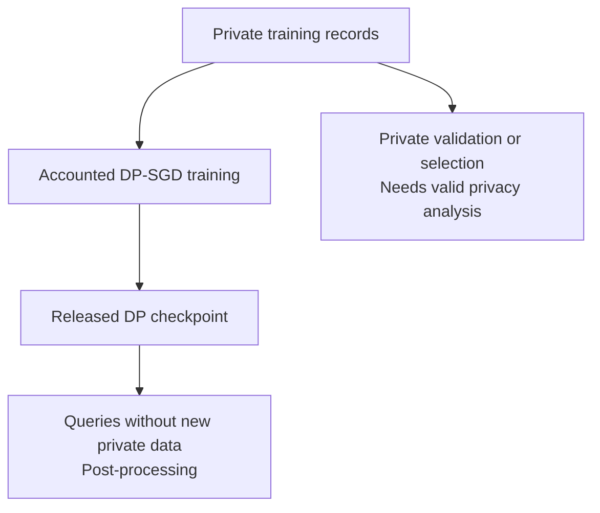

---
{
  "id": "privacy-preserving-ml-differential-privacy",
  "title": "Privacy-Preserving Machine Learning",
  "slug": "privacy-preserving-ml-differential-privacy",
  "section": "Applied LLM Engineering",
  "category": "Alignment & Safety",
  "difficulty": "Medium",
  "order": 8,
  "coverImage": "illustrations/_generated/privacy_mechanism_dark.png",
  "companies": ["OpenAI", "Anthropic", "Google", "Meta"],
  "shortDescription": "A support copilot recites a private note, and the cause might be training, retrieval, or the prompt. Differential privacy bounds the training path only when the protected unit matches the promise.",
  "keyConceptsTested": ["differential privacy", "neighboring datasets", "epsilon and delta", "protected unit", "privacy composition", "DP-SGD", "per-example versus per-user clipping", "Gaussian noise", "privacy accounting", "membership inference", "memorization extraction", "DP-LoRA"],
  "prerequisites": ["responsible-ai-governance-ethics-compliance", "pytorch-training-loops"]
}
---

Imagine a support copilot in its final security review. An analyst prompts it with `"Ticket summary: Customer reported recurring billing error on..."`. It completes the sentence with a customer's address and a private medical note.

Seeing sensitive text in a response does not by itself pinpoint the leak path. Did a retrieval tool fetch an unauthorized ticket? Was the note already in the prompt? Was it published elsewhere, or memorized during training? Trace the data path before diagnosing training leakage.

Suppose the investigation confirms training-data extraction. Removing names reduces direct identifiers; addresses, unusual phrases, and combinations of facts can still identify someone. Memorization depends on the data, repetition, training, and attack. An unusual sentence isn't automatically memorized.[^carlini2021Extraction]

<span data-glossary="differential-privacy">Differential privacy</span> compares neighboring training datasets that differ in one declared protected contribution. It bounds how much that change can affect the distribution of released outputs. The contribution might be a row or a person's entire history. The privacy definition also specifies whether that contribution is added, removed, or replaced. Those choices determine the guarantee.[^dwork2006][^dwork2014]

Our training setup uses the **central privacy model**: a trusted service sees raw records, and the released model must satisfy the privacy bound. Queries using that model and no additional private data inherit its guarantee. Raw databases, prompts, retrieval tools, and internal logs need their own controls. DP bounds the effect of protected participation. It doesn't prevent every sensitive inference or erase facts someone already knows.

The review still has a tempting shortcut: scrub the names, run a membership test, and treat a pass as safety. What would that test actually tell you?

## What an attack test can tell you

Regex redaction masks recognized strings. Privacy evaluation also asks whether the remaining text or model behavior reveals information. Three useful attack families are:

1. **Memorization and extraction**: Probe for verbatim training text, for example by passing prefixes. Controlled experiments can insert synthetic secrets, called *canaries*, at different repetition counts and test their recoverability. Published language-model work extracted sequences present in a single training document, showing that rare text can be recoverable in some settings.[^carlini2021Extraction]
2. **Membership inference (MIA)**: Test whether a candidate document belonged to training.[^shokri2016membership] Low loss can be a signal, but familiar or easy non-member text can also have low loss. Reference-model scores and compressed text length can help calibrate difficulty. The reference model does not require a disjoint training set. These scores support an attack decision; they don't reveal membership with certainty.[^carlini2021Extraction]
3. **Attribute inference or reconstruction**: Combine partial information with model outputs to guess sensitive fields. Some success comes from population correlations rather than one person's contribution. DP limits the influence of any one person's data while allowing the model to learn population patterns.[^dwork2014]

| Defense strategy | What it provides | Vulnerability left open |
|---|---|---|
| Regex name scrubbing | Removes specific known string tokens | Syntactic masking misses unique context, rare phrases, and semantic fingerprints |
| Identifier hashing | Converts persistent IDs into fixed pseudonyms | Pseudonyms remain linkable across records; correlations still leak |
| Passing a membership test | Reports the tested attack's performance on its evaluation setup | Stronger attacks, other populations, and other interfaces remain untested |
| Differentially private training | Bounds probabilities for the declared neighboring relation and parameters | Doesn't certify legal compliance, access control, task quality, or zero disclosure |

A weak attack can miss real leakage. A successful, statistically sound attack can give evidence against a claimed guarantee. Neither result substitutes for checking the mechanism and its assumptions. DP's inequality holds for every output event, including events chosen by an adversary with background knowledge.

```checkpoint
Why does a passing membership inference test fail to guarantee that a customer's support ticket can't be extracted?
---
The test measures one attack on selected data and an interface. Differential privacy provides a formal bound only when its mechanism, protected unit, and accounting assumptions hold; evaluate other extraction strategies under those same assumptions as well.
```

## Start with the unit you promise to protect

Before configuring an epsilon or tuning noise scales, write one concrete definition: "one protected unit is ___." Two datasets are neighbors when they differ by that single <span data-glossary="protected-unit">protected unit</span>.

In enterprise support data, that unit might be one row, one conversation ticket, or one customer account.

| Protected unit | Neighboring dataset definition | Operational failure mode |
|---|---|---|
| Row | Remove one training message | One customer sent fifty messages across several tickets |
| Conversation | Remove one multi-turn conversation | A user participated in multiple support incidents over time |
| User | Remove every message and ticket from that user | Missing identity tracking prevents bounding total user contributions |

Suppose Alice submitted twelve support messages across three tickets. A row-level guarantee bounds what happens when one message is removed. A user-level guarantee bounds what happens when all twelve messages disappear simultaneously. These guarantees apply to different neighboring relations and bound different changes: one message versus all of a user's messages.

The definition also depends on the adjacency convention:

- **Add/remove adjacency**: One protected unit is added or removed. Removing a user can remove many rows.
- **Replace-one adjacency**: One unit's complete value is replaced, keeping the number of units fixed.

Treat the dataset as a **multiset of protected units**, preserving repeated contributions. For a sum of vectors whose individual norms are at most $C$, add/remove sensitivity is at most $C$; replace-one sensitivity is at most $2C$. Both bounds can be attained in one dimension. Derive sensitivity from the query and neighboring-dataset definition for each mechanism.

For every measurable output event $S$, a randomized mechanism $M$ satisfies $(\varepsilon,\delta)$-differential privacy if:[^dwork2014]

$$
P(M(D) \in S) \le e^{\varepsilon} P(M(D') \in S) + \delta
$$

The probabilities reflect the internal randomness of mechanism $M$, not randomness in picking the training dataset. The condition must hold in both directions ($D$ to $D'$ and $D'$ to $D$) for every neighboring pair and every measurable output event $S$.

With $\delta=0$, **epsilon** bounds the ratio of event probabilities by $e^\varepsilon$ in both directions. At $\varepsilon=0.5$, an event with probability $0.001$ on one neighbor has probability at most about $0.00165$ on the other. These are probabilities, not odds. At $\varepsilon=8$, the multiplier is about $2{,}981$, a much weaker limit.

With $\delta>0$, the bound includes **additive slack**: that example becomes $0.00165+\delta$. Interpret delta through the approximate-DP event-probability bound; it doesn't map directly to the fraction of people exposed or a universal per-run switch. Approximate DP permits density ratios to exceed $e^\varepsilon$ on some outputs while bounding event probabilities.

Why insist on a small delta? A mechanism that publishes its **entire dataset** with probability $\delta$ and otherwise returns a constant satisfies $(0,\delta)$-DP. Also, publishing one uniformly selected raw unit illustrates why delta around $1/N$ can be dangerous. Here $N$ counts protected units, not necessarily rows.

Choosing delta much below $1/N$ is common guidance, not part of the definition. NIST discusses more conservative targets such as $1/N^2$ or $1/(N\log N)$ and calls for justifying unusually large values. Choose and document it for the population and risk; don't copy $10^{-5}$ as a universal safe default.[^nist2025DPGuarantees] Setting $\delta=0$ gives *pure* DP.

<figure>
  
  <figcaption>The shaded area is the excess probability mass for one direction; approximate DP checks the reverse neighbor order too. Under the displayed adjacency, a clipped sum changes by at most C for add/remove and 2C for replace-one.</figcaption>
</figure>

For densities $p$ and $q$, the largest excess over all events is $\int\max(p(s)-e^\varepsilon q(s),0)\,ds$. Approximate DP bounds this quantity by delta and also requires the reverse-direction bound. Gaussian densities with different means have unbounded likelihood ratios in the tails; overlapping curves alone don't prove DP.[^charles2024userdp]

Consider a toy mechanism you can evaluate by hand. A support customer answers a sensitive yes/no question truthfully with probability $0.75$ and reports the opposite answer with probability $0.25$:

| True private response | Probability reporting Yes | Probability reporting No |
|---|---|---|
| Yes | 0.75 | 0.25 |
| No | 0.25 | 0.75 |

The largest probability ratio for either output, in either direction, is $0.75/0.25=3$. Thus $\varepsilon=\ln 3$ and $\delta=0$. Every event is a subset of these two outputs, so checking both singleton outputs suffices here. Adding this randomness on the client, before the collector sees the response, gives **local DP**.[^dwork2014]

<!-- leetllm: test, output=show -->
```python title="check-randomized-response.py"
import math

yes_input = {"Yes": 0.75, "No": 0.25}
no_input = {"Yes": 0.25, "No": 0.75}
ratios = [
    ratio
    for output in yes_input
    for ratio in (
        yes_input[output] / no_input[output],
        no_input[output] / yes_input[output],
    )
]
print(f"largest probability ratio: {max(ratios):.1f}")
print(f"epsilon: {math.log(max(ratios)):.3f}, delta: 0")
```

<!-- leetllm: output:start -->
```text title="Output" output compact
largest probability ratio: 3.0
epsilon: 1.099, delta: 0
```
<!-- leetllm: output:end -->

This example verifies probabilities; it doesn't collect private responses. Central DP training uses a trusted service instead, and needs a mechanism for the entire released training result.

```checkpoint
A hospital proposes epsilon = 2 and delta = 0.05 for 50,000 protected patients. Does this mean exactly 2,500 patients could be exposed?
---
No. Delta is additive slack in an event-probability inequality. For example, a mechanism that releases the entire dataset with probability 0.05 and otherwise returns a constant already satisfies (0, 0.05)-DP, hence also (2, 0.05)-DP. The number doesn't specify a fixed exposed group. Such a large delta allows severe risk and needs replacement with a justified, much smaller target.
```

## Mechanisms and sensitivity scaling

To protect a query, add noise calibrated to how much its answer could change when one protected unit changes. That maximum change is its *global sensitivity*. For any function $f$ mapping a dataset to a vector space, sensitivity is the greatest distance between answers on neighboring datasets $D$ and $D'$:

$$
\Delta_1 f = \sup_{D \sim D'} \|f(D) - f(D')\|_1, \qquad \Delta_2 f = \sup_{D \sim D'} \|f(D) - f(D')\|_2
$$

The mechanism determines the kind of noise and how to calibrate it. Two foundational choices are:

The **Laplace mechanism** adds independent noise drawn from $\text{Lap}(\Delta_1 f / \varepsilon)$ to each coordinate. It guarantees pure $(\varepsilon, 0)$-differential privacy. For scalar counts or low-dimensional database queries, Laplace noise is the usual choice.

For a $d$-dimensional vector, $\|v\|_1\le\sqrt d\,\|v\|_2$. An $L_2$ sensitivity bound can therefore imply a larger $L_1$ bound. Coordinate-wise Laplace calibration may be costly in this setting; it doesn't universally make neural-network optimization fail.

The **Gaussian mechanism** adds $\mathcal{N}(0,s^2 I)$. One classical sufficient calibration, for $0<\varepsilon<1$ and $0<\delta<1$, is:[^dwork2014]

$$
s > \frac{\Delta_2 f \sqrt{2 \ln(1.25/\delta)}}{\varepsilon}
$$

This calibration is sufficient over the stated epsilon range. Analytical Gaussian calibration uses the Gaussian cumulative distribution function and avoids limitations of this classical bound.[^balle2018AnalyticGaussian] Gaussian noise and its composition analysis are standard ingredients in DP-SGD, though they don't imply a universal utility ranking over all mechanisms.

We'll use $s$ for an actual standard deviation. In the training step that follows, $\sigma$ is a **dimensionless noise multiplier**, and the standard deviation on the clipped sum is $\sigma C$. That scale is valid only after each contribution is bounded. What has to happen to one example's gradient before the noise is added?

## Differentially private stochastic gradient descent

Ordinary SGD averages a mini-batch's gradients and updates the parameters. Without a contribution bound, one gradient can change that average substantially. A large gradient isn't itself evidence of private text or memorization.

<span data-glossary="dp-sgd">Differentially private stochastic gradient descent (DP-SGD)</span> combines bounded contributions with calibrated randomness and accounting.[^abadi2016privacy]

The steps below show one **record-level, add/remove** DP-SGD variant so its assumptions stay visible. Its Poisson sampler independently includes each present record with public probability $q$. Let $L$ be a fixed public normalizer, unchanged between neighbors; commonly $L=qN$ for a public reference population size $N$. Using a private, changing record count as a published normalizer needs separate analysis.

Each step $t$ has five phases:

1. **Poisson subsampling**: Include each record independently with probability $q$, forming a random-size batch $B_t$. Other samplers require accounting that matches them.
2. **Per-sample gradients**: Obtain each contribution $g_i(\theta_t)=\nabla_\theta\mathcal L(x_i,\theta_t)$ and its clipping factor before reduction. Efficient methods such as *ghost clipping* can do this without materializing every full per-example gradient tensor.[^li2021StrongDPLearners]
3. **Per-sample clipping**: Enforce an $L_2$ norm threshold $C > 0$ on each vector:
   $$
   \bar{g}_i(\theta_t) = g_i(\theta_t) \cdot \min\left(1, \frac{C}{\|g_i(\theta_t)\|_2}\right)
   $$
   Leave a zero vector unchanged, avoiding division by zero. Other vectors retain their direction; norms above $C$ shrink to $C$.
4. **Summation and Gaussian noise injection**: Sum the clipped vectors and add calibrated Gaussian noise scaled to sensitivity $C$:
   $$
   \widetilde{g}_t = \sum_{i \in B_t} \bar{g}_i(\theta_t) + \mathcal{N}\left(0, \sigma^2 C^2 I\right)
   $$
   Conditional on the previous accounted state, adding or removing one sampled contribution changes the clipped sum by at most $C$. The multiplier, sampling, and number of steps determine the composed privacy guarantee.
5. **Descent step**: Divide the noisy aggregate by target batch size $L$ and update parameters:
   $$
   \theta_{t+1} = \theta_t - \eta_t \frac{\widetilde{g}_t}{L}
   $$

<figure>
  
  <figcaption>The vector (3, 4) moves radially to (0.6, 0.8), keeping its direction while meeting the norm bound. Clip protected-unit contributions before summing, then add calibrated noise and divide by public L. The plotted clipping is deterministic; privacy also requires valid sampling and accounting.</figcaption>
</figure>

A frequent bug in custom implementations is clipping the batch average *after* aggregation: `clip(mean(gradients), C)`. This bounds the final update vector's length to $C$, but neighboring dataset averages can still point in opposite directions, creating a worst-case difference of $2C$ between outputs. Clipping must occur per sample before aggregation to guarantee sensitivity $C$ for the batch sum.

Verify the geometry on three vectors. This deterministic example is **not a DP release**: it adds no noise. Keep full precision during aggregation and round only the display; rounding a clipped vector first can push its norm above $C$.

<!-- leetllm: test, deps=numpy, output=show, id=vector-clipping -->
```python title="clip-vector-gradients.py"
import numpy as np

def clip_vector_l2(vector: np.ndarray, bound: float) -> np.ndarray:
    if bound <= 0:
        raise ValueError("bound must be positive")
    norm = float(np.linalg.norm(vector))
    if norm == 0.0 or norm <= bound:
        return vector.copy()
    return vector * (bound / norm)

sample_gradients = np.array([
    [0.4, 0.3],    # norm = 0.5 <= 1.0 (unclipped)
    [3.0, 4.0],    # norm = 5.0 > 1.0 (scaled by 1.0 / 5.0 = 0.2)
    [0.6, 0.8],    # norm = 1.0 == 1.0 (unclipped)
], dtype=float)
clip_bound = 1.0
clipped = np.array([clip_vector_l2(g, clip_bound) for g in sample_gradients])

print(f"sample gradients: {sample_gradients.tolist()}")
print(f"clipped gradients: {[[round(float(x), 4) for x in g] for g in clipped]}")

sum_g = clipped.sum(axis=0)
print(f"clipped sum before noise: [{sum_g[0]:.2f}, {sum_g[1]:.2f}]")
```

<!-- leetllm: output:start -->
```text title="Output" output compact
sample gradients: [[0.4, 0.3], [3.0, 4.0], [0.6, 0.8]]
clipped gradients: [[0.4, 0.3], [0.6, 0.8], [0.6, 0.8]]
clipped sum before noise: [1.60, 1.90]
```
<!-- leetllm: output:end -->

The outlier `[3.0, 4.0]` scales to `[0.6, 0.8]`, with norm $1$. Contrast `[1.0, 3.0]`: rounding its clipped coordinates to `[0.3162, 0.9487]` gives a norm slightly above $1$. The displayed decimals aren't the vector you should aggregate. Production DP needs a vetted implementation, including numerical behavior.

Now consider what happens when Alice contributes multiple messages. If Alice wrote two tickets with gradients $0.5$ and $5.0$, example-level clipping bounds each message to $1.0$, leaving Alice with a combined influence of $1.5$. It doesn't give Alice a single $C$ bound. A known limit of $k$ clipped records permits a $kC$ sum bound; unlimited records don't.

One user-level construction groups records, builds a vector per user, and clips that vector.[^charles2024userdp] It can use a sum or an average defined by the mechanism. Other constructions use per-example clipping plus bounded records per user and user-level analysis. Simply renaming a row-level accountant doesn't protect users.

Here's the **sum-then-user-clip** geometry, again without noise. Alice's two tickets and Bao's one ticket use a fixed public normalizer of two:

<!-- leetllm: test, deps=numpy, output=show, id=user-clipping -->
```python title="clip-complete-user-contributions.py"
import numpy as np

def clip_scalar(gradient: float, bound: float) -> float:
    if bound <= 0:
        raise ValueError("bound must be positive")
    return float(np.clip(gradient, -bound, bound))

user_gradients = {"Alice": [0.5, 5.0], "Bao": [0.25]}
clip_bound = 1.0

for user, gradients in user_gradients.items():
    row_clipped_sum = sum(clip_scalar(value, clip_bound) for value in gradients)
    user_clipped = clip_scalar(sum(gradients), clip_bound)
    print(f"{user}: row-clipped sum={row_clipped_sum:.2f}, user-clipped={user_clipped:.2f}")

normalizer = 2  # Public and unchanged across neighboring datasets.
user_contributions = {
    user: clip_scalar(sum(values), clip_bound)
    for user, values in user_gradients.items()
}
with_alice = sum(user_contributions.values()) / normalizer
without_alice = user_contributions["Bao"] / normalizer
print(f"with Alice, before noise: {with_alice:.3f}")
print(f"without Alice, before noise: {without_alice:.3f}")
print(f"change from removing Alice: {with_alice - without_alice:.3f}")
assert abs(with_alice - without_alice) <= clip_bound / normalizer
```

<!-- leetllm: output:start -->
```text title="Output" output compact
Alice: row-clipped sum=1.50, user-clipped=1.00
Bao: row-clipped sum=0.25, user-clipped=0.25
with Alice, before noise: 0.625
without Alice, before noise: 0.125
change from removing Alice: 0.500
```
<!-- leetllm: output:end -->

Removing Alice changes the normalized sum by $C/2=0.5$. The unnormalized user contribution is bounded by $C$ regardless of her ticket count. A full user-level training guarantee must also match user sampling, noise calibration, and composition.

```checkpoint
An implementation clips only the batch average to norm C, then claims sensitivity C/L. What is wrong?
---
Two clipped averages can point in opposite directions, differing by as much as 2C. The difference is bounded by 2C, so the claimed C/L bound doesn't follow. Per-contribution clipping gives sensitivity at most C for the sum and C/L after a fixed public normalization. Batch-average clipping could support a different mechanism with appropriate calibration and analysis.
```

## Account for every exposed release

Clipping bounds sensitivity for one training step. Training an LLM takes thousands of steps. A <span data-glossary="privacy-accountant">privacy accountant</span> tracks how privacy loss accumulates over the full optimization run [^opacus2026privacyaccounting].

Basic composition adds valid conditional step budgets: $(\sum_t\varepsilon_t,\sum_t\delta_t)$. For example, $5{,}000$ steps each charged epsilon $0.1$ give a conservative epsilon $500$. This bound can be very loose.

The **moments accountant** and **Rényi differential privacy (RDP)** exploit more information about the mechanism.[^abadi2016privacy][^mironov2017rdp] For neighboring output densities $p$ and $p'$ and order $\alpha>1$, Rényi divergence is:

$$
D_\alpha(p\|p')=\frac{1}{\alpha-1}\ln\int p(s)^\alpha p'(s)^{1-\alpha}\,ds
$$

An RDP bound $\varepsilon_t^{\mathrm{RDP}}(\alpha)$ must hold for all neighbors, in both directions, conditional on earlier released states. Such bounds add:

$$
\varepsilon_{\mathrm{total}}^{\mathrm{RDP}}(\alpha)
=\sum_{t=1}^T\varepsilon_t^{\mathrm{RDP}}(\alpha)
$$

For a chosen $0<\delta<1$, a valid conservative conversion is:[^mironov2017rdp]

$$
\varepsilon_{\mathrm{DP}}
=\min_{\alpha\in\mathcal A}
\left(\varepsilon_{\mathrm{total}}^{\mathrm{RDP}}(\alpha)
+\frac{\ln(1/\delta)}{\alpha-1}\right)
$$

Here $\mathcal A$ is the set of analyzed orders. Accountants can use tighter conversions. For an **unsampled** Gaussian mechanism with sensitivity $C$ and standard deviation $\sigma C$, the per-step RDP bound is $\alpha/(2\sigma^2)$. Subsampling changes the analysis; don't insert a rough $q^2$ multiplier and treat it as a certified budget.

**Subsampling amplification** exploits the random inclusion of a protected unit when the sample identity isn't released. The observer sees an output distribution that mixes inclusion and non-inclusion cases. They can still infer something about participation. A Poisson accountant must match the actual sampler, adjacency, protected unit, and clipping mechanism.

Compute a concrete budget with Opacus's `RDPAccountant`.[^opacusRdpAccountant2026] This example pins version **1.6.0**, checked September 21, 2026. It charges 300 or 600 Poisson-sampled Gaussian steps at $q=0.01$, multiplier $\sigma=1$, and $\delta=10^{-5}$:

<!-- leetllm: test, deps=opacus==1.6.0, output=show -->
```python title="account-sampled-gaussian-updates.py"
from opacus.accountants import RDPAccountant

for steps in [300, 600]:
    accountant = RDPAccountant()
    for _ in range(steps):
        accountant.step(noise_multiplier=1.0, sample_rate=0.01)
    epsilon = accountant.get_epsilon(delta=1e-5)
    print(f"steps={steps}, epsilon={epsilon:.3f}, delta=1e-5")
```

<!-- leetllm: output:start -->
```text title="Output" output compact
steps=300, epsilon=1.451, delta=1e-5
steps=600, epsilon=1.748, delta=1e-5
```
<!-- leetllm: output:end -->

For these settings, doubling steps increases the reported bound from $1.451$ to $1.748$. The change follows this accountant's specified sampler and parameters; compare other step counts with the same accounting model. The accountant computes a bound from the configured parameters. Verify that your optimizer and training code satisfy those assumptions.

What about serving ten million queries? The **post-processing theorem** says that computations using the accounted DP output and no additional unprotected private data preserve its training-data guarantee.[^dwork2014] Query count alone adds no training epsilon. This doesn't protect the contents of new private prompts or authorize retrieval from a raw ticket database.

<!-- leetllm: audience:book:start -->

<!-- leetllm: audience:book:end -->

Private validation needs care even if you don't publish its score: selecting a released model using raw private scores can leak information through the choice. Use public validation or a valid private evaluation/selection mechanism with accounting. Publishing raw gradients or unprotected diagnostics may have no useful finite budget; don't just charge them an arbitrary epsilon.

Checkpoints aren't automatically independent new charges. If the accountant already bounds the **joint transcript** of all noisy training updates, releasing multiple checkpoints derived only from that transcript is post-processing of the accounted run. Separate training runs on overlapping users generally need composition. Disjoint protected populations can permit parallel composition. Record which analysis covers each artifact so you neither omit exposure nor charge the same transcript twice.

Suppose two fine-tuning runs have already used the same protected users, and you're considering a third model. Each run has a verified guarantee for the same adjacency, conditional on earlier releases. Add their budgets conservatively and compare them with a local cap:

<!-- leetllm: test, output=show -->
```python title="track-private-release-ledger.py"
from decimal import Decimal, localcontext

def compose_release(released, candidate, epsilon_cap, delta_cap):
    budgets = [(Decimal(eps), Decimal(delta)) for eps, delta in [*released, candidate]]
    eps_cap, del_cap = Decimal(epsilon_cap), Decimal(delta_cap)
    for eps, delta in [*budgets, (eps_cap, del_cap)]:
        if eps < 0 or not (0 <= delta < 1):
            raise ValueError("budget requires epsilon >= 0 and 0 <= delta < 1")
    values = [value for pair in [*budgets, (eps_cap, del_cap)] for value in pair]
    lowest_exponent = min(value.as_tuple().exponent for value in values)
    highest_digit = max(value.adjusted() for value in values)
    with localcontext() as context:
        context.prec = max(28, highest_digit - lowest_exponent + len(str(len(budgets))) + 2)
        total_epsilon = sum((eps for eps, _ in budgets), Decimal("0"))
        total_delta = sum((delta for _, delta in budgets), Decimal("0"))
    allowed = total_epsilon <= eps_cap and total_delta <= del_cap
    return total_epsilon, total_delta, allowed

released = [
    (Decimal("1.2"), Decimal("0.000001")),
    (Decimal("1.1"), Decimal("0.000001")),
]
candidate = (Decimal("0.9"), Decimal("0.000001"))
proposed_epsilon, proposed_delta, allowed = compose_release(
    released, candidate, Decimal("3.0"), Decimal("0.000003")
)

print(f"candidate total: epsilon={proposed_epsilon:.1f}, delta={proposed_delta:.6f}")
print(f"release allowed: {allowed}")
assert not allowed
```

<!-- leetllm: output:start -->
```text title="Output" output compact
candidate total: epsilon=3.2, delta=0.000003
release allowed: False
```
<!-- leetllm: output:end -->

The calculation rejects the candidate because $3.2>3.0$. Finite `Decimal` inputs avoid binary floating-point surprises, and the local precision accommodates the sum rather than silently rounding a tiny excess down to the cap. Checking arithmetic composition against a target cap is only one safeguard; training pipelines must still verify that clipping, sampling, and noise generation match the accountant's assumptions.

## The privacy-utility trade-off in modern LLMs

Noise geometry helps explain a cost of private training. Measure task accuracy separately under the declared privacy budget.

For sum noise $Z\sim\mathcal N(0,\sigma^2C^2I_d)$ over $d$ **trainable coordinates**, the root mean square (RMS) norm is exactly:

$$
\sqrt{\mathbb E[\|Z\|_2^2]}=\sigma C\sqrt d
$$

The mean norm is close to this for large $d$; an individual draw can fall below a chosen threshold. The placement matters. DP-SGD adds this noise to the **sum**, then divides by $L$ and multiplies by learning rate $\eta$. The RMS norm of the resulting parameter-step noise is $\eta\sigma C\sqrt d/L$.

Actual gradient signal depends on the task, representations, clipping, and optimization. Published work shows that pretrained representations, objectives, and hyperparameters can make full private fine-tuning effective. Choose batch size from the optimization and privacy-accounting requirements. Compare parameter-efficient methods against a well-tuned full-fine-tuning baseline.[^li2021StrongDPLearners]

**DP-LoRA** combines a LoRA parameterization with private training. LoRA freezes base weights and learns low-rank updates:[^hu2021]

For a linear layer acting on column vectors, let $W_0\in\mathbb R^{d_{\mathrm{out}}\times d_{\mathrm{in}}}$. Its frozen weight receives this trainable update:

$$
W = W_0 + \Delta W = W_0 + \frac{\alpha}{r} B A, \qquad A \in \mathbb{R}^{r \times d_{\text{in}}}, \quad B \in \mathbb{R}^{d_{\text{out}} \times r}
$$

For one adapted matrix, the trainable count is $r(d_{\mathrm{in}}+d_{\mathrm{out}})$ instead of $d_{\mathrm{in}}d_{\mathrm{out}}$. At rank $8$, a $4096\times4096$ matrix uses $65{,}536$ adapter parameters, about $0.39\%$ of that matrix's original count. The whole-model fraction depends on which layers are adapted and which other parameters remain trainable.

If only adapters are trained, clip and perturb their protected-unit contributions. Compare $7$ billion full-model coordinates and $5$ million adapter coordinates with the **same** $\sigma C$, $L$, and $\eta$. The sum-noise RMS ratio is $\sqrt{7\times10^9/(5\times10^6)}\approx37.42$. Compute both the sum and step noise:

<!-- leetllm: test, output=show -->
```python title="compare-noise-coordinate-counts.py"
import math

sigma_c = 1.0
normalizer = 128
learning_rate = 0.01
full_sum_rms = sigma_c * math.sqrt(7_000_000_000)
adapter_sum_rms = sigma_c * math.sqrt(5_000_000)

print(f"full sum-noise RMS: {full_sum_rms:.2f}")
print(f"adapter sum-noise RMS: {adapter_sum_rms:.2f}")
print(f"RMS ratio: {full_sum_rms / adapter_sum_rms:.2f}")
print(f"full step-noise RMS: {learning_rate * full_sum_rms / normalizer:.2f}")
print(f"adapter step-noise RMS: {learning_rate * adapter_sum_rms / normalizer:.2f}")
```

<!-- leetllm: output:start -->
```text title="Output" output compact
full sum-noise RMS: 83666.00
adapter sum-noise RMS: 2236.07
RMS ratio: 37.42
full step-noise RMS: 6.54
adapter step-noise RMS: 0.17
```
<!-- leetllm: output:end -->

This calculation compares coordinate-space magnitudes. Adapter coordinates and full-weight coordinates describe different parameterizations, so equal coordinate norms can change model outputs by different amounts. Evaluate task accuracy and gradient signal-to-noise ratio separately; the privacy budget follows its accountant and training configuration.

<figure>
  
  <figcaption>Independent coordinate noise grows in total norm as √d. Under the same σC, L, and η, the 7-billion-coordinate update carries 37.42 times the coordinate-space noise norm of the 5-million-coordinate update; compare task quality with measurements for each parameterization.</figcaption>
</figure>

Before claiming protection, inspect the base model too:

1. **Existing information**: If a base was pretrained non-privately, private fine-tuning doesn't retroactively protect that pretraining or erase memorized text.
2. **Incremental protection**: The fine-tuning proof normally holds the base and other unaccounted inputs fixed across neighbors. It bounds the change caused by protected fine-tuning contributions. A base model, background knowledge, and population correlations may still reveal a fact.
3. **Overlapping private users**: If removing a protected user should also change a privately pretrained base, include that base's exposure in an end-to-end privacy analysis of the person's participation.

The support copilot's training claim has to name the protected unit, the adjacency, the sampler, the clipping rule, the noise multiplier, the step count, delta, the accountant version, and the artifacts that release covers. Usefulness and extraction still need their own evaluation. Retrieval permissions and prompt or log handling sit outside that training proof. The labels behind the next stage need documented lineage, consent, and a scope you can defend.

```mastery-quiz
[
  {
    "question": "Nia wrote replies 1 and 2 on ticket A. On ticket B, Nia wrote reply 3 and Sol wrote reply 4. Sol wrote replies 5 and 6 on ticket C. Which copy of this log tests the effect of Nia leaving under user-level add/remove adjacency?",
    "options": [
      "Keep replies 3, 4, 5, and 6.",
      "Keep replies 4, 5, and 6.",
      "Keep replies 5 and 6.",
      "Keep replies 1, 2, 4, 5, and 6."
    ],
    "answer": "Keep replies 4, 5, and 6.",
    "explanation": "Removing Nia takes out replies 1, 2, and 3. All three of Sol's replies stay, including reply 4 on the shared ticket. Deleting ticket A alone leaves Nia's reply 3. Deleting both tickets she used also removes Sol's reply 4. Deleting just reply 3 leaves her first two replies."
  },
  {
    "question": "A binary randomized-response mechanism reports the true bit with probability 0.8 and the opposite with probability 0.2. Which pure-DP epsilon follows?",
    "options": [
      "0, because every answer has some randomness.",
      "0.8, because epsilon equals truth-telling probability.",
      "ln(4), from the largest probability ratio in either direction.",
      "ln(0.6), from subtracting the probabilities."
    ],
    "answer": "ln(4), from the largest probability ratio in either direction.",
    "explanation": "The maximum ratio is 0.8/0.2=4 for either possible reported bit. Taking log gives about 1.386; checking both singleton events covers the two-output mechanism."
  },
  {
    "question": "A record-level DP-SGD implementation claims add/remove sensitivity C for its gradient sum. Which clipping operation supports that claim?",
    "options": [
      "Clip the sum to norm C after adding all raw gradients.",
      "Clip each record's vector to norm C before summation.",
      "Clip the average to norm C after dividing by batch size.",
      "Clip parameter values to norm C after the optimizer step."
    ],
    "answer": "Clip each record's vector to norm C before summation.",
    "explanation": "Adding or removing one bounded contribution changes this sum by at most C. Clipping an already aggregated vector bounds its norm but can leave a neighboring difference of 2 C. Noise and matching accounting are still required."
  },
  {
    "question": "A hospital tests a release on two datasets that differ by one patient's participation. The same output event has probabilities 0.09 and 0.21. At epsilon = ln(2), what is the smallest delta that satisfies the approximate-DP inequalities for this event in both directions?",
    "options": [
      "0",
      "0.015",
      "0.03",
      "0.12"
    ],
    "answer": "0.03",
    "explanation": "The multiplier is 2. Doubling 0.09 gives 0.18, so reaching 0.21 takes another 0.03. In reverse, 0.09 is already below twice 0.21. Zero misses the first direction. Putting delta inside the multiplication gives 0.015. The bound adds delta after multiplication. The difference of 0.12 ignores the multiplier. The 0.03 is slack on this event probability. It gives no patient headcount."
  },
  {
    "question": "Two models have 3.6 billion and 4 million trainable coordinates. Each coordinate receives independent, zero-mean Gaussian noise with the same positive standard deviation. What is the ratio of their RMS noise norms, larger model to smaller model, and what does it tell you about task accuracy?",
    "options": [
      "30. Task accuracy needs a separate evaluation.",
      "900. Task accuracy needs a separate evaluation.",
      "30. The smaller model is 30 times as accurate on the task.",
      "900. The smaller model is 900 times as accurate on the task."
    ],
    "answer": "30. Task accuracy needs a separate evaluation.",
    "explanation": "Each coordinate adds the same variance to the expected squared norm. The dimension ratio is 900, so the ratio of RMS norms is its square root, 30. Using 900 compares squared norms. Inferring either accuracy ratio assumes a fixed link between noise length and task performance. Measure accuracy on the task and use the training accountant for the privacy budget."
  },
  {
    "question": "A membership audit ranks documents by how much lower their mean loss per token is on the target model than on a reference model. For note R, the target and reference losses are 0.40 and 0.44. For note S, they are 0.65 and 1.05. Which note ranks higher, and by how much?",
    "options": [
      "Note R by 0.25.",
      "Note S by 0.61.",
      "Note R by 0.36.",
      "Note S by 0.36."
    ],
    "answer": "Note S by 0.36.",
    "explanation": "The target improves on the reference by 0.04 for R and 0.40 for S. S ranks higher by 0.36. R is easy for both models. The gap of 0.25 compares just the target losses, and 0.61 compares just the reference losses. Ranking R higher by 0.36 reverses the direction of improvement. Use examples with known membership to measure how often this ranking identifies training documents."
  },
  {
    "question": "Each contribution to a sum has norm at most C, with C > 0. Using only this constraint, what are the tightest general upper bounds on sensitivity for add/remove and replace-one adjacency?",
    "options": [
      "At most C for both neighboring relations.",
      "At most 2 C for both neighboring relations.",
      "At most C for add/remove and 2 C for replace-one.",
      "At most 2 C for add/remove and C for replace-one."
    ],
    "answer": "At most C for add/remove and 2 C for replace-one.",
    "explanation": "Adding or removing one vector changes the sum by at most C. A vector of length C attains that bound, so 2 C is loose for add/remove. Replacing a vector changes the sum by the difference of two vectors, whose length is at most 2 C. Replacing −C with +C in one dimension attains 2 C and rules out C for replacement."
  },
  {
    "question": "Which serving operation is covered by post-processing of a released DP model without additional training-data exposure?",
    "options": [
      "Retrieve raw private tickets and feed them to the model.",
      "Choose a checkpoint using unprotected private scores.",
      "Publish unnoised gradients alongside the model.",
      "Answer public prompts using only the released model."
    ],
    "answer": "Answer public prompts using only the released model.",
    "explanation": "These queries use the accounted output without new unprotected private data. Raw retrieval, private selection, and gradient publication introduce other data paths. The guarantee for training data also doesn't protect new private prompts."
  },
  {
    "question": "A trainer shuffles six customers uniformly into pairs each epoch. One epoch yields AF, BD, and CE. The accountant assumes each customer enters a batch independently with probability 1/3. To check that assumption, consider the first batch of a fresh epoch. Given that A is in it, what chance does each sampler give B of joining it?",
    "options": [
      "Training 1/3, accountant 1/3.",
      "Training 1/5, accountant 1/5.",
      "Training 1/5, accountant 1/3.",
      "Training 1/3, accountant 1/5."
    ],
    "answer": "Training 1/5, accountant 1/3.",
    "explanation": "Once A has a place in the training pair, five customers have an equal chance at the one remaining place. B's chance is 1/5. Using 1/3 for training ignores the information about A. Under independent inclusion, A's selection leaves B's chance at 1/3. Using 1/5 for the accountant imposes a fixed pair size. Both samplers include each customer one third of the time overall, but that agreement alone cannot justify using this accountant for training."
  },
  {
    "question": "A frozen base was pretrained non-privately on Alice's records. A later adapter has a valid user-level DP fine-tuning guarantee. What is protected?",
    "options": [
      "Alice's pretraining exposure, because the base is frozen.",
      "Every sensitive fact the combined model could generate.",
      "Alice's incremental fine-tuning contribution with the base held fixed.",
      "Alice's whole participation, without accounting for pretraining."
    ],
    "answer": "Alice's incremental fine-tuning contribution with the base held fixed.",
    "explanation": "The fine-tuning analysis doesn't retroactively protect non-private pretraining. Protecting Alice across both stages requires an end-to-end analysis that accounts for the base's dependence on her data."
  }
]
```

> **Next:** Continue to [Data Labeling and Human Feedback](/learn/data-labeling-human-feedback-active-learning). Private training depends on well-scoped human data; the next lesson builds labeling and feedback pipelines that preserve data lineage, consent, and reliable supervision.
