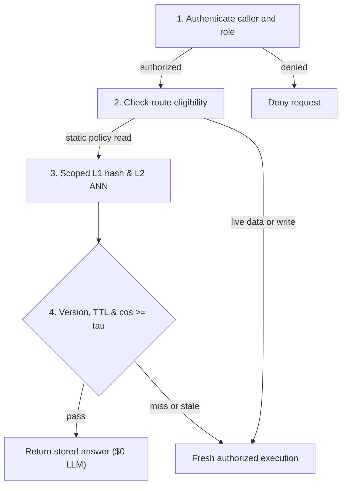

---
{
  "id": "semantic-caching-cost-latency-optimization",
  "slug": "semantic-caching-cost-latency-optimization",
  "title": "Semantic Caching & Cost Optimization",
  "shortDescription": "Reuse verified policy answers across paraphrases only when tenant scope, corpus version, and TTL rules pass, and only when precision, net savings, and tail latency justify caching.",
  "difficulty": "Medium",
  "category": "Inference Optimization",
  "section": "Applied LLM Engineering",
  "coverImage": "social_banner.png",
  "companies": [
    "OpenAI"
  ],
  "prerequisites": [
    "model-versioning-continuous-deployment",
    "hybrid-search-dense-sparse-retrieval"
  ],
  "relatedQuestions": [
    "llm-cost-engineering-token-economics",
    "vector-database-internals-hnsw-ivf"
  ],
  "order": 22,
  "keyConceptsTested": [
    "Scoped exact-match and semantic cache identities",
    "Cosine similarity candidate retrieval vs answer equivalence",
    "Metadata pre-filtering for tenant isolation and route safety",
    "Corpus-version and embedding-index cache invalidation",
    "Shadow-mode cutoff calibration across precision and recall",
    "Wilson lower confidence bounds for release sample size",
    "Break-even safe-hit thresholds and net workload savings",
    "Mean vs p95 nearest-rank tail latency under cache misses",
    "Separating application semantic caches from provider prefix reuse"
  ]
}
---

When an enterprise developer assistant answers "How long are revoked API keys retained in audit logs?", users will phrase the same policy question dozens of ways. Reusing a pre-verified answer can eliminate redundant LLM calls and trim median latency from one second down to tens of milliseconds. Yet reusing that stored reply for "Can I restore a revoked API key?", for a live service outage query, or across isolated customer tenants turns a latency optimization into an authorization leak or correctness incident.

Safe semantic caching rests on separating two independent jobs: **filtering eligibility** and **scoring paraphrase similarity**. Structural identity checks decide whether a request is allowed to consult the cache at all, which corpus version is active, and which tenant permissions apply. Vector search then ranks nearby wording only within that filtered slice, after which a calibrated cutoff and shadow validation prove whether reuse saves money without corrupting answer accuracy.

## Build scoped cache keys before introducing similarity

An answer belongs to the exact configuration that produced it, including model release, prompt template, documentation corpus snapshot, tenant workspace, locale, and output schema. Treating prompt text alone as a cache key fails both safety and freshness requirements whenever a policy manual updates or when two tenants hold different entitlement rules[^owasp2026Authorization]. If the active `corpus_version` advances from `2026-04` to `2026-05`, even byte-identical queries must miss old entries so readers never serve superseded guidance.

Multi-tenant isolation also demands hard pre-filtering before nearest-neighbor lookup rather than post-hoc score adjustment. Suppose tenant `alpha` asks about internal retention rules and receives a response reflecting tenant `alpha` data, while tenant `beta` sends a nearly identical prompt seconds later. Vector indexes such as RedisVL or Qdrant require passing explicit metadata filter predicates (`tenant_id`, `access_scope`, `corpus_version`, `locale`, `response_schema`) directly into the read query so foreign tenant entries never enter candidate scoring[^redis2026SemanticCacheApi].

| Request type | Cache path decision | Engineering rationale |
|---|---|---|
| "How long are revoked <span data-glossary="secrets-management">API keys</span> retained?" | Eligible for L1 + L2 lookup | Static policy FAQ scoped by active `corpus_version` and `access_scope` |
| "How long do revoked keys stay in audit logs?" | Candidate via L2 vector ANN | Paraphrase misses exact string hash (`L1`) and enters cosine lookup (`L2`) |
| "What is the current billing database latency?" | Bypass answer cache | Depends on mutable real-time operational state; requires live lookup |
| "Revoke compromised API key ending in 9241." | Bypass answer cache | Side-effect mutation requires direct authorization and fresh execution |

<figure>
  
  <figcaption>Multi-tier lookup checks L1 exact hashes before scoped L2 nearest-neighbor search and L3 inference, while the similarity matrix explains why antonym requests require intent gates alongside cosine cutoffs.</figcaption>
</figure>

In the code lab below, we lock down exact L1 identity hashing first using standard SHA-256 digests over both canonicalized prompt text and full release scope. Combining those fields into a deterministic record key guarantees that a corpus upgrade, tenant switch, locale switch, or embedder replacement immediately partitions the keyspace cleanly before vector search even enters the picture.

<!-- leetllm: test, output=show, id=scoped-cache-key, deps=numpy,scikit-learn -->
```python title="scoped-cache-key-partitioning.py"
from dataclasses import dataclass, asdict
from hashlib import sha256
import json


@dataclass(frozen=True)
class CacheScope:
    release_id: str
    corpus_version: str
    tenant_id: str
    access_scope: str
    locale: str
    response_schema: str
    embedding_model_id: str


@dataclass(frozen=True)
class CacheRequest:
    query: str
    route_id: str
    tenant_id: str
    access_scope: str
    requires_live_data: bool = False
    writes_state: bool = False
    authorized: bool = True
    ttl_seconds: int = 86_400


def build_exact_cache_key(query: str, scope: CacheScope) -> str:
    payload = {
        "query": " ".join(query.lower().split()),
        "scope": asdict(scope),
    }
    encoded = json.dumps(payload, sort_keys=True, separators=(",", ":")).encode("utf-8")
    return sha256(encoded).hexdigest()


BASE_SCOPE = CacheScope(
    release_id="policy-assistant-v4",
    corpus_version="2026-04-01",
    tenant_id="docs-public",
    access_scope="public-policy",
    locale="en-US",
    response_schema="cited-support-answer-v3",
    embedding_model_id="ngram-tfidf-v1",
)

q_seed = "How long are revoked API keys retained in audit logs?"
q_paraphrase = "How long do revoked API keys stay in audit logs?"

k_seed = build_exact_cache_key(q_seed, BASE_SCOPE)
k_para = build_exact_cache_key(q_paraphrase, BASE_SCOPE)
k_new_corpus = build_exact_cache_key(
    q_seed, CacheScope(**{**asdict(BASE_SCOPE), "corpus_version": "2026-05-01"})
)
k_other_tenant = build_exact_cache_key(
    q_seed, CacheScope(**{**asdict(BASE_SCOPE), "tenant_id": "tenant-enterprise-42"})
)

print(f"Seed exact digest:        {k_seed[:16]}")
print(f"Paraphrase digest match?: {k_para == k_seed} ({k_para[:16]})")
print(f"New corpus match?:        {k_new_corpus == k_seed} ({k_new_corpus[:16]})")
print(f"Other tenant match?:      {k_other_tenant == k_seed} ({k_other_tenant[:16]})")
```

<!-- leetllm: output:start -->
```text title="Output" output compact
Seed exact digest:        5a1d9a9fa2772e73
Paraphrase digest match?: False (54b3d7cf199163cf)
New corpus match?:        False (a3dfd116593f0f79)
Other tenant match?:      False (17bebdba78a74850)
```
<!-- leetllm: output:end -->

Exact hashing handles identical repeats cleanly while isolating tenants and corpus updates, yet notice that even a trivial wording swap (`"are ... retained"` to `"do ... stay"`) hashes to a completely different digest (`False`). Bridging paraphrases requires <span data-glossary="embedding">embedding</span> queries into a continuous vector space and ranking neighbors by directional alignment[^bang2023][^reimers2019]. Still, vector closeness alone carries a subtle trap that breaks naive similarity caches.

## Similarity proposes a candidate; eligibility decides reuse

For any two nonzero vectors $a$ and $b$, <span data-glossary="cosine-similarity">cosine similarity</span> isolates the angle between them regardless of magnitude:

$$
\operatorname{cosine}(a, b) = \frac{a \cdot b}{\lVert a \rVert_2 \lVert b \rVert_2}, \qquad d_{\text{cos}}(a, b) = 1 - \operatorname{cosine}(a, b)
$$

Always verify your vector database's metric convention before setting thresholds[^redis2026SemanticCacheApi]. When working in cosine similarity, values closer to $1.0$ indicate closer alignment and rules accept candidates with $\operatorname{cosine}(a, b) \ge \tau$ (for example $\tau = 0.88$). When working in Redis COSINE distance ($d_{\text{cos}} \in [0, 2]$), smaller numbers mean closer alignment, so an equivalent rule requires $d_{\text{cos}}(a, b) \le 0.12$, never $0.88$.

Cosine closeness measures surface or topical alignment under a specific encoder, **not** logical equivalence of answers. Opposite instructions often share nearly identical vocabulary, grammar, and vector neighborhoods: "How do I upgrade my team workspace plan?" and "How do I downgrade my team workspace plan?" differ in only one prefix (`up` vs. `down`) while requiring opposite product procedures. Setting a loose threshold (such as $\tau = 0.65$) causes high-scoring false positives across opposing intents, so teams combine route/intent gates with carefully calibrated cutoffs before reusing a single byte.

<!-- leetllm: test, output=show, continue=scoped-cache-key, id=tfidf-cosine-traps, deps=numpy,scikit-learn -->
```python title="tfidf-antonym-cosine-traps.py"
import numpy as np
from sklearn.feature_extraction.text import TfidfVectorizer
from sklearn.metrics.pairwise import cosine_similarity

queries = [
    "How long are revoked API keys retained in audit logs?",
    "How long do revoked API keys stay in audit logs?",
    "Can I restore a revoked API key?",
    "How do I upgrade my team workspace plan?",
    "How do I downgrade my team workspace plan?",
    "What is the current billing database latency?",
]

vectorizer = TfidfVectorizer(analyzer="char_wb", ngram_range=(3, 5))
embeddings = vectorizer.fit_transform(queries)
sim_matrix = cosine_similarity(embeddings)

print(f"Cosine(retention, paraphrase):    {sim_matrix[0, 1]:.4f}  [valid paraphrase]")
print(f"Cosine(retention, restore-key):   {sim_matrix[0, 2]:.4f}  [near-miss exception]")
print(f"Cosine(retention, live-latency):  {sim_matrix[0, 5]:.4f}  [unrelated domain]")
print(f"Cosine(upgrade,   downgrade):     {sim_matrix[3, 4]:.4f}  [DANGER: antonym exceeds paraphrase!]")
```

<!-- leetllm: output:start -->
```text title="Output" output compact
Cosine(retention, paraphrase):    0.7223  [valid paraphrase]
Cosine(retention, restore-key):   0.2753  [near-miss exception]
Cosine(retention, live-latency):  0.0058  [unrelated domain]
Cosine(upgrade,   downgrade):     0.7863  [DANGER: antonym exceeds paraphrase!]
```
<!-- leetllm: output:end -->

> **Common mistake:** Treating high cosine similarity as answer equivalence. In the real TF-IDF output above, `"upgrade"` vs. `"downgrade"` scores `0.7863`, beating the genuine retention paraphrase (`0.7223`). Always run authorization checks, live-state bypasses, corpus/index version matching, and TTL expiration before consulting vector distance.

## Order structural gates before cutoff checks

Every semantic cache lookup should obey one unambiguous execution sequence so stale, unauthorized, or live queries never hit stale vectors. First verify user authentication and tenant entitlements, returning an immediate denial when revoked. Next inspect trusted route metadata so live operational queries or state-changing writes bypass answer reuse cleanly. Only eligible read requests hash into the scoped exact store (`L1`), and only exact misses proceed to scoped vector search (`L2`), where version tags, TTL timestamps, and score cutoffs must all pass together.



Changing upstream dependencies also requires scoped invalidation rather than hoping background eviction cleans everything in time. Updating the `corpus_version`, changing the JSON `response_schema`, or swapping `embedding_model_id` partitions the lookup query immediately so stale vectors stay invisible without deleting keys synchronously under load. Only replacing the embedding encoder requires re-embedding cached queries; changing ANN search parameters (`efSearch`) while holding the encoder fixed preserves existing vectors yet still requires re-calibrating the threshold in shadow mode.

<figure>
  
  <figcaption>Eligibility filters enforce tenant isolation, cacheable route rules, corpus revisions, and TTL freshness before ANN similarity runs, slicing 10,000 queries into live bypass, L1 exact hits, L2 semantic hits, and cache misses.</figcaption>
</figure>

## Calibrate cutoffs in shadow mode and bound sample confidence

Shipping an uncalibrated threshold immediately exposes users to false hits. Instead, deploy new cache candidates in **shadow mode**: run the scoped cache pipeline asynchronously alongside live model generation, log every proposed hit against the actual fresh output, and collect human or frontier-judge equivalence labels over representative traffic. Keep the three evaluation metrics distinct while tuning $\tau$:

- **Hit precision:** Safe equivalent proposals divided by all proposals clearing $\tau$ (`TP / (TP + FP)`). Raising $\tau$ generally raises precision, though isolated high-scoring antonyms can create non-monotonic dips.
- **Labeled paraphrase recall:** Safe proposals clearing $\tau$ divided by all truly equivalent pairs in the eligible evaluation set (`TP / (TP + FN)`).
- **Overall proposal rate:** Proposals clearing $\tau$ divided by total queries, including bypassed live traffic and cache misses (`proposed / N_total`).

Point precision alone still misleads teams when shadow sample sizes are small. Passing 12 out of 12 shadow probes sounds like 100% reliability, yet the 95% Wilson score lower confidence bound for $n$ trials with $100\%$ observed successes equals[^nistBinomialIntervals2026]:

$$
p_{\text{lower}} = \frac{n}{n + z^2}, \qquad z = 1.96
$$

At $n = 12$ zero-error hits, $12 / (12 + 1.96^2) \approx 75.8\%$, meaning up to one in four real requests could still fail silently! Clearing a strict `99.0%` precision floor with 95% confidence at zero failures requires roughly $n \ge 381$ independently sampled hits (and more if even one false positive appears). Replaying the same 12 prompts 40 times artificially inflates $n$ without creating statistical independence.

<figure>
  
  <figcaption>Raising the similarity cutoff tightens hit precision at the cost of paraphrase recall, while Wilson lower bounds show why hundreds of independent shadow checks are needed to verify a 99% precision floor.</figcaption>
</figure>

<!-- leetllm: test, output=show, continue=tfidf-cosine-traps, id=shadow-threshold-sweep, deps=numpy,scikit-learn -->
```python title="shadow-threshold-and-wilson-sweep.py"
# Labeled eligible shadow probes: (cosine_score, equivalent_answer)
shadow_scores = np.array([0.99, 0.96, 0.94, 0.91, 0.89, 0.85, 0.82, 0.79, 0.72, 0.66])
shadow_equiv  = np.array([True, True, True, True, True, True, True, False, True, False])

thresholds = [0.65, 0.72, 0.80, 0.88, 0.94, 0.98]
total_equiv = int(shadow_equiv.sum())
for tau in thresholds:
    proposed = shadow_scores >= tau
    tp = int(np.sum(proposed & shadow_equiv))
    n_prop = int(np.sum(proposed))
    precision = (tp / n_prop * 100.0) if n_prop else 100.0
    recall = tp / total_equiv * 100.0
    print(f"tau={tau:.2f} | proposed={n_prop:2d}/10 | precision={precision:5.1f}% | recall={recall:5.1f}%")


def wilson_lower_bound(successes: int, trials: int, z: float = 1.96) -> float:
    if trials == 0:
        return 0.0
    p_hat = successes / trials
    denom = 1.0 + (z ** 2) / trials
    center = p_hat + (z ** 2) / (2.0 * trials)
    margin = z * np.sqrt((p_hat * (1.0 - p_hat) + (z ** 2) / (4.0 * trials)) / trials)
    return float((center - margin) / denom)


for n_sample in [12, 50, 120, 250, 381, 500]:
    lb = wilson_lower_bound(n_sample, n_sample) * 100.0
    print(f"100% pass at n={n_sample:3d} -> Wilson 95% lower bound: {lb:5.2f}%")
```

<!-- leetllm: output:start -->
```text title="Output" output compact
tau=0.65 | proposed=10/10 | precision= 80.0% | recall=100.0%
tau=0.72 | proposed= 9/10 | precision= 88.9% | recall=100.0%
tau=0.80 | proposed= 7/10 | precision=100.0% | recall= 87.5%
tau=0.88 | proposed= 5/10 | precision=100.0% | recall= 62.5%
tau=0.94 | proposed= 3/10 | precision=100.0% | recall= 37.5%
tau=0.98 | proposed= 1/10 | precision=100.0% | recall= 12.5%
100% pass at n= 12 -> Wilson 95% lower bound: 75.75%
100% pass at n= 50 -> Wilson 95% lower bound: 92.86%
100% pass at n=120 -> Wilson 95% lower bound: 96.90%
100% pass at n=250 -> Wilson 95% lower bound: 98.49%
100% pass at n=381 -> Wilson 95% lower bound: 99.00%
100% pass at n=500 -> Wilson 95% lower bound: 99.24%
```
<!-- leetllm: output:end -->

Notice how cleanly precision and recall trade off across $\tau$: below `0.80`, the incompatible pair (`0.79`) leaks in and drops precision to `88.9%` at `tau=0.72` and `80.0%` at `tau=0.65`; setting $\tau = 0.88$ removes both false positives cleanly while keeping `62.5%` recall; pushing $\tau = 0.98$ sacrifices almost every genuine paraphrase (`12.5%` recall) for zero precision gain. Meanwhile, the Wilson bound shows mathematically why teams wait for hundreds of unique independent checks before flipping a shadow policy to live traffic.

## Verify break-even economics and tail latency

A high precision cache still fails its product goal if lookup overhead exceeds saved inference spend, or if users experience identical wait times in the slow tail. Let $c_{\text{gen}}$ denote fresh generation cost per request, $c_{\text{lookup}}$ denote fixed per-request embedding and vector-search overhead paid on every eligible lookup, and $h$ denote the safe hit fraction. Expected spend drops only when $h \cdot c_{\text{gen}} > c_{\text{lookup}}$, giving a hard **break-even hit rate**:

$$
h^* = \frac{c_{\text{lookup}}}{c_{\text{gen}}}
$$

Suppose average generation costs \$0.0040 and semantic embedding plus ANN search costs \$0.00008 on every request ($h^* = 2.0\%$). On 10,000 queries, serving completely fresh inference costs \$40.00; hitting a 57.14% safe cache rate costs \$0.80 in lookup fees plus \$17.14 in miss generation (\$17.94 total), saving \$22.06. Yet if an organization's safe hit rate sits at 1.5%, lookup fees exceed avoided LLM calls and the cache actively loses money on every thousand requests.

Latency behaves even more asymmetrically. When cache hits serve in `30 ms` and cache misses take `20 ms` of lookup overhead plus `1,000 ms` of LLM inference (`1,020 ms`), average latency falls steadily with hit ratio (`449 ms` at `57%`). However, under nearest-rank indexing at rank $\lceil 0.95 \cdot N \rceil$, the **p95 tail latency remains stuck at `1,020 ms`** (actually `20 ms` slower than running without a cache!) across every hit ratio up to `95%`, plummeting to `30 ms` only once fewer than `5%` of total traffic misses[^vllm2026optimization].

<figure>
  
  <figcaption>A 57.14% safe hit rate drops 10,000-query spend from $40.00 to $17.94, yet p95 tail latency stays flat at 1,020 ms until more than 95% of requests avoid model generation.</figcaption>
</figure>

<!-- leetllm: test, output=show, continue=shadow-threshold-sweep, id=cost-and-tail-latency, deps=numpy,scikit-learn -->
```python title="cache-break-even-and-p95-latency.py"
N_QUERIES = 10_000
GEN_COST = 0.0040       # $4.00 per 1k misses
LOOKUP_COST = 0.00008   # $0.08 per 1k lookups

break_even = LOOKUP_COST / GEN_COST
print(f"Break-even safe hit rate: {break_even:.1%}")

for hit_rate in [0.00, 0.015, 0.5714, 0.80]:
    misses = int(round(N_QUERIES * (1.0 - hit_rate)))
    lookup_fee = 0.0 if hit_rate == 0.0 else N_QUERIES * LOOKUP_COST
    total_cost = lookup_fee + misses * GEN_COST
    baseline = N_QUERIES * GEN_COST
    print(f"hit_rate={hit_rate:6.2%} | total=${total_cost:6.2f} | net_saved=${baseline - total_cost:+6.2f}")

# Latency distribution check (30 ms hit vs 1,020 ms miss)
rng = np.random.default_rng(7)
for hit_rate in [0.00, 0.25, 0.5714, 0.80, 0.94, 0.96]:
    if hit_rate == 0.0:
        latencies = np.full(N_QUERIES, 1000.0)
    else:
        n_hits = int(round(N_QUERIES * hit_rate))
        latencies = np.concatenate([np.full(n_hits, 30.0), np.full(N_QUERIES - n_hits, 1020.0)])
    mean_ms = float(np.mean(latencies))
    p95_ms = float(np.percentile(latencies, 95, method="inverted_cdf"))
    print(f"hit_rate={hit_rate:6.2%} -> mean={mean_ms:6.1f} ms | p95={p95_ms:6.1f} ms")
```

<!-- leetllm: output:start -->
```text title="Output" output compact
Break-even safe hit rate: 2.0%
hit_rate= 0.00% | total=$ 40.00 | net_saved=$ +0.00
hit_rate= 1.50% | total=$ 40.20 | net_saved=$ -0.20
hit_rate=57.14% | total=$ 17.94 | net_saved=$+22.06
hit_rate=80.00% | total=$  8.80 | net_saved=$+31.20
hit_rate= 0.00% -> mean=1000.0 ms | p95=1000.0 ms
hit_rate=25.00% -> mean= 772.5 ms | p95=1020.0 ms
hit_rate=57.14% -> mean= 454.3 ms | p95=1020.0 ms
hit_rate=80.00% -> mean= 228.0 ms | p95=1020.0 ms
hit_rate=94.00% -> mean=  89.4 ms | p95=1020.0 ms
hit_rate=96.00% -> mean=  69.6 ms | p95=  30.0 ms
```
<!-- leetllm: output:end -->

> **Key insight:** Semantic caching shrinks *average* latency steadily, yet **p95 tail latency stays stuck at `1,020 ms` (20 ms slower than uncached inference)** until more than 95% of requests hit the cache. Never mistake median latency drops for tail-latency wins unless misses also accelerate via provider prompt-prefix caching.[^vllm2026prefix][^openai2026promptcaching]

## Coordinate semantic caching with provider prompt caching

In complete production stacks, **L1 exact hash**, **L2 semantic vector reuse**, and **L3 inference prompt-prefix caching** play complementary roles rather than competing for the same work:

| Layer | Matching unit | Outcome on hit | Cost & operational ownership |
|---|---|---|---|
| L1 exact response | Normalized query text + full `CacheScope` | Returns stored evaluated reply; zero model fee | Application cache store (`Redis` / DB) |
| L2 semantic response | Filtered ANN embedding match ($\operatorname{cos} \ge \tau$) | Returns stored evaluated reply; zero model fee | Application vector index + shadow labels |
| L3 prefix KV reuse | Identical leading prompt tokens[^vllm2026prefix][^openai2026promptcaching] | Skips shared prefix prefill; still generates output | Inference engine (`vLLM`) or provider API |
| Uncached generation | Fresh suffix + output decode | Produces new reply on dynamic queries | Upstream frontier or open-weight model |

Whenever L1 or L2 hits safely, all downstream L3 and uncached decoding fees drop to zero. Whenever a query intentionally bypasses answer reuse (such as live database state or tenant-specific multi-turn chat) or misses below $\tau$, L3 prefix caching preserves shared system-instruction KV blocks at a 75% to 90% input discount while still generating a fresh, personalized answer. Keeping both layers clearly separated in request traces (`hit_tier`, `bypass_reason`, `cosine_score`, `provider_cached_tokens`) lets teams attribute real invoice savings accurately in the next stage of LLM cost engineering.

```mastery-quiz
[
  {
    "question": "A gateway receives request A (unknown route, caller revoked) and request B (live database latency route, authorized caller, candidate score NaN). Which ordered outcome happens in each case?",
    "options": [
      "A: bypass unknown route; B: reject NaN score.",
      "A: deny caller access; B: bypass cache to live path.",
      "A: deny caller access; B: reject NaN score.",
      "A: bypass unknown route; B: bypass cache to live path."
    ],
    "answer": "A: deny caller access; B: bypass cache to live path.",
    "explanation": "Authentication and role checks execute first, so A stops immediately with an access denial. Request B requires live operational state, so route eligibility bypasses semantic answer caching before vector scoring runs."
  },
  {
    "question": "Suppose an embedding + ANN lookup costs $0.00006 per eligible request and fresh LLM generation averages $0.0030 per miss. Over 2,000 requests at a 1.5% safe hit rate, what is the break-even threshold and net spend change?",
    "options": [
      "Break-even 2.0%; net savings +$0.03.",
      "Break-even 0.5%; net savings -$0.03.",
      "Break-even 2.0%; net savings -$0.03.",
      "Break-even 0.5%; net savings +$0.03."
    ],
    "answer": "Break-even 2.0%; net savings -$0.03.",
    "explanation": "Break-even hit rate is c_lookup / c_gen = 0.00006 / 0.0030 = 2.0%. At 1.5%, lookup saves $0.000045/query against a $0.00006/query fee, yielding net -0.000015 * 2,000 = -$0.03."
  },
  {
    "question": "An API configures Redis COSINE distance = 1 - cosine_similarity with a maximum allowed distance of 0.012. Candidate A has cosine similarity 0.991 and candidate B has 0.985. How does each score compare to the threshold?",
    "options": [
      "A: distance 0.009 (passes screen); B: distance 0.015 (fails screen).",
      "A: distance 0.991 (fails screen); B: distance 0.985 (fails screen).",
      "A: distance 0.009 (fails screen); B: distance 0.015 (passes screen).",
      "A: distance 0.991 (passes screen); B: distance 0.985 (passes screen)."
    ],
    "answer": "A: distance 0.009 (passes screen); B: distance 0.015 (fails screen).",
    "explanation": "Cosine distance equals 1 - similarity: candidate A is at 0.009 <= 0.012 and passes the numeric screen, while candidate B at 0.015 exceeds the cutoff."
  },
  {
    "question": "Twelve independently reviewed shadow hits all pass equivalence review. Using the zero-failure Wilson 95% lower bound n / (n + 1.96^2), what lower bound follows, and does repeating those same 12 queries increase statistical confidence?",
    "options": [
      "About 75.8%; repeating identical IDs adds zero independent cases.",
      "About 100%; repeating identical IDs improves statistical power.",
      "About 75.8%; repeating identical IDs pushes the lower bound over 99%.",
      "About 100%; repeating identical IDs adds zero independent cases."
    ],
    "answer": "About 75.8%; repeating identical IDs adds zero independent cases.",
    "explanation": "12 / (12 + 3.8416) = 75.75%. Statistical confidence relies on independent samples drawn from distinct traffic queries; duplicating existing IDs creates zero new information."
  },
  {
    "question": "An engineering change modifies ANN search parameter efSearch while leaving the embedding model unchanged (Change A). A second change swaps the embedding encoder while leaving answers unchanged (Change B). Which maintenance step applies to each?",
    "options": [
      "A: re-embed prompts and revalidate cutoff; B: keep vectors and revalidate.",
      "A: keep vectors and retune shadow cutoff; B: re-embed prompts and revalidate.",
      "A: keep vectors without shadow validation; B: re-embed only new prompt entries.",
      "A: re-embed prompts without retuning cutoff; B: keep vectors and flush cache keys."
    ],
    "answer": "A: keep vectors and retune shadow cutoff; B: re-embed prompts and revalidate.",
    "explanation": "Adjusting ANN search parameters alters which neighbors appear without shifting existing embedding coordinates, so revalidation suffices. Swapping the encoder alters vector geometry completely, requiring fresh embeddings across stored prompts before scoring."
  },
  {
    "question": "Across 100 requests, 90 hit the cache in 30 ms and 10 miss and pay 20 ms lookup + 1,000 ms generation (1,020 ms). What are the nearest-rank mean and p95 latency?",
    "options": [
      "Mean 129 ms; p95 1,020 ms.",
      "Mean 129 ms; p95 30 ms.",
      "Mean 921 ms; p95 1,020 ms.",
      "Mean 921 ms; p95 30 ms."
    ],
    "answer": "Mean 129 ms; p95 1,020 ms.",
    "explanation": "Mean latency is (90 * 30 + 10 * 1020) / 100 = 129 ms. Because 10% of queries miss (> 5%), the 95th percentile falls inside the slow miss bucket at 1,020 ms."
  }
]
```

> **Next:** Continue to [LLM Cost Engineering & Token Economics](/learn/llm-cost-engineering-token-economics). Response caching cuts the number of requests that generate answers; next, account carefully for the remaining workload across uncached input, cached prefixes, reasoning output, and per-call spend ceilings.
