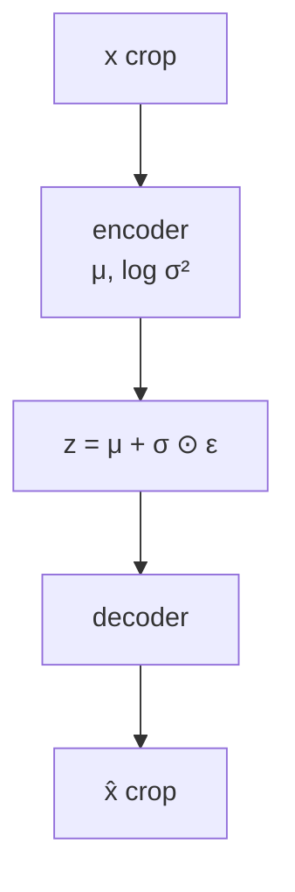

---
{
  "id": "autoencoders-vaes-generative-modeling-basics",
  "title": "Autoencoders and VAEs",
  "slug": "autoencoders-vaes-generative-modeling-basics",
  "section": "Deep Learning Foundations",
  "category": "Model Architecture",
  "difficulty": "Easy",
  "order": 7,
  "coverImage": "illustrations/_generated/vae_latent_reconstruction_dark.png",
  "companies": [
    "Google",
    "Meta",
    "OpenAI",
    "Stability AI",
    "Anthropic",
    "Microsoft",
    "Amazon",
    "Apple"
  ],
  "shortDescription": "A two-number code can rebuild one screenshot crop, but a random draw still has to land where the decoder was trained to paint.",
  "keyConceptsTested": [
    "Autoencoder bottleneck and reconstruction loss",
    "Deterministic latent codes and sampling limits",
    "VAE approximate posterior and prior",
    "Variational inference, EM, and the evidence lower bound",
    "KL divergence for diagonal Gaussians",
    "Reparameterized sampling",
    "ELBO and beta-weighted objective",
    "Posterior collapse diagnosis"
  ],
  "aliases": [
    "probabilistic-generative-models-em"
  ]
}
---

Can two numbers describe a 5-by-5 grayscale crop well enough to redraw its bright 2-by-2 highlight? Now reverse the question: pick a random pair of numbers and hand them to the decoder. What will it paint if training only showed it codes emitted by an encoder?

An **<span data-glossary="autoencoder">autoencoder</span>** compresses an input into a compact latent code and learns to rebuild it.[^hinton2006autoencoder] A **<span data-glossary="variational-autoencoder">variational autoencoder (VAE)</span>** shapes that latent space around a known probability prior so fresh random draws decode into coherent new examples.[^kingma2014]

## Compress one screenshot crop

Start with a 5-by-5 grayscale crop with pixel intensities in `[0, 1]`: a bright 2-by-2 center block and a faint two-pixel lower strip. One latent coordinate can track the center block while a second tracks the lower strip.

<figure>
  
  <figcaption>The masks average four center pixels into $z_1=0.8875$ and two lower pixels into $z_2=0.170$. A matching two-basis decoder rebuilds the 25 pixels at mean squared error 0.0027.</figcaption>
</figure>

An autoencoder pairs an encoder $z = f_\phi(x)$ and decoder $\hat{x} = g_\theta(z)$. Because $z$ has 2 numbers instead of 25, it forms an **hourglass bottleneck**. Compression always discards detail: swapping the four center pixels leaves their average $z_1$ unchanged, so a deterministic decoder produces the identical image.

## Learn the bottleneck

Compare our hand-crafted bottleneck against a trained <span data-glossary="pytorch">PyTorch</span> autoencoder (<span data-glossary="gradient">gradients</span> + Adam <span data-glossary="optimizer">optimizer</span>) on 48 jittered copies of the crop, and check both against a constant mean-crop baseline:

<!-- leetllm: test, deps=torch, output=show -->
```python title="autoencoder-bottleneck.py"
import numpy as np
import torch
from torch import nn
import torch.nn.functional as F

base_np = np.array([
    0.08, 0.12, 0.09, 0.11, 0.07,
    0.15, 0.85, 0.88, 0.14, 0.10,
    0.11, 0.90, 0.92, 0.13, 0.09,
    0.07, 0.18, 0.16, 0.12, 0.08,
    0.06, 0.09, 0.10, 0.07, 0.05,
], dtype=np.float32)

center, lower = [6, 7, 11, 12], [16, 17]
W_enc = np.zeros((25, 2), dtype=np.float32)
W_enc[center, 0], W_enc[lower, 1] = 0.25, 0.50
W_dec = np.zeros((2, 25), dtype=np.float32)
W_dec[0, center], W_dec[0, [5, 8, 10, 13]] = 1.0, 0.12
W_dec[1, lower], W_dec[1, [15, 18, 21, 22]] = 1.0, 0.35
z = base_np @ W_enc
x_hat = np.clip(z @ W_dec + 0.08, 0.0, 1.0)
print(f"crafted: z={np.round(z, 3).tolist()} MSE={float(np.mean((base_np - x_hat) ** 2)):.4f}")

torch.manual_seed(3)
patches = torch.clamp(torch.tensor(base_np) + 0.025 * torch.randn(48, 25), 0.0, 1.0)
enc = nn.Sequential(nn.Linear(25, 8), nn.Tanh(), nn.Linear(8, 2))
dec = nn.Sequential(nn.Linear(2, 8), nn.Tanh(), nn.Linear(8, 25), nn.Sigmoid())
opt = torch.optim.Adam(list(enc.parameters()) + list(dec.parameters()), lr=0.03)
for _ in range(250):
    opt.zero_grad()
    F.mse_loss(dec(enc(patches)), patches).backward()
    opt.step()

with torch.no_grad():
    trained = F.mse_loss(dec(enc(patches)), patches).item()
    baseline = F.mse_loss(patches.mean(0, keepdim=True).expand_as(patches), patches).item()
print(f"trained AE MSE={trained:.4f} | constant-mean baseline={baseline:.4f}")
```

<!-- leetllm: output:start -->
```text title="Output" output compact
crafted: z=[0.8880000114440918, 0.17000000178813934] MSE=0.0027
trained AE MSE=0.0006 | constant-mean baseline=0.0006
```
<!-- leetllm: output:end -->

The trained MSE (`0.0006`) ties the constant mean predictor because all 48 patches are noisy copies of one template; the decoder can memorize the average without reading $z$.

> **Common mistake:** Treating low reconstruction MSE as proof of a useful representation. Always compare against a constant-mean baseline and verify that swapping codes changes the decoded output.

Even on diverse datasets, plain reconstruction loss $L_{\text{AE}} = \|x - g_\theta(f_\phi(x))\|_2^2$ only scores codes the encoder actually emits. The encoder can park center crops near `(-1.8, 1.2)` and lower strips near `(1.7, -1.3)`, leaving `(0, 0)` empty so a random draw from $\mathcal{N}(0, I)$ lands where the decoder never trained.

<figure>
  
  <figcaption>Left: deterministic codes sit far from the $\mathcal{N}(0, I)$ prior rings, leaving the origin empty. Right: KL regularization pulls a VAE posterior ($\mu=[0.40, -0.20]$, $\sigma \approx [0.705, 1.051]$) into the prior so a draw $z \approx [0.752, -1.251]$ lands in trained territory.</figcaption>
</figure>

## A VAE learns distributions over codes

A VAE defines a generative model: sample $z \sim p(z) = \mathcal{N}(0, I)$, then decode $x \sim p_\theta(x \mid z)$. Because the exact posterior $p_\theta(z \mid x)$ is intractable for neural decoders, one shared encoder predicts a tractable **approximate posterior** $q_\phi(z \mid x)$, known as amortized <span data-glossary="variational-inference">variational inference</span>.

In a diagonal-Gaussian VAE, the encoder emits a mean $\mu(x)$ and log-<span data-glossary="variance">variance</span> $\log \sigma^2(x)$ so `sigma = exp(0.5 * logvar)` stays positive:

$$
q_\phi(z \mid x) = \mathcal{N}\!\left(\mu(x), \operatorname{diag}(\sigma^2(x))\right),
\qquad
p(z) = \mathcal{N}(0, I)
$$

## Keep posteriors near a sampleable prior

The VAE pulls each posterior toward $\mathcal{N}(0, I)$ using <span data-glossary="kl-divergence">Kullback-Leibler (KL) divergence</span>, which has an exact closed form for diagonal Gaussians:[^kingma2014]

$$
D_{\mathrm{KL}}\!\left(q_\phi(z \mid x) \,\|\, p(z)\right)
=
-\frac{1}{2} \sum_j \left(1 + \log \sigma_j^2 - \mu_j^2 - \sigma_j^2\right)
$$

KL equals zero only when $\mu = 0$ and $\sigma = 1$. For $\mu = [0.40, -0.20]$ and $\log\sigma^2 = [-0.70, 0.10]$, the sum evaluates to `0.2009` nats.

## Sample while gradients still flow

An ordinary random draw (`Normal.sample()`) breaks the autograd path from $z$ back to $(\mu, \log\sigma^2)$.[^pytorchDistributions2026] Kingma and Welling move randomness into an independent standard-normal variable $\epsilon$ via the **reparameterization trick**:[^kingma2014]

$$
\epsilon \sim \mathcal{N}(0, I),
\qquad
z = \mu + \sigma \odot \epsilon
$$

For fixed $\epsilon$, $z$ is differentiable with $\partial z_j / \partial \mu_j = 1$ and $\partial z_j / \partial \log\sigma_j^2 = \frac{1}{2}\sigma_j \epsilon_j = \frac{1}{2}(z_j - \mu_j)$, implemented in PyTorch by `Normal.rsample()`. (With detached `sample()`, the decoder and analytic KL still receive gradients; only the reconstruction path to the encoder breaks.)

<figure>
  
  <figcaption>With `sample()`, reconstruction trains only the decoder; with `rsample()`, reconstruction gradients flow through $z = \mu + \sigma \odot \epsilon$ back to $\mu$ and $\sigma$. Analytic KL updates the encoder in both cases.</figcaption>
</figure>

Check the closed-form KL, reparameterized draw, and `sample()` vs. `rsample()` gradient routing in PyTorch:

<!-- leetllm: test, deps=torch, output=show -->
```python title="kl-and-reparameterization.py"
import torch
from torch.distributions import Normal


def kl_std_normal(mu, logvar):
    return 0.5 * (mu.square() + torch.expm1(logvar) - logvar).sum()


for name, m, lv in [("prior", [0.0, 0.0], [0.0, 0.0]), ("small", [0.4, -0.2], [-0.7, 0.1]), ("far", [2.0, -1.5], [-1.5, 1.2])]:
    print(f"{name:5s} KL={kl_std_normal(torch.tensor(m), torch.tensor(lv)).item():.4f}")

mu = torch.tensor([0.40, -0.20], requires_grad=True)
logvar = torch.tensor([-0.70, 0.10], requires_grad=True)
sigma = torch.exp(0.5 * logvar)
z_fixed = mu + sigma * torch.tensor([0.50, -1.00])

dist = Normal(mu, sigma)
ordinary, pathwise = dist.sample(), dist.rsample()
g_mu, g_lv = torch.autograd.grad(pathwise.sum(), (mu, logvar), retain_graph=True)
kl_g_mu = torch.autograd.grad(kl_std_normal(mu, logvar), mu)[0]

print("fixed z:", [round(v, 3) for v in z_fixed.detach().tolist()])
print("requires_grad -> sample:", ordinary.requires_grad, "| rsample:", pathwise.requires_grad)
print("rsample d/dmu:", g_mu.tolist(), "| logvar match:", torch.allclose(g_lv, 0.5 * (pathwise.detach() - mu.detach())))
print("analytic KL d/dmu:", [round(v, 3) for v in kl_g_mu.tolist()])
```

<!-- leetllm: output:start -->
```text title="Output" output compact
prior KL=0.0000
small KL=0.2009
far   KL=4.0466
fixed z: [0.752, -1.251]
requires_grad -> sample: False | rsample: True
rsample d/dmu: [1.0, 1.0] | logvar match: True
analytic KL d/dmu: [0.4, -0.2]
```
<!-- leetllm: output:end -->

The full training graph connects encoder, reparameterized sample, and decoder (at generation time, drop the encoder and sample $z \sim \mathcal{N}(0, I)$ directly):



## The VAE objective

A VAE maximizes the **<span data-glossary="evidence-lower-bound">evidence lower bound (ELBO)</span>** on the data log-likelihood $\log p_\theta(x)$:[^kingma2014]

$$
\mathcal{L}_{\mathrm{ELBO}}
=
\mathbb{E}_{q_\phi(z \mid x)}[\log p_\theta(x \mid z)]
-
D_{\mathrm{KL}}\!\left(q_\phi(z \mid x)\,\|\,p(z)\right)
$$

The gap $\log p_\theta(x) - \mathcal{L}_{\mathrm{ELBO}} = D_{\mathrm{KL}}(q_\phi(z \mid x) \| p_\theta(z \mid x)) \ge 0$, so maximizing the ELBO jointly improves data likelihood and tightens the approximate posterior.

This objective directly generalizes classical **Expectation-Maximization (EM)**.[^dempster1977em] In EM, the **E-step** sets a per-example distribution $q_i(z)$ to the exact posterior $p_\theta(z \mid x_i)$ (closing the gap to zero), and the **M-step** updates generative parameters $\theta$ to maximize the expected complete-data log-likelihood. With a deep neural decoder, exact posterior inference is intractable and storing separate variational parameters for millions of examples does not scale. A VAE replaces the per-example E-step with **amortized encoder inference** $q_\phi(z \mid x)$ and runs joint gradient ascent on the ELBO over both $\phi$ and $\theta$ on every minibatch.

In code we minimize the negative ELBO, often weighting KL by $\beta$:

$$
L_{\mathrm{VAE}} = L_{\mathrm{recon}} + \beta D_{\mathrm{KL}}
$$

Under independent Gaussian pixel noise with variance $\tau^2$, $-\log p_\theta(x \mid z) = \frac{1}{2\tau^2}\sum_{i=1}^N (x_i - \hat{x}_i)^2 + \text{const}$ is a scaled **sum** of squared errors. Switching between `mean` and `sum` over $N$ pixels shifts the effective KL weight $\beta$ by a factor of $N$, so always recalibrate $\beta$ when changing reductions or latent width.[^kingma2014]

<figure>
  = 1.00)." />
  <figcaption>Higher $\beta$ trades reconstruction error for lower KL in a 4D VAE. At $\beta \in [0.10, 0.50]$, exactly two coordinates stay active (> 0.1 nats), matching the two true blob coordinates; at $\beta \ge 1.00$, all four collapse.</figcaption>
</figure>

Higgins et al. introduced $\beta$-VAE to tighten the latent channel by increasing KL pressure.[^higgins2017] Because a factorized prior alone leaves latent axes rotatable unless architectural bias or supervision breaks symmetry,[^locatello2019Disentanglement] sweeping $\beta$ on 2D-parameterized blobs in a 4D latent exposes the exact rate-distortion trade-off:

<!-- leetllm: test, deps=torch, output=show -->
```python title="beta-rate-distortion-sweep.py"
import torch
import torch.nn as nn
import torch.nn.functional as F

torch.set_num_threads(1)
t = torch.linspace(-1.0, 1.0, 5)
gx, gy = torch.meshgrid(t, t, indexing="ij")
torch.manual_seed(7)
n = 512
cx, cy = torch.rand(n) * 1.4 - 0.7, torch.rand(n) * 1.4 - 0.7
patches = torch.exp(-((gx[None] - cx[:, None, None]) ** 2 + (gy[None] - cy[:, None, None]) ** 2) / 0.45).view(n, 25)


class PatchBetaVAE(nn.Module):
    def __init__(self, z_dim: int = 4):
        super().__init__()
        self.enc = nn.Sequential(nn.Linear(25, 32), nn.ReLU())
        self.mu, self.lv = nn.Linear(32, z_dim), nn.Linear(32, z_dim)
        self.dec = nn.Sequential(nn.Linear(z_dim, 32), nn.ReLU(), nn.Linear(32, 25), nn.Sigmoid())

    def forward(self, x):
        h = self.enc(x)
        mu, lv = self.mu(h), self.lv(h).clamp(-8.0, 4.0)
        return self.dec(mu + torch.exp(0.5 * lv) * torch.randn_like(mu)), mu, lv


for beta in [0.0, 0.05, 0.1, 0.25, 0.5, 1.0, 2.0]:
    torch.manual_seed(7)
    model = PatchBetaVAE()
    opt = torch.optim.Adam(model.parameters(), lr=5e-3)
    for _ in range(400):
        xhat, mu, lv = model(patches)
        sse = F.mse_loss(xhat, patches, reduction="sum") / n
        kl = -0.5 * (1.0 + lv - mu**2 - lv.exp()).mean(0).sum()
        opt.zero_grad()
        (sse + beta * kl).backward()
        opt.step()
    with torch.no_grad():
        xhat, mu, lv = model(patches)
        sse = (F.mse_loss(xhat, patches, reduction="sum") / n).item()
        kl_dim = -0.5 * (1.0 + lv - mu**2 - lv.exp()).mean(0)
        print(f"beta={beta:.2f}: sse={sse:.3f}, kl={kl_dim.sum().item():.3f}, active={int((kl_dim > 0.1).sum())}/4")
```

<!-- leetllm: output:start -->
```text title="Output" output compact
beta=0.00: sse=0.010, kl=34.564, active=4/4
beta=0.05: sse=0.089, kl=3.795, active=3/4
beta=0.10: sse=0.130, kl=2.693, active=2/4
beta=0.25: sse=0.315, kl=1.680, active=2/4
beta=0.50: sse=0.621, kl=0.851, active=2/4
beta=1.00: sse=1.224, kl=0.002, active=0/4
beta=2.00: sse=1.226, kl=0.000, active=0/4
```
<!-- leetllm: output:end -->

## Train a tiny VAE and watch for posterior collapse

Near-zero KL often signals **posterior collapse**: $q_\phi(z \mid x) \approx p(z)$ for every input, <span data-glossary="mutual-information">mutual information</span> $I_q(X; Z)$ vanishes, and the decoder ignores $z$.[^oord2017vqvae] Autoregressive decoders can still emit sharp outputs from neighboring pixels while ignoring $z$,[^bowman2016SentenceVAE] whereas MSE decoders collapse to the blurry average.

Decomposing average KL using the aggregate posterior $q(z) = \mathbb{E}_X[q_\phi(z \mid X)]$ shows why crushing total KL hurts:[^hoffman2016ELBOSurgery]

$$
\mathbb{E}_X D_{\mathrm{KL}}\!\left(q_\phi(z \mid X)\,\|\,p(z)\right)
= I_q(X; Z) + D_{\mathrm{KL}}\!\left(q(z)\,\|\,p(z)\right)
$$

> **Key insight:** Average KL sums useful code information ($I_q(X; Z)$, keep positive) and aggregate prior mismatch ($D_{\mathrm{KL}}(q(z) \| p(z))$, keep small). Driving total KL to zero wipes out both.

Train a 2D VAE on two distinct crop families (bright center squares vs. bright lower strips) at healthy $\beta = 0.02$ and over-penalized $\beta = 0.50$. Swap the two families' codes to test whether the decoder listens to $z$, and decode three fresh draws from $\mathcal{N}(0, I)$ on the healthy model:

<!-- leetllm: test, deps=torch, output=show -->
```python title="train-and-collapse-vae.py"
import torch
from torch import nn
import torch.nn.functional as F

torch.manual_seed(8)
center = torch.tensor([
    0.05, 0.10, 0.08, 0.10, 0.06, 0.12, 0.88, 0.86, 0.13, 0.08,
    0.10, 0.91, 0.90, 0.12, 0.07, 0.06, 0.15, 0.14, 0.10, 0.06,
    0.05, 0.08, 0.08, 0.05, 0.04,
])
lower = torch.tensor([
    0.04, 0.07, 0.06, 0.08, 0.05, 0.10, 0.15, 0.12, 0.10, 0.06,
    0.08, 0.18, 0.16, 0.09, 0.06, 0.06, 0.84, 0.88, 0.11, 0.07,
    0.04, 0.07, 0.08, 0.05, 0.04,
])
patches = torch.cat([
    torch.clamp(center + 0.02 * torch.randn(32, 25), 0.0, 1.0),
    torch.clamp(lower + 0.02 * torch.randn(32, 25), 0.0, 1.0),
])


def train_vae(beta: float, steps: int = 400):
    torch.manual_seed(8)
    enc = nn.Sequential(nn.Linear(25, 12), nn.Tanh())
    mu_h, lv_h = nn.Linear(12, 2), nn.Linear(12, 2)
    dec = nn.Sequential(nn.Linear(2, 12), nn.Tanh(), nn.Linear(12, 25), nn.Sigmoid())
    opt = torch.optim.Adam(list(enc.parameters()) + list(mu_h.parameters()) + list(lv_h.parameters()) + list(dec.parameters()), lr=0.03)
    for _ in range(steps):
        h = enc(patches)
        mu, lv = mu_h(h), lv_h(h)
        z = mu + torch.exp(0.5 * lv) * torch.randn_like(mu)
        loss = F.mse_loss(dec(z), patches) + beta * (-0.5 * (1 + lv - mu.square() - lv.exp()).sum(1).mean())
        opt.zero_grad()
        loss.backward()
        opt.step()
    with torch.no_grad():
        h = enc(patches)
        mu, lv = mu_h(h), lv_h(h)
        kl_dim = -0.5 * (1 + lv - mu.square() - lv.exp()).mean(0)
        own = F.mse_loss(dec(mu), patches).item()
        swap = F.mse_loss(dec(mu.roll(32, dims=0)), patches).item()
    return dec, [round(v, 4) for v in kl_dim.tolist()], own, swap


for label, beta in [("healthy (beta=0.02)", 0.02), ("collapsed (beta=0.50)", 0.50)]:
    dec, kl_dim, own, swap = train_vae(beta)
    print(f"{label:22s} KL={kl_dim} own_MSE={own:.4f} swap_MSE={swap:.4f}")
    if beta == 0.02:
        torch.manual_seed(99)
        with torch.no_grad():
            for idx, crop in enumerate(dec(torch.randn(3, 2))):
                print(f"  prior draw {idx}: center={crop[[6, 7, 11, 12]].mean():.3f}, lower={crop[[16, 17]].mean():.3f}")
```

<!-- leetllm: output:start -->
```text title="Output" output compact
healthy (beta=0.02)    KL=[0.7605, 0.0013] own_MSE=0.0005 swap_MSE=0.1289
  prior draw 0: center=0.895, lower=0.136
  prior draw 1: center=0.178, lower=0.842
  prior draw 2: center=0.899, lower=0.130
collapsed (beta=0.50)  KL=[0.0, 0.0] own_MSE=0.0326 swap_MSE=0.0326
```
<!-- leetllm: output:end -->

In the healthy run, swapping codes spikes MSE from `0.0005` to `0.1289`, fresh draws from $\mathcal{N}(0, I)$ paint recognizable center squares (`0.895` and `0.899`) and a lower strip (`0.842`), and one dimension absorbs ~1 bit (`0.7605` nats, close to $\ln 2 \approx 0.693$) while the spare stays quiet. At $\beta = 0.50$, KL hits zero and swapping codes leaves MSE unchanged (`0.0326` vs. `0.0326`).

Three levers prevent collapse: **KL annealing** (ramp $\beta$ up after the encoder learns useful codes),[^bowman2016SentenceVAE] **free bits** (floor each latent group's batch-average KL via $\sum_j \max(\tau, \mathbb{E}_X D_{\mathrm{KL},j})$ so gradients stop below $\tau$),[^kingma2016IAFFreeBits] and **decoder context dropout** in autoregressive decoders.[^bowman2016SentenceVAE]

## Debug the latent interface

Four checks catch most VAE training bugs early:

- **Log reconstruction and KL separately:** A smooth total loss hides both KL blow-up and silent collapse.
- **Check `logvar` scaling on `NaN`/`Inf`:** Standard deviation is `exp(0.5 * logvar)`, while `exp(logvar)` is variance; clamp extreme `logvar` if early steps explode.
- **Separate posterior from prior:** Training encodes $q_\phi(z \mid x)$ with `rsample()`, whereas generation skips the encoder and samples $z \sim p(z)$. Verify that swapping $z$ changes outputs.
- **Where latent bottlenecks scale next:** VQ-VAEs replace continuous Gaussian samples with nearest-neighbor discrete codebook lookups trained via straight-through gradients and a learned code prior,[^oord2017vqvae] while latent diffusion models compress images spatially (for example, $8\times$ per axis, shrinking $512 \times 512$ pixel positions by $64\times$) so denoising runs cheaply in latent space before decoding back to pixels.[^rombach2022]

```mastery-quiz
[
  {
    "question": "A fixed encoder averages four center pixels and two lower pixels with no skip connection. Swapping the first and last center pixels leaves their average unchanged. What happens to the latent code and deterministic reconstruction?",
    "options": [
      "The code changes; the reconstruction changes.",
      "The code stays identical; the reconstruction is identical.",
      "The code stays identical; the reconstruction changes.",
      "The code changes; the reconstruction is identical."
    ],
    "answer": "The code stays identical; the reconstruction is identical.",
    "explanation": "Permuting the center pixels preserves their mean, so both crops produce the exact same latent vector and identical output from a deterministic decoder."
  },
  {
    "question": "A diagonal Gaussian posterior has means [0.1, -0.3], log variances [ln(4), ln(0.25)], and fixed noise [-0.5, 2]. What are the reparameterized sample z and its log-variance derivatives?",
    "options": [
      "Sample [-0.9, 0.7]; derivatives [-0.5, 0.5].",
      "Sample [-1.9, 0.2]; derivatives [-1.0, 0.25].",
      "Sample [-0.9, 0.7]; derivatives [1.0, 1.0].",
      "Sample [-0.4, 1.7]; derivatives [-0.25, 1.0]."
    ],
    "answer": "Sample [-0.9, 0.7]; derivatives [-0.5, 0.5].",
    "explanation": "Standard deviations are [2, 0.5], so z = [0.1 + 2*(-0.5), -0.3 + 0.5*2] = [-0.9, 0.7], and dz/d(logvar) = 0.5 * sigma * epsilon = [-0.5, 0.5]."
  },
  {
    "question": "For one example, a diagonal Gaussian has means [1, 0] and log variances [0, ln(4)]. What is its KL divergence to N(0, I), summed over both dimensions?",
    "options": [
      "0.653426 nats.",
      "0.806853 nats.",
      "1.306853 nats.",
      "2.000000 nats."
    ],
    "answer": "1.306853 nats.",
    "explanation": "Coordinate 1 gives 0.5*(1 + 1 - 1 - 0) = 0.5; coordinate 2 gives 0.5*(0 + 4 - 1 - ln(4)) = 0.806853; total = 1.306853 nats."
  },
  {
    "question": "A model has fixed log-evidence -3.0 on an observation. Updating only the encoder raises the ELBO from -3.6 to -3.2. What is the gap before and after, and which KL defines it?",
    "options": [
      "0.6 then 0.2, defined by KL(q(z|x) || p(z)).",
      "0.6 then 0.2, defined by KL(q(z|x) || p_theta(z|x)).",
      "-0.6 then -0.2, defined by KL(q(z|x) || p(z)).",
      "-0.6 then -0.2, defined by KL(q(z|x) || p_theta(z|x))."
    ],
    "answer": "0.6 then 0.2, defined by KL(q(z|x) || p_theta(z|x)).",
    "explanation": "The nonnegative gap log p_theta(x) - ELBO shrinks from 0.6 to 0.2 and equals KL(q_phi(z|x) || p_theta(z|x)), measuring closeness to the exact posterior."
  },
  {
    "question": "A scalar decoder outputs w*z (w = 2) under half squared error against target 1. Normal.sample() returns z = 1.2 from an encoder Gaussian with mean 0.5, plus analytic KL(q || N(0, 1)). What are dL/dw, the reconstruction path to the encoder, and dKL/dmu?",
    "options": [
      "0.00; connected; 0.5.",
      "0.00; detached; 0.0.",
      "1.68; connected; 0.0.",
      "1.68; detached; 0.5."
    ],
    "answer": "1.68; detached; 0.5.",
    "explanation": "Prediction is 2.4, so dL/dw = (2.4 - 1)*1.2 = 1.68. Normal.sample() detaches the reconstruction path to the encoder, while analytic KL still yields dKL/dmu = 0.5."
  }
]
```

> **Next:** Continue to [BPE, WordPiece, and SentencePiece](/learn/tokenization-bpe-wordpiece-sentencepiece).
