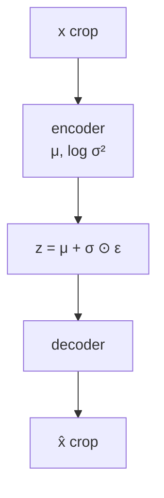

---
{
  "id": "autoencoders-vaes-generative-modeling-basics",
  "title": "Autoencoders and VAEs",
  "slug": "autoencoders-vaes-generative-modeling-basics",
  "section": "Preparation & Prerequisites",
  "category": "Model Architecture",
  "difficulty": "Easy",
  "order": 7,
  "coverImage": "illustrations/_generated/vae_latent_reconstruction_dark.png",
  "companies": [
    "Google",
    "Meta",
    "OpenAI",
    "Stability AI",
    "Anthropic",
    "Microsoft",
    "Amazon",
    "Apple"
  ],
  "shortDescription": "A two-number code can rebuild one screenshot crop, but a random draw still has to land where the decoder was trained to paint.",
  "keyConceptsTested": [
    "Autoencoder bottleneck and reconstruction loss",
    "Deterministic latent codes and sampling limits",
    "VAE approximate posterior and prior",
    "Variational inference and the evidence lower bound",
    "KL divergence for diagonal Gaussians",
    "Reparameterized sampling",
    "ELBO and beta-weighted objective",
    "Posterior collapse diagnosis",
    "VQ-VAE nearest-code quantization",
    "Latent diffusion compression bridge"
  ]
}
---

A sequence model compresses an ordered history into a hidden state. A screenshot crop poses the same question in pixels. Can two numbers preserve a bright 2 by 2 alert badge on a 5 by 5 grayscale screenshot? Suppose you hand the decoder a random pair of numbers. What can it draw if training only showed it codes produced by an encoder?

An **<span data-glossary="autoencoder">autoencoder</span>** learns to reconstruct its input from a latent code, which we make compact here.[^hinton2006autoencoder] A **<span data-glossary="variational-autoencoder">variational autoencoder (VAE)</span>** learns a probabilistic latent model with a prior we can sample for generation. Its objective connects reconstruction and prior sampling, but useful samples still depend on the model, data, and training.[^kingma2014]

## Compress one screenshot crop

Start with a tiny crop. Each grayscale number is between `0` (dark) and `1` (bright). A real screenshot has many more pixels, but a 5 by 5 crop lets us inspect every single number. The bright 2 by 2 block is the highlighted region: one latent coordinate can track those four center pixels while a second coordinate tracks the faint lower band, leaving dark border pixels weighted near zero.

<figure>
  
  <figcaption>The colored masks select four center pixels and two lower pixels from the same crop, compressing 25 pixel intensities into $z_1=0.8875$ and $z_2=0.170$. A matching two-basis decoder reconstructs the patch at mean squared error 0.0027.</figcaption>
</figure>

An autoencoder has two learned functions:

$$
z = f_\phi(x)
\qquad
\hat{x} = g_\theta(z)
$$

The encoder $f_\phi$ maps the input $x$ to the latent code $z$. Meanwhile, the decoder $g_\theta$ maps that code to a reconstruction $\hat{x}$. Here $\phi$ and $\theta$ denote their learned weights. A narrow $z$ creates the **hourglass bottleneck**: the decoder receives input-specific information through those two coordinates. The network must discover compact summaries. A large network can still memorize a tiny dataset.

For this crop, the first encoder map averages the four bright center pixels and the second averages two lower pixels:

$$
z_1 = 0.25 \times (0.85 + 0.88 + 0.90 + 0.92) = 0.8875 \approx 0.888
$$

$$
z_2 = 0.50 \times (0.18 + 0.16) = 0.170
$$

We chose these weights by hand, so the bottleneck arithmetic is visible before asking optimization to discover a useful map.

For normalized pixels, mean-squared error (MSE) measures reconstruction directly:

$$
L_{\text{recon}} = \frac{1}{N}\sum_{i=1}^{N}(x_i-\hat{x}_i)^2
$$

$N$ is the number of pixels, here 25. Each term is one pixel's squared error. The next snippet runs that same encoder, then a matching crafted decoder, so you can see the 25-to-2 shrink and the reconstruction error together.

<!-- leetllm: test, deps=numpy, output=show -->
```python title="crafted-autoencoder-forward.py"
import numpy as np

x = np.array([
    0.08, 0.12, 0.09, 0.11, 0.07,
    0.15, 0.85, 0.88, 0.14, 0.10,
    0.11, 0.90, 0.92, 0.13, 0.09,
    0.07, 0.18, 0.16, 0.12, 0.08,
    0.06, 0.09, 0.10, 0.07, 0.05,
], dtype=np.float32)

center = [6, 7, 11, 12]
lower = [16, 17]
W_encoder = np.zeros((25, 2), dtype=np.float32)
W_encoder[center, 0] = 0.25
W_encoder[lower, 1] = 0.50

W_decoder = np.zeros((2, 25), dtype=np.float32)
W_decoder[0, center] = 1.0
W_decoder[0, [5, 8, 10, 13]] = 0.12
W_decoder[1, lower] = 1.0
W_decoder[1, [15, 18, 21, 22]] = 0.35

z = x @ W_encoder
x_hat = np.clip(z @ W_decoder + 0.08, 0.0, 1.0)
mse = np.mean((x - x_hat) ** 2)

print("input numbers:", x.size)
print("latent numbers:", z.size, np.round(z, 3))
print("reconstruction MSE:", round(float(mse), 4))
```

<!-- leetllm: output:start -->
```text title="Output" output compact
input numbers: 25
latent numbers: 2 [0.888 0.17 ]
reconstruction MSE: 0.0027
```
<!-- leetllm: output:end -->

The input shrinks from 25 numbers to 2. This crafted decoder does well on this one pattern because we built its weights around it. Notice what it loses: rearranging the four selected center pixels while preserving their average leaves $z_1$ unchanged. The decoder then produces the same reconstruction for different inputs. Learned weights can capture variation across a family of crops.

## Learn the bottleneck

The next program makes noisy variations of the same crop and trains an autoencoder in <span data-glossary="pytorch">PyTorch</span>. The training loop uses <span data-glossary="gradient">gradients</span> to update weights with an <span data-glossary="optimizer">optimizer</span>, as in the backpropagation lesson. Compare its MSE with a deliberately uninformative baseline that returns the average crop for every input.

<!-- leetllm: test, deps=torch, output=show -->
```python title="train-tiny-autoencoder.py"
import torch
from torch import nn
import torch.nn.functional as F

torch.manual_seed(3)
base = torch.tensor([
    0.08, 0.12, 0.09, 0.11, 0.07,
    0.15, 0.85, 0.88, 0.14, 0.10,
    0.11, 0.90, 0.92, 0.13, 0.09,
    0.07, 0.18, 0.16, 0.12, 0.08,
    0.06, 0.09, 0.10, 0.07, 0.05,
])
patches = torch.clamp(base + 0.025 * torch.randn(48, 25), 0.0, 1.0)

encoder = nn.Sequential(nn.Linear(25, 8), nn.Tanh(), nn.Linear(8, 2))
decoder = nn.Sequential(nn.Linear(2, 8), nn.Tanh(), nn.Linear(8, 25), nn.Sigmoid())
optimizer = torch.optim.Adam(
    list(encoder.parameters()) + list(decoder.parameters()), lr=0.03
)

with torch.no_grad():
    before = F.mse_loss(decoder(encoder(patches)), patches).item()

for _ in range(250):
    reconstruction = decoder(encoder(patches))
    loss = F.mse_loss(reconstruction, patches)
    optimizer.zero_grad()
    loss.backward()
    optimizer.step()

with torch.no_grad():
    after = F.mse_loss(decoder(encoder(patches)), patches).item()
    latent = encoder(patches[:1])
    mean_crop = patches.mean(dim=0, keepdim=True).expand_as(patches)
    baseline = F.mse_loss(mean_crop, patches).item()

print(f"MSE before training: {before:.4f}")
print(f"MSE after training:  {after:.4f}")
print(f"constant-crop MSE:   {baseline:.4f}")
print("latent shape:", tuple(latent.shape))
```

<!-- leetllm: output:start -->
```text title="Output" output compact
MSE before training: 0.1537
MSE after training:  0.0006
constant-crop MSE:   0.0006
latent shape: (1, 2)
```
<!-- leetllm: output:end -->

The trained MSE is close to the constant-crop baseline. These nearly identical inputs don't require an informative code: a decoder can do well by remembering their shared pattern. Optimization works as expected. To test whether the latent captures useful variation, train and evaluate on distinct patterns, hold out crops, and check whether perturbing the latent changes the reconstruction.

An autoencoder's reconstruction loss scores codes produced by its encoder for training inputs. A random pair can fall far from those codes, where the decoder has received little training signal:

$$
L_{\text{AE}} = \|x - g_\theta(f_\phi(x))\|_2^2
$$

The encoder can arrange codes without matching a chosen prior. It might place center-highlight crops near $(-1.8, 1.2)$ and lower-strip crops near $(1.7, -1.3)$. A standard-normal draw can fall in a region rarely reached by encoded training crops, where reconstruction loss offers little evidence about decoder quality. Outputs there may be useful, blurry, or implausible. The encoder may produce separated or overlapping clusters, and random samples may succeed or fail. A separate model could also learn a distribution over deterministic codes.

| Model question | Deterministic autoencoder answer |
|---|---|
| What does the encoder output? | One point $z$ for each input |
| What is optimized? | Reconstruction of encoded training examples |
| Can you decode a known encoded crop? | Yes, if reconstruction training worked |
| What constrains a standard-normal draw? | Plain reconstruction loss leaves its relation to encoded crops unconstrained |

<figure>
  
  <figcaption>Left: a deterministic autoencoder places separate encoded patches far from the $\mathcal{N}(0, I)$ prior contours (radius 1 and 2 rings), leaving the origin empty for random sampling. Right: the KL penalty pulls a VAE posterior centered at $\mu=[0.40, -0.20]$ (one-standard-deviation ellipse $\sigma_1 \approx 0.705, \sigma_2 \approx 1.051$) inside the prior, so a reparameterized draw $z \approx [0.752, -1.251]$ lands where the decoder has trained.</figcaption>
</figure>

```checkpoint
Why isn't a low reconstruction loss enough to make a deterministic autoencoder a generator?
---
The reconstruction loss evaluates codes produced by the encoder for training-like inputs. It says nothing about the decoder's behavior on points sampled from a chosen prior such as a standard normal distribution.
```

## A VAE learns distributions over codes

A VAE starts with a generative story: draw a latent $z$ from a prior $p(z)$, then draw an image from a decoder distribution $p_\theta(x\mid z)$. For an observed crop, inference runs that story backward: which latent values could have produced it? The encoder predicts an **approximate posterior**, written $q_\phi(z \mid x)$, over those possible values.

The word *approximate* matters: computing the exact posterior $p_\theta(z \mid x)$ is generally impractical, so the encoder parameterizes a tractable variational family $q_\phi(z \mid x)$. This approximation method is <span data-glossary="variational-inference">variational inference</span>. Here it's amortized: one encoder predicts posterior parameters for every crop, sharing its learned inference procedure across inputs.

For the common diagonal-Gaussian case, it predicts a mean vector $\mu$ and a log-<span data-glossary="variance">variance</span> vector $\log \sigma^2$:

$$
q_\phi(z \mid x) = \mathcal{N}\left(\mu(x), \operatorname{diag}(\sigma^2(x))\right)
$$

The model also declares a simple **prior**, usually:

$$
p(z) = \mathcal{N}(0, I)
$$

The posterior describes codes for one observed crop. The prior is the distribution we sample from when no input crop is provided. In $\mathcal{N}(0,I)$, each coordinate has mean zero and variance one, and the coordinates are independent. A diagonal posterior similarly has independent coordinates conditional on this crop, though its means and variances depend on the input. Even when each individual crop uses a factorized diagonal posterior, averaging across the training set gives an aggregate posterior $q_\phi(z)$ whose dimensions generally remain correlated.

Why predict `logvar` instead of a raw standard deviation? An unconstrained linear layer can output negative values, while standard deviation must stay positive. Exponentiating half a finite log variance gives a positive scale. Floating-point exponentiation can still underflow to zero or overflow to infinity. Softplus offers another positive parameterization; log variance is one convenient choice.

<!-- leetllm: test, deps=numpy, output=show -->
```python title="log-variance-to-standard-deviation.py"
import numpy as np

logvar = np.array([-0.70, 0.10])
sigma = np.exp(0.5 * logvar)
variance = np.exp(logvar)

print("log variance:", logvar)
print("variance:", np.round(variance, 3))
print("standard deviation:", np.round(sigma, 3))
print("all sigma positive:", bool(np.all(sigma > 0)))
```

<!-- leetllm: output:start -->
```text title="Output" output compact
log variance: [-0.7  0.1]
variance: [0.497 1.105]
standard deviation: [0.705 1.051]
all sigma positive: True
```
<!-- leetllm: output:end -->

Those two vectors define a Gaussian for one crop. The encoder can place that Gaussian far from the numbers we later draw. What penalty pulls it toward a sampleable prior while preserving crop information?

## Keep posteriors near a sampleable prior

If the encoder may put each crop's distribution anywhere it likes, prior samples still won't reliably land where the decoder has trained. A useful prior penalty vanishes when the posterior equals the standard normal prior and grows rapidly whenever posterior means drift or variances shrink away from one.

VAEs measure that mismatch with <span data-glossary="kl-divergence">Kullback-Leibler (KL) divergence</span>. KL isn't a symmetric distance: direction matters. For a diagonal Gaussian posterior and standard-normal prior, the closed form is:[^kingma2014]

$$
D_{\mathrm{KL}}\left(q_\phi(z \mid x) \,\|\, p(z)\right)
=
-\frac{1}{2}
\sum_j
\left(1 + \log \sigma_j^2 - \mu_j^2 - \sigma_j^2\right)
$$

The penalty is zero when $\mu=0$ and $\sigma=1$. Moving means away from zero or making variances very different from one increases it.

Use the same two-dimensional posterior we'll sample from next: $\mu = [0.40, -0.20]$ and $\log\sigma^2 = [-0.70, 0.10]$. One coordinate at a time:

$$
\begin{aligned}
j=1 &\colon && 1 - 0.70 - (0.40)^2 - e^{-0.70} \approx -0.3566 \\
j=2 &\colon && 1 + 0.10 - (0.20)^2 - e^{0.10} \approx -0.0452 \\
D_{\mathrm{KL}} &= && -\tfrac{1}{2}(-0.3566-0.0452) \approx 0.2009
\end{aligned}
$$

The next snippet checks that closed form on three posteriors, including this one.

<!-- leetllm: test, deps=numpy, output=show -->
```python title="kl-divergence-from-prior.py"
import numpy as np

def kl_to_standard_normal(mu, logvar):
    # expm1(logvar) computes exp(logvar) - 1 accurately near zero.
    return float(0.5 * np.sum(mu**2 + np.expm1(logvar) - logvar))

posteriors = {
    "matches prior": (np.array([0.0, 0.0]), np.array([0.0, 0.0])),
    "small offset": (np.array([0.4, -0.2]), np.array([-0.7, 0.1])),
    "far offset": (np.array([2.0, -1.5]), np.array([-1.5, 1.2])),
}

for name, (mu, logvar) in posteriors.items():
    print(f"{name:13} KL = {kl_to_standard_normal(mu, logvar):.4f}")
```

<!-- leetllm: output:start -->
```text title="Output" output compact
matches prior KL = 0.0000
small offset  KL = 0.2009
far offset    KL = 4.0466
```
<!-- leetllm: output:end -->

KL pressure has a cost. If it dominates reconstruction, all inputs can be encoded nearly like the prior and the decoder may ignore $z$. We'll check for that behavior after the training loop. First we need a way to sample from $q_\phi(z \mid x)$ while keeping gradients connected to $\mu$ and $\sigma$.

## Sample while gradients still flow

Kingma and Welling reparameterize a Gaussian draw so reconstruction gradients can reach encoder parameters.[^kingma2014] Writing $z\sim\mathcal{N}(\mu,\sigma^2)$ specifies a distribution. The sampling API determines how the draw connects to autograd. PyTorch's ordinary `Normal.sample()` supplies no pathwise gradient to its mean or scale. Reparameterization makes that path explicit. Other estimators, including score-function gradients, can train stochastic models without differentiating the sampled value directly.[^pytorchDistributions2026]

The reparameterization trick moves all stochasticity into an independent noise variable $\epsilon$ drawn from a standard normal distribution, then applies an algebraic transformation:

$$
\epsilon \sim \mathcal{N}(0,I),
\qquad
z = \mu + \sigma \odot \epsilon
$$

During the backward pass, $\epsilon$ is treated as a fixed constant tensor. The symbol $\odot$ means elementwise multiplication. For each coordinate $i$, the partial derivatives are:

$$
\frac{\partial z_i}{\partial \mu_i} = 1,
\qquad
\frac{\partial z_i}{\partial \sigma_i} = \epsilon_i
$$

Across all coordinates, the corresponding Jacobians are $\partial z/\partial\mu = I$ and $\partial z/\partial\sigma = \operatorname{diag}(\epsilon)$; derivatives between different coordinates are zero.

Reconstruction gradients $\partial L_{\text{recon}}/\partial z$ can then reach $\mu$, $\sigma$, and the encoder weights $\phi$. PyTorch's `torch.distributions.Normal.rsample()` implements this draw. Using `sample()` removes this reconstruction path to the encoder, but the decoder can still train, and an analytic KL term can still update encoder parameters.[^pytorchDistributions2026]

<figure>
  
  <figcaption>Both rows use the same Gaussian; displayed $\sigma$ and $z$ values are rounded to three decimals. With `sample()`, reconstruction updates the decoder while its encoder route ends at the draw. With fixed $\epsilon$, `rsample()` sends reconstruction gradients to $\mu$ and $\sigma$; the analytic KL term has a separate encoder path in both rows.</figcaption>
</figure>

<!-- leetllm: test, deps=numpy, output=show -->
```python title="reparameterized-sample.py"
import numpy as np

mu = np.array([0.40, -0.20])
logvar = np.array([-0.70, 0.10])
epsilon = np.array([0.50, -1.00])

sigma = np.exp(0.5 * logvar)
z = mu + sigma * epsilon

print("mu:", np.round(mu, 3))
print("sigma:", np.round(sigma, 3))
print("epsilon:", np.round(epsilon, 3))
print("sampled z:", np.round(z, 3))
```

<!-- leetllm: output:start -->
```text title="Output" output compact
mu: [ 0.4 -0.2]
sigma: [0.705 1.051]
epsilon: [ 0.5 -1. ]
sampled z: [ 0.752 -1.251]
```
<!-- leetllm: output:end -->

Inspect how PyTorch tracks gradients across the two sampling methods directly: identify which draw preserves an autograd path back to the encoder parameters, then verify the derivative through `logvar`: $\partial z_j/\partial\log\sigma_j^2=\tfrac12\sigma_j\epsilon_j=\tfrac12(z_j-\mu_j)$.

<!-- leetllm: test, deps=torch, output=show -->
```python title="sample-versus-rsample.py"
import torch
from torch.distributions import Normal

torch.manual_seed(11)
mu = torch.tensor([0.40, -0.20], requires_grad=True)
logvar = torch.tensor([-0.70, 0.10], requires_grad=True)
distribution = Normal(mu, torch.exp(0.5 * logvar))
ordinary = distribution.sample()
pathwise = distribution.rsample()
mu_gradient, logvar_gradient = torch.autograd.grad(
    pathwise.sum(), (mu, logvar), retain_graph=True
)
kl = 0.5 * (mu.square() + torch.expm1(logvar) - logvar).sum()
kl_mu_gradient = torch.autograd.grad(kl, mu)[0]

print("sample has an autograd path:", ordinary.requires_grad)
print("rsample has an autograd path:", pathwise.requires_grad)
print("rsample mean gradient:", mu_gradient.tolist())
print("logvar derivative matches:", torch.allclose(
    logvar_gradient, 0.5 * (pathwise.detach() - mu.detach())
))
print("analytic KL mean gradient:", [round(x, 3) for x in kl_mu_gradient.tolist()])
```

<!-- leetllm: output:start -->
```text title="Output" output compact
sample has an autograd path: False
rsample has an autograd path: True
rsample mean gradient: [1.0, 1.0]
logvar derivative matches: True
analytic KL mean gradient: [0.4, -0.2]
```
<!-- leetllm: output:end -->

That sampled $z$ is what the decoder sees during training. The full path is now:



Generation later skips the encoder. It draws $z$ from the prior $p(z)$ and runs only the decoder. The path is differentiable. Those gradients still need a quantity to improve.

## The VAE objective

The VAE performs variational inference by optimizing an <span data-glossary="evidence-lower-bound">evidence lower bound (ELBO)</span> on the data log-likelihood.[^kingma2014] Written as a quantity to maximize:

$$
\mathcal{L}_{\mathrm{ELBO}}
=
\mathbb{E}_{q_\phi(z \mid x)}[\log p_\theta(x \mid z)]
-
D_{\mathrm{KL}}(q_\phi(z \mid x)\,\|\,p(z))
$$

The first term rewards a decoder that makes the observed crop likely after sampling its latent. The second discourages a posterior that moves too far from the prior. The bound reaches $\log p_\theta(x)$ when $q_\phi(z \mid x)$ matches the true posterior $p_\theta(z \mid x)$. The remaining gap is $D_{\mathrm{KL}}(q_\phi(z \mid x)\,\|\,p_\theta(z \mid x))$.

In code we minimize the negative ELBO, or a weighted variant:

$$
L_{\mathrm{VAE}} = L_{\mathrm{recon}} + \beta D_{\mathrm{KL}}
$$

For $\beta=1$, this is the negative ELBO when `L_recon` estimates the selected negative log-likelihood. To connect that term to the pixel errors you've already calculated, let the decoder output a mean image $\hat{x}$ and assume independent Gaussian pixel noise with fixed variance $\tau^2$:

$$
-\log p_\theta(x\mid z)=\frac{1}{2\tau^2}\sum_{i=1}^{N}(x_i-\hat{x}_i)^2+\frac{N}{2}\log(2\pi\tau^2)
$$

For fixed $\tau$, the last term is constant with respect to the weights. The first term is scaled **summed** squared error. Mean MSE needs its own reduction factor. A smaller observation variance penalizes the same pixel errors more strongly. Changing the reconstruction reduction also changes the optimization problem unless you adjust the KL coefficient.

The reconstruction term averages over posterior samples. Our code uses one reparameterized draw per example, giving a Monte Carlo estimate of that expectation. For this fixed model and example, averaging $n$ independent draws divides the estimator variance by $n$, at the cost of more decoder work. The Gaussian KL term is evaluated analytically.[^kingma2014]

This ledger computes both terms for one crop using a fixed reconstruction:

<!-- leetllm: test, deps=numpy, output=show -->
```python title="vae-loss-ledger.py"
import numpy as np

x = np.array([0.10, 0.90, 0.85, 0.12])
x_hat = np.array([0.12, 0.84, 0.80, 0.14])
mu = np.array([0.40, -0.20])
logvar = np.array([-0.70, 0.10])

reconstruction_mse = np.mean((x - x_hat) ** 2)
kl = -0.5 * np.sum(1 + logvar - mu**2 - np.exp(logvar))

for beta in [0.0, 0.1, 1.0]:
    total = reconstruction_mse + beta * kl
    print(f"beta={beta:.1f}: recon={reconstruction_mse:.4f} KL={kl:.4f} total={total:.4f}")
```

<!-- leetllm: output:start -->
```text title="Output" output compact
beta=0.0: recon=0.0017 KL=0.2009 total=0.0017
beta=0.1: recon=0.0017 KL=0.2009 total=0.0218
beta=1.0: recon=0.0017 KL=0.2009 total=0.2026
```
<!-- leetllm: output:end -->

<figure>
  
  <figcaption>Increasing $\beta$ trades reconstruction accuracy for lower KL in this four-dimensional VAE. At $\beta=0.00$, all four coordinates exceed the active-dimension cutoff of 0.1 nats and total KL is 34.6 nats. At $\beta \in [0.10, 0.50]$, two coordinates remain above that cutoff. At $\beta \ge 1.00$, none do, total KL is near zero, and reconstruction summed squared error is about 1.23.</figcaption>
</figure>

Higgins et al. studied $\beta$-VAE, increasing the KL weight to restrict latent information and encourage disentangled representations.[^higgins2017] A factorized prior alone leaves learned coordinates free to mix real-world factors. Unsupervised disentanglement requires assumptions about the model and data.[^locatello2019Disentanglement] Measure reconstruction distortion, active latent dimensions, and prior samples across a sweep of $\beta$ rather than relying on one unweighted sum:

<!-- leetllm: test, deps=torch, output=show -->
```python title="beta-rate-distortion-sweep.py"
import torch
import torch.nn as nn
import torch.nn.functional as F

torch.set_num_threads(1)  # Use one CPU thread for repeatable reductions.
t = torch.linspace(-1.0, 1.0, 5)
gx, gy = torch.meshgrid(t, t, indexing="ij")
torch.manual_seed(7)
n_samples = 512
cx = torch.rand(n_samples) * 1.4 - 0.7
cy = torch.rand(n_samples) * 1.4 - 0.7
patches = torch.exp(-((gx[None] - cx[:, None, None]) ** 2 + (gy[None] - cy[:, None, None]) ** 2) / 0.45).view(n_samples, 25)

class PatchBetaVAE(nn.Module):
    def __init__(self, z_dim: int = 4):
        super().__init__()
        self.enc = nn.Sequential(nn.Linear(25, 32), nn.ReLU())
        self.mu = nn.Linear(32, z_dim)
        self.logvar = nn.Linear(32, z_dim)
        self.dec = nn.Sequential(nn.Linear(z_dim, 32), nn.ReLU(), nn.Linear(32, 25), nn.Sigmoid())

    def forward(self, x):
        h = self.enc(x)
        mu, logvar = self.mu(h), self.logvar(h).clamp(-8.0, 4.0)
        z = mu + torch.exp(0.5 * logvar) * torch.randn_like(mu)
        return self.dec(z), mu, logvar

for beta in [0.0, 0.05, 0.1, 0.25, 0.5, 1.0, 2.0]:
    torch.manual_seed(7)
    model = PatchBetaVAE(z_dim=4)
    opt = torch.optim.Adam(model.parameters(), lr=5e-3)
    for _ in range(400):
        xhat, mu, logvar = model(patches)
        sse = F.mse_loss(xhat, patches, reduction="sum") / n_samples
        kl_per_dim = -0.5 * (1.0 + logvar - mu**2 - logvar.exp()).mean(dim=0)
        loss = sse + beta * kl_per_dim.sum()
        opt.zero_grad()
        loss.backward()
        opt.step()
    with torch.no_grad():
        xhat, mu, logvar = model(patches)
        sse = (F.mse_loss(xhat, patches, reduction="sum") / n_samples).item()
        kl_dim = -0.5 * (1.0 + logvar - mu**2 - logvar.exp()).mean(dim=0)
        active = int((kl_dim > 0.1).sum().item())
        print(f"beta={beta:.2f}: sse={sse:.3f}, kl={kl_dim.sum().item():.3f}, active={active}/4")
```

<!-- leetllm: output:start -->
```text title="Output" output compact
beta=0.00: sse=0.010, kl=34.564, active=4/4
beta=0.05: sse=0.089, kl=3.795, active=3/4
beta=0.10: sse=0.130, kl=2.693, active=2/4
beta=0.25: sse=0.315, kl=1.680, active=2/4
beta=0.50: sse=0.621, kl=0.851, active=2/4
beta=1.00: sse=1.224, kl=0.002, active=0/4
beta=2.00: sse=1.226, kl=0.000, active=0/4
```
<!-- leetllm: output:end -->

The sweep shows how stronger KL pressure reduces the number of active coordinates while reconstruction error rises. Two active coordinates match the number of factors used to generate these patches, but identifying what each coordinate represents requires another experiment: vary one coordinate while inspecting the decoded patch. At $\beta=1.0$, KL is small rather than exactly zero. Test how much the reconstruction changes when its code changes, as the next example does.

## Train a tiny VAE

Now train a two-dimensional VAE on two families of synthetic crops: one with a bright center highlight and one with a bright lower strip. A constant image can't fit both well. After training, compare reconstruction from each posterior mean with reconstruction from the other family's means. Swapping codes should hurt if they carry pattern information. Finally, decode three prior draws and inspect whether the center or lower strip is bright.

The decoder returns Gaussian mean images in this MSE-based example. We display those means without adding observation noise. The loss below is mean pixel error plus a chosen KL weight. This coefficient is an experimental setting with the mean-MSE scale defined above.

<!-- leetllm: test, deps=torch, output=show -->
```python title="train-tiny-vae.py"
import torch
from torch import nn
import torch.nn.functional as F

torch.manual_seed(8)
center_mark = torch.tensor([
    0.05, 0.10, 0.08, 0.10, 0.06,
    0.12, 0.88, 0.86, 0.13, 0.08,
    0.10, 0.91, 0.90, 0.12, 0.07,
    0.06, 0.15, 0.14, 0.10, 0.06,
    0.05, 0.08, 0.08, 0.05, 0.04,
])
lower_mark = torch.tensor([
    0.04, 0.07, 0.06, 0.08, 0.05,
    0.10, 0.15, 0.12, 0.10, 0.06,
    0.08, 0.18, 0.16, 0.09, 0.06,
    0.06, 0.84, 0.88, 0.11, 0.07,
    0.04, 0.07, 0.08, 0.05, 0.04,
])
patches = torch.cat([
    torch.clamp(center_mark + 0.02 * torch.randn(32, 25), 0.0, 1.0),
    torch.clamp(lower_mark + 0.02 * torch.randn(32, 25), 0.0, 1.0),
])

class TinyVAE(nn.Module):
    def __init__(self):
        super().__init__()
        self.encoder = nn.Sequential(nn.Linear(25, 12), nn.Tanh())
        self.mu = nn.Linear(12, 2)
        self.logvar = nn.Linear(12, 2)
        self.decoder = nn.Sequential(
            nn.Linear(2, 12), nn.Tanh(), nn.Linear(12, 25), nn.Sigmoid()
        )

    def forward(self, x):
        hidden = self.encoder(x)
        mu = self.mu(hidden)
        logvar = self.logvar(hidden)
        z = mu + torch.exp(0.5 * logvar) * torch.randn_like(mu)
        return self.decoder(z), mu, logvar

model = TinyVAE()
optimizer = torch.optim.Adam(model.parameters(), lr=0.03)
beta = 0.02

def loss_terms(x_hat, x, mu, logvar):
    recon = F.mse_loss(x_hat, x)
    kl = -0.5 * (1 + logvar - mu.pow(2) - logvar.exp()).sum(1).mean()
    return recon + beta * kl, recon, kl

for _ in range(400):
    x_hat, mu, logvar = model(patches)
    loss, recon, kl = loss_terms(x_hat, patches, mu, logvar)
    optimizer.zero_grad()
    loss.backward()
    optimizer.step()

torch.manual_seed(99)
with torch.no_grad():
    x_hat, mu, logvar = model(patches)
    loss, recon, kl = loss_terms(x_hat, patches, mu, logvar)
    generated = model.decoder(torch.randn(3, 2))
    mean_mse = F.mse_loss(model.decoder(mu), patches)
    swapped_mse = F.mse_loss(model.decoder(mu.roll(32, dims=0)), patches)
    kl_per_dim = -0.5 * (1 + logvar - mu.square() - logvar.exp()).mean(0)

print(f"reconstruction={recon.item():.4f} KL={kl.item():.4f} total={loss.item():.4f}")
print("generated batch shape:", tuple(generated.shape))
print(f"posterior-mean MSE={mean_mse.item():.4f}; swapped-code MSE={swapped_mse.item():.4f}")
print("KL per dimension:", [round(value, 4) for value in kl_per_dim.tolist()])
for index, crop in enumerate(generated):
    center = crop[[6, 7, 11, 12]].mean().item()
    lower = crop[[16, 17]].mean().item()
    print(f"prior draw {index}: center={center:.3f}, lower={lower:.3f}")
```

<!-- leetllm: output:start -->
```text title="Output" output compact
reconstruction=0.0075 KL=0.7382 total=0.0222
generated batch shape: (3, 25)
posterior-mean MSE=0.0005; swapped-code MSE=0.1276
KL per dimension: [0.0005, 0.7378]
prior draw 0: center=0.142, lower=0.875
prior draw 1: center=0.877, lower=0.150
prior draw 2: center=0.800, lower=0.219
```
<!-- leetllm: output:end -->

Each object in the program now has a job: `mu` and `logvar` define each approximate posterior, `torch.randn_like` supplies $\epsilon$, `decoder` consumes sampled $z$, and the logged losses reveal the compromise.

Every tensor transformation in this minimal VAE uses clean batch-major shapes. Here, `B` is batch size:

| Tensor | Shape in this program | Role |
|---|---|---|
| Input batch `x` | `[B, 25]` | `B` flattened 5 by 5 crops |
| Encoder hidden state | `[B, 12]` | Shared features before the two heads |
| `mu`, `logvar`, and sampled `z` | `[B, 2]` | One two-dimensional posterior per crop |
| Reconstruction `x_hat` | `[B, 25]` | One flattened crop per sampled latent |

The reductions matter too. `F.mse_loss` averages pixel errors over the batch, while the KL term sums its two latent dimensions before averaging over the batch. `beta = 0.02` is specific to this setup. If you change latent width or loss reduction, retune it and keep logging both terms.

Swapping the families' codes raises MSE from `0.0005` to `0.1276`, showing that the decoder uses input-dependent information. Prior draw 0 has a bright lower strip; draw 1 has a bright center; draw 2 is less distinct. Checking three prior draws alongside training reconstructions confirms that both clusters remain active, while systematic quality assessment requires held-out patterns and larger decoded sample grids.

## Watch for posterior collapse

Low KL can look like success because each posterior matches the prior. But if reconstruction stays acceptable while changing $z$ barely changes the output, what happened? The decoder found a shortcut and stopped using its latent input. In information-theoretic terms, the <span data-glossary="mutual-information">mutual information</span> $I(X;Z)$ between observations and latent codes can fall toward zero: knowing the sampled code no longer tells you much about which crop produced it. This failure is called **posterior collapse**. Van den Oord et al. describe it as a common issue for VAEs paired with high-capacity autoregressive decoders.[^oord2017vqvae]

An expressive autoregressive decoder can model data through previously observed pixels or tokens while ignoring the global latent. Training can settle near $q_\phi(z\mid x)=p(z)$, with little input-specific information in the code.[^bowman2016SentenceVAE] That decoder can still generate varied, plausible outputs. An unconditional deterministic mean-image decoder optimized with MSE favors the dataset's mean image when it ignores $z$. Averaging follows from that decoder and loss; posterior collapse describes the broader failure to use latent information.

There are two pressures hidden in the average KL. Let $q(z)$ be the mixture of encoder posteriors over the data and let $I_q(X;Z)$ measure information under that joint data/encoder distribution. Then:[^hoffman2016ELBOSurgery]

$$
\mathbb{E}_X D_{\mathrm{KL}}(q_\phi(z\mid X)\,\|\,p(z))
= I_q(X;Z)+D_{\mathrm{KL}}(q(z)\,\|\,p(z))
$$

Aggregate prior matching and per-crop posterior matching measure separate properties. If every posterior equals the prior, $I_q(X;Z)=0$: a sampled code cannot tell us which crop it came from. A large average KL can reflect prior mismatch, useful information, or both.

The training code already reports KL per latent dimension. One near-zero dimension can be unused capacity when the other distinguishes the two patterns. This per-dimension monitor raises a warning only when KL is tiny in every dimension; it doesn't diagnose collapse by itself:

<!-- leetllm: test, deps=numpy, output=show -->
```python title="posterior-collapse-monitor.py"
import numpy as np

logged_kl_by_dimension = {
    "using latent": np.array([0.31, 0.18]),
    "suspected collapse": np.array([0.0003, 0.0001]),
}
threshold = 0.001

for run_name, kl_dims in logged_kl_by_dimension.items():
    low_kl_warning = bool(np.all(kl_dims < threshold))
    print(f"{run_name:18} total_KL={kl_dims.sum():.4f} low_KL_warning={low_kl_warning}")
```

<!-- leetllm: output:start -->
```text title="Output" output compact
using latent       total_KL=0.4900 low_KL_warning=False
suspected collapse total_KL=0.0004 low_KL_warning=True
```
<!-- leetllm: output:end -->

Interpret a low KL value alongside reconstruction quality, generated samples, and whether predictions respond when $z$ changes. A rapid collapse toward zero still warrants investigation.

Three interventions worth testing are:

1. **KL annealing:** Start with weak KL pressure and increase it toward the intended final weight. Bowman et al. anneal from zero to one for their likelihood-scaled objective.[^bowman2016SentenceVAE] Our mean-MSE example uses a different scale, so choose the endpoint to match its loss scale. The nearly constant-crop experiment showed that zero KL weight can leave the latent unused.
2. **Free bits:** The original formulation sums $\max(\tau,\mathbb{E}_X D_{\mathrm{KL},j})$ over latent groups, with each group's KL averaged over the minibatch before applying the floor.[^kingma2016IAFFreeBits] Below $\tau$, that KL contribution has zero gradient; reconstruction can reward additional information without extra KL cost. Mutual information can still remain low. With natural logarithms, the threshold is measured in nats despite the name.
3. **Decoder rebalancing:** Reduce decoder capacity or weaken autoregressive conditioning. Bowman's word dropout removes some teacher-forced context so latent information becomes more useful.[^bowman2016SentenceVAE] Test whether the decoder uses $z$ after the change, and monitor sample quality because reducing decoder capacity can hurt it.

The order in free bits is observable. Suppose one latent group has per-example KL values `0.2` and `2.2` nats, and its floor is `1.0`. Its batch average is `1.2`, already above the floor, so the original formulation keeps the KL gradient for both examples. Flooring each example first would suppress the first example's gradient and charge a different total:

<!-- leetllm: test, deps=torch, output=show -->
```python title="free-bits-reduction-order.py"
import torch

kl_values = torch.tensor([0.2, 2.2], dtype=torch.float64, requires_grad=True)
floor = 1.0
group_floor = kl_values.mean().clamp_min(floor)
example_floor = kl_values.clamp_min(floor).mean()
group_grad = torch.autograd.grad(group_floor, kl_values, retain_graph=True)[0]
example_grad = torch.autograd.grad(example_floor, kl_values)[0]
print(f"floor after group average: {group_floor.item():.1f}")
print("derivatives:", group_grad.tolist())
print(f"average after example floors: {example_floor.item():.1f}")
print("derivatives:", example_grad.tolist())
```

<!-- leetllm: output:start -->
```text title="Output" output compact
floor after group average: 1.2
derivatives: [0.5, 0.5]
average after example floors: 1.6
derivatives: [0.0, 0.5]
```
<!-- leetllm: output:end -->

These are derivatives with respect to the KL values. Autograd then multiplies them by each value's derivative with respect to the encoder parameters. The example avoids the exact threshold, where the floor has a corner; below the group threshold, that group's KL contribution has zero derivative for every example.

Inspect interpolation to see whether it is meaningful. A decoder built from continuous layers changes continuously with $z$ in a deterministic autoencoder too; mathematical continuity alone says little about image plausibility. The path $z(\alpha)=(1-\alpha)z_A+\alpha z_B$ can cross regions poorly represented during training in either model. Gaussian posterior support alone doesn't tell us where most probability mass lies or where decoding works well.

```checkpoint
An expressive autoregressive VAE has KL near zero but generates varied, plausible images. Does that rule out posterior collapse?
---
No. The decoder can model a rich distribution using previous pixels while ignoring the global latent. Measure whether the encoder's code carries input-specific information and whether changing that code changes the conditional output distribution. Sample variety can come from previous-pixel dependence while the decoder ignores the latent.
```

## VQ-VAE: replace continuous samples with codes

A Vector Quantised Variational Autoencoder (VQ-VAE) takes a different route. Its encoder output is mapped to the nearest <span data-glossary="vector">vector</span> in a learned codebook, producing a discrete latent representation. The original VQ-VAE paper also learns a prior over those discrete codes.[^oord2017vqvae]

For one encoder vector, <span data-glossary="quantization">quantization</span> is a nearest-neighbor lookup:

$$
k = \arg\min_j \lVert z_e(x)-e_j\rVert_2^2,
\qquad
z_q(x)=e_k
$$

<!-- leetllm: test, deps=numpy, output=show -->
```python title="vq-vae-nearest-code.py"
import numpy as np

encoder_output = np.array([0.72, -0.10])
codebook = np.array([
    [-0.80, 0.20],
    [0.65, -0.05],
    [0.10, 0.90],
])

squared_distances = ((codebook - encoder_output) ** 2).sum(axis=1)
index = int(squared_distances.argmin())
quantized = codebook[index]

print("squared distances:", np.round(squared_distances, 3))
print("selected code ID:", index)
print("decoder receives:", quantized)
```

<!-- leetllm: output:start -->
```text title="Output" output compact
squared distances: [2.4   0.007 1.384]
selected code ID: 1
decoder receives: [ 0.65 -0.05]
```
<!-- leetllm: output:end -->

Nearest-code assignments are piecewise constant, so their ordinary derivatives don't supply a useful encoder training signal. VQ-VAE uses a straight-through gradient estimator for the encoder path, plus a codebook loss and a commitment loss so encoder outputs stay close to useful entries:[^oord2017vqvae]

$$
\lVert \operatorname{sg}[z_e(x)] - e \rVert_2^2
+
\beta \lVert z_e(x) - \operatorname{sg}[e] \rVert_2^2
$$

Here $\operatorname{sg}[\cdot]$ stops gradients, $e$ is the selected codebook vector, and this $\beta$ weights the VQ-VAE commitment term. In a $\beta$-VAE, $\beta$ weights the KL term. In the original straight-through setup, reconstruction trains the decoder and encoder; it supplies no codebook gradient. The codebook loss updates selected entries, while commitment updates the encoder. A moving-average codebook update is another option.[^oord2017vqvae] The important distinction is the interface:

The nearest code doesn't change during this backward pass. Which tensors receive gradients from reconstruction alone, and which need the auxiliary losses? This two-coordinate example makes the routing visible:

<!-- leetllm: test, deps=torch, output=show -->
```python title="vq-straight-through-gradients.py"
import torch

encoded = torch.tensor([0.72, -0.10], requires_grad=True)
codebook = torch.tensor([
    [-0.80, 0.20], [0.65, -0.05], [0.10, 0.90]
], requires_grad=True)
index = ((codebook - encoded) ** 2).sum(1).argmin()
quantized = codebook[index]
straight_through = encoded + (quantized - encoded).detach()
target = torch.tensor([0.50, 0.10])
reconstruction = 0.5 * (straight_through - target).square().sum()
encoder_recon, codebook_recon = torch.autograd.grad(
    reconstruction, (encoded, codebook), retain_graph=True, allow_unused=True
)
codebook_loss = (encoded.detach() - quantized).square().sum()
commitment = 0.25 * (encoded - quantized.detach()).square().sum()
(reconstruction + codebook_loss + commitment).backward()

rounded = lambda vector: [round(x, 3) for x in vector.tolist()]
print("forward code:", rounded(straight_through.detach()))
print("reconstruction encoder gradient:", rounded(encoder_recon))
print("reconstruction codebook gradient:", codebook_recon)
print("total encoder gradient:", rounded(encoded.grad))
print("selected code gradient:", rounded(codebook.grad[index]))
assert torch.count_nonzero(codebook.grad[[0, 2]]).item() == 0
```

<!-- leetllm: output:start -->
```text title="Output" output compact
forward code: [0.65, -0.05]
reconstruction encoder gradient: [0.15, -0.15]
reconstruction codebook gradient: None
total encoder gradient: [0.185, -0.175]
selected code gradient: [-0.14, 0.1]
```
<!-- leetllm: output:end -->

| Bottleneck | Decoder receives | How a new latent is obtained |
|---|---|---|
| Autoencoder | Deterministic vector $z$ | Encode an input |
| VAE | Continuous sampled vector $z$ | Sample from a prior after training |
| VQ-VAE | Codebook vector selected by an ID | Sample code IDs from a learned prior after training |

A hand-picked VQ-VAE code ID can be decoded. Plausible sampling depends on drawing code-ID combinations from the learned prior, which captures combinations used by the generative model during training.

Continuous VAEs and discrete VQ-VAEs can both turn a large input into a smaller latent another model can consume. A later generator can model those latents directly, reducing the work of modeling every input pixel.

## Latent models reduce the expensive space

The same latent bottleneck design scales beyond this tiny crop. A later generator can work in latent space, then hand its final representation to the decoder that turns it back into pixels. Rombach et al. train diffusion models in the latent space of pretrained autoencoders, applying denoising operations to the compressed representation.[^rombach2022] They write the spatial downsampling factor as $f = H/h = W/w$ and evaluate the efficiency and quality trade-off across values from 2 to 32, including $f=4$ and $f=8$. The autoencoder's job is precise: compress before the expensive generation steps, then decode a final latent back to pixels.

Their compression stage uses perceptual and adversarial losses, with weak KL or vector-quantization regularization. A separate diffusion model learns the latent distribution.[^rombach2022] Sampling Gaussian noise and decoding it directly isn't equivalent to running that generator: diffusion must first transform noise into a latent that fits the learned distribution.

You can check the size reduction by hand. A downsampling factor of 8 reduces each spatial axis by 8, so it reduces spatial positions by 64. On a 512 by 512 grid that is 262,144 positions becoming 4,096:

<!-- leetllm: test, output=show -->
```python title="latent-spatial-budget.py"
height, width = 512, 512
downsample = 8
latent_height = height // downsample
latent_width = width // downsample

pixel_positions = height * width
latent_positions = latent_height * latent_width

print("pixel grid:", (height, width), "positions:", pixel_positions)
print("latent grid:", (latent_height, latent_width), "positions:", latent_positions)
print("spatial reduction:", pixel_positions // latent_positions, "x")
```

<!-- leetllm: output:start -->
```text title="Output" output compact
pixel grid: (512, 512) positions: 262144
latent grid: (64, 64) positions: 4096
spatial reduction: 64 x
```
<!-- leetllm: output:end -->

Channels and decoder quality still matter. For an RGB image and four-channel latent at $f=8$, the spatial area shrinks by 64 while the channel count grows from 3 to 4, for a 48-fold reduction in scalar values. Those element counts alone do not determine runtime or compressed-file size. Rombach et al. find that aggressive compression hurts their downstream results; detail discarded by the encoder can't be uniquely recovered from its code. A generator may synthesize plausible detail without reproducing the original pixels.

## Debug the latent interface

Start by logging reconstruction and KL losses separately. A low total can hide a reconstruction term that dominates, or a KL term that has collapsed toward zero.

If sampling or KL returns `NaN` or `Inf`, check the scale path first: compute standard deviation as `sigma = exp(0.5 * logvar)`. The expression `exp(logvar)` gives variance. Inspect the range of `logvar` before adding an explicit clamp, since a clamp can hide unstable optimization.

Keep the two distributions distinct. The encoder supplies $q_\phi(z \mid x)$ for an observed crop; generation samples from the prior $p(z)$. If decoded outputs barely change when $z$ changes, the decoder may be ignoring its latent input even when reconstruction looks fine.

For a VQ-VAE, log code usage as well. If only a few code IDs are selected, the codebook's capacity is going unused and the discrete bottleneck needs a closer look.

One loss number mixes three checks: whether the crop was rebuilt, whether a random draw lands where the decoder was trained, and whether changing the code changes the picture.

---

<!-- leetllm: mastery:start -->

## Test what the code preserves

```checkpoint
What changes when an autoencoder becomes a VAE?
---
The encoder no longer emits only one deterministic latent vector. It predicts parameters of a posterior distribution, the model samples a latent through reparameterization, and training adds a KL term that relates that posterior to a prior used for generation.
```

```checkpoint
Why does the VAE use `z = mu + sigma * epsilon`?
---
The random draw is moved into epsilon, which is independent of the encoder parameters. For a fixed sampled epsilon, z remains a differentiable function of mu and sigma, so reconstruction gradients reach the encoder.
```

```checkpoint
Why should you log KL separately from reconstruction loss?
---
A small total can hide failure. Very weak KL can leave poor prior sampling, while KL collapsing near zero can indicate that the decoder ignores z. The two terms explain different behaviors.
```

```checkpoint
The trained autoencoder and a constant mean-crop predictor have nearly equal MSE. Has the two-number latent learned a useful representation?
---
Equal MSE leaves representation quality unresolved. The dataset may be so uniform that the decoder reproduces the shared pattern while ignoring input variation. Compare distinct held-out patterns and test whether changing or swapping codes changes reconstruction error.
```

<!-- leetllm: mastery:end -->

```mastery-quiz
[
  {
    "question": "A fixed encoder averages four selected center pixels and two selected lower pixels, with no skip connection. One crop has center values [0.2, 0.4, 0.6, 0.8] and lower values [0.1, 0.5]. A second exchanges only the first and last selected center pixels. The deterministic decoder and all weights stay fixed. Which pair of outcomes follows?",
    "options": [
      "The code changes from [0.5, 0.3] to [0.3, 0.5]; the reconstruction changes.",
      "The code remains [0.5, 0.3] for both crops; the reconstruction is identical.",
      "The code remains [0.5, 0.3] for both crops; the reconstruction changes.",
      "The code changes from [0.5, 0.3] to [0.8, 0.3]; the reconstruction is identical."
    ],
    "answer": "The code remains [0.5, 0.3] for both crops; the reconstruction is identical.",
    "explanation": "The center sum remains 2 and the lower sum remains 0.6, so the two averages stay 0.5 and 0.3. A fixed deterministic decoder receives the same code and produces the same output. It has no input-specific route for recovering the exchanged arrangement."
  },
  {
    "question": "Given the latent code, a decoder models all pixel positions, including copies, as independent Gaussian observations with variance 0.2. Six pixels have summed squared error 0.12 and MSE 0.02. You duplicate the entire pixel vector, including its reconstruction, to make twelve pixels. What is the error term in the Gaussian negative log likelihood before and after duplication? Omit the normalization term.",
    "options": [
      "0.02 before; 0.02 after.",
      "0.06 before; 0.12 after.",
      "0.30 before; 0.30 after.",
      "0.30 before; 0.60 after."
    ],
    "answer": "0.30 before; 0.60 after.",
    "explanation": "Each position contributes its squared error divided by twice the variance. The six positions contribute 0.12 / 0.4 = 0.30 in total. Counting each error twice gives 0.24 / 0.4 = 0.60. The unchanged 0.02 is the mean squared error. The pair 0.06 and 0.12 comes from halving each sum and skipping the division by the variance. Keeping 0.30 after duplication counts only the original positions."
  },
  {
    "question": "A diagonal posterior has means [0.1, -0.3], log variances [ln(4), ln(0.25)] and a fixed noise draw [-0.5, 2]. Which tuple gives the reparameterized sample and its two coordinate derivatives with respect to log variance?",
    "options": [
      "Sample [-0.9, 0.7]; log-variance derivatives [-0.5, 0.5].",
      "Sample [-1.9, 0.2]; log-variance derivatives [-1.0, 0.25].",
      "Sample [-0.9, 0.7]; log-variance derivatives [1.0, 1.0].",
      "Sample [-0.4, 1.7]; log-variance derivatives [-0.25, 1.0]."
    ],
    "answer": "Sample [-0.9, 0.7]; log-variance derivatives [-0.5, 0.5].",
    "explanation": "Standard deviations are [2, 0.5], so mean plus scaled noise gives [-0.9, 0.7]. The log-variance derivative is half the scaled noise, [-0.5, 0.5]. Using variances as scales gives the wrong sample; the derivative of one belongs to the mean rather than log variance."
  },
  {
    "question": "For one example, a diagonal Gaussian has means [1, 0] and log variances [0, ln(4)]. What is its KL divergence to a standard normal, summed across the two latent coordinates?",
    "options": [
      "0.653426 nats.",
      "0.806853 nats.",
      "1.306853 nats.",
      "2.000000 nats."
    ],
    "answer": "1.306853 nats.",
    "explanation": "The first coordinate contributes 0.5. The second contributes 0.5 × (4 - 1 - ln(4)) = 0.806853. Their sum is 1.306853 nats. Averaging dimensions gives 0.653426, dropping the first mean gives 0.806853, and omitting the log-variance subtraction gives 2."
  },
  {
    "question": "A generative model is held fixed with log evidence -3.0 for one observation. Updating only its approximate posterior moves the ELBO from -3.6 to -3.2. What is the gap before and after the update, and which KL divergence defines it?",
    "options": [
      "0.6 then 0.2, using KL from the approximation to the model prior.",
      "0.6 then 0.2, using KL from the approximation to the true posterior.",
      "-0.6 then -0.2, using KL from the approximation to the model prior.",
      "-0.6 then -0.2, using KL from the approximation to the true posterior."
    ],
    "answer": "0.6 then 0.2, using KL from the approximation to the true posterior.",
    "explanation": "Subtract each ELBO from the fixed log evidence. The gaps are -3.0 - (-3.6) = 0.6 and -3.0 - (-3.2) = 0.2. The smaller gap means the approximation is closer in KL to the true posterior for this observation. Negative gaps reverse the subtraction. Choosing the prior confuses the KL penalty inside the ELBO with the gap above it."
  },
  {
    "question": "A scalar decoder outputs w × z and uses half squared error against target 1. Its weight is 2, and PyTorch's Normal.sample() returns z = 1.2 from the encoder's Gaussian posterior q. The posterior mean is 0.5. The loss adds the analytic KL(q || N(0, 1)) with coefficient one. Which tuple gives the reconstruction gradient for w, the reconstruction path to the encoder, and the KL gradient for the posterior mean, in that order?",
    "options": [
      "0.00; connected; 0.5.",
      "0.00; detached; 0.0.",
      "1.68; connected; 0.0.",
      "1.68; detached; 0.5."
    ],
    "answer": "1.68; detached; 0.5.",
    "explanation": "The decoder predicts 2 × 1.2 = 2.4, so its weight gradient is (2.4 - 1) × 1.2 = 1.68. Normal.sample() cuts the reconstruction path at the draw. Sending reconstruction to the encoder alone puts the stop on the wrong side of the draw. The analytic KL uses the posterior parameters directly. Its mean derivative for this prior is (0.5 - 0) / 1 = 0.5. Setting both gradients to zero extends the stop to the decoder and the KL term. A connected reconstruction path paired with zero KL gradient swaps which term reaches the encoder."
  },
  {
    "question": "One latent group has per-example KL values [0.4, 1.4] nats and a floor of 1. Compare flooring the batch-average KL with averaging the two individually floored KL values. Which tuple gives the charged values and derivatives with respect to the original two KL values?",
    "options": [
      "Group-first: 1.0, [0, 0]; example-first: 1.2, [0, 0.5].",
      "Group-first: 0.9, [0.5, 0.5]; example-first: 1.2, [0, 0.5].",
      "Group-first: 1.0, [0, 0.5]; example-first: 1.2, [0.5, 0.5].",
      "Group-first: 1.2, [0, 0.5]; example-first: 1.0, [0, 0]."
    ],
    "answer": "Group-first: 1.0, [0, 0]; example-first: 1.2, [0, 0.5].",
    "explanation": "The group average is 0.9, below the floor, so it is charged as 1.0 with zero derivatives into both KL values. Flooring individual values gives [1.0, 1.4], whose average is 1.2 and derivatives are [0, 0.5]. The two reduction orders define different objectives."
  },
  {
    "question": "Each of ten image pairs has one horizontal stripe pattern and one vertical stripe pattern. A VAE's fixed decoder maps each posterior mean to a mean image with the correct stripe orientation. The first and second coordinates have mean KL contributions of 0.18 and 0.32 nats. Swap only the first coordinate within each pair. Two reconstructions keep their original orientation. Restore the original codes and swap only the second coordinate. All 20 keep their original orientation. Which coordinates show an effect on stripe orientation in these swaps?",
    "options": [
      "Both coordinates.",
      "Only the second coordinate.",
      "Only the first coordinate.",
      "Neither coordinate."
    ],
    "answer": "Only the first coordinate.",
    "explanation": "Swapping the first coordinate changes 18 of the 20 orientations. That response rules out a decoder that ignores both coordinates. Swapping the second changes zero orientations. Picking the second because its KL is larger, or picking both because both KL values are positive, treats KL as a measure of decoder sensitivity. The swaps test orientation on these images. The second coordinate could still affect another feature."
  },
  {
    "question": "In a VQ-VAE with a straight-through estimator and an identity decoder, the encoder output is [0.2, 0.4], the selected entry is [0.3, 0.3] and the target is [0.1, 0.1]. Use half squared reconstruction error and the original squared codebook and commitment losses, all summed over coordinates. The commitment coefficient is 0.25. What are the total gradient for the encoder output and the codebook-loss gradient for the selected entry?",
    "options": [
      "Encoder [0.2, 0.2]; codebook [0.2, -0.2].",
      "Encoder [0.15, 0.25]; codebook [-0.2, 0.2].",
      "Encoder [0.2, 0.2]; codebook [-0.2, 0.2].",
      "Encoder [0.15, 0.25]; codebook [0.2, -0.2]."
    ],
    "answer": "Encoder [0.15, 0.25]; codebook [0.2, -0.2].",
    "explanation": "The decoder returns the selected entry. Subtracting the target gives [0.2, 0.2], which passes straight through to the encoder. Reporting this as the total omits commitment. Commitment adds 2 × 0.25 × (encoder output - entry) = [-0.05, 0.05], giving a total of [0.15, 0.25]. The codebook loss holds the encoder output fixed, so the entry gradient is 2 × (entry - encoder output) = [0.2, -0.2]. The vector [-0.2, 0.2] points in the direction of the descent step, opposite to the gradient."
  },
  {
    "question": "A 768 × 384 RGB float32 image becomes a 192 × 96 latent grid with eight float16 channels. Compare the original with the latent before file encoding. Which tuple gives the reduction factors for spatial positions, scalar values and raw bytes?",
    "options": [
      "4× positions; 1.5× scalars; 1.5× bytes.",
      "16× positions; 6× scalars; 12× bytes.",
      "4× positions; 1.5× scalars; 3× bytes.",
      "16× positions; 6× scalars; 6× bytes."
    ],
    "answer": "16× positions; 6× scalars; 12× bytes.",
    "explanation": "Each axis shrinks by four, so the original has 4 × 4 = 16 positions per latent position. Each image position holds three scalars and each latent position holds eight. The scalar reduction is 16 × 3 / 8 = 6. A float32 uses four bytes and a float16 uses two, so the raw-byte reduction is 6 × 4 / 2 = 12. Counting only one axis gives 4, 1.5 and 3. Assuming equal byte widths gives a byte factor of 6 with both axes counted, or 1.5 with only one."
  }
]
```

> **Next:** Continue to [The Transformer Architecture End-to-End](/learn/transformer-architecture-end-to-end). An encoder writes a compact code another network can read, and a VAE makes that code sampleable. Next you'll build a representation at every <span data-glossary="token">token</span> position, use attention to combine information across the sequence, and turn those vectors into next-token predictions.
