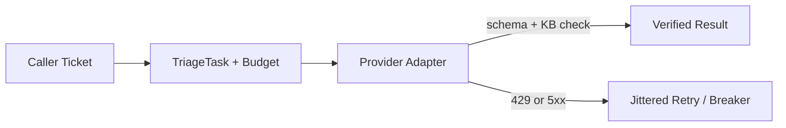

---
{
  "id": "calling-llm-apis-production",
  "title": "Calling LLM APIs in Production",
  "slug": "calling-llm-apis-production",
  "section": "Preparation & Prerequisites",
  "category": "MLOps & Deployment",
  "difficulty": "Easy",
  "order": 9,
  "coverImage": "illustrations/_generated/api_contract_dark.png",
  "companies": [
    "OpenAI",
    "Anthropic",
    "Google",
    "Microsoft",
    "Amazon"
  ],
  "shortDescription": "Turn brittle LLM API calls into reliable backend services using server-side secrets, strict Pydantic schemas, deadline-capped jitter, circuit breakers, streaming guards, and token cost telemetry.",
  "keyConceptsTested": [
    "Server-side API key isolation and secret validation",
    "Typed LLM task wrappers and Pydantic output validation",
    "Tiered timeouts, HTTP 429 triage, jittered retries, and idempotency",
    "Three-state circuit breakers and fallback provider routing",
    "SSE terminal event verification and draft-buffer state",
    "OpenTelemetry GenAI spans, cached token accounting, and HMAC redaction"
  ]
}
---

Your notebook prompt returns spotless JSON on five test inputs. Then you put it behind an HTTP endpoint, and within an hour a provider socket hangs for two minutes, a traffic spike triggers HTTP `429`, a proxy cuts a Server-Sent Events stream one character before the closing brace, and the model invents a citation ID (`KB-999`) that never existed in your database.

An external <span data-glossary="llm">large language model (LLM)</span> is not a deterministic local function. It is a variable-latency network service with stochastic outputs and per-token billing. Building on [Prompt Engineering Fundamentals](/learn/prompt-engineering-fundamentals), this lesson wraps LLM inference in a clean backend service layer. We will route ML platform support tickets alongside retrieved knowledge-base excerpts (`KB-101`, `KB-104`, `KB-109`) into a typed `TriageExtraction`, verifying cited IDs, bounding retries by a single request deadline, isolating queue writes with idempotency keys, and testing the whole stack offline with local HTTP mocks before spending a cent on live tokens.

<figure>
  
  <figcaption>End-to-end request flow inside the model wrapper. Credentials stay on the backend server, structured outputs pass Pydantic schema and knowledge-base grounding checks before queuing work, and OpenTelemetry logs token usage alongside keyed HMAC fingerprints.</figcaption>
</figure>

## Keep credentials and prompts on the server

Calling a hosted model requires an <span data-glossary="secrets-management">API key</span> or cloud credential that bills your account's token quota. Shipping that key inside browser JavaScript, mobile binaries, or build logs hands anyone inspecting network traffic full spending access. Frontend build tools make accidental leaks easy: Next.js inlines any variable prefixed with `NEXT_PUBLIC_` into browser bundles, and Vite exposes `VITE_` variables via `import.meta.env`.[^next2026EnvVariables][^vite2026EnvVariables] Keep provider keys strictly inside server-side secret managers or backend <span data-glossary="environment-variable">environment variables</span>.

Check that the key exists at server startup rather than waiting for the first user request to fail with an authentication crash. Separate staging and production keys so you can rotate one without disrupting the other:

<!-- leetllm: test, output=show, output_title="Server secret check" -->
```python title="server-secret-check.py"
def require_server_key(environ: dict[str, str]) -> str:
    api_key = environ.get("LLM_API_KEY", "").strip()
    if not api_key:
        raise RuntimeError("LLM_API_KEY must be set in the server environment")
    return api_key

try:
    require_server_key({})
except RuntimeError:
    print({"missing_rejected": True})

loaded_key = require_server_key({"LLM_API_KEY": "sk-dev-placeholder"})
print({"loaded": bool(loaded_key), "prefix": loaded_key[:6]})
```

<!-- leetllm: output:start -->
```text title="Server secret check" output compact
{'missing_rejected': True}
{'loaded': True, 'prefix': 'sk-dev'}
```
<!-- leetllm: output:end -->

Checking key presence at boot verifies host configuration, while an authenticated health call confirms active quota and model access. Routing calls through a single backend service also gives you one place to enforce caller rate limits, redact prompts before logging, and swap provider SDKs without rewriting product code.

> **Common mistake:** Relying on CORS headers to protect a key placed in `NEXT_PUBLIC_` or `VITE_` variables. CORS restricts cross-origin browser requests; it never hides constants already downloaded inside the client JavaScript bundle.

## Wrap inference in a typed request layer

Letting individual route handlers build raw vendor SDK dictionaries scatters retry loops, timeouts, and model names across the codebase. One handler retries HTTP `500` five times while another blocks a worker thread for sixty seconds on a dead socket. A unified backend wrapper translates application intent into a provider-agnostic task object first, then delegates wire formatting to thin per-vendor adapters:

| Layer | Responsibility | Why centralizing helps |
|---|---|---|
| Request schema | Enforce task enum, caller identity, and latency budget | Prevents malformed text or unbounded deadlines from reaching models |
| Adapter mapping | Convert task fields into OpenAI, Anthropic, or vLLM JSON payloads | Swaps models or providers without touching business handlers |
| Schema & grounding check | Validate strict JSON fields, ranges, and cited context IDs | Blocks syntactically valid answers that cite missing or invented documents |
| Resilience & timeouts | Enforce connect/read deadlines, full jitter, and breaker limits | Keeps cascading upstream slowdowns from exhausting server sockets |
| Idempotent side effects | Key queue writes or webhook dispatches on caller operation IDs | Stops network retries from duplicating database writes or tickets |
| Redacted telemetry | Emit `gen_ai.*` spans with token counts, latency, and HMAC hashes | Measures cost and reliability without exposing private customer payloads |



Modeling tasks as immutable Python dataclasses makes allowed operations, prompt versions, and latency ceilings explicit in code reviews and tests. Here we separate read-only triage classification from downstream queue mutations and track one shared end-to-end deadline (`overall_deadline_seconds`) across all retry attempts. Freezing task objects prevents middleware from accidentally mutating request deadlines or context IDs mid-flight across retries. Run the example below to construct an immutable `TriageTask` and inspect its normalized chat wire payload:

<!-- leetllm: test, deps=pydantic,numpy,openai,httpx, id=task-wrapper-payload, output=show, output_title="Application task and adapter payload" -->
```python title="task-wrapper-payload.py"
import json
from dataclasses import dataclass
from typing import Literal

@dataclass(frozen=True)
class TriageTask:
    task: Literal["classify_ticket", "summarize_incident"]
    tenant_id: str
    kb_chunk_ids: tuple[str, ...]
    ticket_text: str
    trace_id: str
    prompt_version: str
    connect_timeout_s: float = 2.0
    read_timeout_s: float = 8.0
    overall_deadline_s: float = 20.0
    max_retries: int = 2

kb_corpus = {
    "KB-101": "GPU out-of-memory during long context requires paged KV cache blocks.",
    "KB-104": "TTFT rises above 800 ms when large prefill batches block decode steps.",
    "KB-109": "Credit exhaustion 429 responses require billing intervention, not retries.",
}

task = TriageTask(
    task="classify_ticket",
    tenant_id="org_ml_infra",
    kb_chunk_ids=("KB-101", "KB-104"),
    ticket_text="Workers hit CUDA out of memory when batching 32k context prompts.",
    trace_id="tr_91af",
    prompt_version="triage_v4",
)

context_block = "\n".join(f"[{cid}] {kb_corpus[cid]}" for cid in task.kb_chunk_ids)
wire_payload = {
    "messages": [
        {"role": "developer", "content": "Classify using only the listed KB excerpts. Output strict JSON."},
        {"role": "user", "content": f"<kb>\n{context_block}\n</kb>\nTicket: {task.ticket_text}"},
    ],
    "required_fields": ["category", "priority", "cited_chunk_ids", "confidence", "summary"],
}

print("task:", task.task, task.tenant_id, task.kb_chunk_ids)
print(json.dumps(wire_payload, indent=2))
```

<!-- leetllm: output:start -->
```text title="Application task and adapter payload" output compact
task: classify_ticket org_ml_infra ('KB-101', 'KB-104')
{
  "messages": [
    {
      "role": "developer",
      "content": "Classify using only the listed KB excerpts. Output strict JSON."
    },
    {
      "role": "user",
      "content": "<kb>\n[KB-101] GPU out-of-memory during long context requires paged KV cache blocks.\n[KB-104] TTFT rises above 800 ms when large prefill batches block decode steps.\n</kb>\nTicket: Workers hit CUDA out of memory when batching 32k context prompts."
    }
  ],
  "required_fields": [
    "category",
    "priority",
    "cited_chunk_ids",
    "confidence",
    "summary"
  ]
}
```
<!-- leetllm: output:end -->

Every model call serves two outputs at once: the caller receives a typed extraction or structured error, while observability receives elapsed time, token counts, and status inside a `try ... finally` block so parse rejections never disappear behind fallback responses.

## Enforce strict schemas and verify cited evidence

Downstream code needs exact enums, bounded numbers, and real document IDs rather than free-form prose. Modern APIs offer two formatting modes, and neither eliminates server-side verification:

| Mechanism | Provider guarantee | Required server validation |
|---|---|---|
| JSON mode (`json_object`) | Ensures valid JSON syntax on complete replies | Validate all keys, enums, numeric bounds, and cited IDs locally |
| Structured Outputs (`json_schema`) | Constrains decoding to a supported JSON schema subset | Still inspect refusals, truncation (`incomplete`), and domain grounding[^openai_structured_outputs] |

Constrained decoding guarantees structural adherence on completed non-refusal outputs, just as strict <span data-glossary="tool-calling">tool calling</span> structures function parameters.[^openai2026_function_calling] Even so, a syntactically flawless JSON payload can still contain hallucinated document citations (`KB-999`), booleans coerced where integers belong, or `NaN` constants accepted by Python's permissive default `json.loads`.[^pythonJson2026] We combine `parse_constant` and duplicate-key rejection with Pydantic's `ConfigDict(extra="forbid", strict=True)` and an explicit subset check ensuring every cited chunk ID exists in the retrieved context actually sent to the model.[^pydanticModels2026]

<!-- leetllm: test, continue=task-wrapper-payload, id=schema-check, output=show, output_title="Pydantic schema and citation grounding check" -->
```python title="validate-extraction.py"
import json
import time
from typing import Literal
from pydantic import BaseModel, ConfigDict, Field, ValidationError

class TriageExtraction(BaseModel):
    model_config = ConfigDict(extra="forbid", strict=True)
    category: Literal["gpu_oom", "latency_slo", "auth_access", "billing"]
    priority: Literal["p0", "p1", "p2"]
    cited_chunk_ids: list[str] = Field(min_length=1, max_length=4)
    confidence: float = Field(ge=0.0, le=1.0)
    summary: str = Field(min_length=10, max_length=240)

def _no_duplicates(pairs: list[tuple[str, object]]) -> dict[str, object]:
    obj: dict[str, object] = {}
    for k, v in pairs:
        if k in obj:
            raise ValueError(f"duplicate JSON key: {k}")
        obj[k] = v
    return obj

def _reject_nan(token: str) -> None:
    raise ValueError(f"disallowed JSON constant: {token}")

def parse_grounded_extraction(raw: str, allowed_chunk_ids: set[str]) -> TriageExtraction:
    parsed = json.loads(raw, object_pairs_hook=_no_duplicates, parse_constant=_reject_nan)
    candidate = TriageExtraction.model_validate(parsed)
    unknown = set(candidate.cited_chunk_ids) - allowed_chunk_ids
    if unknown:
        raise ValueError(f"model cited unretrieved chunk IDs: {sorted(unknown)}")
    return candidate

good_json = json.dumps({
    "category": "gpu_oom",
    "priority": "p0",
    "cited_chunk_ids": ["KB-101"],
    "confidence": 0.94,
    "summary": "Batching 32k sequences exhausted GPU VRAM; enable paged KV blocks.",
})
hallucinated_kb = json.dumps({
    "category": "gpu_oom",
    "priority": "p0",
    "cited_chunk_ids": ["KB-999"],
    "confidence": 0.91,
    "summary": "Memory overflow on long context.",
})
bad_nan = '{"category":"gpu_oom","priority":"p0","cited_chunk_ids":["KB-101"],"confidence":NaN,"summary":"Valid summary text"}'

dup_key = '{"category":"gpu_oom","category":"billing","priority":"p0","cited_chunk_ids":["KB-101"],"confidence":0.8,"summary":"Duplicate test"}'

t0 = time.perf_counter()
verified = parse_grounded_extraction(good_json, {"KB-101", "KB-104"})
print("accepted:", verified.category, verified.priority, verified.cited_chunk_ids)

for label, payload in [
    ("hallucinated_kb", hallucinated_kb),
    ("nan_conf", bad_nan),
    ("extra_key", '{"category":"gpu_oom","extra":1}'),
    ("duplicate_key", dup_key),
]:
    try:
        parse_grounded_extraction(payload, {"KB-101", "KB-104"})
    except (ValueError, ValidationError) as err:
        print(f"rejected {label}: {type(err).__name__}")
print("sub_10ms_gate:", (time.perf_counter() - t0) * 1000 < 10.0)
```

<!-- leetllm: output:start -->
```text title="Pydantic schema and citation grounding check" output compact
accepted: gpu_oom p0 ['KB-101']
rejected hallucinated_kb: ValueError
rejected nan_conf: ValueError
rejected extra_key: ValidationError
rejected duplicate_key: ValueError
sub_10ms_gate: True
```
<!-- leetllm: output:end -->

This two-step validator runs in under a millisecond and cleanly separates structure from meaning. Pydantic blocks unknown fields, wrong types, and out-of-range scores, while the set difference blocks any citation absent from the retrieved `<kb>` context.

> **Key insight:** Constrained decoding (`json_schema`) guarantees valid field names and types, never factual grounding. Always check model-emitted IDs, prices, or enum cross-constraints against trusted backend state.

### Exercise an OpenAI SDK adapter with local HTTP mocks

Real vendor responses wrap generated text in status envelopes (`completed` vs `incomplete`) and safety refusal objects. Passing `httpx.MockTransport` into the official `openai.OpenAI` client lets you test request payloads, strict schemas, truncation, and refusals in milliseconds without spending tokens.[^openai_python_sdk] Setting `max_retries=0` on the SDK client keeps retry ownership in your outer wrapper instead of silently squaring request volume (for example, 3 outer attempts times 3 inner SDK attempts equals 9 HTTP calls):

<!-- leetllm: test, continue=schema-check, id=sdk-adapter, output=show, output_title="OpenAI SDK adapter outcomes" -->
```python title="responses-adapter-mock.py"
import httpx
from openai import OpenAI

EXTRACTION_SCHEMA = {
    "type": "object",
    "properties": {
        "category": {"type": "string", "enum": ["gpu_oom", "latency_slo", "auth_access", "billing"]},
        "priority": {"type": "string", "enum": ["p0", "p1", "p2"]},
        "cited_chunk_ids": {"type": "array", "items": {"type": "string"}},
        "confidence": {"type": "number"},
        "summary": {"type": "string"},
    },
    "required": ["category", "priority", "cited_chunk_ids", "confidence", "summary"],
    "additionalProperties": False,
}

def call_triage_adapter(client: OpenAI, model: str, ticket: str, allowed_ids: set[str]) -> TriageExtraction:
    response = client.responses.create(
        model=model,
        instructions="Classify the ML platform ticket using only cited KB IDs.",
        input=json.dumps({"ticket": ticket, "kb_ids": sorted(allowed_ids)}),
        text={"format": {
            "type": "json_schema",
            "name": "triage_extraction",
            "strict": True,
            "schema": EXTRACTION_SCHEMA,
        }},
        max_output_tokens=256,
        store=False,
    )
    if response.status != "completed":
        raise ValueError(f"incomplete_output:{response.status}")
    if any(
        part.type == "refusal"
        for item in response.output if item.type == "message"
        for part in item.content
    ):
        raise ValueError("model_refusal")
    if not response.output_text:
        raise ValueError("empty_output")
    return parse_grounded_extraction(response.output_text, allowed_ids)

def make_mock_reply(*, cited: list[str] | None = None, refusal: bool = False, incomplete: bool = False) -> dict:
    part = (
        {"type": "refusal", "refusal": "Policy blocked request"}
        if refusal
        else {
            "type": "output_text",
            "annotations": [],
            "text": json.dumps({
                "category": "gpu_oom",
                "priority": "p0",
                "cited_chunk_ids": cited or ["KB-101"],
                "confidence": 0.92,
                "summary": "KV cache allocation overflowed device VRAM under 32k context.",
            }),
        }
    )
    status = "incomplete" if incomplete else "completed"
    return {
        "id": "resp_test",
        "object": "response",
        "created_at": 0,
        "model": "gpt-test",
        "status": status,
        "error": None,
        "incomplete_details": {"reason": "max_output_tokens"} if incomplete else None,
        "output": [{"id": "msg_test", "type": "message", "role": "assistant", "status": status, "content": [part]}],
    }

replies = iter([
    make_mock_reply(),
    make_mock_reply(cited=["KB-999"]),
    make_mock_reply(refusal=True),
    make_mock_reply(incomplete=True),
])

def mock_transport(request: httpx.Request) -> httpx.Response:
    body = json.loads(request.content)
    assert request.url.path == "/v1/responses"
    assert body["text"]["format"]["strict"] is True
    return httpx.Response(200, json=next(replies), headers={"x-request-id": "req_mock"})

with OpenAI(
    api_key="sk-mock-local",
    max_retries=0,
    timeout=5.0,
    http_client=httpx.Client(transport=httpx.MockTransport(mock_transport)),
) as client:
    for case in ["valid", "bad_citation", "refusal", "truncated"]:
        try:
            res = call_triage_adapter(client, "gpt-test", "CUDA OOM at 32k context", {"KB-101", "KB-104"})
            print(case, "OK", res.category, res.cited_chunk_ids)
        except ValueError as exc:
            print(case, "REJECT", str(exc))
```

<!-- leetllm: output:start -->
```text title="OpenAI SDK adapter outcomes" output compact
valid OK gpu_oom ['KB-101']
bad_citation REJECT model cited unretrieved chunk IDs: ['KB-999']
refusal REJECT model_refusal
truncated REJECT incomplete_output:incomplete
```
<!-- leetllm: output:end -->

Passing `store=False` opts out of application-state response storage for that request; when handling regulated inputs, pair it with organization-level Zero Data Retention settings and verify live TLS certificates in staging since local mock transports skip TLS.[^openai2026datacontrols]

## Manage timeouts, rate limits, and jittered retries

Model latency depends on prompt length, KV-cache pressure, queue congestion, and generated output tokens. Synchronous calls that omit timeouts tie up web worker threads indefinitely, while unconstrained async tasks leak open sockets and memory buffers. Breaking deadlines into four distinct stages isolates slow failure points cleanly, helping engineers tell apart TCP connection stalls from stalled model decoding:

1. **Connect timeout:** Caps TCP handshake and TLS negotiation when opening a socket to the provider gateway.
2. **First visible text deadline:** Measures <span data-glossary="ttft">time to first token (TTFT)</span> separately from empty HTTP bytes, metadata envelopes, or SSE keep-alive heartbeats.
3. **Read timeout:** Bounds silence between consecutive transport frames; remember from HTTPX's timeout model that periodic SSE heartbeats reset a read timer even when token generation has stalled completely.[^httpx2026Timeouts]
4. **Overall task deadline:** Bounds retrieval, initial attempt, retry sleeps, and fallback execution under one shared monotonic clock budget (`time.monotonic()`).

<!-- leetllm: test, output=show, output_title="Deadline guard outcome" -->
```python title="asyncio-deadline-guard.py"
import asyncio

async def simulated_slow_model() -> str:
    await asyncio.sleep(0.03)
    return "completed"

async def run_with_deadline(deadline_s: float) -> dict[str, str]:
    try:
        output = await asyncio.wait_for(simulated_slow_model(), timeout=deadline_s)
        return {"status": "ok", "output": output}
    except TimeoutError:
        return {"status": "timeout", "fallback": "queue_for_retry"}

print(asyncio.run(run_with_deadline(0.002)))
```

<!-- leetllm: output:start -->
```text title="Deadline guard outcome" output compact
{'status': 'timeout', 'fallback': 'queue_for_retry'}
```
<!-- leetllm: output:end -->

Notice `asyncio.wait_for` cancels the awaiting coroutine upon expiry and waits for cleanup before raising `TimeoutError`, so it works cleanly with cooperative async HTTP clients (`httpx.AsyncClient`), though it cannot preempt blocking C extensions or remote GPU work already running on the vendor cluster.[^python2026asyncioTasks] Because remote inference may continue executing briefly after the client disconnects, treat timed-out requests as having unknown remote billing status until reconciled against provider request IDs. Always record trace timestamps with a monotonic clock rather than wall-clock time so host clock skew never stretches or shortens remaining request budgets.

```checkpoint
An SSE response emits metadata at 0.2s and keep-alive heartbeats every 1s, while visible model tokens have still not appeared after 12s. The read timeout is 2s and the first-text deadline is 10s. Which timeout fires?
---
The 10s first-visible-text deadline fires even though the 2s read timer resets on every heartbeat. Tracking TTFT independently from transport heartbeats catches stalled inference queues reliably.
```

### Triage HTTP 429 rate limits before retrying

Inference gateways rate limit callers along both **Requests Per Minute (RPM)** and **Tokens Per Minute (TPM)**, often accounting for reserved max output tokens upfront or enforcing burst windows over sub-minute intervals.[^openai2026ratelimits] Worse, providers return HTTP `429` for fundamentally incompatible reasons: transient concurrency throttling recovers after backoff, whereas `credit_balance_exhausted` or `insufficient_quota` will fail every automatic retry until an engineer raises spending limits.[^openai2026errorcodes] Inspect structured error codes and `Retry-After` / `x-ratelimit-*` headers before scheduling another attempt:

<!-- leetllm: test, id=retry-classifier, output=show, output_title="Retry classification policy" -->
```python title="classify-api-errors.py"
NON_RETRYABLE_QUOTA = {
    "insufficient_quota",
    "credit_balance_exhausted",
    "organization_spend_limit_exceeded",
    "project_spend_limit_exceeded",
}

def classify_api_failure(status_code: int, error_code: str = "") -> str:
    if error_code in {"model_refusal", "content_filter", "incomplete_output", "validation_error"}:
        return "halt_and_inspect"
    if status_code == 429:
        if error_code in NON_RETRYABLE_QUOTA:
            return "halt_billing_alert"
        if error_code == "rate_limit":
            return "retry_jittered"
        return "halt_and_inspect"
    if status_code in {408, 500, 502, 503, 504}:
        return "retry_jittered"
    if status_code in {400, 401, 403}:
        return "halt_fix_request"
    return "halt_and_inspect"

for code, detail in [
    (429, "rate_limit"),
    (429, "credit_balance_exhausted"),
    (503, ""),
    (401, ""),
    (200, "model_refusal"),
]:
    print(f"{code} {detail or '-':24s} -> {classify_api_failure(code, detail)}")
```

<!-- leetllm: output:start -->
```text title="Retry classification policy" output compact
429 rate_limit               -> retry_jittered
429 credit_balance_exhausted -> halt_billing_alert
503 -                        -> retry_jittered
401 -                        -> halt_fix_request
200 model_refusal            -> halt_and_inspect
```
<!-- leetllm: output:end -->

### Spread retry storms with full jitter and deadline caps

When a regional gateway drops fifty concurrent workers at once, deterministic exponential backoff (`1s, 2s, 4s`) synchronizes those workers so they slam the recovering cluster in lockstep waves. **Full jitter** breaks synchronization by sampling uniformly inside the exponential ceiling, while **decorrelated jitter** links each wait to the preceding sleep interval so overlapping bursts spread rapidly across time:[^awsbackoff]

$$
\begin{aligned}
t_{\text{full}}(k) &= \text{Uniform}\!\left(0,\; \min\!\left(t_{\max},\; b \cdot 2^{k-1}\right)\right) \\
t_{\text{decorr}}(k) &= \min\!\left(t_{\max},\; \text{Uniform}\!\left(b,\; 3 \cdot t_{\text{decorr}}(k-1)\right)\right)
\end{aligned}
$$

When a response includes a `Retry-After` header (either integer delay seconds or an HTTP date resolved against current clock time), treat that value as a hard **floor** added before jitter.[^rfc9110RetryAfter] Before sleeping for even one millisecond, add the proposed wait plus expected next-call duration and verify the sum still fits inside the task's remaining monotonic budget. Failing fast when `floor + jitter + expected_call >= remaining_budget` spares callers wasted seconds on an attempt guaranteed to expire mid-flight.

<figure>
  
  <figcaption>Top: fixed exponential delays trigger synchronized retry spikes of 12 concurrent workers at 1.0s and 3.0s, whereas full jitter disperses load to 1 to 3 workers per bucket. Bottom: when a 2.0s Retry-After floor plus jitter and call latency (3.9s) exceeds 1.8s remaining budget, the wrapper aborts immediately instead of sleeping past its deadline.</figcaption>
</figure>

<!-- leetllm: test, output=show, output_title="Jittered backoff and remaining deadline check" -->
```python title="jitter-and-budget.py"
import random

def full_jitter_s(attempt: int, base: float = 1.0, cap: float = 8.0, rng=random.Random(7)) -> float:
    ceiling = min(cap, base * (2 ** (attempt - 1)))
    return rng.random() * ceiling

def decorrelated_jitter_s(prev_s: float, base: float = 1.0, cap: float = 8.0, rng=random.Random(7)) -> float:
    return min(cap, base + rng.random() * max(0.0, 3.0 * prev_s - base))

def schedule_wait_s(
    attempt: int,
    remaining_s: float,
    expected_call_s: float = 1.5,
    retry_after_s: float = 0.0,
    rng=random.Random(7),
) -> float:
    jitter = full_jitter_s(attempt, base=1.0, cap=4.0, rng=rng)
    wait = retry_after_s + jitter
    if wait + expected_call_s >= remaining_s:
        raise TimeoutError(f"need {wait + expected_call_s:.2f}s but only {remaining_s:.2f}s left")
    return round(wait, 3)

prev = 1.0
for k in range(1, 4):
    fj = full_jitter_s(k)
    dj = decorrelated_jitter_s(prev)
    prev = dj
    print(f"attempt={k} full_jitter={fj:.3f}s decorrelated={dj:.3f}s")

print("fits_budget_wait:", schedule_wait_s(attempt=1, remaining_s=10.0, retry_after_s=1.0))
try:
    schedule_wait_s(attempt=1, remaining_s=1.8, retry_after_s=2.0)
except TimeoutError as exc:
    print("aborted:", str(exc))
```

<!-- leetllm: output:start -->
```text title="Jittered backoff and remaining deadline check" output compact
attempt=1 full_jitter=0.324s decorrelated=1.648s
attempt=2 full_jitter=0.302s decorrelated=1.595s
attempt=3 full_jitter=2.604s decorrelated=3.463s
fits_budget_wait: 1.324
aborted: need 3.65s but only 1.80s left
```
<!-- leetllm: output:end -->

## Isolate outages with circuit breakers and idempotency

Retrying brief hiccups works well, yet hammering a hard-down endpoint only worsens the outage. A three-state <span data-glossary="circuit-breaker">circuit breaker</span> tracks recent transport failures per failure domain (such as `primary_model` versus `fallback_model`) and fails fast once consecutive errors cross a threshold.[^azure2026CircuitBreaker] During cooldown, traffic shifts to a fallback model; once cooldown expires, the breaker enters `half_open` and sends a single probe request to test recovery while concurrent requests stay on fallback.

<figure>
  
  <figcaption>State transitions across a scoped circuit breaker. While Open, requests route straight to a verified fallback model; after cooldown, a single Half-Open canary probe checks upstream health before admitting normal traffic.</figcaption>
</figure>

Keep two operational checks on any fallback route: run the exact same Pydantic schema and KB citation checks on the backup model, and keep spare quota and data-residency alignment ready so sudden failover traffic does not trigger a second wave of `429` errors:

<!-- leetllm: test, output=show, output_title="Circuit breaker and idempotent escalation" -->
```python title="breaker-and-idempotency.py"
from typing import Literal

class ScopedBreaker:
    def __init__(self, failure_threshold: int = 2, cooldown_s: float = 10.0):
        self.failure_threshold = failure_threshold
        self.cooldown_s = cooldown_s
        self.state: Literal["closed", "open", "half_open"] = "closed"
        self.failures = 0
        self.tripped_at = 0.0
        self.probe_active = False

    def route(self, now: float) -> str:
        if self.state == "closed":
            return "primary"
        if self.state == "open" and (now - self.tripped_at) >= self.cooldown_s:
            self.state = "half_open"
            self.probe_active = True
            return "primary_canary"
        return "fallback"

    def record_failure(self, now: float) -> None:
        self.failures += 1
        self.tripped_at = now
        self.probe_active = False
        if self.state == "half_open" or self.failures >= self.failure_threshold:
            self.state = "open"

    def record_success(self) -> None:
        if self.state != "open":
            self.failures = 0
            self.probe_active = False
            self.state = "closed"

breaker = ScopedBreaker(failure_threshold=2, cooldown_s=10.0)
for now, action in [(100.0, "fail"), (101.0, "fail"), (103.0, "check"), (111.0, "probe"), (111.5, "ok")]:
    target = breaker.route(now)
    print(f"t={now:.1f} state={breaker.state:9s} route={target}")
    if action == "fail":
        breaker.record_failure(now)
    elif action == "ok":
        breaker.record_success()

# Idempotent escalation store keyed by caller-supplied operation key
escalation_log: dict[str, tuple[str, str]] = {}

def enqueue_escalation_once(tenant_id: str, idempotency_key: str, category: str) -> tuple[str, bool]:
    if idempotency_key in escalation_log:
        saved_tenant, ticket_id = escalation_log[idempotency_key]
        if saved_tenant != tenant_id:
            raise ValueError("idempotency_key cannot cross tenant scope")
        return ticket_id, False
    ticket_id = f"esc_{len(escalation_log) + 1:03d}_{category}"
    escalation_log[idempotency_key] = (tenant_id, ticket_id)
    return ticket_id, True

first = enqueue_escalation_once("org_ml_infra", "op_88b2", "gpu_oom")
retry = enqueue_escalation_once("org_ml_infra", "op_88b2", "gpu_oom")
print("idempotent write:", first, retry)
```

<!-- leetllm: output:start -->
```text title="Circuit breaker and idempotent escalation" output compact
t=100.0 state=closed    route=primary
t=101.0 state=closed    route=primary
t=103.0 state=open      route=fallback
t=111.0 state=half_open route=primary_canary
t=111.5 state=half_open route=fallback
idempotent write: ('esc_001_gpu_oom', True) ('esc_001_gpu_oom', False)
```
<!-- leetllm: output:end -->

Every timeout creates uncertainty about whether a remote worker executed a side effect before the client disconnected. Read-only triage classification is naturally safe to retry, whereas dispatching webhooks, charging usage quotas, or opening incident pages mutates external state. Binding mutations to a unique <span data-glossary="idempotency">idempotency</span> key stored under an atomic `(tenant_id, idempotency_key)` constraint turns duplicate client retries into harmless lookups instead of double-paged incidents. Scope keys tightly per user intent so an earlier operation ID never suppresses future independent escalations for the same organization.

## Guard Server-Sent Events streams against truncation

Waiting silently for an entire two-second generation feels sluggish in interactive interfaces, so many endpoints stream text deltas incrementally over <span data-glossary="server-sent-events">Server-Sent Events (SSE)</span>.[^mdn2026sse][^whatwgSse2026] Standard SSE carries UTF-8 events delimited by blank lines using `event:`, `data:`, and `id:` fields; Chat Completions terminates with a non-standard `data: [DONE]` sentinel, whereas newer Responses APIs emit explicit semantic events such as `response.output_text.delta` and `response.completed`.[^openai2026Streaming] Because individual network chunks can batch multiple tokens or split mid-character, track **time to first visible text** separately from HTTP header receipt and **inter-delta latency** separately from raw model token cadence. Measuring transport framing properly avoids blaming token generation rates for proxy buffering delays along the network path:

```http title="sse-stream-wire.http"
HTTP/1.1 200 OK
Content-Type: text/event-stream
Cache-Control: no-cache

event: response.output_text.delta
data: {"delta": "Batching 32k "}

event: response.output_text.delta
data: {"delta": "exhausted VRAM."}

event: response.completed
data: {"finish_reason": "stop"}
```

Crucially, reaching clean end-of-file (`EOF`) without a terminal success event (`response.completed` or `finish_reason="stop"`) does **not** prove the response finished: network proxies routinely close idle TCP streams mid-response right before the closing brace. Display streamed deltas as provisional previews only, and run schema and citation checks strictly after confirming the terminal completion frame:

<figure>
  
  <figcaption>SSE state transitions distinguishing provisional drafts from verified output. An EOF disconnect without a terminal completion frame produces a failed draft even if most text arrived; only completed streams advance to schema and knowledge-base validation.</figcaption>
</figure>

<!-- leetllm: test, output=show, output_title="SSE terminal event guard" -->
```python title="sse-terminal-guard.py"
from collections.abc import Iterator

def mock_sse_frames(*, complete: bool = True, drop_midway: bool = False) -> Iterator[dict]:
    yield {"type": "response.created"}
    chunks = ['{"category": "gpu_oom", ', '"summary": "KV cache ', 'exhausted GPU memory."}']
    for i, chunk in enumerate(chunks):
        if drop_midway and i == 2:
            raise ConnectionError("socket reset mid-stream")
        yield {"type": "response.output_text.delta", "delta": chunk}
    if complete:
        yield {"type": "response.completed", "finish_reason": "stop"}

def consume_stream(frames: Iterator[dict]) -> dict[str, object]:
    buffer = ""
    try:
        for ev in frames:
            if ev["type"] == "response.output_text.delta":
                buffer += ev["delta"]
            elif ev["type"] == "response.completed":
                return {"status": "completed", "chars": len(buffer), "display_only": True}
            elif ev["type"] in {"response.incomplete", "error"}:
                return {"status": "failed", "chars": len(buffer), "reason": "provider_error"}
        return {"status": "failed", "chars": len(buffer), "reason": "eof_without_terminal"}
    except ConnectionError as exc:
        return {"status": "failed", "chars": len(buffer), "reason": str(exc)}

print("normal:", consume_stream(mock_sse_frames(complete=True)))
print("eof_no_done:", consume_stream(mock_sse_frames(complete=False)))
print("socket_drop:", consume_stream(mock_sse_frames(drop_midway=True)))
```

<!-- leetllm: output:start -->
```text title="SSE terminal event guard" output compact
normal: {'status': 'completed', 'chars': 68, 'display_only': True}
eof_no_done: {'status': 'failed', 'chars': 68, 'reason': 'eof_without_terminal'}
socket_drop: {'status': 'failed', 'chars': 45, 'reason': 'socket reset mid-stream'}
```
<!-- leetllm: output:end -->

Both the normal completion and the `eof_no_done` drop received all 68 characters, yet only the stream that emitted `response.completed` transitions to `completed`. For automated background extraction with no human watching tokens arrive, skip SSE streaming altogether and use simpler buffered responses.

> **Common mistake:** Treating a clean TCP close (`EOF`) on an SSE stream as a finished answer. Always require an explicit terminal event (`response.completed` or `finish_reason="stop"`) before persisting or acting on the buffered output.

## Instrument spans, token costs, and redacted logs

When p99 latency spikes, unstructured `print` statements cannot tell you whether the bottleneck is vector retrieval, provider throttling, or repeated validation failures. Instrument retrieval, each model attempt, and schema validation as separate child spans following the OpenTelemetry GenAI semantic conventions:[^otelGenaiSpans2026Pinned]

- `gen_ai.provider.name` and `gen_ai.operation.name`: Identifies vendor and call type (`chat`, `embeddings`).
- `gen_ai.request.model` and `gen_ai.response.model`: Separates alias requested from snapshot served.
- `gen_ai.usage.input_tokens` and `gen_ai.usage.output_tokens`: Tracks billed <span data-glossary="token">token</span> subsets cleanly.
- `gen_ai.response.finish_reasons`: Exposes terminal cause (`stop`, `length`, `content_filter`).

```text title="Trace hierarchy across retrieval, retries, and validation"
[Root Span: POST /v1/triage (tenant=org_ml_infra)]
  ├── [Child Span: kb.retrieve (chunks=2, latency=4ms)]
  ├── [Child Span: gen_ai.chat gpt-test (attempt=1, in=250, out=80, latency=640ms)]
  └── [Child Span: gate.pydantic_and_kb (status=ok, latency=0.7ms)]
```

### Account accurately for cached and reasoning subsets

Two common accounting bugs inflate cloud cost dashboards rapidly: double-counting <span data-glossary="prefix-cache">prompt caching</span> tokens inside total input tokens, and double-counting hidden reasoning tokens inside total output tokens. Provider usage objects report cached reads (`cached_tokens`) and reasoning tokens (`reasoning_tokens`) as **subsets** of `input_tokens` and `output_tokens` respectively.[^openai2026promptcaching][^openai2026reasoning] Subtract cached subsets from total input before applying ordinary input rates, using worked rates of \$2.00 per million ordinary input tokens, \$0.50 per million cached reads, \$2.50 per million cache writes, and \$6.00 per million output tokens:

| Component | Tokens | Rate (per 1M) | Subtotal |
|---|---|---|---|
| Ordinary uncached input | `2000 - 1200 - 100 = 700` | \$2.00 | \$0.00140 |
| Cached prefix hits | 1,200 | \$0.50 | \$0.00060 |
| Cache write creation | 100 | \$2.50 | \$0.00025 |
| Output (includes 80 reasoning) | 200 | \$6.00 | \$0.00120 |
| **Total single call** | **2,200** | | **\$0.00345** |

At 200,000 requests per day across a 30-day month at a simpler \$0.00098 baseline (250 uncached input plus 80 output tokens), monthly spend reaches **\$5,880** before retries or batch discounts. Moving static off-peak jobs such as nightly log summarization onto asynchronous Batch APIs with stable `custom_id` keys cuts per-token spend by roughly 50% at the cost of a 24-hour completion window.[^openai2026batch] When processing batch outcomes, always join completed responses and error entries by `custom_id` rather than positional index because records frequently return out of submission order.

### Scrub sensitive user text with keyed HMAC fingerprints

Prompts frequently carry customer identifiers, stack traces, or internal tickets, making plaintext request logs a sensitive-data leak.[^owasp2025][^otelsensitivedata2026] Logging a keyed HMAC-SHA256 digest instead lets you correlate repeated failing prompts without storing raw user text:

<!-- leetllm: test, output=show, output_title="Subset token accounting and HMAC scrubbing" -->
```python title="cost-and-hmac-telemetry.py"
import hmac
from hashlib import sha256

input_tokens, cached_tokens, cache_write_tokens = 2000, 1200, 100
output_tokens, reasoning_tokens = 200, 80
ordinary_input = input_tokens - cached_tokens - cache_write_tokens
assert ordinary_input >= 0 and reasoning_tokens <= output_tokens

cost_usd = (
    ordinary_input * 2.0
    + cached_tokens * 0.5
    + cache_write_tokens * 2.5
    + output_tokens * 6.0
) / 1_000_000

ticket_text = "Tenant org_ml_infra CUDA OOM allocating 32k KV cache for trace tr_91af"
hmac_key = b"telemetry-hmac-secret-dev"
record = {
    "trace_id": "tr_91af",
    "prompt_version": "triage_v4",
    "ordinary_input": ordinary_input,
    "visible_output": output_tokens - reasoning_tokens,
    "estimated_cost_usd": round(cost_usd, 6),
    "ticket_hmac": hmac.new(hmac_key, ticket_text.encode(), sha256).hexdigest()[:24],
    "status": "ok",
}

assert "Tenant org_ml_infra" not in str(record)
print(record)
```

<!-- leetllm: output:start -->
```text title="Subset token accounting and HMAC scrubbing" output compact
{'trace_id': 'tr_91af', 'prompt_version': 'triage_v4', 'ordinary_input': 700, 'visible_output': 120, 'estimated_cost_usd': 0.00345, 'ticket_hmac': '823cdd0f996dded792ff0036', 'status': 'ok'}
```
<!-- leetllm: output:end -->

> **Key insight:** Provider usage objects report `cached_tokens` inside `input_tokens` and `reasoning_tokens` inside `output_tokens`. Subtract cached reads and writes from total input before pricing uncached tokens, and never add reasoning tokens on top of total output.

```checkpoint
A usage log reports 3,200 total input tokens (including 2,000 cached reads and 200 cache writes) and 300 output tokens (including 120 reasoning tokens). Why must you compute ordinary_input = 3200 - 2000 - 200 and keep output at 300 rather than 420?
---
Provider usage totals already include cached-prefix and reasoning subsets. Subtracting cached and cache-write tokens isolates the 1,000 uncached ordinary input tokens, and billing 300 output tokens avoids charging the 120 hidden reasoning tokens twice.
```

## Check your understanding

<!-- leetllm: mastery:end -->

```mastery-quiz
[
  {
    "question": "A FastAPI backend stores LLM_API_KEY in server environment variables, while a Next.js build reads NEXT_PUBLIC_LLM_API_KEY in client code. What risk remains even if CORS blocks third-party domains?",
    "options": [
      "The NEXT_PUBLIC_ variable sits inside browser JS bundles for inspection",
      "Server variables loaded with os.environ spill into SQLite response logs",
      "CORS response headers expose server secrets without gzip compression",
      "Browser clients convert NEXT_PUBLIC_ constants into bearer OPTIONS fields"
    ],
    "answer": "The NEXT_PUBLIC_ variable sits inside browser JS bundles for inspection",
    "explanation": "Next.js inlines NEXT_PUBLIC_ values into client bundles delivered to the browser. CORS controls cross-origin browser requests rather than hiding constants downloaded by clients, so provider credentials must remain strictly server-side."
  },
  {
    "question": "A model responds under strict json_schema with valid JSON citing KB-999, even though only KB-101 and KB-104 were sent in the context window. Why did schema validation pass and what catches KB-999?",
    "options": [
      "Schema decoding validates field types; backend code guards cited_chunk_ids subsets",
      "Strict schemas confirm facts across private databases whenever temperature rises",
      "OpenAI HTTPX transports parse unknown string lists if parse_constant stays enabled",
      "Pydantic extra='forbid' skips array items unless JSON mode replaces schemas"
    ],
    "answer": "Schema decoding validates field types; backend code guards cited_chunk_ids subsets",
    "explanation": "JSON Schema enforces field names and types such as list[str], not factual grounding against request-specific retrieved documents. Checking set(cited_chunk_ids) <= allowed_chunk_ids rejects hallucinated citations deterministically."
  },
  {
    "question": "An adapter sets max_retries=2 inside OpenAI(...) and wraps the call in an outer loop with max_retries=2 and a shared deadline. Up to how many total provider HTTP requests could fire for one failing task?",
    "options": [
      "Up to 9 requests (3 outer by 3 inner SDK passes), bursting the intended budget",
      "At most 2 requests when Python outer try blocks catch raised ValueErrors early",
      "At most 3 requests when httpx.MockTransport combines overlapping retry counts",
      "Up to 4 requests when asyncio.wait_for drains SDK loops cleanly across steps"
    ],
    "answer": "Up to 9 requests (3 outer by 3 inner SDK passes), bursting the intended budget",
    "explanation": "Nesting retry loops multiplies attempt counts (1 + 2 outer attempts, each running 1 + 2 SDK attempts = 9 total). Let one wrapper own retries and configure max_retries=0 on the underlying SDK client."
  },
  {
    "question": "An SSE stream sends response.created at 0.1s and heartbeat comments every 2s, while no text deltas arrive for 12s. The HTTP read timeout is 4s and first-visible-text deadline is 9s. What stops the request?",
    "options": [
      "The 9s first-visible-text deadline expires at 9s as heartbeats keep read alive",
      "The 4s read timeout expires at 4s because comments are dropped by TCP sockets",
      "The request completes cleanly at 12s as SSE EOF counts as response.completed",
      "The connect timeout aborts the loop at 6s after three consecutive empty comments"
    ],
    "answer": "The 9s first-visible-text deadline expires at 9s as heartbeats keep read alive",
    "explanation": "Periodic wire heartbeats satisfy transport read timers because bytes keep arriving within 4s. Enforcing a dedicated first-visible-text deadline catches streams stuck before emitting real output text."
  },
  {
    "question": "Which HTTP 429 condition should abort immediately and page billing operations rather than entering an exponential backoff retry loop?",
    "options": [
      "error_code == 'credit_balance_exhausted', since backoff adds zero funds",
      "error_code == 'rate_limit' paired with a two-second Retry-After header",
      "Transient HTTP 503 overload arriving from an upstream gateway queue",
      "Short TPM burst throttling triggered during a five-second load spike"
    ],
    "answer": "error_code == 'credit_balance_exhausted', since backoff adds zero funds",
    "explanation": "Rate limits clear as sliding request/token windows replenish, making jittered retries effective within deadline budgets. Account credit exhaustion never self-heals on retry and only wastes worker time."
  },
  {
    "question": "A task has 1.8s left in its deadline budget. The API returns HTTP 429 with Retry-After: 2.0, full jitter adds 0.3s, and expected inference takes 1.5s. What should the wrapper decide?",
    "options": [
      "Raise TimeoutError immediately since 2.0 + 0.3 + 1.5 = 3.8s exceeds 1.8s",
      "Sleep 1.8s through the remaining budget, then invoke inference at t=0.0s",
      "Skip Retry-After and resend right away with 0.05s jitter before timeout",
      "Update max_retries=0 dynamically and sleep 2.0s before calling the LLM"
    ],
    "answer": "Raise TimeoutError immediately since 2.0 + 0.3 + 1.5 = 3.8s exceeds 1.8s",
    "explanation": "Respecting the server Retry-After floor prevents sending a doomed request early, and adding call time shows 3.8s cannot fit inside 1.8s, so failing fast frees workers and alerts the caller right away."
  },
  {
    "question": "With base = 1.0s, cap = 8.0s, random draw = 0.25, and attempt k = 3, what delay does full jitter compute?",
    "options": [
      "1.0s (ceiling min(8.0, 1.0 * 2^2) = 4.0s scaled by 0.25)",
      "4.0s (ceiling 4.0s applied directly without random scaling)",
      "2.0s (cap value 8.0s scaled directly by the 0.25 draw)",
      "0.25s (base interval 1.0s scaled by 0.25 ignoring attempt)"
    ],
    "answer": "1.0s (ceiling min(8.0, 1.0 * 2^2) = 4.0s scaled by 0.25)",
    "explanation": "Full jitter computes min(cap, base * 2^(k-1)) = min(8.0, 4.0) = 4.0s for attempt 3, then scales uniformly by the draw 0.25 to yield 1.0s."
  },
  {
    "question": "A circuit breaker trips Open at t=50s with a 10s cooldown and a single Half-Open probe slot. Requests A and B arrive at t=60s before A finishes. Where does the router send A and B?",
    "options": [
      "A probes the primary provider as canary while B routes directly to fallback",
      "Both A and B probe the primary provider concurrently to speed recovery checks",
      "Both A and B use fallback while cooldown requires two consecutive passes",
      "A skips to fallback while B stays parked in queue until Closed state returns"
    ],
    "answer": "A probes the primary provider as canary while B routes directly to fallback",
    "explanation": "At t=60s cooldown expires, transitioning Open to Half-Open and granting A the sole recovery probe slot. While A is in flight, B avoids piling onto a recovering primary and routes cleanly to fallback."
  },
  {
    "question": "An SSE connection streams all 67 characters of a JSON explanation cleanly and closes at EOF without emitting response.completed or finish_reason='stop'. How should the client mark this response?",
    "options": [
      "Flag incomplete failure for lacking explicit terminal stop confirmation",
      "Record completion cleanly once json.loads parses the 67 text bytes",
      "Insert response.completed inside client JS once byte counters pause",
      "Emit completion alerts immediately since UTF-8 text drained cleanly"
    ],
    "answer": "Flag incomplete failure for lacking explicit terminal stop confirmation",
    "explanation": "Network proxies or idle cuts can drop SSE streams after arbitrary bytes. Treating EOF without an explicit completion event as completed risks acting on truncated outputs."
  },
  {
    "question": "An OTel usage record reports 3,200 total input tokens (including 2,000 cached reads and 200 cache writes) and 300 output tokens (including 120 reasoning tokens). Rates per 1M are \\$2.00 ordinary input, \\$0.50 cached, \\$2.50 cache write, and \\$6.00 output. What are ordinary_input and total USD cost?",
    "options": [
      "1,000 ordinary input tokens and \\$0.005300 total cost",
      "3,200 ordinary input tokens and \\$0.009700 total cost",
      "1,000 ordinary input tokens and \\$0.006020 total cost",
      "1,200 ordinary input tokens and \\$0.005700 total cost"
    ],
    "answer": "1,000 ordinary input tokens and \\$0.005300 total cost",
    "explanation": "Subtract cached and write subsets from input: 3200 - 2000 - 200 = 1000 ordinary tokens. Cost is (1000*2 + 2000*0.5 + 200*2.5 + 300*6) / 1,000,000 = \\$0.005300 because reasoning tokens are already inside the 300 output total."
  }
]
```

> **Next:** Continue to [First AI App End-to-End](/learn/first-ai-app-end-to-end) to wire a fast local classifier, Pydantic validation, SQLite trace persistence, and progressive SSE streaming into a deployable FastAPI service.
