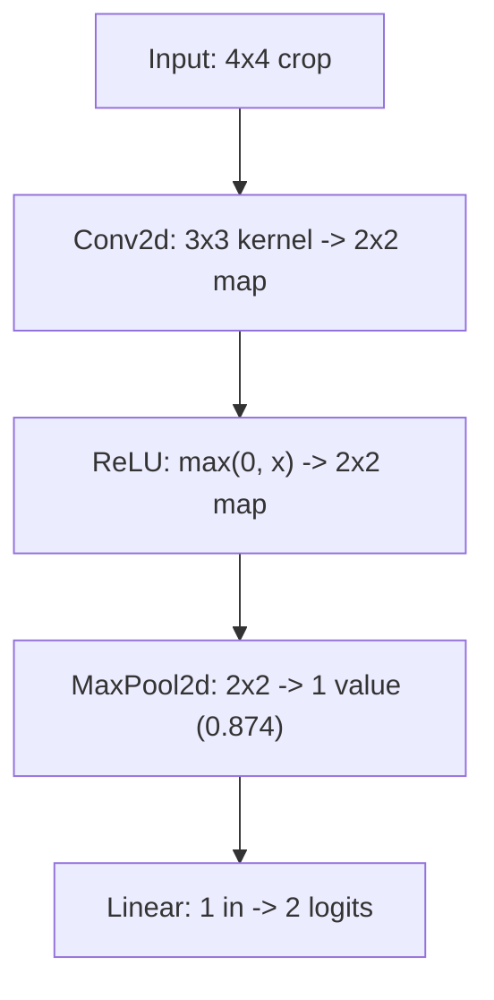

---
{
  "id": "convolutional-neural-networks-from-scratch",
  "title": "CNNs from Scratch",
  "slug": "convolutional-neural-networks-from-scratch",
  "section": "Preparation & Prerequisites",
  "category": "Model Architecture",
  "difficulty": "Easy",
  "order": 3,
  "coverImage": "illustrations/_generated/conv_kernels_feature_maps_dark.png",
  "companies": [
    "Google",
    "Meta",
    "OpenAI",
    "Anthropic",
    "Microsoft",
    "Amazon",
    "Apple"
  ],
  "shortDescription": "A two-pixel shift breaks a model that memorizes coordinates. Trace shared kernels, shapes, pooling, and padding on one 4 by 4 crop.",
  "keyConceptsTested": [
    "Why images need local shared weights",
    "Convolution by hand on a 4 by 4 patch",
    "Stride, padding, and output shapes",
    "Multi-channel filters and parameter counting",
    "Receptive-field growth through stacked layers",
    "Max pooling and saved winner locations",
    "Border-evidence failure without padding",
    "Artificial edges from zero padding",
    "NumPy and PyTorch CNN forward passes"
  ]
}
---

A bright hairline mark cuts diagonally across an equipment panel photo. Shift that mark two pixels right, and any capable inspector still recognizes the scratch. A model that memorizes absolute pixel coordinates breaks on that tiny shift because each coordinate feeds a separate learned weight.

The [previous lesson](/learn/neural-networks-from-scratch) fed named tabular features into dense layers. Their order had to match the weight columns. Images add a useful structure: nearby pixels form edges, corners, and textures. Flattening preserves every pixel value and can be reversed if you know the shape. A dense layer connects coordinates to weights; local neighborhoods and shared detectors must come from the architecture or be learned from examples.

Convolutional neural networks tackle this challenge through two ideas: local receptive fields and weight sharing.[^lecun1998][^goodfellow2016] We trace one `4 x 4` panel crop through hand calculations, tensor dimensions, pooling layers, and a matching PyTorch forward pass to see how raw pixels turn into class scores.

## Make reuse pay for itself

Suppose the inspection camera resizes images to `224 x 224` RGB pixels, where each pixel holds red, green, and blue intensities across three channels. Connecting that full input grid to a modest hidden layer of 256 dense units gives every hidden unit its own distinct weight for every single color channel at every spatial coordinate. A convolutional layer replaces this global wiring with localized detectors. Instead of observing all 150,528 numbers at once, each `3 x 3` RGB detector inspects a small spatial window of `3 x 3 x 3 = 27` weights plus one bias scalar, sliding that exact weight bank across every valid position in the image.

<!-- leetllm: test, output=show -->
```python title="dense-versus-conv-parameters.py"
height, width, channels, hidden = 224, 224, 3, 256
dense_weights = height * width * channels * hidden
dense_biases = hidden
dense_parameters = dense_weights + dense_biases

filters, kernel = 16, 3
conv_weights = filters * channels * kernel * kernel
conv_biases = filters
conv_parameters = conv_weights + conv_biases

print(f"dense parameters: {dense_parameters:,} ({dense_weights:,} weights + {dense_biases} biases)")
print(f"conv parameters: {conv_parameters:,} ({conv_weights:,} weights + {conv_biases} biases)")
print(f"parameter-count ratio: {dense_parameters / conv_parameters:,.0f}x")
```

<!-- leetllm: output:start -->
```text title="Output" output compact
dense parameters: 38,535,424 (38,535,168 weights + 256 biases)
conv parameters: 448 (432 weights + 16 biases)
parameter-count ratio: 86,017x
```
<!-- leetllm: output:end -->

The dense layer requires over 38.5 million parameters, whereas the convolutional layer uses 448. Although the parameter-count ratio is roughly 86,000x, notice that the two layers produce structurally different outputs: 256 global dense scores versus sixteen `222 x 222` local feature maps, so task accuracy and hardware throughput must be compared separately. Two architectural choices drive this drastic reduction: local connectivity restricts each output neuron to a tiny spatial neighborhood, and weight sharing reuses the identical filter bank across every spatial position.

To isolate the contribution of weight sharing, consider a locally connected layer with sixteen `3 x 3` RGB filters and independent weights at every position. Without padding, the output grid has `222 x 222` positions. Giving each position its own private weights balloons the count to `222 * 222 * 448 = 22,079,232` parameters. Weight sharing compresses those 22 million parameters down to 448 without altering the output dimensions.

<figure>
  
  <figcaption>One 16-filter bank serves all 222 × 222 output sites with 448 parameters. Independent banks keep that local output shape and use 22,079,232 parameters. A dense layer over the flattened RGB crop uses 38,535,424 parameters for 256 scores.</figcaption>
</figure>

Beyond parameter savings, weight sharing introduces a mathematical property called **<span data-glossary="translation-equivariance">translation equivariance</span>**. Formally, an operation $f$ is equivariant to translation operator $T_{\Delta}$ when shifting the input produces an identically shifted feature map:

$$
f(T_{\Delta}(x)) = T_{\Delta}(f(x))
$$

For stride-one convolution away from boundary effects, shifting a pattern three pixels right shifts its response three pixels right. The same detector is reused at each position. On a finite crop, padding and a pattern entering or leaving the image can break that exact equality. With stride greater than one, arbitrary pixel shifts also change alignment with the sampling grid.

Equivariance differs from **translation invariance**, where $g(T_{\Delta}(x)) = g(x)$ produces an unchanged output. Local pooling can provide some shift tolerance. A classification head is invariant only when its features and pooling preserve the relevant shifts. Global spatial averaging is unchanged by rearranging feature-map values; boundaries and downsampling can make a translated finite image produce different features.

## Let one detector find one pattern

Examine a concrete grayscale crop representing a small defect on a dark metallic surface. Values range between 0.0 (dark surface) and 1.0 (bright scratch). Four bright values form a central `2 x 2` mark surrounded by background:

| Input crop | Column 1 | Column 2 | Column 3 | Column 4 |
| --- | ---: | ---: | ---: | ---: |
| Row 1 | 0.05 | 0.08 | 0.06 | 0.07 |
| Row 2 | 0.12 | 0.92 | 0.88 | 0.09 |
| Row 3 | 0.08 | 0.90 | 0.93 | 0.11 |
| Row 4 | 0.06 | 0.07 | 0.09 | 0.05 |

Select a `3 x 3` filter, also called a kernel. This kernel rewards bright middle rows while penalizing brightness in adjacent rows, acting as a horizontal line and ridge detector:

| Kernel | Column 1 | Column 2 | Column 3 |
| --- | ---: | ---: | ---: |
| Row 1 | -0.6 | -0.6 | -0.6 |
| Row 2 | 1.1 | 1.1 | 1.1 |
| Row 3 | -0.6 | -0.6 | -0.6 |

Placing a `3 x 3` window over a `4 x 4` grid yields `4 - 3 + 1 = 2` valid starting rows and 2 valid starting columns, producing a `2 x 2` output feature map.

Assuming zero bias for this trace, overlay the kernel on the upper-left `3 x 3` patch covering rows 0 to 2 and columns 0 to 2. Multiply aligned values elementwise and sum the products:

$$
\begin{aligned}
y_{0,0} ={}& (-0.6)(0.05 + 0.08 + 0.06) \\
&+ (1.1)(0.12 + 0.92 + 0.88) \\
&+ (-0.6)(0.08 + 0.90 + 0.93) \\
={}& -0.114 + 2.112 - 1.146 \\
={}& 0.852
\end{aligned}
$$

The middle row contributes `+2.112`, exceeding the combined negative contributions from the neighboring rows (`-0.114` and `-1.146`). Summing all three row contributions yields a pre-activation response of `0.852` at output coordinate `(0, 0)`. This positive scalar reflects how strongly the bright central band outweighs the darker top and bottom rows.

<!-- leetllm: test, output=show -->
```python title="one-convolution-window.py"
patch = (
    (0.05, 0.08, 0.06),
    (0.12, 0.92, 0.88),
    (0.08, 0.90, 0.93),
)
kernel = (
    (-0.6, -0.6, -0.6),
    (1.1, 1.1, 1.1),
    (-0.6, -0.6, -0.6),
)

row_contributions = [
    round(sum(pixel * weight for pixel, weight in zip(row, kernel_row)), 3)
    for row, kernel_row in zip(patch, kernel)
]
response = sum(
    pixel * weight
    for row, kernel_row in zip(patch, kernel)
    for pixel, weight in zip(row, kernel_row)
)

print(f"row contributions: {row_contributions}")
print(f"first response: {response:.3f}")
```

<!-- leetllm: output:start -->
```text title="Output" output compact
row contributions: [-0.114, 2.112, -1.146]
first response: 0.852
```
<!-- leetllm: output:end -->

Slide the identical kernel across the remaining three positions. Each placement computes an inner product between kernel weights and the aligned image window:

| Window | Crop rows, cols | Response |
| --- | --- | ---: |
| Top left | `0:3`, `0:3` | 0.852 |
| Top right | `0:3`, `1:4` | 0.789 |
| Bottom left | `1:4`, `0:3` | 0.817 |
| Bottom right | `1:4`, `1:4` | 0.874 |

The bottom-right window yields `0.874`, the highest activation on the grid, because rows 2 and 3 sit directly beneath the `+1.1` middle strip while row 4's low background intensities (`0.06`, `0.07`, `0.09`) minimize the bottom `-0.6` penalty. Compare that with the top-right offset, where two bright edge pixels fall inside the `-0.6` bottom weights and pull the score down to `0.789`. Because every offset applies the exact same weights, sliding one shared kernel builds a complete spatial map of feature match strength.

<!-- leetllm: test, deps=numpy, output=show -->
```python title="slide-the-kernel.py"
import numpy as np

image = np.array([
    [0.05, 0.08, 0.06, 0.07],
    [0.12, 0.92, 0.88, 0.09],
    [0.08, 0.90, 0.93, 0.11],
    [0.06, 0.07, 0.09, 0.05],
])
kernel = np.array([
    [-0.6, -0.6, -0.6],
    [1.1, 1.1, 1.1],
    [-0.6, -0.6, -0.6],
])

def convolve_valid(image: np.ndarray, kernel: np.ndarray) -> np.ndarray:
    out_height = image.shape[0] - kernel.shape[0] + 1
    out_width = image.shape[1] - kernel.shape[1] + 1
    output = np.empty((out_height, out_width))
    for row in range(out_height):
        for col in range(out_width):
            window = image[row:row + kernel.shape[0], col:col + kernel.shape[1]]
            output[row, col] = np.sum(window * kernel)
    return output

feature_map = convolve_valid(image, kernel)
strongest = tuple(int(pos) for pos in np.unravel_index(np.argmax(feature_map), feature_map.shape))
print(np.round(feature_map, 3))
print("strongest response:", strongest)
```

<!-- leetllm: output:start -->
```text title="Output" output compact
[[0.852 0.789]
 [0.817 0.874]]
strongest response: (1, 1)
```
<!-- leetllm: output:end -->

<figure>
  
  <figcaption>The highlighted upper-left 3 × 3 window produces 0.852 from its three row sums. Reusing the kernel at all four valid offsets fills the 2 × 2 feature map; the strongest response, 0.874, lands at the bottom right.</figcaption>
</figure>

Mathematical convolution flips the kernel horizontally and vertically before computing these sliding sums. PyTorch uses cross-correlation, with no flip.[^goodfellow2016] [^pytorchConv2d2026] With freely learned filters, either kernel orientation can be absorbed into the learned parameters, so both conventions represent the same operations. For a fixed or imported asymmetric kernel, the orientation changes its responses. Our vertically symmetric kernel happens to give the same result either way. That trace used one grayscale channel and windows that fit inside the crop. What happens to the output shape when the photo has color, or when the kernel has to see the border?

## Shapes, channels, and padding modes

The `4 x 4` crop so far has only one grayscale channel. Real camera images bring multiple color channels, and deeper architectures vary stride, padding, dilation rate, and filter count. Keeping these tensor dimensions consistent ensures every layer hands compatible feature maps to the next.

For an input spatial dimension $W$, kernel size $K$, padding $P$, stride $S$, and dilation rate $D$, the output spatial dimension is:

$$
W_{\text{out}} = \left\lfloor \frac{W + 2P - D(K - 1) - 1}{S} \right\rfloor + 1
$$

When dilation $D = 1$ (standard dense sampling), the effective kernel size equals $K$, simplifying the formula to:

$$
W_{\text{out}} = \left\lfloor \frac{W + 2P - K}{S} \right\rfloor + 1
$$

In both forms, the floor operator discards incomplete windows that hang off the padded border rather than reading out-of-bounds memory. Dilation ($D > 1$) widens the filter's reach by inserting $D - 1$ zeros between kernel taps without adding learned parameters: a $3 \times 3$ kernel with dilation $D = 2$ covers a $5 \times 5$ spatial span while keeping only 9 weights. Padding then decides how input borders are extended before sliding begins:

1. **Valid padding ($P = 0$):** No border cells are added. At stride one, the spatial dimension shrinks by $D(K - 1)$, or by $K - 1$ when dilation is one.
2. **Same padding at stride one:** Choose padding so $W_{\text{out}} = W$. With dilation one and an odd kernel, symmetric padding $P = (K - 1)/2$ works: one pixel for a `3 x 3` kernel, two for `5 x 5`. Dilation changes the required total padding to $D(K - 1)$; an odd total needs unequal padding on the two sides. PyTorch's `padding='same'` supports only stride one.[^pytorchConv2d2026]

<!-- leetllm: test, output=show -->
```python title="convolution-output-size.py"
def conv_size(size: int, kernel: int, stride: int = 1, padding: int = 0, dilation: int = 1) -> int:
    if size <= 0 or kernel <= 0 or stride <= 0 or padding < 0 or dilation <= 0:
        raise ValueError("size, kernel, stride, and dilation must be positive; padding cannot be negative")
    effective_kernel = dilation * (kernel - 1) + 1
    if effective_kernel > size + 2 * padding:
        raise ValueError("effective kernel cannot exceed padded input size")
    return (size + 2 * padding - effective_kernel) // stride + 1

configurations = [
    ("worked crop", 4, 3, 1, 0, 1),
    ("same-size crop", 4, 3, 1, 1, 1),
    ("strided screenshot", 224, 3, 2, 1, 1),
    ("dilated feature map", 28, 3, 1, 0, 2),
]

for name, size, kernel, stride, padding, dilation in configurations:
    output = conv_size(size, kernel, stride, padding, dilation)
    print(f"{name}: {size} -> {output}")
```

<!-- leetllm: output:start -->
```text title="Output" output compact
worked crop: 4 -> 2
same-size crop: 4 -> 4
strided screenshot: 224 -> 112
dilated feature map: 28 -> 24
```
<!-- leetllm: output:end -->

Channels introduce a third dimension. In the ordinary `groups=1` convolution used here, one filter has shape $(C_{\text{in}}, K, K)$ and spans all three RGB channels simultaneously. At each spatial stop, the filter computes a three-dimensional inner product across all input channels, sums them into one scalar response, and adds a single bias term. Producing $F$ distinct output feature maps therefore requires $F$ separate filters, giving a weight tensor of shape $(F, C_{\text{in}}, K, K)$ plus $F$ biases.

<!-- leetllm: test, deps=numpy, output=show -->
```python title="rgb-filter-parameters.py"
import numpy as np

image = np.zeros((3, 224, 224))
filters = np.zeros((16, 3, 3, 3))
biases = np.zeros(16)

assert filters.shape[1] == image.shape[0]
print("input shape:", image.shape)
print("one filter shape:", filters[0].shape)
print("output channels:", filters.shape[0])
print("parameters including biases:", filters.size + biases.size)
```

<!-- leetllm: output:start -->
```text title="Output" output compact
input shape: (3, 224, 224)
one filter shape: (3, 3, 3)
output channels: 16
parameters including biases: 448
```
<!-- leetllm: output:end -->

For a PyTorch batch with dimensions ordered NCHW (`batch, channels, height, width`), $F$ filters map $(N, C_{\text{in}}, H_{\text{in}}, W_{\text{in}})$ to $(N, F, H_{\text{out}}, W_{\text{out}})$. Input and output channel counts can differ. Grouped convolution changes connectivity: each filter sees $C_{\text{in}}/G$ channels, and both input and output counts must be divisible by the group count $G$.[^pytorchConv2d2026] NCHW describes axis order here, not a required physical memory layout.

## Receptive fields and channel expansion

An activation in the first feature map sees a small $3 \times 3$ input window. Stacking a second $3 \times 3$ convolution layer lets each second-layer activation view a $3 \times 3$ patch of the first feature map, which in turn depends on a $5 \times 5$ region of the original image. That input footprint influencing a single activation is its **<span data-glossary="receptive-field">receptive field</span>**, and tracking it across stacked layers requires two state variables:[^araujo2019ReceptiveFields]

1. `field`: the side length of the receptive field in raw input pixel units.
2. `jump`: the distance between adjacent activation centers in raw input pixel units.

For a layer with kernel size $K$, stride $S$, and dilation $D$, its effective kernel span is $D(K - 1) + 1$:

$$
\text{field}_{\text{new}} = \text{field} + D(K - 1) \cdot \text{jump},
\qquad
\text{jump}_{\text{new}} = \text{jump} \cdot S
$$

All layers in this trace have dilation one. `field` describes the theoretical footprint. Learned weights, activations, padding, and input determine each pixel's actual contribution; some pixels can have zero local gradient:

<!-- leetllm: test, output=show -->
```python title="receptive-field-trace.py"
layers = [
    ("conv 3x3", 3, 1),
    ("conv 3x3", 3, 1),
    ("pool 2x2", 2, 2),
    ("conv 3x3", 3, 1),
]

field, jump = 1, 1
for name, kernel, stride in layers:
    field = field + (kernel - 1) * jump
    jump = jump * stride
    print(f"{name:9s} receptive field={field:2d}, jump={jump}")
```

<!-- leetllm: output:start -->
```text title="Output" output compact
conv 3x3  receptive field= 3, jump=1
conv 3x3  receptive field= 5, jump=1
pool 2x2  receptive field= 6, jump=2
conv 3x3  receptive field=10, jump=2
```
<!-- leetllm: output:end -->

Notice how pooling accelerates receptive field growth: a stride of 2 doubles the jump from 1 to 2, so the subsequent $3 \times 3$ convolution adds $(3 - 1) \times 2 = 4$ input pixels and reaches a $10 \times 10$ context window. Many classification backbones also increase channel counts as spatial resolution drops, allowing wider channel budgets to represent diverse local combinations, though channel expansion is a design choice rather than an automatic consequence of downsampling. The figure below traces an all-valid sequence matching our exact receptive-field progression across convolution, convolution, pooling, and convolution. Early activations respond to small local neighborhoods while deeper units integrate evidence across wider regions, though aggressive downsampling discards fine spatial detail when inspecting hairline defects just a few pixels wide.

<figure>
  
  <figcaption>The nested regions trace one activation’s receptive field from 1 × 1 through 3 × 3, 5 × 5, 6 × 6, and 10 × 10. The lower track keeps channel count separate from spatial size: map sides step through 224, 222, 220, 110, and 108; stride-two pooling doubles the jump to two input pixels.</figcaption>
</figure>

## Pooling mechanisms and gradient routing

Downsampling feature maps reduces the number of spatial positions processed by later layers while summarizing evidence over a larger spatial neighborhood. Because pooling operates directly on activations with a fixed reduction rule rather than learned parameters, it shrinks spatial dimensions without increasing weight count, though every downsampling step discards fine localization detail. Two pooling mechanisms cover most convolutional architectures:

1. **Max pooling:** Selects the maximum value within each window. It acts as a feature detector: if a crack feature fires strongly anywhere in a $2 \times 2$ window, max pooling preserves that peak response, offering localized translation tolerance.
2. **Average pooling:** Computes the arithmetic mean within each window. Feature-map responses may represent learned patterns, including background intensity. A single large response contributes less to the mean than to the maximum.

**Global Average Pooling (GAP)** averages the spatial values separately for each channel, giving one value per channel and example. Starting with $(N, C, H, W)$, the result can retain shape $(N, C, 1, 1)$ or be flattened to $(N, C)$. A following $Q$-class linear head needs $CQ + Q$ parameters instead of $CHWQ + Q$. This saves parameters when $HW > 1$ and removes spatial information from the head; measure the effect on held-out accuracy.

Evaluate standard $2 \times 2$ max pooling with stride 2 over this $4 \times 4$ response grid:

| Feature map | Column 1 | Column 2 | Column 3 | Column 4 |
| --- | ---: | ---: | ---: | ---: |
| Row 1 | 0.10 | 0.42 | 0.18 | 0.30 |
| Row 2 | 0.25 | 0.91 | 0.44 | 0.12 |
| Row 3 | 0.08 | 0.21 | 0.77 | 0.55 |
| Row 4 | 0.16 | 0.14 | 0.32 | 0.49 |

<!-- leetllm: test, deps=numpy, output=show -->
```python title="max-pooling-winners.py"
import numpy as np

feature_map = np.array([
    [0.10, 0.42, 0.18, 0.30],
    [0.25, 0.91, 0.44, 0.12],
    [0.08, 0.21, 0.77, 0.55],
    [0.16, 0.14, 0.32, 0.49],
])

pooled = np.empty((2, 2))
winners = []
for row in range(2):
    for col in range(2):
        block = feature_map[row * 2:row * 2 + 2, col * 2:col * 2 + 2]
        local_row, local_col = np.unravel_index(np.argmax(block), block.shape)
        pooled[row, col] = block[local_row, local_col]
        winners.append((int(row * 2 + local_row), int(col * 2 + local_col)))

print(np.round(pooled, 2))
print("winner coordinates:", winners)
```

<!-- leetllm: output:start -->
```text title="Output" output compact
[[0.91 0.44]
 [0.21 0.77]]
winner coordinates: [(1, 1), (1, 2), (2, 1), (2, 2)]
```
<!-- leetllm: output:end -->

The output keeps `0.91`, `0.44`, `0.21`, and `0.77`, picking one winning peak from each `2 x 2` quadrant at zero-based coordinates `(1, 1)`, `(1, 2)`, `(2, 1)`, and `(2, 2)`. Tracking those exact winner positions during the forward pass determines where error signals flow on the backward pass, because non-winning cells did not affect the maximum in that neighborhood. As a result, error gradients $\delta = \frac{\partial \mathcal{L}}{\partial y}$ split along different rules for max and average pooling:

- In **max pooling**, the selected input activation receives the window's gradient: $\frac{\partial \mathcal{L}}{\partial x_{\text{winner}}} = \delta$. Other cells receive zero from that window. These aren't necessarily raw pixels. Ties require a backward convention; our NumPy example selects the first maximum in flattened order.
- In **average pooling** over an unpadded $K \times K$ window, each cell receives $\delta/K^2$ from that window. Backpropagation computes gradients, not parameter updates. If pooling windows overlap, contributions to a shared cell add.

```checkpoint
For the four pooled values above, suppose the incoming gradients are [[2.0, -1.0], [0.5, 3.0]]. Which entries of the 4 by 4 input-gradient map are nonzero?
---
Only the selected winners: (1,1) gets 2.0, (1,2) gets -1.0, (2,1) gets 0.5, and (2,2) gets 3.0. All other entries are zero in this non-overlapping, unique-winner example. Max pooling sends each incoming gradient to its selected winner, preserving the negative sign at (1,2).
```

Now reduce the stride to one on a `3 x 3` map whose center is the largest value so the center wins all four overlapping windows. Inspecting PyTorch's forward indices and backward result shows whether overlapping routes take only the maximum incoming gradient or accumulate their sum:

<!-- leetllm: test, deps=torch, output=show -->
```python title="overlapping-pooling-gradients.py"
import torch

values = torch.tensor([[1., 2., 3.], [4., 9., 5.], [6., 7., 8.]],
                      dtype=torch.float64, requires_grad=True)
pool = torch.nn.MaxPool2d(kernel_size=2, stride=1, return_indices=True)
pooled, indices = pool(values[None, None])
incoming = torch.tensor([[[[2., -1.], [0.5, 3.]]]], dtype=torch.float64)
pooled.backward(incoming)

print("pooled:", pooled.detach()[0, 0].tolist())
print("flat winner indices:", indices[0, 0].tolist())
print("input gradients:", values.grad.tolist())
assert values.grad[1, 1].item() == 4.5
assert torch.count_nonzero(values.grad).item() == 1
```

<!-- leetllm: output:start -->
```text title="Output" output compact
pooled: [[9.0, 9.0], [9.0, 9.0]]
flat winner indices: [[4, 4], [4, 4]]
input gradients: [[0.0, 0.0, 0.0], [0.0, 4.5, 0.0], [0.0, 0.0, 0.0]]
```
<!-- leetllm: output:end -->

The center's flattened index is `4` in the `3 x 3` input plane. All four outputs return that index, and backward adds their signed contributions: $2-1+0.5+3=4.5$.[^pytorchMaxPool2d2026] A manual implementation must accumulate with `+=`; assigning with `=` would overwrite earlier contributions. Pooling selects the winner from forward activations, then routes the signed incoming gradient to that location.

<figure>
  
  <figcaption>Each colored 2 × 2 window contributes its maximum to the pooled map. In the backward example, each incoming gradient returns to that winner; every other cell receives zero.</figcaption>
</figure>

## Failure modes: border evidence and padding artifacts

Our worked windows so far fit neatly inside the crop, whereas at an image edge padding supplies synthetic boundary values that enter the filter's weighted sum. For a stride-one valid `3 x 3` operation on an image of size at least `5 x 5`, a corner pixel participates in only one sliding window while an interior pixel participates in nine. Even on our smaller `4 x 4` crop, the most central pixels contribute to four windows while corners appear in just one, which can leave border evidence underrepresented depending on learned filter weights and the classifier head:

<!-- leetllm: test, deps=numpy, output=show -->
```python title="padding-border-evidence.py"
import numpy as np

def total_window_response(image: np.ndarray, padding: int) -> float:
    padded = np.pad(image, padding)
    kernel = np.ones((3, 3))
    total = 0.0
    for row in range(padded.shape[0] - 2):
        for col in range(padded.shape[1] - 2):
            total += np.sum(padded[row:row + 3, col:col + 3] * kernel)
    return total

edge_signal = np.zeros((5, 5))
edge_signal[0, 0] = 1.0
center_signal = np.zeros((5, 5))
center_signal[2, 2] = 1.0

print(f"valid edge total: {total_window_response(edge_signal, padding=0):.0f}")
print(f"valid center total: {total_window_response(center_signal, padding=0):.0f}")
print(f"padded edge total: {total_window_response(edge_signal, padding=1):.0f}")
```

<!-- leetllm: output:start -->
```text title="Output" output compact
valid edge total: 1
valid center total: 9
padded edge total: 4
```
<!-- leetllm: output:end -->

Adding one pixel of padding creates extra valid window placements near the edges, raising corner participation from 1 window to 4. However, constant zero padding fills that added border with zeros, creating an abrupt intensity cliff next to bright interior pixels; on a uniform gray surface of intensity `0.6`, an edge kernel can fire strongly along the frame itself. Reflection padding (`mode='reflect'`) mirrors interior pixels across the border so a uniform patch stays uniform across the boundary, though on textured images mirrored borders still synthesize artificial symmetry that can affect edge gradients:[^numpyPad2026]

<!-- leetllm: test, deps=numpy, output=show -->
```python title="zero-padding-artifact.py"
import numpy as np

card = np.full((5, 5), 0.6)
horizontal_edge = np.array([
    [1.0, 1.0, 1.0],
    [0.0, 0.0, 0.0],
    [-1.0, -1.0, -1.0],
])

def response_map(padded: np.ndarray, kernel: np.ndarray) -> np.ndarray:
    output = np.empty((padded.shape[0] - 2, padded.shape[1] - 2))
    for row in range(output.shape[0]):
        for col in range(output.shape[1]):
            output[row, col] = np.sum(padded[row:row + 3, col:col + 3] * kernel)
    return output

for mode in ("constant", "reflect"):
    padded = np.pad(card, 1, mode=mode)
    responses = response_map(padded, horizontal_edge)
    print(f"{mode} max absolute response: {np.abs(responses).max():.1f}")
```

<!-- leetllm: output:start -->
```text title="Output" output compact
constant max absolute response: 1.8
reflect max absolute response: 0.0
```
<!-- leetllm: output:end -->

Constant zero padding yields an artificial response of `1.8` on an untextured, uniform surface. Reflection padding outputs `0.0`. When edge artifacts appear near image borders, evaluate padding modes and keep training and inference configurations synchronized.

## Build it: an inspectable forward pass

Now trace the unpadded `4 x 4` crop through one end-to-end forward pass: convolution, ReLU activation, max pooling, and a two-class linear head. Because the weights below are hand-chosen, the resulting logits demonstrate forward-pass arithmetic rather than trained defect-detection accuracy. Notice also why the ReLU step matters when stacking layers: linear convolutions without intermediate nonlinearities collapse mathematically into a single affine transformation, whereas finite image boundaries and strides prevent the composed operator from reducing neatly to one small shared kernel.



<!-- leetllm: test, deps=numpy, output=show, id=cnn-forward -->
```python title="cnn-forward-numpy.py"
import numpy as np

image = np.array([
    [0.05, 0.08, 0.06, 0.07],
    [0.12, 0.92, 0.88, 0.09],
    [0.08, 0.90, 0.93, 0.11],
    [0.06, 0.07, 0.09, 0.05],
])
kernel = np.array([
    [-0.6, -0.6, -0.6],
    [1.1, 1.1, 1.1],
    [-0.6, -0.6, -0.6],
])

def conv_valid(image: np.ndarray, kernel: np.ndarray) -> np.ndarray:
    output = np.empty((2, 2))
    for row in range(2):
        for col in range(2):
            output[row, col] = np.sum(image[row:row + 3, col:col + 3] * kernel)
    return output

feature_map = conv_valid(image, kernel)
activated = np.maximum(feature_map, 0.0)
pooled = np.array([activated.max()])
classifier_weights = np.array([[1.4], [-0.9]])
classifier_bias = np.array([-0.2, 0.1])
numpy_logits = classifier_weights @ pooled + classifier_bias

assert feature_map.shape == (2, 2)
assert pooled.shape == (1,)
print("feature map:")
print(np.round(feature_map, 3))
print("pooled activation:", np.round(pooled, 3))
print("logits:", np.round(numpy_logits, 3))
```

<!-- leetllm: output:start -->
```text title="Output" output compact
feature map:
[[0.852 0.789]
 [0.817 0.874]]
pooled activation: [0.874]
logits: [ 1.024 -0.687]
```
<!-- leetllm: output:end -->

The NumPy pipeline produces logits `[1.024, -0.687]`. To verify the exact equivalent in PyTorch, remember that `nn.Conv2d` expects either a batched 4D tensor ordered `(N, C, H, W)` or an unbatched `(C, H, W)` tensor. Calling `.unsqueeze(0).unsqueeze(0)` turns the `(4, 4)` image array into `(1, 1, 4, 4)` so we can load our exact NumPy weights and test numerical agreement:

<!-- leetllm: test, deps=pytorch,numpy, output=show, continue=cnn-forward -->
```python title="same-forward-pass-pytorch.py"
import torch
from torch import nn

image_bchw = torch.tensor(image, dtype=torch.float32).unsqueeze(0).unsqueeze(0)

model = nn.Sequential(
    nn.Conv2d(1, 1, kernel_size=3, bias=False),
    nn.ReLU(),
    nn.MaxPool2d(kernel_size=2),
    nn.Flatten(),
    nn.Linear(1, 2),
)

with torch.no_grad():
    model[0].weight.copy_(torch.tensor(kernel, dtype=torch.float32).view(1, 1, 3, 3))
    model[4].weight.copy_(torch.tensor(classifier_weights, dtype=torch.float32))
    model[4].bias.copy_(torch.tensor(classifier_bias, dtype=torch.float32))

pytorch_logits = model(image_bchw).detach().numpy()[0]
assert np.allclose(pytorch_logits, numpy_logits, rtol=0.0, atol=1e-6)
print("pytorch logits:", np.round(pytorch_logits, 3))
print("matches NumPy:", True)
```

<!-- leetllm: output:start -->
```text title="Output" output compact
pytorch logits: [ 1.024 -0.687]
matches NumPy: True
```
<!-- leetllm: output:end -->

The float32 PyTorch calculation matches NumPy's float64 baseline within `1e-6`, though different reduction orders in optimized GPU or CPU kernels can still introduce tiny floating-point rounding differences. LeNet-5 and AlexNet established that deep stacks of learned convolutions scale from handwritten digits to million-image classification, naturally tempting engineers to stack even deeper layers.[^lecun1998] [^krizhevsky2012] Yet adding depth beyond a few dozen plain layers surfaced an unexpected failure: deeper plain models suffered higher *training* error than shallower counterparts, known as the **degradation problem**. The ResNet authors showed that this slowdown persisted even with batch normalization and healthy backward gradient norms, pointing to an optimization bottleneck rather than overfitting or simple vanishing gradients.[^he2015]

He et al.'s **ResNet** makes the learned branch represent a residual, $\mathcal{F}(\mathbf{x})$, which is added to the original input when their shapes match.[^he2015] An identity shortcut computes:

$$
\mathbf{y} = \mathcal{F}(\mathbf{x}) + \mathbf{x}
$$

The basic block below applies ReLU after this elementwise sum just as the original ResNet formulation specifies, requiring a projection shortcut whenever spatial size or channel count changes between stages. Inside each residual branch, `BatchNorm2d` normalizes every channel using batch and spatial statistics and maintains running averages during training for reuse at evaluation time.[^pytorchBatchNorm2d2026] Here we construct the block in training mode to check tensor shape preservation; measuring panel defect accuracy requires held-out evaluation data:

<!-- leetllm: test, deps=pytorch, output=show -->
```python title="residual-block-pytorch.py"
import torch
from torch import nn

class ResidualBlock(nn.Module):
    def __init__(self, channels: int):
        super().__init__()
        self.conv1 = nn.Conv2d(channels, channels, kernel_size=3, padding=1, bias=False)
        self.bn1 = nn.BatchNorm2d(channels)
        self.relu = nn.ReLU(inplace=True)
        self.conv2 = nn.Conv2d(channels, channels, kernel_size=3, padding=1, bias=False)
        self.bn2 = nn.BatchNorm2d(channels)

    def forward(self, x: torch.Tensor) -> torch.Tensor:
        identity = x
        out = self.relu(self.bn1(self.conv1(x)))
        out = self.bn2(self.conv2(out))
        out += identity
        return self.relu(out)

block = ResidualBlock(channels=16)
dummy_input = torch.randn(1, 16, 28, 28)
output = block(dummy_input)
print("input shape:", list(dummy_input.shape))
print("output shape:", list(output.shape))
print("shape preserved:", dummy_input.shape == output.shape)
```

<!-- leetllm: output:start -->
```text title="Output" output compact
input shape: [1, 16, 28, 28]
output shape: [1, 16, 28, 28]
shape preserved: True
```
<!-- leetllm: output:end -->

The derivative of the residual connection during backpropagation reveals why this works:

$$
\frac{\partial \mathcal{L}}{\partial \mathbf{x}} = \frac{\partial \mathcal{L}}{\partial \mathbf{y}} \left( \frac{\partial \mathcal{F}}{\partial \mathbf{x}} + \mathbf{I} \right)
$$

For the residual sum, the identity term provides a direct additive gradient path. If the branch Jacobian is small, this path can help avoid repeatedly shrinking gradients through that branch. A branch Jacobian of $-\mathbf{I}$ cancels the identity term exactly, so total gradient size depends on both paths. The block's ReLU after addition introduces another gate, so the displayed derivative is for the sum before that ReLU. The original paper demonstrates successful training of residual networks with 50, 101, and 152 layers.[^he2015]

```checkpoint
If an identity shortcut exists, can the total input gradient still be zero?
---
Yes. For the residual sum, a branch derivative of -I makes I + (-I) = 0. A zero incoming gradient or an inactive ReLU after the sum can also give zero. The shortcut adds a gradient path, while the full gradient still depends on path interactions and activation state.
```

A different connection pattern powers **Vision Transformers (ViT)**.[^dosovitskiy2020] Instead of sliding small local filters, ViT slices an image into non-overlapping patches (typically $16 \times 16$ pixels). Linearly projecting each flattened patch into an embedding vector of dimension $D$ is mathematically equivalent to a standard 2D convolution with `kernel_size=16`, `stride=16`, and `out_channels=D`.

The architectural contrast lies in how subsequent layers mix information:

- **Convolutional networks** share local filters across space, encouraging a detector learned in one location to be useful elsewhere. This **inductive bias**, an architectural assumption about useful functions, can help with limited labeled data. Strides, boundaries, and later heads still affect shift behavior.
- **The original Vision Transformer** retains spatial structure through patch extraction and positional embeddings, while its self-attention can combine information from any pair of patches in a layer. It has less built-in image locality than a CNN; the original paper found large-scale pretraining useful for its comparisons.[^dosovitskiy2020]

Data efficiency and model rankings depend on task and training recipe. DeiT showed competitive image transformers trained on ImageNet without external training images, using a stronger training recipe and teacher distillation.[^touvron2021DeiT] ConvNeXt modernized convolutional design and competed with the Transformers studied in its experiments.[^liu2022convnext] For an inspection task, compare suitable pretrained backbones on held-out panel photos, including tiny defects and image boundaries. Account for inference cost as well as accuracy. A score traces back to a kernel window, a pooling winner, and a border the padding invented. This chapter uses hand-chosen weights to trace predictions; training would update them using prediction error.

<!-- leetllm: mastery:start -->
## Change the crop, compute the response

Verify your grasp of spatial output shapes, kernel weight arithmetic, and receptive fields across the checkpoints below.

```checkpoint
Using the kernel in this lesson, calculate the first response when its upper-left weight is changed from -0.6 to 0.0. Which input pixel causes the difference?
---
Only the upper-left aligned input value, 0.05, changes its contribution. Removing its -0.6 weight increases the response by 0.03, from 0.852 to 0.882, because 0.05 times -0.6 had contributed -0.03.
```

```checkpoint
An RGB image of shape 64 by 64 enters eight 5 by 5 filters with stride 2 and padding 2. What is the output spatial shape, and how many parameters, including one bias per filter, does the layer have?
---
Each output dimension is floor((64 + 2 times 2 - 5) / 2) + 1 = 32, so output shape is 8 by 32 by 32. Parameters are 8 filters times (3 channels times 5 times 5 weights) plus 8 biases = 600 + 8 = 608 total.
```

```checkpoint
Trace receptive field and jump for two 3 by 3 stride-one convolutions followed by one 3 by 3 stride-two convolution.
---
Start with field 1 and jump 1. First convolution gives field 1 + 2*1 = 3, jump 1. Second gives field 3 + 2*1 = 5, jump 1. The stride-two convolution gives field 5 + (3 - 1)*1 = 7, jump 1 * 2 = 2. One final activation covers a 7 by 7 input footprint, and adjacent final activations move two input pixels apart.
```

```checkpoint
How can zero padding produce a nonzero edge response on a uniform gray panel?
---
With zero bias, a zero-sum edge kernel gives zero response when its whole window sees the same value. A window crossing the zero-padded border mixes gray and black values and can give a nonzero response. The example's maximum absolute response is 1.8. A false-defect prediction also depends on the learned features and decision boundary.
```

<!-- leetllm: mastery:end -->

```mastery-quiz
[
  {
    "question": "A fixed cross-correlation window currently sums to 1.2. Its aligned pixel is 0.4 and its weight changes from −0.5 to 0.25. All other pixels, weights and bias stay fixed. What new response follows?",
    "options": [
      "0.9",
      "1.1",
      "1.5",
      "1.7"
    ],
    "answer": "1.5",
    "explanation": "The weight change is 0.75, so this updated weight adds 0.4×0.75=0.3 to the old response: 1.2+0.3=1.5. This adjusts one term, rather than replacing the whole sum."
  },
  {
    "question": "An NCHW input has shape (2,6,17,17). Conv2d has 8 output channels, a 3×3 kernel, stride 2, padding 1, dilation 2, groups 2 and one bias per output. Which output shape and stored parameter count follow?",
    "options": [
      "(2,8,8,8); 224 parameters.",
      "(2,8,9,9); 224 parameters.",
      "(2,8,8,8); 440 parameters.",
      "(2,6,8,8); 224 parameters."
    ],
    "answer": "(2,8,8,8); 224 parameters.",
    "explanation": "The effective span is 2×(3−1)+1=5, giving floor((17+2−5)/2)+1=8. Each output sees 6/2=3 channels, so 8×3×3×3+8=224 parameters. Batch and output-channel axes remain 2 and 8."
  },
  {
    "question": "Start with receptive field 1 and jump 1. Apply a kernel-3 stride-2 dilation-1 convolution, then a kernel-3 stride-1 dilation-2 convolution. What final field and jump follow?",
    "options": [
      "Field 7; jump 2.",
      "Field 9; jump 1.",
      "Field 11; jump 4.",
      "Field 11; jump 2."
    ],
    "answer": "Field 11; jump 2.",
    "explanation": "The first layer gives field 1+1×2×1=3 and jump 2. The second adds 2×2×2=8, giving field 11; stride 1 leaves jump 2. Dilation changes the footprint without multiplying the jump."
  },
  {
    "question": "A one-dimensional cross-correlation uses kernel [−1,1], stride 2 and valid start indices 0,2,4 on six values. Compare x=[0,0,1,1,1,1] with a one-position-right shifted boundary x′=[0,0,0,1,1,1]. Which response maps and global maxima result?",
    "options": [
      "Maps [0,1,0] and [0,0,0]; maxima 1 and 0.",
      "Maps [0,0,0] and [0,1,0]; maxima 0 and 1.",
      "Maps [0,0,0] and [0,0,0]; maxima 0 and 0.",
      "Maps [0,1,1] and [0,0,1]; maxima 1 and 1."
    ],
    "answer": "Maps [0,0,0] and [0,1,0]; maxima 0 and 1.",
    "explanation": "The three pairs in x are (0,0),(1,1),(1,1), all giving 0. In x′ the middle pair is (0,1), giving 1. A one-pixel shift changes alignment with stride 2, so even the subsequent global maximum changes."
  },
  {
    "question": "Four unpadded 2×2 stride-1 pooling windows overlap at one center cell. That cell is the unique maximum in every window. The four output gradients are [[-2,1],[4,0.5]]. What total center gradient follows for max pooling, and for average pooling over the same four windows?",
    "options": [
      "Max 3.5; average 3.5.",
      "Max 0.5; average 0.125.",
      "Max 3.5; average 0.875.",
      "Max 7.5; average 1.875."
    ],
    "answer": "Max 3.5; average 0.875.",
    "explanation": "Max pooling adds every signed route: −2+1+4+0.5=3.5. The center belongs to all four average windows, each sending one quarter of its gradient, so 3.5/4=0.875. Overwrite, sign loss and missing divisors produce different results."
  },
  {
    "question": "A uniform 5×5 image has brightness 0.4. Use the zero-bias kernel [[1,1,1],[0,0,0],[−1,−1,−1]], stride 1 and a one-cell border. What maximum absolute responses follow under constant-zero padding and reflection padding?",
    "options": [
      "Zero 1.2; reflect 0.0.",
      "Zero 0.4; reflect 0.0.",
      "Zero 0.0; reflect 1.2.",
      "Zero 1.2; reflect 1.2."
    ],
    "answer": "Zero 1.2; reflect 0.0.",
    "explanation": "At a top-border window, three synthetic zeros face three 0.4 values, giving −1.2. Reflection continues the uniform 0.4 values and the zero-sum kernel cancels. Other images can still produce reflection artifacts; this outcome holds for a uniform patch."
  },
  {
    "question": "A batch of 3 has 12 feature channels on a 5×7 spatial grid. A 4-class linear head includes one bias per class. Compare flattening all spatial values with global average pooling before the head. Which pooled shape and parameter counts follow?",
    "options": [
      "Pooled (3,35); flatten 1684; pooled 144.",
      "Pooled (3,12); flatten 1684; pooled 52.",
      "Pooled (3,12); flatten 1680; pooled 48.",
      "Pooled (3,4); flatten 1684; pooled 52."
    ],
    "answer": "Pooled (3,12); flatten 1684; pooled 52.",
    "explanation": "GAP averages spatial positions separately per channel, giving (3,12). Flattened input width is 12×5×7=420, so 420×4+4=1684 parameters. The pooled head has 12×4+4=52. These heads make different use of position."
  },
  {
    "question": "A convolution feature map is [[-0.2,0.3],[0.9,0.4]]. Apply ReLU, then one 2×2 max pool. A two-logit head has weights [2,−1] and biases [−0.1,0.2]. Which logits and zero-based saved pooling winner result?",
    "options": [
      "Logits [1.1,−0.4]; winner (1,0).",
      "Logits [1.7,−0.7]; winner (0,1).",
      "Logits [0.6,−1.3]; winner (1,0).",
      "Logits [1.7,−0.7]; winner (1,0)."
    ],
    "answer": "Logits [1.7,−0.7]; winner (1,0).",
    "explanation": "ReLU removes −0.2, and max pooling keeps 0.9 at (1,0). The logits are 2×0.9−0.1=1.7 and −0.9+0.2=−0.7. The saved location comes from forward activations, not from head weights."
  },
  {
    "question": "A scalar residual block computes ReLU(F(x)+x) at x=2. Its incoming output gradient is 3. Case A has F(x)=−1 and F′(x)=−0.5; case B has F(x)=−3 with the same derivative. What input gradients follow?",
    "options": [
      "A 1.5; B 0.0.",
      "A −1.5; B −1.5.",
      "A 3.0; B 0.0.",
      "A 1.5; B 1.5."
    ],
    "answer": "A 1.5; B 0.0.",
    "explanation": "In A, the sum is 2 − 1 = 1, so ReLU passes the incoming gradient to both paths. The shortcut contributes 3 and the branch contributes 3 × (−0.5) = −1.5, giving 1.5 in total. An answer of 3.0 in A drops the branch contribution. In B, the sum is 2 − 3 = −1, so ReLU blocks both paths and the input gradient is zero. Getting 1.5 in both cases treats B’s gate as open. Getting −1.5 in both cases also drops the shortcut in each case."
  },
  {
    "question": "An 8×8 RGB image is split into nonoverlapping 2×2 patches. The same linear projection maps every flattened patch to 5 features and includes 5 biases. Which patch-token shape and shared parameter count match an equivalent Conv2d(kernel_size=2,stride=2,out_channels=5)?",
    "options": [
      "Tokens (64,5); 65 parameters.",
      "Tokens (16,12); 60 parameters.",
      "Tokens (16,5); 65 parameters.",
      "Tokens (16,5); 1040 parameters."
    ],
    "answer": "Tokens (16,5); 65 parameters.",
    "explanation": "There are 4×4=16 patches, each with 2×2×3=12 entries. Shared projection weights have 5×12=60 entries plus 5 biases, totaling 65. The equivalent convolution returns 5 channels on a 4×4 grid before rearrangement into 16 tokens."
  }
]
```

> **Next:** Continue to [Training & Backpropagation](/learn/training-backpropagation-gradient-descent). A CNN score in this lesson comes from fixed kernel weights, including which pooling cell would receive an error signal. The next lesson calculates how prediction error changes those weights so useful detectors are learned from data.
