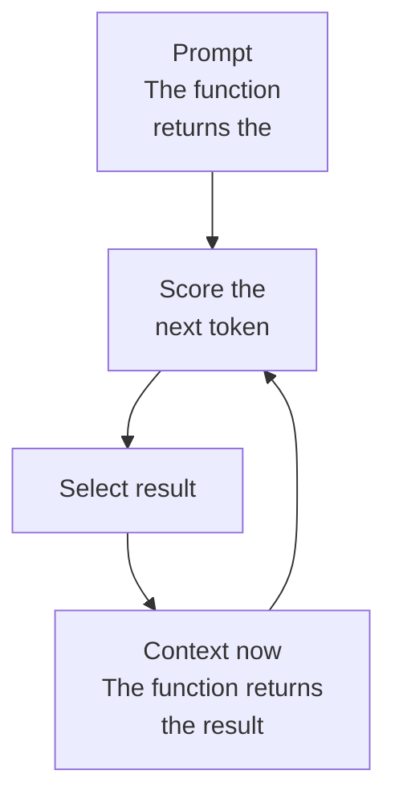

---
{
  "id": "language-modeling-next-token-prediction",
  "title": "Language Modeling & Next Tokens",
  "slug": "language-modeling-next-token-prediction",
  "section": "Preparation & Prerequisites",
  "category": "NLP Fundamentals",
  "difficulty": "Easy",
  "order": 6,
  "coverImage": "illustrations/_generated/next_token_dark.png",
  "companies": [
    "Google",
    "Meta",
    "OpenAI",
    "Anthropic"
  ],
  "shortDescription": "The prompt ends with 'the'. Follow that prefix from a counted bigram through teacher-forced training to the cache that serves the next token.",
  "keyConceptsTested": [
    "Language-model objective: next-token prediction",
    "Chain-rule factorization of sequence probability",
    "Bigram and neural n-gram models share the next-token target",
    "Teacher forcing and parallel causal Transformer training",
    "Cross-entropy loss as averaged negative log-likelihood",
    "Perplexity equals exp(loss): effective choices per token",
    "Autoregressive generation loop",
    "Causal vs masked language modeling (GPT vs BERT)",
    "Context window limits and KV-cache serving tradeoffs",
    "Neural factual recall versus verified retrieval or tool access"
  ]
}
---

The [previous lesson](/learn/transformer-architecture-end-to-end) traced a Transformer from token IDs all the way to unnormalized vocabulary scores. Now an editor prompt ends with `The function returns the`. How does text turn into a probability distribution over what comes next, and what mechanics govern the loop after the model picks a continuation?

A <span data-glossary="token">token</span> is the atomic unit of text in the model's vocabulary. Tokenizers frequently split long words or prefix tokens with spaces, but our running example treats each visible word and punctuation mark as a distinct token. If the model chooses `result`, the conditioning context grows to `The function returns the result`. The updated distribution might next favor a period. This append-and-predict cycle is **autoregressive generation**.

<figure>
  
  <figcaption>Each strip preserves all probability mass in its stated distribution. First, result has 60%, value 25%, index 10%, and all other tokens together 5%. Selecting result appends it to the context, and the next distribution assigns 80% to a period and 20% to the token and. The nested strips score the two-token continuation given the original prompt: result-period carries 0.60 × 0.80 = 0.48, result-and carries 0.12, and continuations starting with other tokens carry 0.40. The basic loop simply samples from each conditional distribution in turn.</figcaption>
</figure>

---

## Next-token scores build a sequence

An **autoregressive language model** assigns a categorical probability distribution over the vocabulary for the token that follows a prefix. A GPT-style <span data-glossary="llm">large language model (LLM)</span> learns these conditional predictions from text.[^radford2018][^radford2019] The basic generation loop consumes one such distribution per selected token, while training and batched serving score multiple positions in parallel before separating scoring from sequence-level decoding.

Suppose a model reads the four-token prompt `"The function returns the"`. Its actual output probabilities depend on its tokenizer, learned weights, and earlier conversation context, so no two checkpoints assign identical numbers. Across a simplified vocabulary slice, a plausible next-token ranking looks like this:

### Next-token distributions after a prompt

| Candidate token | Probability | Sampling behavior |
|---|---:|---|
| `result` | 60% | Greedy argmax picks this directly, and sampling draws it most often. |
| `value` | 25% | Plausible alternative continuation frequently chosen under stochastic sampling. |
| `index` | 10% | At this distribution, selected about one time in ten under repeated unfiltered sampling. |
| Other tokens combined | 5% | The remaining vocabulary mass distributed across thousands of long-tail tokens. |

Summing the explicit candidates captures 95% of the probability mass in this example, while the final row bundles all remaining vocabulary tokens so the distribution sums to exactly 100%.

### Reading the distribution before sampling

The table captures the model's conditional probabilities given the prefix observed so far. Appending or changing even a single modifier shifts semantic expectation and rearranges the top candidates right away. Comparing four closely related prompts shows how sensitive that distribution stays to local phrasing:

| Prompt context | Top continuation | Why the prediction shifts |
|---|---|---|
| `The function returns the` | `result` | Standard completion in code documentation corpora. |
| `The function returns the cached` | `value` | The adjective `cached` shifts semantic expectation toward stored objects. |
| `The function returns the first` | `index` | The ordinal modifier changes the likely noun to an offset or index. |
| `The function returns the` (REST API doc context) | `response` | System instructions and surrounding context reshape the token ranking. |

Shifting surrounding context alters or preserves top candidates depending on what patterns dominated training, and large models can memorize exact training phrases in addition to generalizing from context.[^carlini2021Extraction]

Probability theory explains why scoring one token at a time suffices to score an entire document. Under the **chain rule of probability**, the joint probability of any sequence $W = (w_1, w_2, \dots, w_n)$ factorizes exactly into a product of conditional probabilities:

$$
P(w_1, w_2, \dots, w_n) = \prod_{t=1}^{n} P(w_t \mid w_1, \dots, w_{t-1}) = \prod_{t=1}^{n} P(w_t \mid w_{<t})
$$

Here $w_t$ represents the token at position $t$, $n$ is total sequence length, and $w_{<t}$ denotes the history of all preceding tokens. The first term is $P(w_1)$ under the chosen starting context, often a beginning-of-sequence token. When scoring continuations after a user prompt, each factor conditions on that prompt as well, and including an end token lets the model assign probability to stopping cleanly. Notice that this factorization is an exact mathematical identity requiring no independence assumptions at all. Every step conditions on the complete prefix observed so far. Next-token training simply tasks the network with approximating each conditional factor $P(w_t \mid w_{<t})$ accurately.

Consider guessing continuations for a test runner log prompt (`The test runner says the assertion`) where multiple endings compete cleanly for probability mass:

```text title="completion-prompt.txt"
The test runner says the assertion
```

Among candidate completions such as `passed`, `failed`, or `holds`, every word fits the local English syntax. A language model assigns weights across those options from its training weights, while a decoding rule picks one concrete continuation. Evaluating whether those confidence scores match reality requires calibration checks against held-out logs rather than judging grammar alone.

### Softmax probabilities from raw logits

Tokenizer vocabularies typically hold tens or hundreds of thousands of entries, including subwords and special control tokens. Keeping the arithmetic compact lets us trace every exponential and sum by hand on a five-token vocabulary. Given the prompt `The compiler reported`, the network projects its final hidden state through an unembedding matrix into raw, real-valued <span data-glossary="logits">logits</span>:

| Token | Logit ($z_i$) | Semantic role |
|---|---:|---|
| `error` | 3.0 | Dominant continuation in compilation logs. |
| `warning` | 1.5 | Plausible diagnostic outcome. |
| `success` | -1.0 | Grammatically viable, but uncommon after `reported`. |
| `the` | -2.0 | Could start a noun phrase such as `the error`, but sits low in this example. |
| `</s>` | -3.0 | Premature sequence termination. |

The softmax operator converts these unconstrained logits into normalized probabilities:

$$
P(w_i) = \frac{\exp(z_i - \max_j z_j)}{\sum_{k=1}^{|V|} \exp(z_k - \max_j z_j)}
$$

Subtracting $\max_j z_j$ keeps the exponential numerically stable without altering the output distribution. As derived in the [softmax optimization lesson](/learn/softmax-cross-entropy-optimization), shifting every logit by the maximum keeps the largest exponent at $\exp(0) = 1$, preventing floating-point overflow while preserving exact probability ratios. Verify the conversion over all five logits in Python:

<!-- leetllm: test, output=show -->
```python title="tiny-vocabulary-example.py"
import math

tokens = ["error", "warning", "success", "the", "</s>"]
logits = [3.0, 1.5, -1.0, -2.0, -3.0]

peak = max(logits)
exps = [math.exp(logit - peak) for logit in logits]
total = sum(exps)
probs = [exp / total for exp in exps]

for token, prob in zip(tokens, probs):
    print(f"{token:10s} {prob:.3f}")
print(f"sum        {sum(probs):.3f}")
print("top token ", tokens[max(range(len(probs)), key=lambda i: probs[i])])
```

<!-- leetllm: output:start -->
```text title="Output" output compact
error      0.800
warning    0.178
success    0.015
the        0.005
</s>       0.002
sum        1.000
top token  error
```
<!-- leetllm: output:end -->

`error` commands 80% of the probability mass, followed by `warning` at roughly 18%. The probabilities sum cleanly to 1.0. Softmax normalizes the model's internal scores, whereas verifying whether a build failed still requires reading the test runner's report. The next question is how a model acquires those scores from raw text.

---

## Estimating probabilities from observed n-gram counts

Before neural networks dominated natural language processing, language models estimated sequence probabilities by counting token co-occurrences directly in text corpora. A **bigram model** approximates the full conditional history $w_{<t}$ using only the single immediately preceding token $w_{t-1}$. That truncation defines the **first-order Markov assumption**:

$$
P(w_t \mid w_1, \dots, w_{t-1}) \approx P(w_t \mid w_{t-1})
$$

Under Maximum Likelihood Estimation (MLE), the bigram transition probability equals the ratio of observed pair frequency to previous-token frequency. This fraction converts raw corpus counts into a normalized next-token distribution:

$$
P(w_t \mid w_{t-1}) = \frac{C(w_{t-1}, w_t)}{C(w_{t-1})}
$$

Here $C(w_{t-1}, w_t)$ counts adjacent pairs, and the denominator counts occurrences of the conditioning token **with a following prediction target**: $C(w_{t-1}) = \sum_{v \in V} C(w_{t-1}, v)$. Our explicit end token ensures that ordinary final words have a successor. We don't model transitions out of `<eos>`.

| Previous token ($w_{t-1}$) | Next token candidate ($w_t$) | Observed count | Bigram probability |
|---|---|---:|---:|
| `returns` | `value` | 3 | $3 / 6 = 0.500$ |
| `returns` | `result` | 2 | $2 / 6 = 0.333$ |
| `returns` | `error` | 1 | $1 / 6 = 0.167$ |

### Counting bigram events in code comments

We can verify these calculations directly on a small corpus of six code comments. Surrounding each comment with `<bos>` and `<eos>` gives every sentence an explicit start context and a stopping target. Running the counter in Python reproduces all three conditional fractions above and reveals what happens to unseen words:

<!-- leetllm: test, id=bigram-counts, output=show -->
```python title="count-bigram-events.py"
from collections import Counter, defaultdict

messages = [
    "function returns value",
    "function returns value",
    "method returns result",
    "handler returns value",
    "test returns result",
    "test returns error",
]

counts = defaultdict(Counter)
for message in messages:
    tokens = ["<bos>", *message.split(), "<eos>"]
    for previous, current in zip(tokens, tokens[1:]):
        counts[previous][current] += 1

row = counts["returns"]
total = sum(row.values())
for token, count in row.most_common():
    print(f"P({token:6s} | returns) = {count}/{total} = {count / total:.3f}")
print("unseen token probability =", row["exception"] / total)
```

<!-- leetllm: output:start -->
```text title="Output" output compact
P(value  | returns) = 3/6 = 0.500
P(result | returns) = 2/6 = 0.333
P(error  | returns) = 1/6 = 0.167
unseen token probability = 0.0
```
<!-- leetllm: output:end -->

### The sparsity collapse and Laplace smoothing

Two fundamental flaws immediately stand out in the bigram table above. First, **limited history**: conditioning solely on `returns` makes `function returns` and `test returns` indistinguishable, even though both `function` examples end in `value` while the two `test` examples split between `result` and `error`. Second, **sparsity collapse**: because `returns exception` never appears in our six training comments, its raw count is zero and $P(\text{exception} \mid \text{returns}) = 0.0$, sending the negative log-likelihood of any test document containing that pair to infinity.

**Laplace (add-one) smoothing** removes zero-count collapse by adding a pseudo-count of 1 across the entire vocabulary $V$:

$$
P_{\text{Laplace}}(w_t \mid w_{t-1}) = \frac{C(w_{t-1}, w_t) + 1}{C(w_{t-1}) + |V|}
$$

On a four-token vocabulary (`value`, `result`, `error`, `exception`), the smoothed counts after `returns` become $[4, 3, 2, 1]$, giving a denominator of $6 + 4 = 10$ and raising `exception` to $0.100$. Across the full vocabulary of the corpus plus `exception`, add-one allocates probability mass to every valid token, including words never seen after `returns`:

<!-- leetllm: test, continue=bigram-counts, output=show -->
```python title="smooth-the-full-vocabulary.py"
# Eight ordinary words, an end token, and the extra candidate exception.
prediction_vocab = sorted({token for rows in counts.values() for token in rows} | {"exception"})
smoothed = {token: (row[token] + 1) / (total + len(prediction_vocab)) for token in prediction_vocab}
print("prediction vocabulary:", len(prediction_vocab))
print(f"P(exception | returns): {smoothed['exception']:.4f}")
print(f"row sum: {sum(smoothed.values()):.3f}")
```

<!-- leetllm: output:start -->
```text title="Output" output compact
prediction vocabulary: 10
P(exception | returns): 0.0625
row sum: 1.000
```
<!-- leetllm: output:end -->

An out-of-vocabulary word still needs an unknown-token or subword policy because add-one smoothing only redistributes mass over known entries. While Laplace smoothing demonstrates the math simply, discounting and backoff methods such as Kneser-Ney perform much better on real text.[^chenGoodman1998Smoothing] Still, count tables hit a fundamental combinatorial wall as history widens. With vocabulary size $|V| = 50,000$, there are $|V|^4 = 6.25 \times 10^{18}$ possible four-token prefixes, forcing sparse tables and heuristic backoff with no parameter sharing across similar words.

---

## Neural language models and distributed representations

In 2003, Yoshua Bengio and colleagues replaced discrete n-gram tables with a neural network that learns continuous word vectors jointly alongside a next-word predictor.[^bengio2003] Sharing embedding and projection parameters allows observations from one phrase to inform predictions for semantically related phrases that never appeared verbatim. Notice how smoothly that generalizes beyond exact prefix matches when two verbs or nouns share context.

Instead of representing tokens as orthogonal one-hot vectors with zero overlap ($e_i^\top e_j = 0$), a neural language model maps each token ID into a dense vector in $\mathbb{R}^d$. Words appearing in similar contexts move closer together in vector space as gradients update $E$. The architecture processes fixed context windows through four clean stages:

1. Look up continuous embeddings for the previous $n - 1$ context tokens in an embedding matrix $E \in \mathbb{R}^{|V| \times d}$.
2. Concatenate these vectors into a single feature vector $x \in \mathbb{R}^{(n-1)d}$.
3. Apply a shared predictor to $x$ to yield vocabulary logits. Bengio's model included a nonlinear `tanh` hidden layer and an optional direct affine route, whereas our small lab below uses an affine output map alone.
4. Pass logits through softmax to form next-token probabilities.

```text title="neural-ngram-path.txt"
our lab: context IDs -> embedding lookup E -> concatenated x -> affine map -> logits -> softmax
```

Learned representations share statistical strength across related contexts without storing separate counts for every word tuple. As similar words move together in embedding space, unseen combinations naturally inherit sensible probability estimates. Actual generalization still depends on training data coverage, model capacity, and optimization choices.

<figure>
  
  <figcaption>Six observed records contribute value: 3, result: 2, error: 1 after returns. The bigram uses that one-token row. The neural lab instead reads function and returns, concatenates two learned six-value embedding rows, and applies the shared affine map with W shaped 12 × 8 and an eight-value bias. Embeddings and three selected logits are rounded values after 200 updates, with bars starting at zero. Softmax uses all eight logits: value = 7.904 receives about 99.84%, result about 0.073%, and error about 0.038%. A trigram table could also distinguish the two-token contexts.</figcaption>
</figure>

### Training a tiny neural n-gram with gradient descent

The program below implements a complete neural n-gram from scratch without external frameworks. It reads two context tokens, maps each word to a 6-dimensional embedding vector, concatenates them into 12 features, and projects those features onto 8 vocabulary logits. Running 200 optimization steps shows how quickly the model separates conflicting two-token contexts.

To train those weights, the backward pass applies the exact cross-entropy gradient derived in the softmax lesson: $\frac{\partial \mathcal{L}}{\partial z} = p - y$. Gradients flow backward through the linear projection straight into the active rows of $E$. Step by step, gradient descent aligns the context vectors needed to separate targets:

<!-- leetllm: test, output=show -->
```python title="tiny-neural-ngram.py"
import math
import random

random.seed(7)
sentences = [
    "function returns value",
    "function returns value",
    "method returns result",
    "handler returns value",
    "test returns result",
    "test returns error",
]
vocab = sorted({word for sentence in sentences for word in sentence.split()})
to_id = {word: index for index, word in enumerate(vocab)}
n_vocab = len(vocab)
emb_dim = 6

contexts = []
targets = []
for sentence in sentences:
    words = sentence.split()
    for index in range(2, len(words)):
        contexts.append([to_id[words[index - 2]], to_id[words[index - 1]]])
        targets.append(to_id[words[index]])

embeddings = [[random.uniform(-0.3, 0.3) for _ in range(emb_dim)] for _ in range(n_vocab)]
weights = [[random.uniform(-0.2, 0.2) for _ in range(n_vocab)] for _ in range(emb_dim * 2)]
bias = [0.0] * n_vocab


def concat_embeddings(token_ids):
    return embeddings[token_ids[0]] + embeddings[token_ids[1]]


def logits_from(features):
    logits = bias[:]
    for i, value in enumerate(features):
        for j, weight in enumerate(weights[i]):
            logits[j] += weight * value
    return logits


def softmax(logits):
    peak = max(logits)
    exps = [math.exp(logit - peak) for logit in logits]
    total = sum(exps)
    return [exp / total for exp in exps]


def mean_loss():
    total = 0.0
    for token_ids, target in zip(contexts, targets):
        logits = logits_from(concat_embeddings(token_ids))
        peak = max(logits)
        total += (peak - logits[target]) + math.log(sum(math.exp(z - peak) for z in logits))
    return total / len(contexts)


def predict(text):
    token_ids = [to_id[word] for word in text.split()]
    logits = logits_from(concat_embeddings(token_ids))
    return vocab[max(range(n_vocab), key=lambda index: logits[index])]


initial_loss = mean_loss()
learning_rate = 0.4
for _ in range(200):
    grad_embeddings = [[0.0] * emb_dim for _ in range(n_vocab)]
    grad_weights = [[0.0] * n_vocab for _ in range(emb_dim * 2)]
    grad_bias = [0.0] * n_vocab
    scale = 1.0 / len(contexts)
    for token_ids, target in zip(contexts, targets):
        features = concat_embeddings(token_ids)
        dlogits = [prob * scale for prob in softmax(logits_from(features))]
        dlogits[target] -= scale
        for j, grad in enumerate(dlogits):
            grad_bias[j] += grad
        for i, value in enumerate(features):
            for j, grad in enumerate(dlogits):
                grad_weights[i][j] += value * grad
        dfeatures = [
            sum(weights[i][j] * dlogits[j] for j in range(n_vocab))
            for i in range(emb_dim * 2)
        ]
        for offset, token_id in enumerate(token_ids):
            start = offset * emb_dim
            for dim in range(emb_dim):
                grad_embeddings[token_id][dim] += dfeatures[start + dim]
    for i in range(n_vocab):
        bias[i] -= learning_rate * grad_bias[i]
        for dim in range(emb_dim):
            embeddings[i][dim] -= learning_rate * grad_embeddings[i][dim]
    for i in range(emb_dim * 2):
        for j in range(n_vocab):
            weights[i][j] -= learning_rate * grad_weights[i][j]

print(f"loss before training: {initial_loss:.3f}")
print(f"loss after training:  {mean_loss():.3f}")
print("after 'function returns':", predict("function returns"))
print("after 'test returns':    ", predict("test returns"))
assert predict("function returns") == "value"
assert mean_loss() < initial_loss
```

<!-- leetllm: output:start -->
```text title="Output" output compact
loss before training: 2.145
loss after training:  0.235
after 'function returns': value
after 'test returns':     result
```
<!-- leetllm: output:end -->

Notice how the learned model separates `function returns` from `test returns`: it outputs `value` after `function returns` and `result` after `test returns`. The loss dropped from 2.145 to 0.235 nats, close to the theoretical floor of $\frac{2 \ln(2)}{6} \approx 0.231$ nats imposed because `test returns` appears once with `result` and once with `error`. Because softmax outputs remain strictly positive, finite logits approach those corner probabilities while assigning tiny residual mass to the remaining vocabulary entries. Without a nonlinear hidden layer, each logit is simply a sum of two position-specific embeddings and a bias, which fits all six training rows cleanly while leaving unseen-prefix generalization untested.

```checkpoint
Does distinguishing `function returns` from `test returns` prove that neural embeddings are strictly necessary?
---
No. This result shows context-dependent fitting on six training targets. A discrete trigram table also uses two-token contexts, whereas embeddings and shared predictor weights let updates influence related contexts. Evaluate held-out prefixes to compare generalization. Count models can assign unseen n-gram probabilities through backoff or interpolation.
```

### Temperature scaling on output logits

During inference, sampling algorithms often reshape output logits before drawing tokens by dividing them by a positive **<span data-glossary="temperature">temperature</span>** scalar $T > 0$:

$$
P(w_i) = \frac{\exp(z_i / T)}{\sum_j \exp(z_j / T)}
$$

- $0 < T < 1.0$ (Cooling): Amplifies logit differences and increases the maximum probability. Sampling remains stochastic unless filtering or numerical rounding leaves one choice.
- $T = 1.0$ (Unscaled): Standard softmax probabilities derived directly from learned parameters.
- $T > 1.0$ (Heating): Flattens logit differences across candidates. For finite logits and a finite vocabulary, the distribution approaches uniform as $T \to \infty$, though actual generation quality still depends on the prompt and task.

<!-- leetllm: test, output=show, output_title="Temperature comparison" -->
```python title="compare-temperatures.py"
import math

logits = [3.0, 1.5, -1.0, -2.0, -3.0]
tokens = ["error", "warning", "success", "the", "</s>"]
for temperature in [0.5, 1.0, 2.0]:
    peak = max(logits)
    exps = [math.exp((logit - peak) / temperature) for logit in logits]
    total = sum(exps)
    probabilities = [exp / total for exp in exps]
    ranked = sorted(probabilities, reverse=True)
    if temperature == 1.0:
        print(f"{tokens[0]:<11}{probabilities[0]:.3f}")
        print(f"{tokens[1]:<11}{probabilities[1]:.3f}")
    print(f"T={temperature:.1f} top={ranked[0]:.3f} second={ranked[1]:.3f}")
```

<!-- leetllm: output:start -->
```text title="Temperature comparison" output compact
T=0.5 top=0.952 second=0.047
error      0.800
warning    0.178
T=1.0 top=0.800 second=0.178
T=2.0 top=0.575 second=0.272
```
<!-- leetllm: output:end -->

At $T = 0.5$, `error` surges to 95.2% probability. At $T = 2.0$, it drops to 57.5%, leaving significant mass for alternatives. Temperature changes the sampling distribution while leaving the model's learned parameters unchanged.

As $T \to 0^+$, a unique maximum logit captures all probability mass, whereas tied maxima share it equally. Because the ratio $z_i / T$ is undefined at $T=0$, inference APIs that accept zero temperature implement greedy argmax as a separate branch.

### Causal versus masked language modeling

**Causal language modeling** defines an objective: predict the next token solely from earlier tokens ($w_{<t}$). Bigrams, recurrent networks, and causally masked decoder Transformers can all implement this left-to-right objective, separating the training goal from the underlying architecture. By contrast, **masked language modeling** (BERT) corrupts a span and predicts missing tokens from both left and right context simultaneously.[^devlin2019]

| Objective | Visible context | Core training task | Primary architectural use |
|---|---|---|---|
| Causal language modeling | Only prior tokens ($w_{<t}$) | Predict the single next token | Generative decoders (GPT, LLaMA, Claude) |
| Masked language modeling | Full bidirectional context ($w_{<t}$ and $w_{>t}$) | Reconstruct masked tokens in place | Encoders for embeddings, reranking, classification (BERT) |

BERT predicts selected original tokens from a corrupted sequence. In its original recipe, 15% of positions are selected, with 80% replaced by `[MASK]`, 10% swapped for random tokens, and 10% left unchanged.[^devlin2019] Its bidirectional conditionals do not form the sequential left-to-right factors used for autoregressive text generation, so ordinary BERT models aren't trained for single-pass append-one-token decoding.

---

## Teacher forcing and parallel causal training

How does a causal model learn from massive corpora without manual labeling? Every document turns into a self-supervised training sequence because at each position $t$, the observed next token $w_{t+1}$ serves directly as the ground-truth label.

### The causal attention mask and parallel GEMM

During pre-training, the model receives ground-truth tokens at every position, a technique called **teacher forcing**. In recurrent neural networks (RNNs), step-by-step hidden state dependencies forced forward and backward passes to run sequentially across time. In a decoder Transformer, teacher forcing allows every position inside one layer to compute simultaneously:

1. The entire token sequence $x_1, \dots, x_T$ enters the network at once.
2. The **causal attention mask** sets attention logits $M_{ij} = -\infty$ for all positions $j > i$.
3. Because $\exp(-\infty) = 0$, position $t$ can't attend to future tokens $t+1, \dots, T$.
4. Matrix operations process all known positions together inside each layer rather than waiting for earlier sampled tokens, though deeper layers still execute after earlier layers.

One sequence pass isn't constant work or constant latency. For fixed model widths, full self-attention evaluates $\mathcal{O}(T^2)$ pairwise score and value operations per layer alongside per-token projections and feed-forward MLPs. Parallelism removes sequential position bottlenecks during training, while hardware compute and memory bandwidth still determine step latency.[^vaswani2017]

<figure>
  
  <figcaption>Teacher forcing shifts one observed sequence into four input-label pairs. In the additive mask, columns are key positions j and rows are query positions i; zero entries permit past/current keys and negative infinity excludes future keys. The four true-token probabilities align with their labels, and their negative log losses average 0.209 nats. A Transformer can score these known positions together within each layer. Below, each selected token becomes part of the following generation context, until eos is selected. Layers remain dependent, and the complete pass still does sequence-length-dependent work.</figcaption>
</figure>

### Exposure bias and the train-inference gap

Teacher forcing delivers a clean, stable training gradient, yet it introduces a classic train-inference mismatch known as **exposure bias**.[^bengio2015ScheduledSampling] Under ordinary teacher-forced training, each prediction conditions on an observed dataset prefix rather than the model's own prior samples. During free-running generation, each continuation appends the model's chosen tokens, so an early mistake can steer the prefix into unfamiliar territory and compound downstream. Scheduled sampling and rollout-based methods study ways to bridge that gap, while evaluation should test both teacher-forced loss and open-ended generation for fluency, repetition, drift, and clean stopping.

### Shifting tokens into inputs and target labels

Training a causal decoder requires aligning input prefixes with shifted next-token targets. Given `[<bos>, function, returns, value, <eos>]`, input rows drop the final token while target rows drop the initial `<bos>`:

| Input prefix to model ($x$) | Supervised target label ($y$) |
|---|---|
| `<bos>` | `function` |
| `<bos> function` | `returns` |
| `<bos> function returns` | `value` |
| `<bos> function returns value` | `<eos>` |

In Hugging Face Transformers 5.6.2, `DataCollatorForLanguageModeling(mlm=False)` copies input IDs into labels and marks padding positions with `-100`.[^huggingface2026datacollator] Because the built-in causal loss shifts labels internally (`labels[..., 1:]` paired with all but the last logit, verified October 10, 2026 in [versioned source](https://github.com/huggingface/transformers/blob/v5.6.2/src/transformers/loss/loss_utils.py)), callers must not pre-shift those arrays beforehand.[^huggingface2026causalloss] The snippet below shifts arrays explicitly because our custom loss expects pre-aligned pairs.

Keep target masking separate from attention masking, and watch out for shared padding/EOS token IDs. If `pad_token_id == eos_token_id`, masking by token ID hides genuine stop tokens along with real padding unless you derive `-100` targets directly from the attention mask. Packed multi-document batches and instruction-only tuning similarly require explicit document-reset masks and response-only loss masks.

<!-- leetllm: test, output=show -->
```python title="shift-next-token-labels.py"
vocab = {"<bos>": 0, "function": 1, "returns": 2, "value": 3, "<eos>": 4}
tokens = ["<bos>", "function", "returns", "value", "<eos>"]
ids = [vocab[token] for token in tokens]
inputs = ids[:-1]
targets = ids[1:]

print("input token ids: ", inputs)
print("target token ids:", targets)
for position in range(len(inputs)):
    context = " ".join(tokens[: position + 1])
    print(f"{context:25s} -> {tokens[position + 1]}")
```

<!-- leetllm: output:start -->
```text title="Output" output compact
input token ids:  [0, 1, 2, 3]
target token ids: [1, 2, 3, 4]
<bos>                     -> function
<bos> function            -> returns
<bos> function returns    -> value
<bos> function returns value -> <eos>
```
<!-- leetllm: output:end -->

### Cross-entropy loss across sequence positions

At each supervised position, **cross-entropy loss** scores the probability of the observed target token. Averaging across $n$ scored targets gives:

$$
\mathcal{L} = -\frac{1}{n} \sum_{t=1}^{n} \log P(x_t \mid x_{<t})
$$

If the network assigns probability 1.0 to the target, the term contributes $-\log(1.0) = 0$ loss. At probability 0.01, the penalty is $-\log(0.01) \approx 4.605$ nats. Across conflicting observations of the same prefix, minimizing average loss favors their frequency distribution, not confidence 1.0 in each incompatible target. Exclude ignored targets from both the loss sum and $n$; require at least one scored target.

<!-- leetllm: test, output=show -->
```python title="cross-entropy-over-positions.py"
import math

targets = [1, 2, 3, 4]  # function, returns, value, <eos>
logits = [
    [0.0, 3.0, 0.5, -1.0, -2.0],
    [-1.0, 0.1, 2.5, 0.0, -2.0],
    [-1.0, 0.0, 0.2, 2.0, -1.5],
    [-2.0, 0.0, -1.0, -0.5, 2.4],
]

true_probs = []
losses = []
for row, target in zip(logits, targets):
    peak = max(row)
    exps = [math.exp(logit - peak) for logit in row]
    total = sum(exps)
    prob = exps[target] / total
    true_probs.append(prob)
    losses.append((peak - row[target]) + math.log(total))

print("true-token probabilities:", [round(prob, 3) for prob in true_probs])
print("per-token losses:        ", [round(loss, 3) for loss in losses])
print(f"mean cross-entropy:       {sum(losses) / len(losses):.3f}")
```

<!-- leetllm: output:start -->
```text title="Output" output compact
true-token probabilities: [0.864, 0.824, 0.724, 0.839]
per-token losses:         [0.146, 0.194, 0.323, 0.175]
mean cross-entropy:       0.209
```
<!-- leetllm: output:end -->

### Perplexity as an effective branching factor

Cross-entropy loss in natural logarithms produces units of nats, or bits when computed in base 2. Exponentiating average cross-entropy yields **perplexity**, which equals the reciprocal of the geometric mean of the target token probabilities:[^shannon1948][^jelinek1977]

$$
\text{Perplexity} = \exp(\mathcal{L}) = \exp\left(-\frac{1}{n} \sum_{t=1}^n \log P(x_t \mid x_{<t})\right) = \frac{1}{\sqrt[n]{\prod_{t=1}^n P(x_t \mid x_{<t})}}
$$

Intuitively, perplexity measures the model's **effective branching factor**, meaning how many equally likely options the model feels unsure among at each step:

- A perplexity of 1.0 means the model predicted every target token with 100% confidence ($\mathcal{L} = 0$).
- A uniform predictor over 50,000 tokens has loss $\ln(50,000) \approx 10.82$ and perplexity exactly 50,000, whereas exponentiating the rounded 10.82 gives only an approximation.
- Our four-position example has perplexity about 1.233, though confidence calibration still requires a separate check and poorly calibrated probabilities can even push perplexity above vocabulary size.

<!-- leetllm: test, output=show -->
```python title="perplexity-by-hand.py"
import math

# Probability the model gave to the token that was actually correct, per position
true_token_probs = [0.5, 0.5, 0.5, 0.125]

per_position_loss = [-math.log(prob) for prob in true_token_probs]
avg_loss = sum(per_position_loss) / len(per_position_loss)
perplexity = math.exp(avg_loss)

print(f"per-position loss: {[round(loss, 4) for loss in per_position_loss]}")
print(f"average loss:      {avg_loss:.4f}")
print(f"perplexity:        {perplexity:.4f}")

product = 1.0
for prob in true_token_probs:
    product *= prob
geo_mean = product ** (1 / len(true_token_probs))
print(f"1 / geometric mean:{1 / geo_mean:.4f}")
```

<!-- leetllm: output:start -->
```text title="Output" output compact
per-position loss: [0.6931, 0.6931, 0.6931, 2.0794]
average loss:      1.0397
perplexity:        2.8284
1 / geometric mean:2.8284
```
<!-- leetllm: output:end -->

Notice how a single low-probability target (`0.125` at position 4) pulls the average loss from `0.693` up to `1.039`, nearly tripling perplexity to `2.828`. Because logarithmic loss grows steeply as assigned probability drops toward zero, perplexity penalizes confident surprises heavily.

> Compare token perplexity under the same tokenization, evaluation text, preprocessing, scored targets, and context windowing. Vocabulary size alone doesn't make tokenization units comparable, because byte tokens and subword tokens divide text into different step counts. For a tokenizer-independent metric, report bits per byte under a stated encoding and chunking rule.[^huggingface_ppl]

Long-document evaluation also depends on how chunks are fed to the model. Disjoint chunks reset memory and raise loss near chunk splits, whereas strided sliding windows carry earlier tokens forward as context. When aggregating across variable-length batches (for instance, one batch scoring one target at `0.5` and another scoring three padded targets at `0.125` each), sum total negative log-likelihood and total non-padding token counts across all batches before exponentiating rather than averaging per-batch perplexities:

<!-- leetllm: test, output=show -->
```python title="pool-perplexity-by-target-count.py"
import math

batches = [[0.5], [0.125, 0.125, 0.125]]
nll_sums = [sum(-math.log(p) for p in batch) for batch in batches]
counts = [len(batch) for batch in batches]
means = [nll / count for nll, count in zip(nll_sums, counts)]

pooled = math.exp(sum(nll_sums) / sum(counts))
mean_batch_loss_ppl = math.exp(sum(means) / len(means))
mean_batch_ppl = sum(math.exp(mean) for mean in means) / len(means)
print(f"pooled token perplexity:   {pooled:.3f}")
print(f"exp(mean batch loss):      {mean_batch_loss_ppl:.3f}")
print(f"mean batch perplexity:     {mean_batch_ppl:.3f}")
assert math.isclose(pooled, 1 / (0.5 * 0.125 ** 3) ** 0.25)
```

<!-- leetllm: output:start -->
```text title="Output" output compact
pooled token perplexity:   5.657
exp(mean batch loss):      4.000
mean batch perplexity:     5.000
```
<!-- leetllm: output:end -->

Only the pooled result measures surprise per scored token across these four observations. Taking a plain mean of batch losses gives each batch equal weight, so the single easy target counts as much as all three harder targets. Taking a mean of batch perplexities introduces a further difference because exponentiation is nonlinear. Retain the loss sum and count after excluding padding, prompt-only labels, and other ignored targets.

```checkpoint
A model assigns the true next token a probability of 0.01 at one position. Roughly how much does that position contribute to cross-entropy loss?
---
The contribution is -log(0.01) ≈ 4.605 nats. That is a heavy penalty. Confident correct predictions contribute near 0 loss, whereas low-probability surprises drive loss and perplexity up quickly.
```

---

## The autoregressive generation loop

In basic autoregressive decoding, the model selects one token before it can evaluate probabilities for the following position. Every generated word extends the sequence passed into the next forward evaluation, forming an iterative loop:

1. **Input:** Feed the prompt tokens into the network.
2. **Predict:** Compute vocabulary logits and softmax probabilities for the *next token*.
3. **Select:** Pick a token via greedy argmax or temperature-scaled sampling.
4. **Append:** Concatenate the newly selected token to the input sequence.
5. **Repeat:** Feed the expanded context back into the model to predict the subsequent token.



### A deterministic generation loop in code

This small script demonstrates the sequential mechanics cleanly. On each step, it looks up the current prefix, picks the highest-probability token, appends it, and stops when it encounters `</s>`:

<!-- leetllm: test, output=show -->
```python title="a-tiny-generation-loop-in-code.py"
next_token_table = {
    "The function returns the": [("result", 0.60), ("value", 0.25), ("index", 0.10), ("other", 0.05)],
    "The function returns the result": [(".", 0.80), ("and", 0.20)],
    "The function returns the result.": [("</s>", 1.0)],
}

text = "The function returns the"

for step in range(3):
    choices = next_token_table[text]
    assert abs(sum(probability for _, probability in choices) - 1.0) < 1e-12
    token, _probability = max(choices, key=lambda item: item[1])

    if token == "</s>":
        break

    text = text + ("" if token == "." else " ") + token
    print(step, repr(text))
print("final text:", repr(text))
```

<!-- leetllm: output:start -->
```text title="Output" output compact
0 'The function returns the result'
1 'The function returns the result.'
final text: 'The function returns the result.'
```
<!-- leetllm: output:end -->

This small lookup table stands in for a full language model to trace the control loop cleanly. A production neural model computes logits across every token prefix inside its context window. In practice, a real tokenizer also decodes selected integer IDs back to text rather than using a space-and-period shortcut.

| Termination condition | Trigger mechanism | Production handling |
|---|---|---|
| End or end-of-turn token | A configured stop-token ID is selected | End this generation or turn, allowing tool calls to take another application step. |
| Output token budget | Selected tokens reach the configured output limit | Report the limit so an incomplete answer isn't mistaken for a completed task. |
| Stop sequence match | A configured delimiter matches | Follow the API's policy for retaining or stripping the delimiter. |
| Application interruption | Cancellation, timeout, or an application filter fires | Report the actual reason and handle partial output explicitly. |

### Greedy selection versus temperature sampling

In **greedy decoding**, the engine always picks the argmax logit $\hat{w} = \arg\max_i z_i$. While fixed logits and deterministic tie-breaking keep greedy decoding reproducible across identical kernels, tiny floating-point changes across hardware can flip close ties, and selecting the highest-probability token at step one does not guarantee the highest-probability sequence overall. Suppose $P(A)=0.6$ and $P(B)=0.4$, while the best second token carries probability $0.1$ after $A$ versus $0.9$ after $B$: greedy picks $A$ and peaks at $0.6 \times 0.1 = 0.06$, missing the $B$ continuation at $0.4 \times 0.9 = 0.36$.

In **stochastic sampling**, the engine draws each token randomly according to the softmax distribution. To filter out absurd tail tokens, top-$k$ sampling keeps only the $k$ highest logits and top-$p$ (nucleus) sampling keeps the smallest top set reaching cumulative mass $p$, then renormalizes the surviving weights before drawing. Filtering alters selection frequencies directly relative to raw softmax, as demonstrated below when comparing argmax against temperature sampling:

<!-- leetllm: test, output=show -->
```python title="greedy-versus-sampling.py"
import math
import random

tokens = ["result", "value", "index"]
logits = [2.4, 1.7, 0.2]


def probabilities(temperature):
    if temperature <= 0:
        raise ValueError("temperature must be positive")
    peak = max(logits)
    exps = [math.exp((logit - peak) / temperature) for logit in logits]
    total = sum(exps)
    return [exp / total for exp in exps]


rng = random.Random(4)
greedy = tokens[max(range(len(logits)), key=lambda i: logits[i])]
probs = probabilities(1.4)
samples = [rng.choices(tokens, weights=probs, k=1)[0] for _ in range(8)]

print("greedy:", greedy)
print("sampled at temperature 1.4:", samples)
print("probabilities:", [round(prob, 3) for prob in probs])
```

<!-- leetllm: output:start -->
```text title="Output" output compact
greedy: result
sampled at temperature 1.4: ['result', 'result', 'result', 'result', 'result', 'result', 'index', 'value']
probabilities: [0.551, 0.334, 0.115]
```
<!-- leetllm: output:end -->

### Context window limits and memory growth

In the basic loop, every generated token extends the active context conditioned on future steps. When predicting token 1,000, the model reads both the prompt and all 999 preceding tokens. Serving engines therefore define a maximum **context window** balancing prompt room against output length, with full-attention caches scaling linearly with retained positions whereas sliding-window or recurrent caches trim older entries.[^huggingface2026kvcache]

---

## Production serving: prefill, decode, and the KV cache

Production serving runs the exact same autoregressive weights across two distinct computational regimes: processing the incoming prompt in parallel, then generating response tokens sequentially one by one.

1. **The Prefill Phase:** Processing the user's prompt tokens all at once.
2. **The Decode Phase:** Generating new tokens sequentially one by one.

<figure>
  
  <figcaption>Each K/V column represents the layer-specific vectors of one processed position, omitting individual numerical entries. Prefill processes The function returns the, retains four cache columns, and computes the logits that select result. Feeding result appends column 5 before selecting a period, and feeding the period appends column 6 before selecting the stop token, halting before feeding the stop token itself. Under the displayed model dimensions, raw KV payloads reach 1, 4, and 16 GiB at 2,048, 8,192, and 32,768 cached positions per request before allocator and activation memory.</figcaption>
</figure>

### Count the work before and after caching

In standard multi-head self-attention, every position $t$ computes query, key, and value projections $Q_t = X_t W_Q$, $K_t = X_t W_K$, and $V_t = X_t W_V$. Generating $m$ tokens from a prompt of length $p$ without caching forces the model to reprocess prefixes of lengths $p, p+1, \dots, p+m-1$, making linear projections grow as $\mathcal{O}(m^2)$ and pairwise full attention scores grow as $\mathcal{O}(m^3)$. Calling uncached generation merely quadratic misses that extra factor of $m$ accumulated by recomputing attention over prefixes repeatedly.

### The KV cache and memory bandwidth bottlenecks

For a fixed causal Transformer in evaluation mode, unchanged prefix tokens and position IDs always produce identical historical keys and values. Future appends cannot alter earlier hidden states, creating the reuse invariant behind inference caching. Storing those layer-specific tensors in GPU High Bandwidth Memory (HBM) lets the engine skip old projections, though quantized, offloaded, or sliding-window caches modify what stays retained.[^pope2023][^huggingface2026kvcache] After prefill emits the first token, each decode step runs four concise operations:

1. Feed the token just selected from the previous call so each layer computes its new query, key, and value vectors for that single position.
2. Append $k_t$ and $v_t$ to the cached tensors in HBM.
3. Compute attention by multiplying query vector $q_t$ against all accumulated cached keys and values.
4. Apply the final language modeling head to produce next-token logits and select the following token.

After prefill, projection and feed-forward work per added position is independent of retained sequence length for a fixed model. Full-attention work per position remains linear in the number of visible cached positions. Cache reuse avoids recomputing old projections, while cumulative full-attention work remains quadratic across a growing continuation.

### Check the cache against a full pass

Here is the reuse invariant for one attention layer. Fixed input states stand in for positioned layer inputs. We prefill three positions, then feed positions four and five separately. Each new query is at the **end** of its cache, so all stored keys are allowed. Using nonsquare `is_causal=True` here would instead align the query to the start of the key row, as the previous Transformer lesson showed.

<!-- leetllm: test, deps=torch, output=show -->
```python title="cached-attention-matches-a-full-pass.py"
import torch
import torch.nn.functional as F

torch.manual_seed(3)
hidden = torch.randn(1, 5, 4)
q, k, v = [hidden @ torch.randn(4, 4) for _ in range(3)]
full = F.scaled_dot_product_attention(q, k, v, is_causal=True, dropout_p=0.0)

cache_k, cache_v = k[:, :3].clone(), v[:, :3].clone()
outputs = [F.scaled_dot_product_attention(q[:, :3], cache_k, cache_v,
                                        is_causal=True, dropout_p=0.0)]
lengths = [cache_k.size(1)]
for position in range(3, 5):
    cache_k = torch.cat([cache_k, k[:, position:position + 1]], dim=1)
    cache_v = torch.cat([cache_v, v[:, position:position + 1]], dim=1)
    allowed = torch.ones(1, cache_k.size(1), dtype=torch.bool)
    outputs.append(F.scaled_dot_product_attention(q[:, position:position + 1],
                   cache_k, cache_v, attn_mask=allowed, dropout_p=0.0))
    lengths.append(cache_k.size(1))

print("cached lengths:", lengths)
print("matches full pass:", torch.allclose(torch.cat(outputs, dim=1), full, atol=1e-6))
assert torch.allclose(torch.cat(outputs, dim=1), full, atol=1e-6)
```

<!-- leetllm: output:start -->
```text title="Output" output compact
cached lengths: [3, 4, 5]
matches full pass: True
```
<!-- leetllm: output:end -->

In a complete decoder, each attention layer needs its own cache, and position IDs must continue from the processed prefix. Cached keys already include that layer's positional treatment, such as RoPE. Prefill and decode still execute normalization, feed-forward blocks, and the vocabulary head, skipping only reusable history.

How does this change accelerator utilization?

- **Prefill often has higher arithmetic intensity:** Many prompt positions reuse loaded weight matrices, making large matrix multiplies more likely to be compute-limited.
- **Small-batch decode often hits memory bandwidth:** One position per sequence does relatively little arithmetic per loaded weight. In a simplified batch-one, two-byte dense weight multiply, one multiply-plus-add gives about 2 FLOPs per 2-byte weight, or 1 FLOP/byte. Attention also reads visible KV data. This estimate isn't the arithmetic intensity of every decode kernel.

Batches reuse weights across requests and can increase arithmetic intensity. Context length, model size, quantization, accelerator hardware, kernel fusion, and distributed communication change the bottleneck. Treat these as workload-dependent tendencies and benchmark the actual system.[^pope2023] Speculative decoding can verify several proposed tokens together and accept a block, while preserving the target autoregressive distribution under the exact algorithm.[^leviathan2023]

### Sizing the KV cache in high bandwidth memory

For uniform full-attention layers with equal key/value head dimensions and precision, the raw KV tensor payload for a batch is:

$$
\text{Memory}_{\text{KV}} = 2 \times L \times H_{\text{KV}} \times d_h \times S \times B \times P_{\text{bytes}}
$$

Where:
- $2$: stores both Key and Value matrices
- $L$: number of Transformer layers
- $H_{\text{KV}}$: number of Key/Value attention heads
- $d_h$: stored key/value head dimension (often $d_{\text{model}} / H_Q$, but architecture-dependent)
- $S$: number of cached positions per sequence
- $B$: concurrent batch size
- $P_{\text{bytes}}$: payload bytes per stored value (2 for FP16/BF16, 1 for FP8/INT8)

This assumes each request has the same cached length and each layer keeps every position. For variable lengths, replace $SB$ with their summed cached lengths, and for differing layers sum their separate payloads. Quantization scales, page rounding, allocation reserves, and other model/runtime tensors add memory beyond this formula. A token just selected hasn't necessarily been fed back and cached yet.

<!-- leetllm: test, output=show -->
```python title="kv-cache-memory-budget.py"
batch = 4
layers = 32
kv_heads = 8
head_dim = 128
bytes_per_value = 2

def cache_gib(sequence_length):
    values = batch * layers * sequence_length * kv_heads * head_dim * 2
    return values * bytes_per_value / (1024 ** 3)

for sequence_length in [2_048, 32_768]:
    print(f"{sequence_length:,} tokens: {cache_gib(sequence_length):.2f} GiB")
```

<!-- leetllm: output:start -->
```text title="Output" output compact
2,048 tokens: 1.00 GiB
32,768 tokens: 16.00 GiB
```
<!-- leetllm: output:end -->

At 32,768 cached positions each, our four-request batch has 16 GiB of raw KV payload. At batch size 32, that becomes 128 GiB. Compare it with the chosen model's weight footprint and runtime overhead because layer and head counts alone do not tell us how much memory the weights occupy.

Two architecture choices keep the KV payload practical:

1. **Grouped-Query Attention (GQA):** Query-head groups share fewer KV heads. Changing 32 KV heads to 8 reduces raw KV payload 4× at equal layer count, head dimension, precision, and cached length. The original paper obtained quality close to multi-head attention in its uptrained T5 experiments, while quality at other model and head-ratio settings depends on the model and training recipe. Changing a checkpoint's head count requires a compatible architecture and training/conversion strategy.[^ainslie2023]
2. **PagedAttention (vLLM):** KV blocks can occupy noncontiguous physical storage and be allocated as needed. The original paper measured only 20.4%–38.2% useful token-state occupancy in the compared systems' allocated **KV memory**, with waste from reserves and fragmentation. This wasn't a universal percentage of all GPU VRAM. Equal block sizes avoid external fragmentation, while partial final blocks can still waste space. Block sizes are implementation and workload choices whose tradeoffs the paper evaluated empirically.[^kwon2023]

---

<span id="why-next-token-objectives-learn-structured-computation"></span>
## How next-token predictions can reflect structure

A natural question is how predicting one token at a time lets a language model track code state or multi-step reasoning. Under a narrow Markov assumption, a bigram or short n-gram reading only `# output:` misses the variable initialization and decrement completely. By contrast, a Transformer attending over the full snippet can learn representations that carry `retries = 3`, apply `-= 1`, and predict `2`:

```text title="tracking-a-value.txt"
retries = 3
retries -= 1
print(retries)  # output:
```

Cross-entropy training on program execution traces rewards state-sensitive internal circuits, yet pattern shortcuts can still fool narrow tests. Next-token pre-training builds rich predictive structure and enables few-shot in-context tasks as observed in GPT-3, while instruction tuning and preference optimization further shape assistant behavior as explored in the next lesson.[^brown2020] Always test varied inputs and operations rather than relying on a single clean completion before inferring algorithmic generalization.

---

## Failure modes and debugging

Next-token prediction creates a supervised label at every token position across large corpora. Because the model only learns what prefixes predict plausible continuations, the exact same objective produces recurring failure modes in deployed assistants. Understanding those failure modes starts with separating conditional token probability from verified truth.

### Treating probabilities as ground-truth facts

High token probability reflects conditional likelihood under the model's context and weights rather than verified factual truth. Suppose an internal documentation assistant reads `The rate-limit page says free-tier requests are` and assigns 75% probability to `unlimited` even though actual policy specifies 60 requests per minute. Diagnosing that hallucination requires inspecting the prompt context, retrieved policy documents, model weights, and decoding settings rather than trusting the top token score:

| Failure symptom | Root mechanism | Production remediation |
|---|---|---|
| Plausible hallucination | Missing or misused evidence because plausible text isn't factual verification | Retrieve authoritative documentation and check that the answer follows it |
| Outdated API limits | Learned weights or prompt text may be stale | Query a current authoritative source and preserve its date/version |
| False citations | Plausible-looking URLs can be generated without source support | Open the source and verify the attributed claim or quote |
| Repetitive loops | Model scores and decoding policy can reinforce a repeated prefix | Inspect the prompt, checkpoint, filtering, and stop policy before adjusting decoding settings |

<span id="the-relational-database-myth"></span>
### Why an LLM isn't a live database

Language models do not execute live database queries when emitting tokens. Every forward pass simply mixes prompt context with learned neural weights. Although parameters can encode memorized passages and exact training details, current facts require connecting retrieval or tool calls to an external database and verifying the answer against the fetched record.[^carlini2021Extraction]

---

## Stress-testing prefix distributions and cache budgets

Two small lab edits illustrate how conflicting training targets create an irreducible loss floor and why halving KV storage does not automatically double serving speed. First, appending `"function returns exception"` to `count-bigram-events.py` grows the row after `returns` to 7 counts (`value: 3`, `result: 2`, `error: 1`, `exception: 1`), dropping `value` from `0.500` to $3/7 \approx 0.429$ while placing `exception` at $1/7 \approx 0.143$. Running the same addition in `tiny-neural-ngram.py` pairs the identical two-token prefix `function returns` twice with `value` and once with `exception`, forcing cross-entropy toward a `67%` / `33%` split with an unavoidable conditional-entropy floor.

```checkpoint
Why can't our next-token model achieve zero loss if identical conditioning prefixes are paired with both `value` and `exception`?
---
The same conditioning input produces one normalized distribution, which can't assign probability 1 to two different targets. The cross-entropy optimum matches their empirical frequencies and has a positive conditional-entropy floor. Bayes classification error is a different quantity: for a two-to-one split, it is 1/3 on that prefix, while minimum log loss is −(2/3)ln(2/3)−(1/3)ln(1/3) ≈ 0.637 nats. More informative conditioning could separate the cases.
```

Next, test the arithmetic in `kv-cache-memory-budget.py` by halving `kv_heads` from 8 to 4. That single dimension change cuts the four-request KV payload at 32,768 positions from 16.00 GiB to 8.00 GiB. Doubling KV head capacity lets more equal-length requests fit inside cache memory, though actual serving throughput still depends on model weights, batching, attention compute, and memory traffic.

```checkpoint
The cache calculator predicts half the raw KV payload after halving KV heads. Does that predict twice the tokens per second?
---
No. It predicts tensor storage under the stated dimensions. Weight loading, attention work, other block operations, batching, kernel choice, and communication still affect speed. Measure storage and throughput separately, and evaluate a compatible model's quality before accepting the architectural tradeoff.
```

Together, these mechanics form the foundation of modern language models: factorize documents via the probability chain rule, train parallel causal Transformers with teacher forcing, and reuse cached KV states during decoding. Relying on external retrieval keeps factual claims grounded in current sources rather than raw token likelihood. The next lesson examines how that same next-token predictor scaled from base models into modern reasoning assistants.

```mastery-quiz
[
  {
    "question": "An autoregressive language model gives a first observed token probability 0.7, a second observed token 0.4 given the first, and end 0.5 given both. Which prefix and complete stopped-sequence probabilities follow?",
    "options": [
      "0.14 and 0.28.",
      "0.70 and 0.50.",
      "0.28 and 0.14.",
      "0.28 and 0.28."
    ],
    "answer": "0.28 and 0.14.",
    "explanation": "Multiply the two observed-token conditionals for the prefix: 0.7×0.4=0.28. Including the explicit end decision gives 0.28×0.5=0.14. Reversing them, keeping endpoints alone or omitting the stop factor scores another quantity."
  },
  {
    "question": "After ping, a count row contains A: 4 and B: 2, while all other entries in a declared 12-token prediction vocabulary have zero count. What are the unsmoothed loss for an observed unseen C, and its add-one probability?",
    "options": [
      "Infinite loss, 1/18.",
      "Infinite loss, 1/8.",
      "Zero loss, 1/18.",
      "Finite loss, 1/12."
    ],
    "answer": "Infinite loss, 1/18.",
    "explanation": "C has count 0, so its unsmoothed probability is 0 and −ln 0 is infinite. Add-one creates one pseudo-count for each of 12 eligible entries, so the denominator is 6+12=18 and C receives 1/18. 1/8 smooths only a two-output row, 1/12 discards observations, and zero loss would require probability 1."
  },
  {
    "question": "A neural n-gram has 7 vocabulary entries, 4 embedding coordinates and 3 context tokens. It concatenates the embeddings, then applies an affine map with one bias per output to produce 7 logits. A separate three-output head gives probabilities [0.1, 0.6, 0.3]. The first token is the observed target. How many trainable parameters does the n-gram have, and what is the gradient of this observation’s unweighted softmax cross-entropy loss with respect to the separate head’s logits?",
    "options": [
      "119, [0.1, −0.4, 0.3].",
      "91, [−0.9, 0.6, 0.3].",
      "119, [0.9, −0.6, −0.3].",
      "119, [−0.9, 0.6, 0.3]."
    ],
    "answer": "119, [−0.9, 0.6, 0.3].",
    "explanation": "The embedding table has 7 × 4 = 28 parameters. The three embeddings give 12 input coordinates, so the output map adds 12 × 7 weights and 7 biases, for a total of 119. Counting only the map and biases gives 91. In the separate head, subtract 1 from the target probability and leave the other two entries alone. This gives [−0.9, 0.6, 0.3]. Subtracting 1 from 0.6 treats the most likely token as the target. Reversing all three signs gives the gradient of log likelihood."
  },
  {
    "question": "A causal loss shifts labels internally once and ignores targets marked −100. The input IDs are [5, 7, 9, 2, 2]. Position 3 is a genuine end token. A positional mask marks only position 4 as padding. Which label row keeps the end token in the loss and excludes padding, and what target does logit position 2 receive?",
    "options": [
      "Labels [7, 9, 2, −100, −100], target −100.",
      "Labels [5, 7, 9, 2, −100], target 2.",
      "Labels [5, 7, 9, −100, −100], target −100.",
      "Labels [5, 7, 9, 2, 2], target 2."
    ],
    "answer": "Labels [5, 7, 9, 2, −100], target 2.",
    "explanation": "Copy the input IDs and set only the padding label at position 4 to −100. After the internal shift, logit 2 predicts the real end at position 3, and logit 3 has an ignored target. Leaving both copies of ID 2 in the labels makes the padding slot count as a second end target. Masking both copies removes the real end target. Shifting the labels before passing them to the loss moves the end target to logit 1 and leaves logit 2 with an ignored target."
  },
  {
    "question": "Evaluation batch A scores two targets at probability 0.5 each. Batch B scores one target at probability 0.0625. Padding is ignored. What is the pooled per-target perplexity over these three observations?",
    "options": [
      "9.000.",
      "5.657.",
      "4.000.",
      "8.000."
    ],
    "answer": "4.000.",
    "explanation": "The total NLL is 2 ln 2+ln 16=6 ln 2. Divide by 3 scored targets and exponentiate: e^(2 ln 2)=4. The value 9 is the mean of batch perplexities 2 and 16, 5.657 exponentiates the equally weighted batch losses, and 8 uses the wrong denominator. Retain loss sums and actual counts."
  },
  {
    "question": "A complete three-token row has logits [ln 25, ln 9, 0]. A sampler uses temperature 2, keeps the two highest logits and renormalizes. What is the probability of selecting the first token, rounded to four decimal places?",
    "options": [
      "0.6250",
      "0.7353",
      "0.5556",
      "0.7143"
    ],
    "answer": "0.6250",
    "explanation": "Dividing the logits by 2 and exponentiating gives weights 5, 3 and 1. The top two keep weights 5 and 3, so the first token gets 5/8 = 0.6250. Filtering alone gives 25/34 ≈ 0.7353. Heating alone keeps all three weights and gives 5/9 ≈ 0.5556. With both controls off, the original weights give 25/35 ≈ 0.7143."
  },
  {
    "question": "A single request prefills 5 positions, selects token A, then consumes A and selects end. It stops before feeding end back. Its uniform full-attention cache has 3 layers, 2 KV heads, 4 coordinates per head and 2 bytes per stored coordinate. How many positions has the request processed, and how many bytes of raw keys and values does it retain?",
    "options": [
      "7 positions, 672 bytes.",
      "6 positions, 288 bytes.",
      "6 positions, 576 bytes.",
      "7 positions, 336 bytes."
    ],
    "answer": "6 positions, 576 bytes.",
    "explanation": "The five prompt tokens and A enter the cache, giving six positions. Each position stores 3 layers × 2 heads × 4 coordinates × 2 bytes = 48 bytes of keys, plus 48 bytes of values. Six positions therefore use 576 bytes. Counting keys alone gives 288 bytes. Giving the selected end token a cache entry would give seven positions and 672 bytes. Combining that extra position with counting keys alone gives 336 bytes."
  },
  {
    "question": "A model generates 3 tokens from a 2-token prompt. Without caching, it processes prefixes of lengths 2, 3 and 4. Count every cell in each square attention score matrix, including masked cells. With caching, prefill uses a 2 × 2 matrix, then two single-query calls score 3 and 4 keys respectively. What are the totals for projected positions and score cells, each given in uncached/cached order?",
    "options": [
      "Projection 9/4, score 29/11.",
      "Projection 9/5, score 29/16.",
      "Projection 6/4, score 20/11.",
      "Projection 9/4, score 29/8."
    ],
    "answer": "Projection 9/4, score 29/11.",
    "explanation": "Without caching, the model projects 2 + 3 + 4 = 9 positions and computes 2² + 3² + 4² = 29 score cells. With caching, it projects 2 + 1 + 1 = 4 positions and computes 4 + 3 + 4 = 11 cells. Five cached positions and 16 cells would include an extra call scoring five keys. Six uncached positions and 20 cells skip the length-three call, losing three positions and nine cells. Eight cached cells leave out the three-key score row while still counting its projected position."
  },
  {
    "question": "Two requests retain 6 and 9 positions in 8 uniform layers with 4 KV heads,16 coordinates per head and 2 bytes per value. Fixed pages hold 4 positions per request, with no other overhead. Which raw and page-rounded batch payloads follow?",
    "options": [
      "30 KiB and 30 KiB.",
      "40 KiB and 30 KiB.",
      "15 KiB and 20 KiB.",
      "30 KiB and 40 KiB."
    ],
    "answer": "30 KiB and 40 KiB.",
    "explanation": "Raw positions sum 15 and raw payload 2×8×4×16×15×2=30,720 bytes=30 KiB. Page capacities are 8 and 12 positions, total 20, so rounded payload 40,960 bytes=40 KiB. Reversing costs, ignoring partial tails or storing only K omits part of the declared state."
  },
  {
    "question": "A support assistant cites policy v1 and reports a 14-day retention period. The current v2 policy says 30 days. A code assistant correctly predicts that print(3 * 4) outputs 12. Which checks would verify the policy answer and test whether the code assistant follows the arithmetic?",
    "options": [
      "Inspect the retrieval trace and check the answer against policy v1. Rerun the original program and compare each prediction with its output.",
      "Inspect the retrieval trace and check the answer against policy v2. Vary the inputs and operations and compare each prediction with the program’s output.",
      "Inspect the retrieval trace and check the answer against policy v2. Rerun the original program and compare each prediction with its output.",
      "Inspect the retrieval trace and check the answer against policy v1. Vary the inputs and operations and compare each prediction with the program’s output."
    ],
    "answer": "Inspect the retrieval trace and check the answer against policy v2. Vary the inputs and operations and compare each prediction with the program’s output.",
    "explanation": "The trace shows which passage reached the assistant, while policy v2 states the current retention period. Checking against v1 can explain the 14-day answer but cannot verify it as current, even if the code test uses varied programs. Likewise, pairing the v2 check with repeats misses a predictor that always says 12. Try programs with different results, such as print(8 - 3), and run each one to check the prediction. Checking v1 and repeating the original program leaves both gaps."
  }
]
```

> **Next:** Continue to [From GPT to Modern LLMs](/learn/gpt-to-modern-llms). Factorize a sequence and train next-token loss under teacher forcing. A KV cache reuses earlier computations during generation. GPT-style decoders scaled that same loop into assistants, instruction tuning, and modern serving choices.
