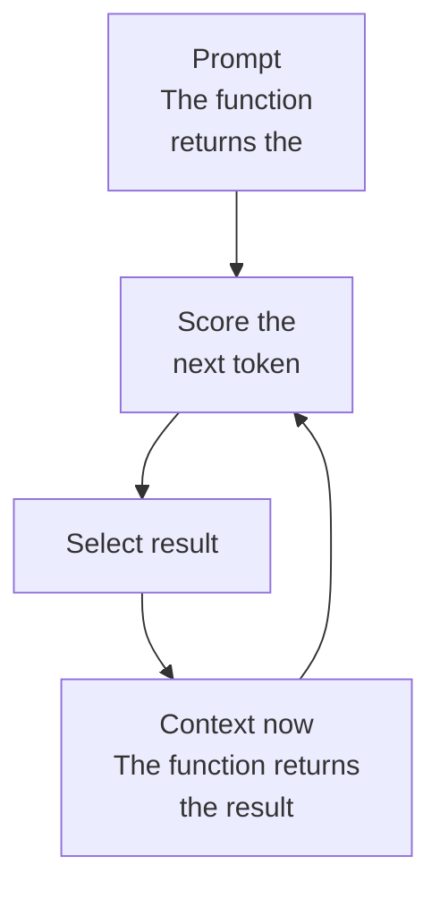

---
{
  "id": "language-modeling-next-token-prediction",
  "title": "Language Modeling & Next Tokens",
  "slug": "language-modeling-next-token-prediction",
  "section": "Preparation & Prerequisites",
  "category": "NLP Fundamentals",
  "difficulty": "Easy",
  "order": 6,
  "coverImage": "illustrations/_generated/next_token_dark.png",
  "companies": [
    "Google",
    "Meta",
    "OpenAI",
    "Anthropic"
  ],
  "shortDescription": "The prompt ends with 'the'. Follow that prefix from a counted bigram through teacher-forced training to the cache that serves the next token.",
  "keyConceptsTested": [
    "Language-model objective: next-token prediction",
    "Chain-rule factorization of sequence probability",
    "Bigram and neural n-gram models share the next-token target",
    "Teacher forcing and parallel causal Transformer training",
    "Cross-entropy loss as averaged negative log-likelihood",
    "Perplexity equals exp(loss): effective choices per token",
    "Autoregressive generation loop",
    "Causal vs masked language modeling (GPT vs BERT)",
    "Context window limits and KV-cache serving tradeoffs",
    "Neural factual recall versus verified retrieval or tool access"
  ]
}
---

Your code editor pauses at `The function returns the`. How does a neural network turn four words into a probability distribution over tens of thousands of candidate continuations, and what happens the moment it picks one?

In the [previous lesson](/learn/transformer-architecture-end-to-end), a Transformer turned token IDs into raw vocabulary scores. A <span data-glossary="token">token</span> is the model's atomic text unit (subwords or characters in production; whole words and punctuation in our running example). If the model selects `result`, the context becomes `The function returns the result`, and the next step favors a period. Repeating that append-and-predict cycle is **autoregressive generation**.

<figure>
  
  <figcaption>Each strip preserves all probability mass in its stated distribution. First, result has 60%, value 25%, index 10%, and all other tokens together 5%. Selecting result appends it to the context, and the next distribution assigns 80% to a period and 20% to the token and. The nested strips score the two-token continuation given the original prompt: result-period carries 0.60 × 0.80 = 0.48, result-and carries 0.12, and continuations starting with other tokens carry 0.40. The basic loop simply samples from each conditional distribution in turn.</figcaption>
</figure>

---

## Next-token scores build a sequence

### Next-token distributions after a prompt

An **autoregressive language model** predicts a probability distribution over the entire vocabulary for the next token given a prefix.[^radford2018][^radford2019] For `"The function returns the"`, a model might put 60% mass on `result`, 25% on `value`, 10% on `index`, and 5% spread across the rest of the vocabulary.

### Reading the distribution before sampling

Change one word in the prefix and the distribution shifts immediately:

| Prompt context | Top continuation | Why the prediction shifts |
|---|---|---|
| `The function returns the` | `result` | Standard completion in code documentation |
| `The function returns the cached` | `value` | The adjective `cached` steers toward stored objects |
| `The function returns the first` | `index` | The ordinal modifier shifts expectation to an offset |
| `The function returns the` (REST API context) | `response` | Surrounding domain context reshapes the ranking |

Context reshapes next-token rankings dynamically, while large checkpoints can also memorize verbatim training phrases.[^carlini2021Extraction]

Why is predicting *one token at a time* enough to model an entire document? By the **chain rule of probability**, any sequence $W = (w_1, w_2, \dots, w_n)$ factorizes *exactly* into a product of conditional next-token probabilities:

$$
P(w_1, w_2, \dots, w_n) = \prod_{t=1}^{n} P(w_t \mid w_1, \dots, w_{t-1}) = \prod_{t=1}^{n} P(w_t \mid w_{<t})
$$

No independence assumption is needed. Every step conditions on the complete prefix observed so far, and including an explicit end token `<eos>` lets the model assign probability to stopping cleanly.

### Softmax probabilities from raw logits

At each step, the unembedding layer outputs raw real-valued <span data-glossary="logits">logits</span> $z \in \mathbb{R}^{|V|}$. After `The compiler reported`, suppose a five-token vocabulary scores `error = 3.0`, `warning = 1.5`, `success = -1.0`, `the = -2.0`, and `</s> = -3.0`. Subtracting the peak logit $\max_j z_j$ before exponentiating converts those scores into normalized probabilities without floating-point overflow (as derived in the [softmax optimization lesson](/learn/softmax-cross-entropy-optimization)):

$$
P(w_i) = \frac{\exp(z_i - \max_j z_j)}{\sum_{k=1}^{|V|} \exp(z_k - \max_j z_j)}
$$

Verify the conversion across all five tokens in Python:

<!-- leetllm: test, output=show -->
```python title="tiny-vocabulary-example.py"
import math

tokens = ["error", "warning", "success", "the", "</s>"]
logits = [3.0, 1.5, -1.0, -2.0, -3.0]

peak = max(logits)
exps = [math.exp(logit - peak) for logit in logits]
total = sum(exps)
probs = [exp / total for exp in exps]

for token, prob in zip(tokens, probs):
    print(f"{token:10s} {prob:.3f}")
print(f"sum        {sum(probs):.3f}")
print("top token ", tokens[max(range(len(probs)), key=lambda i: probs[i])])
```

<!-- leetllm: output:start -->
```text title="Output" output compact
error      0.800
warning    0.178
success    0.015
the        0.005
</s>       0.002
sum        1.000
top token  error
```
<!-- leetllm: output:end -->

`error` takes 80% of the mass, `warning` takes 18%, and all five probabilities sum to `1.0`. Now the central question: how does a model learn those conditional probabilities from raw text?

---

## Estimating probabilities from observed n-gram counts

The simplest language model needs no neural network at all: just count adjacent token pairs. A **bigram model** truncates history to the single preceding token (the **first-order Markov assumption**) and estimates probabilities by Maximum Likelihood:

$$
P(w_t \mid w_{t-1}) = \frac{C(w_{t-1}, w_t)}{C(w_{t-1})}
$$

### Counting bigram events in code comments

Here $C(w_{t-1}) = \sum_{v \in V} C(w_{t-1}, v)$ counts occurrences of $w_{t-1}$ that have a successor (we add `<bos>` and `<eos>` so final words have a stopping target). Count bigrams across six code comments in Python:

<!-- leetllm: test, id=bigram-counts, output=show -->
```python title="count-bigram-events.py"
from collections import Counter, defaultdict

messages = [
    "function returns value",
    "function returns value",
    "method returns result",
    "handler returns value",
    "test returns result",
    "test returns error",
]

counts = defaultdict(Counter)
for message in messages:
    tokens = ["<bos>", *message.split(), "<eos>"]
    for previous, current in zip(tokens, tokens[1:]):
        counts[previous][current] += 1

row = counts["returns"]
total = sum(row.values())
for token, count in row.most_common():
    print(f"P({token:6s} | returns) = {count}/{total} = {count / total:.3f}")
print("unseen token probability =", row["exception"] / total)
```

<!-- leetllm: output:start -->
```text title="Output" output compact
P(value  | returns) = 3/6 = 0.500
P(result | returns) = 2/6 = 0.333
P(error  | returns) = 1/6 = 0.167
unseen token probability = 0.0
```
<!-- leetllm: output:end -->

### The sparsity collapse and Laplace smoothing

Two fundamental flaws immediately stand out in the bigram table above. First, **limited history**: conditioning solely on `returns` makes `function returns` and `test returns` indistinguishable, even though both `function` examples end in `value` while the two `test` examples split between `result` and `error`. Second, **sparsity collapse**: because `returns exception` never appears in our six training comments, its raw count is zero and $P(\text{exception} \mid \text{returns}) = 0.0$, sending the negative log-likelihood of any test document containing that pair to infinity.

**Laplace (add-one) smoothing** removes zero-count collapse by adding a pseudo-count of 1 across the entire vocabulary $V$:

$$
P_{\text{Laplace}}(w_t \mid w_{t-1}) = \frac{C(w_{t-1}, w_t) + 1}{C(w_{t-1}) + |V|}
$$

On a four-token vocabulary (`value`, `result`, `error`, `exception`), the smoothed counts after `returns` become $[4, 3, 2, 1]$, giving a denominator of $6 + 4 = 10$ and raising `exception` to $0.100$. Across the full vocabulary of the corpus plus `exception`, add-one allocates probability mass to every valid token, including words never seen after `returns`:

<!-- leetllm: test, continue=bigram-counts, output=show -->
```python title="smooth-the-full-vocabulary.py"
# Eight ordinary words, an end token, and the extra candidate exception.
prediction_vocab = sorted({token for rows in counts.values() for token in rows} | {"exception"})
smoothed = {token: (row[token] + 1) / (total + len(prediction_vocab)) for token in prediction_vocab}
print("prediction vocabulary:", len(prediction_vocab))
print(f"P(exception | returns): {smoothed['exception']:.4f}")
print(f"row sum: {sum(smoothed.values()):.3f}")
```

<!-- leetllm: output:start -->
```text title="Output" output compact
prediction vocabulary: 10
P(exception | returns): 0.0625
row sum: 1.000
```
<!-- leetllm: output:end -->

Add-one smoothing only redistributes mass over a declared vocabulary; unseen words outside $V$ still need an unknown-token or subword strategy, and production n-gram systems rely on stronger discounting methods like Kneser-Ney.[^chenGoodman1998Smoothing] Even with smoothing, count tables hit a combinatorial wall: at $|V| = 50{,}000$, there are $|V|^4 = 6.25 \times 10^{18}$ four-token prefixes, with zero parameter sharing between similar words.

---

## Neural language models and distributed representations

Bengio et al. (2003) broke that sparsity wall by mapping each token ID to a learned dense vector in $\mathbb{R}^d$ inside an embedding matrix $E \in \mathbb{R}^{|V| \times d}$.[^bengio2003] Words appearing in similar contexts move closer together in embedding space, letting updates from one phrase transfer to related combinations:

1. Look up embeddings for the previous $n - 1$ context tokens in $E$.
2. Concatenate them into $x \in \mathbb{R}^{(n-1)d}$.
3. Project $x$ to vocabulary logits (Bengio used a `tanh` hidden layer; our tiny lab below uses a direct affine projection).
4. Apply softmax to obtain next-token probabilities.

<figure>
  
  <figcaption>Six observed records contribute value: 3, result: 2, error: 1 after returns. The bigram uses that one-token row. The neural lab instead reads function and returns, concatenates two learned six-value embedding rows, and applies the shared affine map with W shaped 12 × 8 and an eight-value bias. Embeddings and three selected logits are rounded values after 200 updates, with bars starting at zero. Softmax uses all eight logits: value = 7.904 receives about 99.84%, result about 0.073%, and error about 0.038%. A trigram table could also distinguish the two-token contexts.</figcaption>
</figure>

### Training a tiny neural n-gram with gradient descent

Train this two-token neural n-gram from scratch with exact cross-entropy gradients $\frac{\partial \mathcal{L}}{\partial z} = p - y$ flowing straight back into $E$:

<!-- leetllm: test, output=show -->
```python title="tiny-neural-ngram.py"
import math
import random

random.seed(7)
sentences = [
    "function returns value",
    "function returns value",
    "method returns result",
    "handler returns value",
    "test returns result",
    "test returns error",
]
vocab = sorted({word for sentence in sentences for word in sentence.split()})
to_id = {word: index for index, word in enumerate(vocab)}
n_vocab = len(vocab)
emb_dim = 6

contexts = []
targets = []
for sentence in sentences:
    words = sentence.split()
    for index in range(2, len(words)):
        contexts.append([to_id[words[index - 2]], to_id[words[index - 1]]])
        targets.append(to_id[words[index]])

embeddings = [[random.uniform(-0.3, 0.3) for _ in range(emb_dim)] for _ in range(n_vocab)]
weights = [[random.uniform(-0.2, 0.2) for _ in range(n_vocab)] for _ in range(emb_dim * 2)]
bias = [0.0] * n_vocab


def concat_embeddings(token_ids):
    return embeddings[token_ids[0]] + embeddings[token_ids[1]]


def logits_from(features):
    logits = bias[:]
    for i, value in enumerate(features):
        for j, weight in enumerate(weights[i]):
            logits[j] += weight * value
    return logits


def softmax(logits):
    peak = max(logits)
    exps = [math.exp(logit - peak) for logit in logits]
    total = sum(exps)
    return [exp / total for exp in exps]


def mean_loss():
    total = 0.0
    for token_ids, target in zip(contexts, targets):
        logits = logits_from(concat_embeddings(token_ids))
        peak = max(logits)
        total += (peak - logits[target]) + math.log(sum(math.exp(z - peak) for z in logits))
    return total / len(contexts)


def predict(text):
    token_ids = [to_id[word] for word in text.split()]
    logits = logits_from(concat_embeddings(token_ids))
    return vocab[max(range(n_vocab), key=lambda index: logits[index])]


initial_loss = mean_loss()
learning_rate = 0.4
for _ in range(200):
    grad_embeddings = [[0.0] * emb_dim for _ in range(n_vocab)]
    grad_weights = [[0.0] * n_vocab for _ in range(emb_dim * 2)]
    grad_bias = [0.0] * n_vocab
    scale = 1.0 / len(contexts)
    for token_ids, target in zip(contexts, targets):
        features = concat_embeddings(token_ids)
        dlogits = [prob * scale for prob in softmax(logits_from(features))]
        dlogits[target] -= scale
        for j, grad in enumerate(dlogits):
            grad_bias[j] += grad
        for i, value in enumerate(features):
            for j, grad in enumerate(dlogits):
                grad_weights[i][j] += value * grad
        dfeatures = [
            sum(weights[i][j] * dlogits[j] for j in range(n_vocab))
            for i in range(emb_dim * 2)
        ]
        for offset, token_id in enumerate(token_ids):
            start = offset * emb_dim
            for dim in range(emb_dim):
                grad_embeddings[token_id][dim] += dfeatures[start + dim]
    for i in range(n_vocab):
        bias[i] -= learning_rate * grad_bias[i]
        for dim in range(emb_dim):
            embeddings[i][dim] -= learning_rate * grad_embeddings[i][dim]
    for i in range(emb_dim * 2):
        for j in range(n_vocab):
            weights[i][j] -= learning_rate * grad_weights[i][j]

print(f"loss before training: {initial_loss:.3f}")
print(f"loss after training:  {mean_loss():.3f}")
print("after 'function returns':", predict("function returns"))
print("after 'test returns':    ", predict("test returns"))
assert predict("function returns") == "value"
assert mean_loss() < initial_loss
```

<!-- leetllm: output:start -->
```text title="Output" output compact
loss before training: 2.145
loss after training:  0.235
after 'function returns': value
after 'test returns':     result
```
<!-- leetllm: output:end -->

Loss drops from `2.145` to `0.235` nats, right near the irreducible conditional-entropy floor $\frac{2 \ln(2)}{6} \approx 0.231$ nats caused by `test returns` appearing once with `result` and once with `error`.

### Temperature scaling on output logits

During decoding, dividing raw logits by a positive **<span data-glossary="temperature">temperature</span>** $T > 0$ reshapes the sampling distribution without changing model weights:

$$
P(w_i) = \frac{\exp(z_i / T)}{\sum_j \exp(z_j / T)}
$$

- **$0 < T < 1.0$ (Cooling):** Amplifies logit gaps and concentrates mass on top candidates (as $T \to 0^+$, mass collapses onto the argmax; APIs accepting `T = 0` switch to greedy argmax explicitly).
- **$T = 1.0$:** Standard unscaled softmax probabilities.
- **$T > 1.0$ (Heating):** Flattens gaps and spreads mass toward lower-ranked tokens, approaching uniform as $T \to \infty$.

<!-- leetllm: test, output=show, output_title="Temperature comparison" -->
```python title="compare-temperatures.py"
import math

logits = [3.0, 1.5, -1.0, -2.0, -3.0]
tokens = ["error", "warning", "success", "the", "</s>"]
for temperature in [0.5, 1.0, 2.0]:
    peak = max(logits)
    exps = [math.exp((logit - peak) / temperature) for logit in logits]
    total = sum(exps)
    probabilities = [exp / total for exp in exps]
    ranked = sorted(probabilities, reverse=True)
    if temperature == 1.0:
        print(f"{tokens[0]:<11}{probabilities[0]:.3f}")
        print(f"{tokens[1]:<11}{probabilities[1]:.3f}")
    print(f"T={temperature:.1f} top={ranked[0]:.3f} second={ranked[1]:.3f}")
```

<!-- leetllm: output:start -->
```text title="Temperature comparison" output compact
T=0.5 top=0.952 second=0.047
error      0.800
warning    0.178
T=1.0 top=0.800 second=0.178
T=2.0 top=0.575 second=0.272
```
<!-- leetllm: output:end -->

At $T = 0.5$, `error` jumps to 95.2%; at $T = 2.0$, it drops to 57.5%.

### Causal versus masked language modeling

**Causal language modeling** predicts each token strictly from prior context ($w_{<t}$), which fits left-to-right text generation. **Masked language modeling** (BERT) corrupts 15% of positions (80% `[MASK]`, 10% random, 10% unchanged) and predicts the missing tokens using both left and right context simultaneously.[^devlin2019]

| Objective | Visible context | Core training task | Primary architectural use |
|---|---|---|---|
| Causal language modeling | Only prior tokens ($w_{<t}$) | Predict the single next token | Generative decoders (GPT, LLaMA, Claude) |
| Masked language modeling | Full bidirectional context ($w_{<t}$ and $w_{>t}$) | Reconstruct masked tokens in place | Encoders for embeddings, reranking, classification (BERT) |

---

## Teacher forcing and parallel causal training

Every raw text document supplies its own supervision: at position $t$, the observed next token $w_{t+1}$ is the target label.

### The causal attention mask and parallel GEMM

During **teacher forcing**, the model reads ground-truth tokens at every position rather than its own sampled tokens. Unlike an RNN that must step sequentially through time, a causal Transformer scores all $T$ positions within a layer in parallel:

1. Feed the entire sequence $x_1, \dots, x_T$ at once.
2. Add a **causal attention mask** setting future scores $M_{ij} = -\infty$ for $j > i$ so $\exp(-\infty) = 0$ blocks future leakage.
3. Evaluate every position's next-token logits simultaneously per layer (full self-attention still performs $\mathcal{O}(T^2)$ pairwise work per layer, and deeper layers still depend on earlier layers).[^vaswani2017]

<figure>
  
  <figcaption>Teacher forcing shifts one observed sequence into four input-label pairs. In the additive mask, columns are key positions j and rows are query positions i; zero entries permit past/current keys and negative infinity excludes future keys. The four true-token probabilities align with their labels, and their negative log losses average 0.209 nats. A Transformer can score these known positions together within each layer. Below, each selected token becomes part of the following generation context, until eos is selected. Layers remain dependent, and the complete pass still does sequence-length-dependent work.</figcaption>
</figure>

### Exposure bias and the train-inference gap

Teacher forcing gives fast, low-variance gradients, at the cost of **exposure bias**: during training every step conditions on clean ground-truth prefixes, whereas during generation each step conditions on the model's own prior samples, so an early slip can compound.[^bengio2015ScheduledSampling]

### Shifting tokens into inputs and target labels

Given `[<bos>, function, returns, value, <eos>]`, inputs drop the last token and targets drop the first:

| Input prefix ($x$) | Target label ($y$) |
|---|---|
| `<bos>` | `function` |
| `<bos> function` | `returns` |
| `<bos> function returns` | `value` |
| `<bos> function returns value` | `<eos>` |

> **Common mistake:** Double-shifting labels or masking genuine `<eos>` tokens. In Hugging Face Transformers, `DataCollatorForLanguageModeling(mlm=False)` copies input IDs into `labels` and masks padding with `-100`, while the built-in causal loss shifts `labels[..., 1:]` internally.[^huggingface2026datacollator][^huggingface2026causalloss] When `pad_token_id == eos_token_id`, always derive `-100` target masks from the attention mask so genuine stop tokens stay supervised.

The snippet below shifts arrays explicitly for a custom loss function:

<!-- leetllm: test, output=show -->
```python title="shift-next-token-labels.py"
vocab = {"<bos>": 0, "function": 1, "returns": 2, "value": 3, "<eos>": 4}
tokens = ["<bos>", "function", "returns", "value", "<eos>"]
ids = [vocab[token] for token in tokens]
inputs = ids[:-1]
targets = ids[1:]

print("input token ids: ", inputs)
print("target token ids:", targets)
for position in range(len(inputs)):
    context = " ".join(tokens[: position + 1])
    print(f"{context:25s} -> {tokens[position + 1]}")
```

<!-- leetllm: output:start -->
```text title="Output" output compact
input token ids:  [0, 1, 2, 3]
target token ids: [1, 2, 3, 4]
<bos>                     -> function
<bos> function            -> returns
<bos> function returns    -> value
<bos> function returns value -> <eos>
```
<!-- leetllm: output:end -->

### Cross-entropy loss across sequence positions

At each supervised position, **cross-entropy loss** scores the probability of the observed target token. Averaging across $n$ scored targets gives:

$$
\mathcal{L} = -\frac{1}{n} \sum_{t=1}^{n} \log P(x_t \mid x_{<t})
$$

If the network assigns probability 1.0 to the target, the term contributes $-\log(1.0) = 0$ loss. At probability 0.01, the penalty is $-\log(0.01) \approx 4.605$ nats. Across conflicting observations of the same prefix, minimizing average loss favors their frequency distribution, not confidence 1.0 in each incompatible target. Exclude ignored targets from both the loss sum and $n$; require at least one scored target.

<!-- leetllm: test, output=show -->
```python title="cross-entropy-over-positions.py"
import math

targets = [1, 2, 3, 4]  # function, returns, value, <eos>
logits = [
    [0.0, 3.0, 0.5, -1.0, -2.0],
    [-1.0, 0.1, 2.5, 0.0, -2.0],
    [-1.0, 0.0, 0.2, 2.0, -1.5],
    [-2.0, 0.0, -1.0, -0.5, 2.4],
]

true_probs = []
losses = []
for row, target in zip(logits, targets):
    peak = max(row)
    exps = [math.exp(logit - peak) for logit in row]
    total = sum(exps)
    prob = exps[target] / total
    true_probs.append(prob)
    losses.append((peak - row[target]) + math.log(total))

print("true-token probabilities:", [round(prob, 3) for prob in true_probs])
print("per-token losses:        ", [round(loss, 3) for loss in losses])
print(f"mean cross-entropy:       {sum(losses) / len(losses):.3f}")
```

<!-- leetllm: output:start -->
```text title="Output" output compact
true-token probabilities: [0.864, 0.824, 0.724, 0.839]
per-token losses:         [0.146, 0.194, 0.323, 0.175]
mean cross-entropy:       0.209
```
<!-- leetllm: output:end -->

### Perplexity as an effective branching factor

Cross-entropy loss in natural logarithms produces units of nats, or bits when computed in base 2. Exponentiating average cross-entropy yields **perplexity**, which equals the reciprocal of the geometric mean of the target token probabilities:[^shannon1948][^jelinek1977]

$$
\text{Perplexity} = \exp(\mathcal{L}) = \exp\left(-\frac{1}{n} \sum_{t=1}^n \log P(x_t \mid x_{<t})\right) = \frac{1}{\sqrt[n]{\prod_{t=1}^n P(x_t \mid x_{<t})}}
$$

Intuitively, perplexity measures the model's **effective branching factor**, meaning how many equally likely options the model feels unsure among at each step:

- A perplexity of 1.0 means the model predicted every target token with 100% confidence ($\mathcal{L} = 0$).
- A uniform predictor over 50,000 tokens has loss $\ln(50,000) \approx 10.82$ and perplexity exactly 50,000, whereas exponentiating the rounded 10.82 gives only an approximation.
- Our four-position example has perplexity about 1.233, though confidence calibration still requires a separate check and poorly calibrated probabilities can even push perplexity above vocabulary size.

<!-- leetllm: test, output=show -->
```python title="perplexity-by-hand.py"
import math

# Probability the model gave to the token that was actually correct, per position
true_token_probs = [0.5, 0.5, 0.5, 0.125]

per_position_loss = [-math.log(prob) for prob in true_token_probs]
avg_loss = sum(per_position_loss) / len(per_position_loss)
perplexity = math.exp(avg_loss)

print(f"per-position loss: {[round(loss, 4) for loss in per_position_loss]}")
print(f"average loss:      {avg_loss:.4f}")
print(f"perplexity:        {perplexity:.4f}")

product = 1.0
for prob in true_token_probs:
    product *= prob
geo_mean = product ** (1 / len(true_token_probs))
print(f"1 / geometric mean:{1 / geo_mean:.4f}")
```

<!-- leetllm: output:start -->
```text title="Output" output compact
per-position loss: [0.6931, 0.6931, 0.6931, 2.0794]
average loss:      1.0397
perplexity:        2.8284
1 / geometric mean:2.8284
```
<!-- leetllm: output:end -->

Notice how a single low-probability target (`0.125` at position 4) pulls the average loss from `0.693` up to `1.039`, nearly tripling perplexity to `2.828`. Because logarithmic loss grows steeply as assigned probability drops toward zero, perplexity penalizes confident surprises heavily.

> Compare token perplexity under the same tokenization, evaluation text, preprocessing, scored targets, and context windowing. Vocabulary size alone doesn't make tokenization units comparable, because byte tokens and subword tokens divide text into different step counts. For a tokenizer-independent metric, report bits per byte under a stated encoding and chunking rule.[^huggingface_ppl]

Long-document evaluation also depends on how chunks are fed to the model. Disjoint chunks reset memory and raise loss near chunk splits, whereas strided sliding windows carry earlier tokens forward as context. When aggregating across variable-length batches (for instance, one batch scoring one target at `0.5` and another scoring three padded targets at `0.125` each), sum total negative log-likelihood and total non-padding token counts across all batches before exponentiating rather than averaging per-batch perplexities:

<!-- leetllm: test, output=show -->
```python title="pool-perplexity-by-target-count.py"
import math

batches = [[0.5], [0.125, 0.125, 0.125]]
nll_sums = [sum(-math.log(p) for p in batch) for batch in batches]
counts = [len(batch) for batch in batches]
means = [nll / count for nll, count in zip(nll_sums, counts)]

pooled = math.exp(sum(nll_sums) / sum(counts))
mean_batch_loss_ppl = math.exp(sum(means) / len(means))
mean_batch_ppl = sum(math.exp(mean) for mean in means) / len(means)
print(f"pooled token perplexity:   {pooled:.3f}")
print(f"exp(mean batch loss):      {mean_batch_loss_ppl:.3f}")
print(f"mean batch perplexity:     {mean_batch_ppl:.3f}")
assert math.isclose(pooled, 1 / (0.5 * 0.125 ** 3) ** 0.25)
```

<!-- leetllm: output:start -->
```text title="Output" output compact
pooled token perplexity:   5.657
exp(mean batch loss):      4.000
mean batch perplexity:     5.000
```
<!-- leetllm: output:end -->

Only the pooled calculation (`sum(nll) / sum(counts)`) measures true per-token perplexity across variable-length batches. Averaging per-batch losses gives a 1-token batch the same weight as a 3-token batch, and averaging per-batch perplexities distorts the result further because $\exp(\cdot)$ is nonlinear.

> **Key insight:** Only compare token perplexity across models sharing the exact same tokenizer, text split, and windowing rule. To compare across different tokenizers, report bits per byte instead.[^huggingface_ppl]

---

## The autoregressive generation loop

During generation, the model cannot jump ahead: it must pick token $t$ before scoring token $t + 1$. Each iteration reads the current prefix, computes vocabulary logits, selects one token via greedy argmax or sampling, appends it to the context, and repeats until hitting a stop token or length cap.



### A deterministic generation loop in code

Trace that sequential control loop over the distributions from Figure 1:

<!-- leetllm: test, output=show -->
```python title="a-tiny-generation-loop-in-code.py"
next_token_table = {
    "The function returns the": [("result", 0.60), ("value", 0.25), ("index", 0.10), ("other", 0.05)],
    "The function returns the result": [(".", 0.80), ("and", 0.20)],
    "The function returns the result.": [("</s>", 1.0)],
}

text = "The function returns the"

for step in range(3):
    choices = next_token_table[text]
    assert abs(sum(probability for _, probability in choices) - 1.0) < 1e-12
    token, _probability = max(choices, key=lambda item: item[1])

    if token == "</s>":
        break

    text = text + ("" if token == "." else " ") + token
    print(step, repr(text))
print("final text:", repr(text))
```

<!-- leetllm: output:start -->
```text title="Output" output compact
0 'The function returns the result'
1 'The function returns the result.'
final text: 'The function returns the result.'
```
<!-- leetllm: output:end -->

| Termination condition | Trigger mechanism | Handling |
|---|---|---|
| End / end-of-turn token | Stop-token ID selected | End generation or turn cleanly |
| Output token budget | Token count hits `max_tokens` | Surface truncation so incomplete output is not treated as finished |
| Stop sequence match | Configured delimiter appears | Retain or strip delimiter per API setting |
| Application interruption | Client cancel, timeout, or filter | Report the stop reason and treat partial text as incomplete |

### Greedy selection versus temperature sampling

**Greedy decoding** picks $\hat{w} = \arg\max_i z_i$ at every step, which can miss higher-probability full sequences (if $P(A)=0.6$ leads to $0.1$ while $P(B)=0.4$ leads to $0.9$, greedy picks $0.06$ instead of $0.36$). **Stochastic sampling** draws from the softmax distribution, commonly after **top-$k$** (keep the $k$ highest logits) or **top-$p$ / nucleus** filtering (keep the smallest set reaching cumulative probability $p$) and renormalizing:

<!-- leetllm: test, output=show -->
```python title="greedy-versus-sampling.py"
import math
import random

tokens = ["result", "value", "index"]
logits = [2.4, 1.7, 0.2]


def probabilities(temperature):
    if temperature <= 0:
        raise ValueError("temperature must be positive")
    peak = max(logits)
    exps = [math.exp((logit - peak) / temperature) for logit in logits]
    total = sum(exps)
    return [exp / total for exp in exps]


rng = random.Random(4)
greedy = tokens[max(range(len(logits)), key=lambda i: logits[i])]
probs = probabilities(1.4)
samples = [rng.choices(tokens, weights=probs, k=1)[0] for _ in range(8)]

print("greedy:", greedy)
print("sampled at temperature 1.4:", samples)
print("probabilities:", [round(prob, 3) for prob in probs])
```

<!-- leetllm: output:start -->
```text title="Output" output compact
greedy: result
sampled at temperature 1.4: ['result', 'result', 'result', 'result', 'result', 'result', 'index', 'value']
probabilities: [0.551, 0.334, 0.115]
```
<!-- leetllm: output:end -->

### Context window limits and memory growth

In the basic loop, every generated token extends the active context conditioned on future steps. When predicting token 1,000, the model reads both the prompt and all 999 preceding tokens. Serving engines therefore define a maximum **context window** balancing prompt room against output length, with full-attention caches scaling linearly with retained positions whereas sliding-window or recurrent caches trim older entries.[^huggingface2026kvcache]

---

## Production serving: prefill, decode, and the KV cache

Production serving runs the exact same autoregressive weights across two distinct computational regimes: processing the incoming prompt in parallel, then generating response tokens sequentially one by one.

1. **The Prefill Phase:** Processing the user's prompt tokens all at once.
2. **The Decode Phase:** Generating new tokens sequentially one by one.

<figure>
  
  <figcaption>Each K/V column represents the layer-specific vectors of one processed position, omitting individual numerical entries. Prefill processes The function returns the, retains four cache columns, and computes the logits that select result. Feeding result appends column 5 before selecting a period, and feeding the period appends column 6 before selecting the stop token, halting before feeding the stop token itself. Under the displayed model dimensions, raw KV payloads reach 1, 4, and 16 GiB at 2,048, 8,192, and 32,768 cached positions per request before allocator and activation memory.</figcaption>
</figure>

### Count the work before and after caching

In standard multi-head self-attention, every position $t$ computes query, key, and value projections $Q_t = X_t W_Q$, $K_t = X_t W_K$, and $V_t = X_t W_V$. Generating $m$ tokens from a prompt of length $p$ without caching forces the model to reprocess prefixes of lengths $p, p+1, \dots, p+m-1$, making linear projections grow as $\mathcal{O}(m^2)$ and pairwise full attention scores grow as $\mathcal{O}(m^3)$. Calling uncached generation merely quadratic misses that extra factor of $m$ accumulated by recomputing attention over prefixes repeatedly.

### The KV cache and memory bandwidth bottlenecks

Because causal masking prevents future tokens from altering past hidden states, every prefix token's keys and values stay identical across future decode steps. Caching those per-layer tensors in GPU HBM lets each decode step run only the newly selected token: compute its $(q_t, k_t, v_t)$, append $k_t$ and $v_t$ to the cache, attend $q_t$ over all cached keys and values, and project to the next token.[^pope2023][^huggingface2026kvcache]

That eliminates repeated projections, dropping projection work from $\mathcal{O}(m^2)$ to $\mathcal{O}(m)$ and cumulative attention work from $\mathcal{O}(m^3)$ to $\mathcal{O}(m^2)$ across $m$ generated tokens.

### Check the cache against a full pass

Verify that prefilling 3 positions and decoding positions 4 and 5 incrementally produces the exact same output as one full causal pass (each decode query sits at the *end* of its cache, so it attends to every cached key):

<!-- leetllm: test, deps=torch, output=show -->
```python title="cached-attention-matches-a-full-pass.py"
import torch
import torch.nn.functional as F

torch.manual_seed(3)
hidden = torch.randn(1, 5, 4)
q, k, v = [hidden @ torch.randn(4, 4) for _ in range(3)]
full = F.scaled_dot_product_attention(q, k, v, is_causal=True, dropout_p=0.0)

cache_k, cache_v = k[:, :3].clone(), v[:, :3].clone()
outputs = [F.scaled_dot_product_attention(q[:, :3], cache_k, cache_v,
                                        is_causal=True, dropout_p=0.0)]
lengths = [cache_k.size(1)]
for position in range(3, 5):
    cache_k = torch.cat([cache_k, k[:, position:position + 1]], dim=1)
    cache_v = torch.cat([cache_v, v[:, position:position + 1]], dim=1)
    allowed = torch.ones(1, cache_k.size(1), dtype=torch.bool)
    outputs.append(F.scaled_dot_product_attention(q[:, position:position + 1],
                   cache_k, cache_v, attn_mask=allowed, dropout_p=0.0))
    lengths.append(cache_k.size(1))

print("cached lengths:", lengths)
print("matches full pass:", torch.allclose(torch.cat(outputs, dim=1), full, atol=1e-6))
assert torch.allclose(torch.cat(outputs, dim=1), full, atol=1e-6)
```

<!-- leetllm: output:start -->
```text title="Output" output compact
cached lengths: [3, 4, 5]
matches full pass: True
```
<!-- leetllm: output:end -->

Each layer keeps its own cache with positional encodings (such as RoPE) already baked into the cached keys. On modern GPUs, this creates two distinct hardware regimes:[^pope2023]

- **Prefill is usually compute-bound:** Many prompt tokens reuse loaded weights together inside large matrix multiplies.
- **Small-batch decode is usually memory-bandwidth-bound:** Streaming a 2-byte weight to do one multiply-add yields ~1 FLOP/byte per single token, leaving tensor cores hungry until larger batching or **speculative decoding** (verifying multiple draft tokens in one parallel target pass while preserving the exact target distribution)[^leviathan2023] increases arithmetic intensity.

### Sizing the KV cache in high bandwidth memory

For uniform full-attention layers, raw KV payload for $B$ concurrent sequences of cached length $S$ at $P_{\text{bytes}}$ per element (2 for FP16/BF16, 1 for FP8/INT8) is:

$$
\text{Memory}_{\text{KV}} = 2 \times L \times H_{\text{KV}} \times d_h \times S \times B \times P_{\text{bytes}}
$$

(For variable sequence lengths, replace $S B$ with the sum of cached positions across requests; a token just sampled is not cached until fed back into the next step.)

<!-- leetllm: test, output=show -->
```python title="kv-cache-memory-budget.py"
batch = 4
layers = 32
kv_heads = 8
head_dim = 128
bytes_per_value = 2

def cache_gib(sequence_length):
    values = batch * layers * sequence_length * kv_heads * head_dim * 2
    return values * bytes_per_value / (1024 ** 3)

for sequence_length in [2_048, 32_768]:
    print(f"{sequence_length:,} tokens: {cache_gib(sequence_length):.2f} GiB")
```

<!-- leetllm: output:start -->
```text title="Output" output compact
2,048 tokens: 1.00 GiB
32,768 tokens: 16.00 GiB
```
<!-- leetllm: output:end -->

At 32,768 tokens per request, just four concurrent streams take **16 GiB** of raw KV memory; at batch size 32, that explodes to **128 GiB**. Two architecture and serving advances tame that growth:

1. **Grouped-Query Attention (GQA):** Sharing 8 KV heads across 32 query heads cuts raw KV cache size $4\times$ while preserving quality close to full multi-head attention.[^ainslie2023]
2. **PagedAttention (vLLM):** Maps fixed-size KV blocks onto noncontiguous physical pages, eliminating external fragmentation so waste stays confined to the partially filled final block per sequence (the vLLM paper measured only 20.4%-38.2% actual KV occupancy in prior contiguous-buffer systems).[^kwon2023]

---

<span id="why-next-token-objectives-learn-structured-computation"></span>
## How next-token predictions can reflect structure

Predicting one token at a time forces a Transformer to track program state across the context. A bigram reading only `# output:` misses `retries = 3` and `retries -= 1`, while full self-attention can carry the variable state and predict `2`:

```text title="tracking-a-value.txt"
retries = 3
retries -= 1
print(retries)  # output:
```

Pretraining on code and text traces builds strong in-context predictive structure,[^brown2020] yet a single correct completion can still come from a shortcut. Vary the inputs and operations and compare predictions against actual program execution to test whether the model truly follows the arithmetic.

---

## Failure modes and debugging

### Treating probabilities as ground-truth facts

Because next-token training maximizes conditional plausibility rather than verifying external truth, high probability is never a fact check. Suppose an assistant reads `The rate-limit page says free-tier requests are` and assigns 75% probability to `unlimited` when the current docs state `60 requests per minute`.

| Failure symptom | Root cause | Fix |
|---|---|---|
| Plausible hallucination | High continuation likelihood without verified evidence | Retrieve authoritative docs and verify the answer against them |
| Outdated facts | Stale weights or stale retrieved passage | Query current authoritative sources and inspect retrieval traces |
| Invented citations | Plausible URL patterns generated from memory | Fetch and verify the cited source directly |
| Repetitive loops | Model scores and greedy/narrow decoding reinforce a repeated span | Inspect prompt, stop tokens, and sampling settings |

<span id="the-relational-database-myth"></span>
### Why an LLM isn't a live database

A language model never runs a live SQL lookup when generating tokens: every step simply combines prompt context with frozen weights. Although weights can memorize training text,[^carlini2021Extraction] current facts require external retrieval or tool calls verified against the latest authoritative record.

## Stress-testing prefix distributions and cache budgets

> **Key insight:** Next-token prediction gives you a universal sequence engine: factorize text via the chain rule, train every position in parallel with teacher forcing, and reuse cached KV states at decode time. Grounding answers in current truth still belongs to retrieval and verification.

```checkpoint
Why can't a next-token model achieve zero cross-entropy loss if identical prefixes (`function returns`) appear twice with `value` and once with `exception`?
---
One prefix produces one normalized distribution, which cannot put probability 1 on two different targets at once. The cross-entropy minimum matches their empirical 2/3 vs. 1/3 split, leaving an irreducible conditional-entropy floor of −(2/3)ln(2/3) − (1/3)ln(1/3) ≈ 0.637 nats.
```

```checkpoint
Halving KV heads cuts raw KV cache storage in half. Does that automatically double tokens per second?
---
No. Halving KV heads cuts cache storage and KV reads by half, while dense weight loads, MLP compute, batching, kernels, and communication still contribute to step latency. Measure storage and throughput separately.
```

```mastery-quiz
[
  {
    "question": "An autoregressive language model gives a first observed token probability 0.7, a second observed token 0.4 given the first, and end 0.5 given both. Which prefix and complete stopped-sequence probabilities follow?",
    "options": [
      "0.14 and 0.28.",
      "0.70 and 0.50.",
      "0.28 and 0.14.",
      "0.28 and 0.28."
    ],
    "answer": "0.28 and 0.14.",
    "explanation": "Multiply the two observed-token conditionals for the prefix: 0.7×0.4=0.28. Including the explicit end decision gives 0.28×0.5=0.14. Reversing them, keeping endpoints alone or omitting the stop factor scores another quantity."
  },
  {
    "question": "After ping, a count row contains A: 4 and B: 2, while all other entries in a declared 12-token prediction vocabulary have zero count. What are the unsmoothed loss for an observed unseen C, and its add-one probability?",
    "options": [
      "Infinite loss, 1/18.",
      "Infinite loss, 1/8.",
      "Zero loss, 1/18.",
      "Finite loss, 1/12."
    ],
    "answer": "Infinite loss, 1/18.",
    "explanation": "C has count 0, so its unsmoothed probability is 0 and −ln 0 is infinite. Add-one creates one pseudo-count for each of 12 eligible entries, so the denominator is 6+12=18 and C receives 1/18. 1/8 smooths only a two-output row, 1/12 discards observations, and zero loss would require probability 1."
  },
  {
    "question": "A neural n-gram has 7 vocabulary entries, 4 embedding coordinates and 3 context tokens. It concatenates the embeddings, then applies an affine map with one bias per output to produce 7 logits. A separate three-output head gives probabilities [0.1, 0.6, 0.3]. The first token is the observed target. How many trainable parameters does the n-gram have, and what is the gradient of this observation’s unweighted softmax cross-entropy loss with respect to the separate head’s logits?",
    "options": [
      "119, [0.1, −0.4, 0.3].",
      "91, [−0.9, 0.6, 0.3].",
      "119, [0.9, −0.6, −0.3].",
      "119, [−0.9, 0.6, 0.3]."
    ],
    "answer": "119, [−0.9, 0.6, 0.3].",
    "explanation": "The embedding table has 7 × 4 = 28 parameters. The three embeddings give 12 input coordinates, so the output map adds 12 × 7 weights and 7 biases, for a total of 119. Counting only the map and biases gives 91. In the separate head, subtract 1 from the target probability and leave the other two entries alone. This gives [−0.9, 0.6, 0.3]. Subtracting 1 from 0.6 treats the most likely token as the target. Reversing all three signs gives the gradient of log likelihood."
  },
  {
    "question": "A causal loss shifts labels internally once and ignores targets marked −100. The input IDs are [5, 7, 9, 2, 2]. Position 3 is a genuine end token. A positional mask marks only position 4 as padding. Which label row keeps the end token in the loss and excludes padding, and what target does logit position 2 receive?",
    "options": [
      "Labels [7, 9, 2, −100, −100], target −100.",
      "Labels [5, 7, 9, 2, −100], target 2.",
      "Labels [5, 7, 9, −100, −100], target −100.",
      "Labels [5, 7, 9, 2, 2], target 2."
    ],
    "answer": "Labels [5, 7, 9, 2, −100], target 2.",
    "explanation": "Copy the input IDs and set only the padding label at position 4 to −100. After the internal shift, logit 2 predicts the real end at position 3, and logit 3 has an ignored target. Leaving both copies of ID 2 in the labels makes the padding slot count as a second end target. Masking both copies removes the real end target. Shifting the labels before passing them to the loss moves the end target to logit 1 and leaves logit 2 with an ignored target."
  },
  {
    "question": "Evaluation batch A scores two targets at probability 0.5 each. Batch B scores one target at probability 0.0625. Padding is ignored. What is the pooled per-target perplexity over these three observations?",
    "options": [
      "9.000.",
      "5.657.",
      "4.000.",
      "8.000."
    ],
    "answer": "4.000.",
    "explanation": "The total NLL is 2 ln 2+ln 16=6 ln 2. Divide by 3 scored targets and exponentiate: e^(2 ln 2)=4. The value 9 is the mean of batch perplexities 2 and 16, 5.657 exponentiates the equally weighted batch losses, and 8 uses the wrong denominator. Retain loss sums and actual counts."
  },
  {
    "question": "A complete three-token row has logits [ln 25, ln 9, 0]. A sampler uses temperature 2, keeps the two highest logits and renormalizes. What is the probability of selecting the first token, rounded to four decimal places?",
    "options": [
      "0.6250",
      "0.7353",
      "0.5556",
      "0.7143"
    ],
    "answer": "0.6250",
    "explanation": "Dividing the logits by 2 and exponentiating gives weights 5, 3 and 1. The top two keep weights 5 and 3, so the first token gets 5/8 = 0.6250. Filtering alone gives 25/34 ≈ 0.7353. Heating alone keeps all three weights and gives 5/9 ≈ 0.5556. With both controls off, the original weights give 25/35 ≈ 0.7143."
  },
  {
    "question": "A single request prefills 5 positions, selects token A, then consumes A and selects end. It stops before feeding end back. Its uniform full-attention cache has 3 layers, 2 KV heads, 4 coordinates per head and 2 bytes per stored coordinate. How many positions has the request processed, and how many bytes of raw keys and values does it retain?",
    "options": [
      "7 positions, 672 bytes.",
      "6 positions, 288 bytes.",
      "6 positions, 576 bytes.",
      "7 positions, 336 bytes."
    ],
    "answer": "6 positions, 576 bytes.",
    "explanation": "The five prompt tokens and A enter the cache, giving six positions. Each position stores 3 layers × 2 heads × 4 coordinates × 2 bytes = 48 bytes of keys, plus 48 bytes of values. Six positions therefore use 576 bytes. Counting keys alone gives 288 bytes. Giving the selected end token a cache entry would give seven positions and 672 bytes. Combining that extra position with counting keys alone gives 336 bytes."
  },
  {
    "question": "A model generates 3 tokens from a 2-token prompt. Without caching, it processes prefixes of lengths 2, 3 and 4. Count every cell in each square attention score matrix, including masked cells. With caching, prefill uses a 2 × 2 matrix, then two single-query calls score 3 and 4 keys respectively. What are the totals for projected positions and score cells, each given in uncached/cached order?",
    "options": [
      "Projection 9/4, score 29/11.",
      "Projection 9/5, score 29/16.",
      "Projection 6/4, score 20/11.",
      "Projection 9/4, score 29/8."
    ],
    "answer": "Projection 9/4, score 29/11.",
    "explanation": "Without caching, the model projects 2 + 3 + 4 = 9 positions and computes 2² + 3² + 4² = 29 score cells. With caching, it projects 2 + 1 + 1 = 4 positions and computes 4 + 3 + 4 = 11 cells. Five cached positions and 16 cells would include an extra call scoring five keys. Six uncached positions and 20 cells skip the length-three call, losing three positions and nine cells. Eight cached cells leave out the three-key score row while still counting its projected position."
  },
  {
    "question": "Two requests retain 6 and 9 positions in 8 uniform layers with 4 KV heads,16 coordinates per head and 2 bytes per value. Fixed pages hold 4 positions per request, with no other overhead. Which raw and page-rounded batch payloads follow?",
    "options": [
      "30 KiB and 30 KiB.",
      "40 KiB and 30 KiB.",
      "15 KiB and 20 KiB.",
      "30 KiB and 40 KiB."
    ],
    "answer": "30 KiB and 40 KiB.",
    "explanation": "Raw positions sum 15 and raw payload 2×8×4×16×15×2=30,720 bytes=30 KiB. Page capacities are 8 and 12 positions, total 20, so rounded payload 40,960 bytes=40 KiB. Reversing costs, ignoring partial tails or storing only K omits part of the declared state."
  },
  {
    "question": "A support assistant cites policy v1 and reports a 14-day retention period. The current v2 policy says 30 days. A code assistant correctly predicts that print(3 * 4) outputs 12. Which checks would verify the policy answer and test whether the code assistant follows the arithmetic?",
    "options": [
      "Inspect the retrieval trace and check the answer against policy v1. Rerun the original program and compare each prediction with its output.",
      "Inspect the retrieval trace and check the answer against policy v2. Vary the inputs and operations and compare each prediction with the program’s output.",
      "Inspect the retrieval trace and check the answer against policy v2. Rerun the original program and compare each prediction with its output.",
      "Inspect the retrieval trace and check the answer against policy v1. Vary the inputs and operations and compare each prediction with the program’s output."
    ],
    "answer": "Inspect the retrieval trace and check the answer against policy v2. Vary the inputs and operations and compare each prediction with the program’s output.",
    "explanation": "The trace shows which passage reached the assistant, while policy v2 states the current retention period. Checking against v1 can explain the 14-day answer but cannot verify it as current, even if the code test uses varied programs. Likewise, pairing the v2 check with repeats misses a predictor that always says 12. Try programs with different results, such as print(8 - 3), and run each one to check the prediction. Checking v1 and repeating the original program leaves both gaps."
  }
]
```

> **Next:** Continue to [From GPT to Modern LLMs](/learn/gpt-to-modern-llms). Factorize a sequence and train next-token loss under teacher forcing. A KV cache reuses earlier computations during generation. GPT-style decoders scaled that same loop into assistants, instruction tuning, and modern serving choices.
