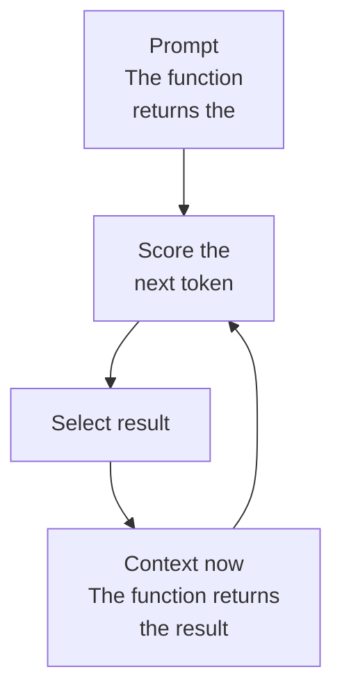

---
{
  "id": "language-modeling-next-token-prediction",
  "title": "Language Modeling & Next Tokens",
  "slug": "language-modeling-next-token-prediction",
  "section": "Core LLM Foundations",
  "category": "NLP Fundamentals",
  "difficulty": "Medium",
  "order": 4,
  "coverImage": "illustrations/_generated/next_token_dark.png",
  "companies": [
    "Google",
    "Meta",
    "OpenAI",
    "Anthropic"
  ],
  "shortDescription": "The prompt ends with 'the'. Follow that prefix from a counted bigram through teacher-forced training to the autoregressive loop that writes the next token.",
  "keyConceptsTested": [
    "Language-model objective: next-token prediction",
    "Chain-rule factorization of sequence probability",
    "Bigram and neural n-gram models share the next-token target",
    "Teacher forcing and parallel causal Transformer training",
    "Cross-entropy loss as averaged negative log-likelihood",
    "Perplexity equals exp(loss): effective choices per token",
    "Autoregressive generation loop",
    "Causal vs masked language modeling (GPT vs BERT)",
    "Prefill vs decode serving regimes",
    "Neural factual recall versus verified retrieval or tool access"
  ]
}
---

Your code editor pauses at `The function returns the`. How does a neural network turn four words into a probability distribution over tens of thousands of continuations, and what happens the moment it picks one?

In the [previous lesson](/learn/transformer-architecture-end-to-end), a Transformer turned token IDs into vocabulary scores. A <span data-glossary="token">token</span> is the model's atomic text unit (subwords in production; words and punctuation in our running example). Selecting `result` extends the context to `The function returns the result`, where the next step favors a period. Repeating that append-and-predict loop is **autoregressive generation**.

<figure>
  
  <figcaption>Selecting result (60%) appends it to the prefix; the next step assigns 80% to a period and 20% to and, giving result-period 0.60 × 0.80 = 0.48.</figcaption>
</figure>

## Next-token scores build a sequence

An **autoregressive language model** predicts a distribution over the entire vocabulary given a prefix.[^radford2018][^radford2019] Changing one word shifts that ranking immediately: `returns the cached` favors `value`, `returns the first` favors `index`, and REST API context favors `response`.

Predicting *one token at a time* suffices to score any document because the **chain rule of probability** factorizes sequence probability *exactly*:

$$
P(w_1, w_2, \dots, w_n) = \prod_{t=1}^{n} P(w_t \mid w_1, \dots, w_{t-1}) = \prod_{t=1}^{n} P(w_t \mid w_{<t})
$$

No independence assumption is required, and an explicit stop token (`<eos>` or `</s>`) gives termination probability. Each step maps raw <span data-glossary="logits">logits</span> $z \in \mathbb{R}^{|V|}$ to probabilities via stabilized softmax (derived in [Softmax, Cross-Entropy & Optimization](/learn/softmax-cross-entropy-optimization)):

$$
P(w_i) = \frac{\exp(z_i - \max_j z_j)}{\sum_{k=1}^{|V|} \exp(z_k - \max_j z_j)}
$$

After `The compiler reported`, logits `[3.0, 1.5, -1.0, -2.0, -3.0]` over `["error", "warning", "success", "the", "</s>"]` assign `0.800` to `error` and `0.178` to `warning`. How does a model learn those conditional distributions from raw text?

## Estimating probabilities from observed n-gram counts

The simplest language model counts adjacent token pairs. A **bigram model** conditions only on the prior token (first-order Markov assumption):

$$
P(w_t \mid w_{t-1}) = \frac{C(w_{t-1}, w_t)}{C(w_{t-1})}
$$

Adding `<bos>` and `<eos>` gives every word a predecessor and stopping target. Two flaws surface right away: **limited history** (`function returns` and `test returns` share one row) and **sparsity collapse** (unseen `returns exception` gets `0.0`, sending negative log-likelihood to $+\infty$). **Laplace (add-one) smoothing** adds a pseudo-count of 1 across the prediction vocabulary $V$:

$$
P_{\text{Laplace}}(w_t \mid w_{t-1}) = \frac{C(w_{t-1}, w_t) + 1}{C(w_{t-1}) + |V|}
$$

<!-- leetllm: test, output=show -->
```python title="bigram-counts-and-smoothing.py"
from collections import Counter, defaultdict

messages = [
    "function returns value", "function returns value", "method returns result",
    "handler returns value", "test returns result", "test returns error",
]
counts = defaultdict(Counter)
for msg in messages:
    tokens = ["<bos>", *msg.split(), "<eos>"]
    for prev, curr in zip(tokens, tokens[1:]):
        counts[prev][curr] += 1

row = counts["returns"]
total = sum(row.values())
for tok, c in row.most_common():
    print(f"P({tok:6s} | returns) = {c}/{total} = {c / total:.3f}")

vocab = sorted({tok for rows in counts.values() for tok in rows} | {"exception"})
print(f"unsmoothed P(exception | returns) = {row['exception'] / total:.3f}")
print(f"Laplace    P(exception | returns) = 1/{total + len(vocab)} = {(row['exception'] + 1) / (total + len(vocab)):.4f}")
```

<!-- leetllm: output:start -->
```text title="Output" output compact
P(value  | returns) = 3/6 = 0.500
P(result | returns) = 2/6 = 0.333
P(error  | returns) = 1/6 = 0.167
unsmoothed P(exception | returns) = 0.000
Laplace    P(exception | returns) = 1/16 = 0.0625
```
<!-- leetllm: output:end -->

Even with Kneser-Ney discounting,[^chenGoodman1998Smoothing] count tables hit a combinatorial wall: at $|V| = 50{,}000$, $|V|^4 = 6.25 \times 10^{18}$ four-token prefixes share zero parameters.

## Neural language models and distributed representations

Bengio et al. (2003) broke that sparsity wall by mapping each token ID to a learned dense vector in $E \in \mathbb{R}^{|V| \times d}$.[^bengio2003] Tokens in similar contexts move closer in embedding space so gradient updates transfer across related phrases. Concatenating the embeddings of $n - 1$ context tokens and projecting to vocabulary logits forms a tiny neural n-gram trained with exact cross-entropy gradients $\frac{\partial \mathcal{L}}{\partial z} = p - y$.

<figure>
  
  <figcaption>Whereas the bigram pools all counts after returns, the neural n-gram concatenates two 6-dim embeddings through a shared 12×8 affine map, reaching value = 7.904 (99.84%) after 200 updates.</figcaption>
</figure>

Train that two-token neural n-gram in NumPy (matching the initial seed and 200 updates behind the figure):

<!-- leetllm: test, deps=numpy, output=show -->
```python title="tiny-neural-ngram.py"
import random
import numpy as np

random.seed(7)
sentences = [
    "function returns value", "function returns value", "method returns result",
    "handler returns value", "test returns result", "test returns error",
]
vocab = sorted({w for s in sentences for w in s.split()})
to_id = {w: i for i, w in enumerate(vocab)}
n_vocab, emb_dim = len(vocab), 6

pairs = [([to_id[w[0]], to_id[w[1]]], to_id[w[2]]) for w in (s.split() for s in sentences)]
E = np.array([[random.uniform(-0.3, 0.3) for _ in range(emb_dim)] for _ in range(n_vocab)])
W = np.array([[random.uniform(-0.2, 0.2) for _ in range(n_vocab)] for _ in range(emb_dim * 2)])
b = np.zeros(n_vocab)

def forward(ids):
    x = np.concatenate([E[ids[0]], E[ids[1]]])
    z = x @ W + b
    e = np.exp(z - z.max())
    return x, z, e / e.sum()

def mean_loss():
    return float(np.mean([-np.log(forward(ids)[2][y]) for ids, y in pairs]))

initial_loss = mean_loss()
for _ in range(200):
    gE, gW, gb = np.zeros_like(E), np.zeros_like(W), np.zeros_like(b)
    for ids, y in pairs:
        x, _, p = forward(ids)
        dz = p.copy(); dz[y] -= 1.0; dz /= len(pairs)
        gb += dz; gW += np.outer(x, dz)
        dx = W @ dz
        gE[ids[0]] += dx[:emb_dim]; gE[ids[1]] += dx[emb_dim:]
    E -= 0.4 * gE; W -= 0.4 * gW; b -= 0.4 * gb

pred = lambda txt: vocab[int(np.argmax(forward([to_id[w] for w in txt.split()])[1]))]
print(f"loss: {initial_loss:.3f} -> {mean_loss():.3f} | function returns -> {pred('function returns')} | test returns -> {pred('test returns')}")
```

<!-- leetllm: output:start -->
```text title="Output" output compact
loss: 2.145 -> 0.235 | function returns -> value | test returns -> result
```
<!-- leetllm: output:end -->

Loss falls from `2.145` to `0.235` nats, right above the irreducible conditional-entropy floor $\frac{2\ln(2)}{6} \approx 0.231$ nats because `test returns` appears once with `result` and once with `error`.

### Causal versus masked language modeling

**Causal language modeling** predicts each token solely from prior tokens ($w_{<t}$), powering generative decoders (GPT, LLaMA, Claude). **Masked language modeling** (BERT) corrupts 15% of tokens (80% `[MASK]`, 10% random, 10% unchanged) and predicts them from both sides simultaneously, powering bidirectional encoders for embeddings and classification.[^devlin2019]

## Teacher forcing and parallel causal training

Raw text supplies its own labels: at position $t$, the target is $w_{t+1}$. Under **teacher forcing**, the model reads ground-truth tokens at every step rather than its own samples. Adding a **causal attention mask** ($M_{ij} = -\infty$ for $j > i$) lets a Transformer score all $T$ positions within a layer in parallel with zero future leakage (full self-attention still performs $\mathcal{O}(T^2)$ work per layer).[^vaswani2017]

<figure>
  
  <figcaption>Teacher forcing scores all four shifted input-label pairs in parallel under a causal mask (mean loss 0.209 nats); generation instead feeds each chosen token back sequentially until eos.</figcaption>
</figure>

Teacher forcing delivers fast, low-variance gradients at the cost of **exposure bias**: training conditions on clean ground-truth prefixes, whereas generation conditions on the model's own prior outputs where early slips can compound.[^bengio2015ScheduledSampling]

### Label shifting, cross-entropy, and perplexity

Given `[<bos>, function, returns, value, <eos>]`, inputs drop the last token (`ids[:-1]`) and targets drop the first (`ids[1:]`).

> **Common mistake:** Double-shifting labels or masking genuine `<eos>` tokens. Hugging Face `DataCollatorForLanguageModeling(mlm=False)` copies `input_ids` into `labels` and masks padding with `-100`, while the causal loss shifts internally.[^huggingface2026datacollator][^huggingface2026causalloss] When `pad_token_id == eos_token_id`, derive `-100` masks from the attention mask so real stop tokens stay supervised.

Averaging negative log-likelihood over $n$ scored targets gives cross-entropy $\mathcal{L}$, and exponentiating yields **perplexity**, the reciprocal geometric mean of target probabilities (effective branching factor per token):[^shannon1948][^jelinek1977]

$$
\mathcal{L} = -\frac{1}{n} \sum_{t=1}^{n} \log P(x_t \mid x_{<t}), \qquad \text{Perplexity} = \exp(\mathcal{L}) = \frac{1}{\sqrt[n]{\prod_{t=1}^n P(x_t \mid x_{<t})}}
$$

A perfect predictor has perplexity `1.0`; uniform over 50,000 tokens has perplexity `50,000`. Across variable-length batches, pool total NLL and total non-padding count before exponentiating so nonlinearity in $\exp(\cdot)$ never distorts batch averages.

<!-- leetllm: test, deps=numpy, output=show -->
```python title="teacher-forcing-and-perplexity.py"
import numpy as np

targets = np.array([1, 2, 3, 4])  # function, returns, value, <eos>
logits = np.array([
    [0.0, 3.0, 0.5, -1.0, -2.0], [-1.0, 0.1, 2.5, 0.0, -2.0],
    [-1.0, 0.0, 0.2, 2.0, -1.5], [-2.0, 0.0, -1.0, -0.5, 2.4],
])
shifted = logits - logits.max(axis=-1, keepdims=True)
probs = np.exp(shifted) / np.exp(shifted).sum(axis=-1, keepdims=True)
true_probs = probs[np.arange(len(targets)), targets]
losses = -np.log(true_probs)
print("true probs:", np.round(true_probs, 3).tolist(), f"| loss={losses.mean():.3f} | ppl={np.exp(losses.mean()):.3f}")

batches = [[0.5], [0.125, 0.125, 0.125]]
nll_sums, counts = [sum(-np.log(p) for p in b) for b in batches], [len(b) for b in batches]
pooled = float(np.exp(sum(nll_sums) / sum(counts)))
distorted = float(np.mean([np.exp(s / c) for s, c in zip(nll_sums, counts)]))
print(f"pooled ppl={pooled:.3f} vs distorted batch mean={distorted:.3f}")
```

<!-- leetllm: output:start -->
```text title="Output" output compact
true probs: [0.864, 0.824, 0.724, 0.839] | loss=0.209 | ppl=1.233
pooled ppl=5.657 vs distorted batch mean=5.000
```
<!-- leetllm: output:end -->

> **Key insight:** Compare token perplexity only under the exact same tokenizer, text split, and windowing rule; across tokenizers, report bits per byte.[^huggingface_ppl]

## The autoregressive generation loop

During generation, the model must select token $t$ before scoring token $t + 1$, looping until `<eos>`, a stop delimiter, or `max_tokens`.



Trace that greedy loop over Figure 1's distributions:

<!-- leetllm: test, output=show -->
```python title="generation-loop.py"
next_token_table = {
    "The function returns the": [("result", 0.60), ("value", 0.25), ("index", 0.10), ("other", 0.05)],
    "The function returns the result": [(".", 0.80), ("and", 0.20)],
    "The function returns the result.": [("</s>", 1.0)],
}
text = "The function returns the"
for step in range(3):
    token, _ = max(next_token_table[text], key=lambda item: item[1])
    if token == "</s>":
        break
    text = text + ("" if token == "." else " ") + token
    print(f"step {step}: {text!r}")
```

<!-- leetllm: output:start -->
```text title="Output" output compact
step 0: 'The function returns the result'
step 1: 'The function returns the result.'
```
<!-- leetllm: output:end -->

Locally greedy picks can miss higher-probability full sequences (if `A` gives $0.6 \times 0.1 = 0.06$ while `B` gives $0.4 \times 0.9 = 0.36$, greedy picks `A`). Practical decoding pairs logits with **temperature scaling** ($z_i / T$), **top-$k$**, or **top-$p$ (nucleus)** filtering, explored in [Decoding Strategies: Greedy to Nucleus](/learn/decoding-strategies-greedy-beam-nucleus).

## From loop to serving: prefill and cached decode

Because causal masking keeps past hidden states invariant as new tokens arrive, serving splits the same weights into two regimes: **prefill** processes all prompt tokens in parallel to populate each layer's KV cache (compute-bound via heavy weight reuse), whereas **decode** feeds only the newly chosen token, appends its $(K, V)$ column, and attends over cached history (memory-bandwidth-bound at small batch sizes).[^pope2023][^huggingface2026kvcache] Caching avoids recomputing prefixes ($\mathcal{O}(m^2)$ projections and $\mathcal{O}(m^3)$ attention work drop to $\mathcal{O}(m)$ and $\mathcal{O}(m^2)$). We unpack KV memory budgets, GQA, and paged allocation in [Inference Mechanics: TTFT, TPS & KV Cache](/learn/inference-mechanics-ttft-tps-kv-cache) and [KV Cache & PagedAttention](/learn/kv-cache-paged-attention-llm-serving).

<figure>
  
  <figcaption>Prefill caches four prompt K/V columns and emits result; each decode step appends one column until the stop token halts the loop. Raw KV payloads reach 1, 4, and 16 GiB at 2,048, 8,192, and 32,768 positions under the shown dimensions.</figcaption>
</figure>

## Structured prediction is not a live database

Next-token training teaches attention layers to track state across context, such as following `retries = 3; retries -= 1; print(retries) # output:` to predict `2`.[^brown2020] Always test varied inputs against real execution to distinguish computation from shortcuts.

More broadly, next-token training maximizes conditional plausibility, not verified truth: a language model never queries a live database during decoding and combines prompt context with frozen weights (which can memorize verbatim text without reflecting updates).[^carlini2021Extraction]

| Symptom | Root cause | Fix |
|---|---|---|
| Plausible hallucination | High likelihood without evidence | Retrieve authoritative docs and verify claims |
| Outdated facts | Stale weights or stale passage | Query current sources and inspect retrieval traces |
| Invented citations | Plausible URL pattern from memory | Fetch and verify the cited source directly |
| Repetitive loops | Narrow decoding reinforces a span | Inspect prompt, stop tokens, and sampling |

```checkpoint
Why can't cross-entropy reach zero if `function returns` appears twice with `value` and once with `exception`?
---
One prefix emits one normalized distribution and cannot put probability `1.0` on two targets simultaneously. The optimum matches the 2/3 versus 1/3 empirical split, leaving an irreducible entropy floor of $-\frac{2}{3}\ln(\frac{2}{3}) - \frac{1}{3}\ln(\frac{1}{3}) \approx 0.637$ nats.
```

```mastery-quiz
[
  {
    "question": "An autoregressive model gives token 1 probability 0.7, token 2 probability 0.4 given token 1, and <eos> probability 0.5 given both. What are the two-token prefix and complete stopped probabilities?",
    "options": [
      "0.14 and 0.28.",
      "0.70 and 0.50.",
      "0.28 and 0.14.",
      "0.28 and 0.28."
    ],
    "answer": "0.28 and 0.14.",
    "explanation": "By the chain rule, prefix probability is 0.7 * 0.4 = 0.28; including <eos> yields 0.28 * 0.5 = 0.14."
  },
  {
    "question": "After 'ping', counts show A: 4, B: 2, and 0 for all other tokens in a 12-token vocabulary. What are unseen token C's unsmoothed loss and Laplace add-one probability?",
    "options": [
      "Infinite loss, 1/18.",
      "Infinite loss, 1/8.",
      "Zero loss, 1/18.",
      "Finite loss, 1/12."
    ],
    "answer": "Infinite loss, 1/18.",
    "explanation": "Count 0 gives probability 0 and -ln(0) = +infinity. Add-one across 12 entries gives denominator 6 + 12 = 18 and probability 1/18."
  },
  {
    "question": "A causal loss shifts labels internally once and ignores -100. Input IDs are [5, 7, 9, 2, 2], where index 3 is genuine <eos> (ID 2) and index 4 is padding. Which labels preserve <eos> while masking padding, and what target does logit 2 get?",
    "options": [
      "Labels [7, 9, 2, -100, -100], target -100.",
      "Labels [5, 7, 9, 2, -100], target 2.",
      "Labels [5, 7, 9, -100, -100], target -100.",
      "Labels [5, 7, 9, 2, 2], target 2."
    ],
    "answer": "Labels [5, 7, 9, 2, -100], target 2.",
    "explanation": "Mask only the padding slot at index 4 via the attention mask. After one internal shift, logit 2 predicts genuine <eos> at index 3."
  },
  {
    "question": "Batch A scores two targets at probability 0.5 each; Batch B scores one target at 0.0625. Padding is ignored. What is the pooled per-token perplexity?",
    "options": [
      "9.000.",
      "5.657.",
      "4.000.",
      "8.000."
    ],
    "answer": "4.000.",
    "explanation": "Total NLL is 2 ln(2) + ln(16) = 6 ln(2). Dividing by 3 targets gives 2 ln(2), and exp(2 ln 2) = 4.000."
  },
  {
    "question": "A docs assistant cites v1 (14-day retention) when current v2 docs say 30 days. A code assistant completes print(3 * 4) as 12. Which verification pair diagnoses both?",
    "options": [
      "Check the retrieval trace against v1, and rerun print(3 * 4).",
      "Check the retrieval trace against current v2 docs, and test varied arithmetic programs against execution.",
      "Check the retrieval trace against current v2 docs, and rerun print(3 * 4).",
      "Check the retrieval trace against v1, and test varied arithmetic programs against execution."
    ],
    "answer": "Check the retrieval trace against current v2 docs, and test varied arithmetic programs against execution.",
    "explanation": "Checking traces against v2 isolates stale retrieval or weights, while testing varied operations against real execution distinguishes genuine computation from shortcuts."
  }
]
```

> **Next:** Continue to [Decoding Strategies: Greedy to Nucleus](/learn/decoding-strategies-greedy-beam-nucleus).
