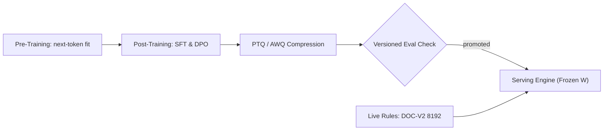

---
{
  "id": "llm-lifecycle-training-to-deployment",
  "title": "The LLM Lifecycle",
  "slug": "llm-lifecycle-training-to-deployment",
  "section": "Preparation & Prerequisites",
  "category": "NLP Fundamentals",
  "difficulty": "Easy",
  "order": 11,
  "coverImage": "illustrations/_generated/llm_lifecycle_dark.png",
  "companies": [
    "Google",
    "Meta",
    "OpenAI",
    "Anthropic"
  ],
  "shortDescription": "Trace a large language model from pre-training, SFT, and DPO alignment through quantization, PagedAttention serving, and versioned bundle checks.",
  "keyConceptsTested": [
    "Pre-training cross-entropy optimization and Chinchilla vs. inference scaling",
    "Byte-Pair Encoding and web-corpus curation pipelines",
    "Supervised fine-tuning with assistant-only loss masking",
    "Direct Preference Optimization, verifiable rewards, and test-time compute",
    "Contamination checks, LLM-as-a-judge bias, and versioned release checks",
    "Post-training quantization, activation outliers, and AWQ/GPTQ compression",
    "PagedAttention, continuous batching, and speculative decoding",
    "Trace isolation separating frozen weights from runtime rules and caching"
  ]
}
---

Yesterday, your serving assistant received a `6144`-token prompt and routed it to `chunked_batch` because retrieved rule `DOC-V1` capped single-pass context at `4096` tokens. This morning, `DOC-V2` ships and raises the ceiling to `8192` tokens, so the exact same `6144`-token request should now run as `single_pass`. Do you need to retrain a 70-billion-parameter <span data-glossary="llm">large language model (LLM)</span> to fix that answer? Of course not. You update the deterministic rule, retrieved document, and cache key sitting around the frozen weights.

In [Building Your First AI Application](/learn/first-ai-app-end-to-end), we separated request handlers from statistical scoring and saved traces. This lesson maps the entire lifecycle of a decoder LLM across pre-training, post-training alignment, offline evaluation, quantization, and high-throughput GPU serving. Knowing which stages change weights and which stages live strictly at runtime prevents you from blaming neural parameters for a stale retrieval index or broken cache key.

Two distinct loops run side by side:

- **The model-building loop** updates parameter tensors through <span data-glossary="pretraining">pre-training</span> and post-training, then optionally packs those weights into lower-bit formats.
- **The production serving loop** holds an approved, frozen <span data-glossary="model-checkpoint">checkpoint</span> steady and steers requests with live retrieved documentation, schema checks, and telemetry. Selected production traces feed future evaluation sets or fine-tuning batches after human review.

<figure>
  
  <figcaption>The model-building path updates weights before offline evaluation verifies the frozen bundle, whereas updated runtime rules (`DOC-V2 8k`) alter serving context directly without touching model parameters.</figcaption>
</figure>

## Five lifecycle stages at a glance

Even a single routing decision (`6144` tokens under `DOC-V1` vs `DOC-V2`) rests on five distinct engineering stages. Foundation labs pre-train base checkpoints on thousands of accelerators, applied teams post-train open weights with SFT or preference tuning, and serving teams compress weights and schedule GPU memory. Keeping weight updates separate from runtime context stops teams from retraining models to fix a configuration change:

| Lifecycle stage | Primary inputs | Output artifact | Updates weights $W$? |
|---|---|---|---|
| 1. Pre-training | Curated web corpus and BPE vocabulary | Base transformer checkpoint | Yes |
| 2. Post-training | Chat turns, preference pairs, verifiable rewards | Instruction-aligned checkpoint | Yes |
| 3. Evaluation | Candidate bundle, golden cases, benchmark rubrics | Pass/hold evaluation report | No |
| 4. Compression | Approved weights plus calibration activations | Quantized INT8/INT4 checkpoint | Changes numeric format |
| 5. Serving & retrieval | Frozen weights, KV-cache pool, live rules (`DOC-V2`) | Checked tokens and telemetry traces | No during inference |



> **Key insight:** Operational thresholds belong in versioned retrieval stores and application code, never baked into neural weights. When a limit changes from `4096` to `8192`, updating the retrieved rule and cache key takes seconds and leaves the verified checkpoint untouched.

## Stage 1: pre-training builds the base predictor

Pre-training produces the base <span data-glossary="transformer">Transformer</span> weights by sampling trillions of text <span data-glossary="token">tokens</span> and training the network to maximize next-token probability across diverse prose, code, and reasoning data. Raw web crawls are noisy, so builders apply multi-stage filtering before tokenization ever starts. Two influential open pipelines highlight complementary design choices: CCNet filters languages with fastText, hashes normalized paragraphs to remove duplicates, and partitions quality by perplexity under reference Wikipedia language models, whereas the original C4 pipeline relies on `langdetect`, sentence-level heuristics, and exact three-sentence deduplication.[^wenzek2019] [^raffel2020]

| Curation axis | CCNet pipeline | Original C4 pipeline |
|---|---|---|
| Language identification | fastText classifier probabilities | `langdetect` heuristic scoring |
| Document quality filter | Perplexity quantiles against Wikipedia models | Terminal punctuation, line-length, and blocklist heuristics |
| Repetition removal | Normalized paragraph SHA-1 hashing | Removal of repeated 3-sentence spans across crawl |

Deduplication prevents repeated boilerplate from dominating gradient updates, though rare sensitive or benchmark strings can still appear once and be memorized. After filtering text, **Byte-Pair Encoding (BPE)** constructs a compact subword vocabulary by repeatedly merging the most frequent adjacent character or byte pairs across the training corpus.[^sennrich2016] [^hfTokenizers2026] During causal pre-training, minimizing cross-entropy loss $-\log p(x_t \mid x_{<t})$ pushes logits upward on each observed continuation token.

<!-- leetllm: test, deps=numpy, output=show -->
```python title="bpe-merge-and-nll.py"
from collections import Counter
import numpy as np

corpus = {
    ("t", "o", "k", "e", "n"): 5,
    ("t", "o", "k", "e", "n", "s"): 4,
    ("c", "o", "n", "t", "e", "x", "t"): 3,
}

pairs: Counter[tuple[str, str]] = Counter()
for word, freq in corpus.items():
    for left, right in zip(word, word[1:]):
        pairs[(left, right)] += freq

top_pair, count = pairs.most_common(1)[0]
print(f"Top BPE merge candidate: {top_pair} (frequency={count})")

logits = np.array([2.4, 0.7, -0.3, -1.1])
probs = np.exp(logits - logits.max())
probs /= probs.sum()
nll_correct = -np.log(probs[0])
nll_uncertain = -np.log(probs[2])
print(f"Target p={probs[0]:.3f} -> NLL={nll_correct:.3f} nats (perplexity={np.exp(nll_correct):.2f})")
print(f"Rare token p={probs[2]:.3f} -> NLL={nll_uncertain:.3f} nats")
```

<!-- leetllm: output:start -->
```text title="Output" output compact
Top BPE merge candidate: ('t', 'o') (frequency=9)
Target p=0.781 -> NLL=0.247 nats (perplexity=1.28)
Rare token p=0.053 -> NLL=2.947 nats
```
<!-- leetllm: output:end -->

Every BPE merge compresses frequent subwords into single vocabulary symbols so self-attention covers wider semantic spans within the fixed context window. Lower negative log-likelihood translates directly into tighter sequence probability estimates and lower perplexity across held-out corpora. Before committing millions of GPU hours to pre-training, however, builders must determine how to split finite compute between parameter count $N$ and total training tokens $D$.

### Chinchilla scaling and inference-adjusted allocation

Kaplan et al. demonstrated smooth power-law drops in pre-training loss as parameters, dataset tokens, and compute grow.[^kaplan2020] Hoffmann et al. refined that balance with the Chinchilla scaling laws, showing that for a fixed dense-transformer compute budget $C \approx 6ND$, optimal loss allocates compute symmetrically between model size and training tokens ($N \propto C^{0.5}, D \propto C^{0.5}$, roughly 20 tokens per parameter).[^hoffmann2022] Under this rule, earlier giants like Gopher (280B parameters trained on 300B tokens) were undertrained compared to Chinchilla (70B parameters trained on 1.4T tokens) using the exact same arithmetic budget.

$$
C \approx 6 N D, \qquad N_{\text{opt}} \propto C^{0.5}, \qquad D_{\text{opt}} \propto C^{0.5}
$$

Chinchilla optimizes pre-training validation loss for a single fixed training compute budget. Production deployments, by contrast, incur recurring inference compute on every served user request over the lifetime of a checkpoint. Modern open-weight families such as Llama 3 intentionally train compact 8B and 70B models on roughly 15 trillion tokens, pushing well past compute optimality so inference stays fast and economical at massive request volume.[^dubey2024]

<!-- leetllm: test, deps=numpy, output=show -->
```python title="scaling-compute-and-serving-cost.py"
import numpy as np

chinchilla_flops = 6.0 * 70e9 * 1.4e12
print(f"Chinchilla 70B x 1.4T FLOPs: {chinchilla_flops:.2e}")

# Compare training + serving economics across 20M and 200M total requests
volumes = np.array([2.0, 20.0, 200.0])  # millions of requests
cost_overtrained_8b = 1.6 + volumes * 0.20
cost_larger_70b = 1.0 + volumes * 0.50

for vol, c_small, c_big in zip(volumes, cost_overtrained_8b, cost_larger_70b):
    winner = "Overtrained Small" if c_small < c_big else "Larger Compute-Opt"
    print(f"Volume={vol:>5.1f}M -> Small={c_small:6.2f}, Big={c_big:6.2f} ({winner})")
```

<!-- leetllm: output:start -->
```text title="Output" output compact
Chinchilla 70B x 1.4T FLOPs: 5.88e+23
Volume=  2.0M -> Small=  2.00, Big=  2.00 (Larger Compute-Opt)
Volume= 20.0M -> Small=  5.60, Big= 11.00 (Overtrained Small)
Volume=200.0M -> Small= 41.60, Big=101.00 (Overtrained Small)
```
<!-- leetllm: output:end -->

Even with identical accuracy targets, lifetime compute economics pivot sharply once serving volume overtakes initial pre-training expenditure. Investing extra training tokens into a compact model reduces recurring memory bandwidth and GPU fleet size per million queries. Base checkpoints remain pure completion engines regardless of scale, though, so teaching conversational formatting and refusal behavior requires post-training.

## Stage 2: post-training aligns assistant behavior

Post-training adapts a pretrained base checkpoint into a helpful instruction follower via three complementary techniques: supervised fine-tuning (SFT), preference optimization, and reinforcement learning with verifiable rewards. Unlike pre-training, conversational SFT organizes datasets into `system`, `user`, and `assistant` turns serialized by the checkpoint's chat template.[^huggingface2026sfttrainer] In **assistant-only loss** (`assistant_only_loss=True`), prompt token targets are set to ignore value `-100` so cross-entropy applies solely to assistant response tokens, though prompt embeddings still receive gradients indirectly because assistant hidden states attend over the prompt prefix.

<figure>
  
  <figcaption>Assistant-only SFT zeroes direct target loss on prompt tokens while still conditioning predictions on them, and DPO widens the log-likelihood margin between cited and unsupported replies relative to a frozen reference model.</figcaption>
</figure>

The PyTorch forward-backward test below demonstrates assistant-only masking directly on a six-token training sequence. Setting `ignore_index=-100` excludes the first three prompt positions from the cross-entropy sum so prompt tokens act purely as conditioning inputs. Even so, backpropagation produces non-zero gradient norms on prompt embeddings because causal attention and linear mixing propagate error signals backward from assistant outputs through every conditioned position.

<!-- leetllm: test, deps=torch, output=show -->
```python title="assistant-sft-loss-mask.py"
import torch
import torch.nn.functional as F

torch.manual_seed(4)
vocab_size, embed_dim, seq_len = 8, 6, 6
emb = torch.nn.Embedding(vocab_size, embed_dim)
mix = torch.nn.Linear(embed_dim, embed_dim)
lm_head = torch.nn.Linear(embed_dim, vocab_size)

# Tokens: [sys, ctx, 6144, route, batch, eos]
input_ids = torch.tensor([0, 1, 2, 3, 4, 5])
causal_mask = torch.tril(torch.ones(seq_len, seq_len)) / torch.arange(1, seq_len + 1).unsqueeze(1)

h = torch.tanh(mix(causal_mask @ emb(input_ids)))
logits = lm_head(h)

# Mask prompt positions [0, 1, 2] with ignore_index=-100; train only assistant targets [3, 4, 5]
targets = torch.tensor([-100, -100, -100, 4, 5, 6])
loss = F.cross_entropy(logits, targets, ignore_index=-100)
loss.backward()

prompt_grad_norm = emb.weight.grad[:3].norm().item()
reply_grad_norm = emb.weight.grad[3:6].norm().item()
print(f"Assistant-only SFT loss: {loss.item():.4f}")
print(f"Prompt token embedding grad norm:    {prompt_grad_norm:.4f} (nonzero via conditioning)")
print(f"Assistant token embedding grad norm: {reply_grad_norm:.4f}")
```

<!-- leetllm: output:start -->
```text title="Output" output compact
Assistant-only SFT loss: 2.2670
Prompt token embedding grad norm:    0.0371 (nonzero via conditioning)
Assistant token embedding grad norm: 0.0299
```
<!-- leetllm: output:end -->

SFT teaches schema conventions and chat turn formatting, yet token-level cross-entropy offers weak contrast when two syntactically fluent answers differ sharply in accuracy or helpfulness. InstructGPT addressed that limitation with Reinforcement Learning from Human Feedback (RLHF), fitting a separate reward model on ranked human comparisons before optimizing the policy with Proximal Policy Optimization (PPO).[^ouyang2022] Training and tuning separate actor, critic, and reward models adds substantial instability and GPU memory overhead, motivating simpler direct preference formulations.

**Direct Preference Optimization (DPO)** eliminates the standalone reward model and on-policy RL rollout loop by substituting a closed-form reward reparameterization directly into the Bradley-Terry preference loss.[^rafailov2023] Given a chosen response $y_w$ and a rejected response $y_l$ for the same prompt $x$, gradient descent maximizes the policy's log-probability margin relative to a frozen reference checkpoint $\pi_{\text{ref}}$. Keeping $\pi_{\text{ref}}$ fixed acts as a KL anchor so the policy improves preference alignment without drifting indiscriminately across unrelated text distributions:

$$
\mathcal{L}_{\mathrm{DPO}}(\pi_\theta; \pi_{\text{ref}})
=
-\log \sigma \!\left(
\beta \left[
\log \frac{\pi_\theta(y_w \mid x)}{\pi_{\text{ref}}(y_w \mid x)}
-
\log \frac{\pi_\theta(y_l \mid x)}{\pi_{\text{ref}}(y_l \mid x)}
\right]
\right)
$$

Notice why widening the gap relative to $\pi_{\text{ref}}$ drives every gradient step cleanly. Raising the probability of both responses equally leaves their relative margin flat or shrunk, increasing preference loss even though the chosen response looks more likely in isolation. Similarly, modifying the reference weights during an update shifts the baseline that stabilizes optimization. Below we compare an initial tied policy against one step that widens the margin from `1.0` to `2.0` nats by pushing down the rejected likelihood.

<!-- leetllm: test, deps=torch, output=show -->
```python title="dpo-preference-loss.py"
import torch
import torch.nn.functional as F

def dpo_loss(pi_w: float, pi_l: float, ref_w: float, ref_l: float, beta: float = 0.5) -> float:
    margin = beta * ((pi_w - ref_w) - (pi_l - ref_l))
    return float(-F.logsigmoid(torch.tensor(margin)).item())

# Reference assigns log p = -4.0 (cited), -5.0 (unsupported guess)
init_loss = dpo_loss(pi_w=-4.0, pi_l=-5.0, ref_w=-4.0, ref_l=-5.0)
flattened_loss = dpo_loss(pi_w=-3.0, pi_l=-3.0, ref_w=-4.0, ref_l=-5.0)
widened_loss = dpo_loss(pi_w=-4.0, pi_l=-6.0, ref_w=-4.0, ref_l=-5.0)

print(f"Initial policy (= reference):  DPO loss = {init_loss:.4f}")
print(f"Equalized scores (-3 vs -3):   DPO loss = {flattened_loss:.4f} (worse margin)")
print(f"Widened margin (-4 vs -6):     DPO loss = {widened_loss:.4f} (lower loss)")
```

<!-- leetllm: output:start -->
```text title="Output" output compact
Initial policy (= reference):  DPO loss = 0.6931
Equalized scores (-3 vs -3):   DPO loss = 0.9741 (worse margin)
Widened margin (-4 vs -6):     DPO loss = 0.4741 (lower loss)
```
<!-- leetllm: output:end -->

For verifiable technical domains such as unit-tested Python code or exact symbolic math, **Reinforcement Learning with Verifiable Rewards (RLVR)** replaces human preference labels with deterministic test execution rewards.[^deepseekai2025] Inference-time compute scales a separate orthogonal dimension: holding weights fixed while allocating additional reasoning tokens or parallel verifier-scored rollouts.[^snell2024] Whenever an automated reward function scores only a subset of structured keys while leaving free-text summaries unchecked, a model can still emit contradictory prose alongside passing fields, so display and execution paths must inspect or construct outputs strictly from verified values.

## Stage 3: evaluation checks, contamination, and bundle hashes

Before promoting a checkpoint, evaluate the entire serving stack across both public benchmarks and domain-specific regression suites. Benchmarks like MMLU (57 academic subjects) and GSM8K (grade-school arithmetic) track broad capability baselines,[^hendrycks2021][^cobbe2021] yet static web benchmarks suffer from **data contamination** whenever test items leak into training crawls, inflating scores without improving real-world reliability.

Detecting contamination combines several partial signals rather than trusting one scan.[^sun2025] Exact n-gram scans catch verbatim copies, numeric perturbations check whether swapping constants causes accuracy to collapse, and rolling benchmarks like LiveBench release fresh timestamped items scored without LLM judges.[^livebenchRepository2026] When you do use LLM-as-a-judge for open-ended replies, watch for **positional bias** (picking whichever reply sits first in `[A, B]` vs `[B, A]`), **verbosity bias**, and self-preference documented in MT-Bench.[^zheng2023]

| Evaluation failure mode | Observable signal | Concrete fix |
|---|---|---|
| Corpus leakage | Exact problem match inside training shards | Exclude leaked questions; verify with fresh dated benchmarks |
| Positional judge skew | Judge selects `A` in `[A, B]` and `B` in `[B, A]` | Run bidirectional swaps and log disagreement counts |
| Prompt or template drift | Chat template changed after metric approval | Bind every evaluation report to immutable component hashes |
| Threshold staleness | Model answers `chunked_batch` under `DOC-V1` after `DOC-V2` ships | Re-index retrieval docs and include rule version in cache keys |

> **Common mistake:** Reusing a benchmark report after swapping the chat template, quantization bit width, or retrieval rule. An evaluation score belongs to the entire versioned bundle, not to the weight file alone.

Compute an immutable SHA-256 bundle fingerprint alongside golden accuracy and p95 latency so any configuration drift automatically triggers re-evaluation:

<!-- leetllm: test, deps=numpy, output=show -->
```python title="eval-bundle-check.py"
import hashlib
import json
import numpy as np

golden_correct = np.array([1, 1, 1, 1, 1, 1, 1, 1, 1, 1], dtype=np.int32)
latencies_ms = np.array([140, 165, 190, 210, 240, 275, 310, 345, 410, 445], dtype=np.float64)

acc = float(golden_correct.mean())
p95_ms = float(np.percentile(latencies_ms, 95))

def bundle_digest(manifest: dict[str, str]) -> str:
    canonical = json.dumps(manifest, sort_keys=True).encode()
    return hashlib.sha256(canonical).hexdigest()[:12]

approved_bundle = {
    "weights": "llama3-8b-v2",
    "tokenizer": "tiktoken-128k",
    "template": "chatml-v4",
    "rule_doc": "DOC-V2",
}
runtime_bundle = {**approved_bundle, "template": "chatml-v5"}

passed_checks = acc == 1.0 and p95_ms <= 500.0
approved_hash = bundle_digest(approved_bundle)
runtime_hash = bundle_digest(runtime_bundle)
print(f"Golden pass rate={acc:.0%}, p95={p95_ms:.1f}ms -> checks_passed={passed_checks}")
print(f"Approved hash={approved_hash}, runtime hash={runtime_hash} -> match={approved_hash == runtime_hash}")
```

<!-- leetllm: output:start -->
```text title="Output" output compact
Golden pass rate=100%, p95=429.2ms -> checks_passed=True
Approved hash=1b362290b149, runtime hash=95bd831c7d03 -> match=False
```
<!-- leetllm: output:end -->

Changing just the chat template from `chatml-v4` to `chatml-v5` flips the bundle digest immediately, signaling that the old evaluation report no longer applies.

## Stage 4: compression and activation-aware quantization

Once weights pass Stage 3 evaluation, deployment teams often quantize them to fit GPU VRAM budgets and relieve the memory-bandwidth bottleneck during decode. A dense 70-billion-parameter model in 16-bit floating point (`BF16` or `FP16`, two bytes per weight) requires:

$$
\text{Weight GiB} = \frac{70 \times 10^9 \times 2}{1024^3} \approx 130.4\text{ GiB}
$$

Packing weights to `INT8` halves that footprint to `65.2 GiB`, and weight-only `INT4` cuts raw weights to `32.6 GiB`. Yet total serving VRAM must also hold runtime buffers and every active request's <span data-glossary="kv-cache">key-value (KV) cache</span>, which remains in higher precision under weight-only quantization. Adding two concurrent `32,768`-token requests on an 80-layer, 8-KV-head model adds `20.0 GiB` of cache, pushing `INT4` total memory past `52 GiB` and overflowing a single 48 GB workstation GPU.

<figure>
  
  <figcaption>Weight compression reduces model footprint substantially, yet active KV caches keep total memory high; protecting channels with large calibration activations (`AWQ`) suppresses quantization distortion before rounding.</figcaption>
</figure>

Symmetric `INT8` quantization maps floats onto integers $[-127, 127]$ using scale $s = \max(|W|) / 127$, returning zero-error exact multiples at extreme weights while rounding intermediate entries. At aggressive `INT4` precision, a small fraction of **activation outlier** channels carry magnitudes many times larger than average coordinates. Because linear output distortion equals $x_j \cdot \Delta W_j$, even tiny weight rounding error on a high-magnitude activation channel shifts layer outputs sharply.

**AWQ (Activation-aware Weight Quantization)** solves this without mixed-precision hardware kernels by multiplying salient weight channels by a calibration factor $s > 1$ before integer rounding and dividing activations by $s$ ahead of the matrix multiply (`W * x = (W * s) * (x / s)`), cutting relative quantization noise on outlier weights cleanly.[^lin2023] **GPTQ** takes a complementary approach, updating remaining unquantized columns using approximate second-order Hessian curvature $2XX^\top$ from calibration batches to compensate layer-output error directly.[^frantar2023] Both methods transform numeric representation, so compressed checkpoints must always pass the Stage 3 evaluation suite again before release.

<!-- leetllm: test, deps=numpy, output=show -->
```python title="quantize-vram-and-awq-error.py"
import numpy as np

def gib(bytes_total: float) -> float:
    return bytes_total / (1024 ** 3)

w_int4 = gib(70e9 * 0.5)
kv_one_req = gib(2 * 80 * 8 * 128 * 32768 * 2)  # K & V, 80 layers, 8 KV heads, d=128, FP16
print(f"70B INT4 weights={w_int4:.1f} GiB, two 32k requests={w_int4 + 2 * kv_one_req:.1f} GiB")

# Symmetric INT8 linear quantization vs dequantization error
w = np.array([-0.84, -0.22, 0.05, 0.41, 0.96])
scale = np.max(np.abs(w)) / 127.0
q = np.clip(np.round(w / scale), -127, 127)
max_err = np.max(np.abs(w - q * scale))
print(f"INT8 max weight rounding error: {max_err:.4f}")

# AWQ intuition: channel 1 has outlier activation |x|=2.0 vs normal |x|=0.25
x_mag = np.array([2.0, 0.25])
dw_raw = np.array([0.02, 0.08])
out_err_raw = x_mag * dw_raw

# Scale channel 1 up by factor 4 before rounding (cuts effective weight delta by 4)
awq_scale = np.array([4.0, 1.0])
out_err_awq = (x_mag / awq_scale) * (dw_raw * 1.0)
print("Raw output error per channel:", np.round(out_err_raw, 4).tolist())
print("AWQ output error per channel:", np.round(out_err_awq, 4).tolist())
```

<!-- leetllm: output:start -->
```text title="Output" output compact
70B INT4 weights=32.6 GiB, two 32k requests=52.6 GiB
INT8 max weight rounding error: 0.0029
Raw output error per channel: [0.04, 0.02]
AWQ output error per channel: [0.01, 0.02]
```
<!-- leetllm: output:end -->

Protecting high-activation channels cuts dominant output distortion fourfold while storing every weight parameter uniformly in compact low-bit integers. Keeping weight scaling calibrated on representative workload prompts also guards against quantization drift on rare numeric distributions. Once weights are packed and verified, serving systems organize dynamic memory allocation and request scheduling to maximize concurrent GPU throughput.

## Stage 5: deployment, memory paging, and scheduling

In production serving, four metrics compete for the same GPU bandwidth and VRAM pool: **Time to First Token (TTFT)** (prefill and queueing time before the first generated token), **Inter-Token Latency (ITL)** (time between consecutive decode steps), total **throughput** (tokens per second across active streams), and **VRAM capacity**. Decoding a single sequence stays severely memory-bandwidth bound because loading tens of gigabytes of weights for one token leaves GPU tensor cores mostly idle. Achieving high throughput therefore requires batching many concurrent requests together, which collides quickly with KV-cache fragmentation.

Naive serving engines pre-allocate one contiguous VRAM buffer per request sized to the model's maximum sequence window, wasting massive capacity on unused prefix slots and external fragmentation. **PagedAttention** solves this bottleneck by partitioning KV caches into fixed-size logical blocks mapped onto noncontiguous physical GPU pages, limiting unused space to only the partial tail block of each live stream while enabling copy-on-write prefix sharing across prompts.[^kwon2023] Alongside block paging, **continuous batching** (iteration-level scheduling, pioneered in Orca) retires completed requests after every decode step and admits waiting prompts as soon as KV blocks and scheduler headroom allow.[^yu2022]

<span id="speculative-decoding-beats-the-memory-bandwidth-wall"></span>
For latency-sensitive streams at small batch sizes, **speculative decoding** trades idle tensor compute for faster decoding without changing output quality.[^leviathan2023] A fast draft model proposes $K$ candidate tokens cheaply in sequence, and the large target model verifies all $K$ logits simultaneously in one parallel forward pass. Exact rejection sampling guarantees the accepted contiguous prefix plus bonus token follows the identical distribution of the full target model alone.

<!-- leetllm: test, deps=numpy, output=show -->
```python title="paged-kv-and-speculative-sim.py"
import numpy as np

# PagedAttention block allocation for 7 live tokens with 4-token blocks
live_tokens = 7
block_size = 4
num_blocks = int(np.ceil(live_tokens / block_size))
allocated_slots = num_blocks * block_size
unused_tail = allocated_slots - live_tokens
print(f"PagedAttention: {live_tokens} tokens -> {num_blocks} blocks ({allocated_slots} slots, {unused_tail} unused)")

# Static batching idle iterations: Request A ends at step 7, Request B ends at step 31
static_steps = np.array([7, 31])
idle_iterations = int(static_steps.max() - static_steps.min())
print(f"Static batch idle slot duration: {idle_iterations} decode steps")

# Speculative decoding verification over K=5 draft tokens (first 4 match, 5th rejected)
draft_matches = np.array([True, True, True, True, False])
accepted_prefix = int(np.argmin(draft_matches)) if not np.all(draft_matches) else len(draft_matches)
emitted_tokens = accepted_prefix + 1  # contiguous prefix + 1 correction draw
print(f"Speculative verify: accepted={accepted_prefix}, total emitted in 1 target pass={emitted_tokens}")
```

<!-- leetllm: output:start -->
```text title="Output" output compact
PagedAttention: 7 tokens -> 2 blocks (8 slots, 1 unused)
Static batch idle slot duration: 24 decode steps
Speculative verify: accepted=4, total emitted in 1 target pass=5
```
<!-- leetllm: output:end -->

> **Key insight:** PagedAttention, continuous batching, and speculative decoding all leave the target model's output distribution mathematically unchanged. They win purely by reclaiming fragmented VRAM, idle batch slots, and underused tensor compute.

## Diagnosing production regressions systematically

When a deployed endpoint starts returning wrong classifications or slow completions, walk the lifecycle before touching training scripts: compare the active bundle manifest (`weights`, `template`, `rule_doc`), inspect retrieved passages and cache keys, check parser stop flags, test quantized vs unquantized outputs on the same prompt, and split latency into queue, prefill, and decode. Most regressions trace to stale retrieval, cache-key collisions, or template drift, all fixable in minutes with frozen weights.

```checkpoint
Suppose DOC-V2 upgrades the single-pass token limit from 4096 to 8192, yet a 6144-token request still receives a cached `chunked_batch` verdict while bypassing the cache returns `single_pass`. Where does the bug live?
---
The checkpoint weights and retrieval docs are working as expected. The verdict cache key lacks `rule_doc` version or prompt length/threshold inputs, so stale DOC-V1 entries collide with DOC-V2 queries. Including configuration version and active input attributes in cache keys eliminates the mismatch without touching model weights.
```

```mastery-quiz
[
  {
    "question": "Under the Chinchilla equal-proportion compute-optimal rule, a new dense pre-training compute budget is 9x larger than before. What parameter and token multipliers preserve compute optimality?",
    "options": [
      "Parameters 3x; tokens 3x.",
      "Parameters 9x; tokens 1x.",
      "Parameters 1x; tokens 9x.",
      "Parameters 9x; tokens 9x."
    ],
    "answer": "Parameters 3x; tokens 3x.",
    "explanation": "Under C = 6ND, optimal parameters and dataset tokens both scale as the square root of compute (sqrt(9) = 3), multiplying together to match 9x FLOPs."
  },
  {
    "question": "Two models meet the exact same task quality. Overtrained Model A costs 1.6 units to train and 0.2 per million requests; Model B costs 1.0 to train and 0.5 per million requests. At 4 million total requests, what are their total costs and which model is cheaper?",
    "options": [
      "A costs 2.4; B costs 3.0; choose A.",
      "A costs 1.8; B costs 1.5; choose B.",
      "A costs 6.6; B costs 6.0; choose B.",
      "A costs 2.4; B costs 3.0; choose B."
    ],
    "answer": "A costs 2.4; B costs 3.0; choose A.",
    "explanation": "Total lifecycle cost equals training plus traffic cost: A = 1.6 + 4 * 0.2 = 2.4 and B = 1.0 + 4 * 0.5 = 3.0. Lower per-request inference spend justifies extra up-front training compute at volume."
  },
  {
    "question": "During assistant-only SFT with prompt tokens masked via ignore_index=-100, a profiler records nonzero gradients on prompt token embeddings. Is the loss mask broken?",
    "options": [
      "No; assistant hidden states attend to prompt tokens during forward steps",
      "Yes; masking prompt loss removes causal paths through prompt embeddings",
      "Yes; prompt tokens belong inside assistant cross-entropy target vectors",
      "No; delimiter positions hold standalone target losses across SFT epochs"
    ],
    "answer": "No; assistant hidden states attend to prompt tokens during forward steps",
    "explanation": "ignore_index=-100 removes prompt indices from the loss sum, yet assistant hidden states still depend on prompt representations via causal self-attention, yielding nonzero conditioning gradients."
  },
  {
    "question": "At the start of DPO training, both the trainable policy and frozen reference model assign log-probabilities of -4.0 to a well-cited reply ('Cited') and -5.0 to an unsupported reply ('Guess'). Which single-step change lowers DPO loss on this preference pair?",
    "options": [
      "Policy log-probabilities move to -4.0 ('Cited') and -6.0 ('Guess') while reference stays fixed.",
      "Policy log-probabilities move to -3.0 ('Cited') and -3.0 ('Guess') while reference stays fixed.",
      "Reference log-probabilities move to -4.0 ('Cited') and -6.0 ('Guess') while policy stays fixed.",
      "Reference log-probabilities move to -3.0 ('Cited') and -3.0 ('Guess') while policy stays fixed."
    ],
    "answer": "Policy log-probabilities move to -4.0 ('Cited') and -6.0 ('Guess') while reference stays fixed.",
    "explanation": "DPO optimizes the log-probability margin relative to the frozen reference. Widening the policy gap from 1.0 to 2.0 lowers loss, whereas shifting policy scores to -3.0 and -3.0 collapses the margin to zero and altering reference weights breaks the optimization objective."
  },
  {
    "question": "Across a held-out response pair, an LLM-as-a-judge selects Candidate A when shown [A, B] and selects Candidate B when shown [B, A]. What does this demonstrate and how should it be handled?",
    "options": [
      "Order sensitivity; log swapped passes and track flip rate explicitly",
      "Length preference; designate the [A, B] order as standard scoring",
      "Clean invariance; mean pool scores and filter split conflicts later",
      "Self-preference; adjust system wording while dropping position logs"
    ],
    "answer": "Order sensitivity; log swapped passes and track flip rate explicitly",
    "explanation": "When the winner flips strictly with slot order on identical replies, positional bias drives the choice. Retaining symmetric passes and reporting inconsistency exposes unreliability."
  },
  {
    "question": "A training-corpus contamination scan flags two matches in manuals: one is the generic sentence 'Show your step-by-step work', and the other is a verbatim benchmark question and answer. Support logs have not been scanned yet, and paraphrases remain unchecked. What is the accurate audit status?",
    "options": [
      "One exact match; scan support logs and inspect both sets for paraphrases",
      "Two exact matches; scan support logs strictly for exact hash collisions",
      "One exact match; extrapolate support leakage proportionally from manuals",
      "Zero confirmed copies prior to exact hashing failures on paraphrases"
    ],
    "answer": "One exact match; scan support logs and inspect both sets for paraphrases",
    "explanation": "Generic instructional phrasing is not benchmark leakage, leaving one confirmed verbatim item so far. Auditing requires scanning all accessible text shards for both verbatim matches and semantic paraphrases."
  },
  {
    "question": "Two linear channels have input activation magnitudes [2.0, 0.25] and absolute weight quantization errors [0.02, 0.08]. What are the resulting per-channel output errors, and which channel dominates?",
    "options": [
      "[0.04, 0.02]; Channel 1 dominates.",
      "[0.02, 0.08]; Channel 2 dominates.",
      "[0.01, 0.32]; Channel 2 dominates.",
      "[0.04, 0.02]; Channel 2 dominates."
    ],
    "answer": "[0.04, 0.02]; Channel 1 dominates.",
    "explanation": "Output error equals |x| * |dW|: 2.0 * 0.02 = 0.04 on Channel 1 versus 0.25 * 0.08 = 0.02 on Channel 2. Despite smaller weight rounding error, Channel 1's large activation amplifies distortion, motivating AWQ scaling."
  },
  {
    "question": "Under PagedAttention with 4-token physical KV blocks, a sequence holds 7 live cached tokens mapped to blocks 3 and 9. What are total allocated token slots and unused tail slots before sharing?",
    "options": [
      "8 allocated slots; 1 unused tail slot.",
      "7 allocated slots; 0 unused slots.",
      "12 allocated slots; 5 unused slots.",
      "8 allocated slots; 0 unused slots."
    ],
    "answer": "8 allocated slots; 1 unused tail slot.",
    "explanation": "ceil(7 / 4) = 2 allocated physical blocks holding 8 total slots, with only 1 unused position in the partially filled second block and zero external fragmentation."
  },
  {
    "question": "In a static batch, Request 1 finishes decoding after 7 steps while Request 2 finishes after 31 steps. How many decode iterations does Request 1's slot sit idle, and what enables continuous batching to reuse it sooner?",
    "options": [
      "24 idle steps; per-step scheduling fills open slots once KV space fits",
      "38 idle steps; per-step scheduling refills open slots skipping VRAM bounds",
      "24 idle steps; new queries stay parked until step 31 finishes decoding",
      "31 idle steps; paging evicts KV blocks to skip sequence allocation"
    ],
    "answer": "24 idle steps; per-step scheduling fills open slots once KV space fits",
    "explanation": "Request 1 waits 31 - 7 = 24 iterations in static batching. Continuous batching checks after every decode iteration whether free KV blocks and scheduler capacity allow immediate prefill admission for queued work."
  },
  {
    "question": "Rule DOC-V2 increases single-pass prompt capacity from 4096 to 8192 tokens. Replaying a 6144-token request hits a cached 'chunked_batch' answer, while bypassing the cache returns 'single_pass'. The cache key currently hashes only (checkpoint_id, request_id). Updating keys to include (rule_doc_version, prompt_tokens) still leaves stale entries unless cache lookups match which fields?",
    "options": [
      "Both active config rule_doc_version and current token-count bounds",
      "The updated rule_doc_version hash while reusing prior length keys",
      "Model checkpoint_id and chat prompt_template_id hashes across runs",
      "Fine-tuned weight checkpoint hashes generated during SFT restarts"
    ],
    "answer": "Both active config rule_doc_version and current token-count bounds",
    "explanation": "Cache keys must bind every decision-relevant input, including both the active configuration revision (`DOC-V2`) and request parameters (`prompt_tokens`), so threshold updates and length cases never collide with stale verdicts while model weights stay frozen."
  }
]
```

> **Next:** Continue to [Linear Regression from Scratch](/learn/linear-regression-from-scratch). Separating frozen weights from runtime rules shows how serving infrastructure works around a finished checkpoint, and fitting a regression model from scratch lets you observe firsthand how gradient optimization fits parameters from training loss and generalizes to held-out data.
