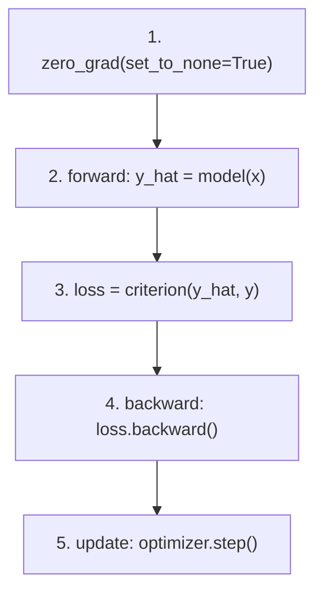

---
{
  "id": "training-backpropagation-gradient-descent",
  "title": "Training & Backpropagation",
  "slug": "training-backpropagation-gradient-descent",
  "section": "Preparation & Prerequisites",
  "category": "NLP Fundamentals",
  "difficulty": "Easy",
  "order": 4,
  "coverImage": "illustrations/_generated/gradient_descent_dark.png",
  "companies": [
    "Google",
    "Meta",
    "OpenAI",
    "Anthropic"
  ],
  "shortDescription": "A latency prediction is four milliseconds low. Follow that error through one update, then see how batch size, depth, and initialization change the step.",
  "keyConceptsTested": [
    "The five-step PyTorch loop: zero_grad, forward, loss, backward, step",
    "Gradient descent mechanics, learning rates, and stability limits",
    "Reverse-mode automatic differentiation and computational graphs",
    "Finite differences as a numerical gradient check",
    "Batching dynamics: full-batch vs mini-batch vs online stochastic descent",
    "Vanishing and exploding gradients across deep layers, and gradient norm clipping",
    "Weight initialization: Xavier/Glorot vs He/Kaiming variance preservation",
    "Train, validation, and test splits with early stopping"
  ]
}
---

The [CNN lesson](/learn/convolutional-neural-networks-from-scratch) computed feature maps while its kernel weights stayed frozen. Now we let the weights change: a model predicts `2` milliseconds of extra time to generate an LLM token, while the server measures `6`. What determines how far its weight and bias should move?

We'll use synthetic latency measurements so every calculation is easy to check. You already worked through [slopes and downhill steps](/learn/calculus-gradients-backpropagation-optimization) and saw [optimizer rules](/learn/optimization-algorithms-adam-schedulers) that reuse those slopes. The missing piece is the update itself: a measured error has to become a change in the weight and the bias. The input is a prompt-complexity score `x`. Latency values are in milliseconds, and half-squared loss is measured in square milliseconds.

## One update has four distinct jobs

When a model predicts poorly, four questions keep the parameter update interpretable: what did the current parameters predict, how wrong was that prediction, which parameters contributed to the error, and how far should they move?

| Step | What happens | Evidence you can inspect |
| --- | --- | --- |
| Forward pass | Current parameters transform inputs into a prediction. | Print predicted delay $\hat{y}$. |
| Loss calculation | A scalar objective scores the error against a known target. | Print one non-negative scalar $L$. |
| Backward pass | Derivatives measure how each parameter affects the loss. | Print $\partial L/\partial w$ and $\partial L/\partial b$. |
| Parameter update | An <span data-glossary="optimizer">optimizer</span> uses gradients and its update rule to change parameters. | Recompute predictions and compare loss. |

Suppose a request has prompt-complexity score `x = 2.0` and later measures `y = 6.0` extra milliseconds of decode latency. We start with a linear latency model:

$$
\hat{y} = wx + b
$$

Here $\hat{y}$ ("y hat") is the predicted delay, $w$ is the weight, and $b$ is the bias. Set initial parameters `w = 1.0` and `b = 0.0`:

$$
\hat{y} = (1.0)(2.0) + 0.0 = 2.0\text{ ms}
$$

The prediction is `4.0` ms below the true target of `6.0` ms. Because the prediction is too low and `x` is positive, increasing either parameter will push the prediction closer to the target. Score the error with **half squared error**: square the `-4.0` ms residual and multiply by `1/2` to get `8.0` square milliseconds. That extra `1/2` doesn't change the optimal $(w, b)$; it cancels the exponent when we differentiate:

$$
L = \frac{1}{2}(\hat{y} - y)^2
$$

The initial loss is:

$$
L = \frac{1}{2}(2.0 - 6.0)^2 = \frac{1}{2}(-4.0)^2 = 8.0
$$

What does a negative slope mean here? Nudge the prediction slightly upward, from `2.0` to `2.01` ms. Loss becomes `0.5 * (2.01 - 6.0)**2 = 7.96005`, dropping by about `0.04` for a `0.01` ms nudge. The ratio of change is about `-4.0`: near this prediction point, each extra millisecond reduces loss by four square milliseconds.

Now compare how the weight and the bias affect that prediction. A `0.01` increase in bias moves the prediction by `0.01` ms. The same numerical increase in weight moves the prediction by `x * 0.01 = 0.02` ms. The weight <span data-glossary="gradient">gradient</span>, or loss sensitivity, is exactly twice the bias gradient:

$$
\frac{\partial L}{\partial \hat{y}} = \hat{y} - y = -4.0,
\qquad
\frac{\partial L}{\partial w} = (\hat{y} - y)x = (-4.0)(2.0) = -8.0,
\qquad
\frac{\partial L}{\partial b} = \hat{y} - y = -4.0
$$

The gradient gives the local slope; the update is the negative gradient scaled by the learning rate. Gradient descent subtracts that scaled vector from the current parameters. When we estimate the full-dataset gradient from one randomly sampled example or mini-batch, the method is called **stochastic gradient descent (SGD)**. With <span data-glossary="learning-rate">learning rate</span> $\eta = 0.1$, the parameter updates are:

$$
w_{\text{new}} = 1.0 - 0.1(-8.0) = 1.8,
\qquad
b_{\text{new}} = 0.0 - 0.1(-4.0) = 0.4
$$

The revised prediction is `1.8 * 2.0 + 0.4 = 4.0` ms, and the loss falls from `8.0` to `0.5 * (4.0 - 6.0)**2 = 2.0`. The two-millisecond prediction boost combines the weight change (`0.8 * 2.0 = 1.6`) and the bias change (`0.4`). The update changes the internal weight and bias; the prediction changes when the model evaluates those updated parameters. Run this complete calculation in Python:

<!-- leetllm: test, output=show -->
```python title="one-update-by-hand.py"
x, target = 2.0, 6.0
w, bias = 1.0, 0.0
learning_rate = 0.1

prediction = w * x + bias
loss = 0.5 * (prediction - target) ** 2
grad_prediction = prediction - target
grad_w = grad_prediction * x
grad_bias = grad_prediction

new_w = w - learning_rate * grad_w
new_bias = bias - learning_rate * grad_bias
new_prediction = new_w * x + new_bias
new_loss = 0.5 * (new_prediction - target) ** 2

print(f"before: prediction={prediction:.1f} loss={loss:.1f}")
print(f"gradients: dL/dw={grad_w:.1f} dL/db={grad_bias:.1f}")
print(f"after:  prediction={new_prediction:.1f} loss={new_loss:.1f}")
```

<!-- leetllm: output:start -->
```text title="Output" output compact
before: prediction=2.0 loss=8.0
gradients: dL/dw=-8.0 dL/db=-4.0
after:  prediction=4.0 loss=2.0
```
<!-- leetllm: output:end -->

<figure>
  
  <figcaption>At ŷ = 2, the tangent slope is −4. With η = 0.1, the prediction moves from (ŷ, L) = (2, 8) to (4, 2); the parameter view traces the same step from (w, b) = (1, 0) to (1.8, 0.4). Every point on 2w + b = 6 fits this one training example.</figcaption>
</figure>

One update cuts our error in half. If we run the update rule repeatedly, the prediction continues approaching `6.0` and the loss continues shrinking toward zero:

<!-- leetllm: test, output=show -->
```python title="repeat-gradient-descent.py"
x, target = 2.0, 6.0
w, bias = 1.0, 0.0
learning_rate = 0.1

for step in range(5):
    prediction = w * x + bias
    loss = 0.5 * (prediction - target) ** 2
    error = prediction - target
    w -= learning_rate * error * x
    bias -= learning_rate * error
    print(f"step {step}: before prediction={prediction:.3f} loss={loss:.3f}; after w={w:.3f} b={bias:.3f}")
```

<!-- leetllm: output:start -->
```text title="Output" output compact
step 0: before prediction=2.000 loss=8.000; after w=1.800 b=0.400
step 1: before prediction=4.000 loss=2.000; after w=2.200 b=0.600
step 2: before prediction=5.000 loss=0.500; after w=2.400 b=0.700
step 3: before prediction=5.500 loss=0.125; after w=2.500 b=0.750
step 4: before prediction=5.750 loss=0.031; after w=2.550 b=0.775
```
<!-- leetllm: output:end -->

The error shrinks each step because each new prediction changes the gradient slope. The learning rate stayed fixed; the error signal being scaled became progressively smaller. That makes the choice of learning rate our next critical question.

## Step size can rescue or wreck learning

At a differentiable point with a nonzero gradient, the **negative gradient** is the direction of steepest local decrease in these parameter coordinates. The **learning rate** scales the gradient-descent step. A small rate can make slow progress. A larger rate can overshoot the minimum; repeated overshoots may converge, oscillate, or diverge.

We can analyze this mathematically for our single-example model. Updating both parameters changes the prediction by:

$$
\Delta \hat{y} = \Delta w \cdot x + \Delta b = -\eta e x^2 - \eta e = -\eta e (x^2 + 1)
$$

where $e = \hat{y} - y$ is the prediction residual. The new residual $e_{\text{next}}$ becomes:

$$
e_{\text{next}} = e + \Delta \hat{y} = e \left(1 - \eta(x^2 + 1)\right)
$$

For $x = 2.0$, $x^2 + 1 = 5.0$, so $e_{\text{next}} = (1 - 5\eta)e$. A nonzero residual converges to zero when $|1 - 5\eta| < 1$, or $0 < \eta < 0.4$. This bound belongs to this half-squared objective and input scale. The factor $1 - 5\eta$ dictates convergence:
- If $\eta = 0.1$, $1 - 5(0.1) = 0.5$: the residual halves every single step.
- If $\eta = 0.2$, $1 - 5(0.2) = 0.0$: the model lands on the exact target in one step.
- If $\eta = 0.4$, $1 - 5(0.4) = -1.0$: the residual flips sign but maintains its magnitude (`-4.0` becomes `+4.0`), oscillating indefinitely without improving.
- If $\eta = 0.5$, $1 - 5(0.5) = -1.5$: the residual flips sign and expands by $1.5\times$ every iteration, diverging to infinity.

The bound says `0.1` should shrink the error, `0.4` should oscillate, and `0.5` should diverge. `0.2` is the special case that lands on the target in one step. Run five steps of each:

<!-- leetllm: test, output=show -->
```python title="learning-rate-behavior.py"
def train_for_five_steps(learning_rate: float) -> list[float]:
    x, target = 2.0, 6.0
    w, bias = 1.0, 0.0
    losses = []
    for _ in range(5):
        prediction = w * x + bias
        error = prediction - target
        losses.append(0.5 * error ** 2)
        w -= learning_rate * error * x
        bias -= learning_rate * error
    return losses

for rate in (0.01, 0.1, 0.5):
    losses = train_for_five_steps(rate)
    formatted = ", ".join(f"{loss:.3f}" for loss in losses)
    print(f"lr={rate:.2f}: {formatted}")
```

<!-- leetllm: output:start -->
```text title="Output" output compact
lr=0.01: 8.000, 7.220, 6.516, 5.881, 5.307
lr=0.10: 8.000, 2.000, 0.500, 0.125, 0.031
lr=0.50: 8.000, 18.000, 40.500, 91.125, 205.031
```
<!-- leetllm: output:end -->

A single training point can't pin down unique parameters: every pair satisfying $2w + b = 6$ yields zero loss. We'll introduce batches of varied requests shortly to break that symmetry.

## Backpropagation assigns credit through a graph

One weight and one bias are easy to differentiate by hand. Real models can contain billions of parameters, so perturbing each parameter separately to compute numerical slopes would require at least one additional forward evaluation per parameter. That's intractable. **<span data-glossary="backpropagation">Backpropagation</span>** applies reverse-mode automatic differentiation to a network: evaluate the forward computation, then propagate derivatives from a scalar loss to the parameters used by that computation in one reverse sweep.[^baydin2018][^pytorch2026autograd] Checkpointing can trade saved intermediates for extra forward recomputation during backward.

With one scalar loss and millions of parameters, reverse mode shares intermediate activations across all parameter paths. Its compute cost scales with the operations in the forward graph, avoiding a separate forward pass per parameter.[^baydin2018] Rumelhart, Hinton, and Williams demonstrated how propagating output error backward lets hidden units learn useful internal representations.[^rumelhart1986][^goodfellow2016]

Before tracking backward derivatives, inspect the forward values: the intermediate product `m = w * x`, the prediction $\hat{y}$, and the residual $e = \hat{y} - y$. Autograd saves what each backward rule needs; it does not need to retain every value displayed here. The decode-latency graph lets us inspect each node directly:

<figure>
  
  <figcaption>Follow the values from left to right: x = 2 and w = 1 give m = wx = 2; adding b = 0 yields ŷ = 2 ms. The measured target y = 6 ms gives residual e = −4 ms and loss L = 8 ms².</figcaption>
</figure>

Start at the loss. The seed derivative at the root is $\partial L/\partial L = 1.0$. The chain rule multiplies that seed by each local derivative along the path to every parameter:

$$
\frac{\partial L}{\partial w}
=
\frac{\partial L}{\partial e}
\frac{\partial e}{\partial \hat{y}}
\frac{\partial \hat{y}}{\partial m}
\frac{\partial m}{\partial w}
=
(e)(1)(1)(x)
=
(-4.0)(1)(1)(2.0)
=
-8.0
$$

$$
\frac{\partial L}{\partial b}
=
\frac{\partial L}{\partial e}
\frac{\partial e}{\partial \hat{y}}
\frac{\partial \hat{y}}{\partial b}
=
(e)(1)(1)
=
(-4.0)(1)(1)
=
-4.0
$$

<figure>
  
  <figcaption>The arrows retrace the same graph from loss toward its parameters. Starting with dL/dL = 1, the residual gives dL/de = −4. Addition copies that value to the bias and weighted-input paths; the saved x = 2 scales the weight path to dL/dw = −8.</figcaption>
</figure>

Whenever you write a custom backward pass, test your analytical derivatives against **centered finite differences**. Numerical differentiation is too slow for actual training, but it's the standard tool to verify analytical gradients before deploying them:[^pytorch2026gradcheck]

$$
\frac{\partial L}{\partial \theta} \approx \frac{L(\theta + \epsilon) - L(\theta - \epsilon)}{2\epsilon}
$$

<!-- leetllm: test, output=show -->
```python title="finite-difference-gradient-check.py"
x, target = 2.0, 6.0
w, bias = 1.0, 0.0
epsilon = 1e-5

def loss_at(weight: float, intercept: float) -> float:
    prediction = weight * x + intercept
    return 0.5 * (prediction - target) ** 2

analytic_w = (w * x + bias - target) * x
analytic_bias = w * x + bias - target
numeric_w = (loss_at(w + epsilon, bias) - loss_at(w - epsilon, bias)) / (2 * epsilon)
numeric_bias = (loss_at(w, bias + epsilon) - loss_at(w, bias - epsilon)) / (2 * epsilon)

print(f"dL/dw analytic={analytic_w:.6f} numeric={numeric_w:.6f}")
print(f"dL/db analytic={analytic_bias:.6f} numeric={numeric_bias:.6f}")
print("checks pass:", abs(analytic_w - numeric_w) < 1e-8 and abs(analytic_bias - numeric_bias) < 1e-8)
```

<!-- leetllm: output:start -->
```text title="Output" output compact
dL/dw analytic=-8.000000 numeric=-8.000000
dL/db analytic=-4.000000 numeric=-4.000000
checks pass: True
```
<!-- leetllm: output:end -->

Finite differences require numerical discipline: in general, a large perturbation introduces approximation error, while a tiny one loses precision to floating-point roundoff. Centered differences happen to be exact for this quadratic in exact arithmetic; other losses do not share that property. Use double precision (`float64`) for checks and avoid nondifferentiable points, such as ReLU at zero.[^pytorch2026gradcheckapi]

## Build a scalar autograd engine

Andrej Karpathy's Micrograd captures autograd bookkeeping in a compact executable engine: each object stores a scalar value, its gradient, its parent references, and a local backward closure.[^karpathy2020micrograd] Tensor libraries use the same chain-rule ideas, with additional machinery for arrays, saved tensors, and execution. Our adapted engine resets every reachable gradient at the start of `backward()`, so each call computes a fresh derivative. PyTorch instead accumulates into leaf `.grad` buffers, as we'll demonstrate separately.

For our model $\hat{y} = wx + b$ and half-squared loss $L = 0.5(\hat{y} - y)^2$, every operation implements one local derivative rule:

| Operation | Forward expression | Local backward closure |
| --- | --- | --- |
| Addition | `out = left + right` | `left.grad += out.grad`, `right.grad += out.grad` |
| Multiplication | `out = left * right` | `left.grad += right.data * out.grad`, `right.grad += left.data * out.grad` |
| Power | `out = val ** p` | `val.grad += p * (val.data ** (p - 1)) * out.grad` |

Two structural rules govern the engine:
1. **Topological ordering**: The backward sweep must visit an output node before visiting any of its parent inputs. We build a directed graph from the loss root, perform a depth-first search, and reverse the topological order.
2. **Gradient accumulation**: Parent gradients use `+=` to sum derivative contributions along every path from a variable to the loss (multivariable chain rule).

<!-- leetllm: test, id=scalar-engine, output=show -->
```python title="scalar-autograd-engine.py"
class Value:
    def __init__(self, data, parents=(), operation=""):
        self.data = float(data)
        self.grad = 0.0
        self.parents = tuple(parents)
        self.operation = operation
        self._backward = lambda: None

    def __add__(self, other):
        other = other if isinstance(other, Value) else Value(other)
        out = Value(self.data + other.data, (self, other), "+")
        def backward():
            self.grad += out.grad
            other.grad += out.grad
        out._backward = backward
        return out

    __radd__ = __add__

    def __mul__(self, other):
        other = other if isinstance(other, Value) else Value(other)
        out = Value(self.data * other.data, (self, other), "*")
        def backward():
            self.grad += other.data * out.grad
            other.grad += self.data * out.grad
        out._backward = backward
        return out

    __rmul__ = __mul__

    def __neg__(self):
        return self * -1.0

    def __sub__(self, other):
        return self + (-other)

    def __pow__(self, exponent):
        out = Value(self.data ** exponent, (self,), f"**{exponent}")
        def backward():
            if exponent != 0:
                self.grad += exponent * (self.data ** (exponent - 1)) * out.grad
        out._backward = backward
        return out

    def backward(self):
        order = []
        seen = set()
        def visit(node):
            if node not in seen:
                seen.add(node)
                for parent in node.parents:
                    visit(parent)
                order.append(node)
        visit(self)
        for node in order:
            node.grad = 0.0
        self.grad = 1.0
        for node in reversed(order):
            node._backward()

x, target = Value(2.0), Value(6.0)
w, bias = Value(1.0), Value(0.0)
prediction = w * x + bias
loss = 0.5 * (prediction - target) ** 2
loss.backward()

print(f"prediction={prediction.data:.1f} loss={loss.data:.1f}")
print(f"dL/dw={w.grad:.1f} dL/db={bias.grad:.1f}")
```

<!-- leetllm: output:start -->
```text title="Output" output compact
prediction=2.0 loss=8.0
dL/dw=-8.0 dL/db=-4.0
```
<!-- leetllm: output:end -->

The autograd engine matches our hand calculations exactly. Now consider a shared variable: in $s = a \cdot a$ with $a = 3.0$, what is $ds/da$? Mathematically, $d(a^2)/da = 2a = 6.0$. Because $a$ feeds both multiplication inputs, the backward closure fires for both operands. An engine that assigns with `=` would overwrite the first contribution with `3.0`. Using `+=` sums both paths to `6.0`:

<!-- leetllm: test, continue=scalar-engine, output=show -->
```python title="gradient-accumulation-branch.py"
a = Value(3.0)
squared = a * a
squared.backward()
print(f"a*a={squared.data:.1f}")
print(f"d(a*a)/da={a.grad:.1f}")
```

<!-- leetllm: output:start -->
```text title="Output" output compact
a*a=9.0
d(a*a)/da=6.0
```
<!-- leetllm: output:end -->

<figure>
  
  <figcaption>The leaf a = 3 enters both slots of s = a × a = 9. With s.grad = 1, each multiplication path contributes +3; both values return to the same a.grad buffer, where += produces 6.</figcaption>
</figure>

The `+=` inside a sweep sums contributions from shared paths. In this minimal scalar engine, calling `squared.backward()` again still gives `a.grad = 6`, because the next sweep resets its buffers. Don't mutate `.data` between forward and backward; build a fresh forward graph after changing parameters. Unlike PyTorch, this engine tracks every `Value`, including our input and target, without a `requires_grad` switch.

PyTorch parameter `.grad` buffers persist until explicitly cleared. That behavior enables intentional accumulation across micro-batches, but stale buffers change the intended next update.

## Local backward rules for dense layers, activations, and pooling

Multilayer networks compose simple vector operations. Each layer receives an upstream error gradient $\delta$ from the layer above and computes two items: gradients for its own parameters, and the downstream error signal to pass to the preceding layer.

### Dense layer backward

For a dense linear transformation $z = Wx + b$ with incoming gradient $\delta = \partial L/\partial z$:
- Weight gradient is the outer product: $\partial L/\partial W = \delta x^\top$ (shape matches $W$).
- Bias gradient is the upstream signal itself: $\partial L/\partial b = \delta$.
- Input gradient routes signal backward: $\partial L/\partial x = W^\top \delta$ (shape matches $x$).[^goodfellow2016]

### ReLU backward

ReLU is $h = \max(0, z)$.[^nair2010] Its backward rule checks whether the input was active during the forward pass:

$$
\frac{\partial L}{\partial z} = \frac{\partial L}{\partial h} \cdot \mathbf{1}_{z > 0}
$$

If $z > 0$, the gradient passes through unchanged. At zero the ordinary derivative is undefined; this rule chooses zero, as PyTorch does. Negative inputs also give zero. A "dead ReLU" that remains inactive on every example receives no gradient through that activation. Changes upstream, regularization, or optimizer state can still change its parameters or inputs.

### Max-pooling backward

Max pooling extracts the maximum value within each spatial window and saves the coordinates of that **winner** during the forward pass. The backward rule routes the signed incoming gradient to that coordinate; other locations get zero from that window. Overlapping windows add their contributions. Ties need a convention: the Python code below chooses the first maximum in row-major enumeration.

<!-- leetllm: test, output=show -->
```python title="dense-relu-maxpool-backward.py"
x = [2.0, 1.0]
weight = [[0.5, -0.2], [0.1, 0.4]]
delta = [-1.5, 0.5]

dW = [[d * xi for xi in x] for d in delta]
db = list(delta)
dx = [sum(weight[i][j] * delta[i] for i in range(len(delta))) for j in range(len(x))]
print("dW", dW)
print("db", db)
print("dx", dx)

z_relu = [-1.0, 2.0]
up = [3.0, 4.0]
dz = [u * (1.0 if z > 0 else 0.0) for z, u in zip(z_relu, up)]
print("ReLU dz", dz)

feature = [
    [0.10, 0.42, 0.18, 0.30],
    [0.25, 0.91, 0.44, 0.12],
    [0.08, 0.21, 0.77, 0.55],
    [0.16, 0.14, 0.32, 0.49],
]
winners = []
for row_start in (0, 2):
    for col_start in (0, 2):
        cells = [(r, c) for r in range(row_start, row_start + 2)
                 for c in range(col_start, col_start + 2)]
        winners.append(max(cells, key=lambda cell: feature[cell[0]][cell[1]]))
pool_grad = [0.5, -0.2, 0.1, 0.3]
grad_in = [[0.0 for _ in row] for row in feature]
for (row, col), grad in zip(winners, pool_grad):
    grad_in[row][col] += grad
print("saved winners", winners)
print("max-pool grad_in:")
for row in grad_in:
    print(row)
```

<!-- leetllm: output:start -->
```text title="Output" output compact
dW [[-3.0, -1.5], [1.0, 0.5]]
db [-1.5, 0.5]
dx [-0.7, 0.5]
ReLU dz [0.0, 4.0]
saved winners [(1, 1), (1, 2), (2, 1), (2, 2)]
max-pool grad_in:
[0.0, 0.0, 0.0, 0.0]
[0.0, 0.5, -0.2, 0.0]
[0.0, 0.1, 0.3, 0.0]
[0.0, 0.0, 0.0, 0.0]
```
<!-- leetllm: output:end -->

In the CNN pipeline from the previous lesson, these local rules connect in reverse order. The dense head sends its input gradient to max-pooling, max-pooling routes that signal to its saved winners, and ReLU passes it only through positions that were positive during the forward pass.

## Put the update into a PyTorch loop

For one ordinary update per batch, clear gradients, run forward, calculate loss, run backward, and step the optimizer. Clearing must happen before the next backward contribution you intend to keep; it can also happen after the previous step. With deliberate micro-batch accumulation, clear once per effective batch.

Here is the exact state transition sequence for each phase:

1. **`optimizer.zero_grad(set_to_none=True)`**: PyTorch accumulates gradients by default. Before launching a new backward pass, we must reset parameter `.grad` attributes. Passing `set_to_none=True` leaves those attributes as `None` instead of filling existing tensors with zeros. PyTorch documents a generally lower memory footprint and a modest performance benefit, with the important behavior that optimizers skip parameters whose gradients remain `None`.[^pytorchZeroGrad2026]
2. **Forward pass (`predictions = model(inputs)`)**: Autograd operates as a dynamic "define-by-run" tape. As tensors flow through layers, PyTorch records mathematical operations, builds a directed acyclic graph (DAG), and automatically saves the tensors each backward formula needs. Custom autograd functions request those saved tensors explicitly with `ctx.save_for_backward`; built-in operations manage them internally.[^pytorch2026autograd]
3. **Loss evaluation (`loss = criterion(predictions, targets)`)**: The criterion reduces this batch's prediction errors into one scalar. That scalar tensor forms the root of the autograd DAG, with its `grad_fn` attribute pointing to the final operation (for example, `<MseBackward0>`).
4. **Backward pass (`loss.backward()`)**: Calling `.backward()` on the root scalar propagates derivatives through the DAG. PyTorch executes local vector-Jacobian products and accumulates contributions into connected leaf parameter `.grad` buffers. With ordinary backward, saved tensors needed for backward are released. References to the loss and its `grad_fn` can still exist; that doesn't make a second backward through the same saved computation valid.[^pytorchBackward2026]
5. **Optimizer step (`optimizer.step()`)**: The optimizer updates registered parameters in place. For the SGD optimizer used here, the rule is $\theta \leftarrow \theta - \eta \cdot \theta.\text{grad}$; adaptive optimizers transform the stored gradient before updating. The optimizer doesn't clear gradients, so that responsibility remains with `zero_grad()`.



Run those five steps on the latency rows. Each pass should clear the old gradient before it records a new one:

<!-- leetllm: test, deps=torch, output=show -->
```python title="pytorch-training-loop.py"
import torch
from torch import nn

features = torch.tensor([[1.0], [2.0], [3.0]])
targets = torch.tensor([[3.0], [5.0], [7.0]])
model = nn.Linear(1, 1)

with torch.no_grad():
    model.weight.fill_(0.0)
    model.bias.fill_(0.0)

optimizer = torch.optim.SGD(model.parameters(), lr=0.08)
loss_fn = nn.MSELoss(reduction="mean")

optimizer.zero_grad(set_to_none=True)
predictions = model(features)
loss = 0.5 * loss_fn(predictions, targets)
loss.backward()

print(f"loss before update: {loss.item():.4f}")
print(f"dL/dw={model.weight.grad.item():.3f} dL/db={model.bias.grad.item():.3f}")

optimizer.step()

with torch.no_grad():
    after_loss = 0.5 * loss_fn(model(features), targets)
print(f"loss after update:  {after_loss.item():.4f}")
print(f"updated parameters: w={model.weight.item():.3f} b={model.bias.item():.3f}")
```

<!-- leetllm: output:start -->
```text title="Output" output compact
loss before update: 13.8333
dL/dw=-11.333 dL/db=-5.000
loss after update:  4.2812
updated parameters: w=0.907 b=0.400
```
<!-- leetllm: output:end -->

What happens if you omit `zero_grad()`? Each backward pass adds new gradients to existing ones. Recomputing the same loss at unchanged parameters gives two equal contributions, so this example doubles the gradient. Different batches or updated parameters do not necessarily produce equal gradients:

<!-- leetllm: test, deps=torch, output=show -->
```python title="why-zero-grad-matters.py"
import torch

w = torch.tensor(1.0, requires_grad=True)
loss1 = 0.5 * (w * 2.0 - 6.0) ** 2
loss1.backward()
grad_step1 = w.grad.item()

loss2 = 0.5 * (w * 2.0 - 6.0) ** 2
loss2.backward()
accumulated_grad = w.grad.item()

w.grad.zero_()
loss3 = 0.5 * (w * 2.0 - 6.0) ** 2
loss3.backward()
cleared_grad = w.grad.item()

print(f"first backward:       {grad_step1:.1f}")
print(f"without zeroing:      {accumulated_grad:.1f} (doubled!)")
print(f"after zeroing again:  {cleared_grad:.1f}")
```

<!-- leetllm: output:start -->
```text title="Output" output compact
first backward:       -8.0
without zeroing:      -16.0 (doubled!)
after zeroing again:  -8.0
```
<!-- leetllm: output:end -->

### Evaluation mode and no_grad

During validation and inference, we don't compute parameter updates. We use two complementary controls:
- **`model.eval()`**: Switches module behavior. Dropout becomes an identity; BatchNorm uses its stored running estimates by default. Those estimates aren't the exact population statistics, and BatchNorm configured without running statistics still uses batch statistics. This mode doesn't disable autograd.[^pytorch2026autograd][^pytorchBatchNorm2d2026]
- **`with torch.no_grad():`**: Disables reverse-mode gradient recording within the current thread and block, reducing memory use for operations that would otherwise track gradients. It doesn't change existing parameters' `requires_grad` flags; tensor factories with an explicit `requires_grad=True` are an exception. It also doesn't disable forward-mode automatic differentiation.[^pytorchNoGrad2026]

Call `model.train()` again when returning to training after validation.

## Batching dynamics: full batch, mini-batch, and online stochastic

How many examples should contribute to a single parameter update? Optimization operates across three distinct regimes:

| Regime | Examples per update | Updates per data pass | Sampling noise | Hardware pattern |
| --- | ---: | ---: | --- | --- |
| Full-batch GD | Entire dataset $N$ | $1$ | No example-sampling noise at fixed parameters | Exact gradient may require accumulation when $N$ doesn't fit in memory. |
| Online SGD | $B = 1$ | $N$ | Highest of the three | Tiny operations often underuse parallel hardware. |
| Mini-batch SGD | $1 < B < N$ | $\lceil N/B \rceil$ if keeping the last partial batch | Typically falls under uniform sampling | Batched operations can improve accelerator utilization. |

### Full-batch gradient descent

Full-batch gradient descent evaluates every example in the dataset before taking a step:

$$
g_{\text{full}} = \frac{1}{N} \sum_{i=1}^N \nabla_\theta L(x_i, y_i; \theta)
$$

For a deterministic sum of per-example losses at fixed parameters, this is the exact empirical-risk gradient. You can accumulate that gradient across chunks before one update, weighting each chunk by its share of $N$. Batch-dependent operations such as training-mode BatchNorm can change the forward computation when you split a batch; accumulation then does not always reproduce one physical full batch. The optimizer also waits for all $N$ examples before taking a step.[^goodfellow2016]

### Online stochastic gradient descent (pure SGD)

Pure SGD uses exactly one sample per update ($B = 1$). Each update is cheap, but its gradient is a noisy estimate of the full gradient. Processing samples one by one also tends to underuse parallel matrix hardware, so many cheap updates can still take longer in wall-clock time.

### Mini-batch gradient descent

Mini-batch training trades between update frequency, gradient noise, and hardware utilization. Partitioning data into batches of size $B$ converts sample-by-sample work into batched tensor operations, but the best $B$ depends on the model, hardware, optimizer, and validation behavior.

Why does `reduction="mean"` matter? For a mean of separate per-example losses at fixed parameters, uniform random sampling makes the mini-batch gradient unbiased for the full-dataset gradient:

$$
g_{\text{batch}} = \frac{1}{B} \sum_{i=1}^B \nabla_\theta L(x_i, y_i; \theta) \implies \mathbb{E}[g_{\text{batch}}] = g_{\text{full}}
$$

Averaging prevents the gradient from doubling merely because you duplicate every example in a batch. For independent draws, the gradient estimate's covariance is the per-example gradient covariance divided by $B$. Changing $B$ still changes update frequency, so validate the learning rate again. Batch-dependent losses, weighted reductions, and random reshuffling also affect how learning-rate scaling behaves.

For unequal micro-batches, weight each mean loss by `micro_batch_size / effective_batch_size` before backward. Three examples split into groups of two and one need weights `2/3` and `1/3` to preserve equal per-example influence. Accumulate at unchanged parameters and step once; weights of `1/2` each would double the last example's influence.

Check that difference on the three requests from our PyTorch loop. At zero weight and bias, the full-batch weight gradient is $-(3 + 10 + 21)/3 = -11.333\ldots$. Averaging the two micro-batch means equally instead gives $(-6.5 - 21)/2 = -13.75$. Autograd computes either objective faithfully; the loss weights decide which one you train:

<!-- leetllm: test, deps=torch, output=show -->
```python title="unequal-microbatch-gradients.py"
import torch

x = torch.tensor([1.0, 2.0, 3.0], dtype=torch.float64)
y = torch.tensor([3.0, 5.0, 7.0], dtype=torch.float64)

def gradients(weights=None):
    w = torch.tensor(0.0, dtype=torch.float64, requires_grad=True)
    b = torch.tensor(0.0, dtype=torch.float64, requires_grad=True)
    if weights is None:
        (0.5 * (w * x + b - y).square().mean()).backward()
    else:
        for indices, share in zip((slice(0, 2), slice(2, 3)), weights):
            loss = 0.5 * (w * x[indices] + b - y[indices]).square().mean()
            (loss * share).backward()
    return torch.stack((w.grad, b.grad))

full = gradients()
weighted = gradients((2 / 3, 1 / 3))
equal = gradients((1 / 2, 1 / 2))
for label, gradient in (("full batch", full), ("weighted chunks", weighted), ("equal chunks", equal)):
    print(f"{label}: dL/dw={gradient[0]:.3f}, dL/db={gradient[1]:.3f}")
print("weighted matches full:", torch.allclose(full, weighted))
assert torch.allclose(full, weighted) and not torch.allclose(full, equal)
```

<!-- leetllm: output:start -->
```text title="Output" output compact
full batch: dL/dw=-11.333, dL/db=-5.000
weighted chunks: dL/dw=-11.333, dL/db=-5.000
equal chunks: dL/dw=-13.750, dL/db=-5.500
weighted matches full: True
```
<!-- leetllm: output:end -->

This example uses one loss element per request. For several output elements per request, or a masked token loss, use the denominator of the actual reduction. For a token mean, weight each chunk mean by its valid-token count divided by the effective batch’s total valid-token count. Equivalently, divide each chunk’s summed token loss by that shared total. Clipping each chunk separately would also change the combined gradient; clip after the final accumulated backward.

The full-batch gradient and an equal average of chunk means already disagreed. Compare full-batch, mini-batch, and one-example updates on six samples:

<!-- leetllm: test, output=show -->
```python title="batching-dynamics.py"
data = [(1.0, 3.0), (2.0, 5.0), (3.0, 7.0), (4.0, 9.0), (5.0, 11.0), (6.0, 13.0)]

def run_experiment(batch_size, examples_seen, lr):
    w, b = 0.0, 0.0
    steps = examples_seen // batch_size
    for step in range(steps):
        idx = (step * batch_size) % len(data)
        batch = data[idx:idx + batch_size] if batch_size < len(data) else data
        errs = [w * x + b - y for x, y in batch]
        gw = sum(e * x for e, (x, _) in zip(errs, batch)) / len(batch)
        gb = sum(errs) / len(batch)
        w -= lr * gw
        b -= lr * gb
    all_errs = [w * x + b - y for x, y in data]
    total_loss = sum(0.5 * e**2 for e in all_errs) / len(data)
    return steps, w, b, total_loss

examples_seen = 60
full = run_experiment(batch_size=6, examples_seen=examples_seen, lr=0.05)
mini = run_experiment(batch_size=2, examples_seen=examples_seen, lr=0.05)
online = run_experiment(batch_size=1, examples_seen=examples_seen, lr=0.05)

for label, batch_size, result in (
    ("full batch", 6, full),
    ("mini-batch", 2, mini),
    ("online SGD", 1, online),
):
    updates, w, b, loss = result
    print(f"{label:10s} B={batch_size}: updates={updates:2d} w={w:.3f} b={b:.3f} loss={loss:.4f}")
```

<!-- leetllm: output:start -->
```text title="Output" output compact
full batch B=6: updates=10 w=2.108 b=0.539 loss=0.0204
mini-batch B=2: updates=30 w=2.041 b=0.706 loss=0.0139
online SGD B=1: updates=60 w=2.019 b=0.874 loss=0.0022
```
<!-- leetllm: output:end -->

Each run processes 60 example presentations, but the update counts differ: 10 full-batch updates, 30 mini-batch updates, and 60 online updates. The smaller batches reach lower training loss faster on this ordered, noiseless line. This comparison isolates update behavior for one data order; real training chooses batch size by measuring validation behavior and accelerator throughput.

## Vanishing and exploding gradients in deep networks

In a multi-layer feedforward network with $L$ layers:

$$
h_l = \sigma(W_l h_{l-1} + b_l), \quad l = 1, \dots, L
$$

Write $g_l = \partial L/\partial h_l$ for the gradient arriving at layer $l$. One reverse step is:

$$
g_{l-1} = W_l^\top\left(g_l \odot \sigma'(z_l)\right)
$$

Here $\odot$ is element-wise multiplication, and $\sigma'(z_l)$ is the activation derivative evaluated at the saved preactivation. Repeating this rule from layer $L$ down to layer $1$ multiplies many layer Jacobians, exposing the core instability of deep backpropagation:

1. **Vanishing gradients**: If the repeated layer Jacobians contract the directions carrying the error signal (for example, because of saturating activations or undersized weights), the gradient product can decay exponentially:
   $$
   \left\|\frac{\partial L}{\partial h_1}\right\| \propto \gamma^{L-1} \to 0 \quad (\gamma < 1)
   $$
   Early layers can learn very slowly. A tiny gradient can yield a tiny step, with practical effect set by the optimizer, learning rate, and parameter scale; depth can still add representational value.
2. **Exploding gradients**: If the repeated Jacobians expand those directions, the product can grow exponentially:
   $$
   \left\|\frac{\partial L}{\partial h_1}\right\| \propto \gamma^{L-1} \to \infty \quad (\gamma > 1)
   $$
   Large finite gradients can cause unstable updates, and sufficiently large intermediate values can overflow. Failure thresholds depend on the model's Jacobians, which vary by layer, direction, and input. The schematic factor $\gamma$ summarizes repeated contraction or expansion.

### Gradient norm clipping

Pascanu, Mikolov, and Bengio proposed **gradient norm clipping** to stabilize training when gradients explode.[^pascanu2013] Unlike value clipping (`clip_grad_value_`), which truncates individual gradient coordinates independently and changes the update direction, **norm clipping** rescales the entire gradient vector when its Euclidean norm exceeds a threshold $C$:

$$
\mathbf{g} \leftarrow \mathbf{g} \cdot \min\left(1, \frac{C}{\|\mathbf{g}\|_2 + \epsilon}\right)
$$

Ideal norm clipping leaves a finite vector unchanged below $C$ and scales longer vectors to norm $C$. PyTorch's small denominator safeguard can make the final norm slightly smaller, even near the threshold. The common scale preserves the gradient's direction. Call `clip_grad_norm_` after `backward()` and before `optimizer.step()`.[^pytorchClipGrad2026]

<figure>
  
  <figcaption>A 3–4–5 gradient vector makes the geometry visible. Applying one scale of 2/5 gives (1.2, 1.6), so the clipped vector reaches norm 2 while keeping its original direction.</figcaption>
</figure>

<!-- leetllm: test, deps=torch, output=show -->
```python title="gradient-clipping-deep-flow.py"
import torch
from torch import nn

torch.manual_seed(42)

layers = [nn.Linear(4, 4, bias=False) for _ in range(5)]
model = nn.Sequential(*layers)

with torch.no_grad():
    for layer in layers:
        layer.weight.fill_(2.0)

x = torch.ones(1, 4)
loss = model(x).sum()
loss.backward()

raw_norm = torch.sqrt(sum(p.grad.norm() ** 2 for p in model.parameters())).item()
returned_norm = nn.utils.clip_grad_norm_(model.parameters(), max_norm=5.0, error_if_nonfinite=True).item()
post_clip_norm = torch.sqrt(sum(p.grad.norm() ** 2 for p in model.parameters())).item()

print(f"unclipped gradient norm:        {raw_norm:.2f}")
print(f"returned norm before clipping:  {returned_norm:.2f}")
print(f"actual norm after clipping:     {post_clip_norm:.2f}")
```

<!-- leetllm: output:start -->
```text title="Output" output compact
unclipped gradient norm:        36635.74
returned norm before clipping:  36635.74
actual norm after clipping:     5.00
```
<!-- leetllm: output:end -->

The clipped norm prints as `5.00`; the unrounded result can be slightly below five. For plain SGD without momentum or weight decay, this bounds the gradient-driven parameter displacement by $\eta C$. Momentum and adaptive optimizers transform the gradient using optimizer state, so their final update can have a different norm and direction.

A NaN or infinite gradient needs an upstream numerical diagnosis. Here `error_if_nonfinite=True` stops on a nonfinite norm so you can inspect the offending computation. With AMP's `GradScaler`, unscale the accumulated gradients with `scaler.unscale_(optimizer)` before clipping, then use `scaler.step(optimizer)` and `scaler.update()`.[^pytorchAmpExamples2026]

## Weight initialization: preserving variance across depth

Zero initialization works for our single affine regressor, but causes problems in multilayer networks. What changes with depth?
- **Identical hidden units**: Units remain equivalent when both their incoming and outgoing connections are symmetric. Different outgoing weights give units with equal incoming weights different gradients. Setting all weights and biases to zero can trap a deep network in this symmetry or block gradients entirely; zero biases with independently initialized weights are common.
- **Unscaled $\mathcal{N}(0, 1)$ initialization**: Consider $z = \sum_{i=1}^{n_{\text{in}}} w_i x_i$. With independent zero-mean weights, zero-mean inputs of common variance, and no cross-term covariance:
  $$
  \operatorname{Var}(z) = \sum_{i=1}^{n_{\text{in}}} \operatorname{Var}(w_i x_i) = n_{\text{in}} \operatorname{Var}(w) \operatorname{Var}(x)
  $$
  With weight variance one and fan-in 256, this linear preactivation has 256 times the input variance under those assumptions. Nonlinear layers change the recurrence; sigmoid and tanh map values to bounded ranges and can saturate.

To keep $\operatorname{Var}(z) = \operatorname{Var}(x)$, we must scale weight variance inversely with the number of input connections (fan-in):

$$
\operatorname{Var}(w) = \frac{1}{n_{\text{in}}}
$$

### Xavier / Glorot initialization

Under approximately linear, centered-activation assumptions, Glorot and Bengio proposed a compromise between forward fan-in and backward fan-out requirements. Their normalized initialization has:[^glorot2010Initialization]

$$
\operatorname{Var}(w) = \frac{2}{n_{\text{in}} + n_{\text{out}}}
$$

For a normal distribution, use standard deviation $\sqrt{2/(n_{\text{in}} + n_{\text{out}})}$. For a uniform distribution, sample from $\mathcal{U}\left(-\sqrt{\frac{6}{n_{\text{in}} + n_{\text{out}}}}, \sqrt{\frac{6}{n_{\text{in}} + n_{\text{out}}}}\right)$. These are the gain-one forms. Tanh is centered and approximately linear near zero; logistic sigmoid outputs aren't centered at zero, and the original paper discusses their saturation difficulty. Activation-specific gains can change the scale; the code below deliberately uses PyTorch's default Xavier gain of one.[^pytorchInitialization2026]

### He / Kaiming initialization

For a symmetric, zero-mean preactivation $z$, ReLU zeroes the negative half of the distribution. Its second moment becomes:

$$
\mathbb{E}[\operatorname{ReLU}(z)^2] = \int_0^\infty z^2 p(z)\, dz = \frac{1}{2}\mathbb{E}[z^2]
$$

The equation concerns expected squared activation. ReLU outputs have a positive mean, so expected squared activation differs from variance. Under the initialization assumptions, compensating for the halved second moment gives He/Kaiming's fan-in rule:[^he2015Initialization]

$$
\operatorname{Var}(w) = \frac{2}{n_{\text{in}}}
$$

The formula says He should compensate for ReLU. The run also includes an unscaled network, a tiny initialization, and Xavier with tanh. Compare their activation standard deviations across 10 layers:

<!-- leetllm: test, deps=torch, output=show -->
```python title="weight-initialization-variance.py"
import torch
from torch import nn

torch.manual_seed(42)

dim = 256
num_layers = 10
x = torch.randn(1000, dim)

def track_variance(init_fn, activation_fn):
    h = x
    stds = [h.std().item()]
    for _ in range(num_layers):
        linear = nn.Linear(dim, dim, bias=False)
        init_fn(linear.weight)
        h = activation_fn(linear(h))
        stds.append(h.std().item())
    return stds

unscaled = track_variance(lambda w: nn.init.normal_(w, std=1.0), nn.ReLU())
too_small = track_variance(lambda w: nn.init.normal_(w, std=0.01), nn.ReLU())
xavier = track_variance(lambda w: nn.init.xavier_normal_(w), nn.Tanh())
kaiming = track_variance(lambda w: nn.init.kaiming_normal_(w, nonlinearity="relu"), nn.ReLU())

print(f"input std:                 {unscaled[0]:.2f}")
print(f"unscaled after 10 layers:  {unscaled[-1]:.2e}")
print(f"too small after 10 layers: {too_small[-1]:.2e}")
print(f"xavier tanh layer 10:      {xavier[-1]:.2f}")
print(f"kaiming relu layer 10:     {kaiming[-1]:.2f}")
```

<!-- leetllm: output:start -->
```text title="Output" output compact
input std:                 1.00
unscaled after 10 layers:  2.53e+10
too small after 10 layers: 3.41e-10
xavier tanh layer 10:      0.23
kaiming relu layer 10:     0.78
```
<!-- leetllm: output:end -->

With unscaled weights, activation standard deviation exploded to $2.53 \times 10^{10}$ within 10 layers. With undersized weights, it collapsed to $3.41 \times 10^{-10}$. Kaiming initialization finished at $0.78$, on the input's order of magnitude. Finite random networks vary around the target scale of `1.0`.

## Train, validation, and test splits with early stopping

A model that memorizes training data but fails on fresh queries is useless in production. Rigorous evaluation partitions data into three disjoint sets:

1. **Training set**: Used to compute gradients and update weights; fit preprocessing statistics here too.
2. **Validation set**: Held out from gradient updates, but used to choose hyperparameters, stopping time, and checkpoints. Repeated selection can overfit this set.
3. **Test set**: Reserved for evaluation after development choices are fixed. Avoid using its results to select the model. A representative independent holdout can estimate generalization; leakage, dependence, and distribution shift still affect that estimate.[^sklearn2026CrossValidation]

Choose split sizes to give useful uncertainty for the examples and slices you care about. Keep near-duplicate requests and shared users or documents in the same split when they would leak information. For latency prediction on future traffic, a chronological holdout may answer the deployment question better than random row splitting. Fit feature scaling on training data and reuse that fitted transform on validation and test data.

### Underfitting vs overfitting

Compare curves using compatible loss definitions; dropout and training-mode BatchNorm can otherwise make their values hard to compare.
- **Underfitting**: Persistently high training and validation losses can indicate limited capacity, missing features, strong regularization, or failed optimization. Check whether the model can fit a small clean batch before adding depth.
- **Overfitting**: Falling training loss with worsening validation loss is evidence of a generalization gap, which can include fitting noise. Check leakage and distribution differences too. Evaluate early stopping, regularization, or more representative data against the validation objective.

### Early stopping with checkpointing

Our early-stopping policy separates two decisions: save every new lowest-loss checkpoint, but reset patience only after improvement greater than `min_delta` from the last patience-reset value. Small improvements can accumulate toward that threshold. Stop after `patience` evaluations without such progress. This separation ensures the checkpoint restored for evaluation is the actual lowest observed loss, even when its improvement is small:

<!-- leetllm: test, id=early-stopping, output=show -->
```python title="early-stopping-checkpoint.py"
import copy
import math

class EarlyStopping:
    def __init__(self, patience: int = 3, min_delta: float = 1e-4):
        if patience < 1 or not math.isfinite(min_delta) or min_delta < 0:
            raise ValueError("patience must be positive and min_delta finite and nonnegative")
        self.patience = patience
        self.min_delta = min_delta
        self.best_loss = float("inf")
        self.progress_loss = float("inf")
        self.best_weights = None
        self.counter = 0
        self.should_stop = False

    def update(self, val_loss: float, weights: dict) -> bool:
        if not math.isfinite(val_loss):
            raise ValueError("validation loss must be finite")
        if self.should_stop:
            return True
        if val_loss < self.best_loss:
            self.best_loss = val_loss
            self.best_weights = copy.deepcopy(weights)
        if val_loss < self.progress_loss - self.min_delta:
            self.progress_loss = val_loss
            self.counter = 0
        else:
            self.counter += 1
            if self.counter >= self.patience:
                self.should_stop = True
        return self.should_stop

simulated_val_losses = [4.5, 3.1, 2.0, 1.8, 1.85, 1.92, 2.10, 2.30]
early_stop = EarlyStopping(patience=3)

for epoch, val_loss in enumerate(simulated_val_losses, start=1):
    model_state = {"weights": f"checkpoint_epoch_{epoch}"}
    stopped = early_stop.update(val_loss, model_state)
    print(f"epoch {epoch}: val_loss={val_loss:.2f} counter={early_stop.counter}/{early_stop.patience}")
    if stopped:
        model_state = copy.deepcopy(early_stop.best_weights)
        print(f"early stopping triggered at epoch {epoch}! restoring best loss: {early_stop.best_loss:.2f}")
        print(f"restored state: {model_state['weights']}")
        break
```

<!-- leetllm: output:start -->
```text title="Output" output compact
epoch 1: val_loss=4.50 counter=0/3
epoch 2: val_loss=3.10 counter=0/3
epoch 3: val_loss=2.00 counter=0/3
epoch 4: val_loss=1.80 counter=0/3
epoch 5: val_loss=1.85 counter=1/3
epoch 6: val_loss=1.92 counter=2/3
epoch 7: val_loss=2.10 counter=3/3
early stopping triggered at epoch 7! restoring best loss: 1.80
restored state: checkpoint_epoch_4
```
<!-- leetllm: output:end -->

These simulated validation losses reach their minimum at epoch 4. The monitor stops after three evaluations without sufficient progress and restores that checkpoint. This synthetic validation sequence omits a training-loss curve so it isolates checkpoint selection alone.

<!-- leetllm: test, continue=early-stopping, output=show -->
```python title="small-improvement-checkpoint.py"
monitor = EarlyStopping(patience=2, min_delta=0.01)
for epoch, loss in enumerate([1.0, 0.995, 0.996], start=1):
    if monitor.update(loss, {"epoch": epoch}):
        break
assert monitor.best_weights["epoch"] == 2
print(f"stopped at epoch {epoch}; saved epoch {monitor.best_weights['epoch']}")
print(f"lowest loss: {monitor.best_loss:.3f}")
```

<!-- leetllm: output:start -->
```text title="Output" output compact
stopped at epoch 3; saved epoch 2
lowest loss: 0.995
```
<!-- leetllm: output:end -->

For a real PyTorch model, pass `model.state_dict()` into the monitor and restore with `model.load_state_dict(monitor.best_weights)`. The deep copy matters because an uncopied state dictionary can share storage with parameters that keep changing. Use `model.eval()` for the restored evaluation. Resuming training also requires the relevant optimizer, scheduler, and random-state checkpoints.[^pytorchSavingLoading2026]

## Why the next loss function matters

Half squared error fits a continuous target such as extra decode latency. Classifying an issue as `bug`, `docs`, or `security` poses a discrete classification objective, and so is predicting the next token. The model outputs unnormalized real-valued <span data-glossary="logits">logits</span>.

The underlying backpropagation engine remains unchanged. For mutually exclusive classes, <span data-glossary="softmax">softmax</span> normalizes logits, and <span data-glossary="cross-entropy">cross-entropy</span> penalizes low probability on the target class. With a normalized target vector $y$, the single-example logit gradient is $\hat{p} - y$; mean reduction adds the batch scaling. Raw logits carry another risk: naive exponentiation can overflow. The next lesson derives max subtraction for finite logits and stable log-space loss. In PyTorch, `CrossEntropyLoss` accepts raw logits, so don't apply softmax before passing them to that loss.

<!-- leetllm: mastery:start -->
## Diagnose a broken update

When training behaves erratically, reduce your run to a single reproducible batch and inspect tensor states:

| Symptom | Possible cause | Diagnostic check |
| --- | --- | --- |
| Gradients look correct, but loss increases after step. | Learning rate is too large. | Reduce $\eta$ by $10\times$. Check residual contraction factor $1 - \eta(x^2 + 1)$. |
| Gradients grow larger on every mini-batch. | Stale gradients not cleared. | Verify `optimizer.zero_grad(set_to_none=True)` runs before `loss.backward()`. |
| Loss suddenly becomes `NaN` or `Inf`. | Overflow, invalid input, division, logarithm, or unstable updates. | Find the first nonfinite value; inspect inputs, loss, and gradient norms. Clipping doesn't repair NaNs. |
| Early layer weights receive near-zero updates. | Vanishing gradients or dead ReLUs. | Check preactivations for negative bias. Switch to He initialization or LeakyReLU/GELU. |
| Activations explode to $> 10^{6}$ in early layers. | Improper weight initialization scale. | Check fan-in variance. Apply Xavier for tanh or He for ReLU activations. |
| Training loss falls steadily but validation loss rises. | Model overfitting training set. | Add early stopping, verify validation set construction, and apply weight decay. |
| Validation uses excessive GPU VRAM. | Unneeded gradient recording or retained tensor references. | Use `torch.no_grad()` for validation and inspect tensors retained by reporting code. |

## Checkpoints & practice

```checkpoint
Keep the original residual -4.0 but change the input to x = -2.0 by starting at w = -1.0, b = 0.0. With learning rate 0.1, which parameter moves down, and does the prediction still rise?
---
dL/dw = (-4.0) * (-2.0) = 8.0, while dL/db = -4.0. The updated parameters are w = -1.0 - 0.1(8.0) = -1.8 and b = 0.0 - 0.1(-4.0) = 0.4. The prediction becomes (-1.8)(-2.0) + 0.4 = 4.0. The weight decreases, but because x is negative, a lower weight produces a higher prediction. The input sign dictates the parameter update direction.
```

```checkpoint
At x = 2.0, what happens to the residual if the learning rate is exactly 0.2? What happens if it's 0.4?
---
The residual update factor is 1 - 5*eta. When eta = 0.2, 1 - 5(0.2) = 0.0, zeroing the residual in a single step. When eta = 0.4, 1 - 5(0.4) = -1.0: the residual flips sign (-4 becomes +4) but keeps its exact magnitude, so the loss never improves.
```

```checkpoint
Why does PyTorch default to accumulating gradients across backward() calls instead of overwriting them?
---
Accumulation sums contributions from multiple uses of a parameter and lets you combine micro-batches before one update. Weight each micro-batch loss to match the intended effective-batch mean, keep parameters unchanged until the final backward, and clear once per effective batch. BatchNorm and other batch-dependent computations can prevent equivalence to one physical large batch.
```

```checkpoint
How do norm clipping and coordinate-wise value clipping affect the gradient's direction? How can Adam's state affect the final update?
---
Value clipping can scale coordinates differently and change the vector's direction. Norm clipping applies one common positive scale to a nonzero finite gradient. An adaptive optimizer then rescales coordinates using accumulated state, which can redirect its final parameter update.
```

<!-- leetllm: mastery:end -->

```mastery-quiz
[
  {
    "question": "For prediction w*x + b and half-squared error, use x = -3, target 8, w = -1 and b = 1. One gradient-descent step has rate 0.05. Which result follows?",
    "options": [
      "Gradients (12,-4); new (w,b) = (-1.6,1.2); prediction 6; loss 2.",
      "Gradients (-12,-4); new (w,b) = (-0.4,1.2); prediction 2.4; loss 15.68.",
      "Gradients (12,-4); new (w,b) = (-0.4,0.8); prediction 2; loss 18.",
      "Gradients (-4,12); new (w,b) = (-0.8,0.4); prediction 2.8; loss 13.52."
    ],
    "answer": "Gradients (12,-4); new (w,b) = (-1.6,1.2); prediction 6; loss 2.",
    "explanation": "The initial prediction is 4 and residual -4. Multiply by x for the weight gradient: (-4)(-3) = 12; the bias gradient is -4. Subtract 0.05 times each gradient. The updated prediction is (-1.6)(-3) + 1.2 = 6, giving half-squared loss 2."
  },
  {
    "question": "A single-example affine regressor uses x = 3 and updates both weight and bias for half-squared loss. At learning rate 0.15, how does a nonzero residual change on each repeated step?",
    "options": [
      "It keeps its sign and doubles; squared loss grows fourfold.",
      "It flips sign and halves; squared loss becomes one quarter.",
      "It flips sign without shrinking; squared loss stays fixed.",
      "It becomes zero because the rate is below the stability limit."
    ],
    "answer": "It flips sign and halves; squared loss becomes one quarter.",
    "explanation": "The residual multiplier is 1 - eta(x² + 1) = 1 - 0.15(10) = -0.5. Its sign flips and magnitude halves, so half-squared loss scales by 0.25. Being inside the convergence interval does not imply one-step fitting."
  },
  {
    "question": "A dense layer has 120 inputs and 40 outputs. What weight variance does gain-one Xavier initialization use, and what weight variance does fan-in He initialization use for ReLU?",
    "options": [
      "Xavier 1/120, He 1/60.",
      "Xavier 1/80, He 1/20.",
      "Xavier 1/80, He 1/60.",
      "Xavier 1/120, He 1/20."
    ],
    "answer": "Xavier 1/80, He 1/60.",
    "explanation": "Xavier balances the two widths, so its weight variance is 2/(120 + 40) = 1/80. A Xavier variance of 1/120 uses only the input width. ReLU halves the second moment of a symmetric preactivation, so fan-in He compensates by using 2/120 = 1/60. A He variance of 1/20 comes from dividing 2 by the output width. The pair with Xavier 1/120 and He 1/20 makes both mistakes."
  },
  {
    "question": "Two PyTorch SGD runs start with weight w = 2 and a momentum buffer of 3. Both use momentum 0.8, learning rate 0.1, zero weight decay and no Nesterov acceleration. The next batch does not use w. After one step, what are the values of w in the run with w.grad = None and the run with a zero gradient tensor, in that order?",
    "options": [
      "(2.00, 2.00)",
      "(2.00, 1.70)",
      "(1.76, 1.76)",
      "(2.00, 1.76)"
    ],
    "answer": "(2.00, 1.76)",
    "explanation": "When w.grad is None, SGD skips w and leaves it at 2. With a zero tensor, SGD updates the buffer to 0.8 × 3 + 0 = 2.4 and moves w to 2 − 0.1 × 2.4 = 1.76. Skipping both weights misses the stored momentum in the second run. Moving both treats None as a zero tensor. A value of 1.70 uses the old buffer of 3 without multiplying it by 0.8."
  },
  {
    "question": "A finite gradient is (5,12). Ideal Euclidean norm clipping uses cap 6.5. Which result distinguishes it from clipping each coordinate to [-6.5,6.5]?",
    "options": [
      "Norm clipping gives (2.5,6); value clipping gives (5,6.5).",
      "Norm clipping gives (5,6.5); value clipping gives (2.5,6).",
      "Both methods give (2.5,6) because the original norm is 13.",
      "Norm clipping gives (0,0); value clipping gives (5,6.5)."
    ],
    "answer": "Norm clipping gives (2.5,6); value clipping gives (5,6.5).",
    "explanation": "The original norm is 13, so norm clipping applies the common factor 6.5/13 = 0.5. Coordinate clipping changes the 12 coordinate alone, producing (5,6.5), which points in a different direction. An optimizer can subsequently transform the clipped gradient."
  },
  {
    "question": "One scalar node a = 4 is reused in s = a*a + a. What derivative must its owned gradient buffer contain after one fresh reverse sweep?",
    "options": [
      "5, from one multiplication input and the direct addition path.",
      "9, from the two multiplication paths and the direct addition path.",
      "8, from the two multiplication paths without the addition path.",
      "20, from copying the forward output value into the gradient."
    ],
    "answer": "9, from the two multiplication paths and the direct addition path.",
    "explanation": "The multiplication contributes 4 through each operand reference and the direct addition contributes 1. The owned gradient is 4 + 4 + 1 = 9. The graph must add shared-path contributions instead of overwriting them."
  },
  {
    "question": "A PyTorch model stays in eval mode throughout validation. Each batch starts with gradient recording enabled. A trainable linear layer computes scores = layer(x), and the loop logs scores.mean(). Which edit prevents autograd from building a backward graph for the layer?",
    "options": [
      "Call layer.zero_grad() before computing scores.",
      "Compute scores, then log scores.detach().mean().",
      "Compute scores inside torch.no_grad(), then take the mean.",
      "Compute scores, then take the mean inside torch.no_grad()."
    ],
    "answer": "Compute scores inside torch.no_grad(), then take the mean.",
    "explanation": "Autograd decides whether to record the layer's operations when layer(x) runs. Wrapping that call in torch.no_grad() suppresses recording even though the weights are trainable. Evaluation mode controls layer behavior, and zero_grad() clears stored parameter gradients. Detaching scores cuts the connection for the metric. Wrapping just the mean suppresses recording for the reduction. In both cases autograd has already recorded the layer."
  },
  {
    "question": "An early-stopping policy saves every new minimum, but resets patience only after progress greater than min_delta = 0.01 from the last reset value. Patience is 2 and losses are [1.000,0.996,0.993]. What happens at epoch 3?",
    "options": [
      "Patience resets at epoch 3 and the epoch-1 weights remain saved.",
      "Patience resets at every smaller loss and training continues with epoch-3 weights.",
      "Training stops and restores epoch 1 because neither later decrease exceeded 0.01.",
      "Training stops and restores epoch 3, the lowest observed loss."
    ],
    "answer": "Training stops and restores epoch 3, the lowest observed loss.",
    "explanation": "The first loss resets patience. Neither 0.996 nor 0.993 improves by more than 0.01 from 1.000, so the counter reaches two. Checkpoint saving is separate: both are new minima, and epoch 3 is the best saved state."
  },
  {
    "question": "A two-hidden-unit network receives x = 2. Its saved preactivations are [-2,3], ReLU outputs [0,3], output weights [4,-1], and output bias 1. Target is 2 with half-squared loss. Which gradients follow for output weights and first-layer weights?",
    "options": [
      "Output weights [0,12]; first-layer weights [0,-8].",
      "Output weights [-8,-12]; first-layer weights [-32,8].",
      "Output weights [0,-12]; first-layer weights [0,8].",
      "Output weights [0,-12]; first-layer weights [-32,8]."
    ],
    "answer": "Output weights [0,-12]; first-layer weights [0,8].",
    "explanation": "Prediction is -2, so residual is -4. Output weight gradients are residual times saved activations: [0,-12]. Hidden upstream gradients are [-16,4]; the saved ReLU gate blocks the first. Multiplying [0,4] by input 2 gives first-layer gradients [0,8]."
  },
  {
    "question": "Two micro-batches have 4 and 6 valid target tokens. Their token-mean losses are 2 and 5. At unchanged parameters, which weighting reproduces the ten-token mean objective before one accumulated update?",
    "options": [
      "Weights (0.5,0.5), giving loss 3.5.",
      "Weights (0.4,0.6), giving loss 3.8.",
      "Weights (0.6,0.4), giving loss 3.2.",
      "Weights (1,1), giving loss 7.0."
    ],
    "answer": "Weights (0.4,0.6), giving loss 3.8.",
    "explanation": "The effective reduction counts valid tokens: each chunk mean receives its token count divided by ten. Thus 0.4(2) + 0.6(5) = 3.8. Equal chunk weights overrepresent tokens in the smaller chunk; summing means changes the objective scale."
  }
]
```

> **Next:** Continue to [Softmax, Cross-Entropy & Optimization](/learn/softmax-cross-entropy-optimization). You can now send scalar errors backward through dense weights, activations, and pooled layers while stabilizing updates with norm clipping and variance-aware initialization. The next lesson replaces continuous latency regression with a classification objective over discrete logits, then derives stable token probabilities and correction signals.
