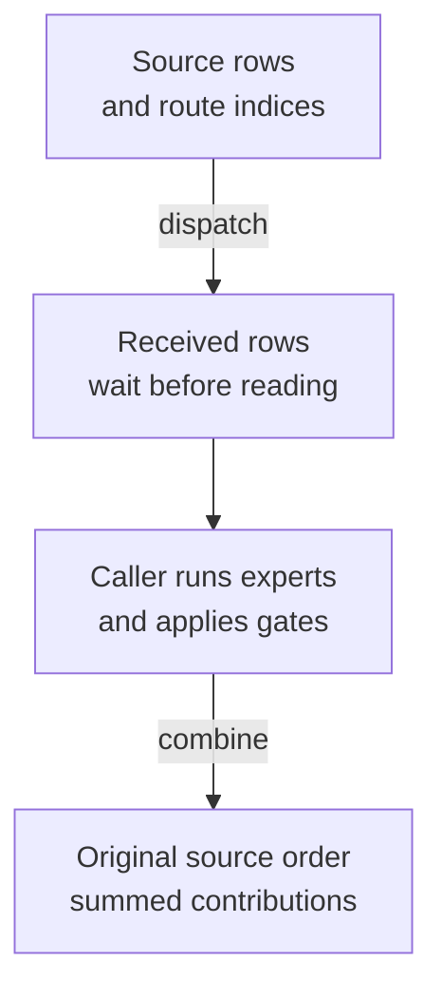

---
{
  "id": "deep-dive-deepep",
  "title": "Deep Dive - DeepEP",
  "slug": "deep-dive-deepep",
  "section": "Project Deep Dives",
  "category": "Inference Optimization",
  "difficulty": "Hard",
  "order": 15,
  "coverImage": "illustrations/_generated/deepep_token_journey_dark.png",
  "shortDescription": "A token can reach two experts on different GPUs and still return to the wrong row. DeepEP is the low-latency dispatch and combine communication library that orchestrates these MoE transfers across NVLink and RDMA.",
  "keyConceptsTested": [
    "MoE expert-parallel dispatch and combine",
    "Logical versus physical bandwidth across NVLink and RDMA",
    "NCCL Gin direct and hierarchical hybrid paths",
    "ElasticBuffer, EPHandle, EventOverlap, and deterministic sorting",
    "FP8 dispatch with BF16 combine and expert alignment",
    "Analytical SM and queue-pair sizing plus JIT kernel compilation",
    "V2 versus legacy NVSHMEM V1 and experimental PP, CP, and Engram extensions"
  ],
  "prerequisites": [
    "deep-dive-slime",
    "deep-dive-megatron",
    "deep-dive-deepgemm",
    "model-parallelism-for-llm-inference",
    "deep-dive-sglang"
  ],
  "relatedQuestions": [
    "mixture-of-experts-architecture",
    "model-parallelism-for-llm-inference",
    "mixed-precision-training-loss-scaling",
    "deep-dive-slime"
  ],
  "companies": [
    "DeepSeek",
    "NVIDIA"
  ]
}
---

A routed <span data-glossary="mixture-of-experts">mixture-of-experts</span> (MoE) layer can send one token to two experts on different GPUs. Each expert is a specialized feed-forward block, and a router gate weight determines how much that expert's output contributes to the final hidden state. Getting both results back to the originating GPU is only half the problem: each output must land in the exact source row, with its gate weight applied once, while every <span data-glossary="cuda-kernel">CUDA kernel</span> shares GPU <span data-glossary="streaming-multiprocessor">streaming multiprocessors (SMs)</span> with the expert matrix multiplications. If communication claims too many SMs, the transport looks fast in isolation while the whole MoE layer slows down.

The previous chapter traced slime's rollout and training loop. Whenever the active model is a sparse MoE, every forward and backward pass still has to exchange hidden-state rows across ranks. **DeepEP (DeepEveryParallel)** is DeepSeek's communication library built specifically for that exchange. Its V2 architecture wraps expert-parallel dispatch and combine in a symmetric buffer backed by <span data-glossary="nccl">NCCL</span> Gin, NVIDIA Collective Communications Library's device-side network interface. Across <span data-glossary="nvlink">NVLink</span> inside a node and <span data-glossary="rdma">remote direct memory access (RDMA)</span> between nodes, DeepEP shares one routing model while choosing different transport and synchronization paths. The archived <span data-glossary="nvshmem">NVIDIA SHMEM (NVSHMEM)</span>-based V1 used a separate API and resource model.[^deepep2026repo][^deepep2026legacy]

One subtle mixed-fabric detail explains why hardware ordering matters as much as routing math. When a logical scale-up domain spans both NVLink and RDMA, a completed RDMA transport call and GPU visibility of preceding writes are separate hardware guarantees. DeepEP inserts a system-scope memory fence before its Gin barrier so remote writes become visible before the receiving kernel reads them.[^deepep2026mixedfabricfix]

<!-- leetllm: edition:reference:start -->

## Release transition: V2.5 buffer and event handling

DeepEP evolved from a single unified `ElasticBuffer` in V2 into specialized buffers in V2.5. The core expert-parallel mechanics remain identical across both: destination-rank deduplication, caller-owned gate multiplication, and source-row restoration through saved route metadata. What changes is buffer ownership, deferred epilogue handling, and the removal of the legacy V1 NVSHMEM backend.[^deepep2026v25readme][^deepep2026v25release]

| Architectural area | V2 design | V2.5 design |
| --- | --- | --- |
| Buffer ownership | One `ElasticBuffer` | `EPBuffer`, `BucketBuffer`, `EngramBuffer`, and `PPBuffer` share `BufferBase`; `BufferAllocator` plans symmetric allocations |
| Deferred EP results | Dispatch returns five values immediately | With `defer_epilogue=True`, dispatch returns one `EventOverlap`; its first `.wait()` returns four results |
| Kernel compilation | In-tree JIT under `csrc/jit/` | Host extension built at installation; runtime kernels compiled through the DeepJIT submodule |
| Runtime floor | CUDA 12.3+, NCCL 2.30.4+ | Linux, Python 3.10+, Hopper or newer, CUDA 13.1+, PyTorch 2.10+, NCCL 2.32.3+, C++20 `std::format` |
| Legacy path | V1 available with NVSHMEM | V1 and NVSHMEM backend removed |

> **Common mistake:** Unpacking a deferred V2.5 dispatch call directly into five variables raises `TypeError: cannot unpack non-iterable EventOverlap object`. Call `.wait()` once and keep the returned tuple: the completion hook runs only on the first wait, so a second `.wait()` returns `None`. Remember also that `.wait()` enqueues a GPU stream dependency rather than synchronizing the host CPU.[^deepep2026v25readme]

Here is the V2.5 deferred-epilogue flow for an initialized EP group with BF16 input `x` and routing tensors:

```python title="v25_deferred_epilogue.py"
from deep_ep import EPBuffer

buffer = EPBuffer(
    group, num_max_tokens_per_rank=4096, hidden=7168, num_topk=8,
)
ready = buffer.dispatch(
    x, topk_idx=topk_idx, topk_weights=topk_weights, num_experts=128,
    expert_alignment=expert_alignment, do_expand=True,
    do_zero_padding=True, do_cpu_sync=True,
    async_with_compute_stream=True, defer_epilogue=True,
)
launch_independent_work()
recv_x, _, recv_w, handle = ready.wait()
# Expanded weights hold one scalar per expert row; the caller applies them once.
expert_output = launch_weighted_expanded_experts(recv_x, recv_w, handle)
combined_ready = buffer.combine(
    expert_output, handle=handle,
    async_with_compute_stream=True, defer_epilogue=True,
)
combined_x, _ = combined_ready.wait()
```

During latency-sensitive decode without CPU count synchronization, pass `do_cpu_sync=False` and read only the valid expert ranges recorded in `handle`. Enabling `do_zero_padding=True` zeros alignment gaps for clean GEMM inputs, while leaving those padding slots excluded from valid tokens. V2.5 also adds redundant-expert weight prefetch and FP32 gradient reduction over NVLink across the local NVLink domain; the caller still supplies the replication map, reroutes tokens, and keeps storage alive.[^deepep2026v25readme]

<!-- leetllm: edition:reference:end -->

## Why expert parallelism needs a communication layer

Think from the perspective of a single GPU rank. An MoE layer replaces one dense feed-forward network with dozens or hundreds of expert networks, and a router selects <span data-glossary="top-k">top-k</span> experts for every <span data-glossary="token">token</span>. <span data-glossary="expert-parallelism">Expert parallelism</span> (EP) partitions those experts across ranks so each GPU stores only its local slice of weights. Memory per GPU drops dramatically, at the cost of exchanging token activations on every MoE layer.

Each rank starts with a hidden-state matrix `X` (one row per local token) plus router outputs `topk_idx[t, j]` and `topk_weight[t, j]`. Dispatch sends each token at most once to each selected destination rank, even when that rank hosts two of the token's chosen experts. An optional expansion pass on the receiving rank then duplicates that row into one aligned slot per selected expert. After the local expert <span data-glossary="gemm">general matrix multiplications</span> (GEMMs) finish, combine reverses the route and sums the returning contributions into each original source row. DeepEP passes gate weights alongside activations as metadata, leaving the caller responsible for multiplying each expert output by its gate weight exactly once before combine.

Why not call a standard collective like `all_to_all_single`? A fixed-size all-to-all expects uniform peer counts. Even variable-split all-to-all leaves the caller to compute peer counts, deduplicate same-rank experts, pack aligned GEMM buffers, synchronize asynchronous receives, and invert the scatter back into source order. DeepEP fuses those four responsibilities into one communication layer:

| Stage | Responsibility |
| --- | --- |
| Layout | Map every valid `(token, expert)` pair to a destination rank and aligned expert slot |
| Transport | Carry rows over local memory, NVLink, or NCCL Gin RDMA |
| Synchronization | Signal when the compute stream can safely read received rows |
| Inversion | Return expert outputs to their original source rows and sum contributions |

DeepEP stops cleanly at the communication layer: the router, expert GEMMs, gate multiplication, and training loop live in the caller. That separation makes debugging sharp because a wrong output can be isolated either to route metadata or to local expert math.[^deepep2026repo]



## A four-token routing ledger

Trace a tiny four-token system by hand to make every piece of metadata concrete. Take two ranks and four experts: rank 0 owns experts `{0, 1}` and starts with tokens `a` and `b`; rank 1 owns experts `{2, 3}` and starts with tokens `c` and `d`. Each token selects two experts:

| Token | Source rank | First expert | Second expert | Gate weights |
| --- | ---: | ---: | ---: | --- |
| `a` | 0 | 0 (rank 0) | 3 (rank 1) | 0.70, 0.30 |
| `b` | 0 | 2 (rank 1) | 1 (rank 0) | 0.40, 0.60 |
| `c` | 1 | 1 (rank 0) | 3 (rank 1) | 0.55, 0.45 |
| `d` | 1 | 0 (rank 0) | 2 (rank 1) | 0.25, 0.75 |

Here every token picks one expert on rank 0 and one on rank 1, so the eight expert assignments require eight `(source token, destination rank)` rows (four local, four remote). Rank 0 sends `a` to expert 3 and `b` to expert 2 while receiving `c` for expert 1 and `d` for expert 0. Rank 1 executes the mirror exchange. In real workloads, router skew makes these counts uneven across ranks.

Dispatch builds this mapping and returns an `EPHandle` storing route indices and reverse-slot metadata. Gate values arrive as a separate tensor aligned with the received rows, so the caller multiplies each expert output by its corresponding gate weight before invoking `combine`.

<figure>
  
  <figcaption>Token a stays on rank 0 for expert 0 and crosses to rank 1 for expert 3. The caller weights the expert outputs; combine uses the EPHandle to sum them into source row a.</figcaption>
</figure>

```checkpoint
For token `b`, which rank receives its first dispatched copy, and who applies its gate weight?
---
Rank 1 receives the copy for expert 2. The caller multiplies that expert's output by `0.40` before DeepEP combines the contributions for source token `b`.
```

## V2's single interface: ElasticBuffer

In DeepEP V2, both high-throughput training and low-latency inference share `ElasticBuffer`. You can specify an explicit byte size or let the buffer compute a 2 MiB-aligned allocation from maximum tokens per rank, hidden dimension, top-k, 8-bit floating-point (FP8) dispatch, topology, and reduction mode. The buffer owns symmetric GPU memory registered with NCCL (with optional CPU memory reserved for experimental Engram fetches).

Despite the name, *elastic* refers to a unified symmetric memory abstraction rather than automatic growth on demand. V2 uses more buffer memory than V1, so size the buffer up front for your worst-case token envelope using `get_buffer_size_hint`.[^deepep2026repo]

```python title="elastic_buffer_setup.py"
from deep_ep import ElasticBuffer

required = ElasticBuffer.get_buffer_size_hint(
    group,
    num_max_tokens_per_rank=4096,
    hidden=7168,
    num_topk=8,
    use_fp8_dispatch=True,
)
buffer = ElasticBuffer(
    group,
    num_max_tokens_per_rank=4096,
    hidden=7168,
    num_topk=8,
    use_fp8_dispatch=True,
)
recv_x, recv_idx, recv_w, handle, event = buffer.dispatch(
    x,
    topk_idx=topk_idx,
    topk_weights=topk_weights,
    num_experts=128,
    async_with_compute_stream=True,
)
```

Passing `num_sms=0` or `num_qps=0` delegates resource sizing to DeepEP's analytical helpers (use integers, not `None`). With `async_with_compute_stream=True`, `dispatch` returns an `EventOverlap` handle so you can run independent compute while transfers finish, then wait on the event before reading `recv_x`.[^deepep2026repo]

| ElasticBuffer concern | V2 behavior |
| --- | --- |
| Capacity | Explicit bytes or `get_buffer_size_hint` planning estimate |
| Topology | Auto-detects physical ranks and selects direct or hybrid logical domains |
| Layout | Returns `EPHandle` with prefixes, slots, and source metadata |
| Compute overlap | Returns `EventOverlap` and keeps allocation on the communication stream |
| Precision | Accepts <span data-glossary="bf16">BF16</span> tensors or FP8 values plus scale factors |
| Reuse | Accepts a cached handle when the exact routing layout repeats |

> **Key insight:** Reusing a buffer avoids allocation and communicator setup on every step, whereas reusing an `EPHandle` promises that the exact token-to-expert routing is unchanged. Cached dispatch passes `topk_idx=None` and reuses `handle.topk_idx` without comparing a new router output, so matching tensor shapes alone never makes an old handle valid for a new step.

## Dispatch: layout, move, and epilogue

DeepEP V2 organizes dispatch into three logical stages that kernels overlap in flight:

1. **Count and lay out** rows by destination scale-up rank and local expert.
2. **Move** rows across local symmetric memory, NVLink, or NCCL Gin RDMA.
3. **Copy or expand** received rows into the layout required by the expert GEMM.

Inputs follow clean shapes: `topk_idx` and `topk_weights` have shape `[num_tokens, num_topk]`, and hidden states have shape `[num_tokens, hidden]` in BF16 (or FP8 paired with scale factors). An expert ID of `-1` marks an unused router slot and generates neither transport traffic nor an expert row.

The receiving rank produces either a **non-expanded** layout (one row per received source token, paired with its top-k metadata) or an **expanded** layout (one slot per selected expert, with each local expert's contiguous segment padded to GEMM alignment). Alignment regularizes <span data-glossary="matrix">matrix</span> tile shapes, while padding slots never represent tokens and never enter combine. Passing `do_zero_padding=True` clears those gaps.

Look carefully at how expanded offsets work. `psum_num_recv_tokens_per_expert[i]` stores the aligned starting offset of expert `i` *plus its real token count*, rather than an inclusive sum of padded capacities. For real counts `[3, 1]` and alignment 4, expert starts are `[0, 4]`, valid endpoints are `[3, 5]`, total allocated capacity is 8 slots, and `num_unaligned_recv_tokens_per_expert` keeps `[3, 1]`. CPU-synchronized dispatch returns exact host counts; async no-sync callers must slice by valid device counts rather than reading through padded capacity.

On the C++ launch side (`csrc/kernels/elastic/dispatch.hpp` paired with `deep_ep/buffers/elastic.py`), DeepEP selects `dispatch` for a single flat domain and `hybrid_dispatch` when ranks span multiple scale-out groups, passing the NCCL device communicator, symmetric window, prefix arrays, slot metadata, SM budget, and QP count into a JIT-compiled kernel.

## Combine: reverse routing plus reduction

After local expert GEMMs finish, activations sit in expert order rather than source-token order. `combine` reads `handle.recv_src_metadata`, scale-up prefix sums, and (in hybrid mode) channel metadata to send each row back to its source rank and sum all expert contributions for each source token. Local rows bypass remote links but still enter the same reduction.[^deepep2026repo]

Return to token `a` in our four-token example. Suppose expert 0 outputs `(1, 0)` and expert 3 outputs `(4, 0)`. After the caller applies gate weights `0.70` and `0.30`, combine receives `(0.70, 0)` and `(1.20, 0)` and returns `(1.90, 0)`. Forgetting gate weights produces `(5, 0)`; applying them twice produces `(0.85, 0)`. Because all three tensors share the exact same shape, transport tests must check numerical values alongside row counts.

The `allow_multiple_reduction` option exposes a subtle bandwidth-versus-precision trade-off. Staging a local reduction before forwarding sends fewer rows across the fabric, yet materializing an intermediate subtotal in BF16 adds a second rounding step. The general reduction kernel accumulates in FP32 before casting to BF16, while a no-bias path with at most two inputs uses packed BF16 addition.

Consider three already-weighted contributions: `256`, `1`, and `-256`. Accumulating all three in FP32 gives `1`, which BF16 represents exactly. Materializing `256 + 1` in BF16 first rounds `257` to `256` under round-to-nearest-even; adding `-256` then leaves `0`. That catastrophic cancellation disappears in a single FP32 accumulation:

<!-- leetllm: test, deps=numpy, output=show -->
```python title="staged_bf16_rounding.py"
import numpy as np

def bf16(value: float) -> float:
    bits = np.array([value], dtype=np.float32).view(np.uint32)
    # Keep the upper 16 bits. At a tie, retain an even low bit.
    rounded = (bits + np.uint32(0x7FFF) + ((bits >> np.uint32(16)) & np.uint32(1))) & np.uint32(0xFFFF0000)
    return float(rounded.view(np.float32)[0])

single_stage = bf16(256.0 + 1.0 - 256.0)
local_stage = bf16(256.0 + 1.0)
two_stages = bf16(local_stage - 256.0)
assert single_stage == 1.0 and local_stage == 256.0 and two_stages == 0.0
print(f"one final BF16 cast: {single_stage:.0f}")
print(f"BF16 local subtotal: {local_stage:.0f}; final result: {two_stages:.0f}")
```

<!-- leetllm: output:start -->
```text title="Output" output compact
one final BF16 cast: 1
BF16 local subtotal: 256; final result: 0
```
<!-- leetllm: output:end -->

Backward pass duality ties dispatch and combine together cleanly:

| Forward operation | Reverse-mode operation |
| --- | --- |
| Dispatch source rows to experts | Combine expert <span data-glossary="gradient">gradients</span> back to source rows |
| Expert GEMM consumes received rows | Expert GEMM produces gradients in received layout |
| Combine sums expert outputs to source rows | Dispatch copies source gradients to expert slots |

For the unweighted routing operators, dispatch and combine are exact transposes: scattering rows forward becomes summing gradients backward. The surrounding autograd wrapper still differentiates expert projections and gate multiplication explicitly, since gate gradients depend on both raw expert outputs and upstream gradients. `combine` always outputs BF16 and optionally fuses up to two BF16 bias tensors in its epilogue.

## Topology: scale-up and scale-out are different roads

Hardware topology splits communication into two distinct regimes. **Scale-up** connects GPUs inside one node over high-bandwidth NVLink. **Scale-out** connects GPUs across nodes over RDMA network interface cards (NICs). A flat all-to-all ignores that gap: a kernel optimized for cross-node RDMA can waste synchronization overhead inside a node, while direct all-to-all across nodes multiplies queue-pair (QP) count and cross-rail congestion.

DeepEP V2 queries physical topology from NCCL and runs in one of two modes while preserving global rank IDs:

<figure>
  
  <figcaption>Direct mode uses point-to-point cross-node RDMA. Hybrid mode routes over an RDMA rail followed by high-bandwidth intranode NVLink forwarding to reduce cross-rail network congestion.</figcaption>
</figure>

| Mode | Logical shape | Primary path | Best fit | Main trade-off |
| --- | --- | --- | --- | --- |
| Direct | Single scale-up domain | NCCL Gin full connection or local symmetric memory | Flat fabrics or single-node EP | Largest peer set and highest QP pressure per rank |
| Hybrid | `scale-out × scale-up` | Cross-node RDMA rail plus intranode NVLink forward | Multi-node clusters with NVLink islands | Extra channel linked lists, metadata, and forwarding warps |

In hybrid mode, DeepEP splits <span data-glossary="cuda-warp">CUDA warps</span> (32-thread execution groups) between scale-out RDMA transfers and intranode NVLink forwarding, using per-channel linked lists to overlap both hops. At backend initialization, DeepEP requests `NCCL_GIN_CONNECTION_RAIL` in hybrid mode and `NCCL_GIN_CONNECTION_FULL` in direct mode, asserting early if the fabric cannot support the chosen connection type (unless `EP_DISABLE_GIN` overrides it).

## Logical bandwidth is not a NIC counter

DeepEP's README reports performance in **logical bandwidth**: the total algorithmic tensor volume exchanged across the EP group, including rows that stay on their source GPU. Physical hardware counters measure bytes traversing a specific NVLink lane or RDMA NIC. Because they divide different byte counts by elapsed time, mixing them produces false regressions or phantom speedups.

Work a quick example. Suppose four ranks exchange 100 MiB of logical token payload in 1 ms, and half the rows remain local while half cross RDMA. Over 1 ms, 100 MiB yields $100 \times 2^{20} / (0.001 \times 10^9) = 104.86$ decimal GB/s of logical bandwidth, while the NIC sees only 50 MiB, or $52.43$ GB/s. Meanwhile, in hybrid mode a forwarded row crosses NVLink in addition to RDMA, so physical NVLink counters can exceed logical volume. Always evaluate dispatch-plus-expert-plus-combine end-to-end layer latency alongside communication bandwidth.

DeepEP's published V2 logical-bandwidth reference points (8K tokens, hidden size 7168, top-8 routing, FP8 dispatch, BF16 combine) illustrate the scale difference between RDMA and intranode NVLink, and between max-throughput and overlap-friendly SM budgets:[^deepep2026repo]

| Arch | NIC | Topology | Dispatch bottleneck | Combine bottleneck | SMs |
| --- | --- | --- | --- | --- | ---: |
| SM90 | CX7 | EP 8×2 | 90 GB/s RDMA | 81 GB/s RDMA | 12 |
| SM90 | CX7 | EP 8×4 | 61 GB/s RDMA | 61 GB/s RDMA | 6 |
| SM100 | CX7 | EP 8×2 | 90 GB/s RDMA | 91 GB/s RDMA | 12 |
| SM100 | N/A | EP 8 | 726 GB/s NVLink | 740 GB/s NVLink | 64 (max perf) |
| SM100 | N/A | EP 8 | 643 GB/s NVLink | 675 GB/s NVLink | 24 (min SM) |

On SM100 intranode EP8, cutting communication SMs from 64 down to 24 retains nearly 89% of dispatch bandwidth while freeing 40 SMs for overlapping compute.

<!-- leetllm: edition:reference:start -->

## NCCL Gin V2 backend

NCCL Gin lets GPU kernels issue network operations directly from device code while reusing the application's existing NCCL communicator. DeepEP V2 initializes that backend in seven ordered steps:

1. Accept or create the host NCCL communicator.
2. Query physical rank domains and Gin capability.
3. Request QP contexts, queue depth, traffic class, and barrier/notification signals.
4. Select rail (`NCCL_GIN_CONNECTION_RAIL`) or full (`NCCL_GIN_CONNECTION_FULL`) connections for hybrid or direct mode.
5. Allocate symmetric GPU memory (and optional CPU memory).
6. Register the symmetric window and obtain NVLink peer pointers.
7. Build the device communicator handle consumed by JIT kernels.

Cluster knobs such as `EP_OVERRIDE_RDMA_SL` (InfiniBand service level) and `NCCL_GIN_CROSS_NIC=0` (multi-plane handle handling) tune network behavior at deployment time. Keep lifetime ownership strict: DeepEP owns layout metadata, kernels, and window registration; NCCL owns the communicator; the model runtime owns process-group teardown. Destroying a communicator while an `EventOverlap` hook or active kernel still references its window causes a lifecycle failure rather than a routing error.

<!-- leetllm: edition:reference:end -->

## EPHandle: route metadata with a lifetime

`EPHandle` bridges dispatch, local expert compute, and combine by carrying every offset needed to invert the scatter:

| Handle field | Meaning |
| --- | --- |
| `topk_idx` | Cloned routing choices (unless caller disables copying) |
| `recv_src_metadata` | Source token and destination slot mapping |
| `dst_buffer_slot_idx` | Receive-buffer slots used for cached dispatch |
| `psum_num_recv_tokens_per_scaleup_rank` | Prefix sum of received rows per scale-up peer |
| `psum_num_recv_tokens_per_expert` | Aligned start plus valid count for each local expert |
| `num_unaligned_recv_tokens_per_expert` | Real token counts in expanded mode |
| `token_metadata_at_forward` | Per-channel metadata for hybrid combine |
| `channel_linked_list` | Hybrid channel forwarding links |
| `num_sms` | Dispatch SM budget reused by combine |

Cached dispatch (`topk_idx=None`) skips layout discovery when replaying an identical route, such as a matching backward pass. Because it bypasses CPU count synchronization, only reuse a handle when the route itself is guaranteed unchanged.

For reproducible training slices or debugging, DeepEP offers a deterministic mode that sorts received rows after arrival by `(source_global_id, expert_id)`. Non-expanded mode permutes data, weights, indices, and metadata together; expanded mode sorts rows within each expert segment and updates slot pointers. Sorting removes arrival-order nondeterminism at the cost of extra post-kernel work and tighter overlap constraints.

## EventOverlap: stream synchronization mechanics

<span data-glossary="cuda-stream">CUDA streams</span> allow communication kernels to overlap with independent GPU compute, so returning from `dispatch` in Python only means the kernel has been enqueued. `EventOverlap` wraps a <span data-glossary="cuda">CUDA</span> event and optional post-wait hook (such as deterministic sorting):

```python title="event_overlap.py"
recv_x, recv_idx, recv_w, handle, event = buffer.dispatch(
    x,
    topk_idx=topk_idx,
    topk_weights=topk_weights,
    num_experts=num_experts,
    async_with_compute_stream=True,
)

launch_independent_work()
event.current_stream_wait()
# Non-expanded layout: compute local experts, apply each gate once,
# and sum local expert outputs per received row in BF16.
expert_output = launch_weighted_local_experts(recv_x, recv_idx, recv_w)

combined_x, _, combine_event = buffer.combine(
    expert_output,
    handle=handle,
    async_with_compute_stream=True,
)
combine_event.current_stream_wait()
```

`current_stream_wait()` inserts a GPU-side dependency on the active stream without blocking the host CPU; calling a host sync between dispatch and expert launch destroys the overlap. Pass `previous_event` when communication must wait for an upstream compute kernel, and ensure every consumer stream waits on completion before releasing buffers.

## Precision: FP8 on the wire, BF16 for the reduction

DeepEP supports BF16 hidden states by default and FP8 hidden states paired with block scale factors for lower wire traffic during dispatch. Combine always consumes and produces BF16 activations, leaving gate weighting in the caller's expert path.

Count the actual wire bytes for FP8 dispatch: with one 4-byte FP32 scale per 128 elements, a 7,168-element hidden row needs `7,168` payload bytes plus `224` scale bytes (`7,392` bytes total) compared to `14,336` bytes for BF16. Adding routing metadata and packet headers makes the true saving slightly under 2×. Scale-factor layout, stride, and optional `use_tma_aligned_col_major_sf` (<span data-glossary="tma">Tensor Memory Accelerator (TMA)</span> alignment) must match the downstream expert GEMM exactly, or valid wire bytes will dequantize to garbage.

In reinforcement learning and post-training for large sparse models, rollout inference often favors FP8 dispatch for speed while training may keep BF16 activations or higher-precision accumulators. Track dtype and scale layout in the run configuration so numerical shifts never get mistaken for communication or reward regressions.

## Analytical SM and QP sizing

DeepEP's `get_theoretical_num_sms` estimates a starting SM count from link bandwidths and a balanced uniform routing model. It multiplies the raw bandwidth-derived SM count by `1.25`, rounds up to an even integer of at least `4`, and clamps to the GPU's SM count. When overlap with compute is prioritized, it stays near that minimum; for maximum standalone communication bandwidth, it raises the floor to `64` SMs.

The balanced routing model counts expected *distinct destination ranks*, not total expert selections. With $E$ experts split evenly across $G$ destination groups and $k$ distinct experts chosen uniformly without replacement, the expected number of touched destinations is:

$$
\mathbb{E}[\text{destinations}] = G \left(1 - \frac{\binom{E - E/G}{k}}{\binom{E}{k}}\right)
$$

For $E=4$ experts across $G=2$ ranks and $k=2$, six unordered expert pairs exist: two stay on one rank (`{0,1}`, `{2,3}`), and four touch both ranks, giving $(2\cdot 1 + 4\cdot 2)/6 = 5/3 \approx 1.667$ destinations rather than 2.

Queue-pair sizing follows a similar analytical rule: direct mode requests `min(num_sms, 9)` QPs, while hybrid mode requests `num_sms * 16 + 1` QPs so channels and notifications get independent queues, capped by the number of allocated <span data-glossary="qps">QPs</span>:

<!-- leetllm: test, output=show -->
```python title="destination_and_queue_counts.py"
from itertools import combinations
from math import comb, isclose

def expected_destinations(experts, groups, topk):
    return groups * (1 - comb(experts - experts // groups, topk) / comb(experts, topk))

def queue_count(sms, allocated, hybrid):
    requested = sms * 16 + 1 if hybrid else min(sms, 9)
    return min(requested, allocated)

pairs = list(combinations(range(4), 2))
enumerated = sum(len({expert // 2 for expert in pair}) for pair in pairs) / len(pairs)
assert isclose(enumerated, expected_destinations(4, 2, 2))
print(f"expected destination ranks: {enumerated:.6f}")
print(f"12 SMs, 128 allocated QPs: direct={queue_count(12, 128, False)}, hybrid={queue_count(12, 128, True)}")
```

<!-- leetllm: output:start -->
```text title="Output" output compact
expected destination ranks: 1.666667
12 SMs, 128 allocated QPs: direct=9, hybrid=128
```
<!-- leetllm: output:end -->

In the 12-SM hybrid case, the formula requests 193 QPs and silently caps at the 128 allocated queues. More importantly, production DeepSeek-style routers often use group-limited or skewed routing that breaks the uniform-subset assumption. Use the helper as a baseline, inspect your real token-routing histogram, and pass `num_sms` explicitly whenever skewed traffic or compute overlap budgets diverge from the uniform model.

<!-- leetllm: edition:reference:start -->

## JIT compilation is part of the runtime

Rather than shipping precompiled binaries for every combination of topology, expansion mode, hidden byte width, alignment, warp count, SM budget, and QP count, DeepEP compiles specialized kernels on demand via JIT (in-tree in V2, via DeepJIT in V2.5). Compilation caches modules on disk and loads them through a runtime handle.

That design shrinks install times while shifting compiler and header compatibility checks onto first use. Pre-warm every production shape during startup or account for JIT compile time in readiness probes, and keep cache directories separated by GPU architecture and compiler version.

| Variable | Purpose |
| --- | --- |
| `EP_JIT_CACHE_DIR` | Persistent kernel cache directory |
| `EP_JIT_DEBUG` | Print JIT compilation diagnostics |
| `EP_JIT_DUMP_PTX` / `EP_JIT_DUMP_SASS` | Dump generated assembly for inspection |
| `EP_JIT_PTXAS_CHECK` | Fail compilation if kernels spill to local memory |
| `TORCH_CUDA_ARCH_LIST` | Build-time CUDA architecture targets |
| `EP_NCCL_ROOT_DIR` | Override NCCL headers and library search path |

<!-- leetllm: edition:reference:end -->

## A runnable routing ledger

Let us verify the complete four-token dispatch, expansion, alignment padding, expert weighting, and inverse combine in Python. Give token `a` hidden state `(1.0, 0.0)` and let expert $k$ scale its input by $k + 1$, so expert 0 outputs `(1.0, 0.0)` and expert 3 outputs `(4.0, 0.0)`:

$$
0.70\cdot(1.0,\ 0.0) + 0.30\cdot(4.0,\ 0.0) = (1.90,\ 0.0)
$$

The simulation below builds aligned expanded expert buffers (padding each expert to a multiple of 4), computes and weights outputs in expert order, reverses the result list to prove order independence, and restores every source token strictly from the saved inverse map:

<!-- leetllm: test, output=show, id=routing-ledger -->
```python title="routing_ledger.py"
from dataclasses import dataclass
import math

HIDDEN = {
    "a": (1.0, 0.0),
    "b": (0.0, 1.0),
    "c": (1.0, 1.0),
    "d": (2.0, -1.0),
}
ROUTES = {
    "a": [(0, 0.70), (3, 0.30)],
    "b": [(2, 0.40), (1, 0.60)],
    "c": [(1, 0.55), (3, 0.45)],
    "d": [(0, 0.25), (2, 0.75)],
}
SOURCE_RANK = {"a": 0, "b": 0, "c": 1, "d": 1}
EXPERTS_PER_RANK = 2


def owner_rank(expert):
    return expert // EXPERTS_PER_RANK


def expert_map(expert, hidden):
    scale = expert + 1
    return (hidden[0] * scale, hidden[1] * scale)


@dataclass(frozen=True)
class Row:
    token: str
    topk_slot: int
    hidden: tuple[float, float]
    weight: float
    path: str


def dispatch(hidden, routes, sources, alignment=4):
    if set(hidden) != set(routes) or set(hidden) != set(sources):
        raise ValueError("Token sets differ")
    recv = {expert: [] for expert in range(4)}
    inverse = {}
    rank_rows = set()
    for token, choices in routes.items():
        if sources[token] not in (0, 1):
            raise ValueError("Invalid source rank")
        seen = set()
        for topk_slot, (expert, weight) in enumerate(choices):
            if expert == -1:  # unused router slot, not Python index -1
                continue
            if not 0 <= expert < 4 or expert in seen:
                raise ValueError("Invalid or duplicate expert")
            seen.add(expert)
            destination = owner_rank(expert)
            rank_rows.add((token, destination))
            slot = len(recv[expert])
            inverse[expert, slot] = (token, topk_slot)
            path = "local" if destination == sources[token] else "remote"
            recv[expert].append(Row(token, topk_slot, hidden[token], weight, path))
    for rows in recv.values():
        rows.extend([None] * (-len(rows) % alignment))
    return recv, inverse, rank_rows


def run_experts(recv):
    results = []
    for expert, rows in recv.items():
        for slot, row in enumerate(rows):
            if row is None:  # padding never acquires a source identity
                continue
            raw = expert_map(expert, row.hidden)
            weighted = tuple(row.weight * value for value in raw)
            results.append(((expert, slot), weighted))
    return results


def combine(results, inverse, source_tokens):
    combined = {token: [0.0, 0.0] for token in source_tokens}
    seen = set()
    for key, value in results:
        if key not in inverse or key in seen:
            raise ValueError("Unexpected, padded, or duplicate result slot")
        if len(value) != 2 or not all(math.isfinite(v) for v in value):
            raise ValueError("Invalid expert output")
        seen.add(key)
        token, _topk_slot = inverse[key]
        for column in range(2):
            combined[token][column] += value[column]
    if seen != set(inverse):
        raise ValueError("Missing expert results")
    return {token: tuple(value) for token, value in combined.items()}


recv, inverse, rank_rows = dispatch(HIDDEN, ROUTES, SOURCE_RANK)
results = run_experts(recv)
combined = combine(list(reversed(results)), inverse, HIDDEN)
assert math.isclose(combined["a"][0], 1.90)
assert len(inverse) == 8 and sum(map(len, recv.values())) == 16

for token in HIDDEN:
    x, y = combined[token]
    print(f"{token}: ({x:.2f}, {y:.2f})")
for expert in range(4):
    copies = ", ".join(f"{row.token} {row.path}" for row in recv[expert] if row is not None)
    print(f"E{expert} <- {copies}")
```

<!-- leetllm: output:start -->
```text title="Output" output compact
a: (1.90, 0.00)
b: (0.00, 2.40)
c: (2.90, 2.90)
d: (5.00, -2.50)
E0 <- a local, d remote
E1 <- b local, c remote
E2 <- b remote, d local
E3 <- a remote, c local
```
<!-- leetllm: output:end -->

Now test three critical edge cases in the same session:
1. **Same-rank deduplication:** Move token `a`'s first choice from expert 0 (rank 0) to expert 2 (rank 1). Experts 2 and 3 both live on rank 1, so transport drops from 8 to 7 destination-rank rows while expanded expert assignments stay at 8 (`0.70 × 3 + 0.30 × 4 = 3.30`).
2. **Masked `-1` slot:** Mask `a`'s second choice to `-1`. It creates neither a destination row nor an expert slot (and never indexes Python's last expert).
3. **Padding rejection:** Attempting to feed an alignment-padding slot back into `combine` raises an immediate error.

<!-- leetllm: test, output=show, continue=routing-ledger -->
```python title="routing_edge_cases.py"
same_rank_routes = {**ROUTES, "a": [(2, 0.70), (3, 0.30)]}
recv2, inverse2, destinations2 = dispatch(HIDDEN, same_rank_routes, SOURCE_RANK)
assert len(inverse2) == 8 and len(destinations2) == 7
assert math.isclose(combine(run_experts(recv2), inverse2, HIDDEN)["a"][0], 3.30)

masked_routes = {**ROUTES, "a": [(0, 0.70), (-1, 0.30)]}
recv3, inverse3, destinations3 = dispatch(HIDDEN, masked_routes, SOURCE_RANK)
assert len(inverse3) == 7 and len(destinations3) == 7
assert combine(run_experts(recv3), inverse3, HIDDEN)["a"] == (0.70, 0.0)

try:
    combine(results + [((0, 2), (999.0, 999.0))], inverse, HIDDEN)
except ValueError as error:
    assert str(error) == "Unexpected, padded, or duplicate result slot"
else:
    raise AssertionError("Padding acquired a source identity")
print("same-rank experts: 8 expert assignments, 7 destination rows")
print("masked selection: a=(0.70, 0.00); padded result rejected")
```

<!-- leetllm: output:start -->
```text title="Output" output compact
same-rank experts: 8 expert assignments, 7 destination rows
masked selection: a=(0.70, 0.00); padded result rejected
```
<!-- leetllm: output:end -->

<!-- leetllm: edition:reference:start -->

## V2 and V1 are different products

DeepEP V1 and V2 are distinct designs rather than drop-in modes of one API. V1 exposes `Buffer`, relies on NVSHMEM with separate NVLink and RDMA buffer sizes, and ships distinct normal and 0-SM RDMA low-latency kernels. V2 replaces NVSHMEM with NCCL Gin, unifies high-throughput and latency paths behind `ElasticBuffer` (and specialized buffers in V2.5), and adds direct/hybrid logical domains.[^deepep2026legacy]

| Dimension | V1 | V2 |
| --- | --- | --- |
| Main Python object | `Buffer` | `ElasticBuffer` (split in V2.5) |
| Primary network backend | NVSHMEM | NCCL Gin |
| Buffer sizing | Separate NVLink and RDMA hints | Unified symmetric buffer hint |
| Low-latency EP | Pure RDMA 0-SM hook method | Removed 0-SM RDMA mode |
| SM selection | Manual or tuned configs | Analytical helper with explicit override |
| Scale domain | Normal and low-latency variants | Direct and hybrid logical domains |

When migrating an older DeepSeek-V3 integration from V1 to V2, port routing layouts and handles first, verify NCCL Gin connectivity and buffer sizing, and pass deterministic numerical checks before measuring throughput.[^deepep2026legacy][^deepseekv3_2024]

## Experimental PP, CP, and Engram extensions

Beyond expert parallelism, DeepEP includes experimental primitives sharing the same symmetric-memory and event machinery:

- **<span data-glossary="pipeline-parallelism">Pipeline parallel</span> (PP):** Point-to-point tensor transfers through symmetric memory, including an experimental 0-SM RDMA variant. It provides transport only and leaves pipeline scheduling to frameworks like <span data-glossary="nvidia-megatron">Megatron</span>.
- **<span data-glossary="context-parallelism">Context parallel</span> (CP):** Copy-engine transfers for sequence slices, including a 0-SM copy-engine path, separate from attention masking or sequence partitioning.
- **Engram:** Remote embedding lookup by integer index over RDMA with optional CPU-backed storage and TMA-aligned scale factors. FP8 scale factors replicate globally on write and gather locally on fetch while the remote get moves entry payloads.
- **AGRS:** Experimental all-gather and reduce-scatter sessions over NVLink symmetric memory.

An Engram transport bug illustrates why routing logic alone misses hardware submission errors: a NIC doorbell notifies the hardware that queued RDMA operations are ready to execute, and an early Engram fetch loop could leave the tail of aggregated gets without ringing that doorbell. The fix defers one unaggregated get per active peer and records an asynchronous flush so every queued transfer actually submits.[^deepep2026repo][^deepep2026engramdoorbell] Because PP, CP, and Engram can draw from the same QP and symmetric-memory pool as EP dispatch, budget concurrent sessions explicitly.

## Requirements and cluster checks

DeepEP V2 targets Hopper (SM90) and newer GPUs with NVLink inside nodes and RDMA (InfiniBand, with RoCE compatibility) between nodes. V2 requires CUDA 12.3+, PyTorch 2.10+, and NCCL 2.30.4+, while V2.5 raises the floor to CUDA 13.1+, NCCL 2.32.3+, and a C++20 compiler supporting `std::format`.[^deepep2026repo]

| Check | Why it matters | Failure symptom |
| --- | --- | --- |
| GPU capability and PTX target | JIT kernels require supported instructions | Compile or launch error |
| CUDA, PyTorch, and NCCL versions | Compile-time headers and runtime libraries must agree | Import, communicator, or JIT failure |
| NVLink peer map | Scale-up domain must match NCCL local symmetric access (LSA) | Slow or invalid hybrid path |
| RDMA device and rail map | Gin requires usable network contexts | Gin unavailable assertion |
| QP allocation | Hybrid channels need dedicated queues | Initialization failure or timeout |
| Symmetric memory capacity | Buffers and workspaces must fit in GPU/CPU memory | Allocation or registration failure |
| Service-level isolation | Cross-job congestion inflates tail latency | Unstable combine latency |

Watch for subtle NCCL version coupling: builds compiled against NCCL headers older than 2.31 must load the exact same NCCL version at runtime, whereas 2.31+ requests a runtime-versioned device communicator. Inspect the loaded library with `EP_BUFFER_DEBUG=1` on worker nodes rather than relying solely on package version constraints, and redact <span data-glossary="secrets-management">credentials</span> and private hostnames before sharing diagnostic logs.

## Applications in giant-model post-training

In large-scale MoE post-training and RL, every generated token during rollout triggers dispatch and combine across experts, while training requires exact route preservation and reproducible gradients. Placement topology determines who owns the communicator and which bottleneck dominates:

| Post-training pattern | DeepEP role | Key metrics |
| --- | --- | --- |
| Separate rollout and trainer clusters | Dedicated EP groups for serving and training | <span data-glossary="tokens-per-second">Tokens per second</span>, weight sync cost, route version |
| Colocated actor and rollout | Shared GPU memory and communicator across alternating phases | Peak buffer bytes, phase switch pause, overlap efficiency |
| Teacher or specialist distillation | Repeatable routing across large teacher experts | Deterministic match, FP8 error, aggregate bandwidth |

When RL reward shifts after an infrastructure or dtype change, separate transport delay, FP8 scale mismatch, and algorithmic drift by logging route histograms, weight versions, and precision settings side by side.

## Strengths and weaknesses

| Strength | Why it helps | Limitation |
| --- | --- | --- |
| Unified V2 API | Single handle and event model across throughput and latency | Larger symmetric buffer footprint than V1 |
| NCCL Gin integration | Reuses existing application communicators | Requires recent NCCL and Gin-capable fabric |
| Direct and hybrid modes | Adapts to flat clusters or NVLink islands | Hybrid channel metadata adds debugging complexity |
| Analytical SM/QP sizing | Solid baseline without exhaustive grid search | Uniform-routing model misses skewed gates |
| FP8 dispatch and BF16 combine | Cuts wire bytes while keeping BF16 outputs | Caller owns scales, gating, and reduction staging |
| Deterministic sorting | Reproducible arrival order for tests and training | Sorting overhead reduces peak throughput |
| Runtime JIT | Avoids compiling every shape at install time | First-use compile latency and cache hygiene |
| MIT source license | Permissive reuse of library source | NCCL, NVSHMEM, and model weights carry separate terms |

## Team, contributors, governance, and licenses

DeepEP is published by DeepSeek AI under the MIT license (`LICENSE`). Its citation credits Chenggang Zhao, Shangyan Zhou, Liyue Zhang, Chengqi Deng, Zhean Xu, Yuxuan Liu, Kuai Yu, Jiashi Li, and Liang Zhao, with acknowledgments to the NVIDIA NCCL team for Gin support.[^deepep2026repo][^deepep2026license]

| Field | Project detail |
| --- | --- |
| Organization | DeepSeek AI |
| Core dependency | NVIDIA NCCL Gin and device communication APIs |
| Source license | MIT (`LICENSE`) |
| Legacy V1 dependency | NVSHMEM under NVIDIA license terms (removed in V2.5)[^deepep2026nvshmem] |
| Asset scope | CUDA, NCCL, <span data-glossary="model-checkpoint">model checkpoints</span>, and datasets keep their own licenses |

## Benchmark and failure-mode checklist

Reproducible DeepEP benchmarks record eight fields alongside throughput:

1. Library revision and JIT/compiler versions.
2. GPU architecture, rank count, NVLink map, NIC model, and rail topology.
3. CUDA, PyTorch, and NCCL versions.
4. Tokens per rank, hidden size, top-k, expert count, and alignment.
5. Router histogram, local-bypass fraction, and deterministic flag.
6. Precision, scale layout, SM budget, QP count, and direct vs. hybrid mode.
7. Warm-up iterations, JIT compile time, dispatch, combine, and full MoE layer latency.
8. Logical-byte formula alongside physical NIC/NVLink counters.

| Symptom | Subsystem | First check |
| --- | --- | --- |
| Gin unavailable assertion | NCCL communicator and topology | NCCL version, Gin properties, direct vs. hybrid mode |
| JIT compile failure | Compiler and cache | CUDA path, arch list, cache permissions |
| Receive count mismatch | Layout metadata | `EPHandle` prefixes, alignment, CPU sync mode |
| Wrong output order | Source slots and caching | `recv_src_metadata`, stale cached handle reuse |
| Timeout at scale | RDMA and QP pressure | Rail map, service level, QP count, congestion |
| OOM during initialization | Buffer sizing | Buffer size hint, concurrent PP/Engram buffers |
| Reward shift after dtype change | Numerics | FP8 scales, BF16 combine staging, GEMM accumulator |
| Slow second iteration | Stream ordering | `EventOverlap` waits and host sync stalls |

Validate row-to-source-token mapping with route <span data-glossary="checksum">checksums</span>, per-expert counts, and deterministic small-cluster tests before scaling up long training runs.

## Source-reading map

Read one vertical slice from Python down to JIT kernels:

| Order | File or directory | Question |
| ---: | --- | --- |
| 1 | `README.md` | Public API surface, requirements, and experimental features |
| 2 | `deep_ep/buffers/elastic.py` | Python buffer interface, sizing hints, handles, and events |
| 3 | `deep_ep/utils/event.py` | Stream wait hooks and deferred completion |
| 4 | `csrc/kernels/backend/nccl.cu` | Gin capability probing, rail setup, and symmetric windows |
| 5 | `csrc/kernels/elastic/dispatch.hpp` | Dispatch launch parameters, layout, and topology |
| 6 | `csrc/kernels/elastic/combine.hpp` | Reverse reduction and source-metadata consumption |
| 7 | `csrc/jit/compiler.hpp` and `csrc/jit/cache.hpp` | Kernel generation, compilation, and caching |
| 8 | `docs/legacy.md` and `docs/nvshmem.md` | Archived V1 interface and NVSHMEM dependencies |

Keep state ownership clear while reading: the router owns expert choices, `EPHandle` owns slot-to-source mapping, NCCL owns the communicator and memory window, `EventOverlap` owns stream readiness, and the caller owns expert math and gate weighting.

## Reviewing an integration

### Evaluation rubric

- **Foundational:** Trace token `a` through both experts to derive `1.90` with gate weights applied once, separating received gate tensors from `EPHandle` route metadata.
- **Intermediate:** Explain destination-rank deduplication, aligned expert padding vs. valid endpoints, cached-handle validity, and GPU stream waits before reading received rows.
- **Advanced:** Reconcile logical bandwidth with physical NIC/NVLink counters, critique balanced-gate SM/QP sizing under skewed routing, and separate CPU route verification from multi-GPU memory-fence and stream-ordering tests.

### Follow-up questions

```checkpoint
The route changes from experts [0, 3] to [2, 3] without changing tensor shapes. What must change before dispatch?
---
Rebuild the route handle. Both new experts live on rank 1, so the token needs one destination-rank row instead of two, followed by two expert slots on rank 1. Reusing the old handle silently replays the previous route because cached dispatch does not inspect new router indices.
```

```checkpoint
An integration passes the CPU routing simulation but hangs when a direct logical domain spans both NVLink and RDMA. What remains untested?
---
The CPU simulation tests arithmetic and inverse slot mapping, not GPU transport, memory visibility, barriers, or event lifetimes. Inspect the mixed-fabric system-scope fence before the Gin barrier and run distributed correctness tests directly on the target multi-fabric topology.
```

<!-- leetllm: edition:reference:end -->

```mastery-quiz
[
  {
    "question": "A toy source z has hidden row [2, −1]. Expert 1 returns twice its input and expert 3 returns four times its input. Their gates are 0.25 and 0.75. Which contributions and restored row apply each gate once?",
    "options": [
      "[4, −2] + [8, −4] → [12, −6].",
      "[1, −0.5] + [6, −3] → [7, −3.5].",
      "[0.25, −0.125] + [4.5, −2.25] → [4.75, −2.375].",
      "[1, −0.5] + [0, 0] → [1, −0.5]."
    ],
    "answer": "[1, −0.5] + [6, −3] → [7, −3.5].",
    "explanation": "The raw outputs are [4, −2] and [8, −4]. Multiplying once by 0.25 and 0.75 gives [1, −0.5] and [6, −3], and the saved inverse route sums them back into z as [7, −3.5]. Raw summation, double weighting, and dropping an expert produce the distractors."
  },
  {
    "question": "Six experts are placed as {0,1} on rank 0, {2,3} on rank 1 and {4,5} on rank 2. Tokens u, v and w choose [2,3], [0,5] and [4,5]. Then only w’s second choice becomes −1, with no renormalization. What are (destination rows, expert assignments) before and after?",
    "options": [
      "Before (6,6); after (5,5).",
      "Before (4,4); after (4,4).",
      "Before (4,6); after (3,5).",
      "Before (4,6); after (4,5)."
    ],
    "answer": "Before (4,6); after (4,5).",
    "explanation": "Each token travels once per distinct destination rank and then expands to its valid experts. Initially u touches 1 rank, v touches 2, and w touches 1: 4 destination rows and 6 expert assignments. Masking one of w’s two same-rank choices drops one expert slot while its remaining choice still needs rank 2."
  },
  {
    "question": "An expanded receive layout has two experts with real counts [5,2] and alignment 4. Each segment rounds its allocation up independently. Which starts, valid endpoints and total capacity follow?",
    "options": [
      "Starts [0,8]; endpoints [5,10]; capacity 12.",
      "Starts [0,5]; endpoints [5,7]; capacity 8.",
      "Starts [0,8]; endpoints [8,12]; capacity 12.",
      "Starts [0,8]; endpoints [5,10]; capacity 10."
    ],
    "answer": "Starts [0,8]; endpoints [5,10]; capacity 12.",
    "explanation": "The first expert rounds up to 8 slots and the second to 4, giving total capacity 12. Valid ranges are [0, 5) and [8, 10), so valid endpoints are [5, 10]. The distractors confuse padded storage with valid token counts."
  },
  {
    "question": "A historical V2 cached handle was built for a token’s experts [0,4] in a six-expert, three-rank group. The new route is [2,3], with the same shapes. A separate replay keeps its route unchanged but frees referenced storage before a pending consumer. Which repair pair follows?",
    "options": [
      "First: retain handle; second: retain early free.",
      "First: rebuild route; second: retain early free.",
      "First: rebuild route; second: preserve storage through consumers.",
      "First: retain handle; second: preserve storage through consumers."
    ],
    "answer": "First: rebuild route; second: preserve storage through consumers.",
    "explanation": "Changing experts invalidates the cached route even when tensor shapes match, so dispatch must rebuild the handle. In the second case, replaying a valid route still requires keeping its backing tensors alive until every consuming stream finishes."
  },
  {
    "question": "A deferred DeepEP V2.5 dispatch records event D on the dispatch stream. On stream A, the first `wrapper.wait()` queues a copy into the returned rows. The caller keeps the result tuple, records event E next on A, then switches to stream B and calls `wrapper.wait()` again. With the storage alive and no other synchronization, what does the second call return, and which event is sufficient to order B’s first read after the copy?",
    "options": [
      "It returns None. Waiting on D is sufficient.",
      "It returns the saved tuple. Waiting on D is sufficient.",
      "It returns None. Waiting on E is sufficient.",
      "It returns the saved tuple. Waiting on E is sufficient."
    ],
    "answer": "It returns None. Waiting on E is sufficient.",
    "explanation": "The first `.wait()` runs the completion hook, returns the tuple, and clears the hook, so the second `.wait()` returns None. Event D only marks dispatch completion before A's copy finishes; recording E after the copy on A and waiting on E on B orders B's read after the copy."
  },
  {
    "question": "A benchmark exchange counts 144 MiB of logical payload over 2 ms. Exactly 96 MiB stay local and 48 MiB cross the NIC in that same interval; ignore protocol overhead for this comparison. What are logical and remote decimal GB/s, rounded to one decimal?",
    "options": [
      "Logical 72.0; remote 24.0.",
      "Logical 75.5; remote 25.2.",
      "Logical 75.5; remote 75.5.",
      "Logical 25.2; remote 75.5."
    ],
    "answer": "Logical 75.5; remote 25.2.",
    "explanation": "Multiplying MiB by 2^20 and dividing by 0.002 s and 10^9 gives 75.50 GB/s logical and 25.17 GB/s remote. The lower NIC rate reflects local-rank bypass rather than a network bottleneck."
  },
  {
    "question": "Already-weighted BF16-representable inputs are 256, 3 and −256. In this range adjacent BF16 values include 256, 258 and 260; the retained significand at 258 is odd and at 260 is even. Every BF16 store uses round-to-nearest, ties-to-even. A local stage stores 256+3 before subtracting 256. What differs from one FP32 accumulation and a final BF16 cast?",
    "options": [
      "Staged 2; single accumulation 3.",
      "Staged 3; single accumulation 3.",
      "Staged 4; single accumulation 2.",
      "Staged 4; single accumulation 3."
    ],
    "answer": "Staged 4; single accumulation 3.",
    "explanation": "The intermediate subtotal 259 sits halfway between 258 and 260, so round-to-nearest-even stores 260; subtracting 256 leaves 4. A single FP32 accumulation keeps the exact sum 3 before casting to BF16."
  },
  {
    "question": "An FP8 row has 4,096 one-byte values, one four-byte scale per 128 values and an 80-byte routing header. How many bytes belong to this complete row, and how many of them are scales?",
    "options": [
      "4,176 total; 0 scales.",
      "4,224 total; 128 scales.",
      "4,304 total; 128 scales.",
      "4,208 total; 32 scales."
    ],
    "answer": "4,304 total; 128 scales.",
    "explanation": "4,096 / 128 = 32 scale groups, taking 32 × 4 = 128 bytes. Adding 4,096 payload bytes, 128 scale bytes, and the 80-byte header totals 4,304 bytes."
  },
  {
    "question": "Six experts are evenly split over three destinations, and every unordered pair is equally likely. Separately, an 8-SM communication setting uses standard QP rules direct=min(SMs,9), hybrid=16×SMs+1, both capped at 100 allocated queues. Which expected destination count and actual QP counts follow?",
    "options": [
      "Expected 1.8; direct 8; hybrid 100.",
      "Expected 2.0; direct 8; hybrid 100.",
      "Expected 1.8; direct 9; hybrid 129.",
      "Expected 2.0; direct 9; hybrid 129."
    ],
    "answer": "Expected 1.8; direct 8; hybrid 100.",
    "explanation": "Of the 15 unordered pairs, 3 stay on one destination and 12 span two, giving (3×1 + 12×2) / 15 = 1.8 expected destinations. Direct mode takes min(8, 9) = 8 QPs; hybrid requests 129 QPs and clamps to the 100 allocated queues."
  },
  {
    "question": "Two evaluated settings run dispatch, experts and combine serially with equal correctness. A takes [1.2,3.0,1.1] ms; B takes [0.8,3.6,1.0] ms. Which complete-layer times and configuration choice follow?",
    "options": [
      "A 2.3 ms; B 1.8 ms; choose B.",
      "A 5.3 ms; B 5.4 ms; choose A.",
      "A 5.4 ms; B 5.3 ms; choose B.",
      "A 3.0 ms; B 3.6 ms; choose A."
    ],
    "answer": "A 5.3 ms; B 5.4 ms; choose A.",
    "explanation": "Summing all three serial stages gives 5.3 ms for A and 5.4 ms for B. Configuration B saves 0.5 ms on communication by using more SMs, yet loses 0.6 ms in the expert GEMM, making A faster end to end."
  }
]
```

> **Next:** Continue to [Deep Dive - Tinker](/learn/deep-dive-tinker). Trace a token through dispatch and combine, and keep a logical bandwidth number separate from a NIC counter. Tinker is a hosted LoRA service that keeps that cluster off your laptop, so the next chapter is the algorithm and API layer operating above kernels like this one.
