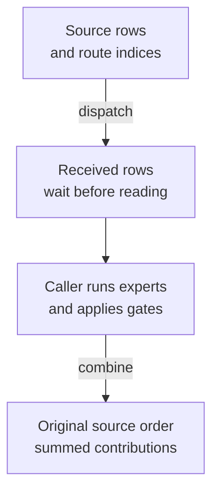

---
{
  "id": "deep-dive-deepep",
  "title": "Deep Dive - DeepEP",
  "slug": "deep-dive-deepep",
  "section": "Project Deep Dives",
  "category": "Inference Optimization",
  "difficulty": "Hard",
  "order": 15,
  "coverImage": "illustrations/_generated/deepep_token_journey_dark.png",
  "shortDescription": "A token can reach two experts on different GPUs and still return to the wrong row. DeepEP is the low-latency dispatch and combine communication library that orchestrates these MoE transfers, including the V2.5 buffer change.",
  "keyConceptsTested": [
    "MoE expert-parallel dispatch and combine",
    "Logical versus physical bandwidth across NVLink and RDMA",
    "NCCL Gin direct and hierarchical hybrid paths",
    "ElasticBuffer, EPHandle, EventOverlap, and deterministic sorting",
    "FP8 dispatch with BF16 combine and expert alignment",
    "Analytical SM and queue-pair sizing plus JIT kernel compilation",
    "V2 versus legacy NVSHMEM V1 and experimental PP, CP, and Engram extensions"
  ],
  "prerequisites": [
    "deep-dive-slime",
    "deep-dive-megatron",
    "deep-dive-deepgemm",
    "model-parallelism-for-llm-inference",
    "deep-dive-sglang"
  ],
  "relatedQuestions": [
    "mixture-of-experts-architecture",
    "model-parallelism-for-llm-inference",
    "mixed-precision-training-loss-scaling",
    "deep-dive-slime"
  ],
  "companies": [
    "DeepSeek",
    "NVIDIA"
  ]
}
---

A routed <span data-glossary="mixture-of-experts">mixture-of-experts</span> (MoE) layer can send one token to two experts on different GPUs. Each expert is a specialized neural-network block, and a gate weight determines how much its output contributes. Returning both outputs isn't enough: they must return to the correct source row, with that weight applied exactly once. A route can be wrong while every <span data-glossary="cuda-kernel">CUDA kernel</span> reports success, and communication that consumes too many <span data-glossary="streaming-multiprocessor">streaming multiprocessors (SMs)</span> leaves fewer resources for the expert matrix multiply.

The previous chapter followed slime's rollout and training loop. That loop still has to move hidden-state rows whenever its policy is a sparse MoE. DeepEP (DeepEveryParallel) is DeepSeek's communication library for that hop. V2 wraps expert-parallel dispatch and combine in an `ElasticBuffer` backed by <span data-glossary="nccl">NCCL</span> Gin, NVIDIA Collective Communications Library's device-side network interface. Its <span data-glossary="nvlink">NVLink</span> and <span data-glossary="rdma">remote direct memory access (RDMA)</span> paths share routing metadata but differ in transport and synchronization. The archived <span data-glossary="nvshmem">NVIDIA SHMEM (NVSHMEM)</span>-based V1 has a different API and resource model.[^deepep2026repo][^deepep2026legacy]

The code walkthrough follows V2 at `dd758caf451848bd150e1046af3d0a73e5fff38d`. That historical snapshot is retained for the routing and kernel examples. The V2.5 migration release below was checked on October 10, 2026. The runnable examples below exercise CPU routing and arithmetic only. CUDA snippets demonstrate API integration patterns rather than an installed driver deployment.

That reading snapshot isn't a deployment recommendation. At the September 23 check, main was `a56d6156febcd9976e55adc85b5155bfac9f28f8`, three commits ahead.

The first two add and document a system-scope memory fence before the Gin barrier when a logical scale-up domain spans NVLink and RDMA. A completed transport operation and visibility of preceding writes are different guarantees. The mixed-fabric ordering fix matters even when API shapes stay unchanged.

The third fixes request submission in experimental Engram fetching. We'll return to that separate path below. The public EP API and README benchmark table are unchanged across these three commits.[^deepep2026mixedfabricfix][^deepep2026engramdoorbell]

## Release transition: V2.5 buffer and event handling

On October 10, upstream main was `93eb6eb238127e96c6d7a4a625a6dad158348509`. V2.5 landed on September 29. The four-token ledger, caller-owned gate multiplication, and source identity still teach the EP problem, but installing current main doesn't provide the historical `ElasticBuffer` interface. V2.5 splits it into dedicated buffers and removes V1, its legacy documentation, and the NVSHMEM dependency.[^deepep2026v25readme][^deepep2026v25release]

| Architectural area | Historical V2 walkthrough | V2.5 migration |
| --- | --- | --- |
| Buffer ownership | One `ElasticBuffer` | `EPBuffer`, `BucketBuffer`, `EngramBuffer`, and `PPBuffer` share `BufferBase`; `BufferAllocator` plans symmetric allocations |
| Deferred EP results | Dispatch returns five values immediately | With `defer_epilogue=True`, dispatch returns one `EventOverlap`; its first wait returns four results |
| Kernel compilation | In-tree JIT under `csrc/jit/` | Host extension built at installation; runtime kernels compiled through the DeepJIT submodule |
| Runtime floor | CUDA 12.3+, NCCL 2.30.4+ at this pin | Linux, Python 3.10+, Hopper or newer, CUDA Toolkit 13.1+, PyTorch 2.10+, NCCL 2.32.3+, and a C++20 compiler/library supporting `std::format` |
| Legacy path | V1 remains installable with NVSHMEM | V1 and NVSHMEM backend removed; reproduce them from an older revision |
| Benchmark table | Five historical logical-bandwidth rows below | The current README omits them; use them as historical results, not V2.5 performance evidence |

The updated event mechanism introduces a distinct failure mode. Keep the old five-value unpack while enabling deferred epilogues, and Python raises `TypeError: cannot unpack non-iterable EventOverlap object`. Wait once and retain the returned tensors and handle: the hook runs only on the first wait, so a second `.wait()` returns `None` instead of another copy of the results. Waiting still establishes a stream dependency, not CPU completion.[^deepep2026v25readme]

This V2.5 fragment assumes an initialized EP group, BF16 CUDA input `x`, valid routing tensors, and caller-provided expert functions and alignment. It was checked against the public API, not executed on GPUs:

```python title="v25_deferred_epilogue.py"
from deep_ep import EPBuffer

buffer = EPBuffer(
    group, num_max_tokens_per_rank=4096, hidden=7168, num_topk=8,
)
ready = buffer.dispatch(
    x, topk_idx=topk_idx, topk_weights=topk_weights, num_experts=128,
    expert_alignment=expert_alignment, do_expand=True,
    do_zero_padding=True, do_cpu_sync=True,
    async_with_compute_stream=True, defer_epilogue=True,
)
launch_independent_work()
recv_x, _, recv_w, handle = ready.wait()
# Expanded weights are one value per expert row; caller applies them once.
expert_output = launch_weighted_expanded_experts(recv_x, recv_w, handle)
combined_ready = buffer.combine(
    expert_output, handle=handle,
    async_with_compute_stream=True, defer_epilogue=True,
)
combined_x, _ = combined_ready.wait()
```

For decoding without CPU count synchronization, use `do_cpu_sync=False` and consume only the valid expert ranges in the handle. Zero padding clears alignment gaps; it doesn't make unused capacity valid tokens. Fresh gating still needs a fresh route handle.[^deepep2026v25readme]

V2.5 also adds redundant-expert weight prefetch and FP32 gradient reduction over NVLink. These are collective exchanges within the NVLink domain, including ranks with no replicas. The caller still supplies the replication map, reroutes tokens, manages expert computation, and keeps storage alive. They don't turn the old balanced-gate SM estimate into a planner for skewed experts. Bucket collectives, PP, and Engram remain experimental; validate each specialized buffer separately.[^deepep2026v25readme]

```checkpoint
Before reading kernels, answer one question: what must cross ranks in an MoE layer?
---
Hidden-state rows and enough routing metadata to identify destination experts and restore source positions. Gate values can travel as metadata too, but the caller decides where to apply them. Expert parameter matrices stay on their owning ranks.
```

## Why expert parallelism needs a communication layer

Start from one rank's view. A rank is a process in the communication group; here each rank controls one GPU. An MoE architecture replaces one dense feed-forward block with many expert blocks. A router chooses <span data-glossary="top-k">top-k</span> experts for each <span data-glossary="token">token</span>. <span data-glossary="expert-parallelism">Expert parallelism</span> (EP) places different experts on different ranks, so each rank owns only a slice of the expert weights. That saves per-rank model memory, but every MoE layer now has to exchange token rows.

For one local rank, write hidden states as a matrix `X` with one row per token. The router returns `topk_idx[t, j]` and `topk_weight[t, j]`. Dispatch transports a token once per selected destination rank, even if that rank owns two of its selected experts. An optional expansion then creates one slot per expert. Local destinations still need layout and memory work, but not a remote link. After expert computation, combine reverses the route and sums expert contributions. The caller must apply gate weights before that sum; passing `topk_weights` doesn't multiply activation rows automatically.

A fixed-size all-to-all assumes known per-peer counts. Variable-split collectives can handle uneven sizes, but callers must still compute those splits and pack the rows. Sparse routing also creates per-expert expansion and reverse-reduction work. DeepEP specializes that whole exchange rather than introducing the possibility of uneven communication. Four questions remain:

| Job | Question the implementation must answer |
| --- | --- |
| Layout | Which source token goes to which destination expert slot? |
| Transport | Which local or remote path carries each slot? |
| Synchronization | When can a <span data-glossary="gemm">general matrix multiplication</span> (GEMM) read received rows? |
| Inversion | How does combine restore source order and sum incoming expert outputs? |

DeepEP doesn't implement the router or expert GEMMs. It accepts their rows and routing tensors, builds a layout handle, executes the exchange, and returns data in the layout the next kernel expects. The router, expert GEMMs, and training loop remain in the caller. That separation of responsibilities will matter when we diagnose a slow route versus a wrong route.[^deepep2026repo]



## A four-token routing ledger

Use two ranks and four tokens. Rank 0 owns tokens `a` and `b`; rank 1 owns `c` and `d`. There are four experts, two per rank, and each token selects two experts. Here the two selected experts always live on different ranks, so eight expert slots also require eight source-token/destination-rank rows, including local rows.

| Token | Source rank | First expert | Second expert | Gate weights |
| --- | ---: | ---: | ---: | --- |
| `a` | 0 | 0 (rank 0) | 3 (rank 1) | 0.70, 0.30 |
| `b` | 0 | 2 (rank 1) | 1 (rank 0) | 0.40, 0.60 |
| `c` | 1 | 1 (rank 0) | 3 (rank 1) | 0.55, 0.45 |
| `d` | 1 | 0 (rank 0) | 2 (rank 1) | 0.25, 0.75 |

Rank 0 sends one copy of `a` to expert 3 and one copy of `b` to expert 2. It also receives `c` for expert 1 and `d` for expert 0. Rank 1 performs the mirror exchange. The counts happen to balance here; a real gate can send more rows from one rank than that rank receives.

Dispatch creates this mapping. The returned `EPHandle` retains route indices and reverse-slot metadata, not gate values. Received gate tensors are separate outputs. Keep them aligned with expert rows when applying weights, then use the handle to return the weighted contributions.

<figure>
  
  <figcaption>Token a stays on rank 0 for expert 0 and crosses to rank 1 for expert 3. The caller weights the expert outputs; combine uses the EPHandle to sum them into source row a.</figcaption>
</figure>

```checkpoint
For token `b`, which rank receives its first dispatched copy, and who applies its gate weight?
---
Rank 1 receives the copy for expert 2. The caller must multiply that expert's output by `0.40` before DeepEP combines the contributions for source token `b`.
```

## V2's single interface: ElasticBuffer

V2 gives high-throughput and latency-oriented expert-parallel dispatch one interface: `ElasticBuffer`. The caller can pass an explicit byte count, or derive a 2 MiB-aligned size from maximum tokens per rank, hidden dimension, top-k, 8-bit floating-point (FP8) dispatch, topology, and reduction settings. Here 2 MiB means 2,097,152 bytes. The buffer then owns symmetric memory registered with NCCL.

*Elastic* describes this memory abstraction, not automatic infinite growth. The pinned V2 uses GPU-backed storage and can reserve CPU bytes for experimental Engram use. The README says V2 consumes more buffer space than V1 and that mixed GPU/CPU backing is still planned. Size the buffer from a real worst-case envelope rather than assuming it will grow on demand.[^deepep2026repo]

Before dispatch can run, a caller needs a capacity estimate. `get_buffer_size_hint` gives a planning number, not an allocation. This unexecuted integration fragment assumes an initialized NCCL process group, BF16 or correctly scaled FP8 input, and valid routing tensors on a supported GPU:

```python title="elastic_buffer_setup.py"
from deep_ep import ElasticBuffer

required = ElasticBuffer.get_buffer_size_hint(
    group,
    num_max_tokens_per_rank=4096,
    hidden=7168,
    num_topk=8,
    use_fp8_dispatch=True,
)
buffer = ElasticBuffer(
    group,
    num_max_tokens_per_rank=4096,
    hidden=7168,
    num_topk=8,
    use_fp8_dispatch=True,
)
recv_x, recv_idx, recv_w, handle, event = buffer.dispatch(
    x,
    topk_idx=topk_idx,
    topk_weights=topk_weights,
    num_experts=128,
    async_with_compute_stream=True,
)
```

If `num_sms` or `num_qps` is `0`, `dispatch` asks the analytical helpers for defaults. Pass an integer to override them; the pinned implementation doesn't accept `None` as the automatic sentinel. `EventOverlap` marks communication readiness when asynchronous mode is requested. Launch independent work, then wait on the event before reading `recv_x`. EP2048 is a documented domain limit; measure saturation and topology support on the target deployment.[^deepep2026repo]

| ElasticBuffer concern | V2 behavior |
| --- | --- |
| Capacity | Set bytes directly or use `get_buffer_size_hint`; size is a planning input |
| Topology | Detect physical ranks and choose direct or hybrid logical domains |
| Layout | Return `EPHandle` with prefixes, slots, and source metadata |
| Compute overlap | Return `EventOverlap` and keep allocation on the communication stream when requested |
| Precision | Accept <span data-glossary="bf16">BF16</span> tensors or FP8 data plus scale factors |
| Reuse | Accept a cached handle when routing layout is unchanged |

Reusing a buffer can avoid allocation and communicator setup. Reusing a handle is a stronger promise: the route itself must remain unchanged. The Python API asserts selected dimensions and reuses `handle.topk_idx`; it doesn't compare a newly computed route because cached dispatch requires `topk_idx=None`. Equal shapes don't establish equal routing.

## Dispatch: layout, move, and epilogue

Ask what dispatch must preserve while rows are moving. V2 has three conceptual stages, even though kernels can overlap them: count and lay out rows by scale-up rank and local expert; move rows through local symmetric memory, NVLink, or NCCL Gin RDMA; then copy or expand rows into the receive layout used by expert GEMM.

The input specifications make those stages concrete. `topk_idx` has shape `[num_tokens, num_topk]`, and `topk_weights` has the same shape with float values. Hidden states have shape `[num_tokens, hidden]` in BF16, or arrive as FP8 values plus scale factors. An expert index of `-1` means that selection is unused. V2 returns received indices and weights beside the data so the next kernel can keep routing metadata attached.

The receive layout can be **non-expanded** or **expanded**. In non-expanded mode, one received row represents a source token with top-k metadata. In expanded mode, a token can occupy one slot per selected expert, and each local expert's segment is aligned for its GEMM. Alignment padding regularizes expert <span data-glossary="matrix">matrix</span> shapes, but padding isn't a token and must not enter a combined row. Callers can use `do_zero_padding` when those gaps need to be cleared.

The copy epilogue turns metadata into expert input. In expanded mode, `psum_num_recv_tokens_per_expert[i]` is the aligned start of expert `i` plus its actual count, not simply an inclusive sum of padded counts. For counts `[3, 1]` and alignment 4, starts are `[0, 4]`, these endpoints are `[3, 5]`, and allocated expert segments total 8 slots. `num_unaligned_recv_tokens_per_expert` retains `[3, 1]`. Exact CPU counts require the CPU-synchronized path; no-sync callers must respect valid device counts rather than treating capacity as data.

The C++ launch path chooses `dispatch` for one scale-out domain and `hybrid_dispatch` when ranks span multiple scale-out groups. It passes the NCCL device communicator, symmetric window, buffer pointers, prefix arrays, slot metadata, timeout cycles, SM count, QP count, and topology indices into a just-in-time (JIT)-generated kernel. Reading `csrc/kernels/elastic/dispatch.hpp` beside `deep_ep/buffers/elastic.py` reveals the Python-to-C++ dispatch interface.

```checkpoint
Why does V2 keep both aligned prefix sums and unaligned expert counts?
---
Expert GEMM wants aligned offsets, while combine and correctness checks need the actual number of rows. The two values let the kernel use regular storage without treating alignment padding as a real token.
```

## Combine: reverse routing plus reduction

Once each receiving rank runs its local experts, rows are in expert order rather than source-token order. `combine` consumes `handle.recv_src_metadata`, per-scale-up prefix sums, and optional hybrid channel metadata to reverse that mapping and sum contributions. Activation reduction and optional return of top-k weights are separate operations in `combine_reduce_epilogue.cuh`. Local bypasses skip a remote transfer, but still participate in reduction.[^deepep2026repo]

For token `a`, the caller passes weighted outputs `0.70 × (1, 0)` and `0.30 × (4, 0)`. Combine should return `(1.90, 0)`. Passing raw expert outputs returns `(5, 0)`; weighting twice returns `(0.85, 0)`. All three tensors have the same shape. Check numerical values as well as counts in a transport test.

The API exposes `allow_multiple_reduction`, which controls staging. Reducing within a rank or node can send fewer rows onward, but intermediate BF16 materialization introduces extra rounding. Disabling it avoids those additional reduction stages, potentially moving more data. The general reduction path accumulates in FP32 before casting to BF16; a no-bias path with at most two inputs uses packed BF16 addition. Neither "BF16 output" nor "FP32 accumulation" alone describes every path. Treat staging as a bandwidth/numerical tradeoff.

For a concrete rounding case, consider already-weighted contributions `256`, `1`, and `-256`. Accumulating all three in FP32 gives `1`, which BF16 can represent. If a local stage first materializes `256 + 1` as BF16, round-to-nearest-even produces `256`; adding `-256` then gives `0`. This is cancellation: two large terms nearly cancel, so losing a small term changes the answer.

Round FP32 bit patterns to BF16 using IEEE round-to-nearest-even bit truncation. Notice that changing intermediate storage changes the sum even though the route and final dtype match:

<!-- leetllm: test, deps=numpy, output=show -->
```python title="staged_bf16_rounding.py"
import numpy as np

def bf16(value: float) -> float:
    bits = np.array([value], dtype=np.float32).view(np.uint32)
    # Keep the upper 16 bits. At a tie, retain an even low bit.
    rounded = (bits + np.uint32(0x7FFF) + ((bits >> np.uint32(16)) & np.uint32(1))) & np.uint32(0xFFFF0000)
    return float(rounded.view(np.float32)[0])

single_stage = bf16(256.0 + 1.0 - 256.0)
local_stage = bf16(256.0 + 1.0)
two_stages = bf16(local_stage - 256.0)
assert single_stage == 1.0 and local_stage == 256.0 and two_stages == 0.0
print(f"one final BF16 cast: {single_stage:.0f}")
print(f"BF16 local subtotal: {local_stage:.0f}; final result: {two_stages:.0f}")
```

<!-- leetllm: output:start -->
```text title="Output" output compact
one final BF16 cast: 1
BF16 local subtotal: 256; final result: 0
```
<!-- leetllm: output:end -->

Compare the deployed kernel's reduction staging against the upstream reference before choosing a numerical tolerance.[^deepep2026repo]

Backward duality provides a compact consistency check:

| Forward operation | Reverse-mode operation |
| --- | --- |
| Dispatch source rows to experts | Combine expert <span data-glossary="gradient">gradients</span> to source rows |
| Expert GEMM consumes received rows | Expert GEMM produces gradients in received layout |
| Sum expert outputs back to source tokens | Copy source gradients to corresponding expert slots |

For the unweighted route operators, dispatch and combine are transposes: copying rows forward becomes summing their gradients backward. The surrounding autograd wrapper must also differentiate expert functions and gate multiplication. It can't omit gate gradients merely because the communication calls reverse each other.

`topk_weights` can be two-dimensional in non-expanded mode or one-dimensional in expanded mode. `bias` supports zero, one, or two BF16 bias tensors for the combine epilogue. Its combined activation output is BF16. If a caller supplies a different layout or dtype, validation should fail immediately during parameter validation rather than silently producing corrupt gradients.

A correct reduction still doesn't say which road the row took. Scale-up inside a node and scale-out across nodes wait on different links.

## Topology: scale-up and scale-out are different roads

The four-token ledger now meets hardware. **Scale-up** means GPUs inside one node, normally connected by NVLink. **Scale-out** means GPUs in different nodes, normally connected through RDMA network interfaces. A row that moves quickly over NVLink may wait on a network interface card (NIC), while a path that saves SM work across RDMA can add needless synchronization inside a node.

V2 derives physical domains from NCCL. With hybrid mode enabled, `num_scaleout_ranks` represents RDMA groups and `num_scaleup_ranks` represents the local NVLink domain. With hybrid mode disabled, DeepEP treats the whole communicator as one logical scale-up domain and uses a direct path. The logical view lets kernels choose a hierarchy while retaining original global rank IDs.

<figure>
  
  <figcaption>Direct mode uses point-to-point cross-node RDMA. Hybrid mode routes over an RDMA rail followed by high-bandwidth intranode NVLink forwarding to reduce cross-rail network congestion.</figcaption>
</figure>

| Mode | Logical shape | Primary path | Use when | Main risk |
| --- | --- | --- | --- | --- |
| Direct | One scale-up domain | NCCL Gin full connection or local symmetric memory | Network fabric or topology favors one flat exchange | Every rank sees the largest domain and queue-pair (QP) pressure |
| Hybrid | Scale-out × scale-up | RDMA rail between nodes plus NVLink within node | Multi-node EP with usable NVLink islands | More metadata, channels, and topology assumptions |

Hybrid dispatch uses channel linked lists and per-channel token metadata. It can forward rows through a local scale-up group after the RDMA phase. The code budgets <span data-glossary="cuda-warp">CUDA warps</span>, groups of 32 scheduled GPU threads, for scale-out and forward work separately, then launches a clustered kernel to overlap communication with nearby compute. A flat all-to-all comparison misses those extra ownership and synchronization costs.

When a network has multiple rails, NCCL Gin's connection type matters. The V2 backend asks NCCL for a `NCCL_GIN_CONNECTION_RAIL` context in hybrid mode and `NCCL_GIN_CONNECTION_FULL` in direct mode. If Gin isn't available for the selected topology, initialization asserts instead of quietly choosing an incompatible path, unless `EP_DISABLE_GIN` explicitly changes behavior. Treat that assertion as a topology validation step. A path that initializes cleanly can still publish a bandwidth number that doesn't match the NIC. The next question is which bytes that number counts.

## Logical bandwidth is not a NIC counter

DeepEP's README calls its performance numbers **logical bandwidth**. Logical bytes measure the total algorithmic tensor volume exchanged, including local-rank traffic. Physical link counters count bytes that crossed NVLink or a NIC. Those measurements answer different questions, so a profiler needs both labels.

Suppose four ranks exchange 100 MiB of token payload according to an EP layout. If half the rows stay on source GPUs, the logical operation still accounts for 100 MiB while the RDMA port may see only the remote half. If that payload crosses an NVLink hop during a hybrid forward, a physical NVLink counter can count copies that logical bandwidth reports once. A speedup without its byte denominator is not a reproducible measurement.

Over a 1 ms window, 100 MiB corresponds to 104.8576 decimal GB/s; 50 MiB corresponds to 52.4288 GB/s. A difference between those figures may come from byte accounting. Real counters also include their own protocol and direction conventions. Use dispatch-plus-expert-plus-combine latency to evaluate layer performance alongside communication bandwidth.

Read the README tables as reports for their stated shapes: 8K tokens per batch, hidden size 7168, top-8 routing, FP8 dispatch, and BF16 combine. For reproduction, inspect the test harness too; its per-rank count can be `max(1, args.num_tokens - rank)`. Keep the README's batch description separate from the harness's rank-specific counts. The table reports these logical-bandwidth snapshots:[^deepep2026repo]

| Arch | NIC | Topology | Dispatch bottleneck | Combine bottleneck | SMs |
| --- | --- | --- | --- | --- | ---: |
| SM90 | CX7 | EP 8×2 | 90 GB/s RDMA | 81 GB/s RDMA | 12 |
| SM90 | CX7 | EP 8×4 | 61 GB/s RDMA | 61 GB/s RDMA | 6 |
| SM100 | CX7 | EP 8×2 | 90 GB/s RDMA | 91 GB/s RDMA | 12 |
| SM100 | N/A | EP 8 | 726 GB/s NVLink | 740 GB/s NVLink | 64 (max perf) |
| SM100 | N/A | EP 8 | 643 GB/s NVLink | 675 GB/s NVLink | 24 (min SM) |

These rows don't establish a V1-to-V2 speedup. A comparison also needs the exact V1 workload, topology, tuning, timing and correctness settings. Record token count, hidden size, top-k, dtype, SM count, queue-pair count, and bandwidth denominator before comparing runs.

| Measurement | Include in a benchmark report |
| --- | --- |
| Logical payload | Tokens, hidden dimension, top-k, dtype, local-bypass convention |
| Physical links | NVLink topology, NIC model, rail count, RDMA speed, congestion state |
| Kernel budget | SM count, channel count, QP count, shared-memory setting |
| Shape | Token distribution per rank and per expert, padding/alignment |
| Timing | Dispatch, combine, end-to-end MoE layer, warm-up and JIT compile time |
| Correctness | Route <span data-glossary="checksum">checksum</span>, expert counts, deterministic mode, output tolerance |

```checkpoint
An experiment reports 90 GB/s logical RDMA bandwidth, but your NIC counter shows 45 GB/s. Is that automatically a regression?
---
No. The logical figure can include local traffic and can use a different byte denominator. Reconcile token counts, local bypass, and measured physical bytes before judging the result.
```

## NCCL Gin V2 backend

NCCL Gin is a device-side communication interface for issuing network operations from GPU code. V2 reuses an existing NCCL communicator instead of asking an application to construct a separate transport world. The C++ backend queries communicator properties, requests Gin contexts and signals, registers a symmetric memory window, and stores a device communicator pointer for JIT kernels.

Follow initialization as a chain of ownership transfers:

1. Create or receive the host NCCL communicator.
2. Query physical rank domains and Gin capability.
3. Request QP contexts, queue depth, traffic class, and signal count.
4. Choose rail or full connection based on direct or hybrid mode.
5. Allocate symmetric GPU and optional CPU memory.
6. Register a window and obtain NVLink peer pointers.
7. Build a device communicator that JIT kernels can call.

The signal count includes rank barriers and custom communication notifications. `EP_OVERRIDE_RDMA_SL` can place V2 traffic on a chosen InfiniBand service level, while `NCCL_GIN_CROSS_NIC=0` changes symmetric-memory handle reuse behavior for multi-plane systems. These are cluster integration knobs, not per-request model settings.

Keep ownership explicit. DeepEP owns layout, kernels, and its window lifecycle. NCCL owns communicator and network primitives. A model runtime still owns process-group formation, rank assignment, and shutdown order. Aborting a communicator while an `EventOverlap` hook or JIT kernel still references its window is a lifecycle bug, not a routing bug.

## EPHandle: route metadata with a lifetime

After dispatch, ask what survives the network transfer. `EPHandle` is returned by dispatch and consumed by combine. Its fields expose the route in a form that bridges device kernels, CPU scheduling, and cached inference:

| Handle field | Meaning |
| --- | --- |
| `topk_idx` | Cloned routing choices, unless caller opts out of copying |
| `recv_src_metadata` | Source token and destination slot mapping |
| `dst_buffer_slot_idx` | Receive-buffer slots used for cached dispatch |
| `psum_num_recv_tokens_per_scaleup_rank` | Prefix sum for received rows per scale-up peer |
| `psum_num_recv_tokens_per_expert` | Alignment-aware local expert offsets |
| `num_unaligned_recv_tokens_per_expert` | Actual expanded-mode counts |
| `token_metadata_at_forward` | Per-channel metadata for hybrid combine |
| `channel_linked_list` | Hybrid channel forwarding links |
| `num_sms` | Dispatch SM choice reused by combine |

A cached handle can skip layout recomputation for a replay of the same route, such as a corresponding backward operation. A new decode token usually has a newly computed route; equal batch size doesn't make the old handle reusable. The cached path skips CPU count discovery, so the caller must establish route and layout compatibility before using it.

V2's deterministic mode sorts received rows after the kernel. Non-expanded mode sorts data, weights, indices, and source metadata. Expanded mode sorts rows within each expert and updates slot pointers without permuting the metadata table in the same way. The sort key uses source-global order and expert identity, so equal inputs can present the same expert order even when arrival order differs.

Determinism has a cost: sorting and metadata work can constrain asynchronous behavior. Enable it for correctness tests, reproducible training slices, or debugging route drift. Measure it separately from the non-deterministic throughput path.

## EventOverlap: stream synchronization mechanics

<span data-glossary="cuda-stream">CUDA streams</span> let communication and compute overlap, but a Python return doesn't make an output tensor safe to read. `EventOverlap` wraps a <span data-glossary="cuda">CUDA</span> event and can register a hook to run after the event is waited on. First launch independent work, then make the compute stream wait before it reads received rows:

```python title="event_overlap.py"
recv_x, recv_idx, recv_w, handle, event = buffer.dispatch(
    x,
    topk_idx=topk_idx,
    topk_weights=topk_weights,
    num_experts=num_experts,
    async_with_compute_stream=True,
)

launch_independent_work()
event.current_stream_wait()
# Non-expanded layout: caller computes experts, applies each gate once,
# and sums experts belonging to this destination rank into one BF16 row.
expert_output = launch_weighted_local_experts(recv_x, recv_idx, recv_w)

combined_x, _, combine_event = buffer.combine(
    expert_output,
    handle=handle,
    async_with_compute_stream=True,
)
combine_event.current_stream_wait()
```

`previous_event` can make a communication kernel wait for an upstream CUDA event. `allocate_on_comm_stream` controls ownership of newly allocated tensors when that dependency is used. A host synchronization inserted between the event and expert work can erase the overlap the caller intended to gain. Profile stream waits beside kernel durations, and keep readiness separate from route correctness.

This code sketch leaves `launch_weighted_local_experts` as the caller's expert-integration placeholder. `current_stream_wait()` enqueues a dependency on the current stream; it does not synchronize the host. In deterministic mode it also triggers a sorting hook on the waiting stream. Establish readiness on each consumer stream before releasing the wrapper. Keep allocation lifetimes and all consumer dependencies explicit. A waited tensor can still hold incorrect values if the wire format and reduction format disagree.

## Precision: FP8 on the wire, BF16 for the reduction

DeepEP accepts BF16 hidden states for the baseline path. In FP8 dispatch mode, input is a tuple of FP8 values and scale factors. The receiving expert integration consumes that representation according to its GEMM interface. Combine takes and returns BF16 activation rows; gate multiplication belongs in the caller's expert path, not in the transport.

Lower payload precision doesn't remove numerical validation. Scale-factor layout, hidden alignment, and expert GEMM expectations must agree. A kernel can move bytes correctly while a mismatched scale <span data-glossary="stride">stride</span> corrupts activations. The reference quantizer uses one float scale per 128 values: a 7,168-element FP8 row takes 7,168 payload bytes plus 224 scale bytes, versus 14,336 bytes for BF16. Routing metadata and protocol overhead are additional, so this isn't exactly a 2× wire-byte reduction.

`use_tma_aligned_col_major_sf` selects an optional scale-factor layout suitable for <span data-glossary="tma">Tensor Memory Accelerator (TMA)</span> paths. Verify model quantization and GEMM compatibility before enabling it. DeepEP's source handles scale metadata, but it doesn't decide which quantization scheme an entire model should use.

For post-training or reinforcement learning (RL) on large sparse models, this distinction matters twice. <span data-glossary="rollout">Rollout</span> inference may favor low-latency FP8 dispatch, while training may need BF16 or a different accumulator policy. Keep dtype and scale metadata in the experiment manifest. Otherwise, a reward-curve change after a dtype switch confounds communication changes with model numerics.

## Analytical SM and QP sizing

V2's `get_theoretical_num_sms` estimates communication SMs from topology bandwidth and a balanced gate model. Before trusting that number, ask what it can observe: expected top-k destinations, read and write work, NVLink traffic, RDMA traffic, and the link bottleneck, but not your future gate histogram.

Treat the helper as an analytical starting point and measure the workload before selecting a runtime value. It multiplies the raw bandwidth-derived estimate by 1.25, rounds up to an even count of at least 4, and clamps to the device's multiprocessor count. When compute-communication overlap is preferred, it stays near that calculated minimum; otherwise, it raises the floor to 64 SMs for maximum standalone throughput. The implementation assumes balanced routing, whereas production DeepSeek-style gates can be group-limited and asymmetric. Inspect the actual token distribution before trusting the estimate, and pass `num_sms` explicitly when your application overlap budget demands tighter bounds.

Queue-pair (QP) sizing follows a related rule. Direct mode encourages roughly one QP per communication SM, capped at nine in the pinned helper (`min(num_sms, 8 + 1)`). Hybrid mode encourages `num_sms * 16 + 1` QPs so channels and notification work can have independent queues, then caps that value by allocated <span data-glossary="qps">QPs</span>. More QPs consume resources and can increase RDMA doorbell ringing. Use the theoretical count as a starting point, then measure queue pressure and tail latency.

The balanced-gate model counts distinct destinations, not expert selections. With four experts split evenly across two ranks and two distinct experts sampled uniformly, six expert pairs are possible. Two pairs stay on one destination rank; four touch both. Expected destination count is therefore $(2×1 + 4×2)/6 = 5/3$, not 2. The helper uses the equivalent formula $G[1-\binom{E-E/G}{k}/\binom{E}{k}]$, for $E$ experts evenly divided among $G$ groups.

This standard-library check compares that formula with exhaustive enumeration and reproduces the pinned QP helper's arithmetic. Measure queue count and throughput on the target hardware before selecting a configuration:

<!-- leetllm: test, output=show -->
```python title="destination_and_queue_counts.py"
from itertools import combinations
from math import comb, isclose

def expected_destinations(experts, groups, topk):
    return groups * (1 - comb(experts - experts // groups, topk) / comb(experts, topk))

def queue_count(sms, allocated, hybrid):
    requested = sms * 16 + 1 if hybrid else min(sms, 9)
    return min(requested, allocated)

pairs = list(combinations(range(4), 2))
enumerated = sum(len({expert // 2 for expert in pair}) for pair in pairs) / len(pairs)
assert isclose(enumerated, expected_destinations(4, 2, 2))
print(f"expected destination ranks: {enumerated:.6f}")
print(f"12 SMs, 128 allocated QPs: direct={queue_count(12, 128, False)}, hybrid={queue_count(12, 128, True)}")
```

<!-- leetllm: output:start -->
```text title="Output" output compact
expected destination ranks: 1.666667
12 SMs, 128 allocated QPs: direct=9, hybrid=128
```
<!-- leetllm: output:end -->

The hybrid request is 193 queues, but only 128 are allocated. The helper caps at 128; it doesn't allocate the missing 65. Group-limited or skewed gates violate the uniform-subset assumption behind the expected-destination formula. The source explicitly warns against using its balanced SM model for V3.0's group-limited gate.

```checkpoint
Why can a balanced-gate SM estimate be wrong for a production MoE model?
---
The gate distribution can be asymmetric or group-limited. That changes read, write, RDMA, and NVLink traffic, so the modeled bottleneck and chosen SM count no longer match the real route.
```

## JIT compilation is part of the runtime

DeepEP V2 compiles kernels at runtime. The Python or C++ launch code assembles template parameters such as topology, expansion mode, hidden bytes, expert alignment, number of warps, SM count, and QP count. The JIT compiler parses required headers, invokes NVCC or the configured compiler, caches the resulting module, and launches it with a generated configuration.

That choice avoids compiling every shape specialization during installation, but moves a failure risk into first use. A missing CUDA compiler, incompatible NCCL headers, or unsupported instruction can surface at the first dispatch. The pinned JIT selects its architecture from the active device and compiler support; `TORCH_CUDA_ARCH_LIST` controls extension/build targets, not every runtime JIT specialization. Separate compile, cold-start, and steady-state timings.

Relevant environment switches include:

| Variable | Purpose |
| --- | --- |
| `EP_JIT_CACHE_DIR` | Choose a persistent kernel cache directory |
| `EP_JIT_DEBUG` | Print JIT diagnostics |
| `EP_JIT_DUMP_PTX` / `EP_JIT_DUMP_SASS` | Save generated assembly for inspection |
| `EP_JIT_PTXAS_CHECK` | Assert no local-memory use in compiled kernels |
| `TORCH_CUDA_ARCH_LIST` | Select CUDA architecture targets |
| `EP_NCCL_ROOT_DIR` | Point build and JIT lookup at NCCL headers and libraries |

For a launch, pre-warm every required shape on every worker or include compilation time in startup readiness. A cache mounted from one host may contain code for a different device capability. Treat cache keys and compiler versions as part of the deployment artifact. Those steps still assume the V2 API. What does the integration do if it was written against the archived library?

## V2 and V1 are different products

DeepEP V1 is archived documentation, not a hidden compatibility mode for the V2 API. V1 exposes a `Buffer`, uses NVSHMEM for internode and low-latency methods, asks callers to provide separate NVLink and RDMA sizes, and has distinct normal and low-latency kernels. Its low-latency path can use a hook to defer an RDMA receive without occupying SMs. V2 uses `ElasticBuffer`, NCCL Gin, unified high-throughput and low-latency APIs, and larger scale-up and scale-out domains.[^deepep2026legacy]

| Dimension | V1 | V2 |
| --- | --- | --- |
| Main Python object | `Buffer` | `ElasticBuffer` |
| Primary network backend | NVSHMEM | NCCL Gin |
| Buffer sizing | Separate NVLink/RDMA hints | Unified elastic buffer hint |
| Low-latency EP | Pure RDMA method | Removed 0-SM RDMA low-latency mode |
| SM selection | Caller-selected or tuned configs | Analytical helper, manual override available |
| Scale domain | Normal and low-latency variants | Direct and hybrid logical domains |
| Documentation status at this pin | Archived | Active V2 README and source |

V1 source remains relevant when reading old DeepSeek-V3 integrations or reproducing a historical benchmark. Check the current V2 source and deployment prerequisites for CUDA, <span data-glossary="pytorch">PyTorch</span>, NVSHMEM, and low-latency support. V1 performance tables use H800 and CX7 setups; compare them with V2's SM90 and SM100 tables only after matching shapes and links.[^deepep2026legacy][^deepseekv3_2024]

Migration order matters: port the routing logic first, then port the transport. Replace `Buffer` layout calls with `ElasticBuffer` handles, verify NCCL Gin availability, resize memory, and rerun deterministic correctness tests before measuring throughput. Don't infer compatibility from a successful import alone.

## Experimental PP, CP, and Engram extensions

The pinned V2 repository includes experimental primitives beyond EP. Treat each as a separate subsystem rather than as another dispatch mode:

- **<span data-glossary="pipeline-parallelism">Pipeline parallel</span> (PP):** send and receive tensors through symmetric memory. The README lists 0-SM PP with RDMA as an experimental path. It doesn't replace <span data-glossary="nvidia-megatron">Megatron</span>'s full pipeline scheduler.
- **<span data-glossary="context-parallelism">Context parallel</span> (CP):** use copy-engine-oriented paths for context slices, including a 0-SM copy-engine variant. It doesn't define attention semantics or sequence partitioning policy.
- **Engram:** fetch remote embedding entries by integer index through RDMA, with optional CPU-backed storage and TMA-aligned scale factors. Its API doesn't expose key search or an attention KV-cache manager. FP8 scale factors are globally replicated at write time and gathered locally at fetch time; the remote get transfers the entry data.
- **AGRS:** experimental all-gather and reduce-scatter sessions over NVLink symmetric memory.

The README labels Engram, PP, and CP experimental. Their shared allocation and event machinery with `ElasticBuffer` makes them useful systems experiments; validate each primitive's maturity, failure handling, and target workload before production use.[^deepep2026repo]

The September 16 Engram change is a useful example of a transport failure that a routing ledger can't detect. A NIC doorbell tells the network device that queued requests are ready to submit. The older fetch loop could leave the tail of aggregated gets without that notification. The newer kernel defers one get per used peer, issues it without aggregation after the other gets, and then records the asynchronous flush. Correct indices don't prove those bytes were submitted. Check the fetch implementation and test actual arrival on your cluster before relying on this experimental path.[^deepep2026engramdoorbell]

For a large RL system, keep these components explicit. A PP send can be healthy while EP RDMA is congested. An Engram fetch can consume the same QP or memory budget that dispatch sizing assumed was free. A CP copy can change stream dependencies. Share a buffer only when its maximum concurrent sessions and lifetimes are accounted for.

## Requirements and cluster checks

The pinned V2 README lists Hopper (SM90) GPUs or architectures with SM90 Parallel Thread Execution (PTX) support, CUDA 12.3 or newer for SM90, PyTorch 2.10 or newer, and NCCL 2.30.4 or newer. NVLink is expected for intranode communication and RDMA for internode communication. The repository reports full InfiniBand testing and theoretical compatibility with RDMA over Converged Ethernet (RoCE). Recheck these requirements against the source revision you deploy; later revisions can change the support floor.[^deepep2026repo]

Before a multi-node job starts, check the path from hardware to buffer:

| Check | Why it matters | Failure symptom |
| --- | --- | --- |
| GPU capability and PTX target | JIT kernels need supported instructions | Compile or launch error |
| CUDA, PyTorch, NCCL versions | Headers and runtime device APIs must agree | Import, communicator, or JIT failure |
| NVLink peer map | Scale-up domain must match NCCL local symmetric access (LSA) | Slow or invalid hybrid path |
| RDMA device and rail map | Gin needs usable network contexts | Gin unavailable assertion |
| QP allocation | Hybrid channels need enough queues | Initialization or timeout |
| Symmetric memory capacity | Buffer and workspace must fit | Allocation or window registration failure |
| Service-level and traffic isolation | Congestion can distort route latency | Tail spikes and cross-job interference |

The NCCL minimum requirement involves more than header declarations. In the pinned backend, a build against headers older than NCCL 2.31 must load exactly the same NCCL version at runtime. The 2.31-and-newer branch requests a runtime-version device communicator instead. Two installations that both satisfy `2.30.4+` can therefore still fail initialization if headers and the loaded library differ. Inspect the loaded version in buffer debugging output, rather than checking only the wheel installed in the image.[^deepep2026repo]

Don't run `pip install` on a login node and assume the worker image matches. The source's JIT cache and NCCL library path are runtime dependencies. Include their versions, topology dump, and `EP_BUFFER_DEBUG=1` initialization output in a launch specification. Redact <span data-glossary="secrets-management">credentials</span> and private host details before sharing it.

## Applications in giant-model post-training

Every generated token in a sparse MoE policy or teacher can trigger another dispatch and combine. The previous slime study showed that rollout, reward, and training must agree on tokens and weight versions. Those sampled trajectories still pass through MoE layers. Rollout needs fast expert routing. Training needs exact route metadata and reproducible gradients. A slow all-to-all multiplies across generated tokens, while an incorrect or stale handle can corrupt every subsequent update.

Use DeepEP to compare three placement patterns. For each one, ask which phase owns the communicator and which diagnostic metric would reveal its cost:

| Post-training pattern | DeepEP role | Measurement |
| --- | --- | --- |
| Separate rollout and trainer clusters | Serve MoE layers during rollout; trainer uses its own EP group | <span data-glossary="tokens-per-second">Tokens per second</span>, sync cost, route version |
| Colocated actor and rollout | Reuse GPU memory and communicator when phases alternate | Peak buffer bytes, pause time, overlap |
| Teacher or specialist distillation | Run many expert policies or a large teacher with repeatable routing | Deterministic output, FP8 error, aggregate bandwidth |

The communication library doesn't solve policy staleness, reward hacking, or checkpoint synchronization. It can become the lowest-level source of latency and numerical mismatch in those systems. Pair route metrics with rollout weight versions, expert-load histograms, and reward audit logs. If reward falls after a topology change, separate transport delay, dtype error, and algorithm behavior before changing the policy.

## A runnable routing ledger

Work token `a` by hand before touching code. Its hidden state is `(1.0, 0.0)`. Give expert $k$ a toy map that multiplies by $k + 1$, so expert 0 returns `(1.0, 0.0)` and expert 3 returns `(4.0, 0.0)`. The combined first coordinate weights each expert output before summation:

$$
0.70\cdot(1.0,\ 0.0) + 0.30\cdot(4.0,\ 0.0) = (1.90,\ 0.0)
$$

Expert 0 lives on rank 0, so that copy of `a` is local. Expert 3 lives on rank 1, so the second copy is remote. The standard-library model below builds expanded receive slots, pads each expert to four rows, computes and weights outputs in expert order, and combines them using the saved inverse map. It never recomputes the original routes during combine. Shuffling the returned rows must not change the answer.

<!-- leetllm: test, output=show, id=routing-ledger -->
```python title="routing_ledger.py"
from dataclasses import dataclass
import math

HIDDEN = {
    "a": (1.0, 0.0),
    "b": (0.0, 1.0),
    "c": (1.0, 1.0),
    "d": (2.0, -1.0),
}
ROUTES = {
    "a": [(0, 0.70), (3, 0.30)],
    "b": [(2, 0.40), (1, 0.60)],
    "c": [(1, 0.55), (3, 0.45)],
    "d": [(0, 0.25), (2, 0.75)],
}
SOURCE_RANK = {"a": 0, "b": 0, "c": 1, "d": 1}
EXPERTS_PER_RANK = 2


def owner_rank(expert):
    return expert // EXPERTS_PER_RANK


def expert_map(expert, hidden):
    scale = expert + 1
    return (hidden[0] * scale, hidden[1] * scale)


@dataclass(frozen=True)
class Row:
    token: str
    topk_slot: int
    hidden: tuple[float, float]
    weight: float
    path: str


def dispatch(hidden, routes, sources, alignment=4):
    if set(hidden) != set(routes) or set(hidden) != set(sources):
        raise ValueError("Token sets differ")
    recv = {expert: [] for expert in range(4)}
    inverse = {}
    rank_rows = set()
    for token, choices in routes.items():
        if sources[token] not in (0, 1):
            raise ValueError("Invalid source rank")
        seen = set()
        for topk_slot, (expert, weight) in enumerate(choices):
            if expert == -1:  # unused router slot, not expert Python index -1
                continue
            if not 0 <= expert < 4 or expert in seen:
                raise ValueError("Invalid or duplicate expert")
            seen.add(expert)
            destination = owner_rank(expert)
            rank_rows.add((token, destination))
            slot = len(recv[expert])
            inverse[expert, slot] = (token, topk_slot)
            path = "local" if destination == sources[token] else "remote"
            recv[expert].append(Row(token, topk_slot, hidden[token], weight, path))
    for rows in recv.values():
        rows.extend([None] * (-len(rows) % alignment))
    return recv, inverse, rank_rows


def run_experts(recv):
    results = []
    for expert, rows in recv.items():
        for slot, row in enumerate(rows):
            if row is None:  # padding never acquires a source identity
                continue
            raw = expert_map(expert, row.hidden)
            weighted = tuple(row.weight * value for value in raw)
            results.append(((expert, slot), weighted))
    return results


def combine(results, inverse, source_tokens):
    combined = {token: [0.0, 0.0] for token in source_tokens}
    seen = set()
    for key, value in results:
        if key not in inverse or key in seen:
            raise ValueError("Unexpected, padded, or duplicate result slot")
        if len(value) != 2 or not all(math.isfinite(v) for v in value):
            raise ValueError("Invalid expert output")
        seen.add(key)
        token, _topk_slot = inverse[key]
        for column in range(2):
            combined[token][column] += value[column]
    if seen != set(inverse):
        raise ValueError("Missing expert results")
    return {token: tuple(value) for token, value in combined.items()}


recv, inverse, rank_rows = dispatch(HIDDEN, ROUTES, SOURCE_RANK)
results = run_experts(recv)
combined = combine(list(reversed(results)), inverse, HIDDEN)
assert math.isclose(combined["a"][0], 1.90)
assert len(inverse) == 8 and sum(map(len, recv.values())) == 16

for token in HIDDEN:
    x, y = combined[token]
    print(f"{token}: ({x:.2f}, {y:.2f})")
for expert in range(4):
    copies = ", ".join(f"{row.token} {row.path}" for row in recv[expert] if row is not None)
    print(f"E{expert} <- {copies}")
```

<!-- leetllm: output:start -->
```text title="Output" output compact
a: (1.90, 0.00)
b: (0.00, 2.40)
c: (2.90, 2.90)
d: (5.00, -2.50)
E0 <- a local, d remote
E1 <- b local, c remote
E2 <- b remote, d local
E3 <- a remote, c local
```
<!-- leetllm: output:end -->

The inverse map is a teaching structure that makes routing steps visible; DeepEP's binary `EPHandle` uses its own layout. Gate values live in the received rows and are applied in `run_experts`; `combine` only sums received vectors. Missing, duplicated, or padded return slots fail explicitly. GPU operations avoid these expensive Python-style checks, so retain an independent reference in integration tests.

Now move `a`'s first selection from expert 0 to expert 2. Experts 2 and 3 both live on rank 1: there are still eight expert assignments, but only seven source-token/destination-rank rows. The receiver expands `a` for the two local experts after transport. A `-1` selection contributes neither a transport destination nor an expert slot; don't accidentally treat it as Python's last expert.

Run this continuation in the same session as `routing_ledger.py`. It checks that deduplication changes transport rows without dropping expert work, then removes the second selection for `a`. Finally, it deliberately returns an alignment-padding slot. The combine step verifies that alignment-padding slots never map to real source tokens:

<!-- leetllm: test, output=show, continue=routing-ledger -->
```python title="routing_edge_cases.py"
same_rank_routes = {**ROUTES, "a": [(2, 0.70), (3, 0.30)]}
recv2, inverse2, destinations2 = dispatch(HIDDEN, same_rank_routes, SOURCE_RANK)
assert len(inverse2) == 8 and len(destinations2) == 7
assert math.isclose(combine(run_experts(recv2), inverse2, HIDDEN)["a"][0], 3.30)

masked_routes = {**ROUTES, "a": [(0, 0.70), (-1, 0.30)]}
recv3, inverse3, destinations3 = dispatch(HIDDEN, masked_routes, SOURCE_RANK)
assert len(inverse3) == 7 and len(destinations3) == 7
assert combine(run_experts(recv3), inverse3, HIDDEN)["a"] == (0.70, 0.0)
# The reference doesn't renormalize the remaining gate; masking is separate.

try:
    combine(results + [((0, 2), (999.0, 999.0))], inverse, HIDDEN)
except ValueError as error:
    assert str(error) == "Unexpected, padded, or duplicate result slot"
else:
    raise AssertionError("Padding acquired a source identity")
print("same-rank experts: 8 expert assignments, 7 destination rows")
print("masked selection: a=(0.70, 0.00); padded result rejected")
```

<!-- leetllm: output:start -->
```text title="Output" output compact
same-rank experts: 8 expert assignments, 7 destination rows
masked selection: a=(0.70, 0.00); padded result rejected
```
<!-- leetllm: output:end -->

The same-rank route still needs both experts: `0.70 × 3 + 0.30 × 4 = 3.30`. Sending one row to a rank saves transport duplication; it doesn't turn top-2 expert routing into top-1. A masked expert and a padded storage slot are different absences, but neither should create a returned contribution.

## Strengths and weaknesses

DeepEP maintains a focused interface. It exposes a compact EP API and specializes kernels for current GPU and RDMA paths. V2's unified buffer, analytical resource estimates, NCCL communicator reuse, deterministic option, and JIT compilation make that interface inspectable. Each choice also leaves a limit to measure:

| Strength | Why it helps | Limitation |
| --- | --- | --- |
| Unified V2 API | One handle model for throughput and latency paths | V2 buffer sizing is larger than V1 |
| NCCL Gin integration | Reuses application communicators and network setup | Requires recent NCCL and compatible Gin topology |
| Direct plus hybrid modes | Fits flat or NVLink-island clusters | Hybrid metadata and tuning are harder to debug |
| Analytical SM/QP sizing | Good starting point without exhaustive autotuning | Balanced-gate assumptions miss skewed routes |
| FP8 dispatch and BF16 combine | Cuts payload while retaining BF16 activation output | Scale layout, gate application, and reduction rounding remain caller concerns |
| Deterministic sorting | Reproducible route order for tests and training | Sorting adds work and can lower throughput |
| Runtime JIT | Avoids compiling every shape during install | First-use compile and cache failures are runtime risks |
| MIT source license | Permissive source reuse with notice obligations | NCCL, NVSHMEM, models, and data have separate terms |

A test failure can expose a deployment incompatibility or a software defect. Larger V2 buffers may trade memory for broader topology support, while minimum SM counts can favor overlap over standalone benchmark scores. A failed Gin assertion can reveal that network deployment does not satisfy the selected mode. Diagnose against interface requirements before modifying kernel code.

## Team, contributors, governance, and licenses

The repository is published under the DeepSeek organization. Its citation lists Chenggang Zhao, Shangyan Zhou, Liyue Zhang, Chengqi Deng, Zhean Xu, Yuxuan Liu, Kuai Yu, Jiashi Li, and Liang Zhao. The README also thanks NCCL contributors and the NCCL team for V2 Gin support. These names describe the pinned source snapshot's credited contributors, not a permanent ranking of current maintainers.[^deepep2026repo]

| Field | What the pinned source says |
| --- | --- |
| Organization | DeepSeek AI repository, focused on expert-parallel communication |
| Credited contributors | Chenggang Zhao, Shangyan Zhou, Liyue Zhang, Chengqi Deng, Zhean Xu, Yuxuan Liu, Kuai Yu, Jiashi Li, Liang Zhao |
| Upstream dependency | NVIDIA NCCL Gin backend and NCCL device communication APIs |
| Source license | MIT, copyright notice for DeepSeek, per `LICENSE`[^deepep2026license] |
| Legacy dependency | V1 documentation and code use NVSHMEM, which has its own NVIDIA license terms[^deepep2026nvshmem] |
| Asset scope | CUDA, NCCL, NVSHMEM, model weights, datasets, and cluster software keep their own terms |

The source's MIT license permits use, modification, and distribution with the required notice. It doesn't grant a license to NCCL or NVSHMEM binaries, <span data-glossary="model-checkpoint">model checkpoints</span>, benchmark datasets, or network firmware. An image should inventory those dependencies separately. At the old V2 pin, NVSHMEM remains needed for legacy methods, so removing every NVSHMEM package from that image can break a V1 compatibility path even when V2 EP itself uses NCCL Gin. This dependency warning applies to that historical image.[^deepep2026license][^deepep2026nvshmem]

Use the pinned README for project identity and its benchmark tables. The DeepSeek-V3 report motivates expert-parallel communication and group-limited routing; the later V2 kernels need sources from their own revision.[^deepseekv3_2024]

## Benchmark and failure-mode checklist

A throughput number is evidence only when another engineer can reconstruct its bytes, route, timing, and correctness check. Before trusting a number, record benchmark metadata with:

1. DeepEP commit and JIT/compiler versions.
2. GPU architecture, GPU count, NVLink map, NIC model, and rail topology.
3. CUDA, PyTorch, NCCL, and optional NVSHMEM versions.
4. Tokens per rank, hidden size, top-k, expert count, and expert alignment.
5. Gate histogram, local-bypass rate, and deterministic setting.
6. FP8/BF16 scale layout, SM count, QP count, and hybrid/direct mode.
7. Warm-up policy, JIT time, dispatch time, combine time, and end-to-end layer time.
8. Logical-byte formula and physical-link counters.

Common failures map to specific subsystems:

| Symptom | Subsystem to inspect | First check |
| --- | --- | --- |
| Gin unavailable assertion | NCCL communicator and topology | NCCL version, Gin properties, direct/hybrid mode |
| JIT compile failure | Compiler and cache | CUDA home, architecture list, cache permissions |
| Receive count mismatch | Layout metadata | `EPHandle` prefixes, expert alignment, CPU sync mode |
| Wrong output order | Deterministic and source slots | `recv_src_metadata`, cached-handle validity |
| Timeout at scale | RDMA and QP pressure | Rail map, service level, QP count, congestion |
| Out of memory (OOM) during initialization | Buffer sizing | V2 hint, CPU bytes, concurrent PP/Engram sessions |
| Reward regression after dtype change | Numeric specification | FP8 scales, BF16 combine, expert GEMM accumulator |
| Slow second iteration | Stream dependency | `EventOverlap` waits and stale handles |

The most dangerous failure is a plausible tensor mapped from the wrong source tokens. A profiler shows kernel time, stream waits, and link traffic. Verify row-to-source-token mapping with route checksums, per-expert counts, and deterministic small-cluster tests before launching a long RL job.

## Source-reading map

This map targets the historical V2 commit, where these paths exist. Read one vertical slice instead of opening every kernel at once. Begin with the public API, follow one route into the kernels, then inspect legacy compatibility layers:

| Order | File or directory | Question |
| ---: | --- | --- |
| 1 | `README.md` | What is V2, which claims are project-reported, and what remains experimental? |
| 2 | `deep_ep/buffers/elastic.py` | How do Python inputs, handles, sizing, and events fit together? |
| 3 | `deep_ep/utils/event.py` | Which stream waits and hooks make asynchronous output safe? |
| 4 | `csrc/kernels/backend/nccl.cu` | How does Gin capability, rail mode, and symmetric memory initialize? |
| 5 | `csrc/kernels/elastic/dispatch.hpp` | Which launch arguments define dispatch layout and topology? |
| 6 | `csrc/kernels/elastic/combine.hpp` | How does the reverse reduction consume source metadata? |
| 7 | `csrc/jit/compiler.hpp` and `csrc/jit/cache.hpp` | When are kernels generated, compiled, and reused? |
| 8 | `docs/legacy.md` | Which V1 assumptions should not leak into V2 guidance? |
| 9 | `docs/nvshmem.md` | Which binary and hardware terms apply only to legacy methods? |

At each step, identify the authoritative state: Router output owns expert choices. `EPHandle` owns source-to-slot metadata. NCCL owns communicator and window state. The event owns readiness. The expert GEMM owns its local output. Combine should never guess any of those values from decoded text or a second route calculation. That ownership map is the shortest path from a profiler symptom to the component that can explain it.

## Reviewing an integration

### Evaluation rubric

- **Foundational:** Trace token `a` through both experts and derive 1.90 after exactly one gate multiplication. Distinguish received gate tensors from the handle's route metadata.
- **Intermediate:** Explain destination-rank deduplication, expert padding, cached-route validity, and the stream wait that must precede reading dispatched rows.
- **Advanced:** Reconcile logical bytes with physical traffic, qualify balanced-gate resource estimates, and separate CPU reference agreement from GPU memory-ordering and distributed correctness.

### Follow-up questions

```checkpoint
The route changes from experts [0, 3] to [2, 3] without changing tensor shapes. What must change before dispatch?
---
Rebuild the route handle. Both new experts live on rank 1, so the token has one destination-rank row rather than two, followed by two expert slots on rank 1. Reusing the old handle silently preserves the old route; matching shapes aren't a validity check.
```

```checkpoint
An integration agrees with the CPU routing ledger but hangs only when a direct logical domain spans NVLink and RDMA. What remains untested?
---
The ledger does not execute transport, remote visibility, barriers, event lifetimes, or GPU kernels. Check the deployed commit against the mixed-fabric ordering fix, then reproduce on the actual topology with upstream distributed correctness tests; a CPU run cannot exercise system-scope fence behavior.
```

```mastery-quiz
[
  {
    "question": "A toy source z has hidden row [2, −1]. Expert 1 returns twice its input and expert 3 returns four times its input. Their gates are 0.25 and 0.75. Which contributions and restored row apply each gate once?",
    "options": [
      "[4, −2] + [8, −4] → [12, −6].",
      "[1, −0.5] + [6, −3] → [7, −3.5].",
      "[0.25, −0.125] + [4.5, −2.25] → [4.75, −2.375].",
      "[1, −0.5] + [0, 0] → [1, −0.5]."
    ],
    "answer": "[1, −0.5] + [6, −3] → [7, −3.5].",
    "explanation": "The raw outputs are [4, −2] and [8, −4]. Their weighted contributions are [1, −0.5] and [6, −3]. The saved inverse route restores their sum to z. Raw summation, repeated weighting and dropping a valid expert give the other tuples."
  },
  {
    "question": "Six experts are placed as {0,1} on rank 0, {2,3} on rank 1 and {4,5} on rank 2. Tokens u, v and w choose [2,3], [0,5] and [4,5]. Then only w’s second choice becomes −1, with no renormalization. What are (destination rows, expert assignments) before and after?",
    "options": [
      "Before (6,6); after (5,5).",
      "Before (4,4); after (4,4).",
      "Before (4,6); after (3,5).",
      "Before (4,6); after (4,5)."
    ],
    "answer": "Before (4,6); after (4,5).",
    "explanation": "A token is sent once per distinct destination rank, then expanded for its valid experts. u touches one rank, v two and w one: four destination rows and six expert assignments. Masking one of w’s two same-rank choices removes one assignment while its other choice retains that destination."
  },
  {
    "question": "An expanded receive layout has two experts with real counts [5,2] and alignment 4. Each segment rounds its allocation up independently. Which starts, valid endpoints and total capacity follow?",
    "options": [
      "Starts [0,8]; endpoints [5,10]; capacity 12.",
      "Starts [0,5]; endpoints [5,7]; capacity 8.",
      "Starts [0,8]; endpoints [8,12]; capacity 12.",
      "Starts [0,8]; endpoints [5,10]; capacity 10."
    ],
    "answer": "Starts [0,8]; endpoints [5,10]; capacity 12.",
    "explanation": "The first expert allocates eight slots and the second four. Their valid ranges are [0,5) and [8,10), while capacity is twelve. Padded endpoints, unaligned starts and truncating the final allocation confuse valid population with reserved storage."
  },
  {
    "question": "A historical V2 cached handle was built for a token’s experts [0,4] in a six-expert, three-rank group. The new route is [2,3], with the same shapes. A separate replay keeps its route unchanged but frees referenced storage before a pending consumer. Which repair pair follows?",
    "options": [
      "First: retain handle; second: retain early free.",
      "First: rebuild route; second: retain early free.",
      "First: rebuild route; second: preserve storage through consumers.",
      "First: retain handle; second: preserve storage through consumers."
    ],
    "answer": "First: rebuild route; second: preserve storage through consumers.",
    "explanation": "The new expert choices change the route even though tensor shapes match, so rebuild compatible metadata. The unchanged replay still needs its referenced allocation alive through every consumer. Route validity and allocation lifetime are independent requirements."
  },
  {
    "question": "A deferred DeepEP V2.5 dispatch records event D on the dispatch stream. On stream A, the first `wrapper.wait()` queues a copy into the returned rows. The caller keeps the result tuple, records event E next on A, then switches to stream B and calls `wrapper.wait()` again. With the storage alive and no other synchronization, what does the second call return, and which event is sufficient to order B’s first read after the copy?",
    "options": [
      "It returns None. Waiting on D is sufficient.",
      "It returns the saved tuple. Waiting on D is sufficient.",
      "It returns None. Waiting on E is sufficient.",
      "It returns the saved tuple. Waiting on E is sufficient."
    ],
    "answer": "It returns None. Waiting on E is sufficient.",
    "explanation": "The first wait returns the tuple and clears the hook that produced it. The second call waits on D and returns None. D can finish while A still has rows to copy, even if the caller holds every tensor. A records E after the copy in stream order. When B waits on E before reading, its kernel sees the completed rows. The host can continue while the GPU carries out that work."
  },
  {
    "question": "A benchmark exchange counts 144 MiB of logical payload over 2 ms. Exactly 96 MiB stay local and 48 MiB cross the NIC in that same interval; ignore protocol overhead for this comparison. What are logical and remote decimal GB/s, rounded to one decimal?",
    "options": [
      "Logical 72.0; remote 24.0.",
      "Logical 75.5; remote 25.2.",
      "Logical 75.5; remote 75.5.",
      "Logical 25.2; remote 75.5."
    ],
    "answer": "Logical 75.5; remote 25.2.",
    "explanation": "Convert MiB using 2^20 bytes and 2 ms using 0.002 seconds, then divide byte rates by 10^9. Logical rate is 75.497472 GB/s and remote rate is 25.165824 GB/s. The difference is the intentional local bypass, not proof of a NIC regression."
  },
  {
    "question": "Already-weighted BF16-representable inputs are 256, 3 and −256. In this range adjacent BF16 values include 256, 258 and 260; the retained significand at 258 is odd and at 260 is even. Every BF16 store uses round-to-nearest, ties-to-even. A local stage stores 256+3 before subtracting 256. What differs from one FP32 accumulation and a final BF16 cast?",
    "options": [
      "Staged 2; single accumulation 3.",
      "Staged 3; single accumulation 3.",
      "Staged 4; single accumulation 2.",
      "Staged 4; single accumulation 3."
    ],
    "answer": "Staged 4; single accumulation 3.",
    "explanation": "The exact subtotal 259 is halfway between 258 and 260. Nearest-even stores 260, and subtracting 256 gives 4. A single FP32 accumulation retains 3 before its final cast. Exact input representation does not guarantee exact intermediate storage."
  },
  {
    "question": "An FP8 row has 4,096 one-byte values, one four-byte scale per 128 values and an 80-byte routing header. How many bytes belong to this complete row, and how many of them are scales?",
    "options": [
      "4,176 total; 0 scales.",
      "4,224 total; 128 scales.",
      "4,304 total; 128 scales.",
      "4,208 total; 32 scales."
    ],
    "answer": "4,304 total; 128 scales.",
    "explanation": "Dividing 4,096 values by 128 gives 32 groups. Each group has one four-byte scale, so the scales occupy 128 bytes. The row takes 4,096 + 128 + 80 = 4,304 bytes. A total of 4,176 omits the scales. A total of 4,224 omits the header. A total of 4,208 counts each scale as one byte. Correct decoding also requires matching the scale grouping, dtype, layout and stride."
  },
  {
    "question": "Six experts are evenly split over three destinations, and every unordered pair is equally likely. Separately, an 8-SM communication setting uses standard QP rules direct=min(SMs,9), hybrid=16×SMs+1, both capped at 100 allocated queues. Which expected destination count and actual QP counts follow?",
    "options": [
      "Expected 1.8; direct 8; hybrid 100.",
      "Expected 2.0; direct 8; hybrid 100.",
      "Expected 1.8; direct 9; hybrid 129.",
      "Expected 2.0; direct 9; hybrid 129."
    ],
    "answer": "Expected 1.8; direct 8; hybrid 100.",
    "explanation": "There are fifteen expert pairs: three same-destination pairs and twelve touching two destinations. Expected destinations are (3+24)/15=1.8. Direct requests eight queues; hybrid requests 129 but is capped at the 100 allocated queues. Neither that uniform expectation nor the queue request measures a skewed workload."
  },
  {
    "question": "Two evaluated settings run dispatch, experts and combine serially with equal correctness. A takes [1.2,3.0,1.1] ms; B takes [0.8,3.6,1.0] ms. Which complete-layer times and configuration choice follow?",
    "options": [
      "A 2.3 ms; B 1.8 ms; choose B.",
      "A 5.3 ms; B 5.4 ms; choose A.",
      "A 5.4 ms; B 5.3 ms; choose B.",
      "A 3.0 ms; B 3.6 ms; choose A."
    ],
    "answer": "A 5.3 ms; B 5.4 ms; choose A.",
    "explanation": "Under the explicitly serial assumption, add all three stages: A=5.3 ms and B=5.4 ms. B communicates faster but its slower expert stage outweighs that gain. These benchmark timings select A for this workload; an overlapped deployment needs its actual critical path and matched workload evidence."
  }
]
```

> **Next:** Continue to [Deep Dive - Tinker](/learn/deep-dive-tinker). Trace a token through dispatch and combine, and keep a logical bandwidth number separate from a NIC counter. Tinker is a hosted LoRA service that keeps that cluster off your laptop, so the next chapter is the algorithm and API layer operating above kernels like this one.
