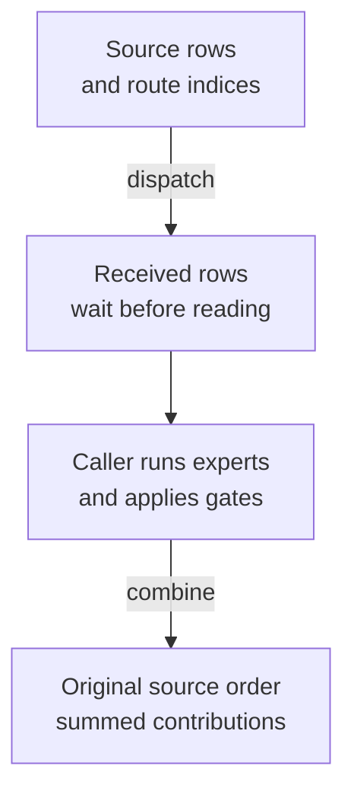

---
{
  "id": "deep-dive-deepep",
  "title": "Deep Dive - DeepEP",
  "slug": "deep-dive-deepep",
  "section": "Project Deep Dives",
  "category": "Inference Optimization",
  "difficulty": "Hard",
  "order": 6,
  "coverImage": "illustrations/_generated/deepep_token_journey_dark.png",
  "shortDescription": "A token can reach two experts on different GPUs and still return to the wrong row. DeepEP is the low-latency dispatch and combine communication library that orchestrates these MoE transfers across NVLink and RDMA.",
  "keyConceptsTested": [
    "MoE expert-parallel dispatch and combine",
    "Logical versus physical bandwidth across NVLink and RDMA",
    "NCCL Gin direct and hierarchical hybrid paths",
    "ElasticBuffer, EPHandle, EventOverlap, and deterministic sorting",
    "FP8 dispatch with BF16 combine and expert alignment",
    "Analytical SM and queue-pair sizing plus JIT kernel compilation",
    "V2 versus legacy NVSHMEM V1 and experimental PP, CP, and Engram extensions"
  ],
  "prerequisites": [
    "deep-dive-deepgemm",
    "model-parallelism-for-llm-inference",
    "deep-dive-sglang"
  ],
  "relatedQuestions": [
    "mixture-of-experts-architecture",
    "model-parallelism-for-llm-inference",
    "mixed-precision-training-loss-scaling"
  ],
  "companies": [
    "DeepSeek",
    "NVIDIA"
  ]
}
---

A routed <span data-glossary="mixture-of-experts">mixture-of-experts</span> (MoE) layer can send one <span data-glossary="token">token</span> to two experts on different GPUs. Getting both results back to the originating GPU is only half the problem: each output must land in the exact source row with its router gate weight applied once, while every communication <span data-glossary="cuda-kernel">CUDA kernel</span> competes for <span data-glossary="streaming-multiprocessor">streaming multiprocessors (SMs)</span> with the expert matrix multiplications.

**DeepEP (DeepEveryParallel)** is DeepSeek's communication library built specifically for <span data-glossary="expert-parallelism">expert-parallel</span> (EP) dispatch and combine over intranode <span data-glossary="nvlink">NVLink</span> and internode <span data-glossary="rdma">RDMA</span> via <span data-glossary="nccl">NCCL</span> Gin (NVIDIA's device-side network interface, replacing the archived <span data-glossary="nvshmem">NVSHMEM</span> V1 backend).[^deepep2026repo][^deepep2026legacy] On mixed NVLink+RDMA domains, DeepEP also inserts a system-scope memory fence before its Gin barrier so remote writes become visible before receiving kernels read them.[^deepep2026mixedfabricfix]

## Why expert parallelism needs a communication layer

In expert parallelism, each GPU stores only its local slice of experts, trading lower weight memory for per-layer activation exchanges. Standard `all_to_all_single` expects uniform counts and leaves the caller to compute peer counts, deduplicate tokens hitting multiple experts on the same rank, pack GEMM-aligned expert buffers, overlap async receives, and invert the scatter back to source order. DeepEP fuses those four responsibilities cleanly while leaving the router, expert <span data-glossary="gemm">GEMMs</span>, and gate multiplication in the caller:[^deepep2026repo]



## A four-token routing ledger

Trace two ranks and four experts: rank 0 owns experts `{0, 1}` with tokens `a, b`; rank 1 owns experts `{2, 3}` with tokens `c, d`. Each token picks top-2 experts:

| Token | Source rank | Expert choices | Gate weights |
| --- | ---: | --- | --- |
| `a` | 0 | E0 (rank 0), E3 (rank 1) | 0.70, 0.30 |
| `b` | 0 | E2 (rank 1), E1 (rank 0) | 0.40, 0.60 |
| `c` | 1 | E1 (rank 0), E3 (rank 1) | 0.55, 0.45 |
| `d` | 1 | E0 (rank 0), E2 (rank 1) | 0.25, 0.75 |

Dispatch sends each token **at most once per distinct destination rank** (even if two chosen experts live on that same rank), returns an `EPHandle` recording the inverse slot map, and delivers gate weights alongside received rows. Suppose expert $k$ scales inputs by $k + 1$ and token `a` starts at `(1.0, 0.0)`: E0 returns `(1.0, 0.0)` and E3 returns `(4.0, 0.0)`. The caller multiplies by gates (`0.70` and `0.30`), and `combine` sums `(0.70, 0.0) + (1.20, 0.0) = (1.90, 0.0)` back into source row `a`.

<figure>
  
  <figcaption>Token `a` stays local for E0 and crosses RDMA for E3; the caller weights expert outputs once, and `combine` restores `(1.90, 0.0)` into source row `a` via `EPHandle`.</figcaption>
</figure>

Verify destination-rank deduplication, `-1` masked router slots (which create neither transport rows nor expert slots), and alignment-padding exclusion in Python:

<!-- leetllm: test, output=show, id=routing-ledger -->
```python title="routing_invariants.py"
import math

HIDDEN = {"a": (1.0, 0.0), "b": (0.0, 1.0), "c": (1.0, 1.0), "d": (2.0, -1.0)}
ROUTES = {
    "a": [(0, 0.70), (3, 0.30)], "b": [(2, 0.40), (1, 0.60)],
    "c": [(1, 0.55), (3, 0.45)], "d": [(0, 0.25), (2, 0.75)],
}

def dispatch_and_combine(routes, alignment=4):
    recv = {e: [] for e in range(4)}
    inverse, dest_rows = {}, set()
    for tok, choices in routes.items():
        for exp, w in choices:
            if exp == -1:  # Unused slot, never Python index -1.
                continue
            dest_rows.add((tok, exp // 2))
            slot = len(recv[exp])
            inverse[exp, slot] = tok
            recv[exp].append((HIDDEN[tok], w))
    padded = {e: rows + [None] * (-len(rows) % alignment) for e, rows in recv.items()}
    out = {t: [0.0, 0.0] for t in HIDDEN}
    for exp, rows in padded.items():
        for slot, item in enumerate(rows):
            if item is None:  # Padding slots never enter combine.
                continue
            h, w = item
            tok = inverse[exp, slot]
            out[tok][0] += w * h[0] * (exp + 1)
            out[tok][1] += w * h[1] * (exp + 1)
    return out, len(dest_rows), len(inverse)

out, d_rows, e_slots = dispatch_and_combine(ROUTES)
assert math.isclose(out["a"][0], 1.90) and (d_rows, e_slots) == (8, 8)
print(f"baseline: a={tuple(round(v, 2) for v in out['a'])}, dest_rows={d_rows}, expert_slots={e_slots}")

# Same-rank dedup: token a hits E2 and E3 (both rank 1) -> 7 dest rows, 8 expert slots.
out2, d2, e2 = dispatch_and_combine({**ROUTES, "a": [(2, 0.70), (3, 0.30)]})
assert math.isclose(out2["a"][0], 3.30) and (d2, e2) == (7, 8)
# Masked -1 slot drops both transport and expert work.
out3, d3, e3 = dispatch_and_combine({**ROUTES, "a": [(0, 0.70), (-1, 0.30)]})
assert math.isclose(out3["a"][0], 0.70) and (d3, e3) == (7, 7)
print(f"same-rank dedup: dest_rows={d2}, expert_slots={e2} | masked -1: a={out3['a'][0]:.2f}")
```

<!-- leetllm: output:start -->
```text title="Output" output compact
baseline: a=(1.9, 0.0), dest_rows=8, expert_slots=8
same-rank dedup: dest_rows=7, expert_slots=8 | masked -1: a=0.70
```
<!-- leetllm: output:end -->

## V2's single interface: ElasticBuffer

DeepEP V2 unifies high-throughput training and low-latency decode behind symmetric GPU memory registered with NCCL (`ElasticBuffer`, later split into specialized `EPBuffer` / `BucketBuffer` classes with deferred `.wait()` epilogues in V2.5).[^deepep2026repo][^deepep2026v25readme][^deepep2026v25release] Size the 2 MiB-aligned symmetric buffer up front for your worst-case token envelope with `get_buffer_size_hint` ("elastic" refers to the unified abstraction, not dynamic reallocation).

```python title="elastic_buffer_setup.py"
from deep_ep import ElasticBuffer

buffer = ElasticBuffer(
    group, num_max_tokens_per_rank=4096, hidden=7168, num_topk=8, use_fp8_dispatch=True,
)
recv_x, recv_idx, recv_w, handle, event = buffer.dispatch(
    x, topk_idx=topk_idx, topk_weights=topk_weights, num_experts=128, async_with_compute_stream=True,
)
```

> **Key insight:** Reusing a **buffer** avoids reallocation across steps, whereas reusing an **`EPHandle`** (`topk_idx=None`) promises identical token-to-expert routing. Matching tensor shapes never validate an old handle for a new router output.

## Dispatch: layout, move, and epilogue

Dispatch overlaps three stages: counting/laying out destination rows, moving hidden states over local memory / NVLink / NCCL Gin RDMA, and optionally expanding received rows into GEMM-aligned per-expert segments (`do_zero_padding=True` zeros alignment gaps).

Watch expanded offset semantics: `psum_num_recv_tokens_per_expert[i]` records expert `i`'s aligned start **plus its real token count** (the valid exclusive endpoint), not the padded capacity. For real counts `[3, 1]` and alignment 4, starts are `[0, 4]`, valid endpoints are `[3, 5]`, and total padded capacity is 8 slots. Async callers using `do_cpu_sync=False` must slice strictly by valid device counts so padding rows never corrupt expert outputs.

## Combine: reverse routing plus reduction

`combine` consumes `handle.recv_src_metadata` to scatter expert outputs back to source ranks and sum all weighted contributions into BF16. By duality, backward pass simply swaps operators: dispatch forward becomes combine backward, and combine forward becomes dispatch backward (while autograd differentiates expert weights and gate multiplications explicitly).

Beware `allow_multiple_reduction` staging: reducing locally into an intermediate BF16 subtotal cuts wire rows at the price of an extra rounding step. For weighted values `[256, 1, -256]`, a single FP32 accumulation produces `1`, whereas staging `bf16(256 + 1)` rounds `257` to `256` (round-to-nearest-even) and leaves `0`:

<!-- leetllm: test, deps=numpy, output=show -->
```python title="staged_bf16_rounding.py"
import numpy as np

def bf16(val: float) -> float:
    bits = np.array([val], dtype=np.float32).view(np.uint32)
    rounded = (bits + np.uint32(0x7FFF) + ((bits >> np.uint32(16)) & np.uint32(1))) & np.uint32(0xFFFF0000)
    return float(rounded.view(np.float32)[0])

print(f"single FP32->BF16: {bf16(256.0 + 1.0 - 256.0):.0f} | staged BF16: {bf16(bf16(256.0 + 1.0) - 256.0):.0f}")
```

<!-- leetllm: output:start -->
```text title="Output" output compact
single FP32->BF16: 1 | staged BF16: 0
```
<!-- leetllm: output:end -->

## Topology: scale-up and scale-out are different roads

DeepEP queries NCCL physical topology and runs in two modes:

<figure>
  
  <figcaption>Direct mode sends point-to-point across RDMA; Hybrid mode crosses one RDMA rail (`NCCL_GIN_CONNECTION_RAIL`) and forwards intranode over high-bandwidth NVLink to curb cross-rail congestion and QP count.</figcaption>
</figure>

- **Direct mode (`NCCL_GIN_CONNECTION_FULL`):** Single scale-up domain or flat fabric; simplest path, highest QP pressure at scale.
- **Hybrid mode (`NCCL_GIN_CONNECTION_RAIL`):** `scale-out x scale-up` hierarchy splitting <span data-glossary="cuda-warp">CUDA warps</span> between cross-node RDMA rails and intranode NVLink forwarding via per-channel linked lists.

## Logical bandwidth is not a NIC counter

DeepEP reports **logical bandwidth**: total algorithmic payload exchanged across the EP group (including local-rank rows) divided by time. If 100 MiB exchanges in 1 ms with half staying local, logical bandwidth is `104.86 GB/s` while the RDMA NIC carries `52.43 GB/s`. Published V2 reference numbers (8K tokens, hidden 7168, top-8, FP8 dispatch, BF16 combine) show the intranode vs. internode gap and the SM overlap trade-off:[^deepep2026repo]

| Arch | Topology | Dispatch | Combine | SMs |
| --- | --- | --- | --- | ---: |
| SM90 (CX7) | EP 8x2 / 8x4 | 90 / 61 GB/s RDMA | 81 / 61 GB/s RDMA | 12 / 6 |
| SM100 (CX7) | EP 8x2 | 90 GB/s RDMA | 91 GB/s RDMA | 12 |
| SM100 (NVLink) | EP 8 | 726 GB/s (max) / 643 GB/s (overlap) | 740 / 675 GB/s | 64 / 24 |

Cutting intranode SM100 communication SMs from 64 to 24 keeps 89% of bandwidth while freeing 40 SMs for overlapping expert GEMMs. Always judge configs by **full MoE layer latency** (dispatch + experts + combine), not standalone transport GB/s.

## NCCL Gin V2 backend

DeepEP initializes NCCL Gin by querying physical domains, requesting QP contexts and rail/full connections, registering symmetric GPU memory windows, and exposing a device communicator handle to JIT kernels. Never destroy the underlying NCCL communicator while an active `EventOverlap` hook or kernel still references its window; watch `EP_OVERRIDE_RDMA_SL` (InfiniBand service level) and `EP_BUFFER_DEBUG=1` when diagnosing cluster issues.

## EPHandle: route metadata with a lifetime

`EPHandle` carries `topk_idx`, `recv_src_metadata`, scale-up/expert prefix arrays, hybrid channel linked lists, and `num_sms`. For reproducible training or debugging, deterministic mode sorts arrivals by `(source_global_id, expert_id)` at the cost of extra post-kernel overhead.

## EventOverlap: stream synchronization mechanics

Because dispatch and combine run asynchronously on a communication <span data-glossary="cuda-stream">CUDA stream</span>, `EventOverlap.current_stream_wait()` inserts a GPU-side stream dependency without stalling the host CPU. In V2.5 deferred-epilogue mode (`defer_epilogue=True`), `.wait()` runs its completion hook and returns the result tuple **once**; a second `.wait()` returns `None`.[^deepep2026v25readme]

## Precision: FP8 on the wire, BF16 for the reduction

FP8 dispatch cuts wire payload nearly in half: for hidden 7,168 with one 4-byte FP32 scale per 128 elements, each row sends `7,168 + 224 = 7,392` bytes vs. `14,336` bytes in BF16 (plus routing headers). Match scale-factor layout (`use_tma_aligned_col_major_sf` for <span data-glossary="tma">TMA</span>) exactly to downstream expert GEMMs, while `combine` always runs in BF16.

## Analytical SM and QP sizing

Under uniform routing of $k$ distinct experts across $G$ groups of $E/G$ experts, expected touched destination ranks are $G \left(1 - \binom{E - E/G}{k}/\binom{E}{k}\right)$. Queue-pair sizing requests `min(num_sms, 9)` QPs in direct mode and `num_sms * 16 + 1` QPs in hybrid mode, clamped to allocated <span data-glossary="qps">QPs</span>:

<!-- leetllm: test, output=show -->
```python title="destination_and_queue_counts.py"
from math import comb

def expected_dests(E, G, k):
    return G * (1 - comb(E - E // G, k) / comb(E, k))

def qp_count(sms, allocated, hybrid):
    return min(sms * 16 + 1 if hybrid else min(sms, 9), allocated)

print(f"E=4, G=2, k=2 -> expected dests={expected_dests(4, 2, 2):.4f}")
print(f"12 SMs, 128 QPs -> direct={qp_count(12, 128, False)}, hybrid={qp_count(12, 128, True)}")
```

<!-- leetllm: output:start -->
```text title="Output" output compact
E=4, G=2, k=2 -> expected dests=1.6667
12 SMs, 128 QPs -> direct=9, hybrid=128
```
<!-- leetllm: output:end -->

Real DeepSeek-style routers are skewed and group-limited, so treat analytical sizing as a starting baseline and override `num_sms` from real routing histograms.

## JIT compilation is part of the runtime

DeepEP JIT-compiles specialized kernels on first use for each `(topology, hidden, alignment, num_sms, num_qps)` combination (using `EP_JIT_CACHE_DIR` for persistent caches, `EP_JIT_PTXAS_CHECK` to catch register spills, and `EP_JIT_DUMP_SASS` for inspection). Pre-warm production shapes at startup so compile latency stays out of live requests.

## Source-reading map

| File | Responsibility |
| --- | --- |
| `deep_ep/buffers/elastic.py` | Python buffer interface, sizing hints, handles, and events |
| `deep_ep/utils/event.py` | `EventOverlap` stream wait hooks and deferred completion |
| `csrc/kernels/backend/nccl.cu` | NCCL Gin probing, rail/full setup, symmetric windows |
| `csrc/kernels/elastic/dispatch.hpp` & `combine.hpp` | Direct/hybrid dispatch layout and inverse combine reduction |
| `csrc/jit/compiler.hpp` & `cache.hpp` | Runtime kernel generation and disk cache |

```mastery-quiz
[
  {
    "question": "Six experts sit on three ranks: {0,1} on rank 0, {2,3} on rank 1, {4,5} on rank 2. Tokens u, v, w pick [2,3], [0,5], [4,5]. Then w's second choice becomes -1. What are (destination rows, expert assignments) before and after?",
    "options": [
      "Before (6,6); after (5,5).",
      "Before (4,4); after (4,4).",
      "Before (4,6); after (3,5).",
      "Before (4,6); after (4,5)."
    ],
    "answer": "Before (4,6); after (4,5).",
    "explanation": "Initially u touches 1 rank, v touches 2, w touches 1 -> 4 destination rows, 6 expert slots. Masking one of w's same-rank choices drops 1 expert slot while w still sends 1 row to rank 2 -> (4, 5)."
  },
  {
    "question": "An expanded receive buffer has two experts with real token counts [5, 2] and GEMM alignment 4. What are segment starts, valid endpoints (`psum_num_recv_tokens_per_expert`), and total capacity?",
    "options": [
      "Starts [0, 8]; endpoints [5, 10]; capacity 12.",
      "Starts [0, 5]; endpoints [5, 7]; capacity 8.",
      "Starts [0, 8]; endpoints [8, 12]; capacity 12.",
      "Starts [0, 8]; endpoints [5, 10]; capacity 10."
    ],
    "answer": "Starts [0, 8]; endpoints [5, 10]; capacity 12.",
    "explanation": "Expert 0 pads 5 -> 8 slots (valid [0, 5)), Expert 1 starts at 8 and pads 2 -> 4 slots (valid [8, 10)), giving endpoints [5, 10] and total capacity 12."
  },
  {
    "question": "A benchmark exchanges 144 MiB of logical payload in 2 ms, with 96 MiB staying local and 48 MiB crossing the RDMA NIC. What are logical and remote decimal GB/s?",
    "options": [
      "Logical 72.0; remote 24.0.",
      "Logical 75.5; remote 25.2.",
      "Logical 75.5; remote 75.5.",
      "Logical 25.2; remote 75.5."
    ],
    "answer": "Logical 75.5; remote 25.2.",
    "explanation": "144 * 2^20 / (0.002 * 10^9) = 75.5 GB/s logical; 48 * 2^20 / (0.002 * 10^9) = 25.2 GB/s crossing the NIC."
  },
  {
    "question": "Weighted BF16-representable values are 256, 3, and -256 (near 256, BF16 spacing is 2; 259 ties halfway between odd 258 and even 260). Compare staged BF16 (`bf16(256+3) - 256`) vs. one FP32 accumulation cast to BF16.",
    "options": [
      "Staged 2; single 3.",
      "Staged 3; single 3.",
      "Staged 4; single 2.",
      "Staged 4; single 3."
    ],
    "answer": "Staged 4; single 3.",
    "explanation": "Intermediate 259 rounds ties-to-even up to 260, so 260 - 256 = 4. Single FP32 accumulation yields exact 3."
  },
  {
    "question": "An FP8 dispatch row has 4,096 1-byte values, one 4-byte FP32 scale per 128 values, and an 80-byte routing header. What are total row bytes and scale bytes?",
    "options": [
      "4,176 total; 0 scales.",
      "4,224 total; 128 scales.",
      "4,304 total; 128 scales.",
      "4,208 total; 32 scales."
    ],
    "answer": "4,304 total; 128 scales.",
    "explanation": "4,096 / 128 = 32 scale groups * 4 B = 128 B scales. Total = 4,096 + 128 + 80 = 4,304 bytes."
  },
  {
    "question": "Two configs run dispatch, experts, and combine serially: Config A takes [1.2, 3.0, 1.1] ms and Config B (more comm SMs) takes [0.8, 3.6, 1.0] ms. Which wins end to end?",
    "options": [
      "Config B (1.8 ms comm beats 2.3 ms).",
      "Config A (5.3 ms total beats 5.4 ms).",
      "Config B (5.3 ms total beats 5.4 ms).",
      "Config A (3.0 ms expert beats 3.6 ms)."
    ],
    "answer": "Config A (5.3 ms total beats 5.4 ms).",
    "explanation": "Total layer time is 5.3 ms for A vs. 5.4 ms for B: giving extra SMs to communication shaved 0.5 ms off transport but cost 0.6 ms in the expert GEMM."
  }
]
```

> **Next:** Continue to [Deep Dive - NCCL](/learn/deep-dive-nccl).
