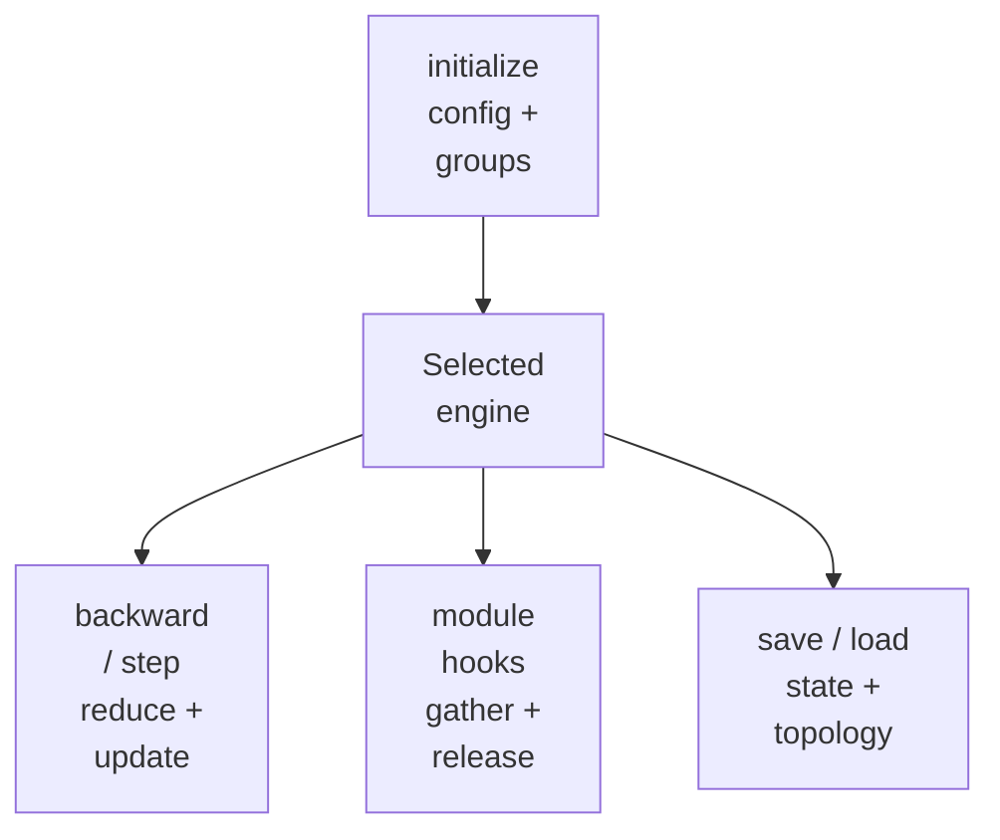

---
{
  "id": "deep-dive-deepspeed",
  "title": "Deep Dive - DeepSpeed",
  "slug": "deep-dive-deepspeed",
  "section": "Project Deep Dives",
  "category": "Fine-Tuning & Training",
  "difficulty": "Hard",
  "order": 8,
  "coverImage": "social_banner.png",
  "companies": [
    "Microsoft",
    "Snowflake",
    "Anyscale",
    "AMD",
    "Google",
    "Intel"
  ],
  "shortDescription": "Weights for a 1.5-billion-parameter model fit in 3 GB, yet the first Adam step needs 24 GB of state. ZeRO partitions that extra state and separates a resumable checkpoint from an export.",
  "keyConceptsTested": [
    "DeepSpeed engine and accumulation boundaries",
    "Dtype-aware ZeRO memory accounting",
    "Reduce-before-update Adam semantics",
    "Gathered working sets and padding",
    "Communication volume versus time",
    "External parameters and dynamic leaf modules",
    "CPU and NVMe offload",
    "Checkpoint resume versus model export",
    "Pinned source and runtime compatibility"
  ],
  "prerequisites": [
    "deep-dive-nccl",
    "deep-dive-megatron",
    "distributed-training-fsdp-deepspeed-zero",
    "mixed-precision-training-loss-scaling"
  ],
  "relatedQuestions": [
    "deep-dive-pytorch",
    "deep-dive-transformers",
    "lora-parameter-efficient-fine-tuning",
    "training-backpropagation-gradient-descent"
  ]
}
---

A model can fit its weights on one GPU and still run out of memory at the first optimizer update. A 1.5-billion-parameter model needs 3 GB for two-byte weights alone. In the ZeRO paper's mixed-precision Adam accounting, training state takes 24 GB before activations or temporary buffers. Where did the other 21 GB come from?[^rajbhandari2020]

The [Megatron lesson](/learn/deep-dive-megatron) split computation across parallel axes. <span data-glossary="deepspeed">DeepSpeed</span> also asks who must retain each tensor between computations. Its <span data-glossary="zero">Zero Redundancy Optimizer (ZeRO)</span> partitions optimizer state, gradients, and eventually parameters across data-parallel ranks. Each rank still processes its own examples; sharding state doesn't mean sharding the examples' computation as tensor parallelism would.

A saved directory can still look complete and resume a different update. The source tour uses commit `c455031422641a825588c926455458c82b27b6c0` (August 6, 2026, before the 0.19.4 release). On October 10, 2026, the `latest` training documentation identifies itself as 0.19.8 and the `stable` ZeRO documentation as 0.19.7. Treat these as distinct version references; validate each feature combination against the source and documentation you deploy.[^deepspeed2026source][^deepspeedTrainingDocs2026][^deepspeedZeroDocs2026]

The marked examples run on a CPU with Python's standard library and check ownership arithmetic plus an Adam update. Validate the corresponding behavior separately with DeepSpeed kernels, distributed execution, and GPU memory measurements.

## Count state before choosing a stage

Let $P$ be the parameter count represented by a data-parallel group. If tensor or pipeline parallelism already splits the model, use the relevant local model partition, not the entire model's parameter count.

The paper's 16-byte recipe is:

| Tensor | Bytes per parameter | Role |
|---|---:|---|
| Low-precision parameter | 2 | Forward and backward computation |
| Low-precision gradient | 2 | Gradient awaiting the update |
| FP32 master parameter | 4 | Higher-precision update state |
| FP32 first moment | 4 | Adam's running gradient average |
| FP32 second moment | 4 | Running average of squared gradients |
| Total | 16 | Model state only |

The second moment isn't an estimate of centered variance. Also, BF16 compute doesn't by itself determine the gradient-accumulation dtype or whether a master copy exists. For example, replacing the two-byte gradient with a four-byte accumulation array changes this simplified total to 18 bytes. Inspect the actual optimizer and buffer dtypes. DeepSpeed exposes `data_types.grad_accum_dtype` separately.[^deepspeedConfigJson2026]

Let $p$, $g$, and $o$ denote bytes per parameter for compute weights, gradients, and optimizer-plus-master state. For $N$ data-parallel ranks, idealized per-rank storage is:

$$
\begin{aligned}
M_{DP} &= P(p+g+o),\\
M_{Z1} &= P(p+g+o/N),\\
M_{Z2} &= P(p+(g+o)/N),\\
M_{Z3} &= P(p+g+o)/N.
\end{aligned}
$$

With $(p,g,o)=(2,2,12)$ and $N=4$, those are $16P$, $7P$, $5.5P$, and $4P$ bytes. The formulas describe balanced persistent state, not peak allocator usage. Padding, persistent small parameters, gathered tensors, activations, communication buffers, workspaces, and fragmentation can add memory.[^rajbhandari2020]

<figure>
  
  <figcaption>ZeRO removes replication in stages. The large first reduction comes from sharding the twelve-byte optimizer-plus-master block; the remaining reductions change gradient and parameter ownership.</figcaption>
</figure>

Use exact calculations to compare recipes without confusing decimal gigabytes ($10^9$ bytes) and binary gibibytes ($2^{30}$ bytes). This estimator deliberately excludes padding and live working sets.

<!-- leetllm: test, id=zero-ledger, output=show -->
```python title="zero_memory.py"
import numpy as np


def compute_zero_memory(parameters: int, ranks: int, param_bytes: int = 2, grad_bytes: int = 2, opt_bytes: int = 12) -> dict[str, float]:
    p = float(parameters)
    r = float(ranks)
    dp = p * (param_bytes + grad_bytes + opt_bytes)
    z1 = p * (param_bytes + grad_bytes) + (p / r) * opt_bytes
    z2 = p * param_bytes + (p / r) * (grad_bytes + opt_bytes)
    z3 = (p / r) * (param_bytes + grad_bytes + opt_bytes)
    return {
        "DP": dp,
        "ZeRO-1": z1,
        "ZeRO-2": z2,
        "ZeRO-3": z3,
    }


total_params = 1_500_000_000
data_ranks = 4
memory_map = compute_zero_memory(total_params, data_ranks)

for stage, total_b in memory_map.items():
    gb = total_b / 1e9
    gib = total_b / (1024**3)
    print(f"{stage:6s} {gb:5.2f} GB | {gib:5.2f} GiB")

assert np.isclose(memory_map["DP"], 24.0e9)
assert np.isclose(memory_map["ZeRO-1"], 10.5e9)
assert np.isclose(memory_map["ZeRO-2"], 8.25e9)
assert np.isclose(memory_map["ZeRO-3"], 6.0e9)
```

<!-- leetllm: output:start -->
```text title="Output" output compact
DP     24.00 GB | 22.35 GiB
ZeRO-1 10.50 GB |  9.78 GiB
ZeRO-2  8.25 GB |  7.68 GiB
ZeRO-3  6.00 GB |  5.59 GiB
```
<!-- leetllm: output:end -->

Stage 1 partitions optimizer state and master weights. Stage 2 also partitions reduced gradients. Stage 3 also partitions compute parameters.[^deepspeedZeroDocs2026] Higher stages aren't quality levels. If stage 2 fits, stage 3's additional gathers may or may not pay off. If saved activations dominate, investigate activation checkpointing, microbatch size, or sequence length before expecting parameter sharding to solve the problem.

Partitioning the bytes does not settle Adam's second moment. That depends on whether each rank updates from its own gradient or from the reduced one.

## Reduce first, then update the owned slice

It doesn't if each rank updates from its own gradient. The square of a mean isn't the mean of squares, which is easiest to see with two ranks. Suppose their gradients for one parameter are 1 and 3. The averaged gradient is 2. The owner applies Adam once to that gradient and its local moment state. It mustn't apply Adam separately to each rank's gradient and then average the updated moments: the second moment involves a square, and $(1^2+3^2)/2=5$, while $((1+3)/2)^2=4$.[^kingma2015]

In an unsharded run, every rank can hold the reduced gradient and optimizer state. In a sharded run, the owning rank holds the relevant slice. The mathematical update can match, although different reduction orders and low-precision arithmetic can change floating-point results.

This implementation runs five updates on eleven parameters, partitioned over four logical owners using NumPy vector operations. The comparison covers every weight and moment, including uneven partitions. The reference uses ordinary Adam without weight decay, not the later AdamW configuration, and doesn't simulate NCCL's execution or DeepSpeed's padding layout.

<!-- leetllm: test, id=zero-adam, output=show -->
```python title="owned_adam.py"
import numpy as np


def adam_step(weight, first, second, gradient, step, lr=0.01):
    first = 0.9 * first + 0.1 * gradient
    second = 0.999 * second + 0.001 * (gradient**2)
    corrected_first = first / (1.0 - 0.9**step)
    corrected_second = second / (1.0 - 0.999**step)
    weight = weight - lr * corrected_first / (np.sqrt(corrected_second) + 1e-8)
    return weight, first, second


def compare_owned_updates(parameters: int, ranks: int, steps: int):
    weights = np.arange(parameters, dtype=np.float64) * 0.1
    m = np.zeros(parameters, dtype=np.float64)
    v = np.zeros(parameters, dtype=np.float64)

    owners = [
        range(parameters * r // ranks, parameters * (r + 1) // ranks)
        for r in range(ranks)
    ]
    sharded = [
        {i: (float(weights[i]), float(m[i]), float(v[i])) for i in ids}
        for ids in owners
    ]

    for step in range(1, steps + 1):
        local_grads = np.array(
            [
                [((i + 2 * r + step) % 7 - 3) / 10.0 for i in range(parameters)]
                for r in range(ranks)
            ],
            dtype=np.float64,
        )
        mean_grad = np.mean(local_grads, axis=0)

        # Unsharded reference update
        weights, m, v = adam_step(weights, m, v, mean_grad, step)

        # Sharded ZeRO update: reduce-scatter gradient slice, update local slice
        for rank, owner in enumerate(sharded):
            reduced = {i: float(mean_grad[i]) for i in owner}
            sharded[rank] = {
                i: tuple(
                    float(x)
                    for x in adam_step(
                        state[0], state[1], state[2], reduced[i], step
                    )
                )
                for i, state in owner.items()
            }

        reconstructed_weights = np.array(
            [state[0] for owner in sharded for state in owner.values()]
        )
        np.testing.assert_allclose(weights, reconstructed_weights, rtol=1e-12, atol=1e-12)

    return [(float(weights[i]), float(m[i]), float(v[i])) for i in range(parameters)]


result = compare_owned_updates(11, 4, 5)

# Verify single scalar update step
w, m_val, v_val = adam_step(1.0, 0.0, 0.0, 2.0, 1)
assert np.isclose(w, 1.0 - 0.01 * 2.0 / (2.0 + 1e-8))
assert np.isclose(m_val, 0.2) and np.isclose(v_val, 0.004)
assert (1**2 + 3**2) / 2 != ((1 + 3) / 2) ** 2
print(f"{len(result)} parameters, 4 owners, 5 updates: weights and moments match")
```

<!-- leetllm: output:start -->
```text title="Output" output compact
11 parameters, 4 owners, 5 updates: weights and moments match
```
<!-- leetllm: output:end -->

The example averages equally weighted rank gradients. Variable microbatch sizes or different numbers of unmasked tokens need the appropriate loss weighting; “average each rank's average” isn't automatically the global token-average objective. If one rank averages one token's gradient of 1 and another averages three token gradients of 3, their rank-average is 2. The four-token average is $(1+3+3+3)/4=2.5$. Sharding can preserve the update you specify, but it can't repair a wrongly weighted objective. The arithmetic is settled for one parameter. Which object in the training loop is allowed to apply it?

## Let the engine own the microstep

That object is the engine. `deepspeed.initialize(...)` selects and configures a `DeepSpeedEngine`, wrapped optimizer, optional data loader, and scheduler. The engine coordinates backward, accumulation, reduction, precision, stepping, and checkpoint state.[^deepspeed2026source]

Here is an integration sketch, not a standalone program. It assumes a model whose forward returns a scalar mean loss, a prepared batch on the correct device, and a distributed launcher. Under the default managed-accumulation behavior, call `step()` after every microbatch; the engine applies an optimizer update at its accumulation boundary. Don't divide the loss by the accumulation count again when using the default engine scaling.[^deepspeedTrainingDocs2026]

```python title="engine_integration_sketch.py"
import deepspeed
import torch

engine, optimizer, _, scheduler = deepspeed.initialize(
    model=model,
    model_parameters=model.parameters(),
    config="ds_config.json",
)
for batch in prepared_batches:
    loss = engine(batch)
    engine.backward(loss)
    engine.step()
```

With accumulation set to eight, this loop calls `backward()` and `step()` eight times for one optimizer update. Calling `step()` only on every eighth batch under the default managed behavior would advance the engine's microstep counter only once. Dividing each loss by eight as well would instead scale an already-averaged gradient a second time.

The current API also offers `managed_gradient_accumulation: false`. In that mode, each `step()` completes one update and the caller chooses when to call it. If the actual accumulation count differs from the configured count, use `backward(..., scale_wrt_gas=False)` and supply the intended loss weighting yourself. The pinned August source rejects unmanaged accumulation with optimizer or parameter offload, while the current training documentation supports those paths. Check the installed engine before combining them.[^deepspeed2026source][^deepspeedTrainingDocs2026]

This four-data-rank configuration uses BF16 model parameters and explicitly requests FP32 gradient accumulation. Validate it on compatible GPUs before adopting it. The optimizer settings belong to your training recipe; ZeRO doesn't determine a suitable learning rate.

```json title="ds_config.json"
{
  "train_batch_size": 64,
  "train_micro_batch_size_per_gpu": 2,
  "gradient_accumulation_steps": 8,
  "bf16": { "enabled": true },
  "data_types": { "grad_accum_dtype": "fp32" },
  "zero_optimization": {
    "stage": 2,
    "contiguous_gradients": true,
    "overlap_comm": true,
    "reduce_bucket_size": 200000000
  },
  "optimizer": {
    "type": "AdamW",
    "params": {
      "lr": 0.00002,
      "betas": [0.9, 0.999],
      "eps": 1e-8,
      "weight_decay": 0.01
    }
  }
}
```

Check two different units. The batch identity is $2\times8\times4=64$ samples per optimizer update. The last factor is the **data-parallel degree**, not necessarily the total number of GPUs when model parallelism is present. Holding all three batch fields fixed while launching eight data ranks is inconsistent, not a harmless scale-out change.[^deepspeedConfigJson2026]

`reduce_bucket_size` is a count of elements, not bytes. Two hundred million elements occupy 400 MB at two bytes each or 800 MB at four bytes each, before other buffers. Communication dtype and accumulation dtype do not need to match. Larger buckets can amortize collective overhead but increase temporary storage and delay the first reduction; inspect the timeline rather than copying a bucket size.[^deepspeedZeroDocs2026]

For a real launch, record the installed DeepSpeed and PyTorch versions, accelerator and driver, the resolved configuration, and `ds_report` output. The report checks operator/environment compatibility. Run a multi-rank training step and exercise the offload path on the target setup.[^deepspeedInstallDocs2026] Neither the integration sketch nor this GPU configuration was executed for this lesson. A config that fits the persistent estimate still has to gather a full matrix from the shards each rank stores.

## Stage 3 needs a live working set

A sharded parameter can't directly supply a conventional full-layer matrix multiplication. ZeRO-3 gathers the parameter view needed for a module, executes it, and can release that full view afterward. Backward can require another gather. Prefetch, persistence, reuse, and module grouping affect the actual schedule.[^deepspeedZeroDocs2026]

<figure>
  
  <figcaption>Forward and backward may need separate parameter gathers. The gradient reduction gives each owner its update slice; an optimizer step waits for the accumulation boundary. Persistence can skip some releases and gathers.</figcaption>
</figure>

Don't subtract the local shard from a gathered allocation unless the implementation actually aliases that storage. In the pinned source's sequential gather path, `param.ds_tensor` is the input shard and a separate `torch.empty(...)` tensor receives the full padded gather.[^deepspeed2026source] Logical values and allocated bytes are different counts.

For four tensors of eight parameters on four ranks, one rank retains eight shard elements in total. A separate full eight-element gather brings the parameter-storage count to sixteen, not fourteen. Keeping a second gathered tensor for prefetch raises this example to twenty-four. These counts exclude gradients, optimizer state, activations, and communication-library workspace.

<figure>
  
  <figcaption>Count allocations that coexist, alongside values received from peers. Prefetch trades a larger live working set for a chance to overlap the next gather; use a profiler to measure that overlap.</figcaption>
</figure>

This storage model rounds each tensor's shard up to a whole element and allocates a separate padded gather buffer. To estimate peak memory for a run, include its DeepSpeed stage, gather schedule, prefetch policy, gradients, optimizer state, activations, and communication workspace.

<!-- leetllm: test, id=zero-working-set, output=show -->
```python title="gather_storage.py"
import numpy as np


def parameter_storage(layer_sizes: list[int] | np.ndarray, ranks: int, live_layers: list[int]):
    sizes = np.asarray(layer_sizes, dtype=np.int64)
    if ranks <= 0 or np.any(sizes <= 0):
        raise ValueError("ranks and layer sizes must be positive")

    # Ceiling division for partitioned shards per rank
    partitions = np.ceil(sizes / ranks).astype(np.int64)
    resident = int(np.sum(partitions))

    if len(live_layers) == 0:
        gathered = 0
    else:
        live_idx = np.asarray(live_layers, dtype=np.int64)
        gathered = int(np.sum(partitions[live_idx] * ranks))

    return resident, gathered, resident + gathered


sizes = [8, 8, 8, 8]
for live in ([], [0], [0, 1]):
    resident, gathered, total = parameter_storage(sizes, 4, live)
    print(
        f"{len(live)} gathered: shards {resident} + full buffers {gathered} = {total} elements"
    )

assert parameter_storage([5, 9, 2], 4, [1]) == (6, 12, 18)
assert parameter_storage(sizes, 4, [0])[2] == 16
assert parameter_storage(sizes, 4, [0, 1])[2] == 24
```

<!-- leetllm: output:start -->
```text title="Output" output compact
0 gathered: shards 8 + full buffers 0 = 8 elements
1 gathered: shards 8 + full buffers 8 = 16 elements
2 gathered: shards 8 + full buffers 16 = 24 elements
```
<!-- leetllm: output:end -->

The largest module's forward/backward working set must still fit. `deepspeed.zero.Init()` can partition parameters during construction so initialization doesn't first materialize the entire model on every GPU, but it doesn't make an oversized live operator fit. Tiling or model parallelism may still be needed.[^deepspeedZeroDocs2026]

### External parameters and dynamic routing are different problems

A tied embedding reused outside its owning module is an **external parameter**. DeepSpeed can discover common cases automatically; otherwise use `deepspeed.zero.register_external_parameter()` to identify the consuming module, or `deepspeed.zero.GatheredParameters` for an explicit access scope. This coordinates access to an existing parameter.[^deepspeedZeroDocs2026]

Dynamic routing is different. Two data ranks may select different existing experts and enter incompatible gather sequences. Marking the enclosing module as a ZeRO leaf gathers its descendants as a unit before executing that module, at the cost of a larger working set. Set the boundary with `deepspeed.utils.set_z3_leaf_modules()` before engine initialization, or the `zero_optimization.leaf_module` configuration. This doesn't register newly created trainable parameters with an already-built optimizer.[^deepspeedTrainingDocs2026]

## Communication volume isn't elapsed time

A simplified ring model makes the paper's communication comparison concrete. For $P$ communicated elements per full vector on $N$ ranks, one all-gather or reduce-scatter sends $(N-1)P/N$ elements per rank. Count sends or receives consistently, not their sum on one side of the comparison.

With equal element widths and no extra gathers, the basic schedules are:

| Schedule | Collective work | Sent elements per rank |
|---|---|---:|
| Replicated data parallel | Gradient reduce-scatter + all-gather | $2(N-1)P/N$ |
| ZeRO-2 | Gradient reduce-scatter + updated-parameter all-gather | $2(N-1)P/N$ |
| ZeRO-3 | Forward parameter gather + backward parameter gather + gradient reduce-scatter | $3(N-1)P/N$ |

This explains the paper's approximately $2P$ versus $3P$ communication model for large $N$.[^rajbhandari2020] Step time also depends on gradient/parameter dtypes, repeated gathers during accumulation or recomputation, parameter persistence, bucket sizes, overlap, and collective algorithms. In stage 1, gradient storage stays replicated; inspect the implementation before inferring a particular reduce-scatter path from its ownership formula.

An accumulation window also changes what “per step” means. By default, ZeRO-2 and ZeRO-3 reduce and partition gradients on each backward call, even though Adam waits for the final microbatch. Keeping only the owned gradient between calls saves memory but can repeat communication. Don't wrap those stages in a DDP-style `engine.no_sync()`: the engine rejects that combination. The current `engine.coalesce_grad_reduction()` API can defer reduction across several backward calls, with a full local gradient copy retained until the scope ends and restrictions on the engine, precision wrapper, and accumulation window. Treat it as a separate schedule to validate, not a free communication reduction.[^deepspeedTrainingDocs2026]

On NVIDIA GPUs, NCCL commonly executes these collectives. DeepSpeed chooses the groups and schedules their use. A slow gather could be an exposed dependency, a small-message problem, or a network route problem. Read the per-rank timeline and communication counters together. Volume and time still assume the state lives on the GPU. What changes when it doesn't fit there at all?

## Offload exchanges memory pressure for movement

Then the state has to move. ZeRO-Offload moved optimizer-related state and work to CPU memory. ZeRO-Infinity extends the hierarchy to CPU and NVMe storage.[^ren2021][^rajbhandari2021] In current configuration, optimizer offload is available for stages 1 through 3, parameter offload for stage 3. Optimizer computation remains on the CPU even when its state is stored on NVMe.[^deepspeedZeroDocs2026]

This fragment shows a stage-3 choice, not a complete launch configuration. It requires suitable local storage, available space, compatible I/O operators, and host memory for staging.

```json title="offload_fragment.json"
{
  "zero_optimization": {
    "stage": 3,
    "offload_optimizer": { "device": "cpu", "pin_memory": true },
    "offload_param": {
      "device": "nvme",
      "nvme_path": "/local_nvme/deepspeed"
    }
  }
}
```

A bandwidth bound is a useful first check. If a step must move 12 GB through a bottleneck sustaining 6 GB/s, that path needs at least two seconds of service time. Perfect overlap with three seconds of independent compute could hide it; a dependency requiring the data before compute can't. Multiple reads/writes and shared-link contention can make the real step slower. Use these parameter values to check the arithmetic, then measure the target NVMe path.

Measure GPU memory, host memory, pinned-memory use, CPU optimizer time, transfer volume, and storage queueing. Compare tokens per second at the same effective batch and sequence lengths. A capacity fit still needs throughput and time-to-completion measurements. A JSON key can name the offload device and still hide which function gathers a parameter or refuses a pipeline combination.

## Trace how the engine uses each config value

Follow the call, not the key name. The pinned source organizes the mechanisms as follows:[^deepspeed2026source]

| Entry point | What to inspect |
|---|---|
| `deepspeed/__init__.py` | Initialization and engine selection |
| `deepspeed/runtime/engine.py` | Backward, accumulation boundaries, step, save/load |
| `deepspeed/runtime/zero/stage_1_and_2.py` | Gradient and optimizer ownership |
| `deepspeed/runtime/zero/stage3.py` | Sharded optimizer and parameter coordination |
| `deepspeed/runtime/zero/partition_parameters.py` | Partition storage, gathers, and parameter status |
| `deepspeed/runtime/swap_tensor/` | Offload staging and state movement |
| `deepspeed/runtime/pipe/engine.py` | Pipeline-specific scheduling and restrictions |



Those branches are cooperating responsibilities, not three sequential phases. When a parameter is unexpectedly resident, follow its gather/release code; when a step occurs too early, follow accumulation bookkeeping.

Compatibility also belongs to a specific path. The pinned `PipelineEngine` rejects ZeRO-2 and ZeRO-3. Current AutoTP training documentation separately supports stages 0 through 3, with model-specific partition rules and topology-aware checkpoint handling. Validate each wrapper combination against its specific engine and documentation.[^deepspeed2026source][^deepspeedTrainingDocs2026]

FSDP is another route to sharded training, using PyTorch-native interfaces and a different engine/config boundary. Megatron supplies model-parallel building blocks and schedules. Compare the integration your model requires, then test loss parity and checkpoint portability. Whichever stack you choose, verify that a saved directory resumes the intended trajectory.

## Resume training and export weights separately

A distributed checkpoint contains more than inference weights. Treat two outcomes separately:

| Outcome | State needed | Verification |
|---|---|---|
| Resume training | Parameters, optimizer, scheduler, counters, required RNG/data progress | Next update agrees with an uninterrupted reference |
| Export a model | Consolidated weights plus model/tokenizer configuration | Reference inputs produce matching outputs within tolerance |

Every participating process must call `engine.save_checkpoint` with a consistent tag. Calling it only on rank zero can hang. For a ZeRO-3 save/reload test, construct a fresh model and engine before loading; the pinned implementation warns against loading immediately into the same already-partitioned engine.[^deepspeed2026source]

Use `client_state` for application-owned progress that DeepSpeed doesn't automatically manage. Restore the sampler or data-loader position and any required per-rank RNG state deliberately. A saved step counter alone doesn't ensure the next microbatch is the same.

For supported dense ZeRO layouts, `get_fp32_state_dict_from_zero_checkpoint` reconstructs FP32 weights. Plan CPU memory for consolidation; lazy conversion changes when tensors are materialized, not the size of the final weights. A weights-only export doesn't contain enough state to reproduce the next Adam update.[^deepspeedCheckpointDocs2026]

Use the Adam state from our ownership lab to isolate the difference. Both restores begin with the identical weight and receive the same next gradient and step counter. Omitting the running first and second moments alters the denominator normalization and step magnitude on the subsequent update.

<!-- leetllm: test, output=show, continue=zero-adam -->
```python title="weights_are_not_optimizer_state.py"
import json
import numpy as np

checkpoint = json.loads(
    json.dumps({"next_step": 6, "parameter_state": result[0]})
)
state = checkpoint["parameter_state"]
next_gradient = 0.4
reference = adam_step(*result[0], next_gradient, 6)
resumed = adam_step(*state, next_gradient, checkpoint["next_step"])
weights_only = adam_step(
    state[0], 0.0, 0.0, next_gradient, checkpoint["next_step"]
)

assert state[0] == result[0][0]
assert resumed == reference
assert not np.isclose(weights_only[0], reference[0], rtol=1e-12, atol=1e-12)
print(f"full-state next weight={resumed[0]:.8f}")
print(f"weights-only next weight={weights_only[0]:.8f}")
print(f"next-update gap={abs(weights_only[0] - reference[0]):.8f}")
```

<!-- leetllm: output:start -->
```text title="Output" output compact
full-state next weight=0.01977263
weights-only next weight=0.01900607
next-update gap=0.00076656
```
<!-- leetllm: output:end -->

Identical saved weights can therefore pass an inference check while resuming a divergent training trajectory. This verification script round-trips one parameter's weight, moments, and counter; full production checkpoints additionally preserve distributed rank files, topology conversion metadata, RNG states, and data loader positions.

Universal Checkpointing adds a conversion/load path for supported topology changes, not arbitrary model conversion. The current tutorial requires compatible parameter names and shapes and documents separate AutoTP/AutoEP layouts. In particular, partition-native AutoEP checkpoints aren't supported by `zero_to_fp32.py`; the documented path uses `ds_to_universal.py` instead.[^deepspeedUniversalCheckpointing2026]

Before a long run, save at the intended topology, stop every worker, reload into a fresh run, and compare the next loss, update, scheduler state, and data progress. Test export separately. These distributed recovery operations weren't executed here.

## Project context and contribution path

The original ZeRO authors worked at Microsoft. The project's pinned governance defines technical oversight through a Technical Steering Committee and its relationship with Linux Foundation AI & Data.[^rajbhandari2020][^deepspeed2026governance] The pinned committer roster includes contributors affiliated with Snowflake, Microsoft, Anyscale, AMD, Google, Intel, UIUC, and Argonne National Laboratory. Those affiliations describe the dated roster, not everyone's current employer.[^deepspeed2026committers]

The code license is Apache-2.0. The charter specifies Developer Certificate of Origin sign-off for contributions and CC BY 4.0 for project documentation.[^deepspeed2026license][^deepspeed2026governance] Check the current contribution instructions before submitting a change.

For a source-level investigation, reduce the failing run first. Include the version/commit, resolved config, smallest reproducer, topology, and earliest rank error. Report whether the failure is initialization, correctness, performance, or recovery; a peer's collective timeout can be a consequence of an earlier failure elsewhere.

## Turn a failed run into a specific hypothesis

### Common failure modes

| Observation | Next investigation |
|---|---|
| Longer sequences OOM despite a small state estimate | Separate saved activations and workspaces from model state |
| OOM during a stage-3 gather | Count simultaneous gathered buffers, padding, and prefetch |
| Loss changes after scaling out | Check effective batch, token weighting, precision, and update count |
| Hang with routed experts | Compare gather order and the configured leaf boundary |
| Lower GPU peak but slower steps after offload | Measure exposed transfers and CPU/storage service time |
| Saved directory exists but resume diverges | Restore optimizer, scheduler, RNG, and data progress in a fresh engine |

### Evaluation rubric

- Derive each stage's storage from tensor ownership and dtype, then explain what the estimate excludes.
- Trace one parameter and its gradient through gather, compute, reduction, and the accumulation-boundary update.
- Separate CPU reference checks from GPU measurements, and distinguish a resumable checkpoint from a weights-only export.

### Follow-up questions

```checkpoint
The state estimate fits, but enabling prefetch causes an OOM. Why isn't that a contradiction?
---
The estimate counts persistent state. Prefetch can keep multiple full gathered tensors live alongside their shards. Add the simultaneous allocations, activations, and workspaces before comparing with available device memory.
```

```checkpoint
Two ranks route to different experts. Should you create parameters lazily and register them as external parameters?
---
No. The routing problem concerns compatible gathers for existing submodules. A suitable leaf boundary gathers descendants together, with a memory cost. External-parameter coordination concerns access outside an existing parameter's owning module; it doesn't make post-initialization parameter creation safe for the optimizer.
```

```mastery-quiz
[
  {
    "question": "A model configuration has 2 billion parameters, compute weights at 2 bytes each, gradients at 4 bytes each and optimizer-related arrays at 12 bytes per parameter. Across 8 data ranks, what are ideal persistent per-rank totals for ZeRO-2 and ZeRO-3, excluding padding and working sets?",
    "options": [
      "ZeRO-2: 4.5 GB; ZeRO-3: 4.5 GB.",
      "ZeRO-2: 8 GB; ZeRO-3: 8 GB.",
      "ZeRO-2: 8 GB; ZeRO-3: 4.5 GB.",
      "ZeRO-2: 12 GB; ZeRO-3: 6 GB."
    ],
    "answer": "ZeRO-2: 8 GB; ZeRO-3: 4.5 GB.",
    "explanation": "Full compute weights are 4 GB; sharded gradients plus optimizer arrays are (8+24)/8=4 GB. Stage 2 therefore totals 8 GB. Sharding all 36 GB gives stage 3 a 4.5 GB persistent count. Neither includes gathers or activations."
  },
  {
    "question": "Two equally weighted ranks supply gradients −1 and 5. The old Adam second moment is 0.2 and beta2 is 0.9. What is the next second moment after reducing the gradient first, versus mistakenly averaging the two locally updated second moments?",
    "options": [
      "Correct 0.58; mistaken 1.48.",
      "Correct 1.48; mistaken 0.58.",
      "Correct 0.40; mistaken 1.30.",
      "Correct 0.38; mistaken 0.68."
    ],
    "answer": "Correct 0.58; mistaken 1.48.",
    "explanation": "The reduced gradient is 2. Correct v=0.9×0.2+0.1×2²=0.58. Local squared gradients average to (1+25)/2=13, giving 0.18+1.3=1.48 under the incorrect operation order."
  },
  {
    "question": "A separate-allocation model has tensor lengths [7,10,3] on 3 ranks. Every local shard rounds up to whole elements. Using zero-based tensor indices, first gather tensor 1, then also prefetch tensor 0. What are the two live parameter-storage totals per rank?",
    "options": [
      "17 then 24 elements.",
      "18 then 27 elements.",
      "20 then 27 elements.",
      "20 then 29 elements."
    ],
    "answer": "20 then 29 elements.",
    "explanation": "Resident shards contain ceil(7/3)+ceil(10/3)+ceil(3/3)=3+4+1=8 elements. Tensor 1 has a 12-element padded gather, so total 20. Tensor 0 adds a separate 9-element gather, bringing total to 29. Subtracting the resident local copy incorrectly mixes storage and communication."
  },
  {
    "question": "A simple 24-GPU topology uses tensor degree 4 and no other model-parallel axis. Each data rank uses microbatch 2 and accumulation 3. A separate communication bucket holds 75 million FP32 elements. What are global batch and bucket storage, excluding other buffers?",
    "options": [
      "144 examples; 150 MB.",
      "36 examples; 300 MB.",
      "144 examples; 300 MB.",
      "36 examples; 75 MB."
    ],
    "answer": "36 examples; 300 MB.",
    "explanation": "Data degree is 24/4=6, so global batch is 2×3×6=36 examples. The element-count bucket needs 75 million×4=300 million bytes, or 300 decimal MB. Tensor workers do not supply independent data examples."
  },
  {
    "question": "Two supported loops each perform five backward calls. M uses default managed accumulation of five but calls engine.step only once afterward, starting at microstep zero. U uses unmanaged accumulation, supplies the intended loss weighting and calls step once afterward. How many optimizer updates do these loop fragments complete?",
    "options": [
      "M 1; U 0.",
      "M 1; U 1.",
      "M 0; U 0.",
      "M 0; U 1."
    ],
    "answer": "M 0; U 1.",
    "explanation": "Managed step advances its microstep clock only once, short of the fifth-call update boundary. Under the separately declared unmanaged mode, each step is an update. Five backward calls alone do not advance the managed step counter."
  },
  {
    "question": "In case A, an embedding module releases its gathered weight before a separate classifier reads that existing weight outside the module. In case B, data ranks choose different existing experts and enter incompatible gathers. Compare external access coordination with a leaf boundary on A’s embedding module or B’s routing module. Which paired repair addresses the stated availability causes?",
    "options": [
      "A: coordinate external access; B: establish a supported enclosing leaf boundary.",
      "A: establish an enclosing leaf boundary; B: coordinate only external access.",
      "A: coordinate external access; B: coordinate only external access.",
      "A: establish an enclosing leaf boundary; B: establish that leaf boundary."
    ],
    "answer": "A: coordinate external access; B: establish a supported enclosing leaf boundary.",
    "explanation": "External access coordination identifies the consumer of an existing parameter. A leaf boundary coordinates descendants before dynamic execution and can enlarge the working set. It does not require running every expert or register new trainable arrays with an already-built optimizer. A leaf on the embedding module alone does not identify the separate consumer after that module has returned."
  },
  {
    "question": "A simplified ring has 3 ranks and a full communicated vector of 24 million equal-width elements. One collective sends (N−1)P/N elements per rank. A baseline uses two such collectives and a candidate uses three. What follows?",
    "options": [
      "Baseline 48 million, candidate 72 million; candidate step time is exactly 1.5×.",
      "Baseline 32 million, candidate 48 million; candidate step time is exactly 1.5×.",
      "Baseline 32 million, candidate 48 million; step-time ratio needs schedule evidence.",
      "Baseline 16 million, candidate 24 million; step-time ratio needs schedule evidence."
    ],
    "answer": "Baseline 32 million, candidate 48 million; step-time ratio needs schedule evidence.",
    "explanation": "One collective sends (2/3)×24=16 million elements. Two send 32 million and three send 48 million. The 1.5 volume ratio does not determine step time because dependency exposure, overlap, message sizes and bandwidth still matter."
  },
  {
    "question": "An offload configuration must move 18 decimal GB at an achieved 6 GB/s. Independent compute lasts 4 seconds. Ignoring setup and contention, what are completion lower bounds with ideal overlap and with a dependency requiring all transfer before compute?",
    "options": [
      "Overlap 3 s; dependent 4 s.",
      "Overlap 4 s; dependent 7 s.",
      "Overlap 7 s; dependent 7 s.",
      "Overlap 4 s; dependent 4 s."
    ],
    "answer": "Overlap 4 s; dependent 7 s.",
    "explanation": "Transfer service takes 18/6=3 seconds. Ideal overlap is max(3,4)=4 seconds. A transfer-before-compute dependency exposes 3+4=7 seconds. Real staging and contention can add time to either."
  },
  {
    "question": "A run processes batches in numerical order and saves after batch 37. On restart, the weights, Adam moments, scheduler, counters and random state match the checkpoint. The loader starts with batch 37. On fixed test inputs, a separate weights-only export has a maximum absolute output error of 0.003 against a tolerance of 0.005. Which checks can the team mark as passed?",
    "options": [
      "Both training continuation and inference export.",
      "Training continuation only.",
      "Inference export only.",
      "Neither training continuation nor inference export."
    ],
    "answer": "Inference export only.",
    "explanation": "The uninterrupted run would read batch 38. Repeating batch 37 can change the next gradient even with the saved Adam moments. Giving both checks credit overlooks this change of input. Rejecting both overlooks the export's output error of 0.003, below the 0.005 tolerance. Inference needs no optimizer state. Crediting training continuation alone makes both mistakes."
  },
  {
    "question": "Two ZeRO jobs save checkpoints on shared storage. In job A, every rank calls save after step 62, but their local timestamps give them different tags. In job B, the ranks agree on the tag, but only rank zero calls save. Which changes satisfy the distributed save semantics in both jobs?",
    "options": [
      "A builds each tag from the step number and rank ID. In B, every rank calls save on the shared directory.",
      "A broadcasts the tag step-62 for every rank to use. In B, every rank enters a barrier before rank zero alone calls save.",
      "A broadcasts the tag step-62 for every rank to use. In B, every rank calls save on the shared directory.",
      "A builds each tag from the step number and rank ID. In B, every rank enters a barrier before rank zero alone calls save."
    ],
    "answer": "A broadcasts the tag step-62 for every rank to use. In B, every rank calls save on the shared directory.",
    "explanation": "The tag identifies the checkpoint that the ranks save together. The shared step number gives it one name. Adding a rank ID gives each shard owner a different checkpoint name. In B, each owner must enter the save call to contribute its state. A barrier brings the ranks to the same point, but rank zero still lacks the other owners' shards. Combining rank-specific tags with a barrier leaves both problems."
  }
]
```

> **Next:** Continue to [Deep Dive - Ray](/learn/deep-dive-ray). Name the rank that owns a parameter, the boundary where Adam may run, and the state a weights-only file leaves out of a resume. Ray schedules tasks, actors, and workflows across a cluster instead of sharding tensors inside one training job.
