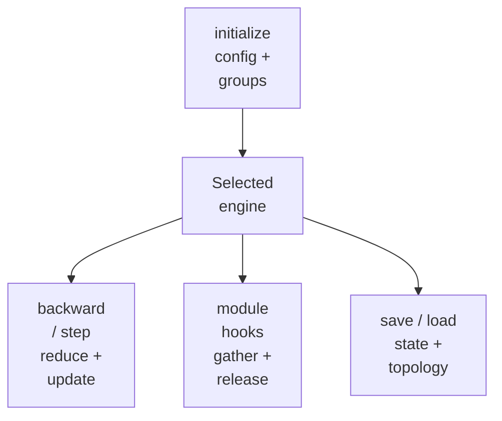

---
{
  "id": "deep-dive-deepspeed",
  "title": "Deep Dive - DeepSpeed",
  "slug": "deep-dive-deepspeed",
  "section": "Project Deep Dives",
  "category": "Fine-Tuning & Training",
  "difficulty": "Hard",
  "order": 8,
  "coverImage": "social_banner.png",
  "companies": [
    "Microsoft",
    "Snowflake",
    "Anyscale",
    "AMD",
    "Google",
    "Intel"
  ],
  "shortDescription": "Weights for a 1.5-billion-parameter model fit in 3 GB, yet the first Adam step needs 24 GB of state. ZeRO partitions that extra state and separates a resumable checkpoint from an export.",
  "keyConceptsTested": [
    "DeepSpeed engine and accumulation boundaries",
    "Dtype-aware ZeRO memory accounting",
    "Reduce-before-update Adam semantics",
    "Gathered working sets and padding",
    "Communication volume versus time",
    "External parameters and dynamic leaf modules",
    "CPU and NVMe offload",
    "Checkpoint resume versus model export",
    "Engine configuration and runtime compatibility"
  ],
  "prerequisites": [
    "deep-dive-nccl",
    "deep-dive-megatron",
    "distributed-training-fsdp-deepspeed-zero",
    "mixed-precision-training-loss-scaling"
  ],
  "relatedQuestions": [
    "deep-dive-pytorch",
    "deep-dive-transformers",
    "lora-parameter-efficient-fine-tuning",
    "training-backpropagation-gradient-descent"
  ]
}
---

A 1.5-billion-parameter model fits its two-byte weights comfortably inside 3 GB of GPU memory, yet the first mixed-precision Adam update demands 24 GB before activations or scratch buffers even enter the picture.[^rajbhandari2020] That 8x gap is the central puzzle of distributed training memory. Where do the extra 21 GB go, and why do standard data-parallel runs duplicate every byte of it on every GPU?

In the [Megatron lesson](/learn/deep-dive-megatron), we split matrix computations across tensor and pipeline axes. <span data-glossary="deepspeed">DeepSpeed</span> attacks the orthogonal bottleneck: **state redundancy**. Its <span data-glossary="zero">Zero Redundancy Optimizer (ZeRO)</span> partitions optimizer states, gradients, and eventually parameters across data-parallel ranks. Each GPU still runs forward and backward passes over its own mini-batch of examples, but no rank stores training state that only another rank needs to update.[^deepspeed2026source][^deepspeedTrainingDocs2026][^deepspeedZeroDocs2026]

## Count state before choosing a stage

Let $P$ be the parameter count owned by a single data-parallel group. When tensor or pipeline parallelism already splits the model, $P$ is the local model partition per rank rather than the full model size.

In standard mixed-precision Adam training, every parameter carries five persistent arrays totaling 16 bytes:[^rajbhandari2020]

| Tensor | Bytes per parameter | Role |
|---|---:|---|
| Low-precision parameter | 2 | Forward and backward compute weights |
| Low-precision gradient | 2 | Gradient awaiting the optimizer step |
| FP32 master parameter | 4 | Full-precision weights for stable updates |
| FP32 first moment | 4 | Adam's running mean of gradients |
| FP32 second moment | 4 | Running mean of squared gradients |
| **Total** | **16** | **Model state only** |

Notice two details that catch engineers off guard. First, Adam's second moment is an uncentered running average of squared gradients, not centered variance. Second, BF16 compute does not dictate gradient-accumulation precision: using an FP32 gradient buffer instead of two-byte gradients raises the recipe from 16 to 18 bytes per parameter. DeepSpeed exposes this explicitly through `data_types.grad_accum_dtype`.[^deepspeedConfigJson2026]

Writing $p$, $g$, and $o$ for bytes per parameter in compute weights, gradients, and optimizer-plus-master state across $N$ data-parallel ranks gives the persistent per-rank storage for each ZeRO stage:

$$
\begin{aligned}
M_{\text{DP}} &= P(p + g + o), \\
M_{\text{Z1}} &= P(p + g + o/N), \\
M_{\text{Z2}} &= P(p + (g + o)/N), \\
M_{\text{Z3}} &= P(p + g + o)/N.
\end{aligned}
$$

With $(p, g, o) = (2, 2, 12)$ and $N = 4$, per-rank state drops from $16P$ bytes in replicated DP to $7P$ in ZeRO-1, $5.5P$ in ZeRO-2, and $4P$ in ZeRO-3. Remember that these equations count balanced persistent state; peak GPU memory also includes activations, temporary communication buckets, padding, persistent small parameters, and allocator fragmentation.[^rajbhandari2020]

<figure>
  
  <figcaption>ZeRO removes replication in stages. Sharding the 12-byte optimizer-plus-master block delivers the largest drop in Stage 1; Stages 2 and 3 then partition gradients and compute weights.</figcaption>
</figure>

Let us compute exact persistent state for our 1.5B-parameter model on four data-parallel ranks in both decimal gigabytes ($10^9$ bytes) and binary gibibytes ($2^{30}$ bytes):

<!-- leetllm: test, id=zero-memory, output=show -->
```python title="zero_memory.py"
import numpy as np


def compute_zero_memory(parameters: int, ranks: int, param_bytes: int = 2, grad_bytes: int = 2, opt_bytes: int = 12) -> dict[str, float]:
    p = float(parameters)
    r = float(ranks)
    dp = p * (param_bytes + grad_bytes + opt_bytes)
    z1 = p * (param_bytes + grad_bytes) + (p / r) * opt_bytes
    z2 = p * param_bytes + (p / r) * (grad_bytes + opt_bytes)
    z3 = (p / r) * (param_bytes + grad_bytes + opt_bytes)
    return {
        "DP": dp,
        "ZeRO-1": z1,
        "ZeRO-2": z2,
        "ZeRO-3": z3,
    }


total_params = 1_500_000_000
data_ranks = 4
memory_map = compute_zero_memory(total_params, data_ranks)

for stage, total_b in memory_map.items():
    gb = total_b / 1e9
    gib = total_b / (1024**3)
    print(f"{stage:6s} {gb:5.2f} GB | {gib:5.2f} GiB")

assert np.isclose(memory_map["DP"], 24.0e9)
assert np.isclose(memory_map["ZeRO-1"], 10.5e9)
assert np.isclose(memory_map["ZeRO-2"], 8.25e9)
assert np.isclose(memory_map["ZeRO-3"], 6.0e9)
```

<!-- leetllm: output:start -->
```text title="Output" output compact
DP     24.00 GB | 22.35 GiB
ZeRO-1 10.50 GB |  9.78 GiB
ZeRO-2  8.25 GB |  7.68 GiB
ZeRO-3  6.00 GB |  5.59 GiB
```
<!-- leetllm: output:end -->

> **Key insight:** Higher ZeRO stages are memory-versus-communication tradeoffs, not quality tiers. Stage 1 alone eliminates 56% of persistent model state on four ranks by sharding the 12-byte optimizer block. If ZeRO-2 fits comfortably, ZeRO-3's extra parameter gathers can slow down training for no gain. Conversely, if long-sequence activations dominate memory, reach for activation checkpointing or smaller microbatches before sharding weights.[^deepspeedZeroDocs2026]

Partitioning bytes across GPUs solves capacity, but Adam's second moment is nonlinear. Each rank cannot simply run Adam on its local gradient and average the results later.

## Reduce first, then update the owned slice

Because Adam squares the gradient when updating its second moment $v_t$, the order of averaging and squaring changes the trajectory. Suppose two ranks compute gradients $1$ and $3$ for the same weight. Averaging first produces gradient $2$, whose square is $2^2 = 4$. Updating each rank locally and averaging afterward produces $(1^2 + 3^2)/2 = 5$. Even worse, if two ranks produce $+2$ and $-2$, their reduced gradient is $0$, whereas squaring locally injects $+4$ into the second moment and shrinks future step sizes on a zero-signal parameter.[^kingma2015]

ZeRO preserves exact Adam mathematics by reversing the replication pattern: every rank participates in reducing the full gradient (via reduce-scatter), so the owning rank receives the globally averaged gradient for its parameter slice and runs Adam once on that slice. Floating-point rounding can differ slightly across reduction orders or low-precision dtypes, but the mathematical update matches unsharded training identically.

To verify this numerically, let us run five Adam steps over eleven parameters partitioned unevenly across four ranks and compare the reconstructed sharded weights against an unsharded reference:

<!-- leetllm: test, id=zero-adam, output=show -->
```python title="owned_adam.py"
import numpy as np


def adam_step(weight, first, second, gradient, step, lr=0.01):
    first = 0.9 * first + 0.1 * gradient
    second = 0.999 * second + 0.001 * (gradient**2)
    corrected_first = first / (1.0 - 0.9**step)
    corrected_second = second / (1.0 - 0.999**step)
    weight = weight - lr * corrected_first / (np.sqrt(corrected_second) + 1e-8)
    return weight, first, second


def compare_owned_updates(parameters: int, ranks: int, steps: int):
    weights = np.arange(parameters, dtype=np.float64) * 0.1
    m = np.zeros(parameters, dtype=np.float64)
    v = np.zeros(parameters, dtype=np.float64)

    owners = [
        range(parameters * r // ranks, parameters * (r + 1) // ranks)
        for r in range(ranks)
    ]
    sharded = [
        {i: (float(weights[i]), float(m[i]), float(v[i])) for i in ids}
        for ids in owners
    ]

    for step in range(1, steps + 1):
        local_grads = np.array(
            [
                [((i + 2 * r + step) % 7 - 3) / 10.0 for i in range(parameters)]
                for r in range(ranks)
            ],
            dtype=np.float64,
        )
        mean_grad = np.mean(local_grads, axis=0)

        # Unsharded reference update
        weights, m, v = adam_step(weights, m, v, mean_grad, step)

        # Sharded ZeRO update: reduce-scatter gradient slice, update local slice
        for rank, owner in enumerate(sharded):
            reduced = {i: float(mean_grad[i]) for i in owner}
            sharded[rank] = {
                i: tuple(
                    float(x)
                    for x in adam_step(
                        state[0], state[1], state[2], reduced[i], step
                    )
                )
                for i, state in owner.items()
            }

        reconstructed_weights = np.array(
            [state[0] for owner in sharded for state in owner.values()]
        )
        np.testing.assert_allclose(weights, reconstructed_weights, rtol=1e-12, atol=1e-12)

    return [(float(weights[i]), float(m[i]), float(v[i])) for i in range(parameters)]


result = compare_owned_updates(11, 4, 5)

# Verify single scalar update step
w, m_val, v_val = adam_step(1.0, 0.0, 0.0, 2.0, 1)
assert np.isclose(w, 1.0 - 0.01 * 2.0 / (2.0 + 1e-8))
assert np.isclose(m_val, 0.2) and np.isclose(v_val, 0.004)
assert (1**2 + 3**2) / 2 != ((1 + 3) / 2) ** 2
print(f"{len(result)} parameters, 4 owners, 5 updates: weights and moments match")
```

<!-- leetllm: output:start -->
```text title="Output" output compact
11 parameters, 4 owners, 5 updates: weights and moments match
```
<!-- leetllm: output:end -->

Notice one subtle assumption in that loop: every rank received equal weight in `mean_grad`. In sequence training with variable padding or masked labels, averaging each rank's local mean is different from averaging across all valid tokens globally. If rank 0 has 1 valid token with gradient $1$ and rank 1 has 3 valid tokens each with gradient $3$, the rank average is $(1 + 3)/2 = 2$, while the true token-weighted average is $(1 + 3 + 3 + 3)/4 = 2.5$. Weight your loss by valid token counts before calling backward whenever ranks carry uneven token counts.

With the per-parameter math settled, the next question is how DeepSpeed coordinates microbatches, accumulation clocks, and gradient reductions inside a training loop.

## Let the engine own the microstep

Calling `deepspeed.initialize(...)` wraps your model, optimizer, optional data loader, and learning-rate scheduler into a `DeepSpeedEngine`. That engine owns the microstep clock: it tracks gradient accumulation, triggers reductions, handles mixed-precision loss scaling, steps the optimizer at accumulation boundaries, and coordinates checkpoint saves.[^deepspeed2026source]

Under DeepSpeed's default managed accumulation mode, call `engine.backward(loss)` and `engine.step()` on **every** microbatch, without manually dividing `loss` by `gradient_accumulation_steps`:[^deepspeedTrainingDocs2026]

```python title="engine_integration_sketch.py"
import deepspeed
import torch

engine, optimizer, _, scheduler = deepspeed.initialize(
    model=model,
    model_parameters=model.parameters(),
    config="ds_config.json",
)
for batch in prepared_batches:
    loss = engine(batch)
    engine.backward(loss)
    engine.step()
```

> **Common mistake:** Porting a standard PyTorch accumulation loop directly into DeepSpeed breaks the update cadence in two ways. Calling `engine.step()` only on every eighth microbatch advances the engine's microstep counter once instead of eight times, delaying updates by 8x. Manually dividing `loss` by `gradient_accumulation_steps` divides an already-scaled gradient a second time.

If your training loop needs dynamic accumulation counts, DeepSpeed also offers `managed_gradient_accumulation: false`. In unmanaged mode, every `engine.step()` executes an optimizer update immediately; pair it with `engine.backward(loss, scale_wrt_gas=False)` and scale losses explicitly. Verify that your installed DeepSpeed version supports combining unmanaged accumulation with optimizer or parameter offload before enabling both.[^deepspeed2026source][^deepspeedTrainingDocs2026]

Here is a four-data-rank ZeRO-2 configuration using BF16 compute weights with explicit FP32 gradient accumulation:

```json title="ds_config.json"
{
  "train_batch_size": 64,
  "train_micro_batch_size_per_gpu": 2,
  "gradient_accumulation_steps": 8,
  "bf16": { "enabled": true },
  "data_types": { "grad_accum_dtype": "fp32" },
  "zero_optimization": {
    "stage": 2,
    "contiguous_gradients": true,
    "overlap_comm": true,
    "reduce_bucket_size": 200000000
  },
  "optimizer": {
    "type": "AdamW",
    "params": {
      "lr": 0.00002,
      "betas": [0.9, 0.999],
      "eps": 1e-8,
      "weight_decay": 0.01
    }
  }
}
```

Two config units trip up distributed launches regularly:

1. **Global batch identity:** `train_batch_size = train_micro_batch_size_per_gpu * gradient_accumulation_steps * DP_degree` ($2 \times 8 \times 4 = 64$). The final factor is the **data-parallel degree**, not total GPU count when tensor or pipeline parallelism is active. Scaling from 4 to 8 data ranks without updating one of these fields causes a configuration mismatch.[^deepspeedConfigJson2026]
2. **Bucket size is elements, not bytes:** `reduce_bucket_size: 200000000` allocates 400 MB for two-byte gradients or 800 MB for FP32 gradients, before other scratch buffers. Larger buckets amortize collective launch overhead at the cost of higher peak memory and later overlap start times.[^deepspeedZeroDocs2026]

Before launching multi-node jobs, run `ds_report` to confirm compiled CUDA/CPU operator compatibility on the target machine.[^deepspeedInstallDocs2026]

Once a ZeRO-2 run still hits GPU memory limits, moving to ZeRO-3 removes parameter replication altogether. That introduces a new memory quantity: the live working set required to materialize layers on the fly.

## Stage 3 needs a live working set

A GPU matrix multiply needs a full weight matrix, not a one-fourth shard. ZeRO-3 keeps parameters partitioned at rest, all-gathers a module's full parameters just before forward compute, and releases the full buffers afterward. Backward typically gathers the module's parameters a second time, computes input and weight gradients, and reduce-scatters the weight gradients back to their owning ranks.[^deepspeedZeroDocs2026]

<figure>
  
  <figcaption>ZeRO-3 gathers full module weights on demand for forward and backward, reduce-scatters gradients to owners, and runs the local Adam update at the accumulation boundary. Parameter persistence can keep small layers resident to skip repeated gathers.</figcaption>
</figure>

When budgeting ZeRO-3 memory, count **coexisting allocations**, not logical parameter values. In DeepSpeed's sequential gather path, each rank retains its local shard in `param.ds_tensor` while allocating a separate padded `torch.empty(...)` buffer to receive the all-gathered layer.[^deepspeed2026source] Subtracting the local shard from the gathered buffer undercounts actual GPU memory.

Consider four layers of 8 parameters each on 4 ranks. At rest, each rank holds $4 \times 2 = 8$ resident shard elements. Gathering layer 0 allocates a separate 8-element full buffer, bringing live parameter storage to $8 + 8 = 16$ elements (not 14). Prefetching layer 1 while layer 0 runs holds two full buffers simultaneously, raising parameter storage to $8 + 16 = 24$ elements before activations, gradients, or NCCL workspaces.

<figure>
  
  <figcaption>Live allocations stack: resident shards coexist with every active and prefetched full-layer gather buffer. Prefetching trades working-set memory for communication overlap.</figcaption>
</figure>

When a tensor's length is not divisible by the data-parallel degree $N$, each shard rounds up to $\lceil \text{size}/N \rceil$ elements, and the gathered buffer holds $N \cdot \lceil \text{size}/N \rceil$ padded elements:

<!-- leetllm: test, id=zero-working-set, output=show -->
```python title="gather_storage.py"
import numpy as np


def parameter_storage(layer_sizes: list[int] | np.ndarray, ranks: int, live_layers: list[int]):
    sizes = np.asarray(layer_sizes, dtype=np.int64)
    if ranks <= 0 or np.any(sizes <= 0):
        raise ValueError("ranks and layer sizes must be positive")

    # Ceiling division for partitioned shards per rank
    partitions = np.ceil(sizes / ranks).astype(np.int64)
    resident = int(np.sum(partitions))

    if len(live_layers) == 0:
        gathered = 0
    else:
        live_idx = np.asarray(live_layers, dtype=np.int64)
        gathered = int(np.sum(partitions[live_idx] * ranks))

    return resident, gathered, resident + gathered


sizes = [8, 8, 8, 8]
for live in ([], [0], [0, 1]):
    resident, gathered, total = parameter_storage(sizes, 4, live)
    print(
        f"{len(live)} gathered: shards {resident} + full buffers {gathered} = {total} elements"
    )

assert parameter_storage([5, 9, 2], 4, [1]) == (6, 12, 18)
assert parameter_storage(sizes, 4, [0])[2] == 16
assert parameter_storage(sizes, 4, [0, 1])[2] == 24
```

<!-- leetllm: output:start -->
```text title="Output" output compact
0 gathered: shards 8 + full buffers 0 = 8 elements
1 gathered: shards 8 + full buffers 8 = 16 elements
2 gathered: shards 8 + full buffers 16 = 24 elements
```
<!-- leetllm: output:end -->

Constructing huge models under `deepspeed.zero.Init()` partitions each parameter as it is created so initialization never materializes the full model on every GPU. Even then, the single largest layer's working set must still fit on one GPU; when one layer exceeds device memory, pair ZeRO-3 with tensor parallelism or operator tiling.[^deepspeedZeroDocs2026]

### External parameters and dynamic routing are different problems

ZeRO-3 inserts pre-forward and post-forward hooks on modules to trigger gathers and releases automatically. Two model patterns break naive module hooks in completely different ways:

- **External parameters** occur when a module reads a weight owned by a different module (such as a tied input/output embedding matrix) after the owning module has already released its full view. Register the consumer with `deepspeed.zero.register_external_parameter()`, or wrap the access in `deepspeed.zero.GatheredParameters(...)`.[^deepspeedZeroDocs2026]
- **Dynamic routing** (such as Mixture-of-Experts) causes different data-parallel ranks to enter different expert submodules on the same step, deadlocking collective all-gathers. Marking the enclosing router/MoE container as a ZeRO leaf (`deepspeed.utils.set_z3_leaf_modules()` or `zero_optimization.leaf_module`) gathers all descendant parameters together before running the container, trading a larger working set for deadlock-free collectives. Neither mechanism registers newly created parameters with an already-initialized optimizer.[^deepspeedTrainingDocs2026]

Every extra gather adds collective traffic. How much extra bandwidth does ZeRO-3 actually move, and when does that volume show up in wall-clock step time?

## Communication volume isn't elapsed time

In a ring collective over $N$ ranks with $P$ equal-width elements, one all-gather or reduce-scatter sends $(N-1)P/N$ elements per rank. Counting per-rank sends consistently yields the classic ZeRO communication comparison:[^rajbhandari2020]

| Schedule | Collectives per update | Sent elements per rank |
|---|---|---:|
| Replicated data parallel | Gradient reduce-scatter + gradient all-gather | $2(N-1)P/N$ |
| ZeRO-2 | Gradient reduce-scatter + updated-parameter all-gather | $2(N-1)P/N$ |
| ZeRO-3 | Forward gather + backward gather + gradient reduce-scatter | $3(N-1)P/N$ |

For large $N$, ZeRO-2 matches standard DDP's $2P$ volume while ZeRO-3 moves roughly $3P$, a $1.5\times$ increase. Yet step time rarely scales linearly with that $1.5\times$ ratio. Mixed dtypes (two-byte weights versus four-byte gradients), activation-checkpointing recomputation gathers, parameter persistence thresholds, bucket sizes, and compute-communication overlap all reshape the timeline.

Gradient accumulation shifts the tradeoff further. By default, ZeRO-2 and ZeRO-3 reduce-scatter gradients on every microbatch backward so each rank discards unowned gradients immediately, saving memory at the expense of repeated communication. DeepSpeed rejects DDP-style `engine.no_sync()` for ZeRO-2 and ZeRO-3. Instead, `engine.coalesce_grad_reduction()` can defer reductions across microbatches by holding a full local gradient buffer until the scope exits, trading extra memory for fewer collectives where supported by the precision wrapper and engine.[^deepspeedTrainingDocs2026]

When a profiler shows slow gathers on NVIDIA GPUs, NCCL executes the collectives while DeepSpeed controls their schedule and bucketization. Inspect per-rank traces alongside communication counters to distinguish an exposed dependency from small-message launch overhead or network congestion.

What happens when even ZeRO-3's sharded state overflows GPU HBM?

## Offload exchanges memory pressure for movement

ZeRO-Offload moves optimizer states and optimizer computation to host CPU RAM and CPU cores; ZeRO-Infinity extends storage to local NVMe drives.[^ren2021][^rajbhandari2021] Optimizer offload works with ZeRO stages 1 through 3, while parameter offload requires stage 3. Even when optimizer state sits on NVMe, the optimizer update itself executes on the CPU.[^deepspeedZeroDocs2026]

```json title="offload_fragment.json"
{
  "zero_optimization": {
    "stage": 3,
    "offload_optimizer": { "device": "cpu", "pin_memory": true },
    "offload_param": {
      "device": "nvme",
      "nvme_path": "/local_nvme/deepspeed"
    }
  }
}
```

A quick bandwidth bound tells you whether offloading will hide behind GPU compute or stall the step. Suppose a step must transfer 12 GB across a PCIe or NVMe link sustaining 6 GB/s. Transfer service time is at least $12 / 6 = 2\text{ s}$. If independent GPU compute takes 3 seconds and overlaps perfectly, the step takes $\max(2, 3) = 3\text{ s}$. If the compute cannot start until transfers finish, the step exposes $2 + 3 = 5\text{ s}$ before accounting for host staging and link contention.

> **Key insight:** Offloading solves capacity, not throughput automatically. Track GPU HBM, host RAM, pinned-memory headroom, CPU optimizer time, and effective tokens per second at fixed batch size and sequence length to see whether the transfer tax is acceptable.

## Trace how the engine uses each config value

DeepSpeed splits initialization, step orchestration, parameter partitioning, offload staging, and pipelining across cooperating runtime components:[^deepspeed2026source]



These branches act concurrently rather than sequentially. When a parameter stays resident unexpectedly, trace the module gather/release hooks; when an optimizer step fires early, inspect the engine's microstep counter.

Engine compatibility follows the selected class: `PipelineEngine` supports ZeRO-0 and ZeRO-1 (rejecting ZeRO-2 and ZeRO-3), whereas AutoTP training supports ZeRO stages 0 through 3 with model-specific partition rules and topology-aware checkpoints.[^deepspeed2026source][^deepspeedTrainingDocs2026] Compared with PyTorch FSDP (which keeps sharding inside native PyTorch modules) and Megatron (which specializes in 3D model-parallel schedules), DeepSpeed centralizes orchestration inside the engine and JSON config.

<!-- leetllm: edition:reference:start -->
When debugging source-level behavior, follow the runtime path rather than guessing from JSON key names:[^deepspeed2026source]

| Entry point | Responsibility |
|---|---|
| `deepspeed/__init__.py` | Initialization and engine selection |
| `deepspeed/runtime/engine.py` | Backward, accumulation boundaries, step, save/load |
| `deepspeed/runtime/zero/stage_1_and_2.py` | Gradient and optimizer shard ownership |
| `deepspeed/runtime/zero/stage3.py` | Sharded optimizer and parameter coordination |
| `deepspeed/runtime/zero/partition_parameters.py` | Partition storage, gathers, and parameter status |
| `deepspeed/runtime/swap_tensor/` | Offload staging and CPU/NVMe movement |
| `deepspeed/runtime/pipe/engine.py` | Pipeline scheduling and stage restrictions |
<!-- leetllm: edition:reference:end -->

## Resume training and export weights separately

A distributed training checkpoint serves two distinct purposes that require different saved state and different verification checks:

| Goal | Required state | How to verify |
|---|---|---|
| Resume training | Weights, optimizer moments, scheduler, step counters, RNG state, data-loader position | Next update matches an uninterrupted run |
| Export for inference | Consolidated model weights plus model and tokenizer config | Forward outputs on fixed inputs match within tolerance |

Every participating rank must call `engine.save_checkpoint(save_dir, tag)` with the **exact same tag**; calling it only on rank 0 hangs collective state collection, while per-rank tags split one checkpoint into incompatible directories. When reloading a ZeRO-3 checkpoint, instantiate a fresh model and engine rather than loading into an already-partitioned live engine.[^deepspeed2026source] Store application-owned state such as data-loader cursors and per-rank RNG seeds inside `client_state`, because restoring the step counter alone will repeat or skip batches.

To export inference weights from supported dense ZeRO checkpoints, `get_fp32_state_dict_from_zero_checkpoint` consolidates shards into FP32 weights on CPU (budget CPU RAM for the full model; lazy conversion defers tensor materialization rather than shrinking final size).[^deepspeedCheckpointDocs2026] For topology changes (such as resuming on a different rank count) or partition-native AutoEP layouts where `zero_to_fp32.py` does not apply, convert through Universal Checkpointing (`ds_to_universal.py`).[^deepspeedUniversalCheckpointing2026]

Why does a weights-only export fail as a training resume? Let us resume our earlier Adam run at step 6 from full checkpoint state versus weights-only state on the exact same next gradient:

<!-- leetllm: test, output=show, continue=zero-adam -->
```python title="weights_are_not_optimizer_state.py"
import json
import numpy as np

checkpoint = json.loads(
    json.dumps({"next_step": 6, "parameter_state": result[0]})
)
state = checkpoint["parameter_state"]
next_gradient = 0.4
reference = adam_step(*result[0], next_gradient, 6)
resumed = adam_step(*state, next_gradient, checkpoint["next_step"])
weights_only = adam_step(
    state[0], 0.0, 0.0, next_gradient, checkpoint["next_step"]
)

assert state[0] == result[0][0]
assert resumed == reference
assert not np.isclose(weights_only[0], reference[0], rtol=1e-12, atol=1e-12)
print(f"full-state next weight={resumed[0]:.8f}")
print(f"weights-only next weight={weights_only[0]:.8f}")
print(f"next-update gap={abs(weights_only[0] - reference[0]):.8f}")
```

<!-- leetllm: output:start -->
```text title="Output" output compact
full-state next weight=0.01977263
weights-only next weight=0.01900607
next-update gap=0.00076656
```
<!-- leetllm: output:end -->

> **Common mistake:** Treating a passing inference parity check as proof of training-resume fidelity. Without Adam's running moments ($m_t, v_t$), the first resumed step resets momentum and denominator scaling, pushing the model onto a different optimization trajectory from the very next batch.

Before committing to a long multi-day run, save a checkpoint on the target topology, tear down all workers, reload into a fresh engine, and confirm that the next loss, parameter update, scheduler state, and data-loader batch match an uninterrupted run.

<!-- leetllm: edition:reference:start -->
## Project context and contribution path

DeepSpeed originated at Microsoft with the ZeRO paper and now operates under Linux Foundation AI & Data with technical oversight by a Technical Steering Committee.[^rajbhandari2020][^deepspeed2026governance] Committers come from across the ecosystem, including Microsoft, Snowflake, Anyscale, AMD, Google, Intel, UIUC, and Argonne National Laboratory.[^deepspeed2026committers] The codebase is Apache-2.0 licensed, documentation is CC BY 4.0, and contributions require Developer Certificate of Origin (DCO) sign-off.[^deepspeed2026license][^deepspeed2026governance]

When investigating or filing a bug report, shrink the failing run to a minimal reproducer and include the installed DeepSpeed and PyTorch versions, resolved config, GPU topology, and the **earliest** rank error (a collective timeout on rank 0 is often a symptom of an earlier crash on another rank).
<!-- leetllm: edition:reference:end -->

## Turn a failed run into a specific hypothesis

### Common failure modes

| Observation | Next investigation |
|---|---|
| Longer sequences OOM despite a small state estimate | Separate saved activations and workspaces from model state |
| OOM during a stage-3 gather | Count simultaneous gathered buffers, padding, and prefetch |
| Loss changes after scaling out | Check effective batch, token weighting, precision, and update count |
| Hang with routed experts | Compare gather order and the configured leaf boundary |
| Lower GPU peak but slower steps after offload | Measure exposed transfers and CPU/storage service time |
| Saved directory exists but resume diverges | Restore optimizer, scheduler, RNG, and data progress in a fresh engine |

<!-- leetllm: edition:reference:start -->
### Evaluation rubric

- Derive each ZeRO stage's persistent storage from tensor ownership and actual dtypes, then account for live working sets and activations separately.
- Trace one parameter and its gradient through gather, compute, reduce-scatter, and the accumulation-boundary Adam update.
- Distinguish a full resumable training checkpoint (optimizer moments, scheduler, RNG, data cursor) from a consolidated weights-only inference export.

### Follow-up questions

```checkpoint
The state estimate fits, but enabling prefetch causes an OOM. Why isn't that a contradiction?
---
The stage formula counts persistent sharded state only. Prefetching keeps multiple full gathered tensors live alongside their resident shards. Add simultaneous gather buffers, activations, and NCCL workspaces before comparing with GPU memory.
```

```checkpoint
Two ranks route to different experts. Should you create parameters lazily and register them as external parameters?
---
No. Dynamic routing requires compatible gather order for existing submodules; marking the enclosing router module as a ZeRO leaf gathers its descendants together at the cost of a larger working set. External-parameter registration coordinates access to an existing parameter outside its owning module and does not register newly created parameters with an initialized optimizer.
```
<!-- leetllm: edition:reference:end -->

```mastery-quiz
[
  {
    "question": "A model configuration has 2 billion parameters, compute weights at 2 bytes each, gradients at 4 bytes each and optimizer-related arrays at 12 bytes per parameter. Across 8 data ranks, what are ideal persistent per-rank totals for ZeRO-2 and ZeRO-3, excluding padding and working sets?",
    "options": [
      "ZeRO-2: 4.5 GB; ZeRO-3: 4.5 GB.",
      "ZeRO-2: 8 GB; ZeRO-3: 8 GB.",
      "ZeRO-2: 8 GB; ZeRO-3: 4.5 GB.",
      "ZeRO-2: 12 GB; ZeRO-3: 6 GB."
    ],
    "answer": "ZeRO-2: 8 GB; ZeRO-3: 4.5 GB.",
    "explanation": "Full compute weights are 4 GB; sharded gradients plus optimizer arrays are (8+24)/8=4 GB. Stage 2 therefore totals 8 GB. Sharding all 36 GB gives stage 3 a 4.5 GB persistent count before gathers or activations."
  },
  {
    "question": "Two equally weighted ranks supply gradients −1 and 5. The old Adam second moment is 0.2 and beta2 is 0.9. What is the next second moment after reducing the gradient first, versus mistakenly averaging the two locally updated second moments?",
    "options": [
      "Correct 0.58; mistaken 1.48.",
      "Correct 1.48; mistaken 0.58.",
      "Correct 0.40; mistaken 1.30.",
      "Correct 0.38; mistaken 0.68."
    ],
    "answer": "Correct 0.58; mistaken 1.48.",
    "explanation": "The reduced gradient is 2. Correct v=0.9×0.2+0.1×2²=0.58. Local squared gradients average to (1+25)/2=13, giving 0.18+1.3=1.48 under the incorrect operation order."
  },
  {
    "question": "A separate-allocation model has tensor lengths [7,10,3] on 3 ranks. Every local shard rounds up to whole elements. Using zero-based tensor indices, first gather tensor 1, then also prefetch tensor 0. What are the two live parameter-storage totals per rank?",
    "options": [
      "17 then 24 elements.",
      "18 then 27 elements.",
      "20 then 27 elements.",
      "20 then 29 elements."
    ],
    "answer": "20 then 29 elements.",
    "explanation": "Resident shards contain ceil(7/3)+ceil(10/3)+ceil(3/3)=3+4+1=8 elements. Tensor 1 allocates a 12-element padded gather buffer, totaling 20. Prefetching tensor 0 adds a separate 9-element buffer, bringing live parameter storage to 29."
  },
  {
    "question": "A simple 24-GPU topology uses tensor degree 4 and no other model-parallel axis. Each data rank uses microbatch 2 and accumulation 3. A separate communication bucket holds 75 million FP32 elements. What are global batch and bucket storage, excluding other buffers?",
    "options": [
      "144 examples; 150 MB.",
      "36 examples; 300 MB.",
      "144 examples; 300 MB.",
      "36 examples; 75 MB."
    ],
    "answer": "36 examples; 300 MB.",
    "explanation": "Data-parallel degree is 24/4=6, so global batch is 2×3×6=36 examples. The element-count bucket needs 75 million×4=300 million bytes, or 300 decimal MB. Tensor workers shard layers within an example rather than supplying extra data examples."
  },
  {
    "question": "Two supported loops each perform five backward calls. M uses default managed accumulation of five but calls engine.step only once afterward, starting at microstep zero. U uses unmanaged accumulation, supplies the intended loss weighting and calls step once afterward. How many optimizer updates do these loop fragments complete?",
    "options": [
      "M 1; U 0.",
      "M 1; U 1.",
      "M 0; U 0.",
      "M 0; U 1."
    ],
    "answer": "M 0; U 1.",
    "explanation": "Managed step advances its microstep clock only once, short of the fifth-call update boundary. Under unmanaged mode, each step completes one optimizer update. Five backward calls alone do not advance the managed step counter."
  },
  {
    "question": "In case A, an embedding module releases its gathered weight before a separate classifier reads that existing weight outside the module. In case B, data ranks choose different existing experts and enter incompatible gathers. Compare external access coordination with a leaf boundary on A’s embedding module or B’s routing module. Which paired repair addresses the stated availability causes?",
    "options": [
      "A: coordinate external access; B: establish a supported enclosing leaf boundary.",
      "A: establish an enclosing leaf boundary; B: coordinate only external access.",
      "A: coordinate external access; B: coordinate only external access.",
      "A: establish an enclosing leaf boundary; B: establish that leaf boundary."
    ],
    "answer": "A: coordinate external access; B: establish a supported enclosing leaf boundary.",
    "explanation": "External access coordination registers the consumer of an existing parameter outside its owning module. A leaf boundary gathers descendants together before dynamic routing executes, avoiding mismatched collective orders across ranks. A leaf on the embedding module alone still releases the weight once that module returns."
  },
  {
    "question": "A simplified ring has 3 ranks and a full communicated vector of 24 million equal-width elements. One collective sends (N−1)P/N elements per rank. A baseline uses two such collectives and a candidate uses three. What follows?",
    "options": [
      "Baseline 48 million, candidate 72 million; candidate step time is exactly 1.5×.",
      "Baseline 32 million, candidate 48 million; candidate step time is exactly 1.5×.",
      "Baseline 32 million, candidate 48 million; step-time ratio needs schedule evidence.",
      "Baseline 16 million, candidate 24 million; step-time ratio needs schedule evidence."
    ],
    "answer": "Baseline 32 million, candidate 48 million; step-time ratio needs schedule evidence.",
    "explanation": "One collective sends (2/3)×24=16 million elements. Two send 32 million and three send 48 million. That 1.5x volume ratio does not fix step time because compute overlap, dependency exposure, bucket size, and interconnect bandwidth all shape elapsed time."
  },
  {
    "question": "An offload configuration must move 18 decimal GB at an achieved 6 GB/s. Independent compute lasts 4 seconds. Ignoring setup and contention, what are completion lower bounds with ideal overlap and with a dependency requiring all transfer before compute?",
    "options": [
      "Overlap 3 s; dependent 4 s.",
      "Overlap 4 s; dependent 7 s.",
      "Overlap 7 s; dependent 7 s.",
      "Overlap 4 s; dependent 4 s."
    ],
    "answer": "Overlap 4 s; dependent 7 s.",
    "explanation": "Transfer service takes 18/6=3 seconds. Ideal overlap takes max(3,4)=4 seconds. A transfer-before-compute dependency exposes 3+4=7 seconds before host staging or link contention."
  },
  {
    "question": "A run processes batches in numerical order and saves after batch 37. On restart, the weights, Adam moments, scheduler, counters and random state match the checkpoint. The loader starts with batch 37. On fixed test inputs, a separate weights-only export has a maximum absolute output error of 0.003 against a tolerance of 0.005. Which checks can the team mark as passed?",
    "options": [
      "Both training continuation and inference export.",
      "Training continuation only.",
      "Inference export only.",
      "Neither training continuation nor inference export."
    ],
    "answer": "Inference export only.",
    "explanation": "The uninterrupted run would read batch 38 next; repeating batch 37 alters the next gradient even with restored Adam moments. Meanwhile, the weights-only export passes inference verification because 0.003 is within the 0.005 tolerance and inference requires no optimizer state."
  },
  {
    "question": "Two ZeRO jobs save checkpoints on shared storage. In job A, every rank calls save after step 62, but their local timestamps give them different tags. In job B, the ranks agree on the tag, but only rank zero calls save. Which changes satisfy the distributed save semantics in both jobs?",
    "options": [
      "A builds each tag from the step number and rank ID. In B, every rank calls save on the shared directory.",
      "A broadcasts the tag step-62 for every rank to use. In B, every rank enters a barrier before rank zero alone calls save.",
      "A broadcasts the tag step-62 for every rank to use. In B, every rank calls save on the shared directory.",
      "A builds each tag from the step number and rank ID. In B, every rank enters a barrier before rank zero alone calls save."
    ],
    "answer": "A broadcasts the tag step-62 for every rank to use. In B, every rank calls save on the shared directory.",
    "explanation": "Every rank must pass one shared checkpoint tag so shards land in a single coherent checkpoint directory. In job B, every shard-owning rank must call save_checkpoint to write its local state; a barrier before a rank-zero-only save still leaves other ranks' shards unsaved."
  }
]
```

> **Next:** Continue to [Deep Dive - Ray](/learn/deep-dive-ray). DeepSpeed partitions tensors inside a single distributed training job; Ray schedules tasks, actors, and multi-stage workflows across an entire cluster.
