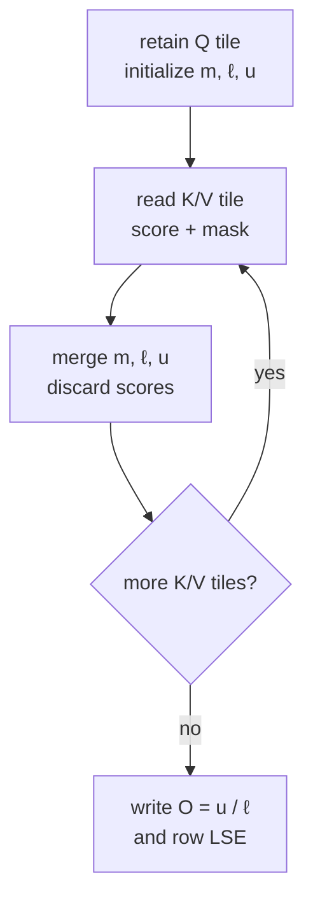

---
{
  "id": "deep-dive-flashattention",
  "slug": "deep-dive-flashattention",
  "title": "Deep Dive - FlashAttention",
  "section": "Project Deep Dives",
  "category": "Inference Optimization",
  "difficulty": "Hard",
  "order": 3,
  "companies": [
    "Dao-AILab",
    "Meta",
    "NVIDIA",
    "PyTorch",
    "Together AI",
    "OpenAI"
  ],
  "shortDescription": "Two new query tokens can attend to the wrong cached keys even when softmax is exact. FlashAttention stays exact only when the tile, mask corner, and installed package match.",
  "keyConceptsTested": [
    "HBM and SRAM IO costs",
    "Exact tiled attention",
    "Online softmax recurrence",
    "Causal 2.1 bottom-right alignment",
    "FA2, FA3 hopper, and FA4 CuTe packages",
    "Paged KV kernel vs cache manager",
    "PyTorch SDPA dispatch and fallback",
    "Backward LSE recomputation"
  ],
  "prerequisites": [
    "scaled-dot-product-attention",
    "flashattention-memory-efficient-attention",
    "inference-mechanics-ttft-tps-kv-cache"
  ],
  "relatedQuestions": [
    "deep-dive-vllm",
    "deep-dive-skyrl",
    "kv-cache-paged-attention-llm-serving",
    "multi-query-grouped-query-attention"
  ],
  "coverImage": "illustrations/_generated/causal_mask_alignment_dark.png"
}
---

A language model can produce the wrong next-token attention output even when its kernel computes softmax with full numerical accuracy. Take two new query <span data-glossary="token">tokens</span> attending over five cached keys: aligning the causal mask to the top-left corner instead of the bottom-right corner silently hides three legal prefix keys, and no shape check will catch it.

The [FlashAttention & Memory Efficiency](/learn/flashattention-memory-efficient-attention) lesson introduced why standard attention stalls on <span data-glossary="gpu">GPU</span> memory traffic. Here we look inside the real **FlashAttention** implementation and its integration surfaces: the online softmax recurrence, the separate FA2/FA3/FA4 packages, bottom-right causal alignment, paged KV lookups, backward recomputation, and PyTorch SDPA dispatch.

Hold the mathematical operator steady throughout: scaled dot-product attention is still $\operatorname{softmax}(QK^{\top}/\sqrt{d})V$. <span data-glossary="flashattention">FlashAttention</span> changes the tiling schedule and the bytes crossing <span data-glossary="hbm">HBM</span> (high-bandwidth memory), never the underlying definition.[^dao2022]

<!-- leetllm: edition:reference:start -->

## Project identity

The FlashAttention papers define the algorithms; the Dao-AILab repository defines the packages, wrappers, and hardware targets you actually import.[^flashattention2026repo]

| Field | Project detail |
| --- | --- |
| Origin | FlashAttention (Tri Dao, Daniel Y. Fu, Stefano Ermon, Atri Rudra, and Christopher Ré)[^dao2022] |
| Stewardship | Dao AI Lab maintains `Dao-AILab/flash-attention`; Tri Dao leads development[^flashattention2026repo][^flashattention2026authors] |
| Source license | BSD-3-Clause for repository source (`LICENSE`); <span data-glossary="cuda">CUDA</span>, ROCm, model weights, and datasets carry separate terms[^flashattentionSourceLicense2026] |

Crucially, FlashAttention-2, FlashAttention-3, and FlashAttention-4 ship as separate install surfaces and import paths rather than one auto-upgrading wheel:[^flashattention2026repo]

| Surface | Install & import | Hardware target |
| --- | --- | --- |
| FlashAttention-2 | `pip install flash-attn --no-build-isolation` → `from flash_attn import flash_attn_func` | Ampere, Ada, Hopper (CUDA 12.0+, PyTorch 2.2+); ROCm Composable Kernel or AIter <span data-glossary="triton-language">Triton</span> |
| FlashAttention-3 | Build `hopper/` → `from flash_attn_3 import flash_attn_interface` | H100 / H800 (CUDA 12.3+, beta) |
| FlashAttention-4 | `pip install flash-attn-4` (or `"flash-attn-4[cu13]"` for CUDA 13) → `from flash_attn.cute import flash_attn_func` | Hopper and Blackwell via CuTe-DSL (Python-embedded DSL) |

Source builds for FA2 require Linux, a matching CUDA/ROCm toolkit, PyTorch, `packaging`, `psutil`, and `ninja`. Always log the exact imported package and function before benchmarking. Also note that FA4 carries operation-specific constraints (such as forward-only FP8 and architecture-specific head dimensions up to 512 on selected value paths) rather than FA2's uniform `head_dim <= 256` limit.[^flashattention2026OctoberSnapshot]

Read the repository in five steps to inspect an integration:[^flashattentionSource2026]

| File | Question to answer |
| --- | --- |
| `README.md` | Documented install paths, toolchains, and supported operations |
| `flash_attn/flash_attn_interface.py` | Public FA2 signature, saved autograd state, and returns |
| `tests/test_flash_attn.py` | Reference comparisons, tolerances, masks, and dtypes |
| `hopper/setup.py` | Separate FA3 Hopper package build and exports |
| `flash_attn/cute/interface.py` | FA4 CuTe-DSL architecture and head-dimension guards |

<!-- leetllm: edition:reference:end -->

## Exact attention without an $n \times n$ workspace

Start with the memory math. At batch size 8, 32 heads, and 8,192 tokens, a single 16-bit attention score tensor takes $8 \times 32 \times 8192^2 \times 2 = 32\ \text{GiB}$ for one layer's intermediate alone. A naïve implementation writes $S = QK^{\top}/\sqrt{d}$ to HBM, reads it back for softmax, writes probabilities $P$ to HBM, and reads $P$ back to multiply by $V$. Every round trip pays HBM latency and bandwidth.

On-chip <span data-glossary="sram">SRAM</span> is orders of magnitude faster than HBM, though much smaller. FlashAttention restructures the loop around SRAM tiles: keeping a query tile $Q_i$ resident on chip, it streams key/value tiles $(K_j, V_j)$ from HBM, computes $S_{ij} = Q_i K_j^{\top}/\sqrt{d}$ in SRAM, updates a running row-wise softmax state, and discards $S_{ij}$ immediately. Total dot-product arithmetic stays $O(n^2 d)$, while live score memory drops from $O(n^2)$ to a single tile.[^dao2023] In the original FA1 IO analysis, HBM transfers drop from $\Omega(nd + n^2)$ to $O(n^2 d^2 / M)$ scalar accesses for SRAM capacity $M$ ($d \le M \le nd$).[^dao2022]

| Intermediate | Per-head shape | Materializing baseline | FlashAttention |
| --- | --- | --- | --- |
| $Q, K, V$ | $n \times d$ each | Read from HBM | Streamed in SRAM tiles |
| Scores $S$ | $n \times n$ | Written & reread in HBM | One SRAM tile, then discarded |
| Probabilities $P$ | $n \times n$ | Written & reread in HBM | Never materialized globally |
| Output $O$ | $n \times d$ | Written to HBM | Written once after the K/V loop |
| Softmax state | $n$ per scalar | Full-row pass | Running $(m_i, \ell_i, u_i)$; saves only row LSE |

For each query row $i$, the kernel tracks three compact quantities: the running maximum score $m_i$, the shifted exponential denominator $\ell_i$, and the unnormalized value accumulator $u_i$. At the end of the K/V loop, it divides once to write $O_i = u_i / \ell_i$ and saves the FP32 <span data-glossary="log-sum-exp">log-sum-exp</span> summary $\operatorname{LSE}_i = m_i + \log \ell_i$ for backward. At our `8 × 32 × 8192` shape, saving FP32 LSE takes just `8 MiB` instead of `32 GiB`.



## Online softmax is what makes the tiles exact

Ordinary softmax appears to require every key score before forming the denominator. What happens when tile 2 contains a score larger than tile 1's maximum? Throwing away tile 1 loses history; adding tile 2 directly mixes exponentials with different shifts. <span data-glossary="online-softmax">Online softmax</span> solves this by rescaling the old running denominator and numerator whenever the maximum rises:[^milakov2018]

$$
m_{\text{new}} = \max(m_{\text{old}}, \max(s))
$$

$$
\ell_{\text{new}} = e^{m_{\text{old}} - m_{\text{new}}}\,\ell_{\text{old}} + \sum_k e^{s_k - m_{\text{new}}}
$$

$$
u_{\text{new}} = e^{m_{\text{old}} - m_{\text{new}}}\,u_{\text{old}} + \sum_k e^{s_k - m_{\text{new}}}\,V_{j,k}
$$

Initialize $m = -\infty$, $\ell = 0$, and $u = 0$. Skip any completely masked tile before exponentiating (avoiding $-\infty - (-\infty)$), and return zero if an entire row has no legal keys. In real arithmetic, this recurrence reproduces dense softmax identically regardless of tile size; in floating point, outputs agree within normal accumulation tolerance.

### Two tiles by hand

Trace one query row over four keys split into two tiles (omitting $1/\sqrt{d}$ for clarity). Tile 1 has scores `[1, 2]` and values `[[10, 0], [0, 10]]`; tile 2 has scores `[3, 0]` and values `[[5, 5], [9, 1]]`.

- **Tile 1:** $m_1 = 2$, $\ell_1 = e^{-1} + 1 = 1.3679$, and $u_1 = e^{-1}[10, 0] + [0, 10] = [3.6788, 10]$. Keep $u_1$ unnormalized.
- **Tile 2:** The new maximum jumps to $m_2 = 3$, so we rescale the prior state by $e^{2 - 3} = e^{-1} \approx 0.3679$:

$$
\ell_2 = 0.3679 \times 1.3679 + (1 + e^{-3}) = 1.5530
$$

$$
u_2 = 0.3679\,[3.6788, 10] + [5, 5] + e^{-3}\,[9, 1] = [6.8014, 8.7286]
$$

- **Final division:** $O_2 = u_2 / \ell_2 = [4.380, 5.620]$, matching full four-element softmax without ever keeping all four scores simultaneously.

<figure>
  
  <figcaption>Rescale the old $\ell$ and $u$, not $m$ or the normalized output. Update $m$ by taking a maximum, then divide the merged numerator by its normalizer once.</figcaption>
</figure>

Verify that the recurrence matches dense softmax across tile sizes, score shifts, and fully masked rows:

<!-- leetllm: test, output=show -->
```python title="two-tile-online-softmax.py"
import numpy as np

scores = np.array([1.0, 2.0, 3.0, 0.0], dtype=np.float64)
values = np.array(
    [[10.0, 0.0], [0.0, 10.0], [5.0, 5.0], [9.0, 1.0]], dtype=np.float64
)


def full(scores: np.ndarray, values: np.ndarray) -> np.ndarray:
    m = np.max(scores)
    if np.isneginf(m):
        return np.zeros(values.shape[1], dtype=np.float64)
    weights = np.exp(scores - m)
    return np.sum(weights[:, None] * values, axis=0) / np.sum(weights)


def tiled(
    scores: np.ndarray, values: np.ndarray, tile_size: int
) -> np.ndarray:
    dim = values.shape[1]
    m = -np.inf
    total = 0.0
    numerator = np.zeros(dim, dtype=np.float64)

    for start in range(0, len(scores), tile_size):
        tile_scores = scores[start : start + tile_size]
        tile_values = values[start : start + tile_size]
        if np.all(np.isneginf(tile_scores)):
            continue
        new_m = max(m, float(np.max(tile_scores)))
        old_scale = 0.0 if np.isneginf(m) else np.exp(m - new_m)
        tile_weights = np.exp(tile_scores - new_m)
        total = old_scale * total + float(np.sum(tile_weights))
        numerator = old_scale * numerator + np.sum(
            tile_weights[:, None] * tile_values, axis=0
        )
        m = new_m

    return numerator / total if total > 0 else np.zeros(dim, dtype=np.float64)


dense = full(scores, values)
split = tiled(scores, values, 2)
print("dense:", [round(float(x), 6) for x in dense])
print("tiled:", [round(float(x), 6) for x in split])
assert np.allclose(dense, split, rtol=1e-12, atol=1e-12)
for size in [1, 2, 3, 4, 10]:
    for shift in [-1000.0, 0.0, 1000.0]:
        res = tiled(scores + shift, values, size)
        assert np.allclose(dense, res, rtol=1e-12, atol=1e-12)
assert np.allclose(tiled(np.full(4, -np.inf), values, 2), np.zeros(2))
assert np.allclose(
    tiled(np.array([-np.inf, -np.inf, 0.0, -np.inf]), values, 2), values[2]
)
```

<!-- leetllm: output:start -->
```text title="Output" output compact
dense: [4.379542, 5.620458]
tiled: [4.379542, 5.620458]
```
<!-- leetllm: output:end -->

## The public interface is several kernels

Integrating FlashAttention requires matching three interface conventions that differ across libraries and generations:

1. **Axis order:** FA2's `flash_attn_func` expects `(batch, sequence, heads, head_dim)`, whereas PyTorch SDPA expects `(batch, heads, sequence, head_dim)`. Swapping sequence and head axes can silently execute whenever dimensions are compatible.[^flashattentionSource2026][^pytorchSdpaDocs2026]
2. **Return tuple:** Public FA2 `flash_attn_func` returns `out` alone (saving FP32 LSE and RNG state internally for autograd), while `return_attn_probs=True` returns `(out, lse, S_dmask)` for debugging and allocates a quadratic probability buffer that ruins memory benchmarks. By contrast, FA4's `flash_attn.cute.flash_attn_func` returns `(out, lse)` directly (with `lse` optionally `None`).[^flashattentionSource2026][^flashattention2026OctoberSnapshot]
3. **ROCm and precision guards:** On AMD ROCm, Composable Kernel is the default backend while `FLASH_ATTENTION_TRITON_AMD_ENABLE=TRUE` selects AIter Triton (`AITER_USE_SYSTEM_TRITON=1` and `FLASH_ATTENTION_USE_SYSTEM_AITER=TRUE` prevent bundled package overrides). On CUDA, FA2 targets <span data-glossary="fp16">FP16</span> and <span data-glossary="bf16">BF16</span> with head dimensions up to 256.[^flashattention2026repo]

For <span data-glossary="multi-query-attention">multi-query attention (MQA)</span> and <span data-glossary="grouped-query-attention">grouped-query attention (GQA)</span>, FA2 assigns consecutive blocks of query heads to each KV head: 6 query heads sharing 2 KV heads map as `[0, 0, 0, 1, 1, 1]`, never interleaved `[0, 1, 0, 1, 0, 1]`:[^flashattentionSource2026]

<!-- leetllm: test, output=show -->
```python title="gqa-head-mapping.py"
import numpy as np


def kv_head_for_queries(
    query_heads: int, key_heads: int, value_heads: int
) -> list[int]:
    if query_heads <= 0 or key_heads <= 0 or value_heads <= 0:
        raise ValueError("head counts must be positive integers")
    if key_heads != value_heads or query_heads % key_heads != 0:
        raise ValueError("K/V heads must match and divide Q heads")
    group_size = query_heads // key_heads
    q_indices = np.arange(query_heads, dtype=np.int64)
    return (q_indices // group_size).tolist()


print("GQA:", kv_head_for_queries(6, 2, 2))
print("MQA:", kv_head_for_queries(6, 1, 1))
assert kv_head_for_queries(3, 3, 3) == [0, 1, 2]
for invalid in [(0, 1, 1), (5, 2, 2), (6, 2, 1)]:
    try:
        kv_head_for_queries(*invalid)
    except ValueError:
        pass
    else:
        raise AssertionError(f"accepted invalid head counts: {invalid}")
```

<!-- leetllm: output:start -->
```text title="Output" output compact
GQA: [0, 0, 0, 1, 1, 1]
MQA: [0, 0, 0, 0, 0, 0]
```
<!-- leetllm: output:end -->

## Causal 2.1 is the decode gotcha

When query length equals key length, a causal mask is a simple lower triangle. During incremental decode or chunked prefill, `seqlen_q` is smaller than `seqlen_k`, and the new queries sit at the *end* of the cached sequence.

Starting in **FlashAttention 2.1**, `causal=True` aligns the causal diagonal to the **bottom-right** corner (`k <= q + seqlen_k - seqlen_q`) instead of the top-left corner (`k <= q`) used in FA 2.0.[^flashattention2026repo] For `seqlen_q = 2` and `seqlen_k = 5`, the two queries occupy positions 3 and 4: bottom-right alignment lets `q0` attend to keys `0..3` and `q1` attend to `0..4`, whereas top-left alignment blinds `q0` to keys `1..3`.

<figure>
  
  <figcaption>Here the two queries occupy positions 3 and 4 of the five-key sequence. FA 2.0's top-left <span data-glossary="causal-mask">causal mask</span> lets q0 see only key 0. FA 2.1's bottom-right mask lets q0 see keys 0 through 3 and q1 see the full prefix. A 1 marks an allowed key; a 0 is masked before softmax.</figcaption>
</figure>

When `seqlen_q > seqlen_k` under bottom-right alignment, the earliest query rows precede all available keys and receive all-zero output vectors.

<!-- leetllm: test, output=show -->
```python title="causal-align.py"
import numpy as np


def causal_keep(seqlen_q: int, seqlen_k: int, align: str) -> list[list[int]]:
    if seqlen_q <= 0 or seqlen_k <= 0:
        raise ValueError("sequence lengths must be positive integers")
    if align not in {"top-left", "bottom-right"}:
        raise ValueError("unknown causal alignment")

    q_idx = np.arange(seqlen_q)[:, None]
    k_idx = np.arange(seqlen_k)[None, :]

    if align == "top-left":
        mask = k_idx <= q_idx
    else:
        mask = k_idx <= (q_idx + seqlen_k - seqlen_q)

    return mask.astype(int).tolist()


print("FA 2.0 q=2,k=5:", causal_keep(2, 5, "top-left"))
print("FA 2.1 q=2,k=5:", causal_keep(2, 5, "bottom-right"))
print("FA 2.1 q=5,k=2:", causal_keep(5, 2, "bottom-right"))
assert causal_keep(2, 5, "top-left") == [[1, 0, 0, 0, 0], [1, 1, 0, 0, 0]]
assert causal_keep(2, 5, "bottom-right") == [[1, 1, 1, 1, 0], [1, 1, 1, 1, 1]]
assert causal_keep(5, 2, "bottom-right") == [
    [0, 0],
    [0, 0],
    [0, 0],
    [1, 0],
    [1, 1],
]
```

<!-- leetllm: output:start -->
```text title="Output" output compact
FA 2.0 q=2,k=5: [[1, 0, 0, 0, 0], [1, 1, 0, 0, 0]]
FA 2.1 q=2,k=5: [[1, 1, 1, 1, 0], [1, 1, 1, 1, 1]]
FA 2.1 q=5,k=2: [[0, 0], [0, 0], [0, 0], [1, 0], [1, 1]]
```
<!-- leetllm: output:end -->

> **Common mistake:** Comparing an FA 2.1+ non-square decode call against <span data-glossary="pytorch">PyTorch</span> `scaled_dot_product_attention(..., is_causal=True)`. PyTorch SDPA documents **upper-left** causal bias for non-square inputs, so pass an explicit lower-right boolean mask to SDPA when building a decode reference.[^pytorchSdpaDocs2026]

Sliding-window local attention follows the same bottom-right anchor: finite `window_size=(left, right)` keeps keys from $i + S - L - \text{left}$ through $i + S - L + \text{right}$ inclusive (clipped to $[0, S)$), with `-1` meaning unlimited on that side.[^flashattentionSource2026]

## Paged KV is a lookup, not a cache manager

Variable-length training batches pack sequences end to end through `flash_attn_varlen_func`, using `int32` cumulative-length arrays (`cu_seqlens_q`, `cu_seqlens_k`) of length `batch + 1` starting at `0`. Any offset error leaks attention across neighboring sequences.[^flashattentionSource2026]

Inference decode adds page indirection via `flash_attn_with_kvcache`, which reads fixed-size physical pages through a block table (requiring a page block size divisible by 256 in FA2), optionally updates the cache in place, and supports rotary <span data-glossary="embedding">embeddings</span> (forward only). Avoid duplicate `cache_batch_idx` entries during in-place writes so concurrent updates never race.[^flashattentionSource2026]

> **Key insight:** In FA4's TMA-based paged kernel, loading the partially filled final page can fetch padding rows past `seqused_k`. Masking their attention score to $-\infty$ gives zero probability, yet `0.0 * NaN` still produces `NaN` in floating point. Keep padding rows inside partially filled pages finite; completely unused pool pages are never read and need no cleanup.[^flashattention2026OctoberSnapshot]

FlashAttention executes the attention math and indirect page lookup; allocation, eviction, prefix sharing, and batch scheduling belong to the serving engine ([vLLM](/learn/deep-dive-vllm), [SGLang](/learn/deep-dive-sglang), and [FlashInfer](/learn/deep-dive-flashinfer)).

| Mode | What changes | Key integration check |
| --- | --- | --- |
| Causal | Masks future keys | Bottom-right alignment when `seqlen_q != seqlen_k` |
| Local window | Restricts attention to `(left, right)` | Quality impact and tile occupancy |
| Varlen | Packs uneven sequences | Monotonic `int32` `cu_seqlens` and exact `max_seqlen` |
| Paged KV | Indirect block-table reads | Finite tail padding on TMA loads; external page allocator |
| MQA / GQA | Shares KV heads across Q groups | Consecutive head grouping matches weights |

## Backward recomputes tiles on purpose

If forward discards the $n \times n$ probability matrix $P$, how does training compute $dQ$, $dK$, and $dV$? FlashAttention saves only $Q, K, V, O$, row-wise $\operatorname{LSE}$, and dropout RNG state, then recomputes score and probability tiles on the fly during backward via $P_{ij} = \exp(S_{ij} - \operatorname{LSE}_i)$ (reproducing the exact forward dropout mask from saved RNG state).[^dao2022][^dao2023]

For $S = QK^{\top}/\sqrt{d}$, $P = \operatorname{softmax}(S)$, and upstream gradient $G = \partial \mathcal{L}/\partial O$:

$$
\begin{aligned}
dV &= P^{\top}G, \qquad dP = G V^{\top}, \\
dS &= P \odot \bigl(dP - \operatorname{rowsum}(P \odot dP)\bigr), \\
dQ &= \frac{dS\, K}{\sqrt{d}}, \qquad dK = \frac{dS^{\top} Q}{\sqrt{d}}.
\end{aligned}
$$

Because $O = PV$, the scalar row term $\operatorname{rowsum}(P \odot dP)$ equals $\operatorname{rowsum}(G \odot O)$, which can be precomputed directly from the saved output $O$ without keeping $P$ in HBM. Recomputing $S$ and $P$ spends extra FLOPs to avoid $O(n^2)$ activation memory, letting long-context training fit in GPU memory and often run faster overall.

FA2 exposes a `deterministic` flag for backward (at extra memory and runtime cost), and FA2 tests check outputs and gradients against reference tolerances rather than bitwise equality.[^flashattention2026repo][^flashattentionSource2026] Verify the forward and backward equations against PyTorch SDPA's math backend across square and non-square bottom-right causal masks, including all-masked rows:

<!-- leetllm: test, output=show, deps=torch==2.13.0 -->
```python title="attention-forward-backward-reference.py"
import math
import torch
import torch.nn.functional as F
from torch.nn.attention import SDPBackend, sdpa_kernel

torch.manual_seed(7)
for query_len, key_len in [(2, 5), (5, 2), (4, 4)]:
    q = torch.randn(1, 2, query_len, 3, dtype=torch.float64, requires_grad=True)
    k = torch.randn(1, 2, key_len, 3, dtype=torch.float64, requires_grad=True)
    v = torch.randn(1, 2, key_len, 4, dtype=torch.float64, requires_grad=True)
    keep = (torch.arange(key_len)[None, :] <=
            torch.arange(query_len)[:, None] + key_len - query_len)
    with sdpa_kernel(SDPBackend.MATH):
        out = F.scaled_dot_product_attention(
            q, k, v, attn_mask=keep, is_causal=False, dropout_p=0.0)
    upstream = torch.randn_like(out)
    actual_grads = torch.autograd.grad(out, (q, k, v), upstream)

    with torch.no_grad():
        scores = (q @ k.transpose(-2, -1) / math.sqrt(3)).masked_fill(~keep, -torch.inf)
        has_key = keep.any(dim=-1, keepdim=True)
        # Avoid softmax(-inf, -inf, ...) on fully masked rows.
        safe_scores = torch.where(has_key, scores, torch.zeros_like(scores))
        p = torch.softmax(safe_scores, dim=-1).masked_fill(~keep, 0.0)
        expected = p @ v
        dp = upstream @ v.transpose(-2, -1)
        ds = p * (dp - (p * dp).sum(dim=-1, keepdim=True))
        expected_grads = (
            ds @ k / math.sqrt(3),
            ds.transpose(-2, -1) @ q / math.sqrt(3),
            p.transpose(-2, -1) @ upstream,
        )
        torch.testing.assert_close(out, expected, atol=1e-12, rtol=1e-12)
        for actual, reference in zip(actual_grads, expected_grads):
            torch.testing.assert_close(actual, reference, atol=1e-12, rtol=1e-12)
        assert torch.all(ds.masked_select(~keep) == 0)
        assert torch.all(out[..., ~keep.any(dim=-1), :] == 0)
    print(f"Q={query_len}, K={key_len}: output and Q/K/V gradients match")
```

<!-- leetllm: output:start -->
```text title="Output" output compact
Q=2, K=5: output and Q/K/V gradients match
Q=5, K=2: output and Q/K/V gradients match
Q=4, K=4: output and Q/K/V gradients match
```
<!-- leetllm: output:end -->

## FA1 through FA4 retune the same IO idea

Across four GPU generations, the core tiled online-softmax algorithm stayed unchanged while the microarchitecture bottleneck shifted:

| Generation | Primary source | Hardware focus | Core architectural change |
| --- | --- | --- | --- |
| FA1 | FlashAttention, NeurIPS 2022[^dao2022] | A100-era CUDA | IO-aware SRAM tiling and online softmax eliminate $n \times n$ HBM intermediates |
| FA2 | FlashAttention-2, ICLR 2024[^dao2023] | Ampere CUDA | Parallelizes query tiles across blocks; trims non-matmul work and warp sync |
| FA3 | FlashAttention-3, 2024[^shah2024] | Hopper H100/H800 | Warp specialization, asynchronous TMA copies overlapping warpgroup MMAs, <span data-glossary="fp8">FP8</span> forward |
| FA4 | FlashAttention-4, 2026[^zadouri2026] | Blackwell & Hopper | CuTe-DSL pipelines redesigned for asymmetric scaling where tensor cores outrun shared memory and exponential units |

From Hopper to Blackwell, tensor-core throughput roughly doubled while shared-memory bandwidth and special-function exponential units grew much more slowly. FA4 responds with software-emulated exponentials, conditional softmax rescaling, TMEM accumulators, and two-CTA backward MMAs written in Python-embedded CuTe-DSL, reporting up to 1,613 TFLOP/s peak forward BF16 throughput (1.3× over cuDNN 9.13 and 2.7× over Triton at head dim 128 on Blackwell, with newer cuDNN releases closing the gap).[^zadouri2026]

## Call SDPA unless you need a repo feature

PyTorch's `F.scaled_dot_product_attention` dispatches automatically across FlashAttention, memory-efficient attention, and the math backend based on input shape, dtype, and GPU.[^pytorchSdpaDocs2026] Prefer SDPA when portability matters, and import `flash-attn` directly when you need a newer generation (FA3/FA4), paged KV updates, or custom mask options not yet exposed in SDPA.

Keep two SDPA details sharp:
- Forcing `SDPBackend.FLASH_ATTENTION` raises a runtime error if any input constraint is violated instead of silently falling back to math.
- Pass `dropout_p=0.0` explicitly during evaluation; SDPA applies `dropout_p` regardless of `model.eval()`.

### A mask can be valid and mean the opposite

SDPA's boolean `attn_mask` uses `True` to **keep** a key, whereas `nn.MultiheadAttention`'s `key_padding_mask` uses `True` to **mask out** padding.[^pytorchSdpaDocs2026] Passing a padding mask directly to SDPA runs cleanly with no shape error and attends exclusively to the padded positions:

<!-- leetllm: test, output=show, deps=torch==2.13.0 -->
```python title="padding-mask-to-sdpa.py"
import torch
import torch.nn.functional as F
from torch.nn.attention import SDPBackend, sdpa_kernel

q = torch.zeros(1, 1, 1, 1, dtype=torch.float64)
k = torch.zeros(1, 1, 2, 1, dtype=torch.float64)
v = torch.tensor([[[[10.0], [1000.0]]]], dtype=torch.float64)
padding = torch.tensor([[False, True]])  # MHA convention: True excludes a key.
with sdpa_kernel(SDPBackend.MATH):
    wrong = F.scaled_dot_product_attention(
        q, k, v, attn_mask=padding[:, None, None, :], dropout_p=0.0)
    correct = F.scaled_dot_product_attention(
        q, k, v, attn_mask=(~padding)[:, None, None, :], dropout_p=0.0)
print("reused padding mask:", wrong.item())
print("SDPA keep mask:", correct.item())
assert wrong.item() == 1000.0
assert correct.item() == 10.0
```

<!-- leetllm: output:start -->
```text title="Output" output compact
reused padding mask: 1000.0
SDPA keep mask: 10.0
```
<!-- leetllm: output:end -->

Frameworks including PyTorch, <span data-glossary="transformer">Transformers</span>, <span data-glossary="deepspeed">DeepSpeed</span>, and <span data-glossary="nvidia-megatron">Megatron-LM</span> rely on FlashAttention both to expand training context length and to speed up prefill, while remembering that decode performance still depends heavily on KV-cache layout and request scheduling.[^flashattention2026repo]

<!-- leetllm: edition:reference:start -->

## Benchmark the path you will ship

Benchmark the exact shape matrix production sends: long prefill, single-token decode over long caches, unequal Q/K lengths, GQA/MQA ratios, causal and local masks, and varlen packing. Warm each implementation, discard compile and allocation runs, and synchronize with CUDA events (never an unsynchronized CPU timer, which measures launch submission rather than GPU execution). Report median, p95, and peak memory alongside reference error tolerances.

Test mixed-shape warmup in the same process too. A compilation cache keyed only by GQA ratio collides when two shapes share the same ratio but differ in KV head count (for example, 128 Q / 2 KV vs. 64 Q / 1 KV, both ratio 64). Including KV head count in the cache key prevents cross-shape corruption; verify both `A → B` and `B → A` orders in fresh processes.[^flashattention2026MlaCacheKey] When latency surprises you, inspect launches and gaps with Nsight Systems and memory/compute ceilings with Nsight Compute.[^nsightSystems2026][^nsightCompute2026]

## Production checklist

Before rolling out a FlashAttention backend, record and verify:

- **Shape:** batch, `seqlen_q`, `seqlen_k`, Q/KV head counts, and `head_dim`.
- **Numerics:** FP16/<span data-glossary="bf16">BF16</span> inputs, FP32 accumulation, softmax scale, `dropout_p`, and max error vs. FP32/math reference.
- **Mask & layout:** bottom-right causal corner, local window, `cu_seqlens`, page-table offsets, and finite tail padding.
- **Runtime:** GPU SKU, CUDA/ROCm version, driver, PyTorch version, and exact imported `flash_attn` package.
- **Fallback budget:** confirm that an unsupported shape fails cleanly or fits memory before falling back to a quadratic math backend that could trigger OOM.

> **Common mistake:** Equating "no quadratic HBM allocation" with "constant-time attention." FlashAttention still evaluates $O(n^2 d)$ dot products, and long-context decode remains memory-bandwidth-bound on KV reads.

<!-- leetllm: edition:reference:end -->

## Architectural summary

- FlashAttention computes exact scaled dot-product attention while shrinking live score memory from $O(n^2)$ in HBM to one SRAM tile.
- Online softmax rescales prior $\ell$ and $u$ by $e^{m_{\text{old}} - m_{\text{new}}}$ whenever a new tile raises $m$, dividing once at the end.
- FA2 (`flash-attn`), FA3 (`hopper/`), and FA4 (`flash-attn-4` CuTe-DSL) are distinct packages with separate return signatures and hardware targets.
- FA 2.1+ aligns `causal=True` to the bottom-right corner for incremental decode, whereas PyTorch SDPA `is_causal=True` uses upper-left alignment on non-square inputs.
- Paged KV performs indirect block-table lookups while leaving allocation, eviction, and finite tail padding to the serving stack.
- Backward saves only output $O$ and row-wise $\operatorname{LSE}$, recomputing score tiles on chip to avoid $O(n^2)$ activation memory.

<!-- leetllm: edition:reference:start -->

### What a kernel integration review should defend

- Derive the two-tile online softmax update, including rescaling and all-masked zero rows.
- Identify the exact imported package, axis order (FA2 vs. SDPA), return tuple, bottom-right causal alignment, and consecutive GQA head mapping.
- Pair GPU benchmarks with reference tolerances, mixed-shape cache-key tests, and a memory-safe fallback plan.

### Review questions

#### Why can a one-token decode test miss the causal-alignment bug?

When `seqlen_q == seqlen_k == 1`, top-left and bottom-right masks are identical. Test `seqlen_q = 1` over multiple cached keys (where bottom-right keeps all keys and top-left keeps only key 0) plus `seqlen_q > seqlen_k` to exercise all-masked rows.

#### Can a faster FA4 paper result justify replacing FA2 in a service?

Only after matching the return signature (`(out, lse)` vs. `out`), device support, head dimensions, masks, and tolerances, and benchmarking end-to-end latency (including compile warmup) against the existing serving baseline.

<!-- leetllm: edition:reference:end -->

### Mask, state, and package checks

```mastery-quiz
[
  {
    "question": "A workload has batch 4, 16 heads and 4,096 query and key positions. One score uses two bytes; one saved row LSE uses four bytes. Which pair gives one full score tensor and all row LSE values?",
    "options": [
      "Score tensor 2 GiB; row LSE 1 MiB.",
      "Score tensor 2 GiB; row LSE 2 MiB.",
      "Score tensor 1 GiB; row LSE 1 MiB.",
      "Score tensor 1 GiB; row LSE 2 MiB."
    ],
    "answer": "Score tensor 2 GiB; row LSE 1 MiB.",
    "explanation": "The full score tensor takes 4 × 16 × 4096² × 2 bytes = 2 GiB. Row LSE drops one sequence dimension: 4 × 16 × 4096 × 4 bytes = 1 MiB."
  },
  {
    "question": "A valid scalar row summary has maximum 4, normalizer 3 and numerator 12. One new key has score 6 and value 5. What output follows after merging and final division?",
    "options": [
      "About 4.250.",
      "About 5.000.",
      "About 4.711.",
      "About 12.091."
    ],
    "answer": "About 4.711.",
    "explanation": "Raise the maximum to 6 and rescale both old quantities by exp(-2): (12 × exp(-2) + 5) / (3 × exp(-2) + 1) ≈ 4.711."
  },
  {
    "question": "Three query rows occupy the final three positions of seven keys. Their scores are equal and the key values are [3,6,9,12,15,18,21]. Under bottom-right causality, which allowed counts and first-row output are correct?",
    "options": [
      "Counts [1,2,3]; first output 3.",
      "Counts [5,6,7]; first output 9.",
      "Counts [5,6,7]; first output 15.",
      "Counts [7,7,7]; first output 12."
    ],
    "answer": "Counts [5,6,7]; first output 9.",
    "explanation": "With offset 7 - 3 = 4, query row 0 sits at position 4 and sees keys 0..4, averaging [3, 6, 9, 12, 15] to 9; rows 1 and 2 see 6 and 7 keys."
  },
  {
    "question": "Eight query heads share two key/value heads under the consecutive-group mapping rule. Each allowed key in KV head 0 has value 10 and each in KV head 1 has value 100. What do query heads 3 and 4 return?",
    "options": [
      "Head 3 returns 100; head 4 returns 10.",
      "Head 3 returns 10; head 4 returns 10.",
      "Head 3 returns 100; head 4 returns 100.",
      "Head 3 returns 10; head 4 returns 100."
    ],
    "answer": "Head 3 returns 10; head 4 returns 100.",
    "explanation": "Group size is 8 / 2 = 4: query heads 0..3 map to KV head 0 (value 10) and query heads 4..7 map to KV head 1 (value 100)."
  },
  {
    "question": "A request uses 300 keys in 256-row pages, filling page 1 first. Two kernels read pages 1 and 2 in full and give padding rows zero probability. The direct kernel multiplies every loaded value (V) by its probability using the value as stored. The other kernel first sets padded V to zero in its local tile. Page 2 has a NaN in V at zero-based row 44. An unread page 3 also has a NaN in V. Which NaNs must the caller replace with finite values for each kernel?",
    "options": [
      "Replace the page 2 NaN for the direct kernel only.",
      "Replace the page 2 NaN for both kernels.",
      "Replace both NaNs for the direct kernel only.",
      "Leave both NaNs in place for both kernels."
    ],
    "answer": "Replace the page 2 NaN for the direct kernel only.",
    "explanation": "Page 2 holds 300 - 256 = 44 real keys (rows 0..43), so row 44 is loaded padding. In the direct kernel, 0 × NaN yields NaN, so page 2 row 44 must be finite. The second kernel zeros padded V in its tile, and neither kernel reads page 3."
  },
  {
    "question": "A softmax row has probabilities [0.4, 0.6] and no dropout. The loss gradients with respect to those probabilities are [7, 2]. What is the gradient with respect to the two input scores?",
    "options": [
      "[+3.00, -2.00]",
      "[+1.25, -1.25]",
      "[+1.20, -1.20]",
      "[+1.00, -1.50]"
    ],
    "answer": "[+1.20, -1.20]",
    "explanation": "Compute the weighted mean 0.4×7 + 0.6×2 = 4, subtract it from [7, 2] to get [3, -2], and multiply elementwise by [0.4, 0.6] to obtain [+1.20, -1.20]."
  },
  {
    "question": "A padding mask is [false,false,true], the corresponding values are [7,10,1000], and all three scores are zero. What outputs come from passing that mask directly to boolean SDPA and then passing its logical inverse?",
    "options": [
      "Direct output 8.5; inverted output 1000.",
      "Direct output 1000; inverted output 8.5.",
      "Direct output 339; inverted output 8.5.",
      "Direct output 1000; inverted output 339."
    ],
    "answer": "Direct output 1000; inverted output 8.5.",
    "explanation": "SDPA treats True as keep, so passing [false, false, true] directly selects only the padded value 1000. Inverting to [true, true, false] averages the real values (7 + 10) / 2 = 8.5."
  },
  {
    "question": "A kernel cache uses the ratio of query heads to KV heads as its key. Shape A has 24 query heads and 3 KV heads. Shape B has 16 and 2. Each passes alone, but B fails after A in the same process. Each process starts with an empty cache and keeps its entries across calls. Which key fixes the collision, and which test checks both warmup orders against a reference?",
    "options": [
      "Key by the query-to-KV ratio. Run A then B in one process and B then A in another.",
      "Key by ratio and KV head count. Run A then B and reverse the order in the same process.",
      "Key by the query-to-KV ratio. Run A then B and reverse the order in the same process.",
      "Key by ratio and KV head count. Run A then B in one process and B then A in another."
    ],
    "answer": "Key by ratio and KV head count. Run A then B in one process and B then A in another.",
    "explanation": "Both shapes share ratio 8, so adding KV head count gives distinct keys (8, 3) and (8, 2). Testing A then B in one fresh process and B then A in another lets each shape warm the cache first."
  },
  {
    "question": "A warmed GPU trace submits a kernel from 0 to 1 ms. Device execution starts at 1 ms and completes at 31 ms. Which pair describes the host submission interval and completed device duration?",
    "options": [
      "Submission 1 ms; device duration 31 ms.",
      "Submission 30 ms; device duration 1 ms.",
      "Submission 1 ms; device duration 30 ms.",
      "Submission 31 ms; device duration 30 ms."
    ],
    "answer": "Submission 1 ms; device duration 30 ms.",
    "explanation": "Host submission spans 0 to 1 ms (1 ms), and GPU execution runs from 1 ms to 31 ms (30 ms). Timing without CUDA synchronization measures only submission."
  },
  {
    "question": "A bottom-right causal call has six query rows, three key rows, equal scores and values [6,12,24]. There are three batch items and four heads; a fallback materializes every score as FP32 within a remaining 512-byte score-buffer allowance. Which output per head and buffer calculation are correct?",
    "options": [
      "Output [6,9,14,14,14,14]; buffer 864 B exceeds 512 B.",
      "Output [0,0,0,6,9,14]; buffer 864 B exceeds 512 B.",
      "Output [6,9,14,14,14,14]; buffer 432 B fits 512 B.",
      "Output [0,0,0,6,9,14]; buffer 432 B fits 512 B."
    ],
    "answer": "Output [0,0,0,6,9,14]; buffer 864 B exceeds 512 B.",
    "explanation": "Under bottom-right alignment (k <= q + 3 - 6), rows 0..2 see no keys and output 0; rows 3..5 average 1, 2, and 3 values to 6, 9, and 14. The materialized FP32 score tensor needs 3 × 4 × 6 × 3 × 4 = 864 bytes, exceeding the 512-byte allowance."
  }
]
```

> **Next:** Continue to [Deep Dive - FlashInfer](/learn/deep-dive-flashinfer). FlashAttention's public kernel still describes attention as tiles over Q, K, and V. FlashInfer is the next layer: ragged batches, paged KV, and serving-shaped kernel plans where those tiles stop being rectangular.
