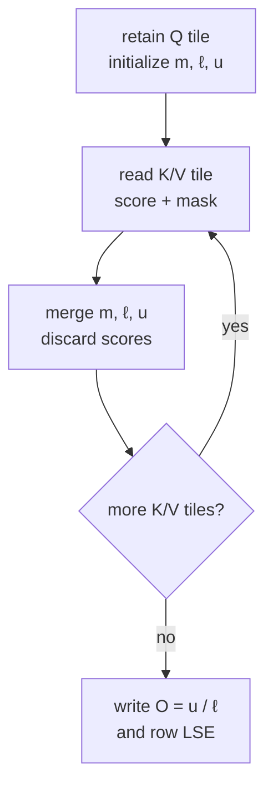

---
{
  "id": "deep-dive-flashattention",
  "slug": "deep-dive-flashattention",
  "title": "Deep Dive - FlashAttention",
  "section": "Project Deep Dives",
  "category": "Inference Optimization",
  "difficulty": "Hard",
  "order": 3,
  "companies": [
    "Dao-AILab",
    "Meta",
    "NVIDIA",
    "PyTorch",
    "Together AI",
    "OpenAI"
  ],
  "shortDescription": "Two new query tokens can attend to the wrong cached keys even when softmax is exact. FlashAttention stays exact only when the tile, mask corner, and installed package match.",
  "keyConceptsTested": [
    "HBM and SRAM IO costs",
    "Exact tiled attention",
    "Online softmax recurrence",
    "Causal 2.1 bottom-right alignment",
    "FA2, FA3 hopper, and FA4 CuTe packages",
    "Paged KV kernel vs cache manager",
    "PyTorch SDPA dispatch and fallback",
    "Backward LSE recomputation"
  ],
  "prerequisites": [
    "scaled-dot-product-attention",
    "flashattention-memory-efficient-attention",
    "inference-mechanics-ttft-tps-kv-cache"
  ],
  "relatedQuestions": [
    "deep-dive-vllm",
    "deep-dive-skyrl",
    "kv-cache-paged-attention-llm-serving",
    "multi-query-grouped-query-attention"
  ],
  "coverImage": "illustrations/_generated/causal_mask_alignment_dark.png"
}
---

A large language model (LLM) can produce the wrong next-token attention result even when its kernel computes softmax perfectly. Two new query <span data-glossary="token">tokens</span> attending to five cached keys expose one such bug: aligning a causal mask to the wrong corner hides valid keys. The tiled kernel inside FlashAttention follows the caller convention that chooses that corner.

The [FlashAttention & Memory Efficiency](/learn/flashattention-memory-efficient-attention) lesson explained why attention can wait on <span data-glossary="gpu">GPU</span> memory traffic. The two-token mask is a different failure. The math can be exact and the installed package can still hide legal keys. A compatible mask, layout, and return interface must accompany the kernel.

Hold the equation steady before changing the implementation. Scaled dot-product attention is still <span data-glossary="softmax">softmax</span> of scaled $QK^T$ times $V$. <span data-glossary="flashattention">FlashAttention</span> changes the schedule and the bytes that cross <span data-glossary="hbm">HBM</span> (high-bandwidth memory), not the definition.[^dao2022]

```checkpoint
What stays mathematically unchanged when FlashAttention is used?
---
The operator is still softmax of scaled $QK^T$ multiplied by $V$. FlashAttention changes scheduling and memory movement, not the attention definition.
```

## Project identity

The papers name the algorithms; the Dao-AILab repository tells you what a process can actually import, test, and run. Kernels, wrappers, tests, and install paths don't all ship as one wheel.[^flashattention2026repo]

| Field | Current project fact |
| --- | --- |
| Origin | The Stanford-centered FlashAttention paper names Tri Dao, Daniel Y. Fu, Stefano Ermon, Atri Rudra, and Christopher Ré.[^dao2022] |
| Stewardship | Dao AI Lab maintains the public repository. Its author file names Tri Dao.[^flashattention2026repo][^flashattention2026authors] |
| Contributor model | Maintainer-led GitHub issues and pull requests. Framework teams add dispatch downstream. |
| Source license | BSD-3-Clause at the walkthrough's pinned source commit.[^flashattentionSourceLicense2026] Check the distributed package and bundled components separately. |
| Commercial boundary | FlashAttention is a kernel implementation, not a hosted model service. A product that embeds it keeps its own support terms. |
| Asset boundary | The repository doesn't license model weights or datasets. <span data-glossary="cuda">CUDA</span> and ROCm dependencies keep their own notices. |

Three install surfaces matter more than the paper titles. These documentation requirements were rechecked September 23, 2026; no GPU installation is claimed:[^flashattention2026repo]

| Surface | How you get it | Hardware target |
| --- | --- | --- |
| FlashAttention-2 | `pip install flash-attn --no-build-isolation`, then `from flash_attn import flash_attn_func` | CUDA path: Ampere, Ada, or Hopper, CUDA 12.0+, PyTorch 2.2+; separate ROCm Composable Kernel or AIter <span data-glossary="triton-language">Triton</span> paths |
| FlashAttention-3 | Install the `hopper/` package, then `from flash_attn_3 import flash_attn_interface` | H100 / H800, CUDA 12.3+, still documented as beta |
| FlashAttention-4 | `pip install flash-attn-4`, then `from flash_attn.cute import flash_attn_func` | Hopper and Blackwell, written in CuTe-DSL (NVIDIA's Python-embedded domain-specific language) |

For CUDA 13, the current README recommends `pip install "flash-attn-4[cu13]"`. The FA2 build instructions assume Linux and an installed CUDA/ROCm toolkit, plus PyTorch, `packaging`, `psutil`, and working `ninja`. A compatible GPU driver alone isn't the source-build toolchain; Windows support remains qualified.[^flashattention2026repo]

A paper name in a citation doesn't tell you which code a wheel will import. FA3 is a separate Hopper path, FA4 is a separate CuTe-DSL package, and FA2 remains the default `flash-attn` import.[^flashattention2026repo] Before benchmarking, print the package and function that actually loaded; otherwise a result can wear the wrong generation's label.

The source walkthrough stays pinned to commit `ce088ab9ce0fc0434dcd8afa0a791da9fcc3a820`. Its selected interfaces, architecture guards, save-state and tolerance assertions were rechecked September 23, 2026. A wheel release does not need to match that commit. Read these files in order:[^flashattentionSource2026]

| File | Question to answer |
| --- | --- |
| `README.md` | Which package, toolchain, GPU, and operation are documented? |
| `flash_attn/flash_attn_interface.py` | What does the public FA2 wrapper accept, save for backward, and return? |
| `tests/test_flash_attn.py` | Which shapes, masks, dtypes, and reference errors are tested? |
| `hopper/setup.py` | Why is FA3 a separate install and import? |
| `flash_attn/cute/interface.py` | Which FA4 architecture and head-dimension guards apply to this operation? |

The table's hardware targets summarize the README, not an exhaustive runtime selector. In particular, the pinned FA4 source has architecture-specific guards beyond the README's Hopper/Blackwell summary, including selected value dimensions of 512. Don't copy a universal `head_dim <= 256` gate from FA2 into a FA4 caller.

The October 10, 2026 check uses commit `94e22c906678e5483fa0e9e24d8e787bc2c0ed4c` for current FA4 behavior while preserving the older walkthrough. Its public call still returns `(out, lse)`. Its source also records constraints that depend on the operation, such as forward-only FP8 and the paged-load boundary below. Test your training and cache configuration against those constraints.[^flashattention2026OctoberSnapshot]

## Exact attention without an $n \times n$ workspace

For batch size 8, 32 heads, and 8,192 tokens, one 16-bit score tensor occupies $8\times32\times8192^2\times2=32$ GiB. That's one intermediate, not the whole model. A materializing baseline can write scores, reread them for softmax, write probabilities, and reread them for the value multiply. Each round trip crosses HBM, the large GPU memory pool. On-chip <span data-glossary="sram">static random-access memory (SRAM)</span> is much smaller, so a tile that stays there can be revisited cheaply.

A query-owned forward loop, as used in FA2's work partitioning, keeps a query tile $Q_i$ while walking key/value tiles $(K_j, V_j)$. For each pair, it computes $S_{ij}=Q_i K_j^T / \sqrt{d}$ on chip, updates a row-wise softmax state, then discards $S_{ij}$. The dot products are still dense, so arithmetic remains $O(n^2 d)$ FLOPs. The live score workspace drops from $n \times n$ to one tile.[^dao2023]

The original FA1 analysis gives $O(n^2 d^2 / M)$ HBM accesses for $d\le M\le nd$, with $M$ measured in scalar elements, versus $\Omega(nd+n^2)$ for its materializing baseline. Under this memory model, the IO bound counts HBM accesses in scalar elements; applying it to bytes or predicting runtime for later kernels requires additional assumptions.[^dao2022]

| Intermediate | Shape for one head | Baseline lifetime | FlashAttention lifetime |
| --- | --- | --- | --- |
| Query, key, value | $n \times d$ each | Read from HBM as needed | Streamed into SRAM tiles |
| Scores | $n \times n$ | Written and reread in HBM | One tile, then discarded |
| Probabilities | $n \times n$ | Often written and reread | Never materialized globally |
| Output | $n \times d$ | Written to HBM | Written after the tile loop |
| Row max and normalizer | $n$ each | Used by softmax | Live tile state; save their LSE summary for backward |

After one tile, each query row retains $m_i$ (largest score so far), $\ell_i$ (sum of shifted exponentials), and a vector $u_i$ (the unnormalized, value-weighted numerator). Only at the end do we divide: $O_i=u_i/\ell_i$. For a nonempty row, $\operatorname{LSE}_i=m_i+\log\ell_i$ is the <span data-glossary="log-sum-exp">log-sum-exp</span> summary. At the example's shape, FP32 LSE needs $8\times32\times8192\times4=8$ MiB, not 32 GiB.

The dependency is easier to see as a loop:



The “yes” edge advances to a new key/value tile. The query tile and softmax state stay live. This conceptual forward loop omits parallel split reductions and hardware-specific pipelines.

```checkpoint
Why can a fused attention kernel still be compute-heavy at long context?
---
It avoids storing the full score matrix, but it still evaluates the allowed query-key pairs. IO savings remove a large memory cost; they don't make the quadratic dot-product work disappear.
```

## Online softmax is what makes the tiles exact

Ordinary softmax looks like it needs every score before it can form a denominator. Suppose tile two has a larger row maximum than tile one. Throwing away tile one's state would lose its contribution, but keeping it on the old scale would misweight it. <span data-glossary="online-softmax">Online softmax</span> merges partial summaries. Let the retained state be $(m_{\text{old}},\ell_{\text{old}},u_{\text{old}})$ and the new tile's row scores be $s$. Then:

$$
m_{\text{new}}=\max(m_{\text{old}},\max(s))
$$

$$
\ell_{\text{new}}=e^{m_{\text{old}}-m_{\text{new}}}\ell_{\text{old}}+\sum_k e^{s_k-m_{\text{new}}}
$$

$$
u_{\text{new}}=e^{m_{\text{old}}-m_{\text{new}}}u_{\text{old}}+\sum_k e^{s_k-m_{\text{new}}}V_{j,k}
$$

When a later tile contains a larger score, the old accumulator is rescaled instead of thrown away. Milakov and Gimelshein describe this streaming normalizer, which FlashAttention uses inside its tiled kernel.[^milakov2018]

Initialize $m=-\infty$, $\ell=0$, and $u=0$. Skip a tile with no allowed key before evaluating exponentials: $-\infty-(-\infty)$ isn't a usable shift. If the entire row is masked, return zero by the kernel's documented convention; ordinary softmax on an all-$-\infty$ row is undefined. Exactness here means the same operator in real arithmetic, not bitwise equality after floating-point reordering.

### Two tiles by hand

Use one query row and four keys split into two tiles. Tile one has scores $[1, 2]$ and values $[[10, 0], [0, 10]]$. Tile two has scores $[3, 0]$ and values $[[5, 5], [9, 1]]$. The common $1/\sqrt{d}$ scale is omitted so the state update stays readable. When tile two introduces a new maximum of $3$, the running normalizer and numerator accumulators built from tile one must be rescaled by $\exp(m^{(1)} - m^{(2)}) = \exp(-1)$ before accumulating the new tile's contributions.

For tile one, $m_1=2$ and $\ell_1=e^{-1}+1=1.3679$. The numerator is $u_1=e^{-1}[10,0]+[0,10]=[3.6788,10]$. Keep that numerator, rather than dividing it after every tile.

Tile two contains a larger score, so $m_2=3$. Old state is rescaled by $e^{2-3}=0.3679$:

$$
\ell_2=0.3679\times 1.3679+(1+e^{-3})=1.5530
$$

$$
0.3679[3.6788,10]+[5,5]+e^{-3}[9,1]=[6.8014,8.7286]
$$

The final result is $O_2=u_2/\ell_2=[4.380,5.620]$, rounded to three decimals. Ordinary softmax over all four scores matches. The tile boundary changed storage, not the answer: no $1\times4$ score row had to survive between tiles.

<figure>
  
  <figcaption>Rescale the old $\ell$ and $u$, not $m$ or the normalized output. Update $m$ by taking a maximum, then divide the merged numerator by its normalizer once.</figcaption>
</figure>

```checkpoint
What error would appear if a later tile had a larger maximum but the old numerator wasn't rescaled?
---
The old contributions would be compared in the wrong exponential scale. Their relative probability would be too large, so the result wouldn't equal dense softmax. Rescaling by $e^{m_{\text{old}}-m_{\text{new}}}$ is the invariant that makes tile order exact.
```

This NumPy reference accepts finite values and scores that are finite or `-inf` (masked). Moving tile boundaries or adding a large constant to every score preserves the mathematical result. It verifies the recurrence across tiles.

<!-- leetllm: test, output=show -->
```python title="two-tile-online-softmax.py"
import numpy as np

scores = np.array([1.0, 2.0, 3.0, 0.0], dtype=np.float64)
values = np.array(
    [[10.0, 0.0], [0.0, 10.0], [5.0, 5.0], [9.0, 1.0]], dtype=np.float64
)


def full(scores: np.ndarray, values: np.ndarray) -> np.ndarray:
    m = np.max(scores)
    if np.isneginf(m):
        return np.zeros(values.shape[1], dtype=np.float64)
    weights = np.exp(scores - m)
    return np.sum(weights[:, None] * values, axis=0) / np.sum(weights)


def tiled(
    scores: np.ndarray, values: np.ndarray, tile_size: int
) -> np.ndarray:
    dim = values.shape[1]
    m = -np.inf
    total = 0.0
    numerator = np.zeros(dim, dtype=np.float64)

    for start in range(0, len(scores), tile_size):
        tile_scores = scores[start : start + tile_size]
        tile_values = values[start : start + tile_size]
        if np.all(np.isneginf(tile_scores)):
            continue
        new_m = max(m, float(np.max(tile_scores)))
        old_scale = 0.0 if np.isneginf(m) else np.exp(m - new_m)
        tile_weights = np.exp(tile_scores - new_m)
        total = old_scale * total + float(np.sum(tile_weights))
        numerator = old_scale * numerator + np.sum(
            tile_weights[:, None] * tile_values, axis=0
        )
        m = new_m

    return numerator / total if total > 0 else np.zeros(dim, dtype=np.float64)


dense = full(scores, values)
split = tiled(scores, values, 2)
print("dense:", [round(float(x), 6) for x in dense])
print("tiled:", [round(float(x), 6) for x in split])
assert np.allclose(dense, split, rtol=1e-12, atol=1e-12)
for size in [1, 2, 3, 4, 10]:
    for shift in [-1000.0, 0.0, 1000.0]:
        res = tiled(scores + shift, values, size)
        assert np.allclose(dense, res, rtol=1e-12, atol=1e-12)
assert np.allclose(tiled(np.full(4, -np.inf), values, 2), np.zeros(2))
assert np.allclose(
    tiled(np.array([-np.inf, -np.inf, 0.0, -np.inf]), values, 2), values[2]
)
```

<!-- leetllm: output:start -->
```text title="Output" output compact
dense: [4.379542, 5.620458]
tiled: [4.379542, 5.620458]
```
<!-- leetllm: output:end -->

## The public interface is several kernels

The FA2 `flash_attn_func` accepts <span data-glossary="tensor">tensors</span> shaped `(batch, sequence, heads, head_dim)` for $Q$, and the same layout for $K$ and $V$ except sequence length and head count may differ from $Q$. PyTorch SDPA puts heads before sequence: `(batch, heads, sequence, head_dim)`. A layout mismatch can run without a shape error when those dimensions happen to fit.[^flashattentionSource2026][^pytorchSdpaDocs2026]

Separate public and private returns. The public FA2 function normally returns only the output tensor. Its private CUDA forward helper returns output, FP32 row LSE shaped `(batch, heads, seqlen_q)`, a probability/<span data-glossary="dropout">dropout</span> buffer, and random-number-generator (RNG) state for autograd. Public `return_attn_probs=True` instead returns a three-tuple `(out, lse, S_dmask)` for testing. The source warns that this debug probability buffer may have incorrect scaling; requesting it can also allocate a quadratic-size buffer. Don't enable it in a memory benchmark.[^flashattentionSource2026]

Even identical function names don't imply identical returns: the pinned FA4 `flash_attn.cute.flash_attn_func` returns `(out, lse)`, with `lse` potentially `None` when it isn't needed or requested. Check the installed signature and source before substituting it for FA2's tensor-returning call.

ROCm has two backends. Composable Kernel is the default, while `FLASH_ATTENTION_TRITON_AMD_ENABLE=TRUE` selects the AIter Triton path. When the HIP extension import fails, the pinned wrapper tries the AIter path and emits a warning. Fallback succeeds only with compatible AIter dependencies and hardware, so verify it in the target environment.[^flashattentionSource2026]

Current ROCm installation instructions add an environment hazard: bundled AIter installation can replace Triton. `AITER_USE_SYSTEM_TRITON=1` retains the environment's Triton; `FLASH_ATTENTION_USE_SYSTEM_AITER=TRUE` selects an already-installed AIter. These control different dependencies. Record the chosen versions and verify compatibility before treating either setting as a fix.[^flashattention2026repo]

FA2 CUDA documents <span data-glossary="fp16">16-bit floating point (FP16)</span> or <span data-glossary="bf16">brain floating point (BF16)</span> and head dimensions up to 256 on its supported GPUs. Consumer-GPU backward at dimension 256 without dropout is documented from flash-attn 2.5.5. These qualifications apply to the stated FA2 releases and supported GPUs; check the documentation for the generation you use.[^flashattention2026repo]

<span data-glossary="multi-query-attention">Multi-query attention (MQA)</span> uses one K/V head; <span data-glossary="grouped-query-attention">grouped-query attention (GQA)</span> uses several, but fewer than Q. FA2 maps consecutive groups of Q heads onto K/V heads. Six Q heads and two K/V heads map as `0,0,0,1,1,1`, not alternating `0,1,0,1,0,1`. This CPU check validates that caller-side specification. It doesn't predict which GPU kernel will run.[^flashattentionSource2026]

<!-- leetllm: test, output=show -->
```python title="gqa-head-mapping.py"
import numpy as np


def kv_head_for_queries(
    query_heads: int, key_heads: int, value_heads: int
) -> list[int]:
    if query_heads <= 0 or key_heads <= 0 or value_heads <= 0:
        raise ValueError("head counts must be positive integers")
    if key_heads != value_heads or query_heads % key_heads != 0:
        raise ValueError("K/V heads must match and divide Q heads")
    group_size = query_heads // key_heads
    q_indices = np.arange(query_heads, dtype=np.int64)
    return (q_indices // group_size).tolist()


print("GQA:", kv_head_for_queries(6, 2, 2))
print("MQA:", kv_head_for_queries(6, 1, 1))
assert kv_head_for_queries(3, 3, 3) == [0, 1, 2]
for invalid in [(0, 1, 1), (5, 2, 2), (6, 2, 1)]:
    try:
        kv_head_for_queries(*invalid)
    except ValueError:
        pass
    else:
        raise AssertionError(f"accepted invalid head counts: {invalid}")
```

<!-- leetllm: output:start -->
```text title="Output" output compact
GQA: [0, 0, 0, 1, 1, 1]
MQA: [0, 0, 0, 0, 0, 0]
```
<!-- leetllm: output:end -->

The equivalent reference repeats each K/V head consecutively. That checks kernel semantics for fixed Q/K/V. Whether a model trained with fewer K/V heads preserves task quality is a separate architectural evaluation. Head mapping can still be right while the decode result is wrong. The mask corner decides which cached keys the first new query is allowed to see.

## Causal 2.1 is the decode gotcha

The corner is the bug. Autoregressive decoders can't read future tokens. A causal tile treats those scores as $-\infty$ before softmax. Before FlashAttention 2.1, `causal=True` aligned the triangle to the top-left. From 2.1 onward, it aligns to the bottom-right. This matches incremental decode when the query rows correspond to the final positions of the key sequence. It isn't the right alignment for every arbitrary short-query layout.[^flashattention2026repo]

For `seqlen_q = 2` and `seqlen_k = 5`, ask whether the first query sees one old key or four. Keep-cells look like this (`1` means the key participates):

<figure>
  
  <figcaption>Here the two queries occupy positions 3 and 4 of the five-key sequence. FA 2.0's top-left <span data-glossary="causal-mask">causal mask</span> lets q0 see only key 0. FA 2.1's bottom-right mask lets q0 see keys 0 through 3 and q1 see the full prefix. A 1 marks an allowed key; a 0 is masked before softmax.</figcaption>
</figure>

If every cell in a query row is masked, the documented output for that row is zero. That shows up when `seqlen_q > seqlen_k` under bottom-right alignment: the first rows have no legal keys.

Equal query and key lengths hide the distinction: top-left and bottom-right masks are the same lower triangle. A short query over a long cache exposes it. <span data-glossary="pytorch">PyTorch</span>'s `scaled_dot_product_attention(..., is_causal=True)` uses a lower-triangular mask on square inputs and documents an upper-left causal bias for non-square inputs. Matching FlashAttention 2.1 from SDPA means passing an explicit lower-right causal bias, not assuming `is_causal=True` did that for you.[^pytorchSdpaDocs2026]

When `seqlen_q > seqlen_k` under bottom-right alignment, the earliest query rows precede all available keys and have no legal keys to attend to, resulting in all-zero mask rows. The helper demonstrates both corners across input configurations.

<!-- leetllm: test, output=show -->
```python title="causal-align.py"
import numpy as np


def causal_keep(seqlen_q: int, seqlen_k: int, align: str) -> list[list[int]]:
    if seqlen_q <= 0 or seqlen_k <= 0:
        raise ValueError("sequence lengths must be positive integers")
    if align not in {"top-left", "bottom-right"}:
        raise ValueError("unknown causal alignment")

    q_idx = np.arange(seqlen_q)[:, None]
    k_idx = np.arange(seqlen_k)[None, :]

    if align == "top-left":
        mask = k_idx <= q_idx
    else:
        mask = k_idx <= (q_idx + seqlen_k - seqlen_q)

    return mask.astype(int).tolist()


print("FA 2.0 q=2,k=5:", causal_keep(2, 5, "top-left"))
print("FA 2.1 q=2,k=5:", causal_keep(2, 5, "bottom-right"))
print("FA 2.1 q=5,k=2:", causal_keep(5, 2, "bottom-right"))
assert causal_keep(2, 5, "top-left") == [[1, 0, 0, 0, 0], [1, 1, 0, 0, 0]]
assert causal_keep(2, 5, "bottom-right") == [[1, 1, 1, 1, 0], [1, 1, 1, 1, 1]]
assert causal_keep(5, 2, "bottom-right") == [
    [0, 0],
    [0, 0],
    [0, 0],
    [1, 0],
    [1, 1],
]
```

<!-- leetllm: output:start -->
```text title="Output" output compact
FA 2.0 q=2,k=5: [[1, 0, 0, 0, 0], [1, 1, 0, 0, 0]]
FA 2.1 q=2,k=5: [[1, 1, 1, 1, 0], [1, 1, 1, 1, 1]]
FA 2.1 q=5,k=2: [[0, 0], [0, 0], [0, 0], [1, 0], [1, 1]]
```
<!-- leetllm: output:end -->

> **⚠️ Common mistake:** Comparing a FlashAttention 2.1 decode call against an SDPA `is_causal=True` reference on unequal query and key lengths, then treating the mismatch as a kernel bug. Check the causal corner before you check numerics.

Local attention is related, but not identical. In FA2, finite `window_size=(left, right)` keeps key indices from $i+S-L-\text{left}$ through $i+S-L+\text{right}$, inclusive, clipped to valid keys, where $L$ and $S$ are query and key lengths. A side set to `-1` means unbounded attention on that side. Causal masking can further restrict that set. A smaller window changes the operator and may affect model quality. Tile shape and memory access determine latency, so fewer allowed scores can still run slower.[^flashattentionSource2026] The mask says which keys inside one sequence are legal. A packed batch still has to say where one example ends and the next begins, or attention leaks across examples.

## Paged KV is a lookup, not a cache manager

Training batches can pack unequal lengths through `flash_attn_varlen_func`. Its `int32` cumulative-length arrays (`cu_seqlens_q`, `cu_seqlens_k`) start at zero, are nondecreasing, and end at the corresponding packed token count. They have `batch + 1` entries. An incorrect offset can leak attention across examples even if every dot product is right; maximum lengths must also agree with the sequences.[^flashattentionSource2026]

Decode has a different boundary. Serving engines store K/V in fixed-size physical pages and map each request through a block table. FA2's `flash_attn_with_kvcache` accepts that table and documents a page block size divisible by 256. This requirement belongs to that API; other paged-cache implementations can set different block sizes. The call can update the cache in place and apply rotary <span data-glossary="embedding">embeddings</span>; it doesn't support backward. The caller must reserve space before updates. Repeated `cache_batch_idx` entries during writes can produce ambiguous competing updates, so don't use them as a cache-sharing protocol.[^flashattentionSource2026]

Current FA4 documents a subtler payload constraint when its paged path loads whole key tiles through the Tensor Memory Accelerator (TMA). The final, partially used page can load rows beyond `seqused_k`. Masking their scores doesn't make NaN values safe: a zero probability multiplied by a NaN value is still NaN. Keep those loaded padding rows finite. Entire pages that the sequence doesn't use may contain anything, including NaNs. This finite-value requirement applies to rows loaded from the partially used final page; unused pages in the serving pool need no such cleanup.[^flashattention2026OctoberSnapshot]

FlashAttention handles the attention math and page lookup. A serving engine still owns allocation, eviction, prefix sharing, and request scheduling. Don't treat the kernel's paged path as a complete <span data-glossary="kv-cache">KV-cache</span> manager. [vLLM](/learn/deep-dive-vllm) made that seam explicit, and [FlashInfer](/learn/deep-dive-flashinfer) widens it for serving-shaped work.

| Mode | What changes | Main production question |
| --- | --- | --- |
| Causal | Mask future keys | Is the mask bottom-right for unequal $Q$ and $K$ lengths? |
| Local | Keep a bounded window | Does the window preserve quality and tile occupancy? |
| Varlen | Pack unequal sequences | Are cumulative lengths and max lengths correct? |
| Paged KV | Indirect K/V pages | Who owns page allocation and eviction? |
| MQA / GQA | Share K/V across Q-head groups | Does the head mapping match the model's trained architecture? |

Forward can discard the score matrix. Training still needs gradients for $Q$, $K$, and $V$. If those probabilities were never stored, where does backward get them?

## Backward recomputes tiles on purpose

Backward rebuilds the probability tiles instead of loading them. Saving the full probability <span data-glossary="matrix">matrix</span> would recreate the quadratic memory problem. FlashAttention saves $Q$, $K$, $V$, output $O$, row-wise LSE, and any required RNG state, then rebuilds score and probability tiles during backward.

For a nonempty row without dropout, let $S=QK^T/\sqrt d$, $P=\operatorname{softmax}(S)$, and $G=\partial\mathcal L/\partial O$. Then $dV=P^TG$, $dP=GV^T$, and

$$
\begin{aligned}
dS &= P\odot\left(dP-\operatorname{rowsum}(P\odot dP)\right),\\
dQ &= \frac{dS K}{\sqrt d}, \qquad dK = \frac{dS^TQ}{\sqrt d}.
\end{aligned}
$$

The row sum broadcasts over keys. Since $O=PV$, its value is also $\operatorname{rowsum}(G\odot O)$, computable from saved output without retaining $P$. Rebuild a probability tile as $\exp(S_{ij}-\operatorname{LSE}_i)$, apply the same mask, and accumulate gradients. Masked probabilities and their gradients are zero. Dropout requires reproducing the forward random mask, not drawing a new one.[^dao2022][^dao2023]


Recomputing costs extra FLOPs and HBM reads. It avoids storing and loading a full $P$, which can let long-context training fit within memory. Measure the extra work on the target shape and hardware to determine its effect on step time.

FlashAttention-2 partitions query tiles across thread blocks and reduces communication between warps.[^dao2023] The FA2 `deterministic` flag applies to backward and can cost memory and time. Test kernel, device, and dropout RNG changes separately when comparing reproducibility; the README's forward-determinism statement covers a narrower configuration.[^flashattention2026repo]

The test specification is numerical, not bitwise. Several pinned FA2 tests bound error by twice a lower-precision PyTorch reference's error against a higher-precision path; some assertions include an extra absolute allowance. Read the specific output and gradient assertions instead of adopting “2× error” as a universal tolerance.[^flashattentionSource2026]

This small example, checked on PyTorch 2.13.0 CPU, compares the derivative above with SDPA's math backend in float64. An explicit keep-mask handles both unequal-length directions, including fully masked rows. `True` means allowed in SDPA, `is_causal=False` avoids applying another causal rule, and `dropout_p=0.0` removes randomness. The reference materializes scores only because these tensors are tiny. Measure a separate GPU run to assess FlashAttention performance.[^pytorchSdpaDocs2026]

<!-- leetllm: test, output=show, deps=torch==2.13.0 -->
```python title="attention-forward-backward-reference.py"
import math
import torch
import torch.nn.functional as F
from torch.nn.attention import SDPBackend, sdpa_kernel

torch.manual_seed(7)
for query_len, key_len in [(2, 5), (5, 2), (4, 4)]:
    q = torch.randn(1, 2, query_len, 3, dtype=torch.float64, requires_grad=True)
    k = torch.randn(1, 2, key_len, 3, dtype=torch.float64, requires_grad=True)
    v = torch.randn(1, 2, key_len, 4, dtype=torch.float64, requires_grad=True)
    keep = (torch.arange(key_len)[None, :] <=
            torch.arange(query_len)[:, None] + key_len - query_len)
    with sdpa_kernel(SDPBackend.MATH):
        out = F.scaled_dot_product_attention(
            q, k, v, attn_mask=keep, is_causal=False, dropout_p=0.0)
    upstream = torch.randn_like(out)
    actual_grads = torch.autograd.grad(out, (q, k, v), upstream)

    with torch.no_grad():
        scores = (q @ k.transpose(-2, -1) / math.sqrt(3)).masked_fill(~keep, -torch.inf)
        has_key = keep.any(dim=-1, keepdim=True)
        # Don't evaluate softmax(-inf, -inf, ...) on empty rows.
        safe_scores = torch.where(has_key, scores, torch.zeros_like(scores))
        p = torch.softmax(safe_scores, dim=-1).masked_fill(~keep, 0.0)
        expected = p @ v
        dp = upstream @ v.transpose(-2, -1)
        ds = p * (dp - (p * dp).sum(dim=-1, keepdim=True))
        expected_grads = (
            ds @ k / math.sqrt(3),
            ds.transpose(-2, -1) @ q / math.sqrt(3),
            p.transpose(-2, -1) @ upstream,
        )
        torch.testing.assert_close(out, expected, atol=1e-12, rtol=1e-12)
        for actual, reference in zip(actual_grads, expected_grads):
            torch.testing.assert_close(actual, reference, atol=1e-12, rtol=1e-12)
        assert torch.all(ds.masked_select(~keep) == 0)
        assert torch.all(out[..., ~keep.any(dim=-1), :] == 0)
    print(f"Q={query_len}, K={key_len}: output and Q/K/V gradients match")
```

<!-- leetllm: output:start -->
```text title="Output" output compact
Q=2, K=5: output and Q/K/V gradients match
Q=5, K=2: output and Q/K/V gradients match
Q=4, K=4: output and Q/K/V gradients match
```
<!-- leetllm: output:end -->

```checkpoint
Why does backward recomputation often make sense for training?
---
Saving a quadratic probability matrix can exceed activation memory at long context. Recomputing score tiles spends extra arithmetic and reads, but keeps only linear-size output and LSE state, often enabling a larger batch or sequence length.
```

## FA1 through FA4 retune the same IO idea

Each release pairs the tiled operator with a hardware bottleneck. Paper numbers are snapshots from a GPU, dtype, sequence, and baseline. They shouldn't be copied into a service <span data-glossary="slo">SLO</span> without reproducing those conditions.

| Generation | Primary source | Hardware or software focus | Core change |
| --- | --- | --- | --- |
| FA1 | FlashAttention, NeurIPS 2022[^dao2022] | A100-era CUDA | IO-aware tiling and exact online softmax avoid materialized intermediates. |
| FA2 | FlashAttention-2, ICLR 2024[^dao2023] | Ampere CUDA | Parallelize query tiles across thread blocks; reduce non-matmul overhead and inter-warp communication. |
| FA3 | FlashAttention-3, 2024[^shah2024] | Hopper H100/H800 | Asynchrony, warp specialization, async copies overlapping warpgroup matmuls, and an <span data-glossary="fp8">FP8</span> forward path. |
| FA4 | FlashAttention-4, 2026[^zadouri2026] | Blackwell, also Hopper | Pipelines for asymmetric scaling: tensor cores got faster than shared memory and exponential units. |

The FA4 paper's Figure 4 reports forward BF16 benchmarks at head dimension 128, sequence lengths 1k through 32k, and 32k total tokens per batch. It labels the GPU B200 and compares against cuDNN 9.13 and a Triton implementation, reporting up to 1.3× and 2.7× respectively, with a peak of 1,613 TFLOPs/s. These published measurements come from the paper; reproduce the comparison on the target hardware before making a current vendor ranking. The same caption says a newer cuDNN version reaches similar performance.[^zadouri2026]

There is also a reproducibility caveat in the reviewed paper: its main benchmark text names B200, while Appendix A.1 lists B100. Record that inconsistency rather than inventing one clean hardware manifest. A local comparison needs its own exact GPU, software versions, shape, mask, and baseline.

FA4 is implemented in CuTe-DSL embedded in Python. The paper also reports shorter single-kernel compile times than its C++ template baseline, but compile time and kernel runtime answer different questions.[^zadouri2026]

That implementation changes more than syntax. It includes software-emulated exponentials, conditional softmax rescaling, tensor memory, and backward matrix-multiply-accumulate (MMA) operations spanning two cooperative thread arrays (CTAs). These are hardware-specific scheduling techniques, not changes to which keys a query may attend.[^zadouri2026]

> **🔬 Research insight:** The paper reports doubled tensor-core throughput from H100 to B200, while shared-memory bandwidth and exponential units remain bottlenecks. FA4 redesigns the kernel around those slower units, so the system-level speedup depends on the full workload.

## Call SDPA unless you need a repo feature

PyTorch scaled dot-product attention (SDPA) can select among FlashAttention, memory-efficient, and math implementations from the input and device.[^pytorchSdpaDocs2026] A model library should call that API when it wants portability and let the dispatcher pick a valid backend. It should call the Dao-AILab package when it needs a generation, mask, or layout the framework path doesn't provide.

The fused kernels have input limitations. Forcing only FlashAttention through `sdpa_kernel` can leave no usable backend, producing diagnostics and a runtime error rather than an automatic math fallback. SDPA's backend name also doesn't identify a separately installed Dao-AILab wheel. Outputs can differ because floating-point operations aren't associative. The math backend supports float64 and keeps intermediates in FP32 for FP16/BF16 inputs.[^pytorchSdpaDocs2026]

Set `dropout_p=0.0` explicitly for evaluation: SDPA applies the passed probability even when the surrounding model is in evaluation mode. Match scaling, masks, head mapping, and dropout before comparing outputs.

### A mask can be valid and mean the opposite

SDPA's boolean `attn_mask` uses `True` to **allow** a key. `MultiheadAttention.key_padding_mask` uses `True` to **exclude** padding. Translate the meaning and broadcast shape when moving between them. Inverting a boolean padding mask makes an SDPA keep-mask; inverting a floating-point additive bias doesn't.[^pytorchSdpaDocs2026]

Consider the case where one real key has value `10` and the padded key has value `1000`. When both scores are zero, the single allowed value decides the output. Reusing the padding mask directly selects the padded value without a shape error, inverting intended attention. This PyTorch 2.13.0 CPU experiment tests mask interpretation, not a FlashAttention kernel.

<!-- leetllm: test, output=show, deps=torch==2.13.0 -->
```python title="padding-mask-to-sdpa.py"
import torch
import torch.nn.functional as F
from torch.nn.attention import SDPBackend, sdpa_kernel

q = torch.zeros(1, 1, 1, 1, dtype=torch.float64)
k = torch.zeros(1, 1, 2, 1, dtype=torch.float64)
v = torch.tensor([[[[10.0], [1000.0]]]], dtype=torch.float64)
padding = torch.tensor([[False, True]])  # MHA-style: True excludes a key.
with sdpa_kernel(SDPBackend.MATH):
    wrong = F.scaled_dot_product_attention(
        q, k, v, attn_mask=padding[:, None, None, :], dropout_p=0.0)
    correct = F.scaled_dot_product_attention(
        q, k, v, attn_mask=(~padding)[:, None, None, :], dropout_p=0.0)
print("reused padding mask:", wrong.item())
print("SDPA keep mask:", correct.item())
assert wrong.item() == 1000.0
assert correct.item() == 10.0
```

<!-- leetllm: output:start -->
```text title="Output" output compact
reused padding mask: 1000.0
SDPA keep mask: 10.0
```
<!-- leetllm: output:end -->

The repository usage page lists integrations in PyTorch, <span data-glossary="transformer">Transformers</span>, <span data-glossary="deepspeed">DeepSpeed</span>, <span data-glossary="nvidia-megatron">Megatron-LM</span>, diffusion systems, and protein-structure models.[^flashattention2026repo] Those examples cover two workloads:

1. **Training:** cut activation memory and raise attention throughput so longer sequences or larger batches fit.
2. **Inference:** accelerate prompt processing, and some decode attention, when the shape reaches an efficient regime. KV-cache layout and the scheduler still dominate many decode traces.

Tiny or unusual tensors can run slower than the default backend. Measure each shape against the backend production would otherwise choose, using the same shape, mask, dtype, and correctness tolerance.

## Benchmark the path you will ship

A backend label identifies a code path. Benchmark a shape matrix from real traffic: long-query prefill, one-token decode over a long cache, unequal query and key lengths, MQA or GQA head counts, head dimensions, causal and local masks, and any variable-length packing. A kernel can win for one row and lose for another because tile occupancy and KV reads change.

Warm each implementation with identical inputs before timing. Discard compilation and first-allocation runs, then synchronize the GPU before and after the measured region, or use CUDA events. CUDA launches are asynchronous, so a CPU timer around an unsynchronized call can measure launch time instead of the kernel. Report a distribution such as median and p95, plus peak memory, rather than one favorable run.

Correctness is a gate, not a footnote. Compare the same outputs against a stable FP32 or math-backend reference with recorded absolute and relative tolerances. Exercise equal and unequal lengths, causal corners, local windows, varlen offsets, and paged indices before accepting a speed result. Raising tolerance until a mismatch disappears turns a fast wrong answer into a misleading benchmark.

Test mixed-shape warmup in one process too. FA4's October 7 MLA fix adds the KV head count to its forward compilation key. Previously, 128 query heads with two KV heads and 64 query heads with one KV head shared a GQA ratio of 64, but could reuse a kernel specialized for the wrong packed layout. Testing each shape only in a fresh process could miss that cache interaction. Check A then B and B then A against the reference, alongside isolated runs. The upstream fix establishes this failure mechanism; no GPU reproduction is claimed here.[^flashattention2026MlaCacheKey]

When timing changes, profile a representative shape instead of guessing from the kernel name. Nsight Systems can expose CUDA API calls, kernel launches, memory operations, and stream gaps; Nsight Compute can separate memory-workload pressure from compute throughput with metrics and roofline views.[^nsightSystems2026][^nsightCompute2026] Use that evidence to decide whether HBM or shared-memory traffic, tensor-core work, launch overhead, occupancy, or register pressure is limiting the path.

## Production checklist

Before enabling a FlashAttention backend, record the workload and the hardware:

- **Shape:** batch, query length, key length, head count, K/V head count, and head dimension.
- **Numerics:** FP16 or <span data-glossary="bf16">BF16</span> input, FP32 accumulation where supported, scale, dropout, and error versus a stable reference.
- **Mask:** causal corner, local window, padding, varlen offsets, and page-table indexing.
- **Device:** GPU family, CUDA or ROCm version, driver, PyTorch version, and which package actually imported.
- **Dispatch:** which backend ran, whether a fallback occurred, and why.
- **Evidence:** p50 and tail latency, memory peak, throughput, and correctness error on representative prompts.

If CUDA, PyTorch, GPU generation, or FlashAttention changes, rerun correctness and performance checks. Test an observable fallback within an explicit memory budget. A math fallback may materialize the quadratic intermediates you removed; at long context it can cause an out-of-memory failure. Reject or reroute shapes that lack a safe path rather than blindly retrying them.

> **⚠️ Common mistake:** Treating "no quadratic allocation" as "constant-time attention." FlashAttention still computes dense query-key pairs, and long-context decode can remain dominated by KV-cache reads and scheduler effects.

Derive the two-tile softmax by hand, name which package a wheel actually imported, and catch the bottom-right mask an SDPA `is_causal=True` reference would miss. The next chapter takes the batch whose histories aren't one rectangle.

## Architectural summary

- FlashAttention computes exact scaled dot-product attention while controlling HBM traffic. The live score workspace is a tile, not $n \times n$.
- Online softmax rescales the old normalizer $\ell$ and numerator $u$ when a later tile raises $m$. Divide only after merging.
- FA2, FA3, and FA4 are different install surfaces. Import paths don't upgrade themselves.
- FA2's causal mask is bottom-right from 2.1, matching queries at the end of a cached sequence. SDPA `is_causal=True` documents upper-left alignment for non-square inputs.
- Paged KV in the kernel is a page-table lookup. Allocation and eviction stay with the serving engine.
- Backward saves LSE and recomputes tiles. Check both output and gradient tolerances; bitwise equality is not expected.
- Production confidence needs a recorded backend, representative measurements, and a memory-safe fallback or rejection path.

### What a kernel integration review should defend

- Derive the two-tile numerator and normalizer, including rescaling and an entirely masked row, without materializing the complete score row.
- Identify the installed package and its public return specification; translate between FA2 and SDPA layouts and justify the causal corner and GQA head mapping.
- Separate CPU reference agreement from GPU kernel correctness, and kernel timings from end-to-end service latency; include a memory budget for unsupported shapes.

### Review questions

#### Why can a one-token decode test miss the causal-alignment bug?

If it tests only one key too, both corners produce the same mask. Use one query over several cached keys: bottom-right allows all keys, while upper-left allows only the first. Also test longer queries than keys to expose fully masked rows.

#### Can a faster FA4 paper result justify replacing FA2 in a service?

No. First match the installed API, return values, device support, shapes, masks, and numerical tolerances. Then benchmark the actual fallback baseline, including compile warmup and cache behavior. A paper's peak throughput neither validates that integration nor predicts service tail latency.

### Mask, state, and package checks

```mastery-quiz
[
  {
    "question": "A workload has batch 4, 16 heads and 4,096 query and key positions. One score uses two bytes; one saved row LSE uses four bytes. Which pair gives one full score tensor and all row LSE values?",
    "options": [
      "Score tensor 2 GiB; row LSE 1 MiB.",
      "Score tensor 2 GiB; row LSE 2 MiB.",
      "Score tensor 1 GiB; row LSE 1 MiB.",
      "Score tensor 1 GiB; row LSE 2 MiB."
    ],
    "answer": "Score tensor 2 GiB; row LSE 1 MiB.",
    "explanation": "The score tensor has 4 × 16 × 4096² × 2 bytes, or 2 GiB. Row state removes one sequence axis: 4 × 16 × 4096 × 4 bytes, or 1 MiB. Treating LSE as a two-byte score or retaining both sequence axes miscounts its storage."
  },
  {
    "question": "A valid scalar row summary has maximum 4, normalizer 3 and numerator 12. One new key has score 6 and value 5. What output follows after merging and final division?",
    "options": [
      "About 4.250.",
      "About 5.000.",
      "About 4.711.",
      "About 12.091."
    ],
    "answer": "About 4.711.",
    "explanation": "Raise the maximum to 6 and rescale both old quantities by exp(-2). The output is (12 × exp(-2) + 5) / (3 × exp(-2) + 1), about 4.711. Keeping both old quantities unchanged gives 4.250; discarding them gives 5; rescaling only the normalizer gives about 12.091."
  },
  {
    "question": "Three query rows occupy the final three positions of seven keys. Their scores are equal and the key values are [3,6,9,12,15,18,21]. Under bottom-right causality, which allowed counts and first-row output are correct?",
    "options": [
      "Counts [1,2,3]; first output 3.",
      "Counts [5,6,7]; first output 9.",
      "Counts [5,6,7]; first output 15.",
      "Counts [7,7,7]; first output 12."
    ],
    "answer": "Counts [5,6,7]; first output 9.",
    "explanation": "The offset is seven minus three. Row zero is position four and includes keys zero through four, averaging 3+6+9+12+15 to 9. The next rows include six and seven keys. The upper-left corner incorrectly uses counts one, two, three; averaging all seven ignores the first query’s actual position."
  },
  {
    "question": "Eight query heads share two key/value heads under the consecutive-group mapping rule. Each allowed key in KV head 0 has value 10 and each in KV head 1 has value 100. What do query heads 3 and 4 return?",
    "options": [
      "Head 3 returns 100; head 4 returns 10.",
      "Head 3 returns 10; head 4 returns 10.",
      "Head 3 returns 100; head 4 returns 100.",
      "Head 3 returns 10; head 4 returns 100."
    ],
    "answer": "Head 3 returns 10; head 4 returns 100.",
    "explanation": "The group size is 8/2=4. Integer division maps query heads zero through three to KV head zero, and four through seven to KV head one. Alternating heads reverses this pair; assigning both boundary queries to the same group misses the group boundary."
  },
  {
    "question": "A request uses 300 keys in 256-row pages, filling page 1 first. Two kernels read pages 1 and 2 in full and give padding rows zero probability. The direct kernel multiplies every loaded value (V) by its probability using the value as stored. The other kernel first sets padded V to zero in its local tile. Page 2 has a NaN in V at zero-based row 44. An unread page 3 also has a NaN in V. Which NaNs must the caller replace with finite values for each kernel?",
    "options": [
      "Replace the page 2 NaN for the direct kernel only.",
      "Replace the page 2 NaN for both kernels.",
      "Replace both NaNs for the direct kernel only.",
      "Leave both NaNs in place for both kernels."
    ],
    "answer": "Replace the page 2 NaN for the direct kernel only.",
    "explanation": "Page 2 holds 300 − 256 = 44 keys in rows 0 through 43. Row 44 is loaded padding. Leaving both NaNs in place gives the direct kernel a term of 0 × NaN, which is NaN. Replace the page 2 NaN with a finite value for that kernel. Replacing it for both kernels does extra work because the kernel that clears padding multiplies 0 × 0. Replacing both NaNs also does extra work because neither kernel reads page 3."
  },
  {
    "question": "A softmax row has probabilities [0.4, 0.6] and no dropout. The loss gradients with respect to those probabilities are [7, 2]. What is the gradient with respect to the two input scores?",
    "options": [
      "[+3.00, -2.00]",
      "[+1.25, -1.25]",
      "[+1.20, -1.20]",
      "[+1.00, -1.50]"
    ],
    "answer": "[+1.20, -1.20]",
    "explanation": "The probability-weighted mean of the incoming gradients is 0.4 × 7 + 0.6 × 2 = 4. Subtract 4 from each gradient, then multiply by its probability to get [0.4 × 3, 0.6 × (−2)] = [+1.20, −1.20]. Stopping after subtraction gives [+3, −2]. Using the unweighted mean of 4.5 gives [+1, −1.5] with the stated probabilities. Using equal probabilities for both steps gives [+1.25, −1.25]."
  },
  {
    "question": "A padding mask is [false,false,true], the corresponding values are [7,10,1000], and all three scores are zero. What outputs come from passing that mask directly to boolean SDPA and then passing its logical inverse?",
    "options": [
      "Direct output 8.5; inverted output 1000.",
      "Direct output 1000; inverted output 8.5.",
      "Direct output 339; inverted output 8.5.",
      "Direct output 1000; inverted output 339."
    ],
    "answer": "Direct output 1000; inverted output 8.5.",
    "explanation": "SDPA True allows a key, so the direct mask selects the padded value 1000. Its inverse allows both real keys, whose equal-weight mixture is (7+10)/2=8.5. The all-three mean 339 corresponds to neither provided allow-set. A padding label does not invert SDPA semantics automatically."
  },
  {
    "question": "A kernel cache uses the ratio of query heads to KV heads as its key. Shape A has 24 query heads and 3 KV heads. Shape B has 16 and 2. Each passes alone, but B fails after A in the same process. Each process starts with an empty cache and keeps its entries across calls. Which key fixes the collision, and which test checks both warmup orders against a reference?",
    "options": [
      "Key by the query-to-KV ratio. Run A then B in one process and B then A in another.",
      "Key by ratio and KV head count. Run A then B and reverse the order in the same process.",
      "Key by the query-to-KV ratio. Run A then B and reverse the order in the same process.",
      "Key by ratio and KV head count. Run A then B in one process and B then A in another."
    ],
    "answer": "Key by ratio and KV head count. Run A then B in one process and B then A in another.",
    "explanation": "Both ratios are 8. Adding the KV head count gives distinct keys (8, 3) and (8, 2) for the two layouts. With a fresh process for each pair, either shape gets to compile first, and the other runs against that warm cache. Compare each output with its reference. The ratio alone still collides even with separate pairs. A single A, B, B, A run starts cold only for A, even with the repaired key. Combining that run with the ratio alone leaves both problems."
  },
  {
    "question": "A warmed GPU trace submits a kernel from 0 to 1 ms. Device execution starts at 1 ms and completes at 31 ms. Which pair describes the host submission interval and completed device duration?",
    "options": [
      "Submission 1 ms; device duration 31 ms.",
      "Submission 30 ms; device duration 1 ms.",
      "Submission 1 ms; device duration 30 ms.",
      "Submission 31 ms; device duration 30 ms."
    ],
    "answer": "Submission 1 ms; device duration 30 ms.",
    "explanation": "Submission lasts one millisecond. Device duration is its completion minus start, 31−1=30 milliseconds. Timing only the unsynchronized host call does not include completed device work; counting from zero instead folds the preceding submission interval into the kernel duration."
  },
  {
    "question": "A bottom-right causal call has six query rows, three key rows, equal scores and values [6,12,24]. There are three batch items and four heads; a fallback materializes every score as FP32 within a remaining 512-byte score-buffer allowance. Which output per head and buffer calculation are correct?",
    "options": [
      "Output [6,9,14,14,14,14]; buffer 864 B exceeds 512 B.",
      "Output [0,0,0,6,9,14]; buffer 864 B exceeds 512 B.",
      "Output [6,9,14,14,14,14]; buffer 432 B fits 512 B.",
      "Output [0,0,0,6,9,14]; buffer 432 B fits 512 B."
    ],
    "answer": "Output [0,0,0,6,9,14]; buffer 864 B exceeds 512 B.",
    "explanation": "Bottom-right alignment uses center i+3−6. The first three rows have no legal key and use the documented zero-output convention; the remaining rows average one, two and three values to 6, 9 and 14. The score buffer requires 3×4×6×3×4=864 bytes, exceeding 512. The upper-left corner removes the empty-row behavior, and 432 bytes incorrectly uses two bytes per FP32 score."
  }
]
```

> **Next:** Continue to [Deep Dive - FlashInfer](/learn/deep-dive-flashinfer). FlashAttention's public kernel still describes attention as tiles over Q, K, and V. FlashInfer is the next layer: ragged batches, paged KV, and serving-shaped kernel plans where those tiles stop being rectangular.
