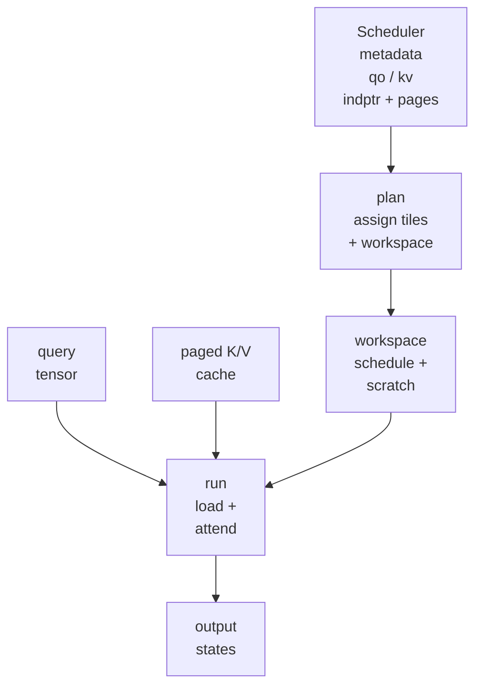

---
{
  "id": "deep-dive-flashinfer",
  "title": "Deep Dive - FlashInfer",
  "slug": "deep-dive-flashinfer",
  "section": "Project Deep Dives",
  "category": "Inference Optimization",
  "difficulty": "Hard",
  "order": 4,
  "companies": [
    "FlashInfer contributors",
    "NVIDIA",
    "vLLM",
    "SGLang",
    "TensorRT-LLM"
  ],
  "shortDescription": "Three requests can share one GPU step with KV lengths 6, 2, and 9 on scattered pages. FlashInfer attends to those histories without treating them as one rectangle.",
  "keyConceptsTested": [
    "Ragged and paged KV-cache layouts",
    "Block-sparse and BSR indirection",
    "Attention-state merge",
    "Plan-run inspector-executor APIs",
    "Split-KV scheduling",
    "JIT backend dispatch",
    "Serving-engine allocator interfaces"
  ],
  "prerequisites": [
    "inference-mechanics-ttft-tps-kv-cache",
    "kv-cache-paged-attention-llm-serving",
    "flashattention-memory-efficient-attention"
  ],
  "relatedQuestions": [
    "continuous-batching-request-scheduling",
    "kv-cache-paged-attention-llm-serving",
    "model-parallelism-for-llm-inference"
  ],
  "coverImage": "illustrations/_generated/ragged_bsr_cta_dark.png"
}
---

Three requests arrive in one GPU serving step together. `R0` runs 3 new query tokens after a 3-token prefix, `R1` decodes 1 token after a 1-token prefix, and `R2` runs 4 new tokens after a 5-token prefix. Their 8 query rows pack cleanly into one ragged buffer, while their KV histories have lengths 6, 2, and 9 scattered across non-contiguous physical pages.

To compute exact causal attention across this jagged batch without copying caches into padded rectangles, the kernel needs three ingredients: explicit per-request query offsets, a physical page table with last-page lengths, and a split-KV scheduler that divides long histories across GPU thread blocks without breaking softmax normalization. Those three mechanisms define **<span data-glossary="flashinfer">FlashInfer</span>**: a serving-oriented kernel library and JIT generator for attention, <span data-glossary="gemm">matrix multiplication</span>, <span data-glossary="mixture-of-experts">MoE</span>, sampling, and KV-cache updates.[^flashinfer2026repo]

[FlashAttention](/learn/flashattention-memory-efficient-attention) eliminates the $n \times n$ score matrix with tiled online softmax; [paged KV caching](/learn/kv-cache-paged-attention-llm-serving) eliminates cache fragmentation with logical-to-physical page tables. FlashInfer composes both inside a plan-then-run execution engine while leaving memory allocation and request scheduling to serving stacks like vLLM and SGLang.

<!-- leetllm: edition:reference:start -->

## Who ships it, who calls it

FlashInfer began in 2023 with researchers from the University of Washington, Carnegie Mellon University, and OctoAI (MLSys 2025 paper by Zihao Ye, Lequn Chen, Ruihang Lai, Wuwei Lin, Yineng Zhang, Stephanie Wang, Tianqi Chen, Baris Kasikci, Vinod Grover, Arvind Krishnamurthy, and Luis Ceze).[^flashinfer2024launch][^ye2025] NVIDIA participates in maintenance and GPU CI alongside the community.[^flashinfer2026contributing]

| Field | Project detail |
| --- | --- |
| Origin | UW, CMU, and OctoAI research lineage (MLSys 2025)[^flashinfer2024launch][^ye2025] |
| Stewardship | Open community plus NVIDIA engineering and GPU CI[^flashinfer2026contributing] |
| Source license | Apache-2.0 for core source (`LICENSE`); bundled CUDA dependencies keep their own notices[^flashinfer2026license] |
| Adopters | <span data-glossary="sglang">SGLang</span>, <span data-glossary="vllm">vLLM</span>, TensorRT-LLM, TGI, MLC-LLM, LightLLM, lorax, and ScaleLLM[^flashinfer2026repo] |

Keep API evolution in mind across minor releases: newer releases (`v0.7.0+` / `v0.7.1+`) standardize cuDNN's natural-log vs. base-2 LSE conversion (`lse_base`), add explicit `batch_offsets_units` (`"elements"` vs. `"tokens"`), and expose planned MLA surfaces such as `trtllm_prefill_with_kv_cache_mla` (where `backend="auto"` can choose XQA, which supports only one query token per request, so multi-token prefill must select a compatible backend explicitly).[^flashinfer0618Release][^flashinfer070Release][^flashinfer071Release]

<!-- leetllm: edition:reference:end -->

## Why inference attention becomes irregular

In training, batches are roughly rectangular. In online LLM serving, requests join and finish asynchronously, chunked <span data-glossary="prefill">prefill</span> mixes with single-token <span data-glossary="decode-phase">decode</span>, and <span data-glossary="kv-cache">KV caches</span> live in a shared page pool.

Return to our three-request batch (`R0` and `R2` in chunked prefill, `R1` in decode) after their new keys and values have been appended to the cache. All 8 query rows pack contiguously, delimited by a prefix-sum pointer array `qo_indptr`:

| Request | Phase | Query rows | `qo_indptr` interval | Logical KV length |
| --- | --- | ---: | --- | ---: |
| R0 | prefill | 3 | `[0, 3)` | 6 |
| R1 | decode | 1 | `[3, 4)` | 2 |
| R2 | prefill | 4 | `[4, 8)` | 9 |

For paged storage with page size $P = 4$, each request owns a list of physical page IDs plus `last_page_len` in `1 .. P` (much like <span data-glossary="virtual-memory">virtual memory</span> frames).[^kwon2023] Logical KV length is `page_size * (len(page_indices) - 1) + last_page_len`:[^flashinfer2026layouts]

| Request | Page indices | `last_page_len` | KV length |
| --- | --- | ---: | --- |
| R0 | `[7, 2]` | 2 | $4 \times (2 - 1) + 2 = 6$ |
| R1 | `[11]` | 2 | $4 \times (1 - 1) + 2 = 2$ |
| R2 | `[3, 14, 6]` | 1 | $4 \times (3 - 1) + 1 = 9$ |

Packed across the batch, we get `qo_indptr = [0, 3, 4, 8]`, `kv_indptr = [0, 2, 3, 6]`, `kv_indices = [7, 2, 11, 3, 14, 6]`, and `kv_last_page_len = [2, 2, 1]`. Notice the two different coordinate units: `qo_indptr` counts **query rows**, whereas `kv_indptr` counts **page IDs**. Mixing those units can remain in bounds while silently reading the wrong sequence.

<!-- leetllm: test, output=show -->
```python title="page_map.py"
PAGE_SIZE = 4
pages = {0: [7, 2], 1: [11], 2: [3, 14, 6]}
last_page_len = {0: 2, 1: 2, 2: 1}


def kv_len(page_ids: list[int], tail: int) -> int:
    if not page_ids or any(p < 0 for p in page_ids):
        raise ValueError("this example requires nonempty, nonnegative page IDs")
    if not 1 <= tail <= PAGE_SIZE:
        raise ValueError("tail must occupy 1..PAGE_SIZE slots")
    return PAGE_SIZE * (len(page_ids) - 1) + tail


qo_indptr = [0]
for query_len in (3, 1, 4):
    qo_indptr.append(qo_indptr[-1] + query_len)

kv_indptr = [0]
for request in (0, 1, 2):
    kv_indptr.append(kv_indptr[-1] + len(pages[request]))

lengths = [kv_len(pages[request], last_page_len[request]) for request in (0, 1, 2)]
assert qo_indptr == [0, 3, 4, 8]
assert kv_indptr == [0, 2, 3, 6]
assert lengths == [6, 2, 9]
for bad_pages, bad_tail in (([], 1), ([3], 0), ([3], 5), ([-1], 1)):
    try:
        kv_len(bad_pages, bad_tail)
    except ValueError:
        pass
    else:
        raise AssertionError("invalid page metadata was accepted")
print("qo_indptr", qo_indptr)
print("kv_indptr", kv_indptr)
print("kv_len", lengths)
```

<!-- leetllm: output:start -->
```text title="Output" output compact
qo_indptr [0, 3, 4, 8]
kv_indptr [0, 2, 3, 6]
kv_len [6, 2, 9]
```
<!-- leetllm: output:end -->

<figure>

<figcaption>Follow logical order, not physical page-number order. R2 token 5 maps to page 14, slot 1; its last page contributes only one token. The allocator never has to move these pages into a contiguous sequence.</figcaption>
</figure>

## Layouts are an API, not an implementation detail

No single physical layout wins every serving phase. FlashInfer elevates layouts to explicit first-class APIs: **ragged** storage packs variable-length <span data-glossary="token">tokens</span> with zero padding, **paged** storage divides KV histories into fixed-size pages, **block-sparse row (BSR)** views a page table as a sparse block matrix indexed by CSR-style `indptr` and `indices`, and **<span data-glossary="multi-head-latent-attention">multi-head latent attention (MLA)</span>** stores compressed latent vectors rather than full K/V heads.[^flashinfer2026layouts] Selected backends also support <span data-glossary="fp8">FP8</span> and FP4 caches with format-specific scales.

Every kernel call separates three inputs:
1. **Payload:** <span data-glossary="tensor">tensors</span> for queries, keys, values, or latents (<span data-glossary="fp16">FP16</span>, <span data-glossary="bf16">BF16</span>, FP8, or sub-byte).
2. **Shape metadata:** head counts, head dimensions, page size, and sequence lengths.
3. **Indirection:** `indptr`, page indices, last-page lengths, and optional sparse masks.

Because payload buffers stay fixed while lightweight metadata updates each step, the serving engine can recycle pages freely without coupling allocator logic into CUDA kernels.

### Ragged prefill and paged decode

Prefill processes many new query tokens per request, so ragged contiguous queries maximize throughput. Decode processes one query token per live request over a long cache, so paged KV eliminates defragmentation copies. A mixed batch like `[R0, R1, R2]` runs through a paged-prefill wrapper using `qo_indptr`, whereas a dedicated decode wrapper assumes exactly one query per request.[^flashinfer2026repo]

### Causality uses logical positions, not page numbers

Request `R2` has 5 cached prefix tokens plus 4 new query tokens (`K = 9`, `Q = 4`). Local query row $i \in \{0, 1, 2, 3\}$ occupies logical position $K - Q + i = 5 + i$ and can attend to logical keys $j \le K - Q + i$ (bottom-right causal alignment). Physical page IDs `[3, 14, 6]` can appear in any order without changing that logical causal mask:

<!-- leetllm: test, output=show -->
```python title="causal_page_lookup.py"
page_ids, page_size, q_len, kv_len = [3, 14, 6], 4, 4, 9
addresses = [(page_ids[j // page_size], j % page_size) for j in range(kv_len)]
mask = [[j <= kv_len - q_len + i for j in range(kv_len)] for i in range(q_len)]
assert addresses[5] == (14, 1)
assert addresses[-1] == (6, 0)
assert [sum(row) for row in mask] == [6, 7, 8, 9]
assert [p for p, _ in addresses] != sorted(p for p, _ in addresses)
print("logical token 5 -> page, slot", addresses[5])
for row in mask:
    print("".join("1" if visible else "." for visible in row))
```

<!-- leetllm: output:start -->
```text title="Output" output compact
logical token 5 -> page, slot (14, 1)
111111...
1111111..
11111111.
111111111
```
<!-- leetllm: output:end -->

### BSR memory access mechanics

Viewing page tables as BSR blocks lets multiple requests point to the exact same physical prefix pages while diverging on their suffix pages, enabling zero-copy prefix sharing and block-sparse patterns. The trade-off is extra pointer arithmetic and non-contiguous gathers, which pay off whenever avoiding padding and copies saves more memory traffic than indirection costs.

## Core mechanism: schedule work around state

Now suppose one request's long KV cache is split across multiple cooperative thread arrays (CTAs, CUDA's thread blocks) to keep the GPU busy. Each CTA sees only a disjoint slice of keys, yet the parent still needs exact global <span data-glossary="softmax">softmax</span> attention.

FlashInfer turns the pair `(o, b)` (normalized output vector $o$ plus base-2 <span data-glossary="log-sum-exp">log-sum-exp</span> $b = \log_2 \sum_j e^{s_j}$) into a composable attention state.[^ye2025][^flashinfer2026recursive][^flashinfer0618Cascade] Notice that $b$ uses base 2 on the natural-exponential partition function; converting a natural-log LSE $\ln \sum_j e^{s_j}$ requires dividing by $\ln 2$ exactly once. Check the producer backend's convention carefully: cuDNN's low-level prefill path supports `lse_base="log2"` (default in v0.7.1+) or `"ln"`, whereas earlier v0.6.18 cuDNN frontend graphs returned natural-log LSE directly.[^flashinfer2026CudnnPrefillFix][^flashinfer070Release][^flashinfer071CudnnPrefill]

Given two disjoint partial states $(o_A, b_A)$ and $(o_B, b_B)$ for the same query row and head, the merge restores their exact relative weights without seeing raw scores:

$$
m = \max(b_A, b_B), \qquad w_A = 2^{b_A - m}, \qquad w_B = 2^{b_B - m}
$$

$$
o = \frac{w_A}{w_A + w_B}\, o_A + \frac{w_B}{w_A + w_B}\, o_B, \qquad b = m + \log_2(w_A + w_B)
$$

Subtracting $m$ prevents exponent overflow, and normalizing $w_A/(w_A + w_B)$ *before* multiplying by $o_A$ prevents overflow when vector entries are very large.[^flashinfer0618Cascade] Because this merge is associative in exact arithmetic, a tree of workers can combine arbitrarily many split-KV chunks or shared-prefix cascade stages in parallel. Only disjoint partitions are valid: overlapping key slices double-count normalization mass.

<figure>

<figcaption>The normalization masses are 4 and 2. Dividing by their total gives weights 2/3 and 1/3. Subtracting the common maximum before exponentiating preserves those weights without overflow.</figcaption>
</figure>

### A worked split-KV example

Take chunk A with $b_A = 2$, $o_A = [1, 0]$ and chunk B with $b_B = 1$, $o_B = [0, 1]$:
1. $m = \max(2, 1) = 2$.
2. Relative weights: $w_A = 2^0 = 1$, $w_B = 2^{-1} = 0.5$, total $z = 1.5$.
3. Merged output: $o = \frac{1}{1.5}[1, 0] + \frac{0.5}{1.5}[0, 1] = [\tfrac{2}{3}, \tfrac{1}{3}]$.
4. Merged statistic: $b = 2 + \log_2(1.5) \approx 2.585$.

Let us run the stable reference merge (handling empty $-\infty$ chunks explicitly) and verify it against direct softmax across 168 cuts, while exposing both double-counting overlap and wrong-base LSE bugs:

<!-- leetllm: test, id=merge-reference, output=show -->
```python title="merge_state.py"
import math


def merge_state(
    o_a: list[float], b_a: float, o_b: list[float], b_b: float
) -> tuple[list[float], float]:
    """Reference merge; -inf with a zero vector represents an empty key set."""
    if not o_a or len(o_a) != len(o_b):
        raise ValueError("state vectors must have the same positive dimension")
    if b_a == -math.inf:
        return list(o_b), b_b
    if b_b == -math.inf:
        return list(o_a), b_a
    shift = max(b_a, b_b)
    w_a = 2 ** (b_a - shift)
    w_b = 2 ** (b_b - shift)
    z = w_a + w_b
    a_scale, b_scale = w_a / z, w_b / z
    merged = [a_scale * x + b_scale * y for x, y in zip(o_a, o_b, strict=True)]
    return merged, shift + math.log2(z)


output, log_sum_exp = merge_state([1.0, 0.0], 2.0, [0.0, 1.0], 1.0)
assert abs(output[0] - 2 / 3) < 1e-12
assert abs(output[1] - 1 / 3) < 1e-12
assert abs(log_sum_exp - (2 + math.log2(1.5))) < 1e-12
assert merge_state([0., 0.], -math.inf, output, log_sum_exp) == (output, log_sum_exp)
assert merge_state([0., 0.], -math.inf, [0., 0.], -math.inf) == ([0., 0.], -math.inf)
assert merge_state([1e308], 0.0, [1e308], 0.0)[0] == [1e308]
print([round(value, 4) for value in output], round(log_sum_exp, 4))
```

<!-- leetllm: output:start -->
```text title="Output" output compact
[0.6667, 0.3333] 2.585
```
<!-- leetllm: output:end -->

<!-- leetllm: test, continue=merge-reference, output=show -->
```python title="check_split_attention.py"
import random

def direct_state(scores, values):
    if not scores:
        return [0.0, 0.0], -math.inf
    shift = max(scores)
    weights = [math.exp(s - shift) for s in scores]
    denominator = sum(weights)
    output = [sum(w * v[d] for w, v in zip(weights, values, strict=True))
              / denominator for d in range(2)]
    return output, (shift + math.log(denominator)) / math.log(2)

rng = random.Random(7)
cases = 0
for length in (1, 2, 6, 9, 33):
    for offset in (-1000.0, 0.0, 1000.0):
        scores = [offset + rng.uniform(-4, 4) for _ in range(length)]
        values = [[rng.uniform(-1, 1), rng.uniform(-1, 1)] for _ in scores]
        expected_o, expected_b = direct_state(scores, values)
        for cut in range(length + 1):
            left = direct_state(scores[:cut], values[:cut])
            right = direct_state(scores[cut:], values[cut:])
            actual_o, actual_b = merge_state(*left, *right)
            assert max(abs(a - b) for a, b in zip(actual_o, expected_o)) < 1e-10
            assert abs(actual_b - expected_b) < 1e-10
            cases += 1

# Overlap double-counts key 0 and shifts 0.5000 to 0.6667.
scores, values = [0.0, 0.0], [[1.0, 0.0], [0.0, 1.0]]
whole = direct_state(scores, values)
duplicate = merge_state(*whole, *direct_state(scores[:1], values[:1]))
assert abs(whole[0][0] - 0.5) < 1e-12
assert abs(duplicate[0][0] - 2 / 3) < 1e-12
# Passing natural-log LSE into a base-2 merge corrupts the weights.
correct = merge_state([1., 0.], 2., [0., 1.], 1.)
wrong_base = merge_state([1., 0.], 2 * math.log(2), [0., 1.], math.log(2))
assert abs(wrong_base[0][0] - correct[0][0]) > 0.04
print("split/direct checks:", cases)
print("overlapping chunks change 0.5000 to", f"{duplicate[0][0]:.4f}")
print("wrong LSE base changes 0.6667 to", f"{wrong_base[0][0]:.4f}")
```

<!-- leetllm: output:start -->
```text title="Output" output compact
split/direct checks: 168
overlapping chunks change 0.5000 to 0.6667
wrong LSE base changes 0.6667 to 0.6179
```
<!-- leetllm: output:end -->

## Plan then run: inspector-executor for GPU kernels

To avoid repeating irregular scheduling work on every transformer layer (and to remain compatible with <span data-glossary="cuda-graph">CUDA Graphs</span>), FlashInfer splits attention into an **inspector-executor** pair: `plan()` inspects batch metadata once on the host, computes tile assignments, split-KV partitions, and scratch offsets into a workspace buffer; then `run()` executes the GPU kernel across every layer using that precomputed plan.[^ye2025]



`plan()` performs host-side scheduling and metadata copies, so it runs *outside* CUDA Graph capture, while compatible `run()` calls capture cleanly inside the graph.[^flashinfer0618Prefill] Graph-mode wrappers fix buffer addresses and batch capacity up front, yet stable addresses never make stale lengths valid: whenever sequence lengths grow or pages change, refresh metadata through the wrapper's supported update path. (Also check wrapper-specific replay rules: `fixed_split_size` can change CTA counts as KV lengths grow, and newer `BatchMLAPagedAttentionWrapper(backend="auto")` resolves SM100 backends during `plan()` with non-FA graph wrappers allowing one plan per wrapper instance.)[^flashinfer0618Prefill][^flashinfer071MlaWrapper]

| Buffer | Created by | Consumed by | Invalidated when |
| --- | --- | --- | --- |
| Page indices | Allocator / scheduler | `plan` and `run` | Logical-to-physical page mapping changes |
| Plan workspace | `plan` | `run` | Lengths, shapes, masks, or buffer change |
| Partial states | Split-KV kernel | Merge kernel | Attention step completes |
| Output tensor | Wrapper or caller | Next model op | Dependent stream finishes and owner recycles it |

Watch backend-specific offset units too: the FA2 wrapper counts `qo_indptr` in **tokens**, whereas low-level cuDNN prefill supports `batch_offsets_units="elements"` (default, scaling Q by `num_qo_heads * head_dim_qk` and O by `num_qo_heads * head_dim_vo`) as well as `"tokens"`.[^flashinfer2026CudnnPrefillFix][^flashinfer071CudnnPrefill] Here is the complete `BatchPrefillWithPagedKVCacheWrapper` GPU workflow on our 3-request, 32-Q / 8-KV <span data-glossary="grouped-query-attention">GQA</span> (`NHD` layout) example:

```python title="flashinfer_plan_run.py"
import torch
import flashinfer

assert torch.cuda.is_available(), "requires NVIDIA CUDA"
torch.manual_seed(7)
device = "cuda:0"
workspace = torch.empty(128 * 1024 * 1024, dtype=torch.uint8, device=device)
wrapper = flashinfer.BatchPrefillWithPagedKVCacheWrapper(
    workspace, kv_layout="NHD", backend="fa2"
)
index = lambda values: torch.tensor(values, dtype=torch.int32, device=device)
q = torch.randn(8, 32, 128, dtype=torch.float16, device=device)
paged_kv_cache = torch.randn(15, 2, 4, 8, 128, dtype=torch.float16, device=device)
wrapper.plan(
    qo_indptr=index([0, 3, 4, 8]),
    paged_kv_indptr=index([0, 2, 3, 6]),
    paged_kv_indices=index([7, 2, 11, 3, 14, 6]),
    paged_kv_last_page_len=index([2, 2, 1]),
    num_qo_heads=32,
    num_kv_heads=8,
    head_dim_qk=128,
    page_size=4,
    causal=True,
    q_data_type=torch.float16,
    kv_data_type=torch.float16,
)
output = wrapper.run(q, paged_kv_cache)
assert output.shape == q.shape and torch.isfinite(output).all()

# Dense reference: gather logical pages and repeat GQA KV heads.
for row_start, row_end, ids, length in (
    (0, 3, [7, 2], 6), (3, 4, [11], 2), (4, 8, [3, 14, 6], 9)
):
    k = paged_kv_cache[ids, 0].reshape(-1, 8, 128)[:length].float()
    v = paged_kv_cache[ids, 1].reshape(-1, 8, 128)[:length].float()
    k, v = k.repeat_interleave(4, dim=1), v.repeat_interleave(4, dim=1)
    query = q[row_start:row_end].float()
    scores = torch.einsum("qhd,khd->hqk", query, k) / (128 ** 0.5)
    q_len = row_end - row_start
    visible = torch.arange(length, device=device)[None, :] <= (
        length - q_len + torch.arange(q_len, device=device)[:, None]
    )
    probabilities = scores.masked_fill(~visible[None], -torch.inf).softmax(-1)
    expected = torch.einsum("hqk,khd->qhd", probabilities, v)
    torch.testing.assert_close(output[row_start:row_end].float(), expected,
                               atol=2e-3, rtol=2e-3)
torch.cuda.synchronize()
print("paged causal GQA reference passed:", tuple(output.shape))
```

## Load balancing and split-KV decisions

Suppose a batch mixes one 128K-token request with seven 128-token requests. Assigning one CTA per request leaves almost every SM idle waiting for the 128K straggler. FlashInfer splits long KV ranges across multiple CTAs, writes compact partial `(o, b)` states to scratch space, and runs a fast merge kernel to restore exact attention.

### What split-KV changes

| Choice | Benefit | Trade-off |
| --- | --- | --- |
| No split (short histories) | Minimal metadata and zero merge overhead | Long request dominates tail latency |
| Split long histories | Balances CTAs across SMs | Extra scratch buffer and merge kernel |
| Split + CUDA Graph | Low launch overhead | Must keep launch grid graph-compatible |
| Dynamic plan per step | Tracks rapid request churn | Host planning and metadata copy overhead |

Choosing chunk size balances warp occupancy against merge cost: chunks that are too tiny drown in merge traffic, while chunks that are too large recreate stragglers. Always tune split thresholds against measured <span data-glossary="itl">inter-token latency (ITL)</span> and tail latency on your actual length distribution rather than copying paper defaults.[^ye2025]

## Backends and JIT compilation

FlashInfer is a multi-backend dispatcher, not a single monolithic <span data-glossary="cuda-kernel">CUDA kernel</span>. Depending on GPU generation, head layout, dtype, and operator, it routes to FlashAttention-2/3, cuDNN, CUTLASS, <span data-glossary="tensorrt-llm">TensorRT-LLM</span>, or JIT-compiled template kernels.[^flashinfer2026repo]

| Execution path | Startup behavior | Best fit |
| --- | --- | --- |
| Precompiled cubin / `flashinfer-jit-cache` | Loads matching binary immediately | Known GPU fleet with predictable startup |
| Runtime JIT module | Compiles on first use, then caches | Custom attention variants or uncovered shapes |
| Vendor backend dispatch | Calls cuDNN / CUTLASS / TRT-LLM / FA | Standard production shapes |
| Dense reference | Slow materializing fallback | Correctness tests and debugging |

Because `flashinfer-jit-cache` installs architecture-specific provider wheels, verify coverage for your GPU fleet and CUDA toolkit (treating preview CUDA builds separately) and pre-warm production shapes before serving traffic. FlashInfer also ships API diagnostic logging; note that level-10 logging wraps CUDA Graph replay with stream synchronization and tensor snapshots (which can write prompt data to disk and distort latency), so enable it only for targeted debugging.[^flashinfer2026logging]

## Where FlashInfer sits in a serving stack

FlashInfer executes GPU kernels and leaves request queuing, rate limits, batching, and KV-page ownership to the surrounding serving engine:

| Layer | Responsibility | Relation to FlashInfer |
| --- | --- | --- |
| API gateway | Auth, <span data-glossary="rate-limit">rate limiting</span>, cancellation | Outside |
| Serving scheduler | <span data-glossary="continuous-batching">Continuous batching</span>, priorities, deadlines | Builds batch metadata |
| KV allocator | Physical page pool, prefix sharing, eviction | Builds page table |
| FlashInfer wrapper | Plans tile schedules, dispatches kernel, merges states | Core |
| Model block | Projections, residuals, <span data-glossary="logits">logits</span> | Consumes attention output |
| Sampler | <span data-glossary="top-k">Top-k</span> / top-p sampling | Optional FlashInfer sampling ops |

The allocator interface is the top source of serving bugs: recycling a page while a <span data-glossary="cuda-stream">CUDA stream</span> is still reading it corrupts active requests, disagreeing on `kv_last_page_len` leaks uninitialized tail slots, and replaying an old plan after page indices move produces plausible numbers for the wrong sequence.

<!-- leetllm: edition:reference:start -->

### A release checklist at the boundary

1. Tie page-index, tail-length, and workspace lifetimes to one stream or explicit CUDA event.
2. Validate `int32` index dtypes, page size, head dimensions, and device at wrapper entry.
3. Verify incremental paged decode against full-prefix attention on randomized variable-length batches.
4. Log selected backend, split-KV setting, and workspace size in traces.
5. Stress cancellation and page recycling with CUDA Graphs enabled.

## Strengths

### One vocabulary for many inference phases

Prefill, decode, mixed chunked prefill, MLA, sparse attention, sampling, <span data-glossary="quantization">quantization</span>, and collective ops share one library surface.

### Explicit composability

Ragged/paged layouts, `plan`/`run` separation, and base-2 state merges expose scheduler metadata cleanly without opaque end-to-end graph lock-in.

### Customization without abandoning fast paths

JIT templates support specialized attention variants alongside mature vendor backends for standard shapes.

### Hardware breadth with caveats

Covers multiple NVIDIA GPU generations while keeping operator support architecture-specific (for example, newer cache wheels drop legacy SM75 and single-request FA2 cubins, requiring first-use JIT on those paths).[^flashinfer0618Release]

## Weaknesses and failure modes

### Metadata complexity moves upward

The serving engine must maintain consistent `int32` `indptr`, page tables, last-page lengths, workspaces, and stream events.[^kwon2023]

### JIT is a release dependency

Uncached shapes add cold-start compile latency and depend on matching CUDA toolkits, compilers, and cache invalidation on upgrade.

### Kernel breadth raises test burden

Every backend, dtype, head grouping, causal mode, and GPU architecture multiplies the test matrix.

### GPU specificity limits portability

FlashInfer is CUDA-native and tied to NVIDIA hardware and vendor backends.

### A kernel library isn't a training stack

FlashInfer targets inference serving; backward support, <span data-glossary="optimizer">optimizers</span>, and distributed training frameworks live outside its primary focus.[^flashinfer0618Source]

## What the paper actually measured

The MLSys 2025 FlashInfer paper evaluated v0.2 (CUDA 12.4, PyTorch 2.4.0, FP16 on A100 40GB and H100 80GB SXM).[^ye2025] Its headline gains reflect those specific workloads and baselines:

| Paper result | Measured setup | Scope limit |
| --- | --- | --- |
| 29%–69% lower ITL | SGLang v0.3.4 FlashInfer vs. Triton v3.0 on Llama 3.1 8B/70B (ShareGPT + Variable 512–2,048, P99 TTFT < 200 ms) | Specific model, GPU, and Triton baseline |
| 28%–30% lower long-context latency | Fused <span data-glossary="rope">RoPE</span>-attention vs. unfused in Streaming-LLM (Vicuna-13B) | Does not generalize uniformly to all context lengths |
| 14%–17% lower ITL for parallel generation | MLC-Engine composable formats ($n=4$, 16 req/s, Llama 3.1 8B/70B) | Specific concurrency and parallel width |

### Correctness is part of benchmark coverage

Test every shipped backend against a dense reference across prefill, decode, mixed batches, partial last pages, shared prefixes, split and unsplit KV, MHA/GQA/MLA, and `int32` metadata arrays before trusting throughput numbers.[^flashinfer2026layouts]

### Diagnose the path before tuning the kernel

Use Nsight Systems to separate CPU `plan()` time, metadata copies, and launch gaps from GPU attention time, then use Nsight Compute to distinguish memory-bandwidth pressure from compute or warp-stall bottlenecks.[^nsightSystems2026][^nsightCompute2026]

## A small code-reading route

1. `flashinfer/decode.py`: trace `BatchDecodeWithPagedKVCacheWrapper.plan` and `.run`.
2. `csrc/batch_decode.cu`: see how offsets and split-KV scratch buffers enter the kernel.
3. `flashinfer/cascade.py` and `include/flashinfer/attention/cascade.cuh`: inspect base-2 attention-state merges.
4. `flashinfer/page.py` and `csrc/page.cu`: inspect KV page append and slot addressing.
5. Wrapper tests vs. dense references: verify exact tolerances and metadata shapes.

## What an integration review must defend

- **Indexing:** Derive `qo_indptr`, `kv_indptr`, page-slot lookups (`R2` token 5 → page 14, slot 1), and bottom-right causal row lengths (`6, 7, 8, 9`).
- **Numerics:** Verify base-2 LSE state merging, disjoint key ranges, empty-chunk handling, and unit conversion from natural-log backends.
- **Lifecycle:** Separate metadata refresh, `plan()`, JIT compilation, and CUDA Graph capture across step changes.
- **Measurement:** Benchmark warm steady-state traces on your target GPU and model with full correctness coverage.

### Follow-up questions

```checkpoint
R2's page IDs stay [3, 14, 6], but its last-page length grows from 1 to 2. Can an unchanged page list justify replaying old length metadata?
---
No. Logical KV length grew from 9 to 10 even though the page list stayed identical. Update tail length and any length-dependent plan or mask before running.
```

```checkpoint
A shared prefix is included in both partial states before merging. Why can the output stay finite yet still be wrong?
---
Merging adds normalization mass from both states, double-counting the shared keys (turning a 1/2 weight into 2/3 in the equal-logit case). Always partition logical key ranges disjointly even when physical pages are shared.
```

<!-- leetllm: edition:reference:end -->

```mastery-quiz
[
  {
    "question": "A fresh compact batch has query lengths [2,5,1,3] and page-list counts [1,3,2,1]. Which pair of pointer arrays preserves both units?",
    "options": [
      "Query [0,2,7,8,11]; pages [0,1,4,6,8].",
      "Query [0,2,5,1,3]; pages [0,1,3,2,1].",
      "Query [0,2,7,8,11]; pages [0,1,4,6,7].",
      "Query [0,1,4,6,7]; pages [0,2,7,8,11]."
    ],
    "answer": "Query [0,2,7,8,11]; pages [0,1,4,6,7].",
    "explanation": "Cumulative sums of query rows give [0, 2, 7, 8, 11], and cumulative sums of page counts give [0, 1, 4, 6, 7]. Keeping the two coordinate units separate prevents silent cross-request reads."
  },
  {
    "question": "A request uses page size 8, ordered pages [12,4,9] and tail length 3. After the tail grows to 4, what are its old/new logical lengths and the address of logical position 13?",
    "options": [
      "Lengths 19→20; position 13 remains page 4, slot 5.",
      "Lengths 19→20; position 13 remains page 9, slot 5.",
      "Lengths 24→25; position 13 remains page 4, slot 5.",
      "Lengths 11→12; position 13 remains page 4, slot 1."
    ],
    "answer": "Lengths 19→20; position 13 remains page 4, slot 5.",
    "explanation": "Length is 8 × (3 - 1) + tail, growing from 19 to 20. Position 13 maps to page index 13 // 8 = 1 (page 4) and slot 13 % 8 = 5, unaffected by appending at the tail."
  },
  {
    "question": "Disjoint states for the same query/head have outputs [2,−1] and [0,3], with base-two statistics 4 and 1. Which output and retained statistic follow the stable recurrence?",
    "options": [
      "Output [1.0000,1.0000]; statistic 2.5000.",
      "Output [1.6000,−0.2000]; statistic 3.3219.",
      "Output [2.0000,−0.6250]; statistic 4.0000.",
      "Output [1.7778,−0.5556]; statistic 4.1699."
    ],
    "answer": "Output [1.7778,−0.5556]; statistic 4.1699.",
    "explanation": "With shift m = 4, relative weights are 1 and 2^-3 = 1/8, giving shares 8/9 and 1/9. Merging yields [16/9, -5/9] ≈ [1.7778, -0.5556] and b = 4 + log2(9/8) ≈ 4.1699."
  },
  {
    "question": "A producer explicitly returns natural-log statistics ln(9) and ln(3) with normalized outputs [4,0] and [0,4]. A second producer returns the already converted base-two statistics for those same states. Which treatment and merged output are correct?",
    "options": [
      "Divide both producers’ statistics by ln(2) before merging; output [3,1].",
      "Divide natural-log statistics by ln(2), retaining base-two ones; output [3,1].",
      "Multiply natural-log statistics by ln(2), retaining base-two ones; output [3,1].",
      "Retain both producers’ statistics without any conversion; output [2,2]."
    ],
    "answer": "Divide natural-log statistics by ln(2), retaining base-two ones; output [3,1].",
    "explanation": "Masses 9 and 3 give weights 3/4 and 1/4, producing [3, 1]. Convert natural-log LSE to base 2 once by dividing by ln(2); dividing an already base-2 value distorts the weights."
  },
  {
    "question": "In the lesson’s CPU merge reference, Trace A merges [1.6e308] at base-two statistic 1 with [1.2e308] at statistic 0. Trace B merges ([2], −∞) with ([4], 0), then repeats the call with [0] in place of [2]. What coordinate does A return, and which inputs does B accept?",
    "options": [
      "A returns about 1.4667e308. B rejects [2] and accepts [0].",
      "A overflows to infinity. B rejects [2] and accepts [0].",
      "A returns about 1.4667e308. B rejects [2] and rejects [0].",
      "A overflows to infinity. B accepts [2] and accepts [0]."
    ],
    "answer": "A returns about 1.4667e308. B rejects [2] and accepts [0].",
    "explanation": "Normalizing shares to 2/3 and 1/3 before scaling avoids overflow and gives ~1.4667e308. An empty state paired with −∞ must carry a zero vector, so [0] is valid and returns ([4], 0) while [2] is invalid."
  },
  {
    "question": "Seven keys include the appended keys of three new queries. For zero-based local query row1 under bottom-right causality, which logical keys are visible and how does permuting physical page IDs affect that allowed set?",
    "options": [
      "Keys 0..4; a page-ID permutation preserves this logical set.",
      "Keys 0..6; a page-ID permutation preserves this logical set.",
      "Keys 0..5; a page-ID permutation preserves this logical set.",
      "Keys 0..5; a page-ID permutation extends this set through 6."
    ],
    "answer": "Keys 0..5; a page-ID permutation preserves this logical set.",
    "explanation": "Local row 1 sits at logical position K - Q + i = 7 - 3 + 1 = 5, so logical keys 0..5 are visible. Physical page IDs only control where blocks reside in memory, never logical causal visibility."
  },
  {
    "question": "For offset arithmetic, a low-level cuDNN call selects element units. Token boundaries are [0,2,5], query heads 12, QK dimension 192 and VO dimension 128. Which Q and O offset arrays match those tensor strides?",
    "options": [
      "Q [0,3072,7680]; O [0,4608,11520].",
      "Q [0,4608,11520]; O [0,3072,7680].",
      "Q [0,4608,11520]; O [0,4608,11520].",
      "Q [0,2,5] unchanged; O [0,2,5] unchanged."
    ],
    "answer": "Q [0,4608,11520]; O [0,3072,7680].",
    "explanation": "Q advances by 12 × 192 = 2,304 elements per token ([0, 4608, 11520]), whereas O advances by 12 × 128 = 1,536 elements per token ([0, 3072, 7680]). Token mode uses [0, 2, 5] for both."
  },
  {
    "question": "Two graph wrappers use the same history. One eight-slot page is full, and an append grows the second page’s tail from one key to two. Buffer addresses and launch shapes stay the same. Wrapper A allows one plan per instance. Its existing plan fixes the replay count at nine keys. Wrapper B reads the count from a buffer the caller can update outside capture for histories of up to 16 keys. What preparation does each wrapper need?",
    "options": [
      "Keep A’s wrapper and update B’s length buffer.",
      "Replace A’s wrapper and recompile B’s kernel.",
      "Keep A’s wrapper and recompile B’s kernel.",
      "Replace A’s wrapper and update B’s length buffer."
    ],
    "answer": "Replace A’s wrapper and update B’s length buffer.",
    "explanation": "The sequence grew from 9 to 10 keys. Wrapper A's single-plan instance hardcodes 9 keys, so it needs a new wrapper and plan. Wrapper B supports dynamic lengths up to 16 by updating its length buffer outside capture without recompiling."
  },
  {
    "question": "An analytical cost model has six independent 3-unit chunks, three worker lanes and a dependent 2-unit merge. A page reader completes at tick 13, while reuse is proposed at tick 11. Which critical path and reuse decision follow? Cost units and reader ticks are separate clocks.",
    "options": [
      "Path 5 cost units; page reusable at tick 11.",
      "Path 8 cost units; page reusable at tick 11.",
      "Path 8 cost units; page retained at tick 11.",
      "Path 20 cost units; page retained at tick 11."
    ],
    "answer": "Path 8 cost units; page retained at tick 11.",
    "explanation": "Six 3-unit chunks across three lanes take two waves (6 units) plus the 2-unit merge = 8 units. Because the active reader finishes at tick 13, the page cannot be recycled at tick 11."
  },
  {
    "question": "A serial execution profile has planning 0.9ms, copy 0.3ms, attention 1.2ms and merge 0.6ms. Only attention is halved. A second comparison additionally enables level-10 graph tensor dumps. Which complete-time estimate, speedup and interpretation follow?",
    "options": [
      "New 2.4ms; speedup 1.25×; the dump-enabled comparison also changes diagnostic work.",
      "New 1.5ms; speedup 2×; the dump-enabled comparison also changes diagnostic work.",
      "New 2.4ms; speedup 1.25×; the dump-enabled comparison isolates the kernel change.",
      "New 1.5ms; speedup 2×; the dump-enabled comparison isolates the kernel change."
    ],
    "answer": "New 2.4ms; speedup 1.25×; the dump-enabled comparison also changes diagnostic work.",
    "explanation": "Halving attention reduces total time from 3.0 ms to 2.4 ms (3.0 / 2.4 = 1.25×). Enabling level-10 dumps injects stream synchronization and snapshot writes, confounding the timing comparison."
  }
]
```

> **Next:** Continue to [Deep Dive - DeepGEMM](/learn/deep-dive-deepgemm).
