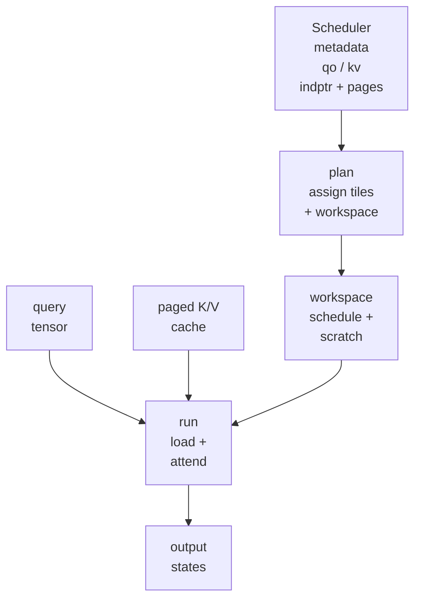

---
{
  "id": "deep-dive-flashinfer",
  "title": "Deep Dive - FlashInfer",
  "slug": "deep-dive-flashinfer",
  "section": "Project Deep Dives",
  "category": "Inference Optimization",
  "difficulty": "Hard",
  "order": 4,
  "companies": [
    "FlashInfer contributors",
    "NVIDIA",
    "vLLM",
    "SGLang",
    "TensorRT-LLM"
  ],
  "shortDescription": "Three requests can share one GPU step with KV lengths 6, 2, and 9 on scattered pages. FlashInfer attends to those histories without treating them as one rectangle.",
  "keyConceptsTested": [
    "Ragged and paged KV-cache layouts",
    "Block-sparse and BSR indirection",
    "Attention-state merge",
    "Plan-run inspector-executor APIs",
    "Split-KV scheduling",
    "JIT backend dispatch",
    "Serving-engine allocator interfaces"
  ],
  "prerequisites": [
    "inference-mechanics-ttft-tps-kv-cache",
    "kv-cache-paged-attention-llm-serving",
    "flashattention-memory-efficient-attention"
  ],
  "relatedQuestions": [
    "continuous-batching-request-scheduling",
    "prefix-caching-prompt-caching",
    "model-parallelism-for-llm-inference",
    "scaling-llm-inference-batching-kv-cache"
  ],
  "coverImage": "illustrations/_generated/ragged_bsr_cta_dark.png"
}
---

Three requests reach one GPU step together. `R0` processes 3 new tokens after a 3-token prefix, `R1` processes 1 after a 1-token prefix, and `R2` processes 4 after a 5-token prefix. Their 8 query rows fit in one compact buffer. After appending the new keys and values, their KV lengths are 6, 2, and 9, scattered across physical pages. Attention still has to return one correct state per row without attending to a future token.

The kernel requires explicit query boundaries, a physical page table with tail length for each sequence, and a work assignment scheme that partitions long histories across thread blocks without corrupting softmax normalization. Those pieces explain <span data-glossary="flashinfer">FlashInfer</span>: a library and kernel generator for attention, <span data-glossary="gemm">matrix multiplication</span>, <span data-glossary="mixture-of-experts">mixture-of-experts</span> operations, sampling, and cache updates.[^flashinfer2026repo] The serving engine still owns allocation and admission.

[FlashAttention](/learn/flashattention-memory-efficient-attention) supplies the tiled softmax, and [paged KV caching](/learn/kv-cache-paged-attention-llm-serving) supplies the logical-to-physical mapping. Keep those two mechanisms separate: avoiding a score matrix and avoiding cache relocation save different memory traffic. The Python exercises here run on CPU and check indexing and attention arithmetic. They don't execute FlashInfer kernels or measure GPU speed.

## Who ships it, who calls it

Start with ownership, because a kernel benchmark and a serving guarantee belong to different layers.

The API walkthrough is pinned to **FlashInfer 0.6.18**, released August 29, 2026, at commit `69ff11fc4954396d98326656dc85debd2223f637`; its relevant source paths were rechecked September 23, 2026.[^flashinfer0618Release][^flashinfer0618Source] The latest release on that date is **v0.7.0**, published September 22. Its cuDNN normalization fix matters to the state-merge interface below.[^flashinfer070Release] The paper benchmarks later in the lesson used v0.2. They aren't measurements of either release.

As checked October 10, the latest release is **v0.7.1**, published October 9. The older reproduction stays pinned. The new release adds planned MLA backend surfaces and a named `trtllm_prefill_with_kv_cache_mla` entry point, but that name doesn't remove decode constraints: its `backend="auto"` can choose XQA, which supports one query token per request. Multi-token prefill callers must explicitly choose a compatible backend.[^flashinfer071Release]

FlashInfer began in summer 2023 with researchers from the University of Washington, Carnegie Mellon University, and OctoAI.[^flashinfer2024launch] The MLSys 2025 paper lists Zihao Ye, Lequn Chen, Ruihang Lai, Wuwei Lin, Yineng Zhang, Stephanie Wang, Tianqi Chen, Baris Kasikci, Vinod Grover, Arvind Krishnamurthy, and Luis Ceze, with affiliations spanning UW, NVIDIA, Perplexity, CMU, and independent research.[^ye2025] The cited contribution snapshot documents NVIDIA participation alongside the FlashInfer community, with public GitHub Actions and an NVIDIA-internal GPU matrix on GitLab.[^flashinfer2026contributing]

| Field | Documented project fact |
| --- | --- |
| Origin | UW, CMU, and OctoAI researchers started the project in 2023; the launch post names that initial team.[^flashinfer2024launch] |
| Stewardship | The cited contribution snapshot documents public review and CI plus an additional NVIDIA GPU test path.[^flashinfer2026contributing] |
| Founding contributors | Zihao Ye, Lequn Chen, Ruihang Lai, and the paper's compiler, systems, and GPU collaborators form the documented research lineage.[^ye2025] |
| Source license | Apache-2.0 for FlashInfer's core source.[^flashinfer2026license] Bundled CUDA components and dependencies can retain BSD, MIT, or other notices. |
| Commercial boundary | NVIDIA participates in maintenance and CI, but FlashInfer remains a public kernel library rather than a model or hosted inference product.[^flashinfer2026contributing] |
| Asset boundary | Tutorials may download gated or separately licensed checkpoints. FlashInfer's Apache license doesn't grant rights to those models or datasets. |

The repository names <span data-glossary="sglang">SGLang</span>, <span data-glossary="vllm">vLLM</span>, TensorRT-LLM, Text Generation Inference, MLC-LLM, LightLLM, lorax, and ScaleLLM as adopters or integrations.[^flashinfer2026repo] Adoption doesn't mean every framework enables every operator. Check the framework's attention backend, FlashInfer release, CUDA version, and model feature matrix before treating a project-level capability as a service guarantee.

Ownership says who is responsible for a number. It doesn't explain why three requests in one step stop looking like one attention matrix.

## Why inference attention becomes irregular

Each request keeps its own length, so the batch is no longer one rectangle. <span data-glossary="flashattention">FlashAttention</span> gives exact attention a streaming recipe: load tiles, update <span data-glossary="online-softmax">online softmax</span> state, and avoid writing a full score matrix to global memory. In serving, the pressure moves to the batch around that kernel. The <span data-glossary="transformer">transformer</span> equation stays regular, but requests arrive and finish independently, sequence lengths change every step, and the <span data-glossary="kv-cache">key-value (KV) cache</span> comes from a shared page pool.

Start by counting two axes. `R0` and `R2` are doing chunked <span data-glossary="prefill">prefill</span>, also called append attention. `R1` is in the <span data-glossary="decode-phase">decode</span> loop. Here, every reported KV length includes the current query tokens' keys and values, which the caller has already appended. A ragged query buffer stores the 8 query rows back-to-back. What tells a kernel where one request ends and the next begins? An index-pointer array `qo_indptr`:

| request | phase | query rows | `qo_indptr` interval | logical KV length |
| --- | --- | ---: | --- | ---: |
| R0 | prefill | 3 | `[0, 3)` | 6 |
| R1 | decode | 1 | `[3, 4)` | 2 |
| R2 | prefill | 4 | `[4, 8)` | 9 |

The query tensor is compact. The paged cache requires two mechanisms: a way to index non-contiguous physical pages and a way to track the active slot count in the final page. Page size $P = 4$ makes allocation independent of exact sequence length, much like <span data-glossary="virtual-memory">virtual memory</span> maps a process address to a physical frame.[^kwon2023] FlashInfer's sequence length formula is `page_size * (len(page_indices) - 1) + last_page_len`, with `last_page_len` in `1 .. page_size`.[^flashinfer2026layouts]

| request | page indices | `last_page_len` | KV length check |
| --- | --- | ---: | --- |
| R0 | `[7, 2]` | 2 | $4 \times (2 - 1) + 2 = 6$ |
| R1 | `[11]` | 2 | $4 \times (1 - 1) + 2 = 2$ |
| R2 | `[3, 14, 6]` | 1 | $4 \times (3 - 1) + 1 = 9$ |

Packed metadata for the whole batch is `kv_indptr = [0, 2, 3, 6]`, `kv_indices = [7, 2, 11, 3, 14, 6]`, and `kv_last_page_len = [2, 2, 1]`. Read the two pointer arrays in different coordinate systems: `qo_indptr` counts query rows, while `kv_indptr` counts page IDs. Confusing those units can still produce in-bounds pointers with the wrong sequence.

A cooperative thread array (CTA) is CUDA's name for a thread block: threads that share on-chip memory and run one tile of work. These tiny lengths illustrate indexing. Benchmark CTA splitting on long histories and account for query tiles, heads, backend, and hardware before choosing a launch strategy.

```checkpoint
Why does a serving kernel need `qo_indptr` instead of a padded `[batch, max_q, heads, dim]` tensor?
---
`qo_indptr` preserves each request's true row range, so the kernel skips padding work and can load a compact ragged buffer. In exchange, every row carries an indirect request boundary.
```

Can you rebuild both pointer arrays before invoking attention? The script below does so from the same page lists. If a later figure or kernel dump disagrees with `qo_indptr = [0, 3, 4, 8]` or KV lengths `[6, 2, 9]`, stop there: metadata is wrong before any attention math runs.

<!-- leetllm: test, output=show -->
```python title="page_map.py"
PAGE_SIZE = 4
pages = {0: [7, 2], 1: [11], 2: [3, 14, 6]}
last_page_len = {0: 2, 1: 2, 2: 1}


def kv_len(page_ids: list[int], tail: int) -> int:
    if not page_ids or any(p < 0 for p in page_ids):
        raise ValueError("this example requires nonempty, nonnegative page IDs")
    if not 1 <= tail <= PAGE_SIZE:
        raise ValueError("tail must occupy 1..PAGE_SIZE slots")
    return PAGE_SIZE * (len(page_ids) - 1) + tail


qo_indptr = [0]
for query_len in (3, 1, 4):
    qo_indptr.append(qo_indptr[-1] + query_len)

kv_indptr = [0]
for request in (0, 1, 2):
    kv_indptr.append(kv_indptr[-1] + len(pages[request]))

lengths = [kv_len(pages[request], last_page_len[request]) for request in (0, 1, 2)]
assert qo_indptr == [0, 3, 4, 8]
assert kv_indptr == [0, 2, 3, 6]
assert lengths == [6, 2, 9]
for bad_pages, bad_tail in (([], 1), ([3], 0), ([3], 5), ([-1], 1)):
    try:
        kv_len(bad_pages, bad_tail)
    except ValueError:
        pass
    else:
        raise AssertionError("invalid page metadata was accepted")
print("qo_indptr", qo_indptr)
print("kv_indptr", kv_indptr)
print("kv_len", lengths)
```

<!-- leetllm: output:start -->
```text title="Output" output compact
qo_indptr [0, 3, 4, 8]
kv_indptr [0, 2, 3, 6]
kv_len [6, 2, 9]
```
<!-- leetllm: output:end -->

<figure>

<figcaption>Follow logical order, not physical page-number order. R2 token 5 maps to page 14, slot 1; its last page contributes only one token. The allocator doesn't have to move these pages into a contiguous sequence.</figcaption>
</figure>

## Layouts are an API, not an implementation detail

FlashInfer documents several logical layouts because no single physical arrangement wins every phase. Ask what each phase wants to keep contiguous. Ragged storage packs <span data-glossary="token">tokens</span> without padding; paged storage breaks a sequence into fixed-size pages; block-sparse row (BSR) metadata views that page table as a sparse matrix. Its CSR-style `indptr` / `indices` arrays tell the kernel which blocks to load. <span data-glossary="multi-head-latent-attention">Multi-head latent attention (MLA)</span> can store compressed latent states instead of ordinary K/V heads.[^flashinfer2026layouts]

The same choice extends to precision. Selected backends accept <span data-glossary="fp8">8-bit floating point (FP8)</span> or FP4 representations, with format-specific scales and packing. Those aren't drop-in replacements for FP16: scale granularity, cache layout, supported GPU, and dequantization path belong to the selected operator specification. The example below stays in FP16 rather than assuming every wrapper supports every quantized cache.

The kernel needs three kinds of information:

1. **Payload:** query, key, value, or latent <span data-glossary="tensor">tensors</span> (in <span data-glossary="fp16">FP16</span>, <span data-glossary="bf16">BF16</span>, FP8, or sub-byte quantized formats).
2. **Shape metadata:** head counts, head dimensions, page size, and request lengths.
3. **Indirection:** row pointers, page indices, last-page lengths, and optional sparse masks.

Payload buffers can remain stable while metadata changes every scheduling step. A serving engine can recycle pages without asking a kernel to understand allocator policy. A kernel can specialize memory access around a known page size without owning the allocator.

### Ragged prefill and paged decode

Prefill consumes many new tokens per request. A ragged layout keeps those tokens contiguous, so a batch prefill wrapper can traverse row ranges with one set of offsets. Decode usually consumes one token per live request and reads a long history. A paged layout avoids copying each history into a newly padded tensor.

Our batch is mixed: `R0` and `R2` have several query rows, `R1` has one. A paged-prefill wrapper can represent all three through `qo_indptr`; a dedicated decode wrapper assumes one query per request. FlashInfer also has other mixed-phase paths, but those aren't interchangeable APIs. Choose a named wrapper and verify its signature before passing scheduler metadata.[^flashinfer2026repo]

### Causality uses logical positions, not page numbers

R2 has five earlier tokens and four new ones. Its first query is at logical position 5, so it can attend to positions 0 through 5, not the whole nine-token cache. For local query index $i$, query length $Q$, and total KV length $K$, the allowed key positions satisfy $j\le K-Q+i$. This is a bottom-right-aligned causal mask. A top-left triangle would expose too little prefix; no mask would expose future tokens.

Run the indexing check before any GPU call. It also shows why sorting the page IDs would change the sequence:

<!-- leetllm: test, output=show -->
```python title="causal_page_lookup.py"
page_ids, page_size, q_len, kv_len = [3, 14, 6], 4, 4, 9
addresses = [(page_ids[j // page_size], j % page_size) for j in range(kv_len)]
mask = [[j <= kv_len - q_len + i for j in range(kv_len)] for i in range(q_len)]
assert addresses[5] == (14, 1)
assert addresses[-1] == (6, 0)
assert [sum(row) for row in mask] == [6, 7, 8, 9]
assert [p for p, _ in addresses] != sorted(p for p, _ in addresses)
print("logical token 5 -> page, slot", addresses[5])
for row in mask:
    print("".join("1" if visible else "." for visible in row))
```

<!-- leetllm: output:start -->
```text title="Output" output compact
logical token 5 -> page, slot (14, 1)
111111...
1111111..
11111111.
111111111
```
<!-- leetllm: output:end -->

### BSR memory access mechanics

BSR metadata doesn't mean the data are mathematically sparse in every model. It says the kernel may load fixed-size blocks through an index table. If `R0` references pages `[7, 2]`, the GPU can gather those pages without a defragmentation copy. If a prefix is shared, several request rows can point at the same physical pages while their suffix pages diverge.

That indirection adds pointer arithmetic and less predictable memory access. It pays off when avoiding copies and padding saves more work than extra gathers cost. Tiny sequences can lose to a simpler contiguous kernel. Use the layout only when its saved movement outweighs its indexing cost; whether it helps depends on the workload.

A long history may still need several thread blocks. The layout says where the keys live. It doesn't say how partial attention states combine.

## Core mechanism: schedule work around state

Suppose one query's KV history is split across two CTAs. What can each worker discard while still letting a parent recover exact attention? Normalization has to survive. An attention kernel normally looks like a matrix multiplication followed by a <span data-glossary="softmax">softmax</span> and a value multiplication, but FlashAttention already showed that the full score matrix is unnecessary. FlashInfer makes the output vector plus a <span data-glossary="log-sum-exp">log-sum-exp</span> statistic the composable unit across workers, devices, and shared prefixes.[^ye2025][^flashinfer2026recursive]

If two workers process disjoint key ranges for the same query row and head, each returns an output vector $o$ and a base-2 log-sum-exp $b$. For ordinary scaled logits $s_j=qk_j^T/\sqrt{d}$, that statistic is $b=\log_2\sum_j e^{s_j}$, not $\log_2\sum_j 2^{s_j}$. The conversion changes the stored normalization base, not the attention distribution. FlashInfer's public `merge_state` expects base-2 statistics; don't pass a natural-log LSE without converting it by division by $\ln 2$.[^flashinfer0618Cascade]

This is a real version boundary: v0.7.0 includes a fix converting the cuDNN frontend graph path's natural-log LSE to the expected base-2 value. The pinned v0.6.18 path returns that LSE without conversion.[^flashinfer2026CudnnPrefillFix][^flashinfer070Release] Identify the producer's backend and version before adding a conversion; dividing an already corrected base-2 statistic by $\ln 2$ again changes the merge weights.

The v0.7.1 low-level cuDNN prefill interface makes the choice explicit: `lse_base="log2"` is the default, while `lse_base="ln"` keeps the frontend's native natural-log statistic. Convert the latter once before a base-2 merge. The cubin cuDNN path only returns base-2 LSE and rejects the `"ln"` request. Version alone therefore doesn't identify the statistic's units; record the backend and argument too.[^flashinfer071CudnnPrefill]

Before reading the recurrence, keep one invariant in mind: every partial output is normalized over its own key range, and its statistic records that range's total weight. The merge must restore the weighting between ranges.

$$
m = \max(b_A, b_B)
$$

$$
w_A = 2^{b_A - m},\qquad w_B = 2^{b_B - m}
$$

$$
o = \frac{w_A\, o_A + w_B\, o_B}{w_A + w_B}
$$

$$
b = m + \log_2(w_A + w_B)
$$

The max subtraction keeps the powers of two in a safe range. Normalize the weights before combining vectors: adding two weighted values near `1e308` and dividing afterward can overflow even when the final convex combination is representable. The pinned CUDA merge also computes normalized scales first.[^flashinfer0618Cascade] The operator is associative in exact arithmetic, so a tree can merge many chunks without replaying their key-value tiles.[^flashinfer2026recursive] Floating-point reduction order can still change the result. Overlapping chunks double-count keys; mismatched masks, positions, or score scales combine different attention problems.

<figure>

<figcaption>The normalization masses are 4 and 2. Dividing by their total gives weights 2/3 and 1/3. The implementation below subtracts a common maximum before exponentiating, preserving those weights without overflowing.</figcaption>
</figure>

### A worked split-KV example

Take one query row and two key chunks. Chunk A has $b_A = 2$ and output $o_A = [1, 0]$. Chunk B has $b_B = 1$ and output $o_B = [0, 1]$.

1. Pick $m = \max(2, 1) = 2$.
2. Compute weights $w_A = 2^{0} = 1$ and $w_B = 2^{-1} = 0.5$.
3. Sum weights $z = 1.5$.
4. Combine outputs: $o = ([1, 0] + 0.5 \cdot [0, 1]) / 1.5 = [2/3, 1/3]$.
5. Keep $b = 2 + \log_2(1.5) \approx 2.585$ for a parent merge.

The merge doesn't need the original scores. Split-KV workers can run on separate pages or sequence ranges, then publish a small state record. Matching state precision, base, and masking rules makes the merged value mathematically equivalent to one larger softmax.

<!-- leetllm: test, id=merge-reference, output=show -->
```python title="merge_state.py"
import math


def merge_state(
    o_a: list[float], b_a: float, o_b: list[float], b_b: float
) -> tuple[list[float], float]:
    """CPU reference; -inf with a zero vector represents an empty key set."""
    if not o_a or len(o_a) != len(o_b):
        raise ValueError("state vectors must have the same positive dimension")
    if b_a == -math.inf:
        return list(o_b), b_b
    if b_b == -math.inf:
        return list(o_a), b_a
    shift = max(b_a, b_b)
    w_a = 2 ** (b_a - shift)
    w_b = 2 ** (b_b - shift)
    z = w_a + w_b
    a_scale, b_scale = w_a / z, w_b / z
    merged = [a_scale * x + b_scale * y for x, y in zip(o_a, o_b, strict=True)]
    return merged, shift + math.log2(z)


output, log_sum_exp = merge_state([1.0, 0.0], 2.0, [0.0, 1.0], 1.0)
assert abs(output[0] - 2 / 3) < 1e-12
assert abs(output[1] - 1 / 3) < 1e-12
assert abs(log_sum_exp - (2 + math.log2(1.5))) < 1e-12
assert merge_state([0., 0.], -math.inf, output, log_sum_exp) == (output, log_sum_exp)
assert merge_state([0., 0.], -math.inf, [0., 0.], -math.inf) == ([0., 0.], -math.inf)
assert merge_state([1e308], 0.0, [1e308], 0.0)[0] == [1e308]
print([round(value, 4) for value in output], round(log_sum_exp, 4))
```

<!-- leetllm: output:start -->
```text title="Output" output compact
[0.6667, 0.3333] 2.585
```
<!-- leetllm: output:end -->

An empty or fully masked chunk has no normalized output. This reference defines it as a zero vector with $b=-\infty$ and handles it explicitly. Blindly evaluating $-\infty-(-\infty)$ produces NaN. The pinned public CUDA merge kernel uses the finite-state recurrence directly.[^flashinfer0618Cascade] Check the producing kernel's masked-state convention before passing its output to a merge; arbitrary empty sentinels may be unsupported.

Now compare split attention with a direct stable softmax, including large logits and a chunk with no visible keys. This continues the preceding cell. The random numbers are synthetic arithmetic inputs, not model outputs or a performance benchmark.

<!-- leetllm: test, continue=merge-reference, output=show -->
```python title="check_split_attention.py"
import random

def direct_state(scores, values):
    if not scores:
        return [0.0, 0.0], -math.inf
    shift = max(scores)
    weights = [math.exp(s - shift) for s in scores]
    denominator = sum(weights)
    output = [sum(w * v[d] for w, v in zip(weights, values, strict=True))
              / denominator for d in range(2)]
    return output, (shift + math.log(denominator)) / math.log(2)

rng = random.Random(7)
cases = 0
for length in (1, 2, 6, 9, 33):
    for offset in (-1000.0, 0.0, 1000.0):
        scores = [offset + rng.uniform(-4, 4) for _ in range(length)]
        values = [[rng.uniform(-1, 1), rng.uniform(-1, 1)] for _ in scores]
        expected_o, expected_b = direct_state(scores, values)
        for cut in range(length + 1):
            left = direct_state(scores[:cut], values[:cut])
            right = direct_state(scores[cut:], values[cut:])
            actual_o, actual_b = merge_state(*left, *right)
            assert max(abs(a - b) for a, b in zip(actual_o, expected_o)) < 1e-10
            assert abs(actual_b - expected_b) < 1e-10
            cases += 1

# Overlap counts a key twice. It is not a valid partition.
scores, values = [0.0, 0.0], [[1.0, 0.0], [0.0, 1.0]]
whole = direct_state(scores, values)
duplicate = merge_state(*whole, *direct_state(scores[:1], values[:1]))
assert abs(whole[0][0] - 0.5) < 1e-12
assert abs(duplicate[0][0] - 2 / 3) < 1e-12
# A natural-log producer has the right masses but the wrong merge units.
correct = merge_state([1., 0.], 2., [0., 1.], 1.)
wrong_base = merge_state([1., 0.], 2 * math.log(2), [0., 1.], math.log(2))
assert abs(wrong_base[0][0] - correct[0][0]) > 0.04
print("split/direct checks:", cases)
print("overlapping chunks change 0.5000 to", f"{duplicate[0][0]:.4f}")
print("wrong LSE base changes 0.6667 to", f"{wrong_base[0][0]:.4f}")
```

<!-- leetllm: output:start -->
```text title="Output" output compact
split/direct checks: 168
overlapping chunks change 0.5000 to 0.6667
wrong LSE base changes 0.6667 to 0.6179
```
<!-- leetllm: output:end -->

```checkpoint
What must a split-KV worker return so another worker can combine its result without seeing raw scores?
---
It must return an output vector and a log-sum-exp normalization statistic for the same query row. The merge uses the largest statistic as a shift, combines weighted outputs, and carries a new statistic upward.
```

## Plan then run: inspector-executor for GPU kernels

The state merge solves how to combine work. A second question is when to decide where that work goes. FlashInfer wrappers separate a metadata pass (`plan`) from the hot data pass (`run`). The plan computes offsets, request-to-tile assignments, temporary-buffer sizes, and choices such as whether to split KV work. The run consumes that plan with query and cache tensors.

Ask which work should happen once per batch and which should happen on every layer launch. The paper describes this split as an inspector-executor pattern: inspect irregular metadata on the CPU, then execute a stable GPU kernel, including under <span data-glossary="cuda-graph">CUDA Graphs</span>, which want the same launch shape and pointer layout each replay.[^ye2025]



Metadata values can change while allocated <span data-glossary="tensor-shape">tensor shapes</span> stay fixed. Reuse a plan across compatible layer calls for the same batch specification, not blindly across decode steps whose sequence lengths have grown. The pinned prefill `plan` performs host-side work and device copies; it can't run inside CUDA Graph capture or `torch.compile`.[^flashinfer0618Prefill] Compatible `run` calls can be captured. Graph-mode wrappers reserve metadata buffers, require a fixed batch size, and bound total query rows and page-index capacity. Stable buffer addresses don't make stale buffer contents correct.

It also creates an explicit buffer lifetime requirement:

| object | created by | consumed by | invalidated when |
| --- | --- | --- | --- |
| page indices | allocator/scheduler | plan and run | logical-to-physical mapping changes; refresh before use |
| plan workspace | `plan` | `run` | incompatible lengths, shapes, mask settings, or buffer replacement |
| partial states | run kernel | merge kernel | current query step ends |
| output tensor | wrapper or caller | model block | owner reuses it after dependent work completes |

The ordinary batch-decode wrapper doesn't take `qo_indptr`, because each request contributes one query row. Our paged-prefill wrapper does. In v0.6.18 the keyword is `head_dim_qk`, and paged metadata names start with `paged_kv_`. The earlier shorthand `head_dim` / `kv_indptr` would raise a keyword error for this wrapper.[^flashinfer0618Prefill]

The following is a **GPU-only smoke check** source-checked against v0.6.18. Run it on a compatible NVIDIA GPU with CUDA-enabled PyTorch and `flashinfer-python==0.6.18`; JIT dependencies and artifacts must match the chosen CUDA build. It allocates synthetic Q/K/V directly, with no model weights or checkpoint downloads. The 128 MiB scratch allocation follows the wrapper's documented recommendation; profile the target path to measure its actual requirement.

This example explicitly selects `fa2` and counts query offsets in tokens. The pinned cuDNN prefill specification instead documents query offsets in elements, multiplying cumulative query lengths by the number of query heads and `head_dim_qk`. The same v0.7.0 fix corrects output offsets when `head_dim_vo` differs from `head_dim_qk`.[^flashinfer2026CudnnPrefillFix] Changing the backend label requires checking that backend's metadata and argument interface.

In v0.7.1, the low-level cuDNN call defaults to `batch_offsets_units="elements"` but also accepts explicit `"tokens"`. In element mode, Q offsets scale by `num_qo_heads * head_dim_qk`, while O offsets scale by `num_qo_heads * head_dim_vo`. Copying Q offsets to O is wrong when those dimensions differ. In token mode, the same token boundaries can describe both tensors. Choose units explicitly when migrating and verify output rows; an in-bounds integer array can still address the wrong rows.[^flashinfer071CudnnPrefill]

```python title="flashinfer_plan_run.py"
import torch
import flashinfer
from importlib.metadata import version

assert version("flashinfer-python") == "0.6.18"
assert torch.cuda.is_available(), "requires NVIDIA CUDA; CPU reference is above"
torch.manual_seed(7)
device = "cuda:0"
workspace = torch.empty(128 * 1024 * 1024, dtype=torch.uint8, device=device)
wrapper = flashinfer.BatchPrefillWithPagedKVCacheWrapper(
    workspace, kv_layout="NHD", backend="fa2"
)
index = lambda values: torch.tensor(values, dtype=torch.int32, device=device)
q = torch.randn(8, 32, 128, dtype=torch.float16, device=device)
paged_kv_cache = torch.randn(15, 2, 4, 8, 128, dtype=torch.float16, device=device)
wrapper.plan(
    qo_indptr=index([0, 3, 4, 8]),
    paged_kv_indptr=index([0, 2, 3, 6]),
    paged_kv_indices=index([7, 2, 11, 3, 14, 6]),
    paged_kv_last_page_len=index([2, 2, 1]),
    num_qo_heads=32,
    num_kv_heads=8,
    head_dim_qk=128,
    page_size=4,
    causal=True,
    q_data_type=torch.float16,
    kv_data_type=torch.float16,
)
output = wrapper.run(q, paged_kv_cache)
assert output.shape == q.shape and torch.isfinite(output).all()

# Independent dense reference: gather logical pages and repeat GQA KV heads.
for row_start, row_end, ids, length in (
    (0, 3, [7, 2], 6), (3, 4, [11], 2), (4, 8, [3, 14, 6], 9)
):
    k = paged_kv_cache[ids, 0].reshape(-1, 8, 128)[:length].float()
    v = paged_kv_cache[ids, 1].reshape(-1, 8, 128)[:length].float()
    k, v = k.repeat_interleave(4, dim=1), v.repeat_interleave(4, dim=1)
    query = q[row_start:row_end].float()
    scores = torch.einsum("qhd,khd->hqk", query, k) / (128 ** 0.5)
    q_len = row_end - row_start
    visible = torch.arange(length, device=device)[None, :] <= (
        length - q_len + torch.arange(q_len, device=device)[:, None]
    )
    probabilities = scores.masked_fill(~visible[None], -torch.inf).softmax(-1)
    expected = torch.einsum("hqk,khd->qhd", probabilities, v)
    torch.testing.assert_close(output[row_start:row_end].float(), expected,
                               atol=2e-3, rtol=2e-3)
torch.cuda.synchronize()
print("paged causal GQA reference passed:", tuple(output.shape))
```

Here NHD means each K or V page has shape `[page_size, kv_heads, head_dim]`. The 32 query heads share 8 KV heads in groups of four. Those are <span data-glossary="grouped-query-attention">grouped-query attention (GQA)</span> semantics, not four copies of each physical cache allocation. The dense comparison repeats heads only in the reference. Its tolerance is a starting check for these random FP16 inputs, not an accuracy budget for every model.

Refresh page mappings and lengths through the public planning path when the batch changes. Some integrations can update compatible fixed-address buffers without rebuilding all work assignments; that support is backend-specific. Replanning metadata doesn't normally require recompiling a kernel or recapturing a compatible graph. Conversely, `fixed_split_size` can change the number of launched CTAs as KV lengths grow. The v0.6.18 docs warn that this can break CUDA Graph compatibility.[^flashinfer0618Prefill]

Don't transfer that FA2 walkthrough's lifecycle to every current wrapper. In v0.7.1, `BatchMLAPagedAttentionWrapper(backend="auto")` resolves SM100 backend selection during `plan()`, using request facts before preparing an executable. Existing non-FA graph plans allow one plan per wrapper and can reject replanning to preserve captured metadata pointers. Prepare a new wrapper for a different backend and capture. Some monolithic CuTe plans permit bounded query redistribution in place; other backends keep different graph structures. The selected backend's replay specification must authorize the update, even when allocations stay fixed.[^flashinfer071MlaWrapper]

## Load balancing and split-KV decisions

If one request has 128K cached tokens and seven requests have 128 tokens, assigning only one CTA per request can leave the GPU underfilled or dominated by the long request. Head and query tiling also contribute parallelism, so request count alone doesn't determine utilization. FlashInfer can partition long KV ranges across CTAs, compute partial states, and merge them. The [6, 2, 9] example teaches indexing; it doesn't justify a particular split threshold.

The scheduler must choose a split policy. A tiny chunk raises merge overhead and metadata traffic. A large chunk raises tail latency because one CTA owns too much work. Optimize for enough resident warps to hide memory stalls while preserving tile reuse and register headroom; maximum occupancy can sacrifice both. The current mix of decode lengths, page locality, head dimension, and concurrent streams needs balanced work.

### What split-KV changes

| choice | likely benefit | cost or risk |
| --- | --- | --- |
| no split for short histories | low metadata overhead | long request can become a tail |
| split long histories | better CTA balance | partial output and merge workspace |
| split plus CUDA graph | stable launch path | graph shape must stay compatible |
| dynamic plan each step | follows request churn | plan CPU/GPU work and synchronization |

The paper describes a load-balanced scheduler designed to cope with dynamic user requests while remaining compatible with CUDA Graphs.[^ye2025] That claim is paper-era and workload-specific. Measure <span data-glossary="itl">inter-token latency (ITL)</span>, tail latency, and memory traffic on the exact model and GPU rather than copying a chunk threshold from a benchmark.

```checkpoint
Why isn't assigning one request to one CTA always fair?
---
Request lengths can differ by orders of magnitude. A long KV history keeps one CTA busy after short requests finish. Splitting that history into chunks lets several CTAs contribute, but requires partial states and a merge step.
```

## Backends and JIT compilation

FlashInfer isn't one monolithic <span data-glossary="cuda-kernel">CUDA kernel</span>. Its Python and C++ APIs select among implementations such as FlashAttention-2/3, cuDNN, CUTLASS, <span data-glossary="tensorrt-llm">TensorRT-LLM</span>, and generated kernels. The choice depends on architecture, operation, dtype, layout, and optional features.[^flashinfer2026repo]

For one attention call, think in a composition chain: a layout reader follows indirection, a backend microkernel computes tiles and online state, and a merge or output transform finishes the result when work was split. Backend label alone leaves that chain unspecified. Record layout, head grouping, dtype, split policy, and selected implementation together when comparing runs.

The just-in-time (JIT) path matters when a supported specialization isn't covered by a precompiled binary, or when a developer implements a custom attention variant. A template specializes code, compiles it, and caches the resulting module. JIT doesn't make an arbitrary head dimension, cache layout, or unsupported GPU valid by itself. Precompiled `flashinfer-cubin` and JIT-cache packages reduce first-use latency when their CUDA and architecture match.

As rechecked October 10, the current `flashinfer-jit-cache` package is a CUDA-specific shim that installs architecture-specific provider wheels. Verify that the installed providers cover your fleet before expecting compilation-free startup.[^flashinfer2026repo] The current README distinguishes CUDA 12.9 and 13.0 runtime CI from CUDA 13.4 preview coverage with PyTorch nightly. Treat CUDA 13.4 as preview coverage; validate that toolkit on your GPU before deployment.

The boundary is practical:

| deployment mode | startup behavior | best fit |
| --- | --- | --- |
| precompiled cubin | load matching binary | known GPU fleet, predictable startup |
| JIT module | compile on first use, then cache | supported specialization or implemented custom attention variant |
| backend dispatch | select cuDNN/CUTLASS/TRT-LLM/FA | reuse mature vendor path |
| separate dense reference | correctness and diagnosis, usually slower | compare outputs; not an automatic CPU fallback |

JIT can make a feature possible, but it moves compiler compatibility into your release. Pin CUDA, compiler, driver, and cache location. Warm kernels before exposing production traffic. Log which backend was selected, so a silent fallback doesn't look like a model regression.

The repository exposes module status, cache management, and API logging commands. API logging can capture calls and system information for diagnosis, but tensor-dumping modes may write sensitive prompts and outputs to disk.[^flashinfer2026logging] Level 10 also wraps CUDA Graph replay: it synchronizes the stream and writes replay snapshots. A latency change with that mode enabled can come from diagnostics rather than attention. Use it for a short correctness investigation, then disable it and repeat the timing run under the recorded logging configuration.

## Where FlashInfer sits in a serving stack

FlashInfer owns kernel-level execution. It doesn't decide admission, tenant quotas, request cancellation, model weights, or page allocation. A stack such as vLLM or SGLang owns those policies, then passes shape and indirection metadata into FlashInfer. <span data-glossary="tensorrt">TensorRT</span>-LLM can supply one backend implementation, but backend availability isn't the same as serving-engine integration.

| layer | responsibility | FlashInfer boundary |
| --- | --- | --- |
| API gateway | auth, <span data-glossary="rate-limit">rate limit</span>, cancellation | outside |
| serving scheduler | <span data-glossary="continuous-batching">continuous batching</span>, priority, deadlines | supplies batch metadata |
| KV allocator | physical page ownership and reuse | supplies page table |
| FlashInfer wrapper | plan offsets, choose kernel, run attention | core |
| model block | projections, residuals, <span data-glossary="logits">logits</span> | calls attention output |
| sampler | <span data-glossary="top-k">top-k</span>/top-p, stop rules | separate FlashInfer operators can help |

The allocator boundary is a source of bugs. Reusing pages while a <span data-glossary="cuda-stream">CUDA stream</span> still reads them can corrupt another request. A disagreement between the page table and `kv_last_page_len` can expose uninitialized values in the last tile. Reusing a plan after page indices change may produce numerically plausible output for the wrong sequence.

### A release checklist at the boundary

1. Keep page-index, length, and workspace lifetimes tied to one stream or explicit event.
2. Assert page size, head dimensions, dtype, and device at wrapper entry.
3. Compare incremental decode against full-prefix attention on short randomized cases.
4. Record selected backend, split-KV flag, and workspace size in a trace.
5. Stress request finish, cancellation, and page reuse while CUDA Graph capture is enabled.

```checkpoint
What evidence would distinguish a page-table lifetime bug from a numerical precision issue?
---
Run a short deterministic case with page reuse and stream synchronization checks. If outputs change when page ownership or execution order changes, inspect metadata lifetimes first. If outputs stay stable but differ gradually with dtype or accumulator precision, compare the merge and softmax states.
```

## Strengths

### One vocabulary for many inference phases

The same project covers prefill, decode, append, mixed prefill/decode, MLA, sparse patterns, sampling, <span data-glossary="quantization">quantization</span>, and communication. A serving engine can keep a stable integration surface while the selected kernel changes.

### Explicit composability

Ragged and paged layouts, plan/run wrappers, split-KV state, and cascade attention expose the metadata that a scheduler already has. The pieces compose instead of requiring one opaque end-to-end graph.

### Customization without abandoning fast paths

JIT templates let an unusual attention variant stay close to the established wrapper interface. Mature backend implementations can handle common shapes while generated code covers new combinations.

### Hardware breadth with caveats

The release spans several NVIDIA generations, while support remains operator-specific. v0.6.18 adds Rubin paths and removes SM75 and single-request FA2 kernels from prebuilt JIT-cache wheels: those APIs may still require first-use compilation even with a cache package installed.[^flashinfer0618Release] Check the chosen attention backend, dtype, and graph mode on the target GPU.

## Weaknesses and failure modes

### Metadata complexity moves upward

The engine must now maintain `indptr`, page indices, last-page lengths, workspaces, events, and plan validity. <span data-glossary="pagedattention">PagedAttention</span> makes memory efficient, but correctness depends on allocator and kernel agreeing on the mapping.[^kwon2023]

### JIT is a release dependency

First-use compilation can create startup spikes or fail because a driver, CUDA toolkit, compiler, or architecture is missing. A warm cache can go stale after a version change. Precompiled wheels reduce risk but narrow supported combinations.

### Kernel breadth raises test burden

Every backend, dtype, head grouping, page layout, causal mode, and architecture multiplies the test matrix. Run compatibility checks across the target GPU fleet, not only on the development GPU.

### GPU specificity limits portability

FlashInfer targets NVIDIA CUDA architectures rather than CPU, AMD, or Apple inference backends. Porting the API idea is possible, but the CUDA kernels, backend dispatch, and cache packages are hardware-specific.

### A kernel library isn't a training stack

FlashInfer's main focus is inference kernels and serving operators.[^flashinfer0618Source] The attention walkthrough here checks forward computation only. Verify any backward path separately before using an operator during training; FlashInfer also requires a separate distributed training framework, <span data-glossary="optimizer">optimizer</span>, and checkpoint system.

## What the paper actually measured

The FlashInfer paper is an MLSys 2025 paper, posted as arXiv:2501.01005. The evaluation used FlashInfer v0.2, CUDA 12.4, and PyTorch 2.4.0 on A100 40GB SXM and H100 80GB SXM GPUs, with FP16 storage and compute.[^ye2025] Use the abstract's ranges as evidence that layout-aware kernels can matter; set service-level <span data-glossary="slo">SLOs</span> from measurements on your workload.

The end-to-end SGLang experiment used ShareGPT plus a synthetic `Variable` workload with sequence lengths uniformly distributed from 512 to 2,048 tokens. It measured time-to-first-token (TTFT) and ITL under online serving, adjusting request rate to keep P99 TTFT below 200 ms.[^ye2025] Those workload and admission details belong beside the percentage, because changing them changes the question the benchmark answers.

Read every number with its denominator:

| paper-era result | what it supports | what it doesn't support |
| --- | --- | --- |
| 29% to 69% lower ITL vs compiler backends | SGLang v0.3.4 with FlashInfer vs its Triton v3.0 backend on Llama 3.1 8B/70B serving traces | same gain on another model, GPU, or scheduler |
| 28% to 30% lower long-context latency | Streaming-LLM with a fused <span data-glossary="rope">rotary positional embedding (RoPE)</span>-attention kernel vs unfused kernels on Vicuna-13B / MT-Bench | a fixed latency budget for all context lengths |
| About 14% to 17% lower ITL for parallel generation | MLC-Engine composable formats at parallel width $n=4$, request rate 16/s, on Llama 3.1 8B/70B ShareGPT | the same percentage increase in throughput or gain at another concurrency |

For a production decision, replay your trace with the same prompt length distribution, output length, batch policy, quantization, CUDA graph mode, and error budget. Compare p50 and p99 time-to-first-token, ITL, <span data-glossary="tokens-per-second">tokens per second</span>, GPU memory, compile time, and correctness against a reference implementation. Freeze a warm steady-state window, change one variable, rerun the same trace, then verify output and tail metrics. That measure-change-verify loop makes a kernel comparison an experiment rather than a before-and-after anecdote.

### Correctness is part of benchmark coverage

A fast path is useful only across shapes it computes correctly. Your harness should compare each selected backend with a trusted reference on the same ragged and paged inputs. Cover prefill, decode, and mixed batches; short histories, non-full last pages, shared prefixes, split and unsplit KV ranges; the MHA, GQA, and MLA head layouts your model uses; and every dtype, mask, device, and fallback path you intend to ship. Include metadata dtypes in that matrix: current FlashInfer docs require `indptr`, page-index, and tail-length arrays to use `int32`; an `int64` index can fail before numeric comparison.[^flashinfer2026layouts] Compare outputs and attention-state statistics under an explicit tolerance, fail on NaN or Inf, and report unsupported shapes separately. One passing dense case is a smoke test, not coverage.

### Diagnose the path before tuning the kernel

When a result regresses, first locate the time. Use Nsight Systems to inspect CPU planning, metadata copies, stream dependencies, kernel launch gaps, and overlap; use Nsight Compute to inspect the selected kernel's memory workload, arithmetic intensity, occupancy limits, and warp stalls.[^nsightSystems2026][^nsightCompute2026] Correlate that trace with the recorded backend, layout, split-KV choice, merge work, and p50/p99 TTFT or ITL. A memory-bound trace points first to page access, layout, or precision; a compute-bound trace points to tile or backend choice; a launch gap points to planning or scheduler work. High GPU utilization can still hide a bad tail, a synchronizing plan, or a silent fallback. Tune the boundary that the trace identifies, then rerun the same correctness matrix.

## A small code-reading route

Use the local repository as a map rather than trying to read every kernel first:

1. Start with `flashinfer/decode.py` and find `BatchDecodeWithPagedKVCacheWrapper.plan` and `.run`.
2. Follow plan metadata into `csrc/batch_decode.cu`, where offsets and optional split-KV buffers become kernel parameters.
3. Read `flashinfer/cascade.py` and `include/flashinfer/attention/cascade.cuh` to see how attention states compose, including the base-2 merge.
4. Read `flashinfer/page.py` and `csrc/page.cu` for page append and slot mapping.
5. Compare a Python wrapper test with its reference-correctness test before reading a specialized backend.

At each layer, write down the shape and lifetime the function assumes, and who owns the next buffer. That check finds more bugs than memorizing kernel names.

## What an integration review must defend

Start from the three-request page map, the merge of two partial attention states, and the plan that went stale. Use that batch to explain the boundary before proposing a faster kernel:

- **Indexing:** Reconstruct both pointer arrays, locate R2 token 5 at page 14 slot 1, and derive its four causal row lengths as 6, 7, 8, and 9.
- **Numerics:** Match split attention to direct softmax with base-2 LSE, disjoint key ranges, empty-state handling, and an explicit floating-point tolerance.
- **Integration:** Distinguish refreshing metadata, planning work, compiling a specialization, and capturing a graph. Record which changed before claiming a cache or graph is reusable.
- **Measurement:** Keep the v0.2 paper results separate from v0.6.18, and report a correctness matrix and serving trace before generalizing a speedup.

### Follow-up questions

```checkpoint
R2's page IDs stay [3, 14, 6], but its last-page length grows from 1 to 2. Can an unchanged page list justify replaying old length metadata?
---
No. The logical KV length grew from 9 to 10 even though the page list stayed fixed. Update the tail length and any length-dependent plan or mask through the supported wrapper path before running; a stable allocation isn't a stable attention problem.
```

```checkpoint
A shared prefix is included in both partial states before merging. Why can the output stay finite yet still be wrong?
---
The merge adds normalization mass from both states, so shared keys are counted twice. In the equal-logit example, duplicating the first value changes its weight from 1/2 to 2/3. Partition logical key positions, even when several requests share physical pages.
```

```mastery-quiz
[
  {
    "question": "A fresh compact batch has query lengths [2,5,1,3] and page-list counts [1,3,2,1]. Which pair of pointer arrays preserves both units?",
    "options": [
      "Query [0,2,7,8,11]; pages [0,1,4,6,8].",
      "Query [0,2,5,1,3]; pages [0,1,3,2,1].",
      "Query [0,2,7,8,11]; pages [0,1,4,6,7].",
      "Query [0,1,4,6,7]; pages [0,2,7,8,11]."
    ],
    "answer": "Query [0,2,7,8,11]; pages [0,1,4,6,7].",
    "explanation": "Prefix sums of query rows give [0,2,7,8,11]; independent prefix sums of page counts give [0,1,4,6,7]. The units remain distinct even when all pointers are in bounds."
  },
  {
    "question": "A request uses page size 8, ordered pages [12,4,9] and tail length 3. After the tail grows to 4, what are its old/new logical lengths and the address of logical position 13?",
    "options": [
      "Lengths 19→20; position 13 remains page 4, slot 5.",
      "Lengths 19→20; position 13 remains page 9, slot 5.",
      "Lengths 24→25; position 13 remains page 4, slot 5.",
      "Lengths 11→12; position 13 remains page 4, slot 1."
    ],
    "answer": "Lengths 19→20; position 13 remains page 4, slot 5.",
    "explanation": "Length is 8×(3−1)+tail, so 19 becomes 20. Floor(13/8)=1 selects the second listed page 4, and 13 mod 8=5 selects its slot. Appending at the end does not remap an earlier token."
  },
  {
    "question": "Disjoint states for the same query/head have outputs [2,−1] and [0,3], with base-two statistics 4 and 1. Which output and retained statistic follow the stable recurrence?",
    "options": [
      "Output [1.0000,1.0000]; statistic 2.5000.",
      "Output [1.6000,−0.2000]; statistic 3.3219.",
      "Output [2.0000,−0.6250]; statistic 4.0000.",
      "Output [1.7778,−0.5556]; statistic 4.1699."
    ],
    "answer": "Output [1.7778,−0.5556]; statistic 4.1699.",
    "explanation": "Shift 4 gives relative weights 1 and 1/8, then shares 8/9 and 1/9. Coordinates become 16/9 and −5/9. The retained statistic is 4+log2(9/8)=log2(18), about 4.169925."
  },
  {
    "question": "A producer explicitly returns natural-log statistics ln(9) and ln(3) with normalized outputs [4,0] and [0,4]. A second producer returns the already converted base-two statistics for those same states. Which treatment and merged output are correct?",
    "options": [
      "Divide both producers’ statistics by ln(2) before merging; output [3,1].",
      "Divide natural-log statistics by ln(2), retaining base-two ones; output [3,1].",
      "Multiply natural-log statistics by ln(2), retaining base-two ones; output [3,1].",
      "Retain both producers’ statistics without any conversion; output [2,2]."
    ],
    "answer": "Divide natural-log statistics by ln(2), retaining base-two ones; output [3,1].",
    "explanation": "The masses are 9 and 3, giving shares 3/4 and 1/4 and output [3,1]. Convert ln(Z)/ln(2) exactly once. Reapplying that conversion to already base-two values changes their relative weights."
  },
  {
    "question": "In the lesson’s CPU merge reference, Trace A merges [1.6e308] at base-two statistic 1 with [1.2e308] at statistic 0. Trace B merges ([2], −∞) with ([4], 0), then repeats the call with [0] in place of [2]. What coordinate does A return, and which inputs does B accept?",
    "options": [
      "A returns about 1.4667e308. B rejects [2] and accepts [0].",
      "A overflows to infinity. B rejects [2] and accepts [0].",
      "A returns about 1.4667e308. B rejects [2] and rejects [0].",
      "A overflows to infinity. B accepts [2] and accepts [0]."
    ],
    "answer": "A returns about 1.4667e308. B rejects [2] and accepts [0].",
    "explanation": "A’s statistics give the workers shares of 2/3 and 1/3. Scaling each coordinate before adding gives about 1.4667e308. Adding 1.6e308 + 0.5 × 1.2e308 before dividing would overflow. The CPU reference requires every coordinate paired with −∞ to be zero. Accepting both calls would let [2] pass. Rejecting both would discard the valid empty state [0], which lets the merge return ([4], 0)."
  },
  {
    "question": "Seven keys include the appended keys of three new queries. For zero-based local query row1 under bottom-right causality, which logical keys are visible and how does permuting physical page IDs affect that allowed set?",
    "options": [
      "Keys 0..4; a page-ID permutation preserves this logical set.",
      "Keys 0..6; a page-ID permutation preserves this logical set.",
      "Keys 0..5; a page-ID permutation preserves this logical set.",
      "Keys 0..5; a page-ID permutation extends this set through 6."
    ],
    "answer": "Keys 0..5; a page-ID permutation preserves this logical set.",
    "explanation": "The query's absolute position is K−Q+i=7−3+1=5, so keys 0 through 5 are visible. Physical mapping can corrupt retrieved values, but it does not redefine the logical causal boundary."
  },
  {
    "question": "For offset arithmetic, a low-level cuDNN call selects element units. Token boundaries are [0,2,5], query heads 12, QK dimension 192 and VO dimension 128. Which Q and O offset arrays match those tensor strides? Other eligibility checks remain separate.",
    "options": [
      "Q [0,3072,7680]; O [0,4608,11520].",
      "Q [0,4608,11520]; O [0,3072,7680].",
      "Q [0,4608,11520]; O [0,4608,11520].",
      "Q [0,2,5] unchanged; O [0,2,5] unchanged."
    ],
    "answer": "Q [0,4608,11520]; O [0,3072,7680].",
    "explanation": "Q stride is 12×192=2304 elements per token; O stride is 12×128=1536. Multiplying the same token boundaries produces different element arrays. Plain boundaries require explicit token mode; these offset calculations alone do not certify the complete operator's eligibility."
  },
  {
    "question": "Two graph wrappers use the same history. One eight-slot page is full, and an append grows the second page’s tail from one key to two. Buffer addresses and launch shapes stay the same. Wrapper A allows one plan per instance. Its existing plan fixes the replay count at nine keys. Wrapper B reads the count from a buffer the caller can update outside capture for histories of up to 16 keys. What preparation does each wrapper need?",
    "options": [
      "Keep A’s wrapper and update B’s length buffer.",
      "Replace A’s wrapper and recompile B’s kernel.",
      "Keep A’s wrapper and recompile B’s kernel.",
      "Replace A’s wrapper and update B’s length buffer."
    ],
    "answer": "Replace A’s wrapper and update B’s length buffer.",
    "explanation": "The history now has 8 + 2 = 10 keys. A’s plan covers positions 0 through 8, so reusing it would miss position 9 in slot 1 of the second page. A needs a new wrapper to plan for ten keys and capture those launches. Ten fits B’s 16-key limit. Updating B’s count to ten outside capture lets the existing graph and compiled kernel read the last key. Recompiling B’s kernel would still leave the old count in its buffer."
  },
  {
    "question": "An analytical cost model has six independent 3-unit chunks, three worker lanes and a dependent 2-unit merge. A page reader completes at tick 13, while reuse is proposed at tick 11. Which critical path and reuse decision follow? Cost units and reader ticks are separate clocks.",
    "options": [
      "Path 5 cost units; page reusable at tick 11.",
      "Path 8 cost units; page reusable at tick 11.",
      "Path 8 cost units; page retained at tick 11.",
      "Path 20 cost units; page retained at tick 11."
    ],
    "answer": "Path 8 cost units; page retained at tick 11.",
    "explanation": "Three lanes require two 3-unit waves, then the 2-unit merge: 8. Reader completion is a separate event; at 11 < 13 its page remains leased. Neither analytical model proves actual GPU speed."
  },
  {
    "question": "A serial execution profile has planning 0.9ms, copy 0.3ms, attention 1.2ms and merge 0.6ms. Only attention is halved. A second comparison additionally enables level-10 graph tensor dumps. Which complete-time estimate, speedup and interpretation follow?",
    "options": [
      "New 2.4ms; speedup 1.25×; the dump-enabled comparison also changes diagnostic work.",
      "New 1.5ms; speedup 2×; the dump-enabled comparison also changes diagnostic work.",
      "New 2.4ms; speedup 1.25×; the dump-enabled comparison isolates the kernel change.",
      "New 1.5ms; speedup 2×; the dump-enabled comparison isolates the kernel change."
    ],
    "answer": "New 2.4ms; speedup 1.25×; the dump-enabled comparison also changes diagnostic work.",
    "explanation": "Original total is 3 ms; the changed attention takes 0.6ms and the whole path takes 2.4ms, giving 3/2.4=1.25. Level-10 replay adds synchronization and snapshots, so enabling it introduces another changed condition."
  }
]
```

> **Next:** Continue to [Deep Dive - DeepGEMM](/learn/deep-dive-deepgemm). Trace irregular attention through its pages, its plan, and its composable states before you move on. The tensor-core GEMM kernels sit beside that path, and layout, low-precision scaling, and MoE grouping decide whether the rest of the layer keeps the GPU busy.
