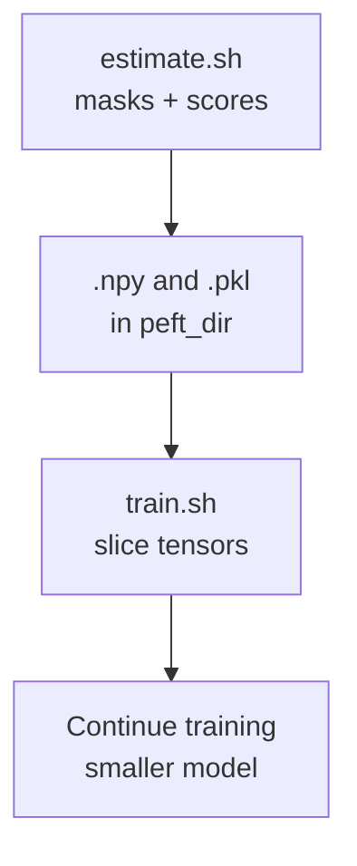

---
{
  "id": "deep-dive-light-peft",
  "title": "Deep Dive - Light-PEFT",
  "slug": "deep-dive-light-peft",
  "section": "Project Deep Dives",
  "category": "Fine-Tuning & Training",
  "difficulty": "Hard",
  "order": 17,
  "coverImage": "illustrations/_generated/lightpeft_estimate_lifecycle_dark.png",
  "companies": [
    "Institute of Information Engineering, Chinese Academy of Sciences",
    "School of Cyber Security, University of Chinese Academy of Sciences"
  ],
  "shortDescription": "A LoRA run can fit its trainable budget and still execute every frozen head. Light-PEFT scores those coordinates, then physically cuts the low-scoring ones before the longer fine-tune.",
  "keyConceptsTested": [
    "Frozen-backbone forward and activation cost under PEFT",
    "Two-phase estimate, structured prune, and continued fine-tuning",
    "Scalar attention-head and FFN dimension masks with L1 penalty",
    "Layer-wise head pruning and global FFN pruning",
    "PEFT module output-change ratios",
    "First-order Taylor rank importance",
    "Saved mask records, adapter weights, and physical tensor surgery",
    "LoRA and Adapter scope in the paper and repository",
    "Table 1, Figure 4, and Table 5 empirical performance",
    "Shared-base adapter serving and RL distribution-shift risks",
    "Academic source, contributor, and license scope",
    "Reproducible experiment records and failure diagnosis"
  ],
  "prerequisites": [
    "deep-dive-tinker",
    "lora-parameter-efficient-fine-tuning",
    "training-backpropagation-gradient-descent",
    "deep-dive-transformers"
  ],
  "relatedQuestions": [
    "supervised-fine-tuning-pipeline",
    "mixed-precision-training-loss-scaling",
    "distributed-training-fsdp-deepspeed-zero",
    "scaling-laws-compute-optimal-training"
  ]
}
---

Your <span data-glossary="lora">LoRA</span> run slashes trainable parameters by 99%, yet the <span data-glossary="gpu">GPU</span> profiler still shows the same sluggish forward pass and heavy activation memory. Why? Freezing a weight matrix removes its optimizer state, not its matrix multiplications. Every batch still streams the entire frozen backbone, evaluates every attention head, and computes every feed-forward coordinate.

**Light-PEFT** (ACL 2024) attacks that frozen cost directly.[^gunaibin2024lightpeft] Instead of keeping the full backbone intact for the entire fine-tuning run, it spends a brief early estimation window scoring attention heads, <span data-glossary="feed-forward-network">FFN</span> intermediate dimensions, PEFT modules, and adapter ranks, then physically slices away the quiet coordinates before running the main fine-tune on a genuinely smaller dense model.[^lightpeft2024repo]

We will follow a compact four-head, five-FFN-coordinate, rank-four walkthrough from early score estimation through physical tensor surgery, tracing how the research paper maps onto `NLU/estimate.py`, `NLU/train.py`, and its bundled PEFT fork.

<figure>
  
  <figcaption>The walkthrough scores drive three distinct cuts: a layer-wise quantile on four heads, a global quantile across five <span data-glossary="feed-forward-network">FFN</span> coordinates, and module pruning followed by rank pruning. Green cells sit strictly above the threshold and survive; red cells are sliced out.</figcaption>
</figure>

## Start with cost that PEFT leaves behind

In ordinary LoRA, a frozen base matrix $W$ receives a low-rank update:[^hu2021]

$$
W' = W + s A B,
$$

where $A \in \mathbb{R}^{d_{\text{in}} \times r}$, $B \in \mathbb{R}^{r \times d_{\text{out}}}$, and $s$ is the adapter scale. (PyTorch stores linear weights transposed, so `lora_A.weight` has shape `[r, d_in]` and `lora_B.weight` has shape `[d_out, r]`; cutting a rank removes rows of `lora_A` and matching columns of `lora_B`.)

Lowering rank $r$ shrinks the adapter branch, but the dense backbone still runs in full on every training step:
1. Stream frozen weights and trainable adapter weights into registers.
2. Execute the full forward pass across every surviving attention head and FFN channel.
3. Retain (or rematerialize) intermediate activations for backpropagation.
4. Propagate <span data-glossary="gradient">gradients</span> backward through frozen layers to reach earlier adapters.
5. Update only the small adapter <span data-glossary="optimizer">optimizer</span> state.

> **Key insight:** "Frozen" eliminates optimizer memory for base weights, not forward FLOPs, weight-read bandwidth, or activation memory. That is why LoRA's wall-clock step time and peak memory still climb steeply as base model size grows.[^gunaibin2024lightpeft]

### A tiny cost ledger

Take one small Transformer layer with hidden width $d = 8$, sequence length $S = 4$, and FFN intermediate width $32$. Per <span data-glossary="token">token</span>, the dense linear projections cost:

| Projection | Multiply-accumulate pairs per token | Why ordinary LoRA still pays it |
| --- | ---: | --- |
| Q, K, V projections | $3 \times 8 \times 8 = 192$ | Frozen <span data-glossary="matrix">matrices</span> still compute attention inputs |
| Attention output projection | $8 \times 8 = 64$ | Residual stream still projects all heads back |
| FFN up projection | $8 \times 32 = 256$ | Every intermediate coordinate executes |
| FFN down projection | $32 \times 8 = 256$ | Every coordinate feeds the residual output |
| LoRA branch (one target) | $8r + 8r$ | Small relative to the 768 frozen pairs |

Across $S = 4$ tokens, the frozen projections execute $3{,}072$ multiply-accumulate pairs ($6{,}144$ FLOPs), before even counting attention scores or memory transfers. Shrinking rank $r$ touches only the final row; cutting unused heads and FFN coordinates shrinks the first four rows physically.

### Why quantization answers a different question

<span data-glossary="qlora">QLoRA</span> compresses base weights into 4-bit storage to cut static weight memory, then dequantizes them for computation.[^dettmers2023] Structured pruning changes the *dimensions* of the matrices themselves, shrinking both weights and activations at once. Light-PEFT studies structured pruning independently of quantization.

```checkpoint
What cost does ordinary LoRA fail to remove?
---
LoRA eliminates base-weight gradients and optimizer state, but every training step still runs the full frozen backbone forward pass, stores its activations, and backpropagates through frozen layers to earlier adapters.
```

<!-- leetllm: edition:reference:start -->

## Research scope and production handoff

The Light-PEFT release is an academic research codebase from Naibin Gu, Peng Fu, Xiyu Liu, Bowen Shen, Zheng Lin, and Weiping Wang (Institute of Information Engineering, Chinese Academy of Sciences), published for Findings of <span data-glossary="acl">ACL</span> 2024 under the `gccnlp` GitHub organization.[^gunaibin2024lightpeft][^lightpeft2024repo][^lightpeft2024contributors]

Before adapting it into a production stack, note two practical constraints: the bundled `peft/` fork carries an Apache-2.0 `LICENSE` while the repository root has no top-level license file, and the repository ships without CI workflows or dedicated unit tests for its two-phase pruning path.[^lightpeft2024repo][^lightpeft2024license]

## Repository map: follow the handoff

The repository keeps its two-phase workflow explicit across scripts and modules:

| Path | Role | What to inspect |
| --- | --- | --- |
| `scripts/estimate.sh` | Phase 1 launch | Dataset, model, rank, mask trainer, output `peft_dir` |
| `scripts/train.sh` | Phase 2 launch | Pruning ratios, `peft_dir`, continuation flags |
| `scripts/vanilla_train.sh` | Baseline script | Standard fine-tuning without early pruning |
| `NLU/estimate.py` | Score recorder | Callback writing `.npy` and `.pkl` histories |
| `NLU/train.py` | Continuation trainer | Loads pruned base + sliced adapters |
| `NLU/get_trainer.py` & `trainer_base.py` | Mode & loss wiring | L1 mask penalty and Taylor importance collection |
| `NLU/nlu_utils.py` | Tensor surgery | Head, FFN, module, and rank slicing helpers |
| `models/hf_roberta/modeling_roberta.py` | Backbone fork | Mask multiplication and linear layer slicing |
| `peft/src/peft/` | PEFT fork | LoRA and Adapter wrappers |

While the paper evaluates RoBERTa-Large, OPT-1.3B, and OPT-6.7B, the repository's runnable NLU path wires up RoBERTa sequence-classification and multiple-choice models.[^gunaibin2024lightpeft][^lightpeft2024repo]

### Dependency age is part of the experiment

The repository's `requirements.txt` targets `torch==2.0.1`, `transformers==4.31.0`, `datasets==2.13.0`, and `numpy==1.25.1`. Porting to modern Transformers or PEFT releases requires adapting module paths, linear weight layouts, and checkpoint loading, and logging exact package versions alongside saved mask hashes.

<!-- leetllm: edition:reference:end -->

## Lifecycle: estimate, prune, continue

Light-PEFT splits fine-tuning into two clean phases: **early estimation** (learning soft importance scores for a short prefix of training) and **physical pruning plus continuation** (slicing tensors into a compact dense model and running the remaining epochs).

<figure>
  
  <figcaption>Estimation runs for a small prefix of total steps, persists mask and importance histories to disk, and hands off to physical tensor surgery so continuation trains on smaller dense shapes (3 heads, 3 FFN coordinates, rank 2 in our walkthrough).</figcaption>
</figure>

The estimation prefix $t'$ stays small relative to total training steps $t$: roughly 5% on GLUE and up to 10% on SuperGLUE and QA (the paper's appendix reports no further gain on BoolQ past ~6.8%).[^gunaibin2024lightpeft]



1. **Estimate:** Attach trainable scalar masks to attention heads and FFN channels (initialized to `1.0`) alongside PEFT adapters, and train briefly with an L1 sparsity penalty.
2. **Record:** Callbacks save mask trajectories (`.npy`), module output-change ratios, and Taylor rank scores (`.pkl`) into `peft_dir`.
3. **Slice and restore:** Phase 2 computes quantile thresholds, slices backbone linear layers and matching adapter feature dimensions, restores surviving adapter weights, and slices surviving adapter ranks.
4. **Continue:** A fresh trainer (`draw_and_training=True`) runs the rest of fine-tuning on the smaller dense matrices.

## Masked Early Pruning of the foundation model

Rather than zeroing scattered individual weights (which dense GPU kernels rarely speed up), Light-PEFT learns structured scalar gates over whole attention heads and FFN intermediate dimensions.

### Attention head masks

In layer $i$, each attention head $j$ receives a learnable scalar $m_{A,j}^{(i)}$ initialized to `1.0`:

$$
h^{(i)}_j = m_{A,j}^{(i)} \cdot \operatorname{head}^{(i)}_j(X).
$$

During estimation (`models/hf_roberta/modeling_roberta.py`), `early_attn_mask` scales each head's attention output. At pruning time, `prune_heads` removes low-scoring head slices synchronously across query, key, value, and output projections, shrinking all four dense matrices.[^lightpeft2024repo]

### FFN dimension masks

An FFN block projects up to intermediate width, applies an activation, multiplies by per-channel scalar mask $m_F$, and projects back down:

$$
z = \operatorname{Act}\!\left(X(W_{fc1}+\Delta W_{fc1})\right), \qquad \operatorname{FFN}(X) = (z \odot m_F)(W_{fc2}+\Delta W_{fc2}).
$$

Removing an intermediate coordinate requires paired slicing: `prune_inter_neurons` cuts matching output rows of `fc1` and input columns of `fc2` so their inner dimension stays valid.[^lightpeft2024repo]

### L1 penalty ranks candidate masks

To push redundant heads and channels apart from essential ones during the short prefix, the estimation loss adds L1 regularization on both masks:

$$
\mathcal{L}_{\text{mask}} = \mathcal{L} + \lambda_A \|m_A\|_1 + \lambda_F \|m_F\|_1,
$$

using $\lambda_A = \lambda_F = 10^{-4}$ in the paper's main runs.[^gunaibin2024lightpeft][^lightpeft2024repo] L1 separates the score distribution; a target pruning ratio and quantile then pick the exact cutoff.

### Layer-wise heads versus global FFN dimensions

Who competes for survival depends on the quantile axis:
- **Attention heads (layer-wise):** Each layer computes its own quantile so every layer drops roughly the same fraction of heads.
- **FFN dimensions (global in `train.sh`):** One threshold is computed across all layers combined (`quantile_axis=None`), letting heavily utilized layers keep more FFN width while quieter layers give up more.

> **Common mistake:** Assuming Light-PEFT ranks backbone masks by absolute magnitude $|m|$. In `prune_bert_attn` and `prune_bert_ffn`, the code thresholds the **signed** scalar values directly with strict `>`. A head whose mask learned `-0.91` is pruned first under signed ranking, even though it has the largest magnitude.[^lightpeft2024repo]

```checkpoint
Why does a quantile tie matter in Light-PEFT?
---
Selection keeps coordinates strictly greater (`>`) than the quantile threshold. If multiple coordinates tie at the threshold value, all tied entries are dropped, leaving fewer survivors than `1 - ratio` would suggest.
```

### Random pruning as a control

`get_early_model` includes a `random_pruning=True` branch that substitutes seeded random scores for learned masks, providing a clean ablation to test whether learned task scores actually beat arbitrary width reduction at the same budget.

## Multi-Granularity Early Pruning of PEFT

Next, Light-PEFT prunes the adapters themselves at two granularities: removing whole PEFT **modules** that barely alter activations, and trimming internal **rank** dimensions inside surviving modules. Because launching many small adapter kernels slows training more than a slightly higher rank inside fewer modules, cutting whole modules delivers real wall-clock savings.[^gunaibin2024lightpeft]

### Module importance from output change

For each LoRA module, importance is the norm ratio of its delta output to the frozen layer's output:

$$
I_M = \frac{\|X W_{\text{down}} W_{\text{up}}\|_2}{\|X W\|_2},
$$

and analogously $\|f(h W_{\text{down}}) W_{\text{up}}\|_2 / \|h\|_2$ for bottleneck Adapters.[^gunaibin2024lightpeft][^lightpeft2024repo] A near-zero ratio indicates that the adapter barely shifts activations on this task. Watch one subtle code detail: the callback replaces non-finite ratios (from a zero denominator) with `0.0`, which can make an unstable module look quiet unless you log NaN/Inf counts beforehand.[^lightpeft2024repo]

### Rank importance from first-order Taylor scores

To rank individual low-rank directions inside a surviving module, the paper defines first-order Taylor sensitivity per parameter:

$$
I_{W_{i,j}} = \left|\frac{\partial \mathcal{L}}{\partial W_{i,j}} W_{i,j}\right|,
$$

and sums magnitudes across the paired column of $W_{\text{down}}$ and row of $W_{\text{up}}$ so both matrices stay matched when sliced.[^gunaibin2024lightpeft]

Watch the discrepancy between paper and code: in `MaskTrainer.training_step`, the implementation averages signed `weight * grad` along each factor *before* taking `abs()`, so opposite-signed terms like `[+2, -2]` cancel to `0` instead of summing to `4`.[^lightpeft2024repo] Know which rule you are reproducing if you port the algorithm.

### Layer-wise versus global adapter ranking

`peft_pruning_method` switches rank pruning between per-module thresholds (`layerwise`, the dataclass default) and cross-module competition (`global`, used in `train.sh`), which concentrates rank capacity in the highest-leverage modules. If every rank in a module falls at or below threshold, that module gets rank zero and is disabled.

## Tiny numerical walk-through

Let's apply every cut by hand on our small example (matching the figure at the top of the lesson):

1. **Heads (layer-wise 25% cut):** Scores `[0.91, 0.08, 0.72, 0.54]` have linear 25th percentile `0.425`. Strict `>` drops head 2 (`0.08`) and keeps heads 1, 3, and 4.
2. **FFN coordinates (global 40% cut):** Pooled scores `[0.07, 0.63, 0.42, 0.15, 0.31]` sort to `[0.07, 0.15, 0.31, 0.42, 0.63]`. Linear interpolation gives `0.15 + 0.6 × (0.31 − 0.15) = 0.246`, dropping `0.07` and `0.15` and keeping `[0.31, 0.42, 0.63]`.
3. **PEFT modules (33% cut):** Output ratios `[0.04, 0.31, 0.11]` give threshold `0.04 + 0.66 × (0.11 − 0.04) = 0.0862`, dropping the `0.04` module.
4. **Adapter ranks (50% cut):** Rank scores `[0.02, 0.17, 0.03, 0.22]` have median `0.10`, keeping ranks 2 and 4 (`0.17` and `0.22`) across both `lora_A` rows and `lora_B` columns.

<!-- leetllm: edition:reference:start -->

## Code path from shell to saved artifacts

`scripts/estimate.sh` runs RoBERTa-Large on SST-2 with `--early_search True --use_mask_trainer True --use_peft True` for `max_steps=800`, writing mask and score files into `results/sst2/roberta-large-lora-p2-first_order/`.

### What `estimate.py` records

`SuperGLUECallback` captures per-layer mask values at evaluation and train end into `early_attn_mask_records.npy` and `early_ffn_mask_records.npy`, and averages the second half of PEFT module and rank histories into `peft_module_records.pkl` and `peft_mask_records.pkl`.

### What `train.py` reads

`scripts/train.sh` points `peft_dir` at those files with `--draw_and_training True` (defaulting to `attn_pruning_ratio=1/3`, `ffn_pruning_ratio=1/3`, `module_pruning_ratio=0.75`, `rank_pruning_ratio=0.5`, and global FFN/PEFT pruning). Note two subtle behaviors:
- **Preserved LoRA scaling:** Partial rank pruning slices `lora_A` and `lora_B` tensors without updating `r` or recomputing `alpha / r`, so the original scale persists. Reloading into a newer PEFT library that recomputes `alpha / new_rank` silently rescales every adapter update.
- **Fresh continuation, not optimizer resume:** `train.py` resets surviving backbone masks to `1.0`, disables mask learning (`set_mask(init_mask=False)`), and starts a fresh optimizer on the reduced shapes. Also avoid loading untrusted `.pkl` / legacy `torch.load` files.[^lightpeft2024repo]

### Failure modes at the estimate-to-train handoff

| Symptom | Likely cause | First check |
| --- | --- | --- |
| `FileNotFoundError` for `.npy` | Wrong `peft_dir` | List estimate output directory |
| Adapter key mismatch | Changed base model or LoRA targets | Compare target module lists between phases |
| Linear shape error | Pruned config and weights out of sync | Print surviving head counts and FFN widths |
| All modules removed | Aggressive ratio or score ties | Inspect survivor counts before wrapping |
| `NaN` scores | Unstable mask/adapter gradients | Check NaN counts and <span data-glossary="learning-rate">learning rate</span> |
| Slower total wall time | Estimation prefix outweighed continuation | Time Phase 1 + surgery + Phase 2 end to end |

<!-- leetllm: edition:reference:end -->

## A copy-runnable mask simulator

Run the exact NumPy quantile logic on our walkthrough scores to see strict `>` thresholding, tie behavior, and signed vs. magnitude head ranking in action:

<!-- leetllm: test, output=show, output_title="Mask simulator output", deps=numpy -->
```python title="lightpeft_mask_simulator.py"
import numpy as np


def keep_above(scores: np.ndarray, ratio: float):
    threshold = float(np.quantile(scores, ratio))
    kept = [int(i) for i in np.flatnonzero(scores > threshold)]
    return threshold, kept


heads = np.array([0.91, 0.08, 0.72, 0.54], dtype=np.float64)
ffn = np.array([0.07, 0.63, 0.42, 0.15, 0.31], dtype=np.float64)
rank_scores = np.array([0.02, 0.17, 0.03, 0.22], dtype=np.float64)

head_threshold, kept_heads = keep_above(heads, 0.25)
ffn_threshold, kept_ffn = keep_above(ffn, 0.40)
rank_threshold, kept_ranks = keep_above(rank_scores, 0.50)
rank_pairs = [(r, r) for r in kept_ranks]

assert kept_heads == [0, 2, 3]
assert kept_ffn == [1, 2, 4]
assert keep_above(np.ones(4), 0.25)[1] == []  # strict '>' drops all tied entries

# Signed vs. magnitude ranking flips which head survives
signed_heads = np.array([-0.91, 0.08, 0.72, 0.54])
assert keep_above(signed_heads, 0.25)[1] == [1, 2, 3]
assert keep_above(np.abs(signed_heads), 0.25)[1] == [0, 2, 3]

print(f"heads threshold={head_threshold:.3f} keep={kept_heads}")
print(f"ffn threshold={ffn_threshold:.3f} keep={kept_ffn}")
print(f"rank threshold={rank_threshold:.3f} pairs={rank_pairs}")
```

<!-- leetllm: output:start -->
```text title="Mask simulator output" output compact
heads threshold=0.425 keep=[0, 2, 3]
ffn threshold=0.246 keep=[1, 2, 4]
rank threshold=0.100 pairs=[(1, 1), (3, 3)]
```
<!-- leetllm: output:end -->

### Verify the adapter product and task behavior

Physical rank slicing must produce the exact same linear map as zeroing out the dropped rank activations, provided `lora_A` rows and `lora_B` columns share the same indices and the original scaling factor is preserved:

<!-- leetllm: test, output=show, output_title="Paired-slice verification", deps=numpy -->
```python title="lightpeft_paired_slice.py"
from itertools import combinations
import numpy as np

A = np.array([[1, 2, 0], [0, 1, 3], [2, 0, 1], [1, -1, 2]], dtype=np.float64)  # [r, d_in]
B = np.array([[1, 2, 3, 4], [-2, 1, 0, 3]], dtype=np.float64)                  # [d_out, r]
x = np.array([2, -1, 3], dtype=np.float64)
hidden = A @ x
checked = 0
for size in range(5):
    for kept in combinations(range(4), size):
        idx = list(kept)
        sliced = B[:, idx] @ (A[idx, :] @ x)
        masked_hidden = np.where(np.isin(np.arange(4), idx), hidden, 0.0)
        np.testing.assert_allclose(sliced, B @ masked_hidden)
        checked += 1

# Mismatched B columns or recomputed alpha/new_rank silently alters the update
correct = B[:, [1, 3]] @ hidden[[1, 3]]
wrong = B[:, [0, 2]] @ hidden[[1, 3]]
assert not np.allclose(correct, wrong)
assert not np.allclose((16.0 / 4.0) * correct, (16.0 / 2.0) * correct)
print(f"paired subsets checked={checked}; mismatched pairing and scale changes detected")
```

<!-- leetllm: output:start -->
```text title="Paired-slice verification" output compact
paired subsets checked=16; mismatched pairing and scale changes detected
```
<!-- leetllm: output:end -->

Note one bug in the upstream repo's control code if you inspect it: its random rank branch constructs an array and indexes it as a dictionary, and `random_shuffle` in the module helper is unused, so write clean guards before relying on those flags.[^lightpeft2024repo]

## Paper evidence: experimental methodology and metrics

The ACL 2024 paper evaluates Light-PEFT across GLUE, SuperGLUE, and QA on RoBERTa-Large, OPT-1.3B, and OPT-6.7B with LoRA and Adapter.[^gunaibin2024lightpeft]

### Table 1 trade-off

On RoBERTa-Large (four-task GLUE average over MNLI, QNLI, QQP, and SST-2 on a TITAN RTX, batch 32, length 128, with training speed **including** the early estimation window):[^gunaibin2024lightpeft]

| Method | Trainable params | Foundation retained | Four-task average | Training speed |
| --- | ---: | ---: | ---: | ---: |
| Baseline LoRA | 0.8M | 100% | 93.3 | 1.0× |
| Light LoRA (moderate pruning) | 0.3M | 72% | 92.2 | 1.4× |
| Light LoRA (heavier pruning) | 0.3M | 67% | 91.9 | 1.6× |

That is a clean Pareto curve: cutting a third of the backbone and pruning adapters yields 1.4× to 1.6× faster end-to-end training at the cost of 1.1 to 1.4 average GLUE points.

### Figure 4 training cost

On an RTX 3090 with RoBERTa-Large (67% retained foundation, 0.3M trainable params, batch 32, length 128), physical slicing cuts model-weight memory by **32%**, activation memory by **40%**, and peak memory by **39%**, running 10-batch forward/backward steps **2.2×** faster than baseline LoRA.[^gunaibin2024lightpeft]

### Table 5 inference performance

On OPT-6.7B (RTX 3090, batch 96, max length 100), both backbone pruning and module removal contribute separately to inference speedup:[^gunaibin2024lightpeft]

| Configuration | Foundation retained | Remaining LoRA modules | Inference speed | Load memory |
| --- | ---: | ---: | ---: | ---: |
| Vanilla LoRA | 100% | 192 | 1.0× | 12.5 GB |
| Light-PEFT | 76% | 192 | 1.1× | 9.5 GB |
| Light-PEFT | 52% | 192 | 1.2× | 6.5 GB |
| Light-PEFT | 52% | 96 | 1.4× | 6.5 GB |
| Light-PEFT | 52% | 48 | 1.6× | 6.4 GB |

Notice rows 3 through 5: holding the backbone constant at 52% and dropping 75% of LoRA modules (from 192 down to 48) boosts inference speed from 1.2× to 1.6× with essentially the same memory footprint.

### What the paper leaves untested

Open engineering questions outside the paper's scope include frontier <span data-glossary="mixture-of-experts">MoE</span> architectures, multi-tenant shared-base adapter fleets, QLoRA combinations, tensor/pipeline-parallel distributed training, and online reinforcement learning.

## Permanent base masks change serving semantics

Standard multi-LoRA serving shares one frozen base model across dozens of tenant adapters because every adapter expects the exact same matrix dimensions. Light-PEFT breaks that shared shape by physically slicing heads and FFN coordinates per task.

| Serving design | Upside | New cost |
| --- | --- | --- |
| One pruned base per task | Maximum task-specific speedup | Duplicate base weights; route traffic by shape |
| Unpruned base + dynamic masks | Shared base weights | Sparse masks only speed up with custom kernels |
| Union of task survivors | One shared shape across adapters | Union width creeps back toward unpruned size |
| Runtime tensor surgery | Flexible fleet | Complex synchronization and cache invalidation |

> **Common mistake:** Keying KV caches or compiled kernels only by `(model_name, head_count)`. Two pruned bases can both have 12 surviving heads while keeping *different* original head indices (say `[1, 3, 4]` vs. `[1, 2, 4]`). Always include the selected coordinate indices and base revision in cache keys.

## Reinforcement-learning distribution shifts

In supervised fine-tuning, the training distribution stays fixed. In online RL, the policy actively shifts the states it visits: early masks score heads on initial distribution $D_0$, physical surgery deletes quiet coordinates, and later exploration moves to $D_1$ where a deleted head may suddenly be essential. Because physical slicing is irreversible, keep unpruned checkpoints and evaluate on held-out shifted slices before committing to permanent cuts in RL loops.

<!-- leetllm: edition:reference:start -->

## Operational fragility and safe experiment design

### Shape requirements

Before loading a pruned adapter state dict, check base revision, layer count, surviving heads per layer, surviving FFN widths, target module names, rank, and bias/dropout config against the saved manifest rather than relying on matching state-dict key names alone.

### Numerical stability requirements

Log precision, loss scale, gradient clipping, NaN/Inf counts, and resolved mask learning-rate multipliers. Watch a classic config trap in the codebase: `MaskTrainer`'s constructor defaults attention/FFN mask LR multipliers to `100` and `50`, while `arguments.py` passes `1` for both, so a port that falls back to constructor defaults silently changes the search dynamics.[^lightpeft2024repo]

### Measurement protocol

Always benchmark the complete end-to-end window (model load + estimation prefix + mask serialization + physical surgery + continued fine-tuning + export) against a matched baseline on the same dataset and optimizer settings (note that the repo's `vanilla_train.sh` targets MNLI while `estimate.sh`/`train.sh` target SST-2).[^lightpeft2024repo]

### Failure isolation

Bring up a new architecture in four incremental steps: (1) one baseline forward/backward batch, (2) one estimation batch confirming all four `.npy`/`.pkl` outputs, (3) physical surgery printing every reduced linear shape, and (4) one post-pruning batch before launching full continuation.

<!-- leetllm: edition:reference:end -->

## Scope comparison with nearby methods

| Method | Shrinks base shapes? | Shrinks adapter shapes? | Search phase | Primary lever |
| --- | --- | --- | --- | --- |
| LoRA | No | Fixed rank | None | Low-rank trainable updates |
| QLoRA[^dettmers2023] | No | Fixed rank | None | <span data-glossary="quantization">4-bit quantized</span> base storage |
| Light-PEFT | Yes (heads & FFN) | Yes (modules & ranks) | Early prefix | Structured tensor slicing |

<!-- leetllm: edition:reference:start -->

## Questions to ask before adapting the code

### Does the model expose the same structures?

Modern decoder-only models use fused QKV matrices, grouped-query attention (GQA), rotary <span data-glossary="embedding">embeddings</span>, and gated SwiGLU FFNs rather than RoBERTa's separate dense layers; head and channel slicing must preserve each layout.

### Can a global score compare coordinates?

Global FFN and rank quantiles assume scores share a comparable scale across layers; inspect per-layer score distributions when changing normalization or depth.

### Is physical pruning legal for the deployment runtime?

Verify that your serving engine (vLLM, SGLang, TensorRT-LLM) and tensor-parallel sharding accept uneven per-layer head counts or non-multiple-of-64 FFN widths.

### Does the task distribution stay stable?

Re-evaluate on shifted or multi-task slices before freezing permanent backbone cuts.

### Can the experiment be undone?

Retain the unpruned base weights, original adapter checkpoint, and selected survivor indices; a mask alone cannot reconstruct sliced matrix rows.

## What a pruning review must defend

- Count the early estimation prefix inside total training wall time.
- Trace exact survivor indices across paired linear layers (`fc1`/`fc2`, `lora_A`/`lora_B`) and preserve the original LoRA scaling factor.
- Log per-layer surviving shapes, NaN/Inf score counts, and post-pruning accuracy on both in-distribution and shifted slices.
- Key serving caches by surviving coordinate IDs, not just tensor width.

### Follow-up questions

```checkpoint
Two pruned adapters have identical tensor shapes but kept different original head indices. Can they share a pruned base?
---
No. Equal tensor widths do not mean identical coordinates; multiplying an adapter against the wrong surviving heads silently corrupts activations. Match both base revision and selected coordinate IDs.
```

```checkpoint
A port reloads rank-four weights as rank two and recomputes alpha/r. The tensors load cleanly. What should you test next?
---
Compare forward outputs against the original pruned model. Light-PEFT preserves the original scaling factor during partial rank slicing, so recomputing alpha/new_rank doubles the update magnitude even though every shape matches.
```

<!-- leetllm: edition:reference:end -->

## Mastery quiz

```mastery-quiz
[
  {
    "question": "A layer with hidden width 12 and FFN width 36 processes six tokens. Each token passes through four attention projections and both FFN projections. Only the 12-by-12 query projection has an unmerged rank-2 LoRA adapter. Across all six tokens, how many multiply-accumulate pairs do the base projections and the adapter each require?",
    "options": [
      "Base 1,440; adapter 48 pairs.",
      "Base 8,640; adapter 144 pairs.",
      "Base 8,640; adapter 288 pairs.",
      "Base 17,280; adapter 576 pairs."
    ],
    "answer": "Base 8,640; adapter 288 pairs.",
    "explanation": "Per token, base projections take 4 × 12² + 2 × 12 × 36 = 1,440 pairs, and the rank-2 LoRA adapter takes 12 × 2 + 2 × 12 = 48 pairs. Across 6 tokens, that totals 8,640 base pairs and 288 adapter pairs."
  },
  {
    "question": "A head score vector is [−0.8, 0.1, 0.3, 0.6]. Request a 25% cut using linear quantiles and strict greater-than. Compare signed ranking with absolute-value ranking. Which zero-based head indices survive?",
    "options": [
      "Signed [1,2,3]; magnitude [0,2,3].",
      "Signed [0,2,3]; magnitude [1,2,3].",
      "Signed [1,2,3]; magnitude [1,2,3].",
      "Signed [0,2,3]; magnitude [0,2,3]."
    ],
    "answer": "Signed [1,2,3]; magnitude [0,2,3].",
    "explanation": "Signed linear 25th percentile is −0.8 + 0.75 × (0.1 + 0.8) = −0.125, keeping indices [1, 2, 3]. Sorted magnitudes [0.1, 0.3, 0.6, 0.8] have 25th percentile 0.25, keeping original indices [0, 2, 3]."
  },
  {
    "question": "Two layers each have four FFN scores: A [0.1, 0.2, 0.3, 0.4] and B [0.6, 0.7, 0.8, 0.9]. Apply strict linear-quantile 50% pruning globally, then compare separate 50% cuts within each layer. Which retained counts (A, B) follow?",
    "options": [
      "Global (2,2); layer-wise (0,4).",
      "Global (2,2); layer-wise (2,2).",
      "Global (0,4); layer-wise (0,4).",
      "Global (0,4); layer-wise (2,2)."
    ],
    "answer": "Global (0,4); layer-wise (2,2).",
    "explanation": "The global median is (0.4 + 0.6) / 2 = 0.5, keeping all 4 coordinates in B and 0 in A. Layer-wise medians (0.25 and 0.75) keep 2 coordinates in each layer."
  },
  {
    "question": "A raw threshold helper receives [0.4, 0.4, 0.4, 0.9] and uses linear 25th percentile with strict greater-than. Separately, its caller receives pruning ratio 0 and skips pruning entirely. How many coordinates survive in each case?",
    "options": [
      "Helper 3; zero-ratio caller 4.",
      "Helper 1; zero-ratio caller 4.",
      "Helper 1; zero-ratio caller 1.",
      "Helper 3; zero-ratio caller 1."
    ],
    "answer": "Helper 1; zero-ratio caller 4.",
    "explanation": "The 25th percentile is 0.4, so strict `>` drops all three tied 0.4 entries and keeps only 0.9 (1 survivor). The caller skips thresholding at ratio 0 and keeps all 4."
  },
  {
    "question": "A module has baseline output [3, 4] and adapter change [0.6, 0.8]. Another observation has zero baseline norm and produces a non-finite ratio that the callback replaces with zero. What are the first ratio and the right interpretation of the second?",
    "options": [
      "Ratio 0.04; numerical failure needs investigation.",
      "Ratio 0.20; measured quietness supports removal.",
      "Ratio 0.20; numerical failure needs investigation.",
      "Ratio 0.04; measured quietness supports removal."
    ],
    "answer": "Ratio 0.20; numerical failure needs investigation.",
    "explanation": "The Euclidean norms are 5 and 1, giving ratio 1 / 5 = 0.20. Replacing a non-finite division by zero with 0.0 masks a numerical failure rather than genuine low importance, so log and inspect invalid counts separately."
  },
  {
    "question": "For one LoRA rank at one step, the signed weight-gradient products are [3, −2] in the stored A row and [2, −1] in the matching B column. Light-PEFT's code sums the magnitudes of the two signed factor means, whereas the paper sums the magnitudes of the individual products. What score does each give?",
    "options": [
      "Code 1; paper 8.",
      "Code 0; paper 8.",
      "Code 1; paper 4.",
      "Code 8; paper 8."
    ],
    "answer": "Code 1; paper 8.",
    "explanation": "In code, the signed means are (3 − 2) / 2 = 0.5 and (2 − 1) / 2 = 0.5, whose magnitudes sum to 1. The paper sums individual magnitudes: |3| + |−2| + |2| + |−1| = 8."
  },
  {
    "question": "Stored A = [[1, 0], [0, 2], [1, 1]], B = [[2, 3, 4], [−1, 0, 2]], and input x = [2, 1]. Keep zero-based ranks [0, 2]. Original alpha = 6 and rank = 3, and Light-PEFT's partial slice preserves that original scale. What scaled update and scale result?",
    "options": [
      "Update [48, 12]; scale 3.",
      "Update [32, 8]; scale 2.",
      "Update [16, 4]; scale 1.",
      "Update [36, 12]; scale 2."
    ],
    "answer": "Update [32, 8]; scale 2.",
    "explanation": "A @ x = [2, 2, 3], so keeping ranks [0, 2] gives [2, 3]. Matching B columns [0, 2] map [2, 3] to [2×2 + 4×3, −1×2 + 2×3] = [16, 4]. Multiplying by preserved scale 6 / 3 = 2 yields [32, 8]."
  },
  {
    "question": "A matched baseline fine-tune takes 100 minutes. Light-PEFT spends 12 minutes estimating, 3 serializing, 4 slicing, 56 continuing, and 5 exporting. What are the total time and end-to-end speedup?",
    "options": [
      "56 minutes; 1.25×.",
      "80 minutes; 1.79×.",
      "56 minutes; 1.79×.",
      "80 minutes; 1.25×."
    ],
    "answer": "80 minutes; 1.25×.",
    "explanation": "Total end-to-end time is 12 + 3 + 4 + 56 + 5 = 80 minutes, giving 100 / 80 = 1.25× speedup. Dividing 100 by 56 alone omits the estimation and surgery overhead."
  },
  {
    "question": "Original heads 0 through 4 contribute [2, 5, −1, 3, 4] to a scalar output. Base A retains original IDs [1, 3, 4], while Base B retains [1, 2, 4]. A cache entry belongs to A and matches B's tensor width. What are the two outputs and the right cache action?",
    "options": [
      "A 12, B 8; reject A’s entry for B.",
      "A 12, B 12; accept A’s entry for B.",
      "A 12, B 8; accept A’s entry for B.",
      "A 12, B 12; reject A’s entry for B."
    ],
    "answer": "A 12, B 8; reject A’s entry for B.",
    "explanation": "Base A sums heads 1, 3, 4 (5 + 3 + 4 = 12), while Base B sums heads 1, 2, 4 (5 − 1 + 4 = 8). Because equal widths hide different surviving head IDs, B must reject A's cache entry."
  },
  {
    "question": "A held-out pruning test has 60 familiar cases and 40 shifted cases. All 60 familiar cases pass and 30 shifted cases pass. Your release requirement demands at least 90% on the shifted slice. What are the aggregate rate, shifted rate, and decision?",
    "options": [
      "Aggregate 90%; shifted 75%; approve.",
      "Aggregate 75%; shifted 90%; hold.",
      "Aggregate 90%; shifted 75%; hold.",
      "Aggregate 75%; shifted 90%; approve."
    ],
    "answer": "Aggregate 90%; shifted 75%; hold.",
    "explanation": "Overall accuracy is 90 / 100 = 90%, but shifted-slice accuracy is 30 / 40 = 75%, falling short of the 90% shifted-slice requirement, so hold the pruned model."
  }
]
```

> **Course complete:** Return to the [curriculum roadmap](/learn). A frozen backbone still costs a forward pass, and a mask becomes a real speedup only after paired tensor surgery shrinks the matrices cleanly. For a career next step, turn these systems deep dives into portfolio work with [AI Engineer Portfolio Projects That Get Interviews](/blog/ai-engineer-portfolio-projects-interviews).
