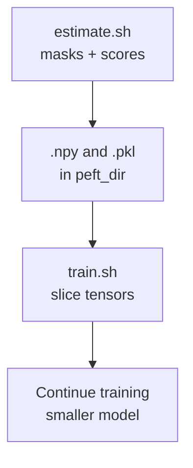

---
{
  "id": "deep-dive-light-peft",
  "title": "Deep Dive - Light-PEFT",
  "slug": "deep-dive-light-peft",
  "section": "Project Deep Dives",
  "category": "Fine-Tuning & Training",
  "difficulty": "Hard",
  "order": 17,
  "coverImage": "illustrations/_generated/lightpeft_estimate_lifecycle_dark.png",
  "companies": [
    "Institute of Information Engineering, Chinese Academy of Sciences",
    "School of Cyber Security, University of Chinese Academy of Sciences"
  ],
  "shortDescription": "A LoRA run can fit its trainable budget and still execute every frozen head. Light-PEFT scores those coordinates, then physically cuts the low-scoring ones before the longer fine-tune.",
  "keyConceptsTested": [
    "Frozen-backbone forward and activation cost under PEFT",
    "Two-phase estimate, structured prune, and continued fine-tuning",
    "Scalar attention-head and FFN dimension masks with L1 penalty",
    "Layer-wise head pruning and global FFN pruning",
    "PEFT module output-change ratios",
    "First-order Taylor rank importance",
    "Saved mask records, adapter weights, and physical tensor surgery",
    "LoRA and Adapter scope in the paper and repository",
    "Table 1, Figure 4, and Table 5 empirical performance",
    "Shared-base adapter serving and RL distribution-shift risks",
    "Academic source, contributor, and license scope",
    "Reproducible experiment records and failure diagnosis"
  ],
  "prerequisites": [
    "deep-dive-tinker",
    "lora-parameter-efficient-fine-tuning",
    "training-backpropagation-gradient-descent",
    "deep-dive-transformers"
  ],
  "relatedQuestions": [
    "supervised-fine-tuning-pipeline",
    "mixed-precision-training-loss-scaling",
    "distributed-training-fsdp-deepspeed-zero",
    "scaling-laws-compute-optimal-training"
  ]
}
---

Your <span data-glossary="lora">LoRA</span> experiment can fit its trainable-parameter budget and still miss its <span data-glossary="gpu">GPU</span> memory or latency budget. The profiler shows why: every batch still reads the frozen backbone, builds its activations, and evaluates every attention head and feed-forward coordinate. The previous chapter's hosted Tinker loop saves <span data-glossary="optimizer-state">optimizer state</span>, but freezing weights doesn't make their forward path disappear.

That leaves an adaptation decision: which dense coordinates can this task afford to lose, and what evidence will let you remove them without silently damaging quality? Dropping a LoRA rank makes the update smaller. It doesn't make the frozen matrix `W` smaller.

Light-PEFT, a <span data-glossary="parameter-efficient-fine-tuning">parameter-efficient fine-tuning</span> (PEFT) method, takes a deliberately sharp route. It spends a short prefix scoring heads, feed-forward dimensions, adapter modules, and adapter ranks, then physically removes the quiet coordinates before the longer fine-tuning run.[^gunaibin2024lightpeft]

The handoff is the lesson. A cost ledger produces task-local scores, those scores become saved records, and only a checked record may become a physical slice. We'll use four heads, five <span data-glossary="feed-forward-network">FFN</span> coordinates, and a rank-four adapter so each later cut has a visible owner.

We're reading the Association for Computational Linguistics (ACL) 2024 research release at the exact commit below, first inspected on September 23, 2026. On October 10, the repository's latest commit still matched that pin. Here ACL names the conference, not an access control list. The equations map onto `NLU/estimate.py`, `NLU/train.py`, and the bundled PEFT fork, not the current upstream PEFT API. Paper numbers stay inside their hardware protocol. A modern serving or reinforcement-learning system still has to prove the rest.[^lightpeft2024repo]

<figure>
  
  <figcaption>The walkthrough scores become three different cuts: a layer quantile on four heads, one global cut across five <span data-glossary="feed-forward-network">FFN</span> coordinates, then module pruning followed by rank pruning. Red cells sit at or below the quantile; green cells are strictly above it and survive.</figcaption>
</figure>

## Start with cost that PEFT leaves behind

Before the notation, make a prediction. If the base weight is frozen and adapter rank `r` falls, which part of a token's path gets shorter? The low-rank branch does. The dense backbone path remains unless we change its shape.

Suppose a Transformer layer receives hidden states `X`. With ordinary LoRA, a frozen weight `W` receives a low-rank update:[^hu2021]

$$
W' = W + sAB,
$$

where `A` maps from the hidden dimension to rank `r`, `B` maps back, and `s` is a scale. These equations use row-vector activations: `A` has shape `[d_in, r]` and `B` has shape `[r, d_out]`. PyTorch stores the transposes: `lora_A.weight` is `[r, d_in]` and `lora_B.weight` is `[d_out, r]`. Thus a rank cut removes mathematical A columns/B rows, or stored A rows/B columns. Only the adapter factors need <span data-glossary="optimizer">optimizer</span> updates. The layer still evaluates `XW'` for every token.

The phrase **frozen** describes parameter updates, not execution. Read one training step as a dependency chain:

1. Read frozen weights and trainable adapter weights.
2. Run forward through every surviving layer.
3. Keep activations or checkpoint enough information to reproduce them.
4. Backpropagate through the paths needed to reach trainable parameters, including frozen operations between adapters and loss.
5. Store <span data-glossary="gradient">gradients</span> only for trainable parameters, then update the adapter.

PEFT removes a large optimizer and gradient burden. It doesn't automatically remove backbone FLOPs, backbone weight reads, or activation memory. The paper measures this directly: as OPT grows, forward time and peak memory rise even though LoRA avoids most backbone parameter gradients.[^gunaibin2024lightpeft]

### A tiny cost ledger

Use one layer with hidden size `d = 8`, sequence length `S = 4`, and a feed-forward width of `32`. Changing adapter rank `r` modifies only the adapter update term in the final row. The rough dense projection count for one <span data-glossary="token">token</span> is proportional to:

| Work item | Shape or count | Why it remains under ordinary PEFT |
| --- | ---: | --- |
| Query, key, value projections | `3 × 8 × 8 = 192` multiply-add pairs | Frozen <span data-glossary="matrix">matrices</span> still produce attention inputs |
| Attention output projection | `8 × 8 = 64` pairs | Residual output still needs the projection |
| FFN up projection | `8 × 32 = 256` pairs | Every intermediate coordinate is computed |
| FFN down projection | `32 × 8 = 256` pairs | Every coordinate can affect residual output |
| LoRA update at one target | `8 × r + r × 8` pairs | Small when `r` is small, but additive |

The adapter may add only a small number of trainable parameters, while the frozen 768 projection pairs per token still run. For `S = 4`, that's 3,072 projection multiply-accumulate pairs (6,144 FLOPs if one multiplication and one addition count separately). This excludes attention-score and value aggregation products, <span data-glossary="softmax">softmax</span>, normalization, activation, and memory movement.

If a task never uses one <span data-glossary="attention-head">attention head</span>, or if many FFN coordinates carry little task signal, PEFT alone has no reason to skip them. A task-specific structured mask can make those coordinates absent from the second run.

### Why quantization answers a different question

Quantization stores weights in fewer bits, reducing their storage footprint while kernels may dequantize values for computation. Quantizing a frozen base doesn't remove additional base optimizer state: ordinary LoRA already avoids that state. Structured pruning instead changes how many rows, columns, heads, or dimensions exist. Light-PEFT studies the second lever. The paper does not evaluate a <span data-glossary="qlora">QLoRA</span> combination, so that configuration needs its own implementation and benchmark.[^gunaibin2024lightpeft][^dettmers2023]

Before deleting base-model coordinates, identify what this repository supports and where a production integration needs its own evidence.

```checkpoint
What does ordinary LoRA fail to remove?
---
It removes most trainable base-model state, but it still executes the frozen backbone forward and backward path. Activations, frozen weight reads, attention work, and FFN work remain unless another method changes the model shape or execution path.
```

## Research scope and production handoff

Before copying a pruning script into a training service, identify what you're holding. The source at commit `7b10c22026fe6fa283d127353a50d6ed7176a8aa` is a small academic code release for the Findings of <span data-glossary="acl">ACL</span> 2024 paper. Its authors are Naibin Gu, Peng Fu, Xiyu Liu, Bowen Shen, Zheng Lin, and Weiping Wang. Their listed affiliations are the Institute of Information Engineering, Chinese Academy of Sciences, and the School of Cyber Security, University of Chinese Academy of Sciences.[^gunaibin2024lightpeft]

Neither the paper nor repository names a company behind the project; primary ownership evidence points to those academic institutions and the `gccnlp` repository account.

Treat paper authors, the `gccnlp` repository account, and the GitHub contributors page as separate attribution records. The repository account publishes this snapshot; the contributors page reports code activity and does not map every paper author to a commit.[^lightpeft2024repo][^lightpeft2024contributors]

License wording needs the same care: the repository root has no repository-wide license file. The bundled `peft/` subtree contains an Apache-2.0 `LICENSE`, and its setup metadata identifies that package as a PEFT fork. It's correct to call that subtree Apache-2.0 licensed. It's not correct to call the full Light-PEFT repository Apache licensed.[^lightpeft2024repo][^lightpeft2024license]

This distinction affects reuse. A research reader can inspect the code, paper, experiment settings, and history. A production team still needs a license review for every file, <span data-glossary="model-checkpoint">model checkpoint</span> terms, dependency terms, and a maintenance plan. This checkout provides no service-level agreement, release cadence, or maintained model catalog. A useful handoff gives the production team a source map, an experiment report, and a clear account of the repository's research scope.

Repository maturity is equally narrow. There's no GitHub Actions workflow and no focused test suite for the Light-PEFT pruning path. The bundled `peft/tests` files exercise inherited configuration and adapter behavior, not the two-phase mask-to-surgery interface. Static Python compilation succeeds at the pinned commit, but that only proves files parse. It doesn't validate mask learning, <span data-glossary="tensor">tensor</span> slicing, checkpoint restoration, or reported performance.[^lightpeft2024repo] That gap is useful context for the rest of the chapter: every claim that matters needs a file, shape, or measurement you can inspect.

## Repository map: follow the handoff

The checkout is direct. It doesn't hide the two-phase workflow behind a package command. Read it by asking one question: what does `estimate.sh` produce that `train.sh` must consume?

| Path | Role | Evidence to inspect |
| --- | --- | --- |
| `README.md` | Install and experiment entry points | `estimate.sh`, `train.sh`, and `vanilla_train.sh` |
| `scripts/estimate.sh` | First phase command | dataset, model, rank, mask trainer, output directory |
| `scripts/train.sh` | Second phase command | pruning ratios, `peft_dir`, and continuation flags |
| `scripts/vanilla_train.sh` | Baseline comparison | same dataset family without early pruning |
| `NLU/estimate.py` | Mask and importance recorder | callback, `.npy`, and `.pkl` writes |
| `NLU/train.py` | Longer continued run | reads pruned model and adapter artifacts |
| `NLU/get_trainer.py` | Mode selection | early search versus draw-and-training |
| `NLU/trainer_base.py` | Loss and optimizer behavior | mask penalty and importance collection |
| `NLU/nlu_utils.py` | Physical pruning helpers | head, FFN, module, and rank surgery |
| `models/hf_roberta/modeling_roberta.py` | Backbone fork | mask multiplication and linear slicing |
| `peft/src/peft/` | PEFT implementation | LoRA and Adapter wrappers plus subtree license |
| `requirements.txt` | Environment pins | Torch 2.0.1, <span data-glossary="transformer">Transformers</span> 4.31.0, NumPy 1.25.1 |

Read the table from left to right: command, recorder, surgery helper, then consumer. This snapshot's custom model map registers RoBERTa sequence-classification and multiple-choice paths.

The paper evaluates LoRA and Adapter on RoBERTa-Large, OPT-1.3B, and OPT-6.7B, but the repository's runnable NLU path is much narrower than that sentence might suggest.[^gunaibin2024lightpeft][^lightpeft2024repo]

### Dependency age is part of the experiment

The release pins `torch==2.0.1`, `transformers==4.31.0`, `datasets==2.13.0`, `numpy==1.25.1`, `scikit_learn==1.3.0`, `fairscale==0.4.13`, and `fsspec==2023.6.0`. These versions describe the tested environment. Check current Transformers model classes, <span data-glossary="cuda">CUDA</span> drivers, and PEFT APIs before reusing the code.

An environment record should carry the pinned commit, Python and CUDA versions, GPU model and memory, and an exact `pip freeze` or lock export. Add the dataset revision and preprocessing settings, random seed, command line for both phases, and hashes for saved mask and adapter files. Those fields let a later reader tell whether a changed result came from code, data, hardware, or a different mask.

Without those fields, a speed or accuracy number is hard to reproduce. Inspect the loaded model shapes after the second command to confirm it selected the intended reduced architecture.

## Lifecycle: estimate, prune, continue

Light-PEFT separates **estimation** from **physical pruning**. During the first phase, masks and importance scores are trainable or recorded alongside PEFT updates. After a short prefix of training, the code selects survivors, slices tensors, writes records, and starts another trainer with those smaller tensors. The important handoff is this: a soft score becomes a shape-changing decision only after the saved records are checked.

<figure>
  
  <figcaption>Count the short estimate prefix in total cost. Persist the mask arrays, PEFT pickles, and adapter weights before physical pruning, then continue on the smaller walkthrough shapes: 3 heads, 3 FFN coordinates, and rank 2.</figcaption>
</figure>

Let `t` be the full training step count and `t′` the estimation prefix. For GLUE the paper keeps estimation around 5% of total steps; SuperGLUE stays within 10%; QA uses 10%. The appendix reports that extending estimation beyond about 6.8% didn't improve BoolQ.[^gunaibin2024lightpeft]

The two shell scripts make that separation visible. Read the diagram as a file handoff: `estimate.sh` learns evidence, `peft_dir` carries it, `train.sh` performs tensor surgery, and the new trainer receives a smaller model.



Those commands encode four handoffs:

1. **Estimate.** Build the baseline model and PEFT modules, initialize attention and FFN scalar masks to one, and train masks and PEFT parameters together for the estimation prefix.
2. **Record.** Evaluation and train-end callbacks save mask histories, PEFT module output ratios, and rank importance. Those records are the evidence that the next phase can inspect.
3. **Slice and restore.** The second process reads `peft_dir`, selects survivors, slices backbone and matching adapter feature dimensions, wraps the reduced base, restores filtered adapter weights, then slices adapter ranks. The estimate process owns the saved evidence; surgery consumes it.
4. **Continue and measure.** Start a new trainer with `draw_and_training=True`, then compare the complete wall-clock run, including estimation and continuation.

The mask is a score during phase one. A pruned dimension is a missing row or column during phase two. Before you run the second command, predict the failure if those rows and columns disagree: the adapter state can't fit the new base. For that reason, `train.sh` must use a compatible checkpoint and adapter state.

## Masked Early Pruning of the foundation model

The first method narrows the cost question to the frozen Transformer: which coordinates contribute enough to justify running them? It doesn't guess individual weight values. It learns two trainable mask families, one scalar per attention head and one scalar per <span data-glossary="feed-forward-network">FFN</span> intermediate dimension.

### Attention head masks

Start with one attention layer. During estimation, every head still exists, but a scalar can turn its contribution up or down. If that scalar ends near zero, predict what happens next: the output is gated first; the head disappears only when the pruning helper slices its feature range.

Let layer `i` have `N_H` heads. A head output is multiplied by scalar `m_A^(i)`. For one head:

$$
h^{(i)}_j = m_{A,j}^{(i)} \cdot \operatorname{head}^{(i)}_j(X).
$$

When `m_A` is near zero, the head contributes little to the task loss under this early trajectory. The mask starts at one, so initial behavior matches the unmasked model. Gradient descent can move individual values, while an L1 term makes small values attractive. This signal applies to the current task and training trajectory; later training or tasks can change the head's value.

The repository implements this in `models/hf_roberta/modeling_roberta.py`. When `config.mask_training` is true, each attention block creates `early_attn_mask` shaped like `(1, heads, 1, 1)` and multiplies attention probabilities by it. At pruning time `prune_heads` builds an index of retained head coordinates and slices query, key, value, and output linear layers.[^lightpeft2024repo]

That slice is structured. It removes a whole head's feature range, not random individual weights. Tensor cores and framework kernels can see a smaller dense matrix. The score creates a candidate; the slice creates the possible steady-state saving.

### FFN dimension masks

The FFN has a different shape requirement. If one intermediate coordinate leaves, both projections around that coordinate must agree. If `fc1` loses a column while `fc2` still expects the original width, the subsequent matrix multiplication fails with an inner dimension mismatch.

An FFN block has an intermediate activation:

$$
z = \operatorname{Act}(X(W_{fc1}+\Delta W_{fc1})),
$$

followed by a mask and the down projection:

$$
\operatorname{FFN}(X) = (z \odot m_F)(W_{fc2}+\Delta W_{fc2}).
$$

Here `m_F` has one scalar per intermediate coordinate. In the source, `early_ffn_mask` is shaped like `(1, intermediate_size)`. `prune_inter_neurons` slices `intermediate.dense` output rows and `output.dense` input columns using the surviving indices.[^lightpeft2024repo]

Removing an FFN coordinate therefore requires both sides of the bottleneck to agree. Slicing only `fc1` leaves `fc2` expecting the old width. Slicing only `fc2` leaves an activation with a mismatched width. The helper changes both. Keep that paired-index rule in mind when you inspect a saved mask.

### L1 penalty ranks candidate masks

The mask values still need a selection rule. A small value is a hint, not yet a deletion, so the mask trainer adds pressure toward sparse values:

$$
\mathcal{L}_{mask} = \mathcal{L} + \lambda_A\lVert m_A\rVert_1 + \lambda_F\lVert m_F\rVert_1.
$$

`trainer_base.py` loops through attention and layer modules, sums the absolute values, and multiplies by `l1_loss_coef`. The shell example sets `l1_loss_coef=1e-4`. The paper's appendix reports `λ_A = λ_F = 1 × 10^-4` for its main experiments.[^gunaibin2024lightpeft][^lightpeft2024repo]

L1 doesn't decide an exact number of heads or neurons by itself. Ask what would happen if every mask stayed above zero: a later ratio and quantile would still choose survivors. L1 makes the score distribution easier to rank, then the requested ratio sets a capacity budget.

### Layer-wise heads versus global FFN dimensions

Before choosing a threshold, decide who is allowed to compete. For attention heads, the helper defaults to layer-wise pruning. It computes a quantile separately within each layer, then prunes values at or below that layer's threshold. Every layer therefore loses roughly the requested fraction, subject to ties.

For FFN dimensions, `train.sh` passes `--ffn_pruning_method "global"`. The helper accepts `pruning_method="global"`, sets `quantile_axis=None`, and computes one threshold across all layers and dimensions. A layer with uniformly useful coordinates can keep more dimensions while another layer loses more. Global ranking spends the budget where scores are lowest; layer-wise ranking protects each layer's quota.

The repository uses layer-wise thresholds for attention heads and one global FFN threshold, so FFN dimensions compete across layers. Check score scales and survivor counts to confirm that this ranking matches the intended budget.

Also inspect the sign. The backbone masks are unconstrained trainable scalars, and `prune_bert_attn` and `prune_bert_ffn` threshold their signed recorded values, without taking magnitudes. Replace the walkthrough's `0.91` with `-0.91`: a 25% signed cut removes that head even though its gate magnitude is largest. Taking absolute values would instead remove the `0.08` head. A negative gate can reverse a contribution rather than make it quiet; changing the ranking rule is a method change, not a harmless numerical cleanup.[^lightpeft2024repo]

```checkpoint
Why does a quantile tie matter?
---
The source uses a strict `>` comparison after computing a quantile. Equal scores at the threshold can produce fewer survivors than a simple percentage calculation. Record the selected indices rather than only the requested ratio.
```

### Random pruning as a control

`get_early_model` uses the saved mask arrays by default. With `random_pruning=True`, it creates seeded random scores and uses them in place of recorded values. Treat that branch as a control: it asks whether a claimed gain depends on task evidence rather than on any structured shape reduction.

Random pruning changes <span data-glossary="tensor-shape">tensor shapes</span>. Compare it with the same seed policy, ratio, hardware, and total time before attributing a performance gain to mask learning.

## Multi-Granularity Early Pruning of PEFT

Once the backbone has candidate survivors, turn the same question toward the adapter. The second method sees adapter capacity at two scales. At **module scale**, should an entire LoRA or Adapter insertion remain at this weight or sub-layer? At **rank scale**, if it remains, how many of its low-rank coordinates are useful? A large module can barely change the task trajectory, while a small surviving module can still spend rank and compute.

Module removal can cut many small operations. Rank removal can retain a module while reducing its internal width. The paper reports both because increasing the number of structured modules can affect forward and backward time more than increasing the rank of one module under a fixed parameter budget.[^gunaibin2024lightpeft]

### Module importance from output change

Make the module decision from what it changes, not from its parameter count. If a module's output barely moves relative to the path it would have taken without the adapter, predict that its score will be close to zero.

For LoRA, the repository and paper compare the adapter output to the frozen weight output:

$$
I_M = \frac{\lVert XW_{down}W_{up}\rVert_2}{\lVert XW\rVert_2}.
$$

For an Adapter inserted after a sub-layer with output `h`:

$$
I_M = \frac{\lVert f(hW_{down})W_{up}\rVert_2}{\lVert h\rVert_2}.
$$

An output ratio near zero says the module changed this task's activations little during the observed prefix. The code collects `pos_importance_scores`, averages the processed history, and writes `peft_module_records.pkl`.[^gunaibin2024lightpeft][^lightpeft2024repo] The word **observed** matters: a quiet prefix can still hide a later task slice.

The displayed ratio suppresses implementation details: the fork's numerator includes LoRA scaling and dropout, its denominator includes the base linear bias, and `MaskTrainer` averages over non-padding tokens. There is no denominator epsilon in the forward ratio. The callback later replaces non-finite observations with zero, which can conceal instability and depress a module score. Log invalid counts before sanitization and report them alongside module scores.[^lightpeft2024repo]

The estimate places modules on all targeted weights so it can compare positions. This can cost more during the short prefix than a usual LoRA run. The paper's argument is that a small search cost can pay for a longer reduced run.

The helper `prune_peft_modules` takes module scores, computes a global quantile, and returns adapter parameter keys for surviving modules. `get_early_peft_model` filters the adapter state dict to those keys, sets `reserved_modules`, and enables `prune_module` so future wrapping skips removed positions.

### Rank importance from first-order Taylor scores

Module pruning asks whether an insertion earns a place. Rank pruning asks which paired low-rank directions earn width. If setting one rank coordinate to zero would change the loss a lot, its first-order score should be large.

For parameter `W_{i,j}` in either down or up projection, the paper writes the first-order term as:

$$
I_{W_{i,j}} = \left|\frac{\partial \mathcal{L}}{\partial W_{i,j}}W_{i,j}\right|.
$$

The paper's Equation 11 takes the absolute value of each weight-gradient product, then its rank score sums those magnitudes for one column of `W_down` and the matching row of `W_up`. This treats a rank coordinate as a unit. Removing only one side would break the low-rank product, so both matrices are sliced.[^gunaibin2024lightpeft]

The repository makes a different aggregation choice. In `MaskTrainer.training_step`, each PEFT module computes `weight * grad` for its down and up matrices, averages along the complementary axis, takes absolute values of those means, stacks the two <span data-glossary="vector">vectors</span>, and sums them into `importance_scores`. Signed products can cancel before that absolute value: products `[+2, -2]` contribute zero through this mean, whereas the paper's sum of magnitudes gives four. The callback averages the later half of the history, replaces NaN and infinity with zero, multiplies by the absolute current mask when present, and writes `peft_mask_records.pkl`. A faithful port must choose which rule it reproduces.[^lightpeft2024repo]

The source's `prune_peft_rank` then computes a quantile across rank scores. For LoRA it slices `lora_A` rows and `lora_B` columns. If every rank is selected for removal, the module gets rank zero and its adapter is disabled. The same pattern exists for the bottleneck Adapter fork.[^lightpeft2024repo]

### Layer-wise versus global adapter ranking

The helper accepts `peft_pruning_method`. A layer-wise choice computes a threshold inside each module. A global choice compares rank coordinates across all matching adapter modules. `arguments.py` defaults both `ffn_pruning_method` and `peft_pruning_method` to `layerwise`. The example `train.sh` overrides both to `global`. The consequence is distinct: global rank pruning concentrates capacity in a few high-importance modules, whereas layer-wise pruning enforces a separate threshold within each module. Record those configuration flags in training logs; preserving only the pruning ratios is insufficient.

Global rank pruning can concentrate capacity in a few modules. Layer-wise pruning sets separate thresholds, yet tied scores can still remove an entire module at a modest ratio. Check each resulting rank before export.

## Tiny numerical walk-through

Now make the cuts by hand. Use four attention heads in one layer, with the same numbers as the score map above. Evaluate which head falls below a layer-wise 25% cut:

| Head | 1 | 2 | 3 | 4 |
| --- | ---: | ---: | ---: | ---: |
| `m_A` | 0.91 | 0.08 | 0.72 | 0.54 |

Request an attention pruning ratio of `0.25`. With NumPy's default linear interpolation, the layer-wise 25th percentile is `0.425` for this tiny list. The source keeps values strictly above that threshold, so head 2 is removed and heads 1, 3, and 4 survive. Query, key, value, and output slices now use three head ranges instead of four. The useful distinction is visible: the threshold chooses head 2; the four synchronized slices make the choice physical.

Next, evaluate cross-layer pooling. Group five FFN coordinates across two layers to see which two a global 40% cut removes:

| Coordinate | L0-n1 | L0-n2 | L0-n3 | L1-n1 | L1-n2 |
| --- | ---: | ---: | ---: | ---: | ---: |
| `m_F` | 0.07 | 0.63 | 0.42 | 0.15 | 0.31 |

For a global 40% pruning ratio, sort values: `0.07, 0.15, 0.31, 0.42, 0.63`. Linear interpolation gives `0.15 + 0.6 × (0.31 − 0.15) = 0.246`, removing two low coordinates and leaving `0.31, 0.42, 0.63`. The five-coordinate pool is a small arithmetic example, not the rectangular unpruned RoBERTa mask layout. A global cut can remove several coordinates from one layer if that is where the low scores are.

For the adapter, let three LoRA insertions produce output ratios `0.04`, `0.31`, and `0.11`. Evaluate the module cut first. A pruning ratio of `0.33` gives the threshold `0.04 + 0.66 × (0.11 − 0.04) = 0.0862`, so the strict comparison removes the `0.04` module. For a surviving module, suppose rank scores are `[0.02, 0.17, 0.03, 0.22]` and rank pruning ratio is `0.50`. The median threshold is `0.10`, so ranks 2 and 4 survive in this local example. The adapter's down projection keeps the corresponding rows and its up projection keeps matching columns.

The arithmetic separates three decisions:

- a score says how much a coordinate changed the observed task trajectory;
- a quantile turns scores into a budget;
- a physical slice turns the budget into dense smaller tensors.

None of those steps says that a coordinate is universally unimportant. A new task, sequence distribution, adapter target set, or reward can rank it differently.

## Code path from shell to saved artifacts

Now follow the handoff in the files. The first command creates empirical score records rather than a reduced model. The default `scripts/estimate.sh` pins one GPU (`CUDA_VISIBLE_DEVICES=2` in the example), GLUE SST-2, RoBERTa-Large, LoRA rank 8, sequence length 128, batch size 32, five <span data-glossary="epoch">epochs</span>, and `max_steps=800`. It passes `--early_search True --use_mask_trainer True --use_peft True` and writes under:

```text
results/sst2/roberta-large-lora-p2-first_order/
```

That path depends on `DATASET_NAME`, `model_name_or_path`, adapter name, and `peft_imp`. The source's `p2-first_order` string controls how PEFT importance is recorded. It isn't a generic method name recognized by current PEFT releases.

### What `estimate.py` records

At `on_train_begin`, `SuperGLUECallback` creates one list per encoder layer for attention and FFN masks. It also writes `init_peft_mask_records.pkl` with initial PEFT mask tensors. The callback is establishing the history that later pruning will treat as evidence.

At each evaluation, the callback records current mask values. At train end it records one final value, stacks each layer's history, and saves:

```text
early_attn_mask_records.npy
early_ffn_mask_records.npy
```

It also processes each PEFT module's score history. The code averages the latter half of the history, sanitizes NaN and infinity, and writes:

```text
peft_module_records.pkl
peft_mask_records.pkl
```

These files are compact relative to the model, but they record the run's <span data-glossary="provenance">data origin</span>. Hash them and keep the seed with the command. If those files are missing or point to another run, the second phase has no trustworthy handoff.

### What `train.py` reads

The second command consumes that handoff. The default `scripts/train.sh` points `peft_dir` at the estimate output and sets:

```text
attn_pruning_ratio=0.333333333
ffn_pruning_ratio=0.333333333
module_pruning_ratio=0.75
rank_pruning_ratio=0.5
ffn_pruning_method=global
peft_pruning_method=global
```

Read those knobs in two groups. The ratios request how much to remove; the method flags decide which scores compete. This command asks for a 75% module cut and a 50% rank cut among surviving modules, then lets global FFN and rank thresholds spend those cuts across layers. Keep the ratios but switch to layer-wise ranking and you've run a different experiment.

It passes `--draw_and_training True --use_peft True`. The script-default ratios differ from Table 1: the paper's 72% retained LoRA row prunes 5/16 of the heads (0.3125) and 1/3 of the FFN dimensions. To reproduce that row, set the matching ratios explicitly; `train.sh` currently requests a 75% module cut and a 50% rank cut.

The three provided scripts use different datasets and training policies, so their default wall times cannot serve as a matched pruning benchmark. `vanilla_train.sh` selects MNLI, five epochs, query/value LoRA targets, `warmup_ratio=0.06`, and `weight_decay=0.1`. The estimate and continuation scripts select SST-2, target query/key/value plus attention and FFN dense projections, and continue for ten epochs after the 800-step estimate. Align dataset and revision, target policy, optimizer settings, and total training budget before timing a local baseline.[^lightpeft2024repo]

`get_trainer.py` calls `get_early_model`, which loads the two `.npy` arrays, chooses the final recorded step, and prunes RoBERTa heads and FFN dimensions. `get_early_peft_model` then loads adapter state, selects modules, slices adapter feature dimensions to match the reduced base, wraps that base, restores filtered weights, and finally prunes ranks. Rank and module pickle reads are conditional on nonzero pruning ratios.[^lightpeft2024repo]

Partial rank pruning changes actual A/B tensor shapes without updating the module's nonzero `r` or recomputing `scaling`. The original scale therefore survives the slice. Rebuilding a modern adapter with `alpha/new_rank` would change its output. Export and reload need explicit per-module shapes and scale alongside the original configuration. Also treat `.pkl` files and the old `torch.load` checkpoint path as trusted-code inputs: don't load artifacts from an untrusted source.

The second command isn't a resume in the optimizer sense. It constructs a new model and trainer after tensor surgery. `set_mask(init_mask=False)` resets surviving backbone masks to one and disables their training/forward gates. The saved scalar magnitudes select coordinates; they aren't preserved as learned gates in continuation. If you need an uninterrupted optimizer trajectory, this code isn't that path.

### Failure modes at the estimate-to-train handoff

If estimation succeeds but continuation fails, isolate the phase failure before changing a ratio. A missing record points backward to the producer; a shape error points forward to the surgery and state pairing. The table gives each symptom a first check:

| Symptom | Failure point | Check |
| --- | --- | --- |
| `FileNotFoundError` for `.npy` | estimate output mismatch | print `peft_dir` and list files |
| adapter key mismatch | base model or target module changed | compare model name and LoRA target list |
| linear shape error | pruned config not paired with state | inspect head count and FFN width |
| all modules removed | quantile or ratio too aggressive | count survivors before wrapping |
| NaN score | unstable loss or gradient | inspect score history and <span data-glossary="learning-rate">learning rate</span> |
| no speed gain | kernels or data pipeline dominate | profile forward, backward, and input work |
| slower total result | search cost omitted or too large | measure both phases from clean start |

For a concrete diagnosis, suppose all four record files exist but `train.py` raises an adapter-key mismatch. Don't lower the pruning ratio first. Compare the base revision, target module list, and surviving shapes with the estimate log; the producer and consumer disagree about identity or layout. A linear shape error points to the same handoff after surgery, while a missing `.npy` points back to the estimate output path.

Keep command output in an execution log. The printed "pruning complete" line records that control flow reached the helper. Verify shape correctness, run a batch, and measure the complete path to assess throughput and task quality.

## A copy-runnable mask simulator

The following NumPy example lets you test the score-to-index handoff. This simulation demonstrates three core invariants: the head threshold keeps indices `[0, 2, 3]`, the global FFN cut keeps `[1, 2, 4]`, and every retained rank appears in both adapter projections. The example mirrors score selection, strict `>` thresholding, and rank pairing using NumPy vector operations. It validates that every retained rank is present in both adapter projections, and every selected backbone coordinate is explicit.

<!-- leetllm: test, output=show, output_title="Mask simulator output", deps=numpy -->
```python title="lightpeft_mask_simulator.py"
import numpy as np


def keep_above(scores: np.ndarray, ratio: float):
    threshold = float(np.quantile(scores, ratio))
    kept = [int(i) for i in np.flatnonzero(scores > threshold)]
    return threshold, kept


heads = np.array([0.91, 0.08, 0.72, 0.54], dtype=np.float64)
ffn = np.array([0.07, 0.63, 0.42, 0.15, 0.31], dtype=np.float64)
rank_scores = np.array([0.02, 0.17, 0.03, 0.22], dtype=np.float64)

head_threshold, kept_heads = keep_above(heads, 0.25)
ffn_threshold, kept_ffn = keep_above(ffn, 0.40)
rank_threshold, kept_ranks = keep_above(rank_scores, 0.50)
rank_pairs = [(r, r) for r in kept_ranks]

assert kept_heads == [0, 2, 3]
assert kept_ffn == [1, 2, 4]
assert [pair[0] for pair in rank_pairs] == [1, 3]
assert [pair[1] for pair in rank_pairs] == [1, 3]
assert keep_above(np.ones(4), 0.25)[1] == []
assert keep_above(heads, 0.0)[1] == [0, 2, 3]
assert keep_above(heads, 1.0)[1] == []

signed_heads = np.array([-0.91, 0.08, 0.72, 0.54])
assert keep_above(signed_heads, 0.25)[1] == [1, 2, 3]
assert keep_above(np.abs(signed_heads), 0.25)[1] == [0, 2, 3]

print(f"heads threshold={head_threshold:.3f} keep={kept_heads}")
print(f"ffn threshold={ffn_threshold:.3f} keep={kept_ffn}")
print(f"rank threshold={rank_threshold:.3f} pairs={rank_pairs}")
```

<!-- leetllm: output:start -->
```text title="Mask simulator output" output compact
heads threshold=0.425 keep=[0, 2, 3]
ffn threshold=0.246 keep=[1, 2, 4]
rank threshold=0.100 pairs=[(1, 1), (3, 3)]
```
<!-- leetllm: output:end -->

The output checks the simulator's logic against NumPy quantiles. For a production reproduction, compare exact selected indices against NumPy before using a trainer helper.

Try changing the rank ratio to `0.75`. The retained pair list shrinks, but every pair still has matching down and up coordinates. Try changing one backbone score to a tie at the threshold. The strict comparison then makes the survivor count depend on the quantile value.

### Verify the adapter product and task behavior

The next example uses NumPy matrix multiplication to verify tensor slicing. It tests every subset of a rank-four adapter. A physically sliced product must equal a full-width product with the removed rank activations zeroed, at the same scale. This checks tensor algebra; evaluate model output and task accuracy separately.

<!-- leetllm: test, output=show, output_title="Paired-slice verification", deps=numpy -->
```python title="lightpeft_paired_slice.py"
from itertools import combinations
import numpy as np

A = np.array([[1, 2, 0], [0, 1, 3], [2, 0, 1], [1, -1, 2]], dtype=np.float64)  # [r, d_in]
B = np.array([[1, 2, 3, 4], [-2, 1, 0, 3]], dtype=np.float64)                   # [d_out, r]
x = np.array([2, -1, 3], dtype=np.float64)
hidden = A @ x
checked = 0
for size in range(5):
    for kept in combinations(range(4), size):
        idx = list(kept)
        sliced_A = A[idx, :]
        sliced_B = B[:, idx]
        sliced = sliced_B @ (sliced_A @ x)
        masked_hidden = hidden.copy()
        for i in range(4):
            if i not in idx:
                masked_hidden[i] = 0.0
        masked = B @ masked_hidden
        np.testing.assert_allclose(sliced, masked)
        checked += 1

# Mismatching B's rank columns keeps valid shapes but changes the function.
correct = B[:, [1, 3]] @ hidden[[1, 3]]
wrong = B[:, [0, 2]] @ hidden[[1, 3]]
assert not np.allclose(correct, wrong)
original_scale, rebuilt_scale = 16.0 / 4.0, 16.0 / 2.0
assert not np.allclose(original_scale * correct, rebuilt_scale * correct)
print(f"paired subsets checked={checked}; mismatched pairing and scale changes detected")
```

<!-- leetllm: output:start -->
```text title="Paired-slice verification" output compact
paired subsets checked=16; mismatched pairing and scale changes detected
```
<!-- leetllm: output:end -->

Neither example runs a Transformer, learns masks, checks an exported checkpoint, or reproduces GPU timings. The upstream helper also needs explicit guards for empty survivor sets and invalid histories. In particular, its random rank branch constructs an array and subsequently treats it like a name-keyed dictionary; the module helper accepts `random_shuffle` but doesn't use it. Don't interpret those flags as a validated end-to-end random control.[^lightpeft2024repo]

## Paper evidence: experimental methodology and metrics

Now separate the questions a benchmark can answer. The paper validates Light-PEFT on GLUE, SuperGLUE, and question-answering tasks. Its foundation models are RoBERTa-Large, OPT-1.3B, and OPT-6.7B. Its PEFT structures are LoRA and Adapter. These combinations define the published test scope; validate other models and adapters separately.[^gunaibin2024lightpeft]

### Table 1 trade-off

Table 1 compares LoRA on RoBERTa-Large with Light-PEFT variants. Each row represents a specific trade-off between search overhead, retained capacity, and downstream task accuracy. Read each row as one quality, capacity, and timing choice. The values below pair paper-reported averages with speeds measured on the paper's test setup. Re-run the timing on the hardware and implementation you plan to use.

| Method | Trainable params | Foundation retained | Four-task average | Training speed |
| --- | ---: | ---: | ---: | ---: |
| Baseline LoRA | 0.8M | 100% | 93.3 | 1× |
| Light LoRA, lower pruning | 0.3M | 72% | 92.2 | 1.4× |
| Light LoRA, higher pruning | 0.3M | 67% | 91.9 | 1.6× |

The average covers the paper's MNLI, QNLI, QQP, and SST-2 columns. Training speed includes estimation before pruning, measured on a single NVIDIA TITAN RTX 24GB <span data-glossary="gpu">GPU</span> with batch size 32 and sequence length 128. The paper does not report an end-to-end download-to-export stopwatch. The 72% row prunes 5/16 of the heads and 1/3 of the FFN intermediate dimensions, then also prunes PEFT modules and ranks.[^gunaibin2024lightpeft]

Notice the trade: the 67% retained configuration uses the same rounded 0.3M trainable parameter count as the 72% configuration, but gives up 0.3 GLUE average points for the reported 0.2× additional speedup. The useful comparison is a Pareto choice under a declared task and budget. "More pruning is always better" isn't a conclusion the table can support.

Relative to baseline LoRA, those rows lose 1.1 and 1.4 average accuracy points. The paper reports MNLI's matched validation accuracy and accuracy for the other three tasks. Appendix Table 7 supplies rank 8, 75% module pruning, 50% rank pruning, learning rate `3e-4`, and task-specific estimation steps and epochs. It reports no repeated-run variance, confidence interval, or complete precision, warmup, synchronization, and timing logs. Use the speed ratios as reported measurements under that setup; reproduce the measurement before relying on them for a deployment decision.[^gunaibin2024lightpeft]

### Figure 4 training cost

The pruning mechanism implies a direct physical consequence: if physical widths shrink, model-weight memory and activation memory should both fall, while the size of the fall still depends on the workload.

Figure 4 measures RoBERTa-Large on an NVIDIA RTX 3090 with batch size 32 and sequence length 128. In that experiment, the Light-PEFT setting retains 67% of foundation parameters and 0.3M trainable parameters. The paper reports 32% lower model-weight memory, 40% lower activation memory, and 39% lower peak memory. Its ten-batch forward and backward timing is 2.2× faster than baseline LoRA.[^gunaibin2024lightpeft]

The peak-memory result follows the mechanism taught earlier. Removing dimensions reduces both weight storage and intermediate activation shapes. The 2.2× ratio comes from the reported ten-batch forward/backward run on this configuration. Batch size, sequence length, GPU, and implementation affect the ratio; measure those settings again on your target workload.

### Table 5 inference performance

Hold the foundation at 52% retained and look at the module column. What can change the inference row without changing that backbone? The number of surviving adapter insertions. Section 5.3.2 places the efficiency experiments on an RTX 3090; Table 5 uses OPT-6.7B with batch size 96 and maximum length 100. It reports load memory and inference speed for foundation pruning and optional module pruning.

| Configuration | Foundation retained | Remaining LoRA modules | Inference speed | Load memory |
| --- | ---: | ---: | ---: | ---: |
| Vanilla LoRA | 100% | 192 | 1× | 12.5G |
| Light-PEFT | 76% | 192 | 1.1× | 9.5G |
| Light-PEFT | 52% | 192 | 1.2× | 6.5G |
| Light-PEFT | 52% | 96 | 1.4× | 6.5G |
| Light-PEFT | 52% | 48 | 1.6× | 6.4G |

The paper therefore reports up to 1.6× inference speed and 48% lower load memory in this OPT-6.7B protocol. "48%" compares 6.5G with 12.5G approximately, and the 1.6× row also removes 75% of PEFT modules. Keep those axes together when reproducing the result.[^gunaibin2024lightpeft]

### What the paper leaves untested

The paper evaluates those combinations. Validate support and benefit separately for:

- modern frontier <span data-glossary="mixture-of-experts">MoE</span> post-training;
- multi-task adapter fleets sharing one base;
- online reinforcement-learning distribution shifts;
- QLoRA plus Light-PEFT combinations;
- distributed large-scale jobs with tensor, pipeline, or expert parallelism;
- current CUDA, ROCm, or accelerator kernel stacks;
- continual pruning while adapters are loaded per request.

A capability claim beyond that scope needs a model-specific implementation, loader test, benchmark protocol, and license check.

## Permanent base masks change serving semantics

Training has handed us a shape-specific artifact. Imagine a compiled plan for 16 heads receiving a 12-head pruned base. Can the server reuse its cached tensors? No. A shared-base adapter service relies on compatible base dimensions and coordinate identities. Ordinary multi-adapter serving makes the same bet: request A selects adapter A, request B selects adapter B, and both still fit the same frozen matrix dimensions. A structured Light-PEFT run physically removes heads and FFN coordinates from that base.

That creates a serving choice:

| Serving design | Benefit | New requirement |
| --- | --- | --- |
| One pruned base per task | Smallest task-specific compute | Duplicate base weights and route requests to shape-specific workers |
| One unpruned base plus masks | Shared storage and shape compatibility | Masks may skip work only if kernels understand them; memory cost returns |
| Union of task survivors | One shared shape for a set of adapters | Union can approach the original width and erase savings |
| Runtime adapter rewrite | Flexible fleet | Physical tensor surgery, synchronization, and cache invalidation |

The paper's "plug-and-play" claim covers switching masks and PEFT modules in its tested setup.[^gunaibin2024lightpeft] Serving arbitrary adapters from one production base requires a deployment-specific implementation and kernel plan. Make that decision after defining the slice, because it determines which artifacts can share a shape.

KV caches and compiled kernels add more state. A cache keyed only by model name and adapter ID can return incompatible tensors if the base shape or pruning seed changes. Include base revision, shape signature, selected-coordinate identity, and adapter revision in cache keys. Two slices can have identical dimensions but retain different original heads. The cache key is part of the pruning specification, not an implementation detail to fill in later.

## Reinforcement-learning distribution shifts

Early scores come from a prefix of one data distribution. Ask whether that evidence is still valid after the model changes. In <span data-glossary="supervised-fine-tuning">supervised fine-tuning</span>, later batches can already differ from the prefix. In online RL, the policy changes the data it receives, so the shift can be stronger:

1. The initial policy samples trajectories from distribution `D_0`.
2. Early masks rank coordinates using rewards and gradients from `D_0`.
3. Pruning changes policy capacity and removes some routes.
4. The new policy samples `D_1`, which can contain states absent from `D_0`.
5. A removed head or FFN coordinate may be important in `D_1` even if it looked quiet in `D_0`.

The paper's static GLUE and QA protocol does not measure this RL concern. An RL evaluation should log policy version, mask version, trajectory distribution, reward slices, and divergence before and after pruning. A held-out online stream can test whether reward collapse follows the physical cut. The important question is causal: did the reward change because of the physical cut, or because the policy changed the data?

If a system needs reversible exploration, keep the unpruned base or a set of checkpoints. A one-way physical slice is cheap to run but expensive to undo without rebuilding the original model.

## Operational fragility and safe experiment design

The code is concise because it assumes a controlled research machine. A production adaptation fails at handoffs, not at the idea's headline: a state dict can have familiar keys and still target the wrong shapes, or a speedup can disappear once estimation is counted. Treat each checklist below as an operational gate.

### Shape requirements

Before loading adapter state, verify structural dimensions explicitly:

- base model identifier and revision;
- number of layers;
- surviving attention heads per layer;
- hidden size and head dimension;
- surviving FFN width per layer;
- target module names;
- LoRA rank or Adapter bottleneck width;
- bias and <span data-glossary="dropout">dropout</span> configuration.

The source slices tensors in place and restores state dict entries by name. A different Transformers implementation can rename a module or store transposed weights. A name match isn't enough; compare tensor shapes before the load. If the shape signature changes, stop before the adapter can fail deeper in the forward pass.

### Numerical stability requirements

Mask penalties and first-order scores depend on gradients. A score change can come from numerical settings rather than task evidence, so record:

- precision and autocast state;
- loss scale if <span data-glossary="mixed-precision">mixed precision</span> is enabled;
- gradient clipping;
- learning rate and mask learning-rate multipliers;
- NaN and infinity counts;
- evaluation interval used to sample mask history.

The repository uses separate attention and FFN mask learning-rate coefficients. `MaskTrainer` has constructor defaults of 100 and 50, but `get_trainer.py` passes `arguments.py` values, and those dataclass defaults are both 1. The example shells don't override them. A port that silently keeps the constructor defaults, or changes the multipliers, changes the search problem.[^lightpeft2024repo] Record the resolved values passed to the trainer; constructor defaults alone can mislead.

### Measurement protocol

A speed claim can be true and still answer the wrong question if the stopwatch starts after the expensive search. Time the complete workflow:

```text
clean process start
  + model and tokenizer load
  + dataset preparation
  + estimation prefix
  + mask and score serialization
  + physical pruning and model rebuild
  + continued fine-tuning
  + evaluation and export
```

The paper's Table 1 explicitly includes estimation before pruning. A benchmark that starts its stopwatch after the masks exist will overstate speedup. A benchmark that includes data download but not model load will answer a different question. State both wall-clock definitions.

### Failure isolation

Run checks in dependency order:

1. **Environment and baseline.** Import the pinned dependency set, load the tokenizer and base model without PEFT, then run one baseline forward and backward batch.
2. **Estimation.** Run one estimation batch, inspect mask ranges, and confirm all four record files exist.
3. **Surgery.** Rebuild one pruned model, print its shapes, and restore one filtered adapter state dict.
4. **Smoke test.** Run one post-pruning batch. Only then start the full continuation.

This order separates environment errors from score errors and shape errors. It also avoids burning a long GPU job before discovering that the saved `peft_dir` points to another dataset. Those gates are about this repository. They don't say how the same idea differs from LoRA or QLoRA, which leave the base shape alone.

## Scope comparison with nearby methods

The difference is the dense shape. Light-PEFT combines pruning with PEFT. It isn't a replacement name for every efficient fine-tuning approach.

| Approach | Changes base shape? | Changes adapter shape? | Search timing | Main evidence |
| --- | --- | --- | --- | --- |
| LoRA | No | Fixed rank | None | adapter task loss |
| QLoRA[^dettmers2023] | No physical shape change | Fixed rank | None | <span data-glossary="quantization">quantized</span> storage and adapter loss |
| Light-PEFT | Yes, structured heads and FFN | Yes, modules and ranks | Early prefix, then slice | masks, output ratios, Taylor scores |

Light-PEFT's efficiency comes from paying for a change in the model's dense shapes. That makes its steady-state run different from a method that only gates execution or stores lower-precision weights. Because the method rewrites dense dimensions, its runtime must accept the resulting shape.

## Questions to ask before adapting the code

When moving beyond RoBERTa NLU, use these as go-or-stop questions in order. A “yes” at one gate doesn't imply a “yes” at the next.

### Does the model expose the same structures?

The code knows RoBERTa attention and layer classes. A decoder-only model may store fused QKV, grouped-query heads, rotary <span data-glossary="embedding">embeddings</span>, parallel residual paths, or gated FFN matrices. A head slice must respect those layouts. An MoE layer adds expert routing and capacity rules that this code doesn't model.

### Can a global score compare coordinates?

Global FFN and rank quantiles assume scores share a meaningful scale. <span data-glossary="layernorm">Layer normalization</span>, module placement, and gradient scale can make one layer's numbers incomparable. Normalize or keep thresholds local only after checking the score distribution.

### Is physical pruning legal for the deployment runtime?

A training fork can slice PyTorch linear layers. A fused inference engine may require a separate kernel for each head count, tensor-parallel shard, or expert layout. Prove that the loader, compiler, quantizer, and serving cache all understand the new shape.

### Does the task distribution stay stable?

Static labels and online rewards answer different questions. For multi-task or RL use, hold out distribution shifts and re-evaluate across pruning phases. Early importance does not persist indefinitely across shifting tasks.

### Can the experiment be undone?

Keep original base weights, original adapter state, selected indices, and a manifest. A mask vector alone can't reconstruct removed matrix rows unless the original checkpoint remains available.

## What a pruning review must defend

A credible review should connect the repository's choices to an artifact that another engineer can inspect:

- Separate trainable-state savings from frozen projection, activation, and attention costs; count estimation before claiming a training speedup.
- Trace the exact commit from score history through selected coordinate indices, adapter feature slicing, restoration, and rank slicing. Explain the stored A/B orientation and preserved scale.
- Report per-layer head and FFN survivors, per-module rank shapes, non-finite score counts, and a post-pruning batch result. A ratio or a successful load alone isn't enough.
- Keep paper-reported timings separate from local measurements, and distinguish the four-task GLUE average from a full-suite score.
- Name the deployment's base revision, selected coordinates, compatible adapters, rollback artifact, and unresolved license or runtime constraints.

### Follow-up questions

```checkpoint
Two pruned adapters have identical tensor shapes but kept different original head indices. Can they share a pruned base?
---
Not on shape equality alone. Each adapter's coordinates refer to specific original base features. Check the selected indices and base revision as well as dimensions; otherwise a valid matrix multiplication can compute the wrong function.
```

```checkpoint
A port reloads rank-four weights as rank two and recomputes alpha/r. The tensors load cleanly. What should you test next?
---
Compare model outputs across pruning stages with the original scale. The pinned implementation preserves its scale during partial rank slicing; recomputing alpha/r can rescale the update even when every shape matches. Then test task quality and export/reload equivalence separately.
```

## Mastery quiz

```mastery-quiz
[
  {
    "question": "A layer with hidden width 12 and FFN width 36 processes six tokens. Each token passes through four attention projections and both FFN projections. Only the 12-by-12 query projection has an unmerged rank-2 LoRA adapter. Across all six tokens, how many multiply-accumulate pairs do the base projections and the adapter each require?",
    "options": [
      "Base 1,440; adapter 48 pairs.",
      "Base 8,640; adapter 144 pairs.",
      "Base 8,640; adapter 288 pairs.",
      "Base 17,280; adapter 576 pairs."
    ],
    "answer": "Base 8,640; adapter 288 pairs.",
    "explanation": "For one token, the base projections use 4 × 12² + 2 × 12 × 36 = 1,440 pairs. The adapter uses 12 × 2 = 24 pairs to reach rank 2 and 2 × 12 = 24 to reach the query output. The totals of 1,440 and 48 cover only one token. Multiplying both by six gives 8,640 base pairs and 288 adapter pairs. An adapter total of 144 counts only one factor. The totals of 17,280 and 576 count each multiplication and addition separately."
  },
  {
    "question": "A fresh head record is [−.8,.1,.3,.6]. Request a 25% cut using linear quantiles and strict greater-than. Compare the pinned signed ranking with a separate absolute-value ranking. Which original head indices survive, using zero-based IDs?",
    "options": [
      "Signed [1,2,3]; magnitude [0,2,3].",
      "Signed [0,2,3]; magnitude [1,2,3].",
      "Signed [1,2,3]; magnitude [1,2,3].",
      "Signed [0,2,3]; magnitude [0,2,3]."
    ],
    "answer": "Signed [1,2,3]; magnitude [0,2,3].",
    "explanation": "The signed cutoff is −.8+.75×(.1+.8)=−.125, so indices 1/2/3 survive. Magnitudes sorted [.1,.3,.6,.8] have cutoff .25, keeping original 0/2/3. A negative gate can reverse a contribution; changing to magnitude ranking changes the method."
  },
  {
    "question": "Two fresh layers each have four FFN scores: A [.1,.2,.3,.4] and B [.6,.7,.8,.9]. Apply strict linear-quantile 50% pruning globally, then compare separate 50% cuts within each layer. Which retained counts (A,B) follow?",
    "options": [
      "Global (2,2); layer-wise (0,4).",
      "Global (2,2); layer-wise (2,2).",
      "Global (0,4); layer-wise (0,4).",
      "Global (0,4); layer-wise (2,2)."
    ],
    "answer": "Global (0,4); layer-wise (2,2).",
    "explanation": "The global median is (.4+.6)/2=.5, so all four B coordinates and no A coordinates survive. Separate medians .25 and .75 keep two in each layer. Both rules keep four overall but allocate them differently."
  },
  {
    "question": "A fresh raw threshold helper receives [.4,.4,.4,.9]. It uses the linear 25th percentile and strict greater-than. Separately, its upstream caller receives requested ratio 0 and skips pruning. Which helper survivor count and caller survivor count follow?",
    "options": [
      "Helper 3; zero-ratio caller 4.",
      "Helper 1; zero-ratio caller 4.",
      "Helper 1; zero-ratio caller 1.",
      "Helper 3; zero-ratio caller 1."
    ],
    "answer": "Helper 1; zero-ratio caller 4.",
    "explanation": "The 25th-percentile cutoff is .4, so all three tied minima are removed and only .9 survives. The caller’s zero-ratio branch skips thresholding and keeps all four. A raw helper at ratio 0 would behave differently; the caller and helper are distinct contracts."
  },
  {
    "question": "A fresh module has baseline output [3,4] and adapter change [.6,.8]. Another observation has zero baseline norm and a non-finite ratio, which the callback later replaces with zero. Which first ratio and interpretation of the second observation follow?",
    "options": [
      "Ratio .04; numerical failure needs investigation.",
      "Ratio .20; measured quietness supports removal.",
      "Ratio .20; numerical failure needs investigation.",
      "Ratio .04; measured quietness supports removal."
    ],
    "answer": "Ratio .20; numerical failure needs investigation.",
    "explanation": "The norms are 5 and 1, yielding 1/5=.20; .04 is the squared-norm ratio. Replacing a non-finite observation with zero does not prove low task importance. Retain invalid counts and inspect the numerical trajectory before selecting coordinates."
  },
  {
    "question": "For one LoRA rank at one training step, the signed products of weights and their task-loss gradients are [3, −2] in the stored A row and [2, −1] in the matching B column. The pinned trainer adds the magnitudes of the two signed means. The paper adds the magnitudes of the individual products. What score does each rule give?",
    "options": [
      "Pinned trainer 1; paper 8.",
      "Pinned trainer 0; paper 8.",
      "Pinned trainer 1; paper 4.",
      "Pinned trainer 8; paper 8."
    ],
    "answer": "Pinned trainer 1; paper 8.",
    "explanation": "The trainer averages within each factor. The A row gives (3 − 2) / 2 = 0.5 and the B column gives (2 − 1) / 2 = 0.5. Their magnitudes add to 1. A trainer score of 0 assumes complete cancellation, although each positive product exceeds its negative partner in magnitude. The paper adds 3 + 2 + 2 + 1 = 8. A paper score of 4 averages the magnitudes within each factor before adding them. A trainer score of 8 applies the paper’s rule to both scores."
  },
  {
    "question": "Stored A=[[1,0],[0,2],[1,1]], B=[[2,3,4],[−1,0,2]], and input x=[2,1]. Retain zero-based ranks [0,2]. Original alpha=6 and rank=3; the pinned partial slice preserves that scale. Which scaled update and scale follow?",
    "options": [
      "Update [48,12]; scale 3.",
      "Update [32,8]; scale 2.",
      "Update [16,4]; scale 1.",
      "Update [36,12]; scale 2."
    ],
    "answer": "Update [32,8]; scale 2.",
    "explanation": "A gives [2,2,3]. Matching B columns 0/2 map retained [2,3] to [16,4]. Preserved 6/3=2 yields [32,8]. Rebuilding alpha/new_rank would change the scale to 3; mismatching B’s columns can retain valid shapes while changing the function."
  },
  {
    "question": "A fresh matched benchmark declares a full baseline window of 100 minutes. Candidate estimation takes 12, serialization 3, surgery 4, continuation 56 and final evaluation/export 5 minutes. Which candidate total and complete-window speed ratio follow?",
    "options": [
      "56 minutes; 1.25×.",
      "80 minutes; 1.79×.",
      "56 minutes; 1.79×.",
      "80 minutes; 1.25×."
    ],
    "answer": "80 minutes; 1.25×.",
    "explanation": "The candidate takes 12+3+4+56+5=80 minutes. The matched speed ratio is 100/80=1.25. Using only the 56-minute continuation gives about 1.79× and omits the declared estimation and handoff work."
  },
  {
    "question": "Original head IDs 0 through 4 contribute [2,5,−1,3,4] to one scalar output, in that order. Base A retains original IDs [1,3,4], while Base B retains [1,2,4]. A cache entry belongs to A and its width matches B. Which outputs and cache decision follow?",
    "options": [
      "A 12, B 8; reject A’s entry for B.",
      "A 12, B 12; accept A’s entry for B.",
      "A 12, B 8; accept A’s entry for B.",
      "A 12, B 12; reject A’s entry for B."
    ],
    "answer": "A 12, B 8; reject A’s entry for B.",
    "explanation": "Both bases keep heads 1 and 4, which contribute 5 and 4. A also keeps head 3, so its output is 5 + 3 + 4 = 12. B keeps head 2, so its output is 5 − 1 + 4 = 8. Reporting 12 for B reuses A’s middle head. Accepting the cache entry treats equal width as sufficient even though the middle slot holds a different head. Reject A’s entry for B."
  },
  {
    "question": "A separate held-out pruning test has 60 familiar cases and 40 shifted cases. All familiar cases and 30 shifted cases pass. The declared required shifted-slice gate is 90%. Which aggregate rate, shifted rate and decision follow?",
    "options": [
      "Aggregate 90%; shifted 75%; approve.",
      "Aggregate 75%; shifted 90%; hold.",
      "Aggregate 90%; shifted 75%; hold.",
      "Aggregate 75%; shifted 90%; approve."
    ],
    "answer": "Aggregate 90%; shifted 75%; hold.",
    "explanation": "There are 90 passes out of 100 overall, but the required shifted slice has 30/40=.75. Its 90% gate fails, so hold despite the higher aggregate. This specified threshold is an experiment requirement, not a universal pruning rule."
  }
]
```

> **Course complete:** Return to the [curriculum roadmap](/learn). A frozen backbone still costs a forward pass, and a mask becomes a shape change only after the saved records are checked. The same habit applies to the earlier project chapters: pin the commit, test the claim, and keep detailed logs. For a career next step, turn those project results into portfolio evidence with [AI Engineer Portfolio Projects That Get Interviews](/blog/ai-engineer-portfolio-projects-interviews).
