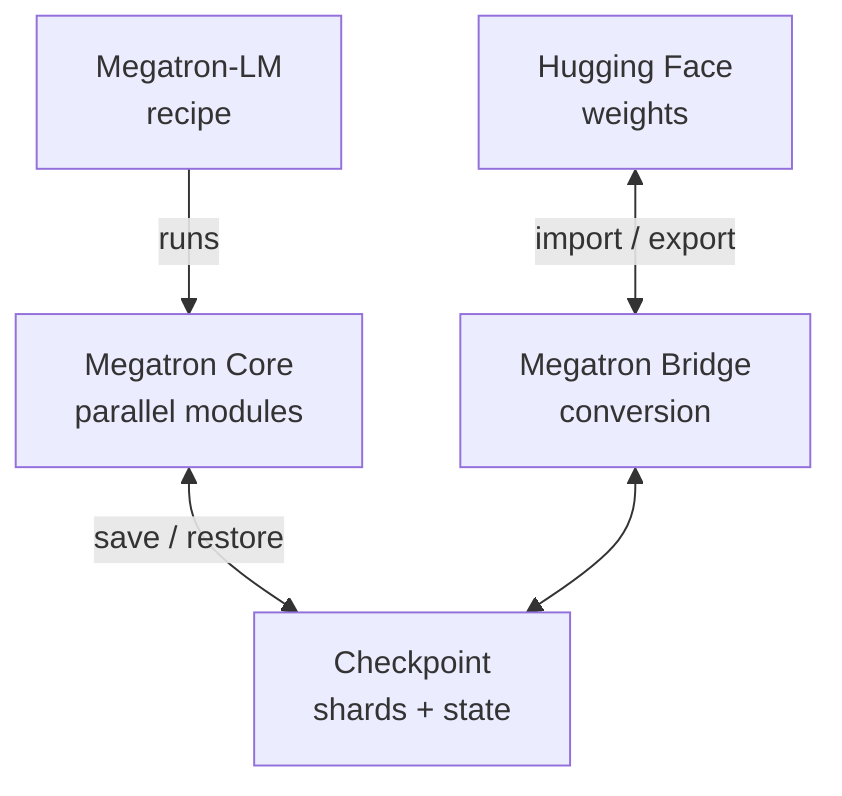

---
{
  "id": "deep-dive-megatron",
  "title": "Deep Dive - Megatron",
  "slug": "deep-dive-megatron",
  "section": "Project Deep Dives",
  "category": "Fine-Tuning & Training",
  "difficulty": "Hard",
  "order": 7,
  "coverImage": "illustrations/_generated/rank_lattice_dark.png",
  "companies": [
    "NVIDIA",
    "Meta AI",
    "Google DeepMind",
    "Microsoft",
    "OpenAI"
  ],
  "shortDescription": "More GPUs can slow a step that still sees the same batch. Megatron assigns each rank a tensor, a collective, and a checkpoint role.",
  "keyConceptsTested": [
    "Megatron Core versus Megatron-LM versus Megatron Bridge",
    "Tensor, pipeline, data, context, and sequence parallelism",
    "Megatron-FSDP as data-parallel sharding",
    "Expert parallelism and MoE parallel folding",
    "Distributed optimizer memory math",
    "Checkpoint resharding and Hugging Face conversion",
    "FP8 and FP4 training tradeoffs",
    "Topology-aware rank order"
  ],
  "prerequisites": [
    "deep-dive-nccl",
    "distributed-training-fsdp-deepspeed-zero",
    "model-parallelism-for-llm-inference",
    "mixed-precision-training-loss-scaling"
  ]
}
---

Scaling a language-model training run from 8 GPUs to 64 can make every optimizer step *slower* when global batch size stays fixed. Half the cluster stalls waiting on activations from earlier layers; the rest waits to sum gradients over the network. More GPUs shrink each chip's matrix work while exposing collective and scheduling overhead.

Megatron-LM is NVIDIA's reference training stack, built on <span data-glossary="nvidia-megatron">Megatron Core</span>, its importable library of parallel layers, process groups, schedules, optimizers, and sharded checkpointing.[^megatron2026repo] Core treats each worker's integer rank as a coordinate in a multi-dimensional grid, then builds scoped NCCL process groups along every axis so each collective touches only the peers that share its data.[^megatron2026parallelstate]

## Split the dimensions that hurt

Training hits different ceilings as models grow: parameters, gradients, and <span data-glossary="optimizer-state">optimizer state</span> overflow HBM; long sequences blow up attention intermediates; and <span data-glossary="mixture-of-experts">mixture-of-experts (MoE)</span> layers store many experts while activating only a few per token. Each axis clears one bottleneck and adds one collective:[^megatronCoreParallelism2026]

| Pressure | Axis or mechanism | Partitioned state | Typical NCCL op |
| --- | --- | --- | --- |
| Wide <span data-glossary="matrix">matrix</span> | <span data-glossary="tensor-parallelism">Tensor parallelism (TP)</span> | Layer weight & activation channels | All-reduce / all-gather / reduce-scatter |
| Deep stack | <span data-glossary="pipeline-parallelism">Pipeline parallelism (PP)</span> | Contiguous layer ranges | P2P activation send/receive |
| Batch throughput | <span data-glossary="data-parallelism">Data parallelism (DP)</span> | Independent samples | <span data-glossary="gradient">Gradient</span> all-reduce / reduce-scatter |
| Long sequence | <span data-glossary="context-parallelism">Context parallelism (CP)</span> | Sequence chunks & KV context | Ring P2P or collective KV exchange |
| Sparse experts | <span data-glossary="expert-parallelism">Expert parallelism (EP)</span> | Expert weights & routed <span data-glossary="token">tokens</span> | All-to-all dispatch & combine |
| Saved activations | Selective recomputation | Discarded intermediates | Extra forward compute, no network |

> **Key insight:** Turn on the fewest axes that remove your current wall. DP scales batch throughput without shortening one sample's forward pass; TP, PP, CP, and EP split one sample's work at the cost of new collectives.

```checkpoint
Why doesn't adding data replicas shorten one sample's forward pass?
---
Each sample still executes end-to-end on one model-parallel replica; DP only processes more samples concurrently and adds gradient sync.
```

## Two projects in one repository, plus a bridge

### Megatron Core

`megatron/core/` holds the reusable library for custom trainers: `parallel_state.py` builds rank grids and NCCL groups; `tensor_parallel/layers.py` implements <span data-glossary="tensor-parallelism">tensor-parallel</span> projections; `pipeline_parallel/schedules.py` schedules microbatches across stages; and `distributed/param_and_grad_buffer.py` packs gradients and parameters into contiguous overlap buffers alongside configurable <span data-glossary="optimizer">optimizers</span> and checkpointing.[^megatron2026repo]

### Megatron-LM reference scripts

Top-level scripts (`pretrain_gpt.py`), `examples/`, and tests turn Core into runnable experiments covering data loaders, schedules, <span data-glossary="mixture-of-experts">MoE</span> dispatch, low precision, and distributed checkpoint round trips.

### Megatron Bridge

Megatron Bridge (`NVIDIA-NeMo/Megatron-Bridge`) converts and validates checkpoints between Hugging Face formats and Megatron Core layouts, mapping <span data-glossary="tensor">tensor</span> shards, pipeline stages, tied embeddings, and MoE experts across ecosystems.[^megatron2026repo][^nvidia2026bridgeCheckpointing] Keep Core, <span data-glossary="transformer">Transformer</span> Engine, CUDA, and Bridge versions aligned.



## Rank groups: factor world size first

For a 64-GPU dense mesh with `TP=4`, `PP=2`, `CP=2`, and `DP=4`, world size $N$ factors into four orthogonal axes:

$$
N = TP \times PP \times CP \times DP = 4 \times 2 \times 2 \times 4 = 64.
$$

`TP × PP × CP = 16` GPUs hold one complete model replica, and `DP=4` repeats that mesh for four independent batches. Expert parallelism (`EP`) does not multiply into this dense product; MoE layers reuse the same ranks via a second factorization.[^megatron2026parallelstate]

`initialize_model_parallel` assigns global ranks using a configurable axis order, defaulting to `tp-cp-ep-dp-pp` (first axis varying fastest).[^megatron2026parallelstate] `TP` gets stride 1 so tensor peers receive consecutive IDs (`0..3`, `4..7`) inside an NVLink node, while `PP` varies slowest (stride 32) so lighter point-to-point stage transfers cross nodes.

<figure>
  
  <figcaption>64-GPU rank lattice under tp-cp-ep-dp-pp: consecutive TP peers (0-3, 4-7, ...), pipeline stride 32, rank 3 at (dp=0, cp=0, pp=0, tp=3).</figcaption>
</figure>

Two ranks share a process group along an axis when every other coordinate matches:

<!-- leetllm: test output=show -->
```python title="rank_groups.py"
import numpy as np

ORDER = ("tp", "cp", "ep", "dp", "pp")
SIZES = {"tp": 4, "cp": 2, "ep": 1, "dp": 4, "pp": 2}
WORLD = 64
strides = {"tp": 1, "cp": 4, "ep": 8, "dp": 8, "pp": 32}


def coords(rank: int) -> dict[str, int]:
    rem = rank
    out = {}
    for name in ORDER:
        out[name] = rem % SIZES[name]
        rem //= SIZES[name]
    return out


def rank_of(c: dict[str, int]) -> int:
    return sum(c[name] * strides[name] for name in ORDER)


def group(rank: int, axis: str) -> list[int]:
    base = coords(rank)
    members = []
    for index in range(SIZES[axis]):
        member = dict(base)
        member[axis] = index
        members.append(rank_of(member))
    return sorted(members)


ranks = np.arange(WORLD, dtype=np.int32)
assert SIZES["tp"] * SIZES["pp"] * SIZES["cp"] * SIZES["ep"] * SIZES["dp"] == WORLD
assert all(rank_of(coords(r)) == r for r in range(WORLD))
assert coords(3) == {"tp": 3, "cp": 0, "ep": 0, "dp": 0, "pp": 0}
assert group(3, "tp") == [0, 1, 2, 3]
assert group(3, "pp") == [3, 35]
assert group(3, "dp") == [3, 11, 19, 27]

print("rank 3", coords(3))
print("TP group", group(3, "tp"))
print("PP group", group(3, "pp"))
print("DP group", group(3, "dp"))
```

<!-- leetllm: output:start -->
```text title="Output" output compact
rank 3 {'tp': 3, 'cp': 0, 'ep': 0, 'dp': 0, 'pp': 0}
TP group [0, 1, 2, 3]
PP group [3, 35]
DP group [3, 11, 19, 27]
```
<!-- leetllm: output:end -->

> **Common mistake:** Logical rank adjacency guarantees NVLink locality only when the job launcher maps consecutive ranks onto the same physical node.

<span data-glossary="fsdp">Megatron-FSDP</span> shards state inside the existing DP group without adding ranks to $N$. Because `CP` peers also hold identical dense weights, Megatron forms a combined **DP-with-CP** group (`4 × 2 = 8` ranks here) for gradient reduction and optimizer sharding.[^megatron2026parallelstate]

```checkpoint
A 64-GPU dense launch sets TP=4, PP=2, and CP=2. What DP size keeps every rank assigned?
---
DP=4, because 64 / (4 × 2 × 2) = 4. Non-divisible products fail during process-group initialization.
```

## What each parallel axis does

### Tensor parallelism: split width

In a transformer MLP, hidden state $X$ passes through an up-projection $A$, GeLU, and a down-projection $B$. With hidden width `H=8`, intermediate width `I=16`, and `TP=4` (production GPT MLPs typically use `I = 4H`), split $A$ `[8, 16]` by **columns** into four shards $A_i$ `[8, 4]` and $B$ `[16, 8]` by **rows** into four shards $B_i$ `[4, 8]`.[^shoeybi2019] Given one replicated token $X$ `[1, 8]`, each rank computes $Y_i = \text{GeLU}(X A_i)$ `[1, 4]` and partial output $Z_i = Y_i B_i$ `[1, 8]`, then one `all-reduce` produces $Z = \sum_i Z_i$.

> **Key insight:** Pairing column-parallel with row-parallel removes communication between the two linear layers. GeLU acts elementwise on each channel, so ranks synchronize only once after the second projection.

In PyTorch's `[out_features, in_features]` storage layout, `ColumnParallelLinear.weight` has shape `[4, 8]` and `RowParallelLinear.weight` has shape `[8, 4]`.[^megatronTensorLayersPinned2026]

<figure>
  
  <figcaption>Forward MLP (H=8, I=16, TP=4): column-parallel GEMMs, local GeLU, row-parallel shards, and one final All-Reduce.</figcaption>
</figure>

<!-- leetllm: test output=show -->
```python title="tp_mlp.py"
import numpy as np

H, I, TP = 8, 16, 4


def gelu(x: np.ndarray) -> np.ndarray:
    return 0.5 * x * (1.0 + np.tanh(np.sqrt(2.0 / np.pi) * (x + 0.044715 * np.power(x, 3))))


up = np.array([[((r + 1) * (c + 3) % 7) / 10.0 for c in range(I)] for r in range(H)], dtype=np.float64)
down = np.array([[((r + 2) * (c + 1) % 5) / 10.0 for c in range(H)] for r in range(I)], dtype=np.float64)
hidden = np.array([[((c % 5) - 2) / 4.0 for c in range(H)]], dtype=np.float64)

serial = gelu(hidden @ up) @ down

up_shards = np.split(up, TP, axis=1)
down_shards = np.split(down, TP, axis=0)
partials = [gelu(hidden @ up_shards[s]) @ down_shards[s] for s in range(TP)]

reduced = np.sum(partials, axis=0)
assert np.allclose(serial, reduced, atol=1e-12)
print("Z", [round(float(v), 4) for v in reduced[0]])
```

<!-- leetllm: output:start -->
```text title="Output" output compact
Z [-0.1782, -0.2062, -0.1582, -0.1862, 0.0, -0.1782, -0.2062, -0.1582]
```
<!-- leetllm: output:end -->

Add any row-parallel output bias **after** the `all-reduce` so it is not multiplied by `TP`. During backward, each column shard produces a partial input gradient $\partial L / \partial X$, requiring a matching `all-reduce` (or `reduce-scatter` / `all-gather` with sequence parallelism).[^shoeybi2019] Self-attention splits heads identically, with <span data-glossary="grouped-query-attention">grouped-query attention</span> (GQA) KV-head count often capping `TP`. Keep `TP` inside NVLink/NVSwitch islands so per-layer collectives never cross slower inter-node links.[^nccl2026troubleshooting]

### Pipeline parallelism: split depth

Pipeline parallelism (PP) places contiguous layer ranges on stages and passes activations point-to-point between them, making PP well suited to cross-node links. Splitting each replica's batch into $m$ microbatches under a 1F1B (one forward, one backward) schedule keeps stages overlapping; interleaved virtual stages shrink warm-up and cool-down idle time further.

For $p$ equal-time non-interleaved stages and $m$ microbatches per data replica, the idealized bubble fraction of total step time is $(p - 1) / (m + p - 1)$ (while the Megatron paper writes $(p - 1)/m$ relative to useful compute time).[^narayanan2021] At `p=2`, one microbatch wastes half the step; `m=8` cuts the idle fraction to `1/9` (~11.1%). Always count $m$ from independent samples per replica, never TP or CP copies.

<!-- leetllm: test output=show -->
```python title="batch_budget.py"
import numpy as np


def batch_budget(global_batch: int, microbatch: int, dp: int, sequence: int, pp: int) -> tuple[int, int, float]:
    microbatches = global_batch // (microbatch * dp)
    bubble = (pp - 1) / (microbatches + pp - 1)
    return microbatches, global_batch * sequence, float(bubble)


m, tokens, bubble = batch_budget(64, 2, 4, 2048, 2)
print("microbatches per replica:", m)
print("token positions per update:", tokens)
print("idealized bubble:", round(bubble, 3))

mb_counts = np.array([1, 2, 4, 8, 16], dtype=np.int32)
bubbles = (2 - 1) / (mb_counts + 2 - 1)
assert np.isclose(bubbles[3], 0.111, atol=1e-3)
```

<!-- leetllm: output:start -->
```text title="Output" output compact
microbatches per replica: 8
token positions per update: 131072
idealized bubble: 0.111
```
<!-- leetllm: output:end -->

### Data parallelism: split samples, then maybe shard state

DP replicates the model-parallel mesh across independent batches and reduces gradients across peers. Doubling `DP` at a fixed global batch and microbatch size halves `m` and widens the pipeline bubble.

To eliminate redundant copies without adding GPUs, Megatron layers sharding onto the existing DP domain: its distributed optimizer or Megatron-FSDP (`--use-megatron-fsdp`). Setting `--data-parallel-sharding-strategy` to `optim`, `optim_grads`, or `optim_grads_params` mirrors <span data-glossary="zero">Zero Redundancy Optimizer (ZeRO)</span> stages across DP peers, while `--num-distributed-optimizer-instances` adds hierarchical sharding islands.[^megatronCoreParallelism2026]

### Context and sequence parallelism: split token work

- **Sequence parallelism (SP)** reuses TP ranks (zero extra GPUs) to shard <span data-glossary="layernorm">LayerNorm</span> and <span data-glossary="dropout">dropout</span> activations along the sequence axis, replacing each TP `all-reduce` with `reduce-scatter` and `all-gather`.[^korthikanti2022] Enable `--sequence-parallel` whenever `TP > 1` (required with nontrivial `TP` + `EP`).[^megatronCoreParallelism2026]
- **Context parallelism (CP)** adds a rank axis to split long sequences (8K+ tokens), exchanging remote K/V blocks via ring P2P (`--cp-comm-type p2p`), all-gather, all-to-all, or hierarchical collectives.[^megatronCoreParallelism2026][^megatron2026parallelstate] Merge partial attention outputs weighted by softmax normalization mass rather than equal shard averages (two legal keys carry twice the weight of one). Because CP peers replicate dense weights, gradients reduce across the combined DP-with-CP group.[^megatron2026repo]

### Expert parallelism: split sparse capacity

In MoE layers, a router assigns each token to its top-$k$ experts. Expert parallelism (EP) distributes experts across GPUs: the dispatcher permutes tokens, routes them via `all-to-all`, `all-gather`, or Flex backends (such as DeepEP), runs grouped expert GEMMs, and combines outputs.[^megatron2026moe] For $k=2$, outputs `[2, 0]` and `[0, 4]` with gating weights `0.75` and `0.25` combine to `0.75 × [2, 0] + 0.25 × [0, 4] = [1.5, 1]`.

Router skew is EP's main hazard: hot experts queue tokens on one GPU while peers stall at combine `all-to-all`. Auxiliary balancing losses, capacity limits, dropless dispatch, and overlap mitigate tails; track per-expert token counts alongside `all-to-all` latency.[^megatron2026moe]

```checkpoint
Why is large TP often a poor choice for small MoE experts?
---
Narrow expert matrices underutilize GEMMs while paying per-token TP collectives; parallel folding decouples attention TP from expert sharding.
```

## MoE parallel folding

Attention wants wide, NVLink-local tensor shards; small experts want unsharded local matrices spread across many EP ranks. Traditional layouts trap `EP ≤ DP` and force experts to inherit attention's `TP`. **MoE parallel folding** factors the *same* GPUs into two independent meshes sharing pipeline depth `PP`: `TP × CP × DP × PP` for attention and `ETP × EP × EDP × PP` for experts (`ETP` = expert TP, `EDP` = expert DP).[^liu2025megatronfolding][^megatron2026moe]

| Layout | Attention mesh (256 GPUs) | Expert mesh (same 256 GPUs) | Effect |
| --- | --- | --- | --- |
| Traditional | `TP=4, CP=2, DP=8, PP=4` | `EP ≤ DP = 8` | EP capped by attention DP |
| Folding | `TP=4, CP=2, DP=8, PP=4` | `ETP=1, EP=64, EDP=1, PP=4` | 8× larger EP with zero extra GPUs |

Verify matching <span data-glossary="tensor-shape">tensor shapes</span>, expert divisibility, optimizer groups, and checkpoint keys on a small fixed-batch MoE test before full <span data-glossary="pretraining">pretraining</span>.

## Distributed optimizer: trade replicated state for collectives

For Adam with <span data-glossary="bf16">BF16</span> weights and FP32 main gradients, persistent state per parameter on a rank's TP/PP shard totals **18 bytes**: 6 replicated bytes (2B BF16 weight + 4B FP32 main grad) plus 12 shardable bytes (4B FP32 master weight + 8B Adam moments). Megatron's distributed optimizer shards those 12 bytes across the optimizer sharding domain of size $d$[^megatron2026distopt]:

$$
\text{bytes per parameter} = 6 + \frac{12}{d}.
$$

Always check the real sharding domain before substituting $d$: in our 64-GPU dense mesh (`DP=4`, `CP=2`) with one optimizer instance, dense weights span `DP × CP = 8` peers, giving `6 + 12/8 = 7.5` bytes per parameter rather than 9.[^megatron2026parallelstate] MoE experts use `EDP`.

Each step runs a four-stage ownership cycle on contiguous buckets so communication overlaps with compute: (1) backward fills local gradient buffers, (2) `reduce-scatter` combines gradients and hands each rank its $1/d$ slice, (3) each rank updates its local FP32 master weights and Adam moments, and (4) `all-gather` broadcasts updated BF16 weights before the next forward pass.

<!-- leetllm: edition:reference:start -->
| Sharding domain `d` | Persistent bytes / param (BF16 weight, FP32 grad) | Memory profile |
| ---: | ---: | --- |
| 1 | `18.0` | Full optimizer state on every replica |
| 2 | `12.0` | Half of optimizer state per rank |
| 4 | `9.0` | Quarter of optimizer state plus replicated model/grad buffers |
| 8 | `7.5` | Diminishing state savings; activations dominate |

Budget additional HBM beyond this formula for activations, temporary all-gather buffers, communication buckets, <span data-glossary="embedding">embeddings</span>, and MoE routing buffers.
<!-- leetllm: edition:reference:end -->

> **Common mistake:** Equal averaging of local replica means silently corrupts gradients when replicas hold different valid token counts. If replica A has 1 valid token (mean gradient `10.0`) and replica B has 3 valid tokens (mean `0.0`), the equal mean is `5.0` while the true global token-weighted mean is `(1 × 10 + 3 × 0) / 4 = 2.5`. At `lr=0.1`, a weight of `1.0` moves to `0.5` instead of `0.75`, and shape checks pass without error.

<!-- leetllm: test output=show -->
```python title="sharded_update.py"
import numpy as np


def sharded_sgd(parameters: np.ndarray, gradients: np.ndarray, lr: float) -> list[float]:
    d = gradients.shape[0]
    reduced = np.mean(gradients, axis=0)
    width = len(parameters) // d
    updated = parameters.copy()
    for rank in range(d):
        sl = slice(rank * width, (rank + 1) * width)
        updated[sl] = parameters[sl] - lr * reduced[sl]
    return [round(float(x), 4) for x in updated]


parameters = np.array([1.0, 2.0, 3.0, 4.0], dtype=np.float64)
gradients = np.array([[1.0, 3.0, 5.0, 7.0], [3.0, 5.0, 7.0, 9.0]], dtype=np.float64)
print("updated:", sharded_sgd(parameters, gradients, 0.1))
print("bytes per parameter at d=8:", 6 + 12 / 8)

local_means = np.array([10.0, 0.0], dtype=np.float64)
valid_tokens = np.array([1, 3], dtype=np.int32)
wrong_gradient = float(np.mean(local_means))
global_token_gradient = float(np.sum(local_means * valid_tokens) / np.sum(valid_tokens))

assert wrong_gradient == 5.0 and global_token_gradient == 2.5
assert 1.0 - 0.1 * wrong_gradient == 0.5
assert 1.0 - 0.1 * global_token_gradient == 0.75
```

<!-- leetllm: output:start -->
```text title="Output" output compact
updated: [0.8, 1.6, 2.4, 3.2]
bytes per parameter at d=8: 7.5
```
<!-- leetllm: output:end -->

```checkpoint
What does a distributed optimizer reduce-scatter, and what does it all-gather?
---
It reduce-scatters gradients so each rank updates its 1/d slice of FP32 master weights and moments, then all-gathers updated BF16 parameters before the next forward pass.
```

## Checkpoints, resharding, and recovery

Reloading weights alone reproduces a saved forward pass, yet losing optimizer moments, RNG state, scheduler state, and data cursors makes the next update diverge and replays batches. Distributed checkpoints store rank-local shards with global metadata:

- **Optimizer**: `dp_reshardable` packs buffers for `DP` changes; `fully_reshardable` saves parameter-shaped state for `TP`/`PP`/`DP` resharding.[^megatronOptimizerCheckpoint018]
- **Data streams**: Loaders like Energon key stream cursors by pure DP rank, requiring matching per-rank handling across DP changes.[^nvidia2026bridgeCheckpointing]
- **Conversion**: Megatron Bridge separates weight-only Hugging Face import/export from full training resumes.[^nvidia2026bridgeCheckpointing]

Publish async checkpoints only after all shards finish writing, load only trusted pickle files,[^pytorchSerialization2026] and run a fixed-batch <span data-glossary="smoke-test">smoke test</span> checking forward logits and the next weight update.

## Precision: FP16, BF16, FP8, and FP4

Megatron Core integrates <span data-glossary="transformer-engine">Transformer Engine</span> for low-precision GEMMs beyond <span data-glossary="fp16">FP16</span> and <span data-glossary="bf16">BF16</span>, separating operand format, scaling strategy, and persistent state precision.[^nvidiaTransformerEngine2026]

- **<span data-glossary="fp8">FP8</span>**: Delayed scaling uses <span data-glossary="amax">amax history</span>; current scaling scales from the active tensor; Blackwell MXFP8 scales per 32-value block.
- **FP4 / NVFP4**: 4-bit <span data-glossary="quantization">quantized</span> GEMMs use finer block scaling. Even with FP8 or FP4 matrix multiplies, master weights, main gradients, and Adam moments typically stay in FP32.[^nvidiaTransformerEngine2026]

Track efficiency with **Model FLOPs Utilization (MFU)**: useful model FLOPs/s divided by peak GPU FLOPs (excluding activation recomputation counted by hardware utilization).[^korthikanti2022] In Megatron-LM's H100 strong-scaling study (1,152 sequences of 4,096 tokens, overlap enabled), growing from 96 to 4,608 GPUs lowered MFU from 47% to 42% as communication grew.[^megatron2026repo] Validate learning quality separately on held-out loss and start from Megatron Bridge performance recipes.[^nvidia2026megatronperformance]

<!-- leetllm: edition:reference:start -->
## Project identity

Megatron-LM and Megatron Core are developed and stewarded by NVIDIA.

| Field | Project detail |
| --- | --- |
| Origin and steward | Created and maintained by NVIDIA.[^megatron2026repo] |
| Founding authors | Mohammad Shoeybi, Mostofa Patwary, Raul Puri, Patrick LeGresley, Jared Casper, and Bryan Catanzaro.[^shoeybi2019] |
| Contribution model | Public PRs with automated tests, NVIDIA code ownership, and DCO sign-off; major architectural proposals start as issues.[^megatron2026contributing] |
| Source license | Top-level BSD-3-Clause-style license preserving Apache-2.0, MIT, and BSD notices on bundled components; inspect per-file headers rather than assuming one SPDX tag.[^megatron2026license] |
| Commercial offerings | Open-source library; NVIDIA containers, NeMo products, and enterprise support carry separate terms.[^megatron2026repo] |
| Model and data assets | Checkpoints, tokenizers, and datasets trained with Megatron retain their own licenses. |

## Research lineage

| Source | Core contribution | Where it lives in Megatron Core |
| --- | --- | --- |
| Shoeybi et al. (2019) | Intra-layer tensor model parallelism for large transformers | `ColumnParallelLinear`, `RowParallelLinear`, and paired collectives[^shoeybi2019] |
| Narayanan et al. (2021) | 3D parallelism (DP + TP + PP), interleaved schedules, and overlap | Pipeline schedules, microbatch budgeting, and async buckets[^narayanan2021] |
| Korthikanti et al. (2022) | Sequence parallelism and selective activation recomputation | `--sequence-parallel` sharding and fine-grained checkpointing[^korthikanti2022] |
| Megatron Core & Folding | Context parallelism, Megatron-FSDP, and decoupled MoE folding | `parallel_state.py` grids, Flex/DeepEP dispatch, and folded expert meshes[^megatronCoreParallelism2026][^liu2025megatronfolding] |

## Strengths and weaknesses

| Dimension | Strength | Operational trade-off |
| --- | --- | --- |
| Scale | Mature TP, PP, DP, CP, EP, overlap, and distributed checkpointing | Large flag matrix expands the debugging surface |
| Performance | Fused kernels, grouped MoE GEMMs, overlap, topology-aware groups | Small batches or slow fabrics expose collective latency |
| Model coverage | Dense transformers, MoE, multimodal, and hybrid models | Custom architectures need bespoke builders and Bridge mappings |
| Memory | Distributed optimizer, Megatron-FSDP, selective recompute, FP8/FP4 | Activations, routing buffers, and temp gathers need headroom |
| Ecosystem | Megatron Bridge converts between Hugging Face and Core | Version skew across Core, Bridge, Transformer Engine, and <span data-glossary="cuda">CUDA</span> breaks loads |
| Reproducibility | Functional tests and explicit CLI configuration | Large runs require disciplined manifests, seeds, and checkpoint verification |

Megatron pays off on multi-GPU clusters running pretraining or large-scale adaptation; for single-GPU fine-tunes or quick prototypes, lighter stacks iterate faster.

## Production topology and debugging loop

Scale out one axis at a time against a fixed workload, starting on two GPUs (`TP=2, PP=1, CP=1, DP=1`) to confirm finite loss, gradients, fixed-batch <span data-glossary="logits">logits</span>, and checkpoint-reload update parity before moving to multi-node launches.

Record a run manifest before changing any parallelism flag so step-time comparisons reflect identical work:

1. **Hardware fabric**: GPU model, <span data-glossary="hbm">HBM</span> capacity, intra-node NVLink/NVSwitch topology, and inter-node network.
2. **Software stack**: Megatron Core, Transformer Engine, CUDA, NCCL, <span data-glossary="pytorch">PyTorch</span>, and Bridge versions.
3. **Workload & mesh**: TP, PP, CP, EP, DP, microbatch, global batch, sequence length, token count, and precision recipe.
4. **Rank layout**: Axis order, expected process groups, and physical placement across nodes.
5. **Runtime knobs**: Communication overlap flags, NCCL topology logs, recomputation, and checkpoint cadence.
6. **Timing window**: Warm-up steps, timed steps, explicit CUDA stream sync, and step-time variance.
7. **Telemetry**: MFU, <span data-glossary="tokens-per-second">tokens per second</span>, step time, collective share, peak HBM, expert balance, and loss.
8. **Correctness checks**: Fixed-batch logit and update tolerances, MoE router parity, and checkpoint reload verification.

Measure the fabric first. NCCL tests separate raw time from algorithm and bus bandwidth, so pair every bandwidth number with collective, payload size, and rank count.[^nccltestsPerformance2026] Because NCCL runs asynchronously on CUDA streams, wrap timed blocks with CUDA events or explicit stream sync rather than timing host enqueues.[^nccl2026streams] Profile in two passes: **Nsight Systems** exposes host gaps, stream overlap, and collective stalls across ranks; **Nsight Compute** diagnoses individual hot kernels for memory bandwidth, tensor-core utilization, and warp occupancy.[^nsightSystems2026][^nsightCompute2026] Use **Compute Sanitizer** to catch out-of-bounds accesses or race conditions in custom kernels.[^computeSanitizer2026]

When scaling up slows a step, map the symptom to its axis:

- **Every layer stalls after raising TP**: Check NCCL logs for TP peers spilling off NVLink onto inter-node sockets.
- **Periodic idle gaps on PP stages**: Raising DP at fixed global batch shrank microbatches `m` and inflated the bubble.
- **Attention slows under CP**: Remote K/V exchange is dominating local attention; check sequence length and `--cp-comm-type`.
- **Long tail on MoE layers**: Compare per-expert token counts with `all-to-all` timing to spot hot experts or padding.
- **Memory drops under DP while step time rises**: Gradient `reduce-scatter` or parameter `all-gather` is no longer hidden behind compute.

```checkpoint
What is the first topology check after a TP scale-out slows every step?
---
Verify that all TP peers share an NVLink/NVSwitch domain and NCCL has not fallen back to sockets, then inspect per-layer collective timing.
```

## Evaluation rubric

- Factor dense and MoE meshes separately under `tp-cp-ep-dp-pp` without double-counting `EP`.
- Explain why column-parallel feeds row-parallel across GeLU with zero intermediate communication and why bias is added after `all-reduce`.
- Distinguish SP activation sharding inside TP from CP sequence partitioning and normalization-weighted attention merges.
- Treat Megatron-FSDP as DP-domain state sharding rather than extra ranks.
- Trace MoE dispatch, grouped compute, weighted combine, and skew-driven `all-to-all` tails.
- Compute distributed-optimizer bytes using the real sharding domain $d$ (such as `DP × CP`) and name non-formula HBM consumers.
- Verify checkpoint reload, resharding, and precision recipes on fixed-batch logits plus the next optimizer update.
- Pair MFU with hardware peak, recomputation rules, and separate validation loss.

### Follow-up questions

```checkpoint
In the 64-rank example, why can DP=4 produce an optimizer sharding domain of size 8?
---
CP=2 replicates dense weights across context peers. With one optimizer instance, Megatron shards dense optimizer state across the combined DP-with-CP group of 4 × 2 = 8 ranks, while pure DP=4 still sets independent sample count.
```

```checkpoint
What changes if DP doubles while global batch and microbatch size stay fixed?
---
Microbatches per replica halve, widening the pipeline bubble even as replicated optimizer memory drops. Keep global tokens and token-weighted loss normalization identical before comparing step times.
```
<!-- leetllm: edition:reference:end -->

```mastery-quiz
[
  {
    "question": "A 96-rank dense launch sets TP=2, PP=3, CP=2, with sequence parallelism reusing TP peers and all other factors at 1. What pure DP fills this world?",
    "options": [
      "DP=16; model-parallel product is 6.",
      "DP=8; model-parallel product is 12.",
      "DP=4; model-parallel product is 24.",
      "DP=12; model-parallel product is 8."
    ],
    "answer": "DP=8; model-parallel product is 12.",
    "explanation": "Model-parallel size is 2 × 3 × 2 = 12, giving 96 / 12 = 8 DP replicas. SP reuses TP ranks without adding GPUs."
  },
  {
    "question": "A 16-rank mesh uses order tp-cp-dp-pp with sizes 2, 2, 2, 2 (first fastest). What are rank 13's TP and PP groups?",
    "options": [
      "TP [9, 13]; PP [12, 13].",
      "TP [5, 13]; PP [9, 13].",
      "TP [12, 13]; PP [9, 13].",
      "TP [12, 13]; PP [5, 13]."
    ],
    "answer": "TP [12, 13]; PP [5, 13].",
    "explanation": "Rank 13 has (tp=1, cp=0, dp=1, pp=1). Stride 1 for TP yields [12, 13]; stride 8 for PP yields [5, 13]."
  },
  {
    "question": "Two row-parallel partial outputs are [1, 2] and [3, -1] with shared bias [0.5, 0.5]. Adding bias on each rank before summing produces what vs. the correct output?",
    "options": [
      "Correct [4.5, 1.5]; buggy [5, 2].",
      "Correct [5, 2]; buggy [4.5, 1.5].",
      "Correct [4.5, 1.5]; buggy [4, 1].",
      "Correct [4, 1]; buggy [5, 2]."
    ],
    "answer": "Correct [4.5, 1.5]; buggy [5, 2].",
    "explanation": "Sum partials to [4, 1], then add bias once for [4.5, 1.5]. Adding bias before reduction double-counts it to [5, 2]."
  },
  {
    "question": "Fix global batch at 96, microbatch at 2, and 3 equal-time PP stages. Pure DP rises from 4 to 8. What are microbatches per replica and ideal 1F1B bubble fraction before and after?",
    "options": [
      "Before 12 and 1/6; after 6 and 1/3.",
      "Before 24 and 1/13; after 12 and 1/7.",
      "Before 12 and 1/7; after 6 and 1/4.",
      "Before 6 and 1/4; after 12 and 1/7."
    ],
    "answer": "Before 12 and 1/7; after 6 and 1/4.",
    "explanation": "Microbatches fall from 96/(2×4)=12 to 96/(2×8)=6. Formula (p-1)/(m+p-1) gives 2/14 = 1/7 before and 2/8 = 1/4 after."
  },
  {
    "question": "An equal-score query sees two local keys with values [1, 5] and one remote key with value [9]. What is the true prefix average vs. equally averaging the two shard means?",
    "options": [
      "True 6; equal means 5.",
      "True 5; equal means 5.",
      "True 5; equal means 6.",
      "True 6; equal means 6."
    ],
    "answer": "True 5; equal means 6.",
    "explanation": "True mean is (1+5+9)/3 = 5; averaging local mean 3 and remote mean 9 equally gives 6. CP weights chunks by normalization mass (2/3 and 1/3)."
  },
  {
    "question": "A BF16/FP32 recipe assigns 200M parameters to each TP/PP shard, with DP=3, CP=2, and one optimizer instance. What persistent bytes/param and decimal GB/rank does 6 + 12/d predict?",
    "options": [
      "8 bytes; 1.6 GB (before activations and peaks).",
      "10 bytes; 2.0 GB (before activations and peaks).",
      "3 bytes; 0.6 GB (before activations and peaks).",
      "7 bytes; 1.4 GB (before activations and peaks)."
    ],
    "answer": "8 bytes; 1.6 GB (before activations and peaks).",
    "explanation": "Dense sharding domain is DP × CP = 6, giving 6 + 12/6 = 8 bytes/param and 200M × 8 = 1.6 GB before activations and temp buffers."
  },
  {
    "question": "Two replicas report local token-mean gradients 6 and -2 from 2 and 6 valid tokens. Starting at w = 1 with SGD lr = 0.1, what do token-weighted vs. equal-mean updates give?",
    "options": [
      "Token-weighted grad 2, w=0.8; equal-mean grad 0, w=1.",
      "Token-weighted grad 0, w=0.8; equal-mean grad 2, w=1.",
      "Token-weighted grad 2, w=1; equal-mean grad 0, w=0.8.",
      "Token-weighted grad 0, w=1; equal-mean grad 2, w=0.8."
    ],
    "answer": "Token-weighted grad 0, w=1; equal-mean grad 2, w=0.8.",
    "explanation": "Token weighting gives (2×6 + 6×(-2))/8 = 0 (w=1). Equal averaging gives (6-2)/2 = 2 (w=0.8), silently corrupting the update."
  },
  {
    "question": "A 128-rank attention mesh uses TP=4, CP=2, DP=4, PP=4; its folded expert mesh uses ETP=2, EP=8, PP=4. Experts return [4, -2] and [-2, 6] with weights 0.25 and 0.75. What are EDP and the combined vector?",
    "options": [
      "EDP=4; [1, 2].",
      "EDP=2; [-0.5, 4].",
      "EDP=2; [1, 2].",
      "EDP=4; [-0.5, 4]."
    ],
    "answer": "EDP=2; [-0.5, 4].",
    "explanation": "EDP = 128/(2×8×4) = 2 across the same ranks. Weighted combine gives 0.25[4, -2] + 0.75[-2, 6] = [-0.5, 4]."
  },
  {
    "question": "Two runs reload w = 3: one restores velocity v = 0.6, the other resets v = 0. With gradient g = -1, v' = 0.5v + g, and w' = w - 0.2v', what next weight does each reach?",
    "options": [
      "Restored 3.14, reset 3.20.",
      "Restored 3.20, reset 3.14.",
      "Restored 3.08, reset 3.20.",
      "Restored 3.14, reset 3.14."
    ],
    "answer": "Restored 3.14, reset 3.20.",
    "explanation": "Restored v' = 0.3 - 1 = -0.7 gives w' = 3.14; reset v' = -1 gives w' = 3.20. Forward passes match, then the first update diverges."
  },
  {
    "question": "A fixed batch gives logit 1.250 before save. Acceptance requires update error <= 0.006 and reload shift <= 0.002. FP4 has error 0.005, reloaded logit 1.249 (12 ms); BF16 has error 0.001, reloaded logit 1.253 (9 ms). Which passes, and how do you find its Adam moment width?",
    "options": [
      "FP4 passes. Use the matrix operand dtype.",
      "BF16 passes. Check the optimizer's configured dtype.",
      "FP4 passes. Check the optimizer's configured dtype.",
      "BF16 passes. Use the matrix operand dtype."
    ],
    "answer": "FP4 passes. Check the optimizer's configured dtype.",
    "explanation": "FP4 passes (0.005 <= 0.006, shift 0.001 <= 0.002), while BF16 shifts 0.003 on reload. Optimizers often keep moments in FP32 regardless of GEMM precision, so inspect the optimizer config."
  }
]
```

> **Next:** Continue to [Deep Dive - DeepSpeed](/learn/deep-dive-deepspeed). Megatron decided which ranks share which NCCL group, then sharded optimizer state on the data-parallel axis. DeepSpeed takes that ownership question further: ZeRO stages, offload, and an engine that owns the training step.
