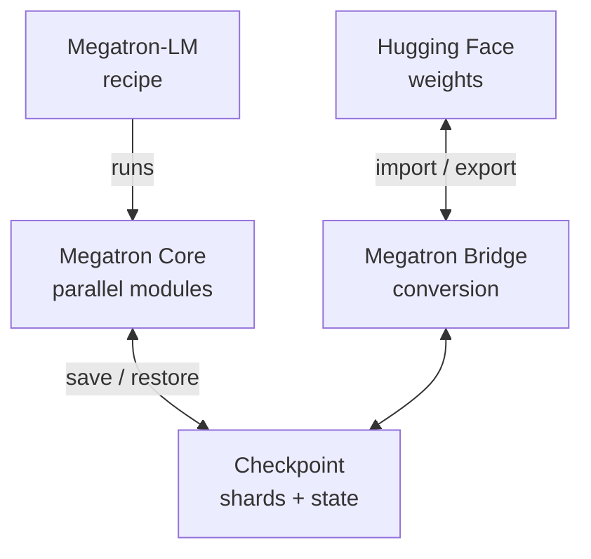

---
{
  "id": "deep-dive-megatron",
  "title": "Deep Dive - Megatron",
  "slug": "deep-dive-megatron",
  "section": "Project Deep Dives",
  "category": "Fine-Tuning & Training",
  "difficulty": "Hard",
  "order": 7,
  "coverImage": "illustrations/_generated/rank_lattice_dark.png",
  "companies": [
    "NVIDIA",
    "Meta AI",
    "Google DeepMind",
    "Microsoft",
    "OpenAI"
  ],
  "shortDescription": "More GPUs can slow a step that still sees the same batch. Megatron assigns each rank a tensor, a collective, and a checkpoint role.",
  "keyConceptsTested": [
    "Megatron Core versus Megatron-LM versus Megatron Bridge",
    "Tensor, pipeline, data, context, and sequence parallelism",
    "Megatron-FSDP as data-parallel sharding",
    "Expert parallelism and MoE parallel folding",
    "Distributed optimizer memory math",
    "Checkpoint resharding and Hugging Face conversion",
    "FP8 and FP4 training tradeoffs",
    "Topology-aware rank order"
  ],
  "prerequisites": [
    "deep-dive-nccl",
    "distributed-training-fsdp-deepspeed-zero",
    "model-parallelism-for-llm-inference",
    "mixed-precision-training-loss-scaling"
  ]
}
---

Scaling a language-model training job from eight GPUs to 64 can make each update slower when each update still processes the same total number of training examples (the global batch). Some GPUs wait for another GPU's result; others wait to combine their updates. More hardware can expose communication and scheduling costs instead of shortening the step, even when nothing runs out of memory.

Which part of the work should each GPU own? The last chapter treated all-reduce, reduce-scatter, all-gather, all-to-all, and send/receive as fundamental NCCL communication primitives: matching ranks, matching dtypes, matching order. This chapter follows that question through a real training mesh.

Megatron-LM is NVIDIA's reference training stack for that job. <span data-glossary="nvidia-megatron">Megatron Core</span> is the library underneath it: parallel layers, process groups, schedules, optimizers, checkpoint utilities, and model definitions. The current repository splits the two on purpose. Megatron-LM ships recipes a research team can run. Core ships building blocks a framework author can import.[^megatron2026repo]

Source baseline: commit `8971d19dda0f2bda87783353dde93a5134422a96` (August 11, 2026), rechecked on September 23, 2026.[^megatron2026parallelstate] This tour follows that pinned commit; the linked `latest` guides can move independently. Python examples below execute CPU arithmetic, while separately labeled experiments identify hardware work. This chapter contains no GPU throughput or convergence measurements.

Treat a process rank (one distributed worker's integer ID) as a grid coordinate. For example, `rank=27` belongs to axes for data replica, context lane, pipeline stage, and tensor shard. Megatron builds NCCL groups from those coordinates, then each forward and backward operation communicates within the group that owns its data. Scale comes from factoring one world into several grids, with communication scoped to each owning group.

## Split the dimensions that hurt

Start with the resource that is blocking progress. Parameters, gradients, <span data-glossary="optimizer-state">optimizer state</span>, and activations can exceed one GPU's memory. Long sequences can make attention intermediates too large even when weights fit. A sparse <span data-glossary="mixture-of-experts">mixture-of-experts (MoE)</span> model stores many experts but activates only a few per token. The same model can therefore hit a memory wall, a link wall, or an uneven-work wall.

Megatron splits different dimensions for different reasons:

| Pressure | Axis or mechanism | What gets partitioned | Typical NCCL op |
| --- | --- | --- | --- |
| Wide <span data-glossary="matrix">matrix</span> doesn't fit | <span data-glossary="tensor-parallelism">Tensor parallelism (TP)</span> | A layer's weight and activation channels | All-reduce or all-gather |
| Stack is too deep | <span data-glossary="pipeline-parallelism">Pipeline parallelism (PP)</span> | Contiguous layer ranges | Point-to-point activation send/receive |
| Batch needs throughput | <span data-glossary="data-parallelism">Data parallelism (DP)</span> | Independent samples or replicas | <span data-glossary="gradient">Gradient</span> reduce or reduce-scatter |
| Prompt is too long | <span data-glossary="context-parallelism">Context parallelism (CP)</span> | Sequence chunks and attention context | Peer-to-peer or collective KV exchange |
| MoE experts are spread out | <span data-glossary="expert-parallelism">Expert parallelism (EP)</span> | Expert weights and routed <span data-glossary="token">tokens</span> | All-to-all dispatch and combine |
| Activations fill memory | Selective recomputation | Saved intermediates | Extra forward compute, less storage |

Read the table as a diagnosis map, not a menu of interchangeable flags. Each axis owns a different piece of state, so the same extra GPU can remove one bottleneck and add another.

Follow one sample through a candidate mesh before choosing. Data parallelism keeps its computation on one replica. Tensor parallelism makes its layer arithmetic cross tensor shards. Pipeline parallelism sends its activation from one layer range to the next. Context parallelism keeps only part of its sequence local. Expert parallelism may move its routed token to another rank and back. That trace predicts where the next wait can appear.[^megatronCoreParallelism2026]

The first budget is memory and the second is communication. TP lowers per-layer memory but adds collectives. DP raises independent work in flight without making one sample's path shorter. PP can make a model fit across nodes, but it inserts stage-to-stage latency. CP reduces sequence-local activation pressure while exchanging remote context. EP spreads expert weights while paying for token movement. Choose the smallest set of axes that removes the observed wall, then measure the new wait.

```checkpoint
Why doesn't adding data replicas directly shorten one sample's forward pass?
---
Each sample still traverses one model-parallel replica. DP can improve aggregate training throughput by processing different samples concurrently, but it adds gradient synchronization and doesn't split that sample's layer arithmetic further.
```

## Two projects in one repository, plus a bridge

Once the bottleneck has a name, the repository map tells you where to inspect it. A Megatron-LM clone contains two layers in one tree, plus a third project next door.

### Megatron Core

`megatron/core/` contains the parts a framework can import: transformer modules, <span data-glossary="tensor-parallelism">tensor-parallel</span> layers, pipeline schedules, distributed data parallel buffers, optimizers, datasets, model-specific builders, inference utilities, and distributed checkpointing. `megatron/core/parallel_state.py` owns process-group construction. `megatron/core/tensor_parallel/layers.py` implements sharded linear and embedding layers. `megatron/core/pipeline_parallel/schedules.py` sequences microbatches across stages. `megatron/core/distributed/param_and_grad_buffer.py` manages contiguous gradient and parameter buffers that can overlap communication with compute.

Core is an API surface, not one opinionated training command. Its configuration objects and process groups let a custom trainer choose a pipeline schedule, <span data-glossary="optimizer">optimizer</span>, precision recipe, checkpoint format, or model architecture while reusing tested kernels and collectives. Inspect Core when the question is "which ranks own this tensor, buffer, or stage?" The answer depends on the mesh a framework builds.[^megatron2026repo]

In an existing Megatron-LM checkout containing the pinned commit, these read-only commands locate the two implementations used below. They don't import Megatron, initialize CUDA, or install dependencies. `git show` reports an invalid object if that commit hasn't been fetched.

```bash title="inspect-pinned-source.sh"
MEGATRON_REV=8971d19dda0f2bda87783353dde93a5134422a96
git show "${MEGATRON_REV}:megatron/core/parallel_state.py" | rg -n 'class RankGenerator|def initialize_model_parallel'
git show "${MEGATRON_REV}:megatron/core/tensor_parallel/layers.py" | rg -n 'class ColumnParallelLinear|class RowParallelLinear'
```

### Megatron-LM reference scripts

Top-level training scripts and `examples/` turn Core into repeatable experiments. `pretrain_gpt.py` still lives at the repository root. Model providers configure tokenizers, data loaders, schedules, logging, checkpoint intervals, and command-line arguments. Tests cover rank-group construction, tensor-parallel layers, pipeline schedules, <span data-glossary="mixture-of-experts">MoE</span> dispatch, precision recipes, and distributed checkpoint round trips. Use these scripts to reproduce a training setup or isolate a mesh change; they aren't a drop-in serving API.

### Megatron Bridge

Megatron Bridge is a separate PyTorch-native library in the NVIDIA NeMo family (`NVIDIA-NeMo/Megatron-Bridge`). It's the conversion, verification, and recipe layer between Hugging Face checkpoints and Megatron Core layouts, including parallelism-aware import and export.[^megatron2026repo][^nvidia2026bridgeCheckpointing] A training run can start from an ecosystem checkpoint, use Megatron's sharded layout, then export a portable checkpoint for evaluation or serving. Conversion isn't a rename: <span data-glossary="tensor">tensor</span> and pipeline shards must map to global tensors, and MoE expert placement must be preserved.



The split clarifies subsystem responsibilities. Core owns mesh, parallel modules, and distributed checkpoint primitives. LM and Bridge both provide training workflows; Bridge also maps model representations across ecosystems. Align versions of Megatron Core, <span data-glossary="transformer">Transformer</span> Engine, CUDA, Bridge, and checkpoint metadata. A source checkout can be ahead of the latest release, so record the commit or package version with each experiment. Version alignment still doesn't say which ranks share a collective. That depends on how one world is factored.

## Rank groups: factor world size first

Make the grid concrete with a dense run of 64 GPUs using `TP=4`, `PP=2`, `CP=2`, and `DP=4`. For the pinned source's dense grid, with additional generalized-tensor rematerialization factors left at their default of one:

$$
N = TP \times PP \times CP \times DP.
$$

Thus

$$
N = 4 \times 2 \times 2 \times 4 = 64.
$$

Don't multiply EP into that equation while retaining the same dense DP value. Expert layers use a **second factorization of the same ranks**, introduced below, not another independent copy of the world.[^megatron2026parallelstate]

Before examining rank IDs, consider how state is partitioned across dimensions. TP, PP, and CP together describe a single model replica; DP duplicates that model-parallel mesh for independent data. Rank numbering reflects coordinate indexing, while process group membership dictates collective communication targets. `initialize_model_parallel` builds rank generators from a configurable order. The pinned function's default is `tp-cp-ep-dp-pp`, and initialization checks that world size is divisible by the model-parallel product.[^megatron2026parallelstate]

Follow rank 3 and examine its communication peers under this order. TP varies fastest, so tensor peers get consecutive global IDs. PP varies last, so a pipeline peer can be far away in the global numbering. The visual reads the 64-GPU grid across four DP columns, each containing CP0 and CP1 context lanes with stacked PP0 and PP1 stages.[^megatron2026parallelstate]

<figure>
  
  <figcaption>Each cell is a global rank. TP peers in a stage are consecutive (0-3, 4-7, ...). Pipeline peers jump by 32 because PP varies last in the default order. Rank 3 is highlighted at coordinates (dp=0, cp=0, pp=0, tp=3).</figcaption>
</figure>

This NumPy snippet models that numbering without creating NCCL communicators. It verifies that rank 3's TP group is `[0, 1, 2, 3]` and its PP group is `[3, 35]`:

<!-- leetllm: test output=show -->
```python title="rank_groups.py"
import numpy as np

ORDER = ("tp", "cp", "ep", "dp", "pp")
SIZES = {"tp": 4, "cp": 2, "ep": 1, "dp": 4, "pp": 2}
WORLD = 64
strides = {"tp": 1, "cp": 4, "ep": 8, "dp": 8, "pp": 32}


def coords(rank: int) -> dict[str, int]:
    rem = rank
    out = {}
    for name in ORDER:
        out[name] = rem % SIZES[name]
        rem //= SIZES[name]
    return out


def rank_of(c: dict[str, int]) -> int:
    return sum(c[name] * strides[name] for name in ORDER)


def group(rank: int, axis: str) -> list[int]:
    base = coords(rank)
    members = []
    for index in range(SIZES[axis]):
        member = dict(base)
        member[axis] = index
        members.append(rank_of(member))
    return sorted(members)


ranks = np.arange(WORLD, dtype=np.int32)
assert SIZES["tp"] * SIZES["pp"] * SIZES["cp"] * SIZES["ep"] * SIZES["dp"] == WORLD
assert all(rank_of(coords(r)) == r for r in range(WORLD))
assert coords(3) == {"tp": 3, "cp": 0, "ep": 0, "dp": 0, "pp": 0}
assert group(3, "tp") == [0, 1, 2, 3]
assert group(3, "pp") == [3, 35]
assert group(3, "dp") == [3, 11, 19, 27]

print("rank 3", coords(3))
print("TP group", group(3, "tp"))
print("PP group", group(3, "pp"))
print("DP group", group(3, "dp"))
```

<!-- leetllm: output:start -->
```text title="Output" output compact
rank 3 {'tp': 3, 'cp': 0, 'ep': 0, 'dp': 0, 'pp': 0}
TP group [0, 1, 2, 3]
PP group [3, 35]
DP group [3, 11, 19, 27]
```
<!-- leetllm: output:end -->

The code checks rank arithmetic for one dense mesh, not communication or an MoE launch. Numeric neighbors aren't necessarily physical neighbors: the launcher still maps ranks to devices and nodes. <span data-glossary="fsdp">Megatron-FSDP</span> (Fully Sharded Data Parallel) changes state ownership within the configured data-parallel domain; it isn't another factor in $N$. With CP, dense weights also repeat across context peers, so gradient synchronization and optimizer sharding can use the combined DP-with-CP group.[^megatron2026parallelstate]

```checkpoint
A 64-GPU dense launch sets TP=4, PP=2, and CP=2. What DP size keeps every rank assigned?
---
DP must be 4 because 64 / (4 × 2 × 2) = 4. A non-divisible product should fail during process-group initialization rather than silently duplicating or dropping ranks.
```

## What each parallel axis does

### Tensor parallelism: split width

Consider a compact multi-layer perceptron (MLP), the transformer's feed-forward block. If hidden width `H=8`, intermediate width `I=16`, and `TP=4`, each rank should own four intermediate channels. The first projection can produce those channels locally; the second projection must combine four partial output vectors. That is tensor parallelism (TP): split a layer's matrix so each GPU computes a shard.

TP cuts a matrix along a dimension that keeps local matrix multiplications (GEMMs) large enough to use the GPU. For a column-parallel first MLP projection, `A` with shape `[H, I]` is split into `TP` column shards of shape `[H, I/TP]`. Many dense GPT-style MLPs use `I = 4H`; our smaller example uses `I = 2H`. Each rank computes `X A_i`, applies the Gaussian Error Linear Unit (GeLU) elementwise activation locally, and passes its activation shard to a row-parallel second projection. The second projection's rows line up with those local shards, so partial outputs can be summed once at the end.[^shoeybi2019]

The running numbers make that split visible: `H=8`, `I=16`, `TP=4`. Each rank stores `[8,4]` for the up projection and `[4,8]` for the down projection. Use one token, so `X` has shape `[1,8]`. Rank `i` computes `Y_i = GeLU(X A_i)` with shape `[1,4]`, then `Z_i = Y_i B_i` with shape `[1,8]`. The layer output is `Z = Σ_i Z_i`. GeLU never needs an all-gather because it acts independently on each channel.

Those are mathematical `X @ A` shapes. The pinned PyTorch implementation stores linear weights in `[out_features, in_features]` order, so `ColumnParallelLinear.weight` is `[4,8]` and `RowParallelLinear.weight` is `[8,4]` here. A transpose in the source isn't a different partition.[^megatronTensorLayersPinned2026]

<figure>
  
  <figcaption>Follow the horizontal execution pipeline from replicated input to column-parallel GEMM, row-parallel GEMM, and final All-Reduce sum. Sequence parallelism adds another reduction during backpropagation.</figcaption>
</figure>

The next snippet verifies sharded tensor parallel execution against the serial reference using NumPy. Serial and sharded sums agree within floating-point tolerance:

<!-- leetllm: test output=show -->
```python title="tp_mlp.py"
import numpy as np

H, I, TP = 8, 16, 4


def gelu(x: np.ndarray) -> np.ndarray:
    return 0.5 * x * (1.0 + np.tanh(np.sqrt(2.0 / np.pi) * (x + 0.044715 * np.power(x, 3))))


up = np.array([[((r + 1) * (c + 3) % 7) / 10.0 for c in range(I)] for r in range(H)], dtype=np.float64)
down = np.array([[((r + 2) * (c + 1) % 5) / 10.0 for c in range(H)] for r in range(I)], dtype=np.float64)
hidden = np.array([[((c % 5) - 2) / 4.0 for c in range(H)]], dtype=np.float64)

# Full serial forward pass
serial = gelu(hidden @ up) @ down

# Sharded TP forward pass: column parallel then row parallel
width = I // TP
up_shards = np.split(up, TP, axis=1)
down_shards = np.split(down, TP, axis=0)

partials = []
for shard in range(TP):
    local = gelu(hidden @ up_shards[shard])
    partials.append(local @ down_shards[shard])

reduced = np.sum(partials, axis=0)
assert np.allclose(serial, reduced, atol=1e-12)
print("Z", [round(float(v), 4) for v in reduced[0]])
```

<!-- leetllm: output:start -->
```text title="Output" output compact
Z [-0.1782, -0.2062, -0.1582, -0.1862, 0.0, -0.1782, -0.2062, -0.1582]
```
<!-- leetllm: output:end -->

In backward, each column shard contributes part of the gradient with respect to the replicated input `X`; those contributions must be summed. A bias on the second projection is added **after** summing partial outputs, otherwise TP copies would count it repeatedly. Sequence-parallel paths replace some replicated-activation reductions with reduce-scatter and all-gather operations, so the one-forward-all-reduce diagram isn't a complete training communication count.[^shoeybi2019]

Attention uses the same idea with heads. Query, key, and value projections are partitioned, local attention runs on head shards, and the output projection combines results. Check the chosen attention implementation's hidden-width, query-head, and query-group divisibility rules. <span data-glossary="grouped-query-attention">Grouped-query attention</span> can make key/value partitioning the limiting constraint; specialized replication paths shouldn't be assumed from ordinary TP arithmetic.

That local arithmetic has a price. Each rank stores roughly `1/TP` of a sharded weight, but every layer may issue all-reduce, all-gather, or reduce-scatter collectives. Consider the trade-off as TP grows from 2 to 8 while batch and model size stay fixed: GEMM shards shrink, collective communicator size expands, and communication latency may begin crossing physical node switches. Measure local GEMM time and TP collective time on the same batch before increasing TP again. The exact count changes with sequence parallelism, overlap settings, and kernel path, so keep TP inside high-bandwidth links when possible.[^nccl2026troubleshooting]

### Pipeline parallelism: split depth

PP assigns contiguous transformer layers to stages. In `PP=2`, stage 0 owns early layers and sends its hidden activation to stage 1, which owns later layers. During training, microbatches flow through a schedule such as 1F1B (one forward pass paired with one backward pass) so stages stay busy. Virtual pipeline stages interleave smaller layer chunks on each rank and can reduce bubbles when layer counts and batch sizes permit.

With only one microbatch, stage 1 must sit completely idle until stage 0 finishes and transmits its first intermediate activation. Add enough microbatches and the stages can overlap, but the first and last waves still leave a bubble. PP lowers per-rank weight memory without all-reducing every layer across nodes, yet it adds activation send/receive latency. A topology with four TP ranks inside each node and two PP stages across nodes can beat a single eight-way TP group over a slower fabric. In the 64-GPU lattice, that's why rank 3's pipeline peer is 35 rather than 4.

For an idealized non-interleaved schedule with equally timed stages, `p` stages and `m` microbatches have an idle fraction of total iteration time approximately `(p-1)/(m+p-1)`. At `p=2`, one microbatch wastes half the slots; eight reduce that fraction to `1/9`. The paper instead expresses bubble time relative to ideal useful-compute time as `(p-1)/m`, which is `1/8` for the eight-microbatch case. The denominators differ; the schedules don't. This ignores communication, stage imbalance, and kernel overlap. Count microbatches from **independent samples**, not TP or CP copies of a sample.[^narayanan2021]

For the 64-rank example, global batch 64 with microbatch size 2 and DP=4 gives eight microbatches per replica. Fixed sequence length 2,048 means 131,072 token positions per update before padding or loss masks. The function rejects a batch that would require a fractional microbatch; it doesn't model ramp-up or variable-length packing.

<!-- leetllm: test output=show -->
```python title="batch_budget.py"
import numpy as np


def batch_budget(global_batch: int, microbatch: int, dp: int, sequence: int, pp: int) -> tuple[int, int, float]:
    microbatches = global_batch // (microbatch * dp)
    bubble = (pp - 1) / (microbatches + pp - 1)
    return microbatches, global_batch * sequence, float(bubble)


m, tokens, bubble = batch_budget(64, 2, 4, 2048, 2)
print("microbatches per replica:", m)
print("token positions per update:", tokens)
print("idealized bubble:", round(bubble, 3))

# Vectorized sweep over microbatch counts with NumPy
mb_counts = np.array([1, 2, 4, 8, 16], dtype=np.int32)
bubbles = (2 - 1) / (mb_counts + 2 - 1)
assert np.isclose(bubbles[3], 0.111, atol=1e-3)
```

<!-- leetllm: output:start -->
```text title="Output" output compact
microbatches per replica: 8
token positions per update: 131072
idealized bubble: 0.111
```
<!-- leetllm: output:end -->

### Data parallelism: split samples, then maybe shard state

DP repeats the model-parallel mesh for independent samples, then combines gradients across replicas. Standard DDP keeps a copy of each rank's assigned model shard across its DP peers; TP and PP may already have partitioned the full model. Megatron's distributed optimizer changes optimizer-state ownership while keeping those copies synchronized. Increasing DP at fixed global batch also reduces microbatches per replica and can worsen the PP bubble.

Megatron-FSDP goes further on that replication domain. With `--use-megatron-fsdp`, `--data-parallel-sharding-strategy` selects `optim`, `optim_grads`, or `optim_grads_params`. These shard optimizer state, then gradients, then parameters: <span data-glossary="zero">Zero Redundancy Optimizer (ZeRO)</span>-style ownership, not extra ranks. These are configuration fragments, not complete launch commands. Hierarchical data parallelism (`--num-distributed-optimizer-instances`) can partition the synchronization domain into smaller sharding domains plus outer replication.[^megatronCoreParallelism2026]

DeepSpeed treats that ownership ladder as its primary control surface. Here it is one option on Megatron's DP group after the model-parallel mesh is already chosen.

### Context and sequence parallelism: split token work

Sequence parallelism (SP) is a companion to TP, not another way to split a full attention calculation. It partitions sequence-dimension activation work in operations such as <span data-glossary="layernorm">LayerNorm</span> and <span data-glossary="dropout">dropout</span>, often using reduce-scatter and all-gather variants to reduce activation memory.[^korthikanti2022] It doesn't mean each rank can run full attention with only its local tokens. Current docs recommend enabling it whenever TP is on, and require `--sequence-parallel` when combining nontrivial TP and EP. Unlike CP, SP reuses the TP ranks and adds no world-size factor.[^megatronCoreParallelism2026]

Consider an 8K-token sequence under `CP=2`: each rank can hold part of the sequence, but attention still needs remote keys and values. Context parallelism exchanges that context while preserving causal masks and global positions; implementations may distribute balanced noncontiguous chunks rather than one contiguous half. Communication can use point-to-point (`--cp-comm-type p2p`), all-gather, all-to-all, or hierarchical paths. The guide's 8K+ recommendation isn't a minimum correctness requirement. CP duplicates weights, so their gradients must include contributions from all context peers.[^megatronCoreParallelism2026][^megatron2026parallelstate] Dynamic CP changes the degree for variable-length batches, but its admissible shapes and performance need separate testing.[^megatron2026repo]

### Expert parallelism: split sparse capacity

An MoE layer has a router that chooses top-`k` experts for each token. Consider a skewed route distribution: if most tokens choose one expert, the total token count hasn't changed, but one rank now owns a queue while others wait. Expert parallelism (EP) places different experts on different GPUs. The dispatcher permutes tokens, sends each token to its expert owners, runs grouped expert GEMMs, then sends outputs back and unpermutes them. Current dispatcher code exposes all-gather and all-to-all paths, plus Flex backends that can specialize communication, including a DeepEP path on supported NVIDIA GPUs.[^megatron2026moe]

With `k=2`, a token produces two routed assignments, not one. Suppose its selected experts return `[2,0]` and `[0,4]`, with router weights `0.75` and `0.25`. Combining gives `0.75 × [2,0] + 0.25 × [0,4] = [1.5,1]`. Returning both vectors to the original token position without applying the weights would change the model. The router's scoring and normalization policy determines those weights; they aren't necessarily uniform. A capacity-limited dispatcher may drop overflowing assignments, while dropless dispatch retains them and pays for the imbalance.[^megatron2026moe]

That imbalance illustrates EP's primary failure surface. An all-to-all can move every token to a different rank, while router skew produces hot experts, uneven work, padding, and queueing. Load-balancing loss, capacity policy, dropless dispatch, grouped GEMM, and overlapping communication with expert compute address different parts of that problem. They don't remove the need to inspect per-expert token counts and all-to-all timing.[^megatron2026moe]

```checkpoint
Why is a large TP value often a poor choice for a small MoE expert?
---
Each expert's matrix can become too narrow for efficient GEMMs, while every expert token still pays TP collectives. Keep attention and expert grids independent when the model and hardware support expert tensor parallelism or parallel folding.
```

## MoE parallel folding

EP exposes a design mismatch: attention wants wide, well-connected tensor shards, while a small expert wants a large local matrix and little tensor communication. Traditional layouts constrain EP to the <span data-glossary="data-parallelism">data-parallel</span> domain, so both layers inherit the same grid. Consider the outcome of applying `TP=4` to a narrow expert: its local GEMM shrinks while each token still pays the extra collective.

Megatron Core's MoE parallel folding decouples those grids. Attention can use `TP × CP × DP × PP`, while MoE can use `ETP × EP × EDP × PP`. ETP is expert tensor parallelism, which splits an individual expert's matrices; EDP is expert data parallelism, which replicates a given expert shard. Folding can break the old `EP ≤ DP` ceiling, reduce minimum GPU counts when CP and EP share ranks, and keep expert communication inside a high-bandwidth island.[^liu2025megatronfolding][^megatron2026moe]

The official example is a 256-GPU attention layout, not the 64-GPU dense lattice above:

| Layout | Attention mesh | Expert mesh | What changes |
| --- | --- | --- | --- |
| Traditional | TP=4, CP=2, DP=8, PP=4 | EP ≤ DP = 8 | Expert grid is trapped inside DP |
| Folding | same attention mesh | ETP=1, EP=64, EDP=1 | EP can grow 8× without growing world size |

Both rows describe the same world: attention uses `4 × 2 × 8 × 4 = 256`, while folded experts use `1 × 64 × 1 × 4 = 256`. EDP means copies of a given expert shard, not the attention layer's DP degree. PP remains four in both grids. EP=64 requires a compatible expert count and rank placement across communication domains. Measure the physical path on the target topology; the logical factorization only specifies the layout.

The table's freedom has a verification cost. Every group needs matching <span data-glossary="tensor-shape">tensor shapes</span>, routing metadata, optimizer ownership, and checkpoint keys. A topology that looks good on paper can fail if the launch order assigns experts across a congested link or if a checkpoint was saved with a different expert grid. Validate expert counts, one routed batch, and a tiny synthetic MoE run before scheduling a long <span data-glossary="pretraining">pretraining</span> job.

## Distributed optimizer: trade replicated state for collectives

The mesh decides where computation runs, but it doesn't decide who keeps every training byte. For conventional Adam with <span data-glossary="bf16">BF16</span> model parameters and FP32 main gradients, the guide's ledger is 18 bytes per parameter before activations and temporary buffers. The distributed optimizer changes it to $6 + 12/d$ bytes, where $d$ is the **optimizer sharding group's size**.[^megatron2026distopt]

The six replicated bytes are two for a BF16 parameter and four for its main gradient buffer. The twelve shardable bytes are an FP32 master parameter and two FP32 Adam moments. These are bytes per parameter already assigned to this TP/PP shard, not necessarily per parameter of the entire model.

At $d=4$, that gives nine bytes. In the running dense mesh, however, `DP=4` and `CP=2`; without hierarchical partitioning, the pinned implementation's DP-with-CP domain has eight ranks, so this ledger gives 7.5 bytes, not nine. Expert parameters can use a different domain. Inspect the actual optimizer group before substituting a number for $d$.[^megatron2026parallelstate]

Trace one parameter's ownership across a step:

1. Backward fills a gradient buffer on each DP rank.
2. `reduce-scatter` combines gradients and gives each rank its shard, with scaling matched to the loss normalization.
3. Each rank updates its local FP32 master parameters and optimizer moments.
4. `all-gather` rebuilds the BF16 parameter buffer for the next forward.

The parameter and gradient buffers are contiguous so communication can start as buckets become ready. Megatron can overlap gradient reduce-scatter with backward and parameter all-gather with forward when the configuration and backend support it. Overlap hides latency only when compute lasts long enough and the network isn't already saturated. If a larger DP value saves memory but lengthens the reduce-scatter tail, the memory win isn't a throughput win.

| Sharding group size `d` | Distributed bytes per BF16 parameter, FP32 grad | What still costs memory |
| ---: | ---: | --- |
| 1 | `18` | Full optimizer and gradient state |
| 2 | `12` | Half of optimizer-owned state per rank |
| 4 | `9` | One quarter of sharded state plus model buffers |
| 8 | `7.5` | Diminishing state savings, same activations |

Those numbers model theoretical memory accounting. Budget headroom for activation buffers, temporary all-gather storage, communication buckets, <span data-glossary="embedding">embeddings</span>, MoE routing buffers, and framework overhead. Use the ledger to choose a candidate DP degree, then check the per-rank high-water mark and step-time tail. A larger DP value can lower throughput even while it saves memory.

This CPU example isolates the ownership change with stochastic gradient descent (**SGD**), not Adam or NCCL. Two replicas each contribute an equally weighted gradient; the mean gradient is partitioned, updated locally, and gathered. Averaging is explicit here. CP contributions and variable valid-token counts need normalization appropriate to the actual loss, not an extra blind division by every group dimension.

For a failure case, replica A has one valid token with scalar gradient 10; replica B has three valid tokens, each with gradient 0. Averaging the replicas' local means gives 5, but the gradient of the global four-token mean is `(1 × 10 + 3 × 0) / 4 = 2.5`. At learning rate 0.1, a parameter starting at 1 becomes 0.5 under the wrong reduction and 0.75 under the token-weighted reduction. Equal tensor shapes and a successful collective don't detect this error. Match the reduction to whether the loss represents a sample mean, a token mean, or a sum; don't apply the equal-replica helper to differently normalized inputs.

<!-- leetllm: test output=show -->
```python title="sharded_update.py"
import numpy as np


def sharded_sgd(parameters: np.ndarray, gradients: np.ndarray, lr: float) -> list[float]:
    d = gradients.shape[0]
    reduced = np.mean(gradients, axis=0)
    width = len(parameters) // d
    updated = parameters.copy()
    for rank in range(d):
        sl = slice(rank * width, (rank + 1) * width)
        updated[sl] = parameters[sl] - lr * reduced[sl]
    return [round(float(x), 4) for x in updated]


parameters = np.array([1.0, 2.0, 3.0, 4.0], dtype=np.float64)
gradients = np.array([[1.0, 3.0, 5.0, 7.0], [3.0, 5.0, 7.0, 9.0]], dtype=np.float64)
print("updated:", sharded_sgd(parameters, gradients, 0.1))
print("bytes per parameter at d=8:", 6 + 12 / 8)

local_means = np.array([10.0, 0.0], dtype=np.float64)
valid_tokens = np.array([1, 3], dtype=np.int32)
wrong_gradient = float(np.mean(local_means))
global_token_gradient = float(np.sum(local_means * valid_tokens) / np.sum(valid_tokens))

assert wrong_gradient == 5.0 and global_token_gradient == 2.5
assert 1.0 - 0.1 * wrong_gradient == 0.5
assert 1.0 - 0.1 * global_token_gradient == 0.75
```

<!-- leetllm: output:start -->
```text title="Output" output compact
updated: [0.8, 1.6, 2.4, 3.2]
bytes per parameter at d=8: 7.5
```
<!-- leetllm: output:end -->

```checkpoint
What does a distributed optimizer reduce-scatter, and what does it all-gather?
---
It reduce-scatters gradients so each DP rank owns a fully reduced gradient slice, updates its local optimizer and FP32 master slice, then all-gathers updated model parameters before the next forward.
```

## Checkpoints, resharding, and recovery

At step 200,000, a node can fail after the model has reached a useful loss. Restarting from weights alone would lose optimizer history, random-number-generator state, and data position. Large runs checkpoint optimizer moments, data-loader position, iteration counters, and parallel-layout metadata alongside model weights. A checkpoint that can resume after a node failure is part of the training system, not a final export step.

Megatron's distributed checkpointing stores global tensor metadata and rank-local shards. Model tensors, optimizer state, and data-loader state may have different resharding support. Test the requested topology change with the exact model, checkpoint format, and software versions; compare an optimizer update and data position as well as a forward pass. Keep launch arguments and the Git commit beside the checkpoint.

The Core 0.18.0 optimizer API distinguishes `dp_reshardable`, whose buffer representation supports DP changes, from `fully_reshardable`, whose parameter-shaped representation permits model-parallel resharding. The API describes optimizer serialization. Architecture support and data-loader state still determine whether a full job can migrate.[^megatronOptimizerCheckpoint018] Bridge's Energon notes provide a concrete limitation: its saved stream state is keyed by pure DP rank, and a missing per-rank state file fails restoration after some DP changes.[^nvidia2026bridgeCheckpointing]

Bridge makes the ecosystem relationship explicit. Hugging Face uses dense tensors and its own key names. Megatron uses tensor and pipeline shards, tied embeddings, optimizer partitions, and model-specific state. Bridge maps between those representations and can validate conversion. Exporting a model for inference may require gathering or converting shards, while resuming training should preserve distributed state instead of flattening everything onto one host. The Bridge docs also separate weight-only initialization from a full resume that restores optimizer, RNG, data-loader, and scheduler state.[^nvidia2026bridgeCheckpointing]

If a restart begins at the wrong iteration, loads only weights, or fails on one expert shard, inspect the state inventory before rerunning. An asynchronous save request isn't a completed checkpoint: only publish it for recovery after all required shards and metadata finish. Checksums can detect corruption but don't establish compatibility. Load only trusted checkpoints because some formats deserialize executable Python objects.[^pytorchSerialization2026] Then run the fixed-batch and next-update <span data-glossary="smoke-test">smoke test</span> before accepting a long resume.

## Precision: FP16, BF16, FP8, and FP4

Megatron Core integrates <span data-glossary="transformer-engine">Transformer Engine</span> for mixed precision. Common baselines use <span data-glossary="fp16">FP16</span> or <span data-glossary="bf16">BF16</span>. <span data-glossary="fp8">FP8</span> recipes can increase matrix throughput and reduce activation bandwidth on supported NVIDIA GPUs, but scale tracking, <span data-glossary="amax">amax history</span>, accumulation precision, and kernel support affect convergence. Newer hardware also supports FP4 and NVFP4 paths for <span data-glossary="quantization">quantized</span> weights or activations; these paths aren't drop-in BF16 replacements on every GPU.[^nvidiaTransformerEngine2026]

The precision recipe is more than a dtype. Delayed FP8 scaling uses a history of each tensor's largest absolute value (`amax`) to choose a later scale. Current scaling derives the scale from the tensor being quantized. Blackwell's MXFP8 uses a scale per 32-value block; NVFP4 uses 4-bit values with finer block scaling and additional training safeguards. Tensor-level `amax` history isn't a requirement of every recipe. Nor does FP4 matrix compute mean that all persistent parameters, gradients, and Adam moments occupy four bits.[^nvidiaTransformerEngine2026]

Use low precision where it matches the hardware and model recipe. Keep optimizer masters and sensitive reductions in higher precision when the implementation expects it. Compare loss curves, gradient norms, validation slices, and checkpoint reload behavior against a BF16 baseline. A faster kernel that changes overflow behavior can cost more than it saves, so precision changes need the same fixed-batch correctness gate as topology changes.

Model FLOPs utilization (MFU) compares useful model arithmetic per second with the selected hardware's peak arithmetic rate. Useful model FLOPs exclude extra activation recomputation; hardware FLOPs utilization can count that extra work. Communication waits and pipeline idle time lower MFU; changing the FLOP-counting convention or precision peak changes the ratio. MFU doesn't measure learning quality.[^korthikanti2022]

The repository README's H100 study uses vocabulary 131,072, sequence length 4,096, overlap flags enabled, and no training-to-convergence measurement. Its strong-scaling test keeps the global batch at 1,152 sequences while growing from 96 to 4,608 H100 GPUs, and reports MFU declining from 47% to 42%. These are vendor-reported, source-scoped results. The summarized README doesn't supply enough software, precision, topology, and numerical-validation detail to reproduce that percentage as a lesson benchmark. Use it as an illustration of exposed communication, then use the current Bridge performance guide to select a documented recipe for an actual experiment.[^megatron2026repo][^nvidia2026megatronperformance]

## Project identity

Performance numbers are easier to interpret when you know who owns each layer and what can be redistributed. Megatron-LM and Megatron Core are NVIDIA-led. Origin, review ownership, and license boundaries are more specific than a generic "community framework" label.

| Field | Current project fact |
| --- | --- |
| Origin and steward | NVIDIA created and maintains Megatron-LM and Megatron Core.[^megatron2026repo] |
| Founding contributors | The original paper names Mohammad Shoeybi, Mostofa Patwary, Raul Puri, Patrick LeGresley, Jared Casper, and Bryan Catanzaro.[^shoeybi2019] |
| Contributor model | Public contributions use tests, pull requests, NVIDIA code ownership, and Developer Certificate of Origin sign-off. Large architectural changes should begin with an issue.[^megatron2026contributing] |
| Source license | The top-level license applies BSD-3-Clause-style terms to files unless noted, then preserves Apache-2.0, MIT, BSD, and other notices for bundled code. Treat the repository as composite rather than assigning one SPDX identifier to every file.[^megatron2026license] |
| Commercial offerings | Megatron Core is source code, not a hosted endpoint. NVIDIA containers, NeMo products, support, and cloud offerings can carry separate terms.[^megatron2026repo] |
| Asset licensing | Model checkpoints, tokenizers, and training data used with Megatron keep their own licenses and access rules. |

## Research lineage

The mesh and optimizer choices came from several research threads, not one kernel.

| Source | Contribution | How it appears in current code |
| --- | --- | --- |
| Shoeybi et al. (2019) | Intra-layer tensor model parallelism for multi-billion-parameter transformers | Column and row parallel layers; paired forward/backward communication[^shoeybi2019] |
| Narayanan et al. (2021) | Scaling model-parallel training across GPU clusters with overlap and scheduling | Combined DP, TP, PP launch planning and communication overlap[^narayanan2021] |
| Korthikanti et al. (2022) | Sequence parallelism combined with selective activation recomputation | Sequence-sharded activation paths and fine-grained recomputation controls[^korthikanti2022] |
| Megatron Core guide | Current combinations of TP, PP, CP, EP, DP, and Megatron-FSDP | Rank generators, group collections, and launch constraints[^megatronCoreParallelism2026] |
| Current repository | GPU kernels, models, precision recipes, checkpointing, and reference scripts | `megatron/core/`, `examples/`, and `tests/`[^megatron2026repo] |

The papers explain why the decomposition works. The repository explains what it costs to keep the decomposition correct as architectures, accelerators, and model families change. Read both in that order: use the paper to predict the needed collective, then use the code and a trace to check that the launch actually performs it.

## Strengths and weaknesses

| Dimension | Strength | Operational constraint or weakness |
| --- | --- | --- |
| Scale | Mature TP, PP, DP, CP, EP, overlap, and checkpoint paths | Group combinations multiply configuration and debugging states |
| Performance | Fused kernels, grouped GEMM, overlap, and topology-aware groups | Small batches or slow links expose collective latency |
| Model coverage | Dense transformers, MoE, multimodal and hybrid architectures | New architectures need model-specific builders and conversion work |
| Memory | Distributed optimizer, Megatron-FSDP, selective recompute, low precision, sharded checkpoints | Activation, routing, and temporary buffers still need headroom |
| Ecosystem | Bridge connects Hugging Face and Megatron representations | Version skew between Core, Bridge, Transformer Engine, and <span data-glossary="cuda">CUDA</span> can break loads |
| Reproducibility | Functional tests and explicit launch arguments | Large runs need disciplined manifests, seeds, and checkpoint audits |

The trade is now visible. This stack pays off when you control a GPU cluster, need pretraining or serious adaptation, and can invest in topology and launch hygiene. It isn't the shortest path for a one-GPU fine-tune, a hosted inference endpoint, or a quick experiment where model fit and iteration speed matter more than maximum cluster utilization. If it is the right stack, the open question is how to add one axis without mistaking a slower step for a better mesh.

## Production topology and debugging loop

Change one axis only after the workload is fixed. This **GPU lab plan has not been run**. In a compatible environment, begin with a tiny two-GPU model at `TP=2`, `PP=1`, `CP=1`, `DP=1` and synthetic data. Check finite loss and gradients, then verify that saving and reloading preserves fixed-batch <span data-glossary="logits">logits</span> and the next update within declared tolerances. Random synthetic inputs do not show meaningful convergence. Use real held-out data separately for learning quality.

Add one axis at a time. `TP=4, PP=2` specifies eight model-parallel ranks when CP=1, not 64 total ranks and not eight necessarily-local ranks. A 64-rank launch also needs a consistent DP/CP factorization and launcher placement. Use a recipe shipped with the pinned software and its supported container; the individual axis flags above aren't a complete training command.

A scale-out result is an experiment, not a flag count. Record a run manifest before changing the mesh so a faster step can be compared with an identical workload:

1. GPU model, <span data-glossary="hbm">HBM</span> capacity, NVLink or NVSwitch links, and inter-node fabric.
2. Core, Transformer Engine, CUDA, NCCL, <span data-glossary="pytorch">PyTorch</span>, and Bridge versions.
3. TP, PP, CP, EP, DP, microbatch, global batch, sequence length, token count, and precision.
4. Rank order, expected process groups, and placement of each group on the fabric.
5. Communication overlap flags, NCCL topology logs, and checkpointing or recomputation settings.
6. Baseline command, warm-up steps, timing window, synchronization method, and repeated-step summary.
7. Metrics for MFU, <span data-glossary="tokens-per-second">tokens per second</span>, step time, communication time, memory high-water mark, expert balance, and loss.
8. Correctness evidence: fixed-batch outputs, gradient or loss tolerance, router assignments where relevant, and a checkpoint reload smoke test.

NCCL tests separate operation time from algorithm and bus bandwidth, so a bandwidth number is meaningful only with the collective, payload, and rank count attached.[^nccltestsPerformance2026] NCCL calls are asynchronous on their CUDA stream; use CUDA events or an explicit stream synchronization around the measured execution block rather than timing only the asynchronous enqueue call.[^nccl2026streams]

Read a distributed trace in two passes. Nsight Systems shows host gaps, CUDA streams, collective launches, memory transfers, and whether pipeline stages overlap. Nsight Compute then explains a selected kernel's launch, memory, compute, and occupancy behavior.[^nsightSystems2026][^nsightCompute2026] Interpret counters alongside kernel timelines and rank placement: occupancy describes active warps, while collective share alone does not identify whether links, placement, or message size caused a stall.

Before accepting a faster topology or precision recipe, send one fixed microbatch through both candidates. Compare loss and logits within a declared tolerance, then compare gradients or one optimizer update. For CP and PP, check that gathered outputs line up; for EP, compare route counts and expert order. Run a short loss and validation slice afterward. Compute Sanitizer can check memory accesses, shared-memory hazards, uninitialized values, and synchronization when a custom kernel or communication path is suspect.[^computeSanitizer2026]

When every step slows after adding GPUs, inspect group placement and collective timing before changing the model. TP across Ethernet can turn each layer into a network barrier. A PP stage that goes idle points to a bubble or too few microbatches; its stage timeline should show that wait. A CP slowdown points to context exchange dominating attention work. An EP tail points to hot experts, padding, or all-to-all congestion; compare per-expert counts with per-rank dispatch time. A DP slowdown after memory improves points to the gradient reduce-scatter or parameter all-gather tail.

When loss changes after a topology or precision change, compare one fixed batch across runs. Check parameter shard reconstruction, seed and data order, optimizer state reload, gradient scaling, and router decisions. Bitwise equality isn't always expected across kernels, but a reproducible run should explain any tolerance and show that validation behavior remains inside its release budget.

```checkpoint
What is the first topology check after a TP scale-out slows every step?
---
Verify that TP ranks share the intended NVLink or NVSwitch domain and that NCCL didn't fall back to a slower socket path. Then inspect collective timing before changing batch or model settings.
```

## Evaluation rubric

Put one rank on the lattice and split an MLP across its tensor peers. A larger data-parallel group can save optimizer memory while exposing a longer step. Use that lattice to check yourself:

- Factor dense and expert grids separately and write each rank's coordinate under `tp-cp-ep-dp-pp` without counting EP twice.
- Explain why a column-parallel projection can feed a row-parallel projection without an intermediate all-gather.
- Distinguish sequence parallelism's activation-memory role from context parallelism's sequence partition.
- Treat Megatron-FSDP as DP-state sharding, not extra GPUs in the world-size product.
- Trace MoE token dispatch, expert compute, combine, and the communication tax of skew.
- Calculate distributed-optimizer memory from its actual sharding-group size and name buffers that aren't in the formula.
- Plan a checkpoint save, reload, and reshard smoke test.
- Treat MFU and speedup claims as configuration-specific measurements with hardware and convergence caveats.

### Follow-up questions

```checkpoint
In the 64-rank example, why can DP=4 still produce an optimizer sharding domain of size eight?
---
CP=2 repeats dense weights across context peers. Without hierarchical partitioning, the DP-with-CP domain contains 4 × 2 = 8 ranks. The pure DP count still determines independent samples, while the optimizer domain determines the sharded-state denominator.
```

```checkpoint
What changes if DP doubles while global batch and microbatch size stay fixed?
---
Microbatches per replica halve. That can expose a larger pipeline bubble even if replicated optimizer memory falls. Compare equal global token counts and the same loss normalization before interpreting step-time changes.
```

```mastery-quiz
[
  {
    "question": "A dense launch has 96 ranks with TP=2, PP=3 and CP=2. Sequence parallelism reuses TP peers, and generalized-tensor rematerialization factors are one. What pure DP degree fills this world?",
    "options": [
      "DP=16; the model-parallel product is 6.",
      "DP=8; the model-parallel product is 12.",
      "DP=4; the model-parallel product is 24.",
      "DP=12; the model-parallel product is 8."
    ],
    "answer": "DP=8; the model-parallel product is 12.",
    "explanation": "The independent dense factors give 96/(2×3×2)=8 data replicas. SP adds no rank factor. This count does not dictate physical node placement or an optimizer sharding denominator."
  },
  {
    "question": "A 16-rank test topology orders tp-cp-dp-pp with sizes 2,2,2,2, first varying fastest. Which are rank 13’s TP group and PP group?",
    "options": [
      "TP [9,13]; PP [12,13].",
      "TP [5,13]; PP [9,13].",
      "TP [12,13]; PP [9,13].",
      "TP [12,13]; PP [5,13]."
    ],
    "answer": "TP [12,13]; PP [5,13].",
    "explanation": "Rank 13 has coordinates tp=1, cp=0, dp=1, pp=1. TP varies stride 1, yielding 12 and 13. PP varies stride 8, yielding 5 and 13. Numeric peers still require a physical launcher map."
  },
  {
    "question": "Two row-parallel output contributions are [1,2] and [3,−1], with shared output bias [.5,.5]. A proposed implementation adds the bias to each contribution before summing. Which correct output and proposed output follow?",
    "options": [
      "Correct [4.5,1.5]; proposed [5,2].",
      "Correct [5,2]; proposed [4.5,1.5].",
      "Correct [4.5,1.5]; proposed [4,1].",
      "Correct [4,1]; proposed [5,2]."
    ],
    "answer": "Correct [4.5,1.5]; proposed [5,2].",
    "explanation": "Sum partials to [4,1], then add the shared bias once for [4.5,1.5]. Adding it on both ranks duplicates the bias and produces [5,2]. Successful communication does not detect that arithmetic change."
  },
  {
    "question": "Hold a global batch of 96 and microbatch size 2 fixed with three equally timed pipeline stages. Pure DP rises from 4 to 8. What are microbatches per replica and ideal non-interleaved idle fractions before and after?",
    "options": [
      "Before 12 and 1/6; after 6 and 1/3.",
      "Before 24 and 1/13; after 12 and 1/7.",
      "Before 12 and 1/7; after 6 and 1/4.",
      "Before 6 and 1/4; after 12 and 1/7."
    ],
    "answer": "Before 12 and 1/7; after 6 and 1/4.",
    "explanation": "Microbatches are 96/(2×4)=12, then 96/(2×8)=6. Idle fraction is (p−1)/(m+p−1), giving 2/14 and 2/8. The bubble-to-useful-work denominator would instead be m."
  },
  {
    "question": "An equal-score query has two legal keys with values [1,5] locally and one legal remote key with value [9]. An implementation averages the two shard means equally. What full-prefix result and equal-mean result follow?",
    "options": [
      "Full prefix 6; equal means 5.",
      "Full prefix 5; equal means 5.",
      "Full prefix 5; equal means 6.",
      "Full prefix 6; equal means 6."
    ],
    "answer": "Full prefix 5; equal means 6.",
    "explanation": "The full result is (1+5+9)/3=5. Local mean 3 and remote mean 9 give 6 if averaged equally. Correct merging weights normalization masses 2/3 and 1/3; SP does not remove this remote attention requirement."
  },
  {
    "question": "A conventional BF16/FP32 recipe assigns 200 million parameters to each TP/PP shard. Pure DP=3, CP=2 and one optimizer instance give its dense sharding domain. What persistent bytes per parameter and decimal GB per rank does 6+12/d predict?",
    "options": [
      "8 bytes; 1.6 GB, before activations and temporary peaks.",
      "10 bytes; 2.0 GB, before activations and temporary peaks.",
      "3 bytes; 0.6 GB, before activations and temporary peaks.",
      "7 bytes; 1.4 GB, before activations and temporary peaks."
    ],
    "answer": "8 bytes; 1.6 GB, before activations and temporary peaks.",
    "explanation": "The actual dense domain has d=3×2=6, so 6+12/6=8 bytes and 200,000,000×8=1.6 billion bytes. It is not a peak-memory estimate and does not apply the same domain to every expert parameter."
  },
  {
    "question": "Two replicas report local token-mean gradients 6 and −2 from 2 and 6 valid tokens. Starting weight is 1 and SGD learning rate is .1. Which global-token-mean update and equal-local-mean update result?",
    "options": [
      "Global gradient 2, weight .8; local mean 0, weight 1.",
      "Global gradient 0, weight .8; local mean 2, weight 1.",
      "Global gradient 2, weight 1; local mean 0, weight .8.",
      "Global gradient 0, weight 1; local mean 2, weight .8."
    ],
    "answer": "Global gradient 0, weight 1; local mean 2, weight .8.",
    "explanation": "Token weighting gives (2×6+6×(−2))/8=0, preserving weight 1. Equal local means give (6−2)/2=2 and weight .8. Identical buffer shapes do not guarantee that the intended reduction objective was applied."
  },
  {
    "question": "A 128-rank attention mesh uses TP=4, CP=2, DP=4, PP=4. Its expert mesh has ETP=2, EP=8 and the same PP. A token’s experts return [4,−2] and [−2,6] with weights .25/.75. Which expert-DP degree and restored token vector are consistent?",
    "options": [
      "EDP=4; token [1,2].",
      "EDP=2; token [−.5,4].",
      "EDP=2; token [1,2].",
      "EDP=4; token [−.5,4]."
    ],
    "answer": "EDP=2; token [−.5,4].",
    "explanation": "Expert EDP is 128/(2×8×4)=2. Weighted combine is .25[4,−2]+.75[−2,6]=[−.5,4]. The mesh factors the existing world and the combine retains both assignment weights."
  },
  {
    "question": "Two runs reload the same weight w = 3 from a checkpoint. One restores the saved velocity v = 0.6. The other resets v to zero. Both use gradient g = −1 and compute v′ = 0.5v + g, then w′ = w − 0.2v′. What next weight does each run reach?",
    "options": [
      "Restored 3.14, reset 3.20.",
      "Restored 3.20, reset 3.14.",
      "Restored 3.08, reset 3.20.",
      "Restored 3.14, reset 3.14."
    ],
    "answer": "Restored 3.14, reset 3.20.",
    "explanation": "The restored run carries 0.5 × 0.6 = 0.3 into the update. Its new velocity is 0.3 − 1 = −0.7, so its weight reaches 3 − 0.2 × (−0.7) = 3.14. The reset run carries zero, so its velocity is −1 and its weight reaches 3.20. The runs agree on the loaded weight and diverge on the next step. Reversing the weights assigns the saved history to the reset run. A restored weight of 3.08 carries all of 0.6. Getting 3.14 twice uses the saved history in both runs."
  },
  {
    "question": "Two recipes pass validation. On a fixed batch, both produce a logit of 1.250 before saving. To qualify, each also needs an update error at most 0.006 and an absolute change in that logit at most 0.002 after reload. With FP4 operands, the update error is 0.005, the reloaded logit is 1.249, and the step takes 12 ms. With BF16 operands, the update error is 0.001, the reloaded logit is 1.253, and the step takes 9 ms. Which recipe qualifies, and how should you determine the storage width of its Adam moments?",
    "options": [
      "FP4 qualifies. Use the matrix operand dtype for both moments.",
      "BF16 qualifies. Check the optimizer’s dtype for each moment.",
      "FP4 qualifies. Check the optimizer’s dtype for each moment.",
      "BF16 qualifies. Use the matrix operand dtype for both moments."
    ],
    "answer": "FP4 qualifies. Check the optimizer’s dtype for each moment.",
    "explanation": "FP4 qualifies. Its update error of 0.005 is within 0.006, and its logit moves by only 0.001 on reload. BF16 has a smaller update error and a faster step, but its logit moves by 1.253 − 1.250 = 0.003, above the 0.002 limit. The optimizer can store moments at a different precision from the matrix operands. Using the operand width would assume four bits per moment value for FP4 or sixteen for BF16 without evidence for either."
  }
]
```

> **Next:** Continue to [Deep Dive - DeepSpeed](/learn/deep-dive-deepspeed). Megatron decided which ranks share which NCCL group, then sharded optimizer state on the data-parallel axis. DeepSpeed takes that ownership question further: ZeRO stages, offload, and an engine that owns the training step.
