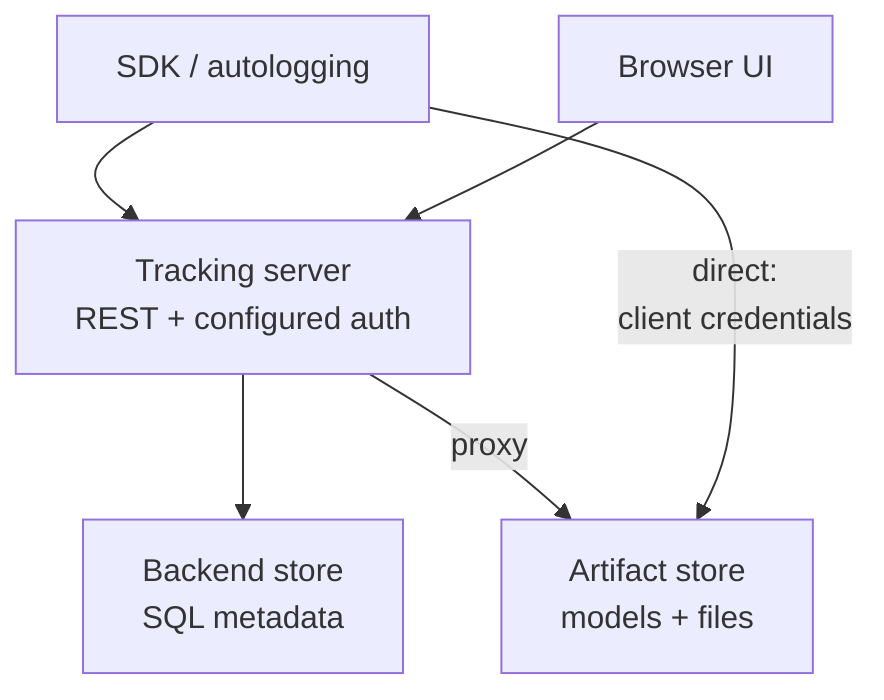

---
{
  "id": "deep-dive-mlflow",
  "title": "Deep Dive - MLflow",
  "slug": "deep-dive-mlflow",
  "section": "Project Deep Dives",
  "category": "MLOps & Deployment",
  "difficulty": "Hard",
  "order": 10,
  "coverImage": "illustrations/_generated/mlflow_lineage_graph_dark.png",
  "companies": [
    "Databricks",
    "Microsoft",
    "Amazon",
    "Google",
    "Meta AI"
  ],
  "shortDescription": "The Git commit is unchanged, but the answer lost its citation. MLflow records which prompt, model, index, and case that request used.",
  "keyConceptsTested": [
    "Tracking server and storage architecture",
    "Runs, logged models, artifacts, and lineage",
    "OpenTelemetry-compatible LLM tracing",
    "Offline and automatic evaluation",
    "Prompt and model registry aliases",
    "AI Gateway capabilities and operational scope",
    "Privacy, retention, and operational tradeoffs"
  ],
  "prerequisites": [
    "advanced-mlops-devops-ai",
    "observability-monitoring-llm-systems",
    "llm-as-judge-automated-evaluation"
  ]
}
---

Two runs of `hybrid-reranker-v3` share the exact same Git commit (`8b2f9e1`). Yesterday it answered a return-window question with a clean link to `DOC-12`. Today it answers `"30 days"` with no citation at all. Checking `git log` reveals nothing, because in a modern LLM application, code is only one of the moving parts: a prompt alias, retrieval index, model endpoint, or evaluation rubric can shift right underneath an unchanged binary.

Ray showed where distributed AI workloads execute. <span data-glossary="mlflow">MLflow</span> solves the companion problem: recording every input, artifact, and <span data-glossary="tracing">request trace</span> under stable, linked identifiers so two executions on the same commit can actually be compared.

Throughout this deep dive, we will trace one retrieval-augmented assistant: it retrieves 40 candidate chunks, reranks them to 8, and generates answers using prompt `support-answer` version 17 against evaluation set `eval-08-01`. When a live request drops its required citation, its captured trace becomes our regression test case, `eval_case_104`.[^mlflow3161Release2026]

## Link every artifact to its Git revision

Replay a Git commit with different training data, hyperparameters, package versions, or checkpoints and you get a different model. The original MLflow paper tackled this by introducing open interfaces for experiment tracking, reproducible packaging, and multi-flavor model deployment without locking teams into a single ML framework.[^zaharia2018]

That same architecture now extends from classical training runs into LLM and agent workflows. Each MLflow entity answers one specific reconstruction question:

| Asset | What it stores | Question it answers |
| --- | --- | --- |
| Run | Parameters, metrics, tags, source metadata | What happened during this experiment? |
| Logged model | Model files, input/output signature, lineage | Which model artifact produced this score? |
| Prompt version | Immutable template text; separately mutable model config | Which instructions reached the model? |
| Trace | Ordered spans, inputs, outputs, latency | Which step failed on this request? |
| Evaluation dataset | Test cases, expectations, <span data-glossary="provenance">data origin</span> | What benchmark did a candidate face? |
| Assessment | Score, rationale, scorer source | Who or what judged this trace? |
| Registry alias | Mutable pointer (`@production`) to a numbered version | Which version is currently active? |

The real leverage comes from the edges between these entities. A live trace records the exact prompt and model version that served it; a bad trace converts into an evaluation case; a candidate evaluation links back to the code and model artifact that produced it.

> **Common mistake:** Treating a registry alias or prompt version number as completely immutable. Aliases move by design, tags can be overwritten, and prompt model settings (like temperature) can be edited independently of the template text. Always log the resolved version and configuration alongside each run.

```checkpoint
Why isn't a Git commit enough to reproduce an LLM evaluation?
---
Code is only one input. Reproduction also requires the exact model and prompt versions, evaluation cases, hyperparameters, dependencies, and scorer definitions. MLflow links those moving pieces under explicit IDs.
```

## Metadata and artifacts take different paths

Every LLM request generates a handful of searchable scalar fields, while a single model checkpoint can weigh gigabytes. Stuffing both into one database forces interactive queries to fight bulk file I/O. MLflow splits storage into two layers: a **backend store** (relational SQL) for searchable metadata, metrics, prompts, and trace indexes, and an **artifact store** (object storage or filesystem) for checkpoints, plots, tables, and large trace payloads.[^mlflow2026architecture]

The tracking server sits in front of both stores over HTTP. Clients send metadata to the tracking server, while artifact bytes take one of two routes: either proxied through the tracking server or uploaded directly to object storage.



Locally, MLflow defaults to SQLite. Production deployments pair a managed relational database (required for Model Registry and opt-in shared workspaces) with cloud object storage.[^mlflow2026backendstore][^mlflow2026architecture]

Proxying artifact uploads keeps object-store <span data-glossary="secrets-management">credentials</span> centralized on the tracking server, at the cost of extra server bandwidth and a broader server IAM footprint that must be tightly scoped. Direct uploads take the server off the data path, but require granting storage credentials to every client. One subtle catch: existing experiments remember the artifact URI they were created with, so flipping server proxy flags affects new experiments without migrating existing runs.[^mlflow2026architecture][^mlflow2026tracking]

<figure>
  
  <figcaption>Follow IDs rather than display names. A run links to a logged model artifact and request traces, while registration assigns a separate version number. Saving a failing trace as eval_case_104 adds a regression case without altering production state.</figcaption>
</figure>

## Runs are evidence containers

An MLflow **run** bundles everything that characterizes one experiment: parameters (`retrieval_k=40`, `rerank_k=8`), metrics (`ndcg_at_8=0.81`), tags (`git_commit`, `dataset_revision`), and artifacts (`error_slices.json`). Keeping those categories distinct makes runs queryable and comparable.

This self-contained snippet runs against a temporary SQLite backend and local artifact folder, logging our reranker run and reading it back:

<!-- leetllm: test, output=show, deps="mlflow==3.16.1" -->
```python title="track_experiment.py"
import os
from pathlib import Path
from tempfile import TemporaryDirectory

os.environ["MLFLOW_DISABLE_TELEMETRY"] = "true"
import mlflow

with TemporaryDirectory() as directory:
    root = Path(directory)
    mlflow.set_tracking_uri(f"sqlite:///{root / 'tracking.db'}")
    experiment_id = mlflow.create_experiment(
        "retrieval-ranking", artifact_location=(root / "artifacts").as_uri()
    )
    with mlflow.start_run(experiment_id=experiment_id, run_name="hybrid-reranker-v3") as run:
        mlflow.log_params({"retrieval_k": 40, "rerank_k": 8})
        mlflow.log_metrics({"recall_at_40": 0.94, "ndcg_at_8": 0.81})
        mlflow.set_tags({"dataset_revision": "eval-08-01", "git_commit": "8b2f9e1"})
        mlflow.log_dict({"case": "eval_case_104", "failure": "missing citation"}, "error_slices.json")
    stored = mlflow.get_run(run.info.run_id)
    print(f"read back: retrieval_k={stored.data.params['retrieval_k']}; ndcg_at_8={stored.data.metrics['ndcg_at_8']}")
```

<!-- leetllm: output:start -->
```text title="Output" output compact
read back: retrieval_k=40; ndcg_at_8=0.81
```
<!-- leetllm: output:end -->

Notice a crucial mutability rule enforced by the backend store: logged **parameters** are write-once per run, whereas **tags** can be updated later (for example, flipping `review=pending` to `review=approved`).[^mlflow2026tracking]

Models work similarly. A **logged model** packages weights, a flavor loader, environment specs, and an optional input/output schema signature under its own model ID linked to the source run. Registering that model assigns a sequential version number in the **Model Registry**, while mutable **aliases** point to versions for deployment. When promoting a model, verify the underlying artifact digest rather than trusting a mutable alias or assuming object-store bytes were never overwritten.[^mlflow2026registryworkflow]

An aggregate metric like `ndcg_at_8=0.81` summarizes a whole dataset, but it cannot tell us why one live request dropped its citation. For that, we need request-level traces.

## LLM traces add request-level lineage

A **trace** captures one request as a tree of nested **spans**, recording each operation's timing, status, attributes, and inputs/outputs. MLflow Tracing is built on <span data-glossary="opentelemetry">OpenTelemetry</span> (OTel), adding LLM-specific conventions while remaining exportable to standard OTel backends.[^mlflow2026tracing][^otelgenai2026] Separate **span links** can also reference related operations (like a shared retrieval call in another trace) without turning them into nested children or inflating the parent's duration.[^mlflow3160Release2026]

Here is the span tree for our failing return-window request. Retrieval returned `DOC-12`, yet the final answer said `"30 days"` without citing it:

```text title="trace-tree.txt"
answer_question                         1,420 ms
├── retrieve_policy_docs                 145 ms
│   ├── embed_query                       24 ms
│   └── vector_search                     91 ms
├── rerank                                110 ms
└── generate_answer                     1,130 ms
    ├── model_call                       980 ms
    └── validate_citations               105 ms
```

The three direct children sum to $145 + 110 + 1{,}130 = 1{,}385\text{ ms}$, leaving $35\text{ ms}$ of root overhead outside them (assuming sequential execution).

> **Key insight:** Never sum every span in a trace tree to compute total latency. Child spans sit inside their parents' wall-clock intervals, and concurrent spans overlap in time; take the interval union of direct children to find root time spent outside them.

Root attributes make traces searchable by model, prompt, or user session, while child spans pinpoint the fault: model spans log <span data-glossary="token">token</span> counts and provider metadata, retrieval spans log document IDs and scores, and tool spans log arguments and exceptions. Seeing `DOC-12` in `retrieve_policy_docs` tells us retrieval worked; inspecting the packed prompt inside `model_call` shows whether `DOC-12` survived truncation and actually reached the LLM.

You can capture traces automatically via framework hooks, ingest them from OpenTelemetry, or add custom spans with `@mlflow.trace` around domain-specific steps like citation validation.

```checkpoint
A trace shows a correct retrieved document but an unsupported answer. Which pipeline stage failed?
---
Compare the retrieval output against the final packed context sent to `model_call`, then inspect the system prompt, raw model output, and citation validator. The trace isolates whether the document was dropped during context packing or ignored during generation.
```

## Traces become evaluation data

Once a live trace exposes a failure, freeze its inputs and write an explicit expectation (here: *"the answer must cite a retrieved document"*) to turn it into regression case `eval_case_104` inside versioned snapshot `eval-08-01`.

One storage detail matters when comparing runs over time: native MLflow evaluation datasets (backed by SQL) support in-place updates via APIs like `merge_records`, so a dataset ID alone can point to mutated expectations later. Retain a content digest or frozen snapshot whenever you compare candidates across releases.[^mlflowEvaluationDatasets2026]

With frozen cases in hand, `mlflow.genai.evaluate` runs each candidate against the same inputs using two complementary kinds of scorers:

- **Deterministic code scorers** for exact rules like JSON schema validity, required citations, tool allowlists, or numerical tolerances.
- **<span data-glossary="calibration">Calibrated</span> LLM judges** for subjective criteria like helpfulness, tone, or semantic groundedness.

<figure>
  
  <figcaption>Eval case eval_case_104 stays fixed while candidate prompt v18 runs through citation and groundedness checks. Production stays on v17 if any required check fails, and moves to v18 only when all criteria pass.</figcaption>
</figure>

Always inspect both per-case failures and aggregate scores. A higher average cannot hide a regression on a critical case like `eval_case_104`, and a holdout set protects against overfitting your prompts to past incidents.

For production monitoring, MLflow can also run configured LLM judges asynchronously on sampled live traces (via AI Gateway endpoints, typically scanning a recent one-hour window without automatic retries). Track **scored coverage** alongside the mean score: if half the traces were skipped or errored out, a flattering average hides blind spots.[^mlflow2026evaluation] And because LLM judges shift whenever their underlying model, prompt, or <span data-glossary="temperature">temperature</span> changes, pin judge configurations and calibrate them against human labels.

<!-- leetllm: edition:reference:start -->

### Run the evidence loop locally

The downloadable [SQLite SDK lab](assets/mlflow_local_lab.py) exercises MLflow's native Python APIs completely offline with deterministic functions: it logs a run, artifact, and two-span trace, registers two prompt versions, moves an alias, and evaluates three citation fixtures with `mlflow.genai.evaluate` and a custom code scorer.[^mlflowGenaiApi2026]

Run it with `uv run mlflow_local_lab.py` (it uses a temporary SQLite database and cleans up afterward). The three fixtures test a missing citation, an unknown citation (`DOC-99`), and a valid citation (`DOC-12`), so 1 of 3 passes and blocks promotion under an all-required-cases release rule.

One API quirk worth knowing: MLflow's `result.passed` summary skips missing scorer cells and defaults to `True` when no result table exists. A production release check should join scored rows against the full list of required case IDs and reject missing assessments explicitly.[^mlflow3161EvaluationResult2026]

```text title="Local SDK lab summaries"
tracking: run, metric, artifact, and two-span trace read back
prompts: old object=v1; fresh alias=v2
mutability: parameter fixed; tag and prompt model config changed
evaluation: missing=False; wrong=False; valid=True; mean=1/3
release: blocked under the all-required-cases policy
PASS: local SDK contracts; no server, provider, or judge calls
```

<!-- leetllm: edition:reference:end -->

```checkpoint
Why should schema validity use a code scorer instead of an LLM judge?
---
Schema validity is deterministic and exact. A code scorer is faster, cheaper, repeatable, and trivial to debug, saving LLM judges for semantic criteria that code cannot express.
```

## Prompt Registry makes instructions deployable assets

Prompt templates act like both code and configuration: a two-word edit can alter tool calls, output formatting, and citation behavior. MLflow's **Prompt Registry** stores numbered template versions alongside variables, commit messages, tags, and optional model configuration.

While a prompt version's template text is immutable, its attached model configuration (such as temperature) remains mutable. Always log the resolved configuration or its digest with each trace so a future replay reproduces the exact sampling behavior.[^mlflow2026prompts]

Mutable **aliases** (`prompts:/support-answer@production`) decouple deployment pointers from version numbers, just as in the Model Registry (which replaced legacy fixed stages like Staging/Production with aliases and tags).[^mlflow2026registryworkflow] Moving an alias changes what *future* loads resolve to; it does not mutate objects already held in worker memory, and alias lookups are cached locally with a default 60-second <span data-glossary="ttl-deadline">time-to-live (TTL)</span> (whereas direct version loads like `prompts:/support-answer/17` cache indefinitely by default).[^mlflow2026prompts]

This compact Python simulation isolates how alias caching and immutable versions behave across discrete clock ticks:

<!-- leetllm: test, output=show -->
```python title="prompt_alias_cache.py"
from dataclasses import dataclass


@dataclass(frozen=True)
class PromptVersion:
    name: str
    version: int
    template: str


class PromptRegistry:
    def __init__(self) -> None:
        self.versions: dict[tuple[str, int], PromptVersion] = {}
        self.aliases: dict[tuple[str, str], tuple[str, int]] = {}

    def register(self, prompt: PromptVersion) -> None:
        key = (prompt.name, prompt.version)
        if key in self.versions:
            raise ValueError("version already exists")
        self.versions[key] = prompt

    def set_alias(self, alias: str, prompt: PromptVersion) -> None:
        key = (prompt.name, prompt.version)
        if key not in self.versions:
            raise KeyError(key)
        self.aliases[(prompt.name, alias)] = key

    def resolve(self, name: str, alias: str) -> PromptVersion:
        return self.versions[self.aliases[(name, alias)]]


class CachedClient:
    """Alias loads refresh after ttl_ticks. MLflow's default alias TTL is 60s."""

    def __init__(self, registry: PromptRegistry, ttl_ticks: int = 1) -> None:
        self.registry = registry
        self.ttl_ticks = ttl_ticks
        self._cached: dict[tuple[str, str], tuple[PromptVersion, int]] = {}

    def load(self, name: str, alias: str, tick: int) -> PromptVersion:
        key = (name, alias)
        cached = self._cached.get(key)
        if cached is None or tick >= cached[1]:
            cached = (self.registry.resolve(name, alias), tick + self.ttl_ticks)
            self._cached[key] = cached
        return cached[0]


v17 = PromptVersion("support-answer", 17, "Cite retrieved docs.")
v18 = PromptVersion("support-answer", 18, "Cite retrieved docs. Refuse if none.")
registry = PromptRegistry()
registry.register(v17)
registry.register(v18)
registry.set_alias("production", v17)

client = CachedClient(registry, ttl_ticks=1)
served = client.load("support-answer", "production", tick=0)

registry.set_alias("production", v18)
stale = client.load("support-answer", "production", tick=0)
fresh = client.load("support-answer", "production", tick=1)
print(f"cached={stale.version} then resolved={fresh.version}")

other = PromptVersion("summarize", 1, "Summarize without adding facts.")
registry.register(other)
registry.set_alias("production", other)
assert client.load("summarize", "production", tick=1) == other

try:
    registry.register(PromptVersion("support-answer", 17, "Silently changed."))
except ValueError:
    print("version overwrite rejected; another prompt's cache stays separate")
```

<!-- leetllm: output:start -->
```text title="Output" output compact
cached=17 then resolved=18
version overwrite rejected; another prompt's cache stays separate
```
<!-- leetllm: output:end -->

During the TTL window between tick 0 and tick 1, a worker still serves `v17` even though `@production` already points to `v18`. Log the **resolved version number** (`17`) in the request trace, not just the alias name: the alias records routing intent, while the version number records what actually ran.

## AI Gateway owns provider access, not application truth

MLflow's **AI Gateway** provides an OpenAI-compatible proxy (`/gateway/mlflow/v1`) plus native passthrough routes for external LLM providers. It centralizes API keys, fallback routing, <span data-glossary="rate-limit">rate limits</span>, spend budgets, <span data-glossary="guardrail">guardrails</span>, and token usage accounting.[^mlflow2026gateway]

What the gateway knows is strictly transport-level: which provider answered, how many tokens were billed, and which fallback fired. Whether `DOC-12` supports the answer or whether an agent was authorized to take an action remains the job of your application logic and evaluators.

| Layer | Owns | Must still check |
| --- | --- | --- |
| Gateway | Provider access, fallbacks, spend limits | Answer correctness |
| Tracing | Request path and observed spans | Evaluation quality |
| Evaluation | Per-case scores on test sets | Coverage across live traffic |
| Registry | Version identity and mutable aliases | Approval before alias moves |
| CI/CD | Automated promotion workflows | Post-deploy live behavior |

<!-- leetllm: edition:reference:start -->

## Production architecture needs operations work

### Database capacity and migrations

Every metric, span, prompt version, and assessment generates database writes and queries. Back production servers with a managed relational database, monitor connection pools, rehearse schema migrations after backups, and archive heavy trace payloads to object storage so metadata queries stay fast.[^mlflow2026backendstore]

### Artifact storage and credentials

Checkpoints and evaluation tables outgrow metadata quickly. Configure encryption, <span data-glossary="checksum">checksums</span>, and retention rules on object storage. Note that deleting a run in MLflow performs a **soft delete** so it can be restored; permanent removal requires running `mlflow gc` and accounting for external backups.[^mlflow2026backendstore]

### Trace privacy

LLM spans routinely capture user prompts, retrieved documents, tool arguments, and exception messages. Redact sensitive fields before export, sample deliberately, and set per-class retention rules. Disabling automatic input capture does not scrub custom attributes or error strings that echo user text.[^mlflow2026productiontracing][^otelsensitivedata2026]

### Async loss and backpressure

Asynchronous span export keeps tracing off the critical request path (enabled by default in open-source MLflow outside Databricks notebooks). Because buffers are bounded in memory, a full export queue or a hard crash drops unexported spans. Flush cleanly on shutdown, monitor exporter error rates, and choose deliberately whether telemetry loss should fail open (usual for user-facing apps) or fail closed.[^mlflow2026productiontracing] For lightweight instrumentation-only containers, MLflow publishes matching `mlflow-tracing` and `mlflow-skinny` distributions; keep their versions locked together.[^mlflow3161Package2026]

### Identity and tenancy

A shared tracking server holds proprietary models, prompts, and user traces, and write access to the Model or Prompt Registry can redirect production traffic. Put TLS, authentication (configured to fail closed without default passwords), workspace permissions, and least-privilege object-store roles in place from day one.[^mlflow3160Release2026][^mlflow3161Release2026]

<!-- leetllm: edition:reference:end -->

## Strengths and weaknesses

| Strength | Why teams value it | Tradeoff or cost |
| --- | --- | --- |
| Framework-neutral APIs | Unified lineage across classical ML and LLM apps | Framework integrations expose uneven detail |
| Metadata / artifact split | Fast SQL search separate from multi-GB checkpoints | Two storage systems to back up and secure |
| OTel-compatible tracing | Plugs into existing telemetry pipelines | Rich LLM payloads heighten privacy risk |
| Linked runs, prompts, traces, evals | End-to-end debugging from live bug to regression test | Links rely on disciplined instrumentation |
| Self-hosted Apache-2.0 core | Full control over infrastructure and data | You operate scaling, upgrades, auth, and retention |
| Model and prompt aliases | Stable deployment pointers decoupled from versions | Mutable pointers need auth and cache awareness |

Know where MLflow stops. It is not a distributed compute scheduler like Ray or <span data-glossary="kubernetes">Kubernetes</span>, and it does not replace an infrastructure observability stack. When GPU utilization spikes or latency regresses inside a kernel, MLflow tells you *which* release and prompt ran, while your cluster profiler explains *why* the hardware stalled.

<!-- leetllm: edition:reference:start -->

## Project identity

MLflow was created at Databricks in 2018 by Matei Zaharia, Andrew Chen, Aaron Davidson, Ali Ghodsi, Andy Konwinski, and collaborators.[^zaharia2018] Databricks donated MLflow to the Linux Foundation in June 2020, where it is governed by a Technical Steering Committee under vendor-neutral open-source rules while Databricks continues contributing and offering managed hosting.[^mlflow2020linuxfoundation][^mlflow2026repo][^mlflow2026databricks]

| Field | Project fact |
| --- | --- |
| Origin | Created at Databricks in 2018 around open tracking, project, and model-flavor interfaces.[^zaharia2018] |
| Stewardship | Linux Foundation project with a Technical Steering Committee and core maintainers.[^mlflow2020linuxfoundation][^mlflow2026contributing] |
| Contributor model | Community pull requests under Developer Certificate of Origin (DCO) sign-off.[^mlflow2026contributing][^mlflow2026charter] |
| Licenses | Apache-2.0 for source code; CC BY 4.0 for documentation.[^mlflow2026license][^mlflow2026charter] |
| Commercial scope | Databricks offers managed MLflow; the Linux Foundation core stays self-hostable.[^mlflow2026databricks][^mlflow2020linuxfoundation] |

## A code-reading path through MLflow

To map these layers directly in source, trace a single request from client call to database row and span:

1. `mlflow/tracking/client.py`: the `MlflowClient` facade.
2. `mlflow/store/tracking/`: REST, file, and SQLAlchemy tracking stores (compare how `SqlAlchemyStore.log_param` enforces parameter immutability against mutable tags).
3. `mlflow/store/artifact/`: artifact repository abstractions that keep bulk bytes off the SQL store.
4. `mlflow/server/handlers.py`: REST endpoints translating HTTP routes to store calls.
5. `mlflow/entities/logged_model.py`: logged model identity and lineage fields.
6. `mlflow/tracing/provider.py` and `mlflow/tracing/client.py`: span creation through persistence.
7. `mlflow/genai/` and `mlflow/gateway/`: evaluation datasets, scorers, prompts, and gateway routing.[^mlflow3161Release2026]

```checkpoint
A prompt version's template stayed unchanged, but its temperature changed from 0.2 to 0.8. Can an old evaluation log containing only the version number reproduce the earlier request?
---
No. Template version numbers do not freeze attached model configuration. Log the exact resolved configuration (or its content digest) alongside every run and trace.
```

## Designing an evidence protocol

Before wiring dashboards, define the minimal record every release of our retrieval assistant must log:

- **Code and environment:** Git commit (`8b2f9e1`), release tag, and locked dependencies.
- **Model and prompt:** provider, exact model ID, prompt alias (`support-answer@production`), resolved version (`v17` or `v18`), and exact model settings.
- **Data:** live retrieval index hash alongside the frozen evaluation dataset digest (`eval-08-01`).
- **Traces and scores:** root trace ID with retrieval/model spans, token/latency/cost attributes, and per-case plus slice assessments (including `eval_case_104`).
- **Release event:** candidate artifact digests, reviewer approval, alias transition, and <span data-glossary="rollback">rollback</span> target.

With those fields linked, any sudden citation drop turns from guesswork into a quick diff across exact versions.

<!-- leetllm: edition:reference:end -->

```mastery-quiz
[
  {
    "question": "An old experiment records a direct object-store artifact URI. An administrator later enables server proxying for newly created experiments. A worker must retrieve the old run’s checkpoint. Which path and credential decision follow?",
    "options": [
      "Use the proxy’s new default location; authorize the server’s access to the old object.",
      "Resolve the old recorded location; authorize the client’s access to that direct path.",
      "Resolve the old recorded location; use the server’s role for a direct client download.",
      "Use the proxy’s new default location; authorize the client to download migrated bytes."
    ],
    "answer": "Resolve the old recorded location; authorize the client’s access to that direct path.",
    "explanation": "Existing experiments keep their originally recorded artifact locations. Enabling proxying for new experiments neither moves old bytes nor grants storage access, so the worker must read from the old direct URI with client credentials unless artifacts are explicitly migrated."
  },
  {
    "question": "A root request lasts 900 ms. Direct child A spans 0–350 ms and direct child B spans 250–700 ms. A model span inside B spans 300–650 ms. What direct-child interval union and root time outside those children follow?",
    "options": [
      "Union 800 ms; outside 100 ms.",
      "Union 1,150 ms; outside −250 ms.",
      "Union 350 ms; outside 550 ms.",
      "Union 700 ms; outside 200 ms."
    ],
    "answer": "Union 700 ms; outside 200 ms.",
    "explanation": "Direct children A (0–350 ms) and B (250–700 ms) overlap by 100 ms, so their union spans 0–700 ms. That leaves 900 − 700 = 200 ms of root time outside them. Summing A and B double-counts the overlap, and adding the nested model span double-counts B."
  },
  {
    "question": "Four required cases W, X, Y and Z have code scores True, False, missing and True. The missing cell has no scorer error. What are scored coverage and observed mean now? If Y later scores True, should a rule requiring every case to pass allow the release?",
    "options": [
      "Coverage 3/4, mean 2/3, block release.",
      "Coverage 3/4, mean 2/3, allow release.",
      "Coverage 4/4, mean 1/2, block release.",
      "Coverage 4/4, mean 1/2, allow release."
    ],
    "answer": "Coverage 3/4, mean 2/3, block release.",
    "explanation": "W, X, and Z are scored and two pass, giving 3/4 coverage and a 2/3 observed mean. Even after Y scores True, coverage reaches 4/4 but X still fails, so an all-cases-must-pass rule blocks the release."
  },
  {
    "question": "Two cases retain unchanged inputs and answers under one native dataset ID. Case M cites DOC-7; its allowed set changes from {DOC-9} in S1 to {DOC-7} in S2. Case N cites DOC-8; its allowed set changes from {DOC-8} to {DOC-6}. Which S1→S2 score transitions follow?",
    "options": [
      "M passes→fails; N passes→fails.",
      "M fails→passes; N fails→passes.",
      "M fails→passes; N passes→fails.",
      "M passes→fails; N fails→passes."
    ],
    "answer": "M fails→passes; N passes→fails.",
    "explanation": "DOC-7 is absent in S1 and present in S2, flipping M from fail to pass. DOC-8 is present in S1 and absent in S2, flipping N from pass to fail. Native dataset IDs allow expectation edits, so compare frozen snapshots before attributing score shifts to the model."
  },
  {
    "question": "An MLflow run has parameter retrieval_k=24 and tag review=pending. Prompt version 7 has temperature 0.1. A script makes three independent SDK calls to set retrieval_k to 26, review to approved, and version 7's temperature to 0.9. It attempts every call even if an earlier one fails. Which values will a fresh read from the stores return?",
    "options": [
      "retrieval_k=24, review=approved, temperature=0.9",
      "retrieval_k=26, review=pending, temperature=0.9",
      "retrieval_k=26, review=pending, temperature=0.1",
      "retrieval_k=24, review=approved, temperature=0.1"
    ],
    "answer": "retrieval_k=24, review=approved, temperature=0.9",
    "explanation": "Run parameters are immutable once logged (keeping retrieval_k=24), while run tags are mutable (updating review to approved). Prompt version 7 freezes its template text, but its attached model config can still be edited, so a fresh read returns temperature=0.9."
  },
  {
    "question": "A client caches each (prompt name, alias) entry for four ticks, counting the tick when it fetched the entry as the first. At tick 5 it loads support@production=v4 and summary@production=v9. Both aliases move at tick 6 to v5 and v10. It reads support at 8, summary at 9, then support at 9. Another caller kept the support object it received at tick 5. Which versions do the three reads return, and what version does the caller's object show afterward?",
    "options": [
      "v4, v9, v4; held v5.",
      "v4, v9, v4; held v4.",
      "v4, v10, v5; held v5.",
      "v4, v10, v5; held v4."
    ],
    "answer": "v4, v10, v5; held v4.",
    "explanation": "Entries fetched at tick 5 remain valid through ticks 5, 6, 7, and 8. The support read at tick 8 still returns cached v4. At tick 9 both entries expire, so summary fetches v10 and support fetches v5. The other caller's in-memory object stays at v4 because moving an alias never mutates already-loaded objects."
  },
  {
    "question": "Two workers load the same model registry version. Worker A’s complete artifact digest matches the evaluated bytes; worker B’s digest differs after an object-store replacement. Their output on one test input happens to match. Which verification outcome follows?",
    "options": [
      "Both workers pass; one equal output confirms artifact parity.",
      "A passes and B is blocked; matching on one input leaves the rest of B unverified.",
      "A is blocked and B passes; the latest object-store bytes define evaluated parity.",
      "Both workers are blocked; one equal output leaves both unverified."
    ],
    "answer": "A passes and B is blocked; matching on one input leaves the rest of B unverified.",
    "explanation": "Worker A matches the evaluated artifact digest, while Worker B's underlying bytes changed under the same version label. Agreeing on a single test case says nothing about other inputs, so B must be evaluated directly rather than trusted by label."
  },
  {
    "question": "After Elm returns 429, a gateway sends the request to two fallback providers. Its log shows Fir 200 (r81) and Oak 200 (r42). The client received reply r81. Input capture was off. Elm's exception records status=429 and detail=aisle, where aisle came from the customer's seat request. The export rule requires the responding provider and the failure status while keeping customer text local. Which payload should the gateway export?",
    "options": [
      "Responder Oak, status 429, detail omitted.",
      "Responder Fir, status 429, detail aisle.",
      "Responder Fir, status 429, detail omitted.",
      "Responder Oak, status 429, detail aisle."
    ],
    "answer": "Responder Fir, status 429, detail omitted.",
    "explanation": "Fir produced r81, the reply actually returned to the client, and Elm's 429 records the failed attempt. Exporting detail=aisle would leak customer prompt text through an exception string even with input capture turned off, so keep status 429 and omit the detail."
  },
  {
    "question": "A FIFO trace queue has capacity 5 and initially holds A, B, C and D. At each tick it sends up to two queued traces before admitting new arrivals, dropping new arrivals beyond capacity. Tick 1 receives E, F, G, H and I; tick 2 receives J and K. What are total sent, still queued and dropped counts?",
    "options": [
      "Sent 4; queued 7; dropped 0.",
      "Sent 4; queued 3; dropped 4.",
      "Sent 2; queued 5; dropped 4.",
      "Sent 4; queued 5; dropped 2."
    ],
    "answer": "Sent 4; queued 5; dropped 2.",
    "explanation": "Tick 1 sends A and B (leaving C and D), admits E, F, and G up to capacity 5, and drops H and I. Tick 2 sends C and D (leaving E, F, and G) and admits J and K, reaching capacity 5 again. Across 11 arrivals, 4 were sent, 5 remain queued, and 2 were dropped."
  },
  {
    "question": "Baseline X uses prompt 7, index 2 and model A and passes a citation check. Candidate Y uses prompt 8, index 3 and model A and fails. Which additional replay isolates the prompt change relative to X?",
    "options": [
      "Prompt 8, index 2, model A; measure the outcome.",
      "Prompt 7, index 3, model A; measure the outcome.",
      "Prompt 8, index 3, model A; measure the outcome.",
      "Prompt 8, index 2, model B; measure the outcome."
    ],
    "answer": "Prompt 8, index 2, model A; measure the outcome.",
    "explanation": "Changing only prompt 7 to prompt 8 while holding index 2 and model A constant isolates the prompt's effect relative to baseline X. Comparing X directly to Y confounds the prompt change with the index change."
  }
]
```

> **Next:** Continue to [Deep Dive - PyTorch](/learn/deep-dive-pytorch). MLflow showed how to preserve evidence around model work, including the prompt versions and traces a training job should log. <span data-glossary="pytorch">PyTorch</span> opens the execution substrate underneath that work: <span data-glossary="tensor">tensors</span>, automatic differentiation, compiler graphs, accelerator dispatch, and distributed collectives.
