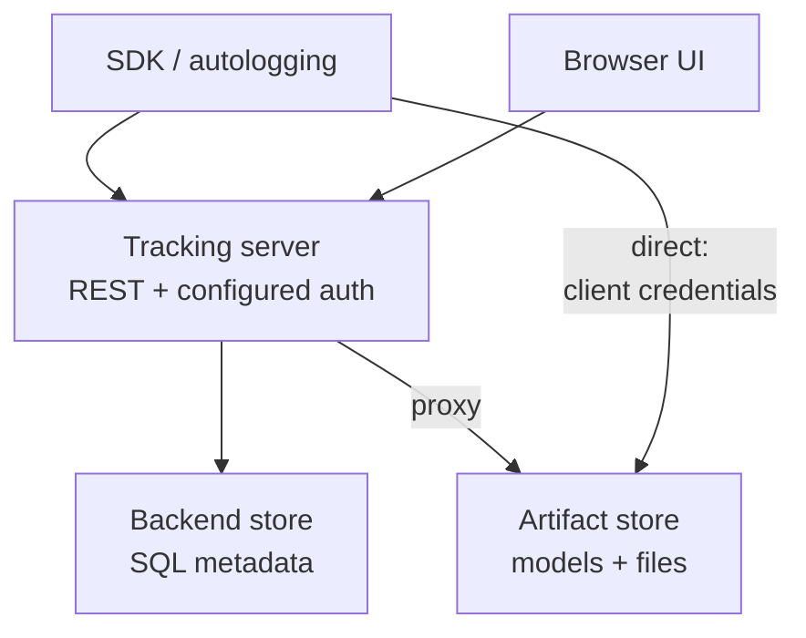

---
{
  "id": "deep-dive-mlflow",
  "title": "Deep Dive - MLflow",
  "slug": "deep-dive-mlflow",
  "section": "Project Deep Dives",
  "category": "MLOps & Deployment",
  "difficulty": "Hard",
  "order": 10,
  "coverImage": "illustrations/_generated/mlflow_lineage_graph_dark.png",
  "companies": [
    "Databricks",
    "Microsoft",
    "Amazon",
    "Google",
    "Meta AI"
  ],
  "shortDescription": "The Git commit is unchanged, but the answer lost its citation. MLflow records which prompt, model, index, and case that request used.",
  "keyConceptsTested": [
    "Tracking server and storage architecture",
    "Runs, logged models, artifacts, and lineage",
    "OpenTelemetry-compatible LLM tracing",
    "Offline and automatic evaluation",
    "Prompt and model registry aliases",
    "AI Gateway capabilities and operational scope",
    "Privacy, retention, and operational tradeoffs"
  ],
  "prerequisites": [
    "advanced-mlops-devops-ai",
    "observability-monitoring-llm-systems",
    "llm-as-judge-automated-evaluation"
  ]
}
---

At 09:12, `hybrid-reranker-v3` answers a return-window question with "30 days" and no citation. Git commit `8b2f9e1` is unchanged, yet a prompt alias, retrieval index, provider model, or evaluator rubric may have moved. Checking the commit alone won't tell us which inputs this request actually used.

Ray showed where that work runs. <span data-glossary="mlflow">MLflow</span> records the evidence around it, including <span data-glossary="tracing">request traces</span>, under stable identities, so two executions that share a commit can still be compared. <span data-glossary="gpu">GPU</span> scheduling and attention kernels stay elsewhere.

Keep one policy assistant in view. It retrieves 40 candidates, reranks to 8, and answers from prompt `support-answer` version 17. Git commit `8b2f9e1` and dataset `support-eval-2026-08-01` (short label `eval-08-01`) identify two more inputs. When a request about the return window omits mandatory documentation citations, its trace becomes diagnostic case `eval_case_104`.

The local SDK lab below pins MLflow **3.16.1**, released September 17, 2026 and verified September 23. The source-reading path uses that release too. Documentation under `/latest/` can move ahead of an installed server, so verify feature availability and client/server compatibility before adopting its examples.[^mlflow3161Release2026]

## Link every artifact to its Git revision

Two runs can share a source commit while using different data, parameters, environments, random seeds, or checkpoints. Replay only the commit and you can still get a different model. The original MLflow paper described open interfaces for tracking experiments, packaging reproducible projects, and representing models in several deployment flavors without forcing teams into one framework.[^zaharia2018]

That open-interface idea still anchors the project. The current tree extends classical experiment tracking into LLM and agent work. Each asset below answers a different reconstruction question:

| Asset | What the record contains | Question it answers |
| --- | --- | --- |
| Run | Parameters, metrics, tags, source | What happened in one experiment? |
| Logged model | Model files, signature, lineage | Which model artifact produced this result? |
| Prompt version | Immutable template; separately mutable model config | Which instructions reached the application? |
| Trace | Ordered spans, inputs, outputs, timing | Which step failed on this request? |
| Evaluation dataset | Cases, expectations, <span data-glossary="provenance">data origin</span> | What evidence did releases face? |
| Assessment | Score, rationale, source | Who or what judged a trace? |
| Registry alias | Mutable name pointing to a version | Which asset does this name currently resolve to? |

These records earn their value through links. A trace can record the resolved prompt and model, a failure can become an evaluation case, and a candidate evaluation can point back to its model and code. Those links aren't automatic for arbitrary application code. Stable IDs also don't make every field immutable: tags, assessments, aliases, and some configuration can change. Require approval in your promotion workflow; the registry API itself won't refuse every unevaluated alias move.

```checkpoint
Why isn't a Git commit enough to reproduce an LLM evaluation?
---
Code is only one input. Reproduction also needs model and prompt versions, data or trace cases, parameters, dependencies, evaluator definitions, and artifacts. MLflow records those changing inputs under linked identities.
```

## Metadata and artifacts take different paths

Suppose every request adds a few searchable fields but a checkpoint adds gigabytes. Putting both in one store makes query traffic compete with large-byte transfers. MLflow separates searchable metadata from large bytes: the backend store holds experiment, run, model, prompt, trace, metric, parameter, and tag records, while the artifact store holds model weights, checkpoints, plots, tables, files, and archived trace payloads.[^mlflow2026architecture]

That split leaves one routing question: who moves artifact bytes? The tracking server provides an HTTP interface in front of both stores. Clients can send metadata to the server while either proxying artifact uploads through it or writing directly to object storage. Those modes have different <span data-glossary="secrets-management">credential</span> and throughput consequences.



SQLite is the default local backend. A production tracking server normally uses a managed relational database plus object storage. The file backend is a legacy path in maintenance mode, and Model Registry requires a database-backed store. Shared workspaces, which group experiments, models, prompts, and artifacts for teams, are opt-in and also need <span data-glossary="sql">SQL</span>.[^mlflow2026backendstore][^mlflow2026architecture]

Artifact proxying keeps storage credentials on the server, but it also widens the server's authority. Scope that role and enforce access checks on artifact requests; proxying isn't tenant isolation by itself. Direct uploads reduce proxy load, but every client now needs storage access. Existing experiments retain their artifact locations, so changing server flags doesn't automatically migrate their bytes or access paths.[^mlflow2026architecture][^mlflow2026tracking]

<figure>
  
  <figcaption>Follow the identifiers, not the display names. A run can link to a logged model artifact and request traces, while registration assigns a separate model version. Selecting a trace as eval_case_104 creates an evaluation case without modifying production state.</figcaption>
</figure>

A diagram of stores still doesn't tell you what one experiment recorded. To answer that, follow one run.

## Runs are evidence containers

A run groups parameters, metrics, tags, artifacts, and source metadata. In our example, retrieval depth and rerank width are parameters, nDCG@8 is a metric, the commit and dataset revision are tags, and `error_slices.json` is an artifact. Each field has a different job when you compare or replay a run.

The MLflow API makes those categories explicit. This example uses a temporary SQLite database and local artifacts, so it needs no tracking server. The metric values demonstrate SDK persistence; reading them back verifies round-trip storage, not retrieval quality. Install `mlflow==3.16.1` in an isolated environment before running it:

<!-- leetllm: test, output=show, deps="mlflow==3.16.1" -->
```python title="track_experiment.py"
import os
from pathlib import Path
from tempfile import TemporaryDirectory

os.environ["MLFLOW_DISABLE_TELEMETRY"] = "true"
import mlflow

with TemporaryDirectory() as directory:
    root = Path(directory)
    mlflow.set_tracking_uri(f"sqlite:///{root / 'tracking.db'}")
    experiment_id = mlflow.create_experiment(
        "retrieval-ranking", artifact_location=(root / "artifacts").as_uri()
    )
    with mlflow.start_run(experiment_id=experiment_id, run_name="hybrid-reranker-v3") as run:
        mlflow.log_params({"retrieval_k": 40, "rerank_k": 8})
        mlflow.log_metrics({"recall_at_40": 0.94, "ndcg_at_8": 0.81})
        mlflow.set_tags({"dataset_revision": "eval-08-01", "git_commit": "8b2f9e1"})
        mlflow.log_dict({"case": "eval_case_104", "failure": "missing citation"}, "error_slices.json")
    stored = mlflow.get_run(run.info.run_id)
    assert stored.data.params["retrieval_k"] == "40"
    assert stored.data.metrics["ndcg_at_8"] == 0.81
    print("read back: retrieval_k=40; ndcg_at_8=0.81")
```

<!-- leetllm: output:start -->
```text title="Output" output compact
read back: retrieval_k=40; ndcg_at_8=0.81
```
<!-- leetllm: output:end -->

Those calls prove that the API accepted records, not that the records describe a valid experiment. Without a dataset revision, a metric can be impossible to compare. Missing model signatures can let the wrong schema reach an artifact, while mutable environment dependencies can defeat reproduction. MLflow stores evidence; the team still has to decide which evidence a release requires.[^mlflow2026tracking]

MLflow's model abstraction packages files with a flavor-specific loader, environment metadata, and an optional input/output signature. A logged model has a model ID and can point back to a source run; that's distinct from a registered model's integer version. A registry version points to an artifact, while tags and aliases remain mutable. Approve the resolved artifact and its digest, then move an alias separately. A version number isn't protection against someone overwriting bytes in the artifact store.[^mlflow2026registryworkflow]

The run can say nDCG@8 is 0.81. That aggregate still can't show which span of a live request went wrong, so we need request-level lineage.

## LLM traces add request-level lineage

A trace represents one request as a tree of spans. Each span records a named operation, timing, status, attributes, and optional inputs or outputs. A parent-child edge describes nesting. Since MLflow 3.16.0, separate **span links** can also connect related operations, such as a downstream trace or another request sharing a retrieval step. A link doesn't make that operation a nested child or justify adding its duration to the parent's time.[^mlflow3160Release2026]

MLflow Tracing is compatible with <span data-glossary="opentelemetry">OpenTelemetry</span> (OTel), an open telemetry standard. It adds LLM-oriented structures while preserving export and ingestion through OTel-compatible systems.[^mlflow2026tracing][^otelgenai2026]

The captured request trace has the following span hierarchy. Retrieval reports `DOC-12`, but generation answers "30 days" with no citation. Investigate the span hierarchy across the execution tree. The root's wall-clock duration is 1,420 ms:

```text title="trace-tree.txt"
answer_question                         1,420 ms
├── retrieve_policy_docs                 145 ms
│   ├── embed_query                       24 ms
│   └── vector_search                     91 ms
├── rerank                                110 ms
└── generate_answer                     1,130 ms
    ├── model_call                       980 ms
    └── validate_citations               105 ms
```

The direct children sum to $145+110+1{,}130=1{,}385$ ms, leaving 35 ms of root work outside those children if they ran sequentially. Never add all nested durations: that double-counts parent time. Overlapping spans also need a timeline rather than a sum to explain the critical path.

Root metadata helps search the trace, while child spans explain it. Model spans can carry <span data-glossary="token">token</span> counts and provider metadata. Retrieval spans can record document IDs and scores; tool spans can record arguments, results, and exceptions. Assessments attach feedback or scores. A recorded document ID confirms instrumentation observed retrieval; inspect context packing to confirm what reached the final model context.

Instrumentation can be manual with `@mlflow.trace` or span contexts, automatic through integration hooks, or ingested from OpenTelemetry. Automatic tracing is fast to adopt, but manual spans are still useful around business decisions that a library integration can't name.

```checkpoint
A trace shows a correct retrieved document but an unsupported answer. Which pipeline stage failed?
---
Inspect the retrieved content, final context packing, instructions, model output, and citation validation. Compare retrieval output with the packed context to see whether the document survived truncation and reached generation. Use the full trace to isolate the failure stage.
```

One failure trace doesn't define a release test by itself. Freeze its inputs and write an expected outcome before changing the candidate, so later comparisons can tell whether the fix helped.

## Traces become evaluation data

Call that frozen diagnostic request `eval_case_104`. The operations loop starts by capturing development or production traces, then selecting failures and representative successes. Add expectations, labels, or human feedback, such as "the answer must cite a retrieved doc," and store those cases in a versioned evaluation dataset (`eval-08-01`).

Here, `eval-08-01` names a frozen comparison snapshot we retain. A native MLflow evaluation dataset has an ID, but its records and expectations can be updated through APIs such as `merge_records`; the ID alone doesn't identify historical contents. Retain the case inputs, expectations and a content digest used for each evaluation. The dataset feature requires a SQL backend; a list of dictionaries, as used in the local lab, is also valid evaluation input without creating a stored dataset.[^mlflowEvaluationDatasets2026]

Now run each candidate application version against the same cases. Apply deterministic scorers and <span data-glossary="calibration">calibrated</span> LLM judges, then inspect per-case failures alongside aggregate slices. Our release policy requires every critical case to pass, so a better average cannot hide a regression on `eval_case_104`. Keep separate representative holdout cases: repeatedly tuning against incident cases can overfit the regression suite.

<figure>
  
  <figcaption>Diagnostic case eval_case_104 stays a fixed input. Our release workflow requires a citation code check and groundedness assessment before moving the prompt alias to v18. A failed check keeps it on v17; MLflow records the evidence but doesn't enforce this application policy automatically.</figcaption>
</figure>

Offline evaluation runs when a team calls `mlflow.genai.evaluate` with cases, a prediction function, and scorers. Use deterministic scorers for exact contracts such as JSON validity, citation existence, tool policy, or numerical tolerance. LLM judges help with relevance or tone when exact code can't express the rubric.

Automatic evaluation applies configured LLM judges asynchronously to sampled or filter-matched traces or conversations. It keeps judge calls off the request's synchronous path, but logging overhead and shared server load still exist. The standard documented judge workflow uses AI Gateway endpoints, considers recent traces within a one-hour window, and doesn't automatically retry failed evaluations. Current documentation also describes an experimental self-hosted configuration for code scorers in administrator-managed, network-isolated job containers; this is separate from the standard LLM-judge workflow and the pinned local SDK lab. Confirm actual version support and configuration before relying on either path. Track the share of eligible cases scored and their average assessment outcome; the average alone can hide low coverage.[^mlflow2026evaluation]

Judge output isn't ground truth. It changes with judge model, prompt, <span data-glossary="temperature">temperature</span>, context, and rubric. Align judges against human labels, pin configurations, sample disagreements, and keep exact safety rules in code where possible.

### Run the evidence loop locally

The downloadable [SQLite SDK lab](assets/mlflow_local_lab.py) exercises native MLflow APIs with deterministic functions instead of provider calls. It reads back a run, artifact, and two-span trace; registers two prompt versions; moves an alias; then evaluates three response fixtures with `mlflow.genai.evaluate` and a custom code scorer.[^mlflowGenaiApi2026]

Run the file with `uv run mlflow_local_lab.py`. Its dependency metadata pins Python 3.12 and MLflow 3.16.1. It disables MLflow usage telemetry and uses a temporary local database and artifact directory, which it removes after checking them. Package installation may need internet access; the lab itself needs neither credentials nor a server.

The three cases have no citation, an unknown citation `DOC-99`, and an allowed citation `DOC-12`. The scorer accepts only a nonempty list of allowed document IDs. Thus one of three cases passes, and our all-required-cases release policy blocks promotion. This checks citation membership, not whether “30 days” is supported by the document's text.

MLflow's `result.passed` summarizes scorer outcomes; it isn't proof that every required case and scorer ran. In 3.16.1, its implementation skips missing values without a scorer error and returns `True` when no result table is present. The lab separately checks the expected three rows and three Boolean scores. A production controller should join results to required case IDs and reject missing assessments before considering the scores.[^mlflow3161EvaluationResult2026]

Expected lab summaries, excluding MLflow's generated run IDs and progress messages:

```text title="Local SDK lab summaries"
tracking: run, metric, artifact, and two-span trace read back
prompts: old object=v1; fresh alias=v2
mutability: parameter fixed; tag and prompt model config changed
evaluation: missing=False; wrong=False; valid=True; mean=1/3
release: blocked under the all-required-cases policy
PASS: local SDK contracts; no server, provider, or judge calls
```

The fresh registry numbers these prompts 1 and 2. They play the roles of v17 and v18 in the incident. Setting `cache_ttl_seconds=0` forces fresh alias resolution, so the lab tests alias movement and already-loaded objects, not elapsed-time cache expiry.

```checkpoint
Why should schema validity use a code scorer instead of an LLM judge?
---
Schema validity is deterministic and exactly computable. A code scorer is cheaper, repeatable, and easier to debug. Save judges for criteria that genuinely require semantic interpretation.
```

Evaluation can promote a new instruction the same way it promotes a model. Is a prompt version, by itself, enough to replay the request?

## Prompt Registry makes instructions deployable assets

A prompt version is not enough by itself. Prompt text behaves like code and configuration at once. A wording change can alter tool selection, output shape, latency, and safety.

MLflow Prompt Registry stores templates with variables, optional model configuration, tags, and commit messages. A created template version is immutable, but its model configuration can be updated. Record the exact resolved configuration or its digest alongside the version. The prompt version alone can't reproduce a historical temperature setting.[^mlflow2026prompts]

Aliases provide mutable names such as `candidate` or `production`. Clients can load `prompts:/support-answer@production` while the alias points to a numbered version. Moving the alias changes subsequent resolution; it doesn't rewrite an already loaded object or hot-reload a worker.

That convenience includes a cache, so an alias move isn't instantly visible to every worker. Version-based loads (`prompts:/support-answer/17`) have an infinite default <span data-glossary="ttl-deadline">time-to-live (TTL)</span>; alias-based loads (`prompts:/support-answer@production`) default to 60 seconds. A process can keep serving v17 until it loads again after expiry. Because attached model configuration is mutable, an indefinitely cached version object can also retain old configuration. Choose an explicit refresh policy and record the resolved configuration used on each request.[^mlflow2026prompts]

The next example isolates cache behavior without calling MLflow. Its integer clock makes expiry reproducible. Versions reject replacement, aliases are scoped by prompt name, and cache entries are keyed by both name and alias. It models immutable templates only, not MLflow's mutable model configuration or concurrent registry writes.

<!-- leetllm: test, output=show -->
```python title="prompt_alias_cache.py"
from dataclasses import dataclass


@dataclass(frozen=True)
class PromptVersion:
    name: str
    version: int
    template: str


class PromptRegistry:
    def __init__(self) -> None:
        self.versions: dict[tuple[str, int], PromptVersion] = {}
        self.aliases: dict[tuple[str, str], tuple[str, int]] = {}

    def register(self, prompt: PromptVersion) -> None:
        key = (prompt.name, prompt.version)
        if key in self.versions:
            raise ValueError("version already exists")
        self.versions[key] = prompt

    def set_alias(self, alias: str, prompt: PromptVersion) -> None:
        key = (prompt.name, prompt.version)
        if key not in self.versions:
            raise KeyError(key)
        self.aliases[(prompt.name, alias)] = key

    def resolve(self, name: str, alias: str) -> PromptVersion:
        return self.versions[self.aliases[(name, alias)]]


class CachedClient:
    """Alias loads refresh after ttl_ticks. MLflow's default alias TTL is 60s."""

    def __init__(self, registry: PromptRegistry, ttl_ticks: int = 1) -> None:
        if type(ttl_ticks) is not int or ttl_ticks < 0:
            raise ValueError("TTL must be a nonnegative integer")
        self.registry = registry
        self.ttl_ticks = ttl_ticks
        self._cached: dict[tuple[str, str], tuple[PromptVersion, int]] = {}
        self._last_tick = -1

    def load(self, name: str, alias: str, tick: int) -> PromptVersion:
        if type(tick) is not int or tick < 0 or tick < self._last_tick:
            raise ValueError("clock must be nonnegative and monotonic")
        self._last_tick = tick
        key = (name, alias)
        cached = self._cached.get(key)
        if cached is None or tick >= cached[1]:
            cached = (self.registry.resolve(name, alias), tick + self.ttl_ticks)
            self._cached[key] = cached
        return cached[0]


def record_trace(alias: str, resolved: PromptVersion) -> dict[str, object]:
    return {
        "prompt_alias": alias,
        "prompt_name": resolved.name,
        "prompt_version": resolved.version,
        "template": resolved.template,
    }


v17 = PromptVersion("support-answer", 17, "Cite retrieved docs.")
v18 = PromptVersion("support-answer", 18, "Cite retrieved docs. Refuse if none.")
registry = PromptRegistry()
registry.register(v17)
registry.register(v18)
registry.set_alias("production", v17)

client = CachedClient(registry, ttl_ticks=1)
served = client.load("support-answer", "production", tick=0)
assert record_trace("production", served)["prompt_version"] == 17

registry.set_alias("production", v18)
stale = client.load("support-answer", "production", tick=0)
assert stale.version == 17

fresh = client.load("support-answer", "production", tick=1)
assert fresh.version == 18
print(f"cached={stale.version} then resolved={fresh.version}")

other = PromptVersion("summarize", 1, "Summarize without adding facts.")
registry.register(other)
registry.set_alias("production", other)
assert client.load("summarize", "production", tick=1) == other
try:
    registry.register(PromptVersion("support-answer", 17, "Silently changed."))
except ValueError:
    print("version overwrite rejected; another prompt's cache stays separate")
else:
    raise AssertionError("immutable template was replaced")
```

<!-- leetllm: output:start -->
```text title="Output" output compact
cached=17 then resolved=18
version overwrite rejected; another prompt's cache stays separate
```
<!-- leetllm: output:end -->

The request trace linked to case `eval_case_104` must store version `17` if that's what the process used, even while the alias already names `18`. The alias describes intended routing; the resolved version describes observed behavior. The toy records template text for inspection; a real trace should apply redaction or record a digest when the template contains sensitive material.

Model Registry uses a similar alias model. Fixed stages such as Staging and Production have been deprecated since MLflow 2.9.0 in favor of tags, aliases, and environment-specific registered models. Aliases separate a deployable name from an immutable model version, while CI/CD owns approval and environment promotion.[^mlflow2026registryworkflow]

Provider calls are another mutable input. The gateway sees them, but it still isn't the source of application truth.

## AI Gateway owns provider access, not application truth

MLflow also includes an OpenAI-compatible gateway surface for provider endpoints. Unified chat-completions live under `/gateway/mlflow/v1`, while passthrough routes expose a provider's native API. The gateway can centralize credentials, routing, fallbacks, <span data-glossary="rate-limit">rate limits</span>, budgets, <span data-glossary="guardrail">guardrails</span>, and usage records.[^mlflow2026gateway]

The gateway can answer which provider served a request, how many tokens it used, and whether a routing rule applied. It can't decide whether `DOC-12` was the right policy or whether a business action was authorized. Keep those decisions in application and evaluation contracts.

Use this distinction when assigning release ownership:

| Layer | Owns | Follow-up check |
| --- | --- | --- |
| Gateway | Provider access, routing, spend limits | Answer correctness |
| Tracing | Request path and observed data | Evaluation validity |
| Evaluation | Scored evidence on selected cases | Population coverage |
| Registry | Version identity and aliases | Release approval by itself |
| CI/CD | Automated promotion rules | Live behavior after release |

Linking these layers doesn't transfer responsibility. A trace exists because a request ran. An assessment exists because something scored it. A registry alias moved because a workflow changed it. Each event needs its own authorization and evidence.

Those links only hold up when the tracking server, object store, and exporters are operated like production systems.

## Production architecture needs operations work

### Database capacity and migrations

Every run metric, trace, span, prompt, alias, and assessment adds write and query load. Use a production database, monitor connection pools and slow queries, and rehearse schema upgrades. Back up before migrations. Large trace payloads may need archival into object storage while lightweight trace metadata remains searchable.[^mlflow2026backendstore]

### Artifact storage and credentials

Model checkpoints and evaluation tables can dwarf metadata. Use lifecycle rules, encryption, <span data-glossary="checksum">checksums</span>, and explicit retention. Decide whether clients upload directly or the server proxies them. Don't give a public tracking server a broad object-store role.

Deleting a run is a soft deletion so it can be restored; it doesn't automatically remove its metadata or artifact bytes. MLflow provides `mlflow gc` for permanent cleanup of deleted runs. Retention work must account for that cleanup and for independently copied artifacts and backups, rather than treating a deleted UI row as erased evidence.[^mlflow2026backendstore]

### Trace privacy

LLM spans can contain prompts, outputs, retrieved documents, tool arguments, secrets, personal data, and source code. Redact before export, sample intentionally, apply access controls, and set retention by data class. Disabling input capture for one integration doesn't automatically sanitize custom span attributes.[^mlflow2026productiontracing][^otelsensitivedata2026]

### Async loss and backpressure

Asynchronous tracing protects request latency, and OSS MLflow enables it by default outside Databricks notebooks. A process crash can still drop buffered spans. Current docs warn that a full export queue discards new traces and that failed exports are discarded after the retry window. Flush on graceful shutdown and monitor exporter failures. Then decide whether telemetry loss should fail open or fail closed: most applications should serve traffic while alerting on <span data-glossary="observability">observability</span> loss, while regulated workflows may choose differently.[^mlflow2026productiontracing]

For instrumentation-only images, MLflow offers the slimmer `mlflow-tracing` distribution. Package composition is version-sensitive: the published `mlflow==3.16.1` package itself depends on matching `mlflow-skinny==3.16.1` and `mlflow-tracing==3.16.1`. Let the resolver install that supported set; don't independently mix mismatched releases based on older packaging advice.[^mlflow3161Package2026]

### Identity and tenancy

A shared tracking server contains proprietary artifacts and request data. Put authentication, TLS, workspace or experiment permissions, and object-store policies into the threat model. Registry write access is deployment power because moving an alias can change what future clients load. MLflow 3.16.0 made basic-auth authorization fail closed by default; 3.16.1 removed the shipped default admin password and fixed UI authorization for non-admin users. These changes apply to that configured authentication path, not to an assurance that every server has authentication enabled.[^mlflow3160Release2026][^mlflow3161Release2026]

## Strengths and weaknesses

Read each row as a tradeoff, not a feature tally:

| Strength | Why teams value it | Weakness or cost |
| --- | --- | --- |
| Framework-neutral interfaces | One evidence model across training and LLM apps | Integrations expose uneven detail |
| Metadata plus artifact split | Search stays separate from large files | Two storage systems need backup and policy |
| OTel-compatible tracing | Existing telemetry systems can ingest or export spans | LLM payloads create privacy risk |
| Linked runs, models, prompts, traces, evals | End-to-end lineage supports debugging and promotion | Correct links still depend on disciplined logging |
| Self-hosted Apache-2.0 core | Teams control infrastructure and data | Team owns upgrades, scaling, auth, and retention |
| Model and prompt aliases | Deployments can reference stable names | Mutable aliases need authorization and cache awareness |

MLflow isn't a general distributed scheduler like Ray or <span data-glossary="kubernetes">Kubernetes</span>. It offers deployment integrations and agent-serving features, but those don't replace the underlying resource scheduler, recovery protocol, or <span data-glossary="autoscaling">autoscaling</span> system. Identify which component actually owns a GPU allocation or retry before treating a logged event as execution control.

It also doesn't replace a full observability platform. Infrastructure metrics, logs, profiles, and distributed application traces may live elsewhere. OpenTelemetry compatibility helps correlate them, but teams still need consistent trace and deployment identifiers across systems. If a GPU is saturated, MLflow can link the request to its model and release; a GPU profiler still has to explain the kernel.

## Project identity

MLflow was created at Databricks and announced in 2018. The original paper's authors included Matei Zaharia, Andrew Chen, Aaron Davidson, Ali Ghodsi, Andy Konwinski, and other Databricks engineers.[^zaharia2018] It focused on experimentation, reproducibility, and deployment through open interfaces rather than a locked framework.

Databricks contributed MLflow to the Linux Foundation on June 25, 2020, giving the project a vendor-neutral governance home.[^mlflow2020linuxfoundation] Databricks remains a major contributor and offers managed MLflow integrations, while the public project can be self-hosted and accepts community contributions.[^mlflow2026repo][^mlflow2026databricks]

| Field | Current project fact |
| --- | --- |
| Origin | Databricks created MLflow; the foundational paper names Matei Zaharia, Andrew Chen, Aaron Davidson, Ali Ghodsi, and collaborators.[^zaharia2018] |
| Stewardship | MLflow is a Linux Foundation project with a technical steering committee and core maintainers listed in its contribution guide.[^mlflow2020linuxfoundation][^mlflow2026contributing] |
| Contributor model | Issues and pull requests flow through project committers and maintainers, with Developer Certificate of Origin sign-off for incoming code.[^mlflow2026contributing][^mlflow2026charter] |
| Project licenses | Source code uses Apache-2.0. The technical charter makes project documentation available under CC BY 4.0.[^mlflow2026license][^mlflow2026charter] |
| Commercial scope | Databricks provides managed MLflow products, while the Linux Foundation repository remains separately governed and self-hostable.[^mlflow2026databricks][^mlflow2020linuxfoundation] |
| Artifact and license scope | Logging a model, dataset, prompt, trace, or artifact doesn't relicense it under MLflow's code license. Your organization still owns its access and retention policy. |

The foundational paper explains the original design, not every modern API. Tracing also builds on OpenTelemetry specifications. For evaluation, prompt registry, gateway, and model-lineage behavior, use the documentation and source matching your release.

## A code-reading path through MLflow

The public repository makes architectural boundaries visible. Trace one request from client call to store and span, then pin the commit because GenAI code moves quickly:

1. Start at `mlflow/tracking/client.py` to see the stable `MlflowClient` facade.
2. Follow a log call into `mlflow/store/tracking/` and compare REST, file, and SQLAlchemy stores.
3. Follow an artifact call into `mlflow/store/artifact/` to see why large bytes use separate repositories.
4. Open `mlflow/server/handlers.py` and trace one REST route to a store operation.
5. Read `mlflow/entities/logged_model.py` for model identity and lineage.
6. Follow `mlflow/tracing/provider.py` and `mlflow/tracing/client.py` from span creation to persistence.
7. Inspect `mlflow/genai/` for evaluation datasets, scorers, and prompts; follow gateway-specific handling into `mlflow/gateway/`.

Use tag `v3.16.1` for this reading exercise instead of moving `master`. Start with `MlflowClient.log_param`, follow the tracking client to `SqlAlchemyStore.log_param`, and find the database constraint that rejects changing an existing parameter value. Then compare it with mutable run tags and prompt aliases. Public concepts are more stable than the implementation paths around them.[^mlflow3161Release2026]

Verify that distinction directly. The local lab tries to overwrite `retrieval_k=40` with `50`, then changes a run tag and a prompt version's temperature. The parameter update must fail; the tag and configuration updates must succeed. A useful source-reading explanation identifies where each rule is enforced and which historical values remain recoverable. Naming three API methods without explaining their different mutability rules misses the important boundary.

```checkpoint
A prompt version's template stayed unchanged, but its temperature changed from 0.2 to 0.8. Can an old evaluation log containing only the version number reproduce the earlier request?
---
No. The template version doesn't identify the historical mutable configuration. Retain the exact configuration used, or its digest plus retrievable content. Resolve configuration deliberately when loading prompts; an already-loaded object may still contain the earlier value.
```

## Designing an evidence protocol

Start an MLflow deployment with required schema fields and release records, not with a dashboard. For the policy assistant, require:

- Application release, source commit (`8b2f9e1`), environment, and dependency lock.
- Resolved model provider and exact model identifier.
- Resolved prompt version alongside its alias (`support-answer@production` and `v17` or `v18`), plus the model configuration actually used.
- Retrieval index and corpus revision (`eval-08-01` isn't a substitute for the live index hash).
- Root trace ID plus tool, retrieval, and model spans.
- Token, latency, failure, and cost attributes with known units.
- Evaluation dataset revision and scorer versions.
- Per-case assessments plus aggregate slices, including `eval_case_104`.
- Approval identity, candidate version, and digests of the evaluated artifact and configuration.
- Alias movement event and <span data-glossary="rollback">rollback</span> target.

That execution record lets a team answer four different questions: what ran, what it observed, how it scored, and why it was promoted. Without those distinctions, one green dashboard can hide missing cases, stale aliases, or dropped traces.

```mastery-quiz
[
  {
    "question": "An old experiment records a direct object-store artifact URI. An administrator later enables server proxying for newly created experiments. A worker must retrieve the old run’s checkpoint. Which path and credential decision follow?",
    "options": [
      "Use the proxy’s new default location; authorize the server’s access to the old object.",
      "Resolve the old recorded location; authorize the client’s access to that direct path.",
      "Resolve the old recorded location; use the server’s role for a direct client download.",
      "Use the proxy’s new default location; authorize the client to download migrated bytes."
    ],
    "answer": "Resolve the old recorded location; authorize the client’s access to that direct path.",
    "explanation": "Existing experiments retain their recorded artifact locations. A flag affecting new routing does not move the old bytes or grant storage authority. Resolve and authorize the path actually recorded for this run; migrate explicitly if a new path is required."
  },
  {
    "question": "A root request lasts 900 ms. Direct child A spans 0–350 ms and direct child B spans 250–700 ms. A model span inside B spans 300–650 ms. What direct-child interval union and root time outside those children follow?",
    "options": [
      "Union 800 ms; outside 100 ms.",
      "Union 1,150 ms; outside −250 ms.",
      "Union 350 ms; outside 550 ms.",
      "Union 700 ms; outside 200 ms."
    ],
    "answer": "Union 700 ms; outside 200 ms.",
    "explanation": "The direct children overlap for 100 ms and together cover 0–700 ms. The root has 900−700=200 ms outside that union. A flat direct-child sum double-counts overlap; adding the nested model span counts B again. These elapsed intervals do not measure CPU utilization."
  },
  {
    "question": "Four required cases W, X, Y and Z have code scores True, False, missing and True. The missing cell has no scorer error. What are scored coverage and observed mean now? If Y later scores True, should a policy that requires every case to pass allow the release?",
    "options": [
      "Coverage 3/4, mean 2/3, block release.",
      "Coverage 3/4, mean 2/3, allow release.",
      "Coverage 4/4, mean 1/2, block release.",
      "Coverage 4/4, mean 1/2, allow release."
    ],
    "answer": "Coverage 3/4, mean 2/3, block release.",
    "explanation": "W, X and Z have scores, and two of them pass. That gives 3/4 coverage and an observed mean of 2/3. Counting Y's empty cell as a failure would give 4/4 coverage and a mean of 1/2. When Y later passes, coverage is complete, but X still fails. Allowing the release would overlook X."
  },
  {
    "question": "Two cases retain unchanged inputs and answers under one native dataset ID. Case M cites DOC-7; its allowed set changes from {DOC-9} in S1 to {DOC-7} in S2. Case N cites DOC-8; its allowed set changes from {DOC-8} to {DOC-6}. Which S1→S2 score transitions follow?",
    "options": [
      "M passes→fails; N passes→fails.",
      "M fails→passes; N fails→passes.",
      "M fails→passes; N passes→fails.",
      "M passes→fails; N fails→passes."
    ],
    "answer": "M fails→passes; N passes→fails.",
    "explanation": "For M, DOC-7 is absent from the old allowed set and present in the new one, so failure becomes success. For N, DOC-8 is present only in the old set, so success becomes failure. The same dataset ID and unchanged answers do not freeze expectations. Compare retained content snapshots before attributing either score transition to a model change."
  },
  {
    "question": "An MLflow run has parameter retrieval_k=24 and tag review=pending. Prompt version 7 has temperature 0.1. A script makes three independent SDK calls to set retrieval_k to 26, review to approved, and version 7's temperature to 0.9. It attempts every call even if an earlier one fails. Which values will a fresh read from the stores return?",
    "options": [
      "retrieval_k=24, review=approved, temperature=0.9",
      "retrieval_k=26, review=pending, temperature=0.9",
      "retrieval_k=26, review=pending, temperature=0.1",
      "retrieval_k=24, review=approved, temperature=0.1"
    ],
    "answer": "retrieval_k=24, review=approved, temperature=0.9",
    "explanation": "MLflow keeps the retrieval depth recorded for the run at 24 and updates its review tag to approved. Reading 26 and pending would treat the recorded parameter as a tuning knob and the review tag as permanent. Version 7 fixes the template text, but its model settings can change. A fresh read returns 0.9. Keeping 0.1 would treat the temperature as part of the fixed template."
  },
  {
    "question": "A toy client caches each (prompt name, alias) entry for four ticks, counting the tick when it fetched the entry as the first. At tick 5 it loads support@production=v4 and summary@production=v9. Both aliases move at tick 6 to v5 and v10. It reads support at 8, summary at 9, then support at 9. Another caller kept the support object it received at tick 5. Which versions do the three reads return, and what version does the caller's object show afterward?",
    "options": [
      "v4, v9, v4; held v5.",
      "v4, v9, v4; held v4.",
      "v4, v10, v5; held v5.",
      "v4, v10, v5; held v4."
    ],
    "answer": "v4, v10, v5; held v4.",
    "explanation": "Both entries cover ticks 5 through 8. The support read at tick 8 returns v4 with the original expiry time. At tick 9, summary fetches v10 and support fetches v5. Returning v9 and v4 at tick 9 would give both entries a fifth tick. The caller kept the v4 object. Reporting held v5 would treat that object as a live reference to the production alias."
  },
  {
    "question": "Two workers load the same model registry version. Worker A’s complete artifact digest matches the evaluated bytes; worker B’s digest differs after an object-store replacement. Their output on one test input happens to match. Which identity-gate result and parity conclusion follow the taught release policy?",
    "options": [
      "Both identity gates pass; one equal output establishes artifact parity.",
      "A passes and B blocks; one equal output does not prove artifact parity.",
      "A blocks and B passes; the latest object-store bytes define evaluated parity.",
      "Both identity gates block; one equal output does not prove artifact parity."
    ],
    "answer": "A passes and B blocks; one equal output does not prove artifact parity.",
    "explanation": "A matches the evaluated artifact. B does not, despite sharing a registry version and one output. Equality on one input does not prove equal artifact bytes or behavior over other inputs. Resolve and validate B’s actual candidate rather than approving it from the old version label or a coincidentally equal response."
  },
  {
    "question": "After Elm returns 429, a gateway sends the request to two fallback providers. Its log shows Fir 200 (r81) and Oak 200 (r42). The client received reply r81. Input capture was off. Elm's exception records status=429 and detail=aisle, where aisle came from the customer's seat request. The export policy requires the responding provider and the failure status. Customer text stays local. Which payload should the gateway export?",
    "options": [
      "Responder Oak, status 429, detail omitted.",
      "Responder Fir, status 429, detail aisle.",
      "Responder Fir, status 429, detail omitted.",
      "Responder Oak, status 429, detail aisle."
    ],
    "answer": "Responder Fir, status 429, detail omitted.",
    "explanation": "Fir produced r81, the reply the client received. Oak also succeeded, but its reply was r42. Elm's 429 records the failed attempt. Exporting aisle would copy the customer's words from the exception even with input capture off. Keep the status and omit the detail."
  },
  {
    "question": "A FIFO trace queue has capacity 5 and initially holds A, B, C and D. At each tick it sends up to two queued traces before admitting new arrivals, dropping new arrivals beyond capacity. Tick 1 receives E, F, G, H and I; tick 2 receives J and K. What are total sent, still queued and dropped counts?",
    "options": [
      "Sent 4; queued 7; dropped 0.",
      "Sent 4; queued 3; dropped 4.",
      "Sent 2; queued 5; dropped 4.",
      "Sent 4; queued 5; dropped 2."
    ],
    "answer": "Sent 4; queued 5; dropped 2.",
    "explanation": "Tick 1 sends A/B, retains C/D, admits E/F/G and drops H/I. Tick 2 sends C/D and admits J/K behind E/F/G. Eleven arrivals equal four sent plus five queued plus two dropped. Unlimited admission, a smaller effective capacity or omitting the second service step produces the tempting wrong ledgers. Queued traces are not yet persisted."
  },
  {
    "question": "Baseline X uses prompt 7, index 2 and model A and passes a citation check. Candidate Y uses prompt 8, index 3 and model A and fails. Which additional replay isolates the prompt change relative to X without assuming its outcome?",
    "options": [
      "Prompt 8, index 2, model A; measure the outcome.",
      "Prompt 7, index 3, model A; measure the outcome.",
      "Prompt 8, index 3, model A; measure the outcome.",
      "Prompt 8, index 2, model B; measure the outcome."
    ],
    "answer": "Prompt 8, index 2, model A; measure the outcome.",
    "explanation": "The replay changes only prompt 7→8 relative to X, holding index 2 and model A fixed. The other choices isolate the index, repeat the confounded candidate, or change prompt and model together. The original two-input change cannot confirm which input caused the drop, and the new outcome still needs measurement."
  }
]
```

> **Next:** Continue to [Deep Dive - PyTorch](/learn/deep-dive-pytorch). MLflow showed how to preserve evidence around model work, including the prompt versions and traces a training job should log. <span data-glossary="pytorch">PyTorch</span> opens the execution substrate underneath that work: <span data-glossary="tensor">tensors</span>, automatic differentiation, compiler graphs, accelerator dispatch, and distributed collectives.
