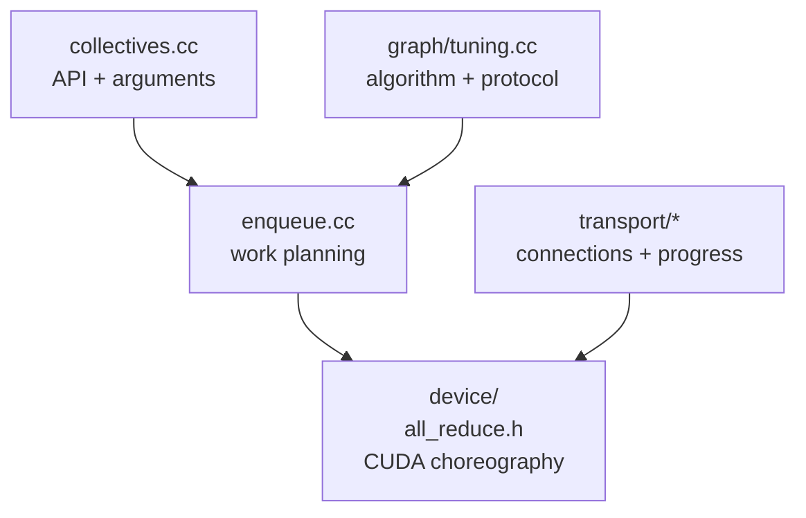

---
{
  "id": "deep-dive-nccl",
  "title": "Deep Dive - NCCL",
  "slug": "deep-dive-nccl",
  "section": "Project Deep Dives",
  "category": "Fine-Tuning & Training",
  "difficulty": "Hard",
  "order": 6,
  "coverImage": "illustrations/_generated/nccl_allreduce_choreography_dark.png",
  "companies": [
    "NVIDIA"
  ],
  "shortDescription": "Four GPUs finish their gradients and then wait on one buffer. NCCL's agreement and route decide whether that wait is bandwidth or a hang.",
  "keyConceptsTested": [
    "Collective interfaces and communicator ordering",
    "All-reduce as reduce-scatter plus all-gather",
    "Ring and tree latency-bandwidth tradeoffs",
    "Topology-aware transport selection",
    "CUDA stream semantics and overlap",
    "NCCL source call path",
    "Algorithmic bandwidth versus bus bandwidth",
    "Distributed hang diagnosis",
    "Project ownership, contributors, and mixed source licensing"
  ],
  "prerequisites": [
    "distributed-training-fsdp-deepspeed-zero",
    "model-parallelism-for-llm-inference",
    "cuda-gpu-computing-for-ml",
    "deep-dive-deepgemm"
  ],
  "relatedQuestions": [
    "deep-dive-megatron",
    "deep-dive-deepspeed",
    "deep-dive-deepep",
    "deep-dive-pytorch"
  ]
}
---

The last chapter examined one GPU's matmul. Now suppose four GPUs each spend 8 ms computing local <span data-glossary="gradient">gradients</span>. The step then waits 6 ms to combine a 256 MiB (mebibyte) gradient buffer from each GPU. Use these assumed timings to work through the communication cost.

A standalone communication test may call that transfer fast, while a real training step exposes more or less time depending on whether the move overlaps other work. If one GPU enters a different communication operation, the other three can wait at a call that looks like a network failure.

<span data-glossary="nccl">NCCL</span> (NVIDIA Collective Communications Library, pronounced "nickel") is the library that coordinates that movement on NVIDIA systems. It provides collective operations such as all-reduce, reduce-scatter, all-gather, broadcast, and all-to-all, plus point-to-point send and receive. NCCL isn't a training framework or scheduler. PyTorch, <span data-glossary="deepspeed">DeepSpeed</span>, <span data-glossary="nvidia-megatron">Megatron</span>, and serving runtimes decide *what* to communicate; NCCL decides how to move it across available GPU links.[^nccl2026guide]

<figure>
  
  <figcaption>Follow the first slot of the running example: 1, 10, 100, and 1000 become 1111 on every rank. The center sigma represents the logical sum across ranks. NCCL can implement that reduction through different physical schedules and links, depending on the topology and selected algorithm.</figcaption>
</figure>

The calls below follow one pinned source map. As of October 10, 2026, the newest public NCCL library release is 2.32.3, published September 17, and the live guide documents that version. Initial Rubin support still lacks a tuned performance model; benchmark the target topology before estimating speed.[^nccl2323Release2026]

## Collective semantics and invariants

A **rank** is one participant in a communication group. A **communicator** records that group and maps ranks to devices. Each rank calls the same collective in the same order, with compatible counts and data types, the same reduction operation, and the same root when the operation has one. A root is a rank index, not a GPU device number. Breaking that agreement can cause a hang, crash, or corrupted result.[^nccl2026collectives]

For sum all-reduce over $k$ ranks, rank $r$ contributes a <span data-glossary="vector">vector</span> $\mathbf{x}^{(r)}$ with $N$ elements. Every rank receives:

$$
\mathbf{y}_i = \sum_{r=0}^{k-1} \mathbf{x}^{(r)}_i,
\qquad i \in \{0, \ldots, N-1\}.
$$

Here, $k$ is rank count, $N$ is elements per input vector, and $i$ selects one element. This example requests `ncclSum`, not an average. NCCL also provides `ncclAvg`. The caller must choose the reduction and scaling needed by its training objective, without dividing twice.[^nccl2026Types]

```checkpoint
Rank 0 calls all-reduce, while rank 1 calls broadcast on the same communicator. Why can neither operation finish?
---
Collectives are ordered group agreements. Each rank is waiting for peers to join the same operation with compatible arguments, but the two ranks entered different protocols.
```

### Choose the operation from desired ownership

The output placement matters as much as the arithmetic. Use all-reduce when every rank needs the whole result. Reduce-scatter fits one reduced shard per rank. Existing shards become a complete <span data-glossary="tensor">tensor</span> through all-gather.

| Operation | Input on each rank | Output ownership | Common AI use |
| --- | --- | --- | --- |
| All-reduce | Same-shaped tensor | Full reduced tensor on every rank | Replicated <span data-glossary="data-parallelism">data-parallel</span> gradients |
| Reduce-scatter | Same-shaped tensor | One reduced chunk per rank | Sharded gradients in <span data-glossary="fsdp">FSDP</span> or <span data-glossary="zero">ZeRO</span> |
| All-gather | One local chunk | Concatenated chunks on every rank | Parameter or activation reconstruction |
| Broadcast | Full tensor on root | Root tensor copied to all ranks | Seeds, metadata, or initial weights |
| All-to-all | Destination chunks | One chunk from every source | <span data-glossary="mixture-of-experts">MoE</span> token routing |
| Send / receive | Point-to-point buffer | Named peer only | Pipeline stage activations |

Broadcast is the simple copy in that table: rank 0 keeps a buffer, and the others receive it. The animations below follow the operations whose ownership is easier to mix up, using the same four-rank numbers you'll compute by hand next.

<figure>
  
  <figcaption>Color marks chunk index. Matching slots reduce to 1111, 2222, 3333, and 4444, then rank r keeps only chunk r. Nobody finishes with a full tensor.</figcaption>
</figure>

<figure>
  
  <figcaption>All-gather starts where reduce-scatter ends. The four owned shards concatenate in rank order, then every rank holds `[1111, 2222, 3333, 4444]`.</figcaption>
</figure>

<figure>
  
  <figcaption>Read color as destination and the label as a source-to-destination address. Rank 2 finishes with one rank-2-bound payload from every source. The exchange moves equal-sized chunks without combining their values.</figcaption>
</figure>

NCCL's all-to-all uses equal-sized chunks. MoE routing may produce unequal token counts, so a runtime needs padding, matched point-to-point transfers, or another variable-size dispatch implementation. Don't assume the equal-chunk picture alone implements a complete MoE router. The guide also documents Gather (collect at a root) and Scatter (distribute from a root).[^nccl2026collectives]

An all-reduce can be implemented as reduce-scatter followed by all-gather. The first half adds corresponding chunks and leaves one finished chunk on each rank. The second half circulates those finished chunks until every rank has the full result. This describes an operation-level equivalence; NCCL can produce the same result with other algorithms. Floating-point summation order can also change the last bits.[^nccl2026collectives]

## Work one all-reduce by hand

Use four ranks with four-element vectors:

| Rank | Input vector |
| ---: | --- |
| 0 | `[1, 2, 3, 4]` |
| 1 | `[10, 20, 30, 40]` |
| 2 | `[100, 200, 300, 400]` |
| 3 | `[1000, 2000, 3000, 4000]` |

Elementwise addition gives `[1111, 2222, 3333, 4444]`. NCCL's reduce-scatter specification places that result by rank index: rank 0 keeps `1111`, rank 1 keeps `2222`, rank 2 keeps `3333`, and rank 3 keeps `4444`. All-gather then shares those four owned chunks so every rank reconstructs the same vector.[^nccl2026collectives]

In fully sharded training, such as <span data-glossary="fsdp">FSDP</span> or ZeRO stage 3, each rank can keep a reduced gradient shard, update its <span data-glossary="optimizer">optimizer</span> and parameter shards, then gather parameters for later computation. That later gather is of updated parameters, not necessarily the same gradient buffer. Earlier ZeRO stages have different ownership rules.

```checkpoint
After reduce-scatter in the four-rank example, rank 2 owns `3333`. What extra operation is needed if rank 2 alone will update only that shard?
---
None for gradient ownership. All-gather is needed only when later computation requires every rank to reconstruct the full tensor or a full parameter bucket.
```

The sum is easy on paper. Moving those bytes without a central reducer that would serialize every link is the actual constraint. A ring is the bandwidth-friendly way to do that.

## Why rings work well for large messages

A ring orders ranks so each sends to one neighbor and receives from another. Split a message into $k$ chunks. Reduce-scatter circulates and combines chunks for $k-1$ steps. All-gather circulates the completed chunks for another $k-1$ steps.

Follow only chunk `x2` (the third slot: `3`, `30`, `300`, `3000`) so the hops stay readable. The partial sum starts on rank 3 and walks clockwise until rank 2, which is the owner of index 2:

| Neighbor hop | Rank that adds | Running sum for `x2` |
| ---: | ---: | ---: |
| start | 3 | `3000` |
| 1 | 0 | `3000 + 3 = 3003` |
| 2 | 1 | `3003 + 30 = 3033` |
| 3 | 2 | `3033 + 300 = 3333` |

After those three reduce-scatter hops, rank 2 owns `3333`. Three all-gather hops then copy that finished shard to ranks 3, 0, and 1. Other chunks move on the same ring at the same time, offset by one slot, which is why a large buffer can keep every link busy.

<figure>
  
  <figcaption>The token is chunk `x2` only. Reduce-scatter ends on rank 2 with `3333`, matching NCCL's rank-index ownership rule. All-gather then starts from that owner. The other three chunks are in flight on the same ring, just not drawn.</figcaption>
</figure>

The next snippet is a CPU, standard-library model of that schedule, not a GPU kernel. It represents each chunk by one integer, so it accepts exactly $k$ values from each of $k$ ranks. It checks ownership and reconstruction without modeling CUDA streams, network progress, or floating-point error.

<!-- leetllm: test, output=show, output_title="Ring all-reduce execution" -->
```python title="ring_allreduce.py"
import numpy as np

inputs = np.array([
    [1, 2, 3, 4],
    [10, 20, 30, 40],
    [100, 200, 300, 400],
    [1000, 2000, 3000, 4000],
], dtype=np.int64)
k = inputs.shape[0]
expected = np.sum(inputs, axis=0).tolist()


def ring_reduce_scatter(bufs: np.ndarray) -> list[int]:
    ranks = bufs.shape[0]
    state = bufs.copy()
    for step in range(ranks - 1):
        send = [int(state[r, (r - step - 1) % ranks]) for r in range(ranks)]
        for r in range(ranks):
            recv_idx = (r - step - 2) % ranks
            state[r, recv_idx] += send[(r - 1) % ranks]
    return [int(state[r, r]) for r in range(ranks)]


def ring_all_gather(owned: list[int]) -> list[list[int]]:
    ranks = len(owned)
    result = [[0] * ranks for _ in range(ranks)]
    for r, value in enumerate(owned):
        result[r][r] = value
    for step in range(ranks - 1):
        snapshot = [row[:] for row in result]
        for r in range(ranks):
            src = (r - 1) % ranks
            chunk = (src - step) % ranks
            result[r][chunk] = snapshot[src][chunk]
    return result


owned = ring_reduce_scatter(inputs)
gathered = ring_all_gather(owned)

rank = 3
total = int(inputs[rank, 2])
print("x2 path")
print(f"  rank {rank} holds {total}")
while rank != 2:
    rank = (rank + 1) % k
    added = int(inputs[rank, 2])
    total += added
    owned_note = " (owns chunk 2)" if rank == 2 else ""
    print(f"  rank {rank} adds {added} -> {total}{owned_note}")

print(f"owned shards: {owned}")
print(f"rank 0 after all-gather: {gathered[0]}")
print(f"send volume factor 2*(k-1)/k = {2 * (k - 1) / k:.2f}")

assert owned == expected == [1111, 2222, 3333, 4444]
assert all(row == expected for row in gathered)

# Verify across dynamic rank counts
for ranks in (1, 2, 3, 5):
    rows = np.array([[10 * r + i for i in range(ranks)] for r in range(ranks)], dtype=np.int64)
    reduced = np.sum(rows, axis=0).tolist()
    assert ring_reduce_scatter(rows) == reduced
    assert ring_all_gather(reduced) == [reduced] * ranks
print("rank-count and shape checks passed")
```

<!-- leetllm: output:start -->
```text title="Ring all-reduce execution" output compact
x2 path
  rank 3 holds 3000
  rank 0 adds 3 -> 3003
  rank 1 adds 30 -> 3033
  rank 2 adds 300 -> 3333 (owns chunk 2)
owned shards: [1111, 2222, 3333, 4444]
rank 0 after all-gather: [1111, 2222, 3333, 4444]
send volume factor 2*(k-1)/k = 1.50
rank-count and shape checks passed
```
<!-- leetllm: output:end -->

For message size $M$, each rank in a ring all-reduce sends about

$$
V_{send} = 2\frac{k-1}{k}M.
$$

Each rank receives the same volume. As $k$ grows, that factor approaches $2$, so the traffic looks like $2M$ per rank, not $kM$. The optimal-bandwidth result is for a point-to-point communication model, as analyzed by Patarasuk and Yuan. It isn't a universal byte lower bound for hardware with in-network reduction or multicast offload.[^patarasuk2009]

The same factor reappears in the `nccl-tests` `busbw` column. For this four-rank toy, the factor is $1.5$; the measurement section turns that traffic factor into a concrete benchmark report and separates it from application time.[^nccltestsPerformance2026]

Rings pay in latency. The algorithm needs $2(k-1)$ neighbor steps, so a tiny message on thousands of ranks spends too much time starting rounds. Pipelining many chunks hides link delay for large buffers, but it can't erase startup cost for small ones.

## Why trees help small and medium messages

A binary tree reduces values toward a root and broadcasts the answer back down. Tree depth grows roughly with $\log_2 k$, which cuts round count compared with a ring. One plain tree can overload internal ranks, so NCCL added complementary double binary trees that split data and swap leaf versus internal-node roles.[^jeaugey2019]

No algorithm wins for every tensor and topology. Rings favor sustained bandwidth. Trees favor fewer rounds. The NCCL 2.32.3 documentation names Ring, Tree, CollnetChain, CollnetDirect, NVLS, NVLSTree, and PAT as selectable algorithm families, plus Simple, LL, and LL128 protocols.[^nccl2026Environment]

Availability depends on the operation, hardware, network plugins, registration, and runtime tuning. Treat the names as candidates that explain a log, not as a menu that every host can run.

NCCL normally chooses algorithms and protocols from its topology and performance model. Forcing `NCCL_ALGO` or `NCCL_PROTO` can be useful for an experiment, but a fixed override can become wrong after hardware, message shapes, or NCCL versions change. Forcing LL128 on a path that doesn't support it can corrupt data, which is why the docs discourage protocol overrides except for diagnosis.[^nccl2026Environment]

| Workload shape | Likely pressure | What to inspect |
| --- | --- | --- |
| Large gradient buckets | Link bandwidth | Ring or fabric-offload path, channel count, bus bandwidth |
| Tiny <span data-glossary="tensor-parallelism">tensor-parallel</span> reductions | Startup latency | Tree-like path, protocol, launch gaps |
| MoE all-to-all | Imbalance and network injection | Per-peer bytes, hot experts, NIC rails |
| Pipeline send/receive | Bubble and ordering | Stage timeline, peer pairing, stream waits |
| FSDP all-gather | Burst overlap | Bucket timing, parameter prefetch, compute coverage |

Those rows still assume every rank entered the same operation. What makes that agreement real when each process only sees its own call?

## A communicator is an ordered program

Nothing in the algorithm name enforces the agreement those rows assume. NCCL doesn't launch processes. A launcher such as MPI, Slurm, or `torchrun` starts them. Application or framework bootstrap code then exchanges a unique communicator ID and agrees on rank-to-device mapping. In a single process, `ncclCommInitAll` can handle this setup for a device list. Each rank within a communicator must use a distinct CUDA device.[^nccl2026Communicators]

Each process then binds a rank to a <span data-glossary="cuda">CUDA</span> device and creates its communicator. Only after that agreement can the ranks enqueue matching work.

After communicator creation, each rank can enqueue this C++ collective with its own buffers and <span data-glossary="cuda-stream">CUDA stream</span>, an ordered GPU work queue. A runnable program also needs valid device buffers, a communicator, a stream, an error-checking `NCCLCHECK` macro, and a CUDA/NCCL system. The CPU examples do not execute this integration fragment.

```cpp title="all_reduce_step.cu"
NCCLCHECK(ncclAllReduce(
    local_gradient,
    global_gradient,
    element_count,
    ncclFloat32,
    ncclSum,
    communicator,
    communication_stream));
```

<figure>
  
  <figcaption>NCCL may start after a bucket-ready event while later backward kernels use independent buffers. The shard reader waits for the reduced-shard event. Updating parameters can require additional dependencies on backward computation that still reads those parameters.</figcaption>
</figure>

For a successful call on a default blocking communicator outside a group, host return means work was enqueued, not completed. The producer must make `local_gradient` ready before communication reads it. A later CUDA event, stream dependency, or synchronization establishes when another kernel may consume `global_gradient`. Keep both buffers alive and avoid conflicting writes until the relevant work completes.[^nccl2026streams]

Grouped calls can defer enqueue until `ncclGroupEnd`. A nonblocking communicator can return `ncclInProgress`; follow the documented completion/error polling before treating its stream work as enqueued. These are different boundaries from GPU completion.[^nccl2026groups][^nccl2026Types]

Grouping can also change the overlap you thought you had. When a group mixes streams, NCCL joins their dependencies before its kernel and blocks those streams until the kernel completes. Two stream names inside one group don't provide independent progress. Keep unrelated work outside that synchronization point when its dependencies permit it.[^nccl2026streams]

NCCL 2.32.3 adds `ncclCollConfig_t::launchCompletionEvent`. The event reports the launch boundary. A shard reader must wait for completion of the collective's writes on the communication stream before reading the reduced buffer. Its header requires a caller-owned, rank-local event created with `cudaEventDisableTiming`, consistent NULL/non-NULL participation across ranks, and at most one non-NULL event per communicator in a group. CUDA versions before 12.3 record it *before* launch. Keep the launch event alive through queued waits and captured-graph executions.[^nccl2323Header2026]

```checkpoint
An all-reduce's launch-completion event is ready. Can another stream immediately read its output?
---
No. The kernel may still be reducing and transferring data. The consumer needs a dependency that covers completion of those writes. An optimizer that also writes parameters must additionally wait for any backward work still reading them.
```

When one thread manages several GPUs, group their matching calls with `ncclGroupStart` and `ncclGroupEnd`. A plain loop can block on its first device before the thread reaches the other ranks. Grouping doesn't relax collective order, including the documented order across communicators within a group.[^nccl2026groups]

Ordering stays global even when work is asynchronous. If one rank enters collective A then B while another enters B then A, stream scheduling can't repair the mismatch. Framework process groups and bucket schedulers exist partly to keep this distributed instruction stream identical across ranks.

> **💡 Key insight:** An NCCL hang often begins *before* NCCL. One rank took a different branch, hit an out-of-memory error, loaded data slowly, or skipped a bucket. Peers then wait inside the next collective they all expected to share.

## Topology turns one API into different routes

Two calls to `ncclAllReduce` can exercise very different hardware. Inside one server, bytes may travel through direct <span data-glossary="gpu">GPU</span> peer access, NVLink, or NVSwitch. Across servers, the path can include PCIe, a network interface card (NIC), InfiniBand or RoCE, switches, and a remote host's reverse path.

<figure>
  
  <figcaption>Compare the short local route with the cross-node route. NVLink, PCIe placement, NIC choice, rail balance, and network fabric can each limit a collective. A relay through another GPU is a separate route, not an NVSwitch-to-PCIe bridge.</figcaption>
</figure>

### Read the matrix before changing a setting

On an NVIDIA host with the driver tools installed, start with host evidence before setting NCCL overrides. Run the topology query:

```bash title="topology.sh"
nvidia-smi topo -m
```

`nvidia-smi topo -m` prints connections among GPUs and NICs, along with CPU and memory affinities. Its labels classify path relationships. Measure achieved bandwidth with a workload that matches the target traffic.[^nvsmi]

The exact <span data-glossary="matrix">matrix</span> depends on the host. Read the host topology matrix across device pairs as follows:

```text title="nvidia-smi topo -m (4-GPU node excerpt)"
        GPU0 GPU1 GPU2 GPU3 NIC0 NIC1
GPU0      X  NV4  SYS  SYS  PIX  SYS
GPU1     NV4   X  SYS  SYS  PIX  SYS
GPU2     SYS SYS   X  NV4  SYS  PIX
GPU3     SYS SYS  NV4   X   SYS  PIX
NIC0     PIX PIX  SYS SYS   X   SYS
NIC1     SYS SYS  PIX  PIX  SYS   X
```

Read the common cells as path hints:

| Cell | Path class | First hypothesis to test |
| --- | --- | --- |
| `NV4` | A bonded set of four NVLinks | GPU traffic stays on the NVLink fabric |
| `PIX` | At most one PCIe switch | GPU and NIC share a short PCIe route |
| `PXB` | Multiple PCIe switches | Extra PCIe hops may add contention |
| `PHB` | A PCIe host bridge | The CPU or root complex sits on the route |
| `NODE` | PCIe host bridges within one NUMA node | Placement may cross a host-bridge boundary |
| `SYS` | PCIe plus an interconnect between NUMA nodes | Remote NUMA or fabric traffic may dominate |

`NV4` means four bonded links, not four times a measured rate. The matrix also doesn't draw switch nodes.

Separate the local GPU fabric from NIC access. A GPU may reach another GPU through NVSwitch, while reaching a NIC through PCIe. NVSwitch isn't a PCIe-to-network bridge. NCCL's PXN path can relay through an intermediate GPU with better NIC access; verify that distinct route in platform topology and logs. A host bridge on the route doesn't by itself mean the payload was copied through CPU memory.[^nccl2026Environment]

NCCL turns that topology hypothesis into a schedule. It discovers GPU, CPU, PCIe, NVLink, and network relationships, searches candidate graph layouts, and tunes a plan. GPUDirect <span data-glossary="rdma">remote direct memory access (RDMA)</span> can let a NIC access GPU memory without staging the payload through ordinary CPU copies. Shared-memory and host-staged paths still matter when direct peer access isn't available.

Topology awareness can't create bandwidth that hardware lacks. A GPU behind the wrong PCIe root, a disabled link, a slow network interface, or oversubscribed switches still cap the collective. The library can select a better route only among paths it can discover and use.

```checkpoint
The same all-reduce is fast within one server but slows sharply across two servers. What changed if tensor size and rank count stayed fixed?
---
The physical route changed. Cross-node traffic adds PCIe, network interfaces, and fabric links, so placement, rail balance, or network bandwidth can become the limit even though the collective API is unchanged.
```

## Read one call through the source tree

The pinned source snapshot makes the runtime boundary concrete.[^nccl2026source] Start with `src/collectives.cc`, where public functions such as `ncclAllReduce` package operation metadata.

The snapshot is commit `5067397c2676d5aed50042fc39e5c8ee96eb0027`. The diagram is a responsibility map, not a literal stack trace: transport connections can be prepared before a device kernel runs, and not every path needs host proxy progress.



Use this source map instead of searching for one giant all-reduce loop:

| Source area | Responsibility | Question to carry |
| --- | --- | --- |
| `src/init.cc`, `bootstrap.cc` | Communicator setup and peer discovery | Which ranks and devices joined? |
| `src/graph/topo.cc`, `search.cc` | Physical topology and graph search | Which links can form rings or trees? |
| `src/graph/tuning.cc` | Algorithm, protocol, and channel model | Why did this message get this plan? |
| `src/enqueue.cc`, `collectives.cc` | Host API validation and work creation | What exactly was enqueued? |
| `src/device/*.h`, `primitives.h` | Device-side copy and reduction steps | Which rank sends, receives, or reduces next? |
| `src/transport/*` | P2P, shared memory, sockets, InfiniBand, plugins | Which physical route carries bytes? |
| `src/proxy.cc` | Host proxy progress for transports that need it | Is progress waiting on host or network work? |
| `src/debug.cc`, `src/ras/` | Logs and reliability signals | What evidence identifies the failed rank or link? |
| `src/nccl_device/`, `src/gin/` | Device-initiated collectives and GPU-side networking | Did a host enqueue start this, or did a device kernel? |

The conventional host all-reduce path and the device-initiated interfaces aren't the same entry point. Reading only `ncclAllReduce` shows the API signature, not the chosen schedule. Reading only a CUDA primitive shows local mechanics, not why the runtime picked that path.

## How higher-level systems use NCCL

NCCL is shared infrastructure across training and inference. Its importance grows as model code partitions more tensors, because each partition boundary creates a communication event.

| System pattern | NCCL traffic | Scaling failure when communication wins |
| --- | --- | --- |
| Data-parallel training | Gradient all-reduce | More replicas yield diminishing <span data-glossary="token">tokens</span>/sec |
| Fully sharded FSDP or ZeRO-3 | Reduce-scatter plus parameter all-gather | Memory fits, but layer gathers stall compute |
| Tensor parallelism | Frequent activation reductions or gathers | Wide TP across slow links hurts every layer |
| Pipeline parallelism | Send/receive activations and gradients | Stage bubbles or peer waits grow |
| Expert parallelism | All-to-all token dispatch and combine | Hot experts create uneven peer traffic |
| Multi-GPU inference | Tensor-parallel reductions, KV or state exchange | <span data-glossary="itl">Inter-token latency</span> rises despite idle FLOPs |

DeepSpeed and Megatron build groups, buckets, overlap schedules, and sharding policies above NCCL. <span data-glossary="pytorch">PyTorch</span> exposes NCCL through `torch.distributed`. Specialized expert-routing libraries can use other communication implementations; don't infer that every GPU collective is an NCCL call. None of those layers remove the need to understand ownership and physical paths.

Choose the optimization target from operation shape. If tensor parallelism emits a small all-reduce in every <span data-glossary="transformer">transformer</span> layer, lowering its launch latency may matter more than peak bandwidth. If data parallelism emits a few huge buckets, saturating network rails and overlapping buckets with backward compute matter more.

## Measure bytes, rounds, and exposed time

Suppose six rounds each add 2 microseconds of startup, while 1 MB traverses a 50 GB/s path. The rough estimate is 12 microseconds of startup plus 20 microseconds of payload time, or 32 microseconds total. This alpha-beta latency decomposition separates per-hop startup cost from linear byte-transfer time.

Writing that calculation generally separates startup latency from payload time:

$$
T_{collective} \approx R\alpha + \frac{V}{B},
$$

where $R$ is communication rounds, $\alpha$ is per-round startup cost, $V$ is bytes crossing the measured path, and $B$ is achieved bandwidth. Real NCCL schedules add channels, protocol overhead, topology contention, and synchronization, but this equation tells you whether reducing rounds or moving bytes faster is the bigger target.

Small payloads make $R\alpha$ visible. Large payloads make $V/B$ visible. Keep that split in mind when you vary message size, rank count, or topology.

### Turn one `all_reduce_perf` row into evidence

`nccl-tests` is a separate NVIDIA repository that checks both NCCL correctness and performance. First build it against your installed CUDA and NCCL (`make`, with `CUDA_HOME` and `NCCL_HOME` when needed); multi-process tests also require an MPI-enabled build. On one host with four visible GPUs, pin the scan to one payload size before comparing routes. This hardware-dependent command wasn't run for the lesson's CPU checks:

```bash title="all_reduce_perf"
./build/all_reduce_perf -b 256M -e 256M -g 4 -n 20 -w 5 -c 1 -T 60
```

Here, `-g 4` uses four GPUs per thread (one thread and process in this launch), `-b` and `-e` select 256 MiB, `-n 20` requests 20 timed iterations, `-w 5` adds five untimed warmups, and `-c 1` requests one correctness-check iteration. `-T 60` sets the test timeout in seconds. Check flags against your checkout: this description follows the public README checked October 10, 2026.[^nccltests2026]

This benchmark report has the shape of current `all_reduce_perf` output. The provided 6.00 ms value lets us check the arithmetic; replace it with a measurement from your GPU, driver, NCCL build, and network:

```text title="all_reduce_perf (256 MiB row)"
# 4 ranks · float32 sum · 5 warmups · 20 timed iterations · check=1
#                                      out-of-place                    in-place
# size (B) count (elements) type redop root  time  algbw  busbw #wrong  time  algbw  busbw #wrong
#                                               (us)  (GB/s) (GB/s)          (us)  (GB/s) (GB/s)
 268435456   67108864      float sum   -1   6000.0  44.74  67.11    0   6000.0  44.74  67.11    0
```

Start with units. `size` is 268,435,456 bytes, and `count` is 67,108,864 float32 elements. Since 6000 microseconds is 0.006 seconds, algorithmic bandwidth is $268{,}435{,}456 / 0.006 = 44.74$ GB/s. It answers, "How quickly did this logical payload complete?"[^nccltestsPerformance2026]

For a four-rank all-reduce, the test's operation-based correction is $2(k-1)/k = 2(4-1)/4 = 1.5$. Thus `busbw` is $44.74 \times 1.5 = 67.11$ GB/s.[^nccltestsPerformance2026]

Read that as a normalized link-oriented score for comparing the same operation across systems. It estimates traffic under the guide's normalization; inspect hardware counters to measure physical transfers. The performance guide derives this factor for point-to-point collective traffic and lists different factors for reduce-scatter, all-gather, broadcast, reduce, and all-to-all.[^nccltestsPerformance2026]

The two halves of the row also answer a buffer question. Out-of-place uses separate send and receive buffers. In-place aliases them for all-reduce, which NCCL defines as `sendBuff == recvBuff`.[^nccl2026inplace]

That equality doesn't describe in-place reduce-scatter or all-gather. Their local shard sits at the rank's offset inside the full buffer. With a typed `float* data`, rank 2, and one element per shard, reduce-scatter receives at `data + 2`; all-gather sends from `data + 2`. Pointer arithmetic advances by elements, so this is an eight-byte offset for float32. Passing the base address as all-gather's local input would read rank 0's slot instead.[^nccl2026inplace]

The CPU example uses an actual shared-memory view to show that layout. It models the completed reduce-scatter write, then compares the correct and incorrect all-gather input slices. Verify CUDA buffer readiness with the pinned NCCL implementation and an on-device test.

<!-- leetllm: test, output=show, output_title="The local shard has an offset" -->
```python title="inplace_shard.py"
import numpy as np

rank, count = 2, 1
data = np.array([100.0, 200.0, 300.0, 400.0], dtype=np.float32)
assert data.itemsize == 4
start = rank * count
local = data[start:start + count]
local[0] = 3333.0  # Model rank 2's completed reduce-scatter output.

assert data[2] == 3333.0
correct_input = local.tolist()
wrong_input = data[:count].tolist()
assert correct_input == [3333.0] and wrong_input == [100.0]
print(f"rank {rank} shard offset: {start * data.itemsize} bytes")
print(f"all-gather local input: {correct_input}")
print(f"using the base address reads: {wrong_input}")
```

<!-- leetllm: output:start -->
```text title="The local shard has an offset" output compact
rank 2 shard offset: 8 bytes
all-gather local input: [3333.0]
using the base address reads: [100.0]
```
<!-- leetllm: output:end -->

`#wrong` reports elements that failed the requested correctness check. A zero count is necessary evidence for this row, but it doesn't cover a later stream or buffer-lifetime race in the application.[^nccltests2026]

<figure>
  
  <figcaption>The arithmetic connects logical bytes, elapsed time, and a collective-specific normalization. Neither bandwidth number identifies the physical route. Application compute overlap requires a separate kernel-and-stream timeline.</figcaption>
</figure>

In checkouts supporting `-I 1`, per-iteration CUDA-event summaries show timing across the measured iterations. Use per-rank traces to attribute a delay. With only 20 samples, nearest-rank p99 can equal the maximum, so collect more iterations for a stable tail estimate. Keep timing separate from correctness checks.[^nccltests2026]

Attach five pieces of evidence to a real performance claim:

| Evidence | Record beside the row |
| --- | --- |
| Hardware and software | GPU model and count, host count, topology, CUDA, NCCL, framework, and `nccl-tests` versions |
| Workload | Payload bytes, element count, rank count, and any aggregation or batch shape |
| Precision and path | Datatype, reduction op, in-place mode, and any forced algorithm or protocol |
| Baseline | Exact comparison command and equivalent tuning on the alternate route or build |
| Correctness | Check mode, tolerance or status, and `#wrong` for each buffer mode |

The benchmark report isolates one collective. In an idealized training schedule, hiding 4 ms of a 6 ms collective leaves 2 ms exposed. Real overlap can slow compute or communication through resource contention, so establish the actual critical path from a trace.

Both schedules can produce the same benchmark report, so compare it with a profiler timeline and the stream event that makes the reduced buffer readable. `algbw` or `busbw` alone isn't a tokens-per-second or step-time result.

Run tests on the same hosts, GPUs, container settings, and network rails as the workload. Use a clean row as an isolated fabric baseline; measure model code, data loading, bucket timing, and stream dependencies in the full workload.

> **🎯 Production tip:** Keep a small performance envelope by message size and rank count. One headline number hides the exact region where tensor-parallel latency or giant gradient buckets fail.

A clean bandwidth report answers whether the fabric can move isolated bytes. It doesn't tell you why a live step exposed time or stopped, so the next question is causal: did ranks disagree, did a process fail, or did the route break?

## Diagnose a hang without guessing

First classify whether ranks disagree, a process failed, or the network path is broken. A timeout stack that ends in NCCL doesn't distinguish those causes.

| Symptom | Likely class | First evidence |
| --- | --- | --- |
| One rank exited or OOMed | Missing participant | Earliest per-rank error, not peer timeouts |
| Same step hangs every run | Collective order or shape mismatch | Per-rank operation sequence and tensor metadata |
| Multi-node only | Interface, firewall, NIC, or RDMA path | Bootstrap and `NET` logs, host connectivity |
| Slow after scale-out | Topology or straggler | Timeline by rank, link counters, `nccl-tests` |
| Container init failure | Shared memory or memlock | `/dev/shm`, limits, NCCL warning |
| Wrong data without hang | Buffer lifetime or stream dependency | CUDA events, producer and consumer streams |

Set `NCCL_DEBUG=WARN` for explicit errors. Escalate briefly to `NCCL_DEBUG=INFO` with focused subsystems such as `INIT,NET,GRAPH`, and write one log per host and process when needed. NCCL documentation also covers shared-memory limits, network-interface selection, container configuration, and asynchronous error handling.[^nccl2026troubleshooting]

In 2.32.3, `ATTN` messages expose important nonfatal fallbacks. Don't set `NCCL_DEBUG=ATTN` across a mixed-version deployment: versions before 2.32 don't recognize that level and fall back to no debug logging. Keep `NCCL_DEBUG=WARN` and add `NCCL_DEBUG_LEVELS=ATTN`; newer versions add the notices, while older versions retain their warning baseline.[^nccl2323Logging2026]

RAS adds GPU progress counters and a watchdog DMA mirror to investigate stalled kernels, alongside expanded link and device diagnostics. Use this evidence to distinguish a launched kernel that stopped progressing from ranks that never agreed on the operation.[^nccl2323Release2026]

Then compare all ranks at the *first* divergence. Check world size, rank-to-device mapping, collective name, count, dtype, root, communicator, and sequence number. If those match, test the path outside the application with `nccl-tests` and inspect the topology NCCL discovered.

Finally, restore automatic tuning after the experiment. Variables such as `NCCL_SOCKET_IFNAME` and `NCCL_IB_HCA` can be stable cluster configuration. Algorithm, protocol, and channel overrides are usually diagnostic controls, not permanent cargo cult.

## Strengths and limits

NCCL is a small collective API over many NVIDIA GPU and network topologies. It fuses communication and reduction on device paths, picks algorithms at runtime, works from one process or many, and exposes plugins for network, tuner, profiler, and newer device-side interfaces.

Its limits are equally important:

- NVIDIA GPU focus makes NCCL the wrong backend for CPU-only or non-NVIDIA collectives.
- Collective correctness is distributed. NCCL can't repair mismatched control flow above it.
- Topology selection can't fix bad cabling, oversubscription, NUMA placement, or unhealthy links.
- Communication kernels consume GPU resources and can interfere with compute when overlap is poorly scheduled.
- Environment overrides can hide one machine issue while hurting another.
- Fast transport doesn't choose a good model-parallel strategy. A framework still owns groups, tensor layouts, and bucket timing.

Call NCCL when the job is on NVIDIA GPUs and bytes have to move inside a node or across nodes. Stay on the framework's process-group API unless you're building a runtime, fused kernel, or communication library that needs NCCL directly.

The 2.32.3 release lists communicator support for multiple MIG instances. The guide dates its experimental path to 2.31: distinct instances remain distinct CUDA devices, require a CUDA 13.0 or newer driver, and don't support NVLink P2P or NVLS. MNNVL must be disabled. Don't transfer a full-GPU topology's performance expectations to this setup.[^nccl2323Release2026][^nccl2026Communicators]

Optional TLS in 2.32.3 covers NCCL-owned socket traffic when built with OpenSSL 3 and configured through `ncclSetEncryption`. Configure encryption separately for external transports and plugin traffic.[^nccl2323Release2026]

## NVIDIA project, public source

NVIDIA develops NCCL and publishes the source in the `NVIDIA/nccl` repository. The repo accepts signed-off contributions under a Developer Certificate of Origin, asks large changes to begin with an issue and design discussion, and keeps tests in the separate `NVIDIA/nccl-tests` project.[^nccl2026source]

The public contributor history records individual work; it is not a permanent ownership roster or formal support agreement.[^nccl2026contributors]

The pinned snapshot's license file needs a careful reading. Most project source uses Apache License 2.0, some parts retain original BSD terms, and borrowed files can carry their own licenses. "NCCL is BSD" or "every NCCL file is Apache-2.0" both erase that file-level boundary.[^nccl2026license]

## Research roots rather than one NCCL paper

NCCL doesn't have one canonical paper that defines the whole current implementation. Its core ideas come from collective-communication research plus years of topology, kernel, and transport engineering.

Patarasuk and Yuan derived a bandwidth lower bound for all-reduce and described a ring algorithm that reaches it for large messages under their communication model.[^patarasuk2009] The result assumes associative, commutative reduction and omits startup and reduction-compute costs. Analyze latency optimality and floating-point reproducibility separately. NVIDIA's NCCL 2.4 engineering account explains why double binary trees reduce latency growth while retaining high aggregate bandwidth, and why NCCL switches between tree and ring paths.[^jeaugey2019]

Later hardware paths add NVSwitch collectives, in-network reduction, registration, multiple rails, and device-initiated communication. Those features change how an algorithm maps to hardware, but not the basic questions: who owns each chunk, how many rounds run, how many bytes cross each bottleneck, and when the consumer stream may read the result.

## Source-reading exercise

Pick one all-reduce from a PyTorch profiler trace. Record tensor bytes, communicator size, duration, and whether compute overlaps it. Capture `nvidia-smi topo -m` beside the trace, then run `nccl-tests` near that message size on the same ranks.

Use the pinned source map to answer four questions:

1. Which public function packages the operation?
2. Which algorithm and protocol names appear in logs?
3. Which graph and transport files correspond to the physical path?
4. Which rank first diverges in the CPU operation-log example below?

Produce a small evidence table rather than a screenshot of a green benchmark. Connect logical operation, source path, topology labels, payload bytes, `algbw`, `busbw`, overlap time, correctness status, and first failure evidence. If the standalone row looks strong but the application still stalls, the table should make that boundary visible.

Without GPUs, compare planned collective logs instead. Each tuple below is `(operation, count, dtype, reduction, root)` for one communicator; `None` means an argument doesn't apply. This teaching checker compares completed logs. It neither runs NCCL nor detects a live network failure. A missing call is exercised locally, without leaving distributed processes hanging.

<!-- leetllm: test, output=show, output_title="Find the first disagreement" -->
```python title="collective_log.py"
from itertools import zip_longest
import numpy as np


def first_divergence(logs):
    if not logs:
        raise ValueError("at least one rank log is required")
    missing = object()
    for step, calls in enumerate(zip_longest(*logs, fillvalue=missing)):
        if any(call != calls[0] for call in calls[1:]):
            return step
    return None


reduce = ("all_reduce", 4, "float32", "sum", None)
broadcast = ("broadcast", 4, "float32", None, 0)
baseline = [reduce, broadcast]
assert first_divergence([baseline] * 4) is None
cases = {
    "missing call": [reduce],
    "reordered calls": [broadcast, reduce],
    "different count": [("all_reduce", 3, "float32", "sum", None), broadcast],
    "different root": [reduce, ("broadcast", 4, "float32", None, 1)],
}
for name, changed in cases.items():
    logs = [baseline, baseline, changed, baseline]
    step = first_divergence(logs)
    assert step == (1 if name in ("missing call", "different root") else 0)
    print(f"{name}: first disagreement at step {step}")

payload_bytes = np.int64(256 * 2**20)
seconds = 0.006
ranks = 4
algbw = float(payload_bytes / seconds / 1e9)
busbw = float(algbw * 2 * (ranks - 1) / ranks)
assert round(algbw, 2) == 44.74 and round(busbw, 2) == 67.11
print(f"bandwidth metrics: algbw={algbw:.2f}, busbw={busbw:.2f} GB/s")
```

<!-- leetllm: output:start -->
```text title="Find the first disagreement" output compact
missing call: first disagreement at step 1
reordered calls: first disagreement at step 0
different count: first disagreement at step 0
different root: first disagreement at step 1
bandwidth metrics: algbw=44.74, busbw=67.11 GB/s
```
<!-- leetllm: output:end -->

Verify correctness by comparing the collective with the intended model computation and checking actual stream dependencies and buffer lifetime; all ranks can agree on the same incorrect operation.

## Takeaways

Follow one slot from four local vectors to the shared sum. Then separate a ring's send volume from the bus-bandwidth score, and a missing rank from a slow route.

- A collective is an ordered agreement across ranks, not a remote function call.
- All-reduce decomposes into reduce-scatter plus all-gather, which explains sharded-training traffic.
- Rings achieve efficient point-to-point byte counts; trees cut rounds. Hardware offload and actual topology can change the best choice.
- `nvidia-smi topo -m` gives path classes and affinities; it doesn't give achieved bandwidth.
- For point-to-point all-reduce accounting, `nccl-tests` busbw is algbw times $2(k-1)/k$, the same factor as ring send volume.
- `algbw` describes an isolated logical payload. It isn't a substitute for an application's exposed step time after overlap.
- CUDA streams make collectives asynchronous, but explicit dependencies still protect buffer correctness.
- Debug the earliest rank divergence, then validate the fabric separately.

## Mastery quiz

```mastery-quiz
[
  {
    "question": "Ranks 0, 1, and 2 supply [2, 7, 6], [1, 3, 5], and [4, 2, 0], respectively. They use one-element shards. What does rank 1 receive from sum reduce-scatter and from average reduce-scatter on these inputs?",
    "options": [
      "Sum 3; average 1.",
      "Sum 12; average 4.",
      "Sum 9; average 3.",
      "Sum 12; average 12."
    ],
    "answer": "Sum 12; average 4.",
    "explanation": "Rank 1 owns coordinate 1. Across the three ranks, that coordinate sums to 7 + 3 + 2 = 12. Its average is 12 / 3 = 4. Using only rank 1's entry gives 3 and then 1. Adding its whole row gives 9 and then 3. Reporting 12 for both reductions skips the division for the average."
  },
  {
    "question": "Ranks 0, 1, and 2 map to GPUs 5, 7, and 1, respectively. Which broadcast root selects the input on GPU 7? What happens if all callers use root 5 instead?",
    "options": [
      "Use root 1. Root 5 is invalid.",
      "Use root 1. Root 5 selects GPU 5.",
      "Use root 7. Root 5 selects GPU 5.",
      "Use root 2. Root 5 is invalid."
    ],
    "answer": "Use root 1. Root 5 is invalid.",
    "explanation": "The root names a communicator rank. Rank 1 supplies the input on GPU 7. Root 2 would copy GPU 1's input. The only valid roots are 0, 1, and 2. Passing device number 7 or 5 as the root is invalid even though both GPUs participate."
  },
  {
    "question": "Source ranks 0, 1, and 2 hold token IDs [15, 24, 37], [28, 19, 12], and [21, 33, 26], respectively. Each row lists one token for each destination in rank order. After all-to-all, what is in rank 2's receive buffer, from first element to last?",
    "options": [
      "[21, 33, 26]",
      "[64, 76, 75]",
      "[12, 26, 37]",
      "[37, 12, 26]"
    ],
    "answer": "[37, 12, 26]",
    "explanation": "Each source sends its third token to rank 2. The receive buffer holds 37 from source 0, 12 from source 1, and 26 from source 2, in that order. Sorting by token ID gives [12, 26, 37]. Keeping rank 2's outgoing row gives [21, 33, 26]. Adding each column gives [64, 76, 75]. All-to-all copies each token into its source rank's slot."
  },
  {
    "question": "A five-rank evenly partitioned ring all-reduces a 10 kB logical payload per rank. Use decimal kB and count sent bytes, excluding received bytes. Which sent-volume and startup-round pair follows?",
    "options": [
      "8 kB sent; 4 neighbor rounds.",
      "16 kB sent; 8 neighbor rounds.",
      "20 kB sent; 10 neighbor rounds.",
      "32 kB sent; 8 neighbor rounds."
    ],
    "answer": "16 kB sent; 8 neighbor rounds.",
    "explanation": "Each phase sends (5 − 1) × (10 / 5) = 8 kB in 4 rounds. Reduce-scatter plus all-gather sends 16 kB in 8 rounds; received bytes are counted separately."
  },
  {
    "question": "Trace A: nonblocking GroupEnd returns in-progress at 2 ms, polling reports successful enqueue at 4 ms, writes complete at 9 ms. Trace B: ordinary host enqueue returns at 3 ms and writes complete at 6 ms. Ignoring other dependencies, what earliest output-reader times follow?",
    "options": [
      "A at 4 ms; B at 3 ms.",
      "A at 9 ms; B at 3 ms.",
      "A at 4 ms; B at 6 ms.",
      "A at 9 ms; B at 6 ms."
    ],
    "answer": "A at 9 ms; B at 6 ms.",
    "explanation": "Output readers require completed writes. The group-success and ordinary host-return times are enqueue boundaries, so the readers wait to 9 ms and 6 ms."
  },
  {
    "question": "For rank 3 with two float32 elements per shard, a full buffer backs an in-place all-gather. Which local slice and byte offset identify its input?",
    "options": [
      "Elements [6:8]; offset 24 bytes.",
      "Elements [3:5]; offset 12 bytes.",
      "Elements [6:8]; offset 6 bytes.",
      "Elements [0:2]; offset 0 bytes."
    ],
    "answer": "Elements [6:8]; offset 24 bytes.",
    "explanation": "The start is rank × shard count = 3 × 2 = 6 elements. Each float32 is four bytes, so the offset is 24 bytes and the two-element view spans [6:8]."
  },
  {
    "question": "An eight-rank all-reduce completes 512 MiB in 8 ms. Use 2²⁰ bytes per MiB, decimal GB/s, and the point-to-point bus-score factor. Which report follows?",
    "options": [
      "Algorithmic 67.11 GB/s; bus score 67.11 GB/s.",
      "Algorithmic 67.11 GB/s; bus score 117.44 GB/s.",
      "Algorithmic 64.00 GB/s; bus score 112.00 GB/s.",
      "Algorithmic 117.44 GB/s; bus score 205.52 GB/s."
    ],
    "answer": "Algorithmic 67.11 GB/s; bus score 117.44 GB/s.",
    "explanation": "512 × 2²⁰ / .008 / 10⁹ = 67.108864 GB/s. Multiply by 2 × 7 / 8 = 1.75 to obtain 117.440512 GB/s. The score is a normalization, not a physical counter."
  },
  {
    "question": "Two ranks run float32 all-reduces on one communicator. Each log lists (reduction, element count) in call order. The first call completes in both runs.\n\nRun A. Rank 0 logs [(sum, 8), (max, 6)] and rank 1 logs [(sum, 8), (max, 6)]. On rank 1, the compute kernel writes an input element at 15 ms. The second all-reduce reads that element at 12 ms.\n\nRun B. Rank 0 logs [(sum, 8), (max, 6)] and rank 1 logs [(sum, 8), (max, 8)]. Both ranks finish writing their inputs at 10 ms and enter the second call at 12 ms.\n\nWhat should you repair first in each run?",
    "options": [
      "A collective agreement; B producer readiness.",
      "A producer readiness; B transport placement.",
      "A producer readiness; B collective agreement.",
      "A transport placement; B collective agreement."
    ],
    "answer": "A producer readiness; B collective agreement.",
    "explanation": "In A, both calls match across ranks. Rank 1 reads the element 3 ms before the kernel writes it. Make the communication stream wait for the producer's completion event. In B, both inputs are ready, but the second max all-reduce uses six elements on one rank and eight on the other. Make the counts agree. Changing the transport cannot order a buffer read or correct a count."
  },
  {
    "question": "A topology snapshot shows NV4 for a GPU pair. A cross-node trace separately shows PXN through an intermediate GPU toward a NIC, with no ordinary host staging copy on that selected path. Which interpretation fits these provided observations?",
    "options": [
      "NV4 labels a path class; PXN identifies GPU forwarding; achieved rates need measurement.",
      "NV4 provides four times the measured rate; PXN identifies GPU forwarding; the rate is established.",
      "NV4 labels a path class; PXN requires a CPU payload copy; the trace omits that required stage.",
      "NV4 identifies the external NIC bridge; PXN identifies GPU forwarding; the fabric route is established by NV4."
    ],
    "answer": "NV4 labels a path class; PXN identifies GPU forwarding; achieved rates need measurement.",
    "explanation": "The matrix describes topology classes rather than measured bandwidth. PXN can use an intermediate GPU with better NIC access without implying ordinary CPU staging; actual route and rate evidence remain separate."
  },
  {
    "question": "Two ideal schedules each contain 10 ms of compute. A has an isolated 5 ms collective with 4 ms hidden by independent compute; B has a 4 ms collective with 1 ms hidden. No other costs or contention exist. Which total-time comparison follows?",
    "options": [
      "A 15 ms; B 14 ms, so B finishes first.",
      "A 6 ms; B 7 ms, so A finishes first.",
      "A 11 ms; B 11 ms, so they finish together.",
      "A 11 ms; B 13 ms, so A finishes first."
    ],
    "answer": "A 11 ms; B 13 ms, so A finishes first.",
    "explanation": "Exposed wait is total communication minus hidden communication. A adds 1 ms to compute and B adds 3 ms, giving 11 ms and 13 ms. Faster isolated communication need not give the faster application schedule."
  }
]
```

> **Next:** Continue to [Deep Dive - Megatron](/learn/deep-dive-megatron). NCCL gives you the communication substrate. Megatron shows how tensor, pipeline, data, context, and expert parallel groups turn those collectives into one large-model training program.
