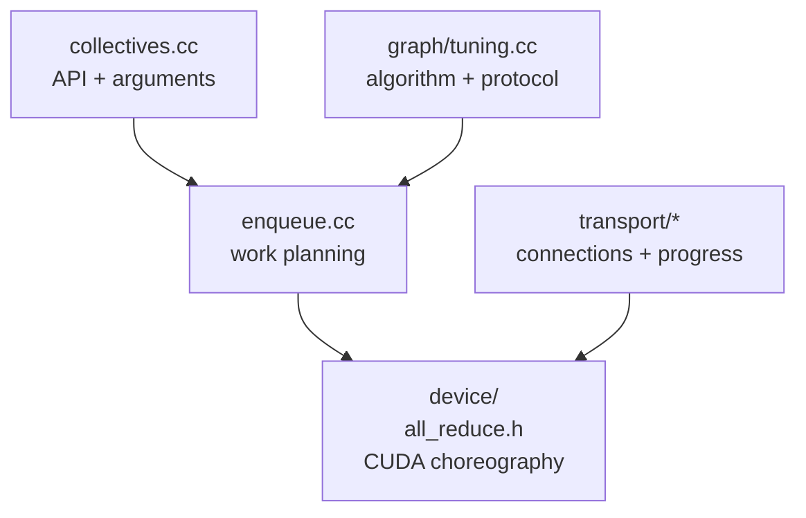

---
{
  "id": "deep-dive-nccl",
  "title": "Deep Dive - NCCL",
  "slug": "deep-dive-nccl",
  "section": "Project Deep Dives",
  "category": "Fine-Tuning & Training",
  "difficulty": "Hard",
  "order": 6,
  "coverImage": "illustrations/_generated/nccl_allreduce_choreography_dark.png",
  "companies": [
    "NVIDIA"
  ],
  "shortDescription": "Four GPUs finish their gradients and then wait on one buffer. NCCL's agreement and route decide whether that wait is bandwidth or a hang.",
  "keyConceptsTested": [
    "Collective interfaces and communicator ordering",
    "All-reduce as reduce-scatter plus all-gather",
    "Ring and tree latency-bandwidth tradeoffs",
    "Topology-aware transport selection",
    "CUDA stream semantics and overlap",
    "NCCL source call path",
    "Algorithmic bandwidth versus bus bandwidth",
    "Distributed hang diagnosis",
    "Project ownership, contributors, and mixed source licensing"
  ],
  "prerequisites": [
    "distributed-training-fsdp-deepspeed-zero",
    "model-parallelism-for-llm-inference",
    "cuda-gpu-computing-for-ml",
    "deep-dive-deepgemm"
  ],
  "relatedQuestions": [
    "deep-dive-megatron",
    "deep-dive-deepspeed",
    "deep-dive-deepep",
    "deep-dive-pytorch"
  ]
}
---

The previous chapter examined a single GPU's tensor-core matrix multiply. Now scale to four GPUs, each spending 8 ms computing local <span data-glossary="gradient">gradients</span> and 6 ms combining a 256 MiB gradient buffer across ranks.

An isolated communication benchmark may report brisk link speed while a live training step stalls depending on whether that transfer overlaps compute. Worse, if a single GPU diverges and enters a different collective, the remaining three ranks block indefinitely on what looks at first glance like a network failure.

**<span data-glossary="nccl">NCCL</span>** (NVIDIA Collective Communications Library, pronounced "nickel") orchestrates these multi-GPU transfers on NVIDIA hardware. It implements collectives (all-reduce, reduce-scatter, all-gather, broadcast, all-to-all) alongside point-to-point send and receive. Frameworks like PyTorch, <span data-glossary="deepspeed">DeepSpeed</span>, and <span data-glossary="nvidia-megatron">Megatron</span> decide *what* to communicate and when; NCCL decides *how* to move those bytes across NVLink, PCIe, and RDMA fabrics.[^nccl2026guide][^nccl2323Release2026]

<figure>
  
  <figcaption>Follow the first slot of our running example: 1, 10, 100, and 1000 reduce to 1111 on every rank. NCCL executes that logical reduction over different physical schedules and links depending on topology and message size.</figcaption>
</figure>

## Collective semantics and invariants

A **rank** is one participant in a communication group, and a **communicator** binds ranks to distinct CUDA devices. Every rank in a communicator must call the same sequence of collectives in the same order, with matching element counts, data types, reduction operator, and root rank (a communicator rank index, not a physical GPU device ID). Violating that collective agreement produces deadlocks, crashes, or silent corruption.[^nccl2026collectives]

For sum all-reduce (`ncclSum`) across $k$ ranks, rank $r$ holds an $N$-element <span data-glossary="vector">vector</span> $\mathbf{x}^{(r)}$, and every rank receives:

$$
\mathbf{y}_i = \sum_{r=0}^{k-1} \mathbf{x}^{(r)}_i, \qquad i \in \{0, \ldots, N-1\}.
$$

NCCL also provides `ncclAvg` for averaging; callers must align the reduction operator with their gradient scaling so they never divide by $k$ twice.[^nccl2026Types]

### Choose the operation from desired ownership

Each collective defines a distinct ownership pattern for its output <span data-glossary="tensor">tensor</span>:

| Operation | Input on each rank | Output ownership | Typical AI role |
| --- | --- | --- | --- |
| All-reduce | Same-shaped tensor | Full reduced tensor on every rank | Replicated <span data-glossary="data-parallelism">data-parallel</span> gradients |
| Reduce-scatter | Same-shaped tensor | One reduced shard per rank | Sharded gradients in <span data-glossary="fsdp">FSDP</span> / <span data-glossary="zero">ZeRO</span> |
| All-gather | One local shard | Concatenated full tensor on every rank | Parameter or activation reconstruction |
| Broadcast | Full tensor on root | Root tensor copied to all ranks | Seeds, metadata, initial weights |
| All-to-all | Equal destination chunks | One chunk from every source rank | <span data-glossary="mixture-of-experts">MoE</span> token routing (equal-chunk) |
| Send / receive | Point-to-point buffer | Named peer only | Pipeline stage activations |

<figure>
  
  <figcaption>Color marks chunk index. Matching slots reduce to 1111, 2222, 3333, and 4444, and rank r retains only chunk r.</figcaption>
</figure>

<figure>
  
  <figcaption>All-gather starts where reduce-scatter ends: the four owned shards concatenate in rank order so every rank holds `[1111, 2222, 3333, 4444]`.</figcaption>
</figure>

<figure>
  
  <figcaption>Color marks destination rank and labels mark source-to-destination pairs. Rank 2 finishes with one rank-2-bound payload from each source without reducing values.</figcaption>
</figure>

Because NCCL's `AllToAll` moves equal-sized chunks, uneven MoE routing needs padding, grouped point-to-point sends/receives, or a specialized EP library like DeepEP.[^nccl2026collectives]

Operationally, **all-reduce equals reduce-scatter followed by all-gather**: reduce-scatter sums matching shards onto their owning ranks, and all-gather broadcasts each completed shard to every rank. NCCL may choose other physical algorithms (such as trees or NVLS), and floating-point summation order can vary in the lowest bits.[^nccl2026collectives]

## Work one all-reduce by hand

Take four ranks with four-element vectors:
- Rank 0: `[1, 2, 3, 4]`
- Rank 1: `[10, 20, 30, 40]`
- Rank 2: `[100, 200, 300, 400]`
- Rank 3: `[1000, 2000, 3000, 4000]`

Elementwise summation yields `[1111, 2222, 3333, 4444]`. Reduce-scatter leaves shard `r` on rank `r`: rank 0 owns `1111`, rank 1 owns `2222`, rank 2 owns `3333`, and rank 3 owns `4444`. All-gather then shares those four shards so every rank holds the complete vector.[^nccl2026collectives]

In <span data-glossary="fsdp">FSDP</span> or ZeRO-3, that split is the whole point: each rank keeps its reduced gradient shard, updates its local <span data-glossary="optimizer">optimizer</span> and parameter shard without ever gathering full gradients, and runs all-gather later on the updated parameters right before forward compute.

## Why rings work well for large messages

A naive central reducer bottlenecks on one GPU's links. A **ring** eliminates that bottleneck by splitting an $M$-byte buffer into $k$ chunks and letting every rank send to its clockwise neighbor while receiving from its counterclockwise neighbor simultaneously.

Follow chunk `x2` (`3, 30, 300, 3000`) through the three reduce-scatter hops from rank 3 to its owner, rank 2:

| Hop | Receiving rank | Running sum for `x2` |
| ---: | ---: | ---: |
| Start | 3 | `3000` |
| 1 | 0 | `3000 + 3 = 3003` |
| 2 | 1 | `3003 + 30 = 3033` |
| 3 | 2 | `3033 + 300 = 3333` |

Three all-gather hops then forward the completed `3333` around the ring from rank 2 to ranks 3, 0, and 1. Meanwhile, chunks `x0`, `x1`, and `x3` travel concurrently on the same ring offset by one hop, saturating every link at once.

<figure>
  
  <figcaption>Tracing chunk `x2` alone: reduce-scatter finishes on rank 2 with `3333`, matching NCCL's rank-index ownership rule, and all-gather circulates it from there while the other three chunks travel concurrently.</figcaption>
</figure>

Verify the ring schedule and its exact ownership across rank counts:

<!-- leetllm: test, output=show, output_title="Ring all-reduce execution" -->
```python title="ring_allreduce.py"
import numpy as np

inputs = np.array([
    [1, 2, 3, 4],
    [10, 20, 30, 40],
    [100, 200, 300, 400],
    [1000, 2000, 3000, 4000],
], dtype=np.int64)
k = inputs.shape[0]
expected = np.sum(inputs, axis=0).tolist()


def ring_reduce_scatter(bufs: np.ndarray) -> list[int]:
    ranks = bufs.shape[0]
    state = bufs.copy()
    for step in range(ranks - 1):
        send = [int(state[r, (r - step - 1) % ranks]) for r in range(ranks)]
        for r in range(ranks):
            recv_idx = (r - step - 2) % ranks
            state[r, recv_idx] += send[(r - 1) % ranks]
    return [int(state[r, r]) for r in range(ranks)]


def ring_all_gather(owned: list[int]) -> list[list[int]]:
    ranks = len(owned)
    result = [[0] * ranks for _ in range(ranks)]
    for r, value in enumerate(owned):
        result[r][r] = value
    for step in range(ranks - 1):
        snapshot = [row[:] for row in result]
        for r in range(ranks):
            src = (r - 1) % ranks
            chunk = (src - step) % ranks
            result[r][chunk] = snapshot[src][chunk]
    return result


owned = ring_reduce_scatter(inputs)
gathered = ring_all_gather(owned)

rank = 3
total = int(inputs[rank, 2])
print("x2 path")
print(f"  rank {rank} holds {total}")
while rank != 2:
    rank = (rank + 1) % k
    added = int(inputs[rank, 2])
    total += added
    owned_note = " (owns chunk 2)" if rank == 2 else ""
    print(f"  rank {rank} adds {added} -> {total}{owned_note}")

print(f"owned shards: {owned}")
print(f"rank 0 after all-gather: {gathered[0]}")
print(f"send volume factor 2*(k-1)/k = {2 * (k - 1) / k:.2f}")

assert owned == expected == [1111, 2222, 3333, 4444]
assert all(row == expected for row in gathered)

for ranks in (1, 2, 3, 5):
    rows = np.array([[10 * r + i for i in range(ranks)] for r in range(ranks)], dtype=np.int64)
    reduced = np.sum(rows, axis=0).tolist()
    assert ring_reduce_scatter(rows) == reduced
    assert ring_all_gather(reduced) == [reduced] * ranks
print("rank-count and shape checks passed")
```

<!-- leetllm: output:start -->
```text title="Ring all-reduce execution" output compact
x2 path
  rank 3 holds 3000
  rank 0 adds 3 -> 3003
  rank 1 adds 30 -> 3033
  rank 2 adds 300 -> 3333 (owns chunk 2)
owned shards: [1111, 2222, 3333, 4444]
rank 0 after all-gather: [1111, 2222, 3333, 4444]
send volume factor 2*(k-1)/k = 1.50
rank-count and shape checks passed
```
<!-- leetllm: output:end -->

Each rank sends $k-1$ chunks of size $M/k$ during reduce-scatter and another $k-1$ chunks during all-gather, giving total sent volume per rank:

$$
V_{\text{send}} = 2\,\frac{k - 1}{k}\,M
$$

Even as $k \to \infty$, sent traffic per rank stays below $2M$ rather than scaling linearly with $k$, achieving bandwidth optimality for point-to-point networks (hardware with NVSwitch in-network reduction or multicast can move even fewer wire bytes).[^patarasuk2009][^nccltestsPerformance2026] The ring's Achilles' heel is latency: $2(k-1)$ sequential hops grow linearly with rank count, dominating small messages at large scale.

## Why trees help small and medium messages

A binary tree reduces values up to a root and broadcasts them back down in $O(\log_2 k)$ hops instead of $2(k-1)$. Because a single tree underutilizes leaf links while saturating internal nodes, NCCL introduced **double binary trees** that split the payload across two complementary trees where every node that is a leaf in one tree acts as an internal node in the other.[^jeaugey2019]

Modern NCCL chooses dynamically among **Ring, Tree, CollnetChain, CollnetDirect, NVLS, NVLSTree, and PAT** algorithms paired with **Simple, LL, and LL128** protocols using an internal topology and cost model.[^nccl2026Environment] Treat `NCCL_ALGO` and `NCCL_PROTO` strictly as diagnostic overrides: forcing `LL128` on an unsupported path can silently corrupt data.

| Workload shape | Dominant pressure | Primary levers to inspect |
| --- | --- | --- |
| Large gradient buckets | Link bandwidth | Ring or NVLS/CollNet offload, channel count, `busbw` |
| Small <span data-glossary="tensor-parallelism">tensor-parallel</span> all-reduces | Startup latency | Tree/LL/LL128 selection, launch gaps |
| MoE all-to-all | Skew and injection rate | Per-peer byte histogram, hot experts, NIC rails |
| Pipeline send/receive | Bubble and ordering | Stage timeline, peer pairing, stream dependencies |
| FSDP parameter all-gather | Burst overlap | Bucket sizing, prefetch timing, compute coverage |

## A communicator is an ordered program

NCCL does not launch processes. MPI, Slurm, or `torchrun` starts the workers, exchanges a unique communicator ID, binds each rank to a distinct <span data-glossary="cuda">CUDA</span> device, and initializes the communicator.[^nccl2026Communicators] Each rank then enqueues matching collectives onto a <span data-glossary="cuda-stream">CUDA stream</span>:

```cpp title="all_reduce_step.cu"
NCCLCHECK(ncclAllReduce(
    local_gradient,
    global_gradient,
    element_count,
    ncclFloat32,
    ncclSum,
    communicator,
    communication_stream));
```

<figure>
  
  <figcaption>NCCL starts after the bucket-ready event while independent backward kernels run concurrently. The shard consumer waits for the reduced-shard completion event before reading.</figcaption>
</figure>

Keep three distinct timing milestones separate:
1. **Enqueue return:** On a default blocking communicator outside a group, returning from `ncclAllReduce` means the kernel is queued on `communication_stream`, not finished. Grouped calls defer enqueue until `ncclGroupEnd`, and nonblocking communicators may return `ncclInProgress` until polling completes.[^nccl2026streams][^nccl2026groups]
2. **Launch completion (`ncclCollConfig_t::launchCompletionEvent`):** Signals when the collective launches (using a caller-owned `cudaEventDisableTiming` event agreed across ranks), *not* when its writes finish.[^nccl2323Header2026]
3. **Write completion:** A downstream CUDA event or stream wait after the collective on `communication_stream` guarantees that `global_gradient` is safe to read. Also note that mixing multiple streams inside one `ncclGroupStart`/`ncclGroupEnd` joins their dependencies across the collective, which can inadvertently serialize independent work.[^nccl2026streams]

> **Key insight:** An NCCL hang almost always begins *before* NCCL. One rank took an alternate control-flow branch, hit OOM, or skipped a gradient bucket, leaving every healthy peer parked inside the next collective waiting for a partner that never arrives.

## Topology turns one API into different routes

The exact same `ncclAllReduce` call can traverse intranode NVLink/NVSwitch or cross PCIe, NICs, InfiniBand/RoCE switches, and remote hosts.

<figure>
  
  <figcaption>Compare the short intranode NVSwitch route with the cross-node PCIe/NIC/fabric route. NVLink, PCIe placement, NIC affinity, and rail balance each constrain achieved throughput.</figcaption>
</figure>

### Read the matrix before changing a setting

Inspect physical connectivity with `nvidia-smi topo -m` before tuning any environment variable:[^nvsmi]

```text title="nvidia-smi topo -m (4-GPU node excerpt)"
        GPU0 GPU1 GPU2 GPU3 NIC0 NIC1
GPU0      X  NV4  SYS  SYS  PIX  SYS
GPU1     NV4   X  SYS  SYS  PIX  SYS
GPU2     SYS SYS   X  NV4  SYS  PIX
GPU3     SYS SYS  NV4   X   SYS  PIX
NIC0     PIX PIX  SYS SYS   X   SYS
NIC1     SYS SYS  PIX  PIX  SYS   X
```

| Label | Physical path | Diagnostic clue |
| --- | --- | --- |
| `NV4` | 4 bonded NVLinks | High-speed intranode GPU fabric (label is link count, not measured GB/s) |
| `PIX` | Single PCIe switch | GPU and NIC share a direct short PCIe hop |
| `PXB` | Multiple PCIe switches | Extra PCIe switch hops can contend |
| `PHB` | PCIe host bridge | Traverses CPU root complex |
| `NODE` | Within one NUMA node | Crosses host bridges inside one socket |
| `SYS` | Cross-NUMA interconnect | Remote NUMA or cross-socket bottleneck |

Keep local GPU fabric distinct from NIC access: NVSwitch connects GPUs to GPUs rather than bridging directly to PCIe NICs. NCCL's **PXN** path can relay traffic through an intermediate GPU that has `PIX` affinity to the NIC, and GPUDirect <span data-glossary="rdma">RDMA</span> lets NICs read GPU memory directly without staging copies through CPU RAM.[^nccl2026Environment]

## Read one call through the source tree

Trace one collective through `NVIDIA/nccl` by subsystem rather than hunting for one monolithic loop:[^nccl2026source]



| Source files | Role |
| --- | --- |
| `src/init.cc`, `bootstrap.cc` | Communicator bootstrap and peer discovery |
| `src/graph/topo.cc`, `search.cc`, `tuning.cc` | Topology discovery, ring/tree search, algorithm/protocol selection |
| `src/collectives.cc`, `src/enqueue.cc` | Public API checks and kernel work queuing |
| `src/device/*.h`, `primitives.h` | GPU send, receive, and reduction primitives |
| `src/transport/*`, `src/proxy.cc` | P2P, SHM, sockets, IB/RDMA plugins, and host proxy progress |
| `src/debug.cc`, `src/ras/` | Logging, reliability telemetry, and stall watchdogs |
| `src/nccl_device/`, `src/gin/` | Device-initiated collectives and GPU-side networking (Gin) |

## How higher-level systems use NCCL

| Parallelism pattern | Primary NCCL traffic | Failure mode when comms dominate |
| --- | --- | --- |
| Data parallelism | Gradient all-reduce | Diminishing <span data-glossary="token">tokens</span>/sec as replicas scale |
| FSDP / ZeRO-3 | Reduce-scatter + parameter all-gather | Layer gathers stall forward/backward compute |
| Tensor parallelism | Small per-layer activation all-reduces | High latency across slow links hurts every layer |
| Pipeline parallelism | Point-to-point send/receive | Pipeline bubbles and stage waits |
| Expert parallelism | All-to-all dispatch and combine | Hot experts skew peer traffic |
| Multi-GPU inference | TP all-reduces and KV/state transfers | <span data-glossary="itl">ITL</span> climbs despite idle FLOPs |

Match optimization to message regime: tiny per-layer TP reductions care about startup rounds and launch latency, whereas giant DP gradient buckets care about link bandwidth and compute overlap.

## Measure bytes, rounds, and exposed time

An alpha-beta latency model separates per-hop startup cost from transfer bandwidth:

$$
T_{\text{collective}} \approx R\alpha + \frac{V}{B}
$$

Here $R$ is rounds, $\alpha$ is per-round latency, $V$ is bytes transferred, and $B$ is achieved bandwidth. Six rounds at $2\ \mu\text{s}$ startup plus $1\ \text{MB}$ at $50\ \text{GB/s}$ takes $12\ \mu\text{s} + 20\ \mu\text{s} = 32\ \mu\text{s}$. Small payloads expose $R\alpha$; large payloads expose $V/B$.

### Turn one `all_reduce_perf` row into evidence

`NVIDIA/nccl-tests` validates correctness and benchmarks isolated collectives:[^nccltests2026]

```bash title="all_reduce_perf"
./build/all_reduce_perf -b 256M -e 256M -g 4 -n 20 -w 5 -c 1 -T 60
```

```text title="all_reduce_perf (256 MiB row)"
# 4 ranks · float32 sum · 5 warmups · 20 timed iterations · check=1
#                                      out-of-place                    in-place
# size (B) count (elements) type redop root  time  algbw  busbw #wrong  time  algbw  busbw #wrong
#                                               (us)  (GB/s) (GB/s)          (us)  (GB/s) (GB/s)
 268435456   67108864      float sum   -1   6000.0  44.74  67.11    0   6000.0  44.74  67.11    0
```

Two bandwidth numbers appear side by side:[^nccltestsPerformance2026]
- **Algorithmic bandwidth (`algbw`):** logical payload divided by time: $268{,}435{,}456\ \text{B} / 0.006\ \text{s} = 44.74\ \text{GB/s}$.
- **Bus bandwidth (`busbw`):** `algbw` scaled by the point-to-point ring volume factor $2(k-1)/k = 1.5$ for $k=4$, giving $44.74 \times 1.5 = 67.11\ \text{GB/s}$. `busbw` normalizes across rank counts for fair comparison; it is a formulaic score, not a hardware link counter.

Notice also how **in-place** addressing differs across collectives.[^nccl2026inplace] In all-reduce, in-place means `sendBuff == recvBuff`. In reduce-scatter and all-gather, each rank's local shard sits at offset `rank * shard_count` inside the shared buffer (`data + rank * count`). Passing the base pointer `data` to all-gather reads rank 0's shard instead of your own:

<!-- leetllm: test, output=show, output_title="The local shard has an offset" -->
```python title="inplace_shard.py"
import numpy as np

rank, count = 2, 1
data = np.array([100.0, 200.0, 300.0, 400.0], dtype=np.float32)
assert data.itemsize == 4
start = rank * count
local = data[start:start + count]
local[0] = 3333.0  # Rank 2's completed reduce-scatter output.

assert data[2] == 3333.0
correct_input = local.tolist()
wrong_input = data[:count].tolist()
assert correct_input == [3333.0] and wrong_input == [100.0]
print(f"rank {rank} shard offset: {start * data.itemsize} bytes")
print(f"all-gather local input: {correct_input}")
print(f"using the base address reads: {wrong_input}")
```

<!-- leetllm: output:start -->
```text title="The local shard has an offset" output compact
rank 2 shard offset: 8 bytes
all-gather local input: [3333.0]
using the base address reads: [100.0]
```
<!-- leetllm: output:end -->

<figure>
  
  <figcaption>Connecting logical bytes, elapsed time, and the ring normalization factor. Application step time still depends on how much of that 6 ms collective overlaps compute.</figcaption>
</figure>

> **Key insight:** A fast `busbw` row proves the fabric is healthy in isolation, not that your training step is fast. Hiding 4 ms of a 6 ms collective leaves 2 ms exposed, whereas an unoverlapped 4 ms collective exposes all 4 ms. Always pair `nccl-tests` envelopes with a profiler timeline showing exposed wait time.

## Diagnose a hang without guessing

When a distributed job times out in NCCL, classify the root cause before touching tuning flags:

| Symptom | Root cause class | First check |
| --- | --- | --- |
| One rank exited or OOMed | Missing participant | Earliest non-timeout rank error log |
| Always hangs at the same step | Collective order or shape mismatch | Per-rank op sequence, count, dtype, root |
| Multi-node only | NIC, firewall, or RDMA fabric | `NCCL_DEBUG=INFO` with `INIT,NET` |
| Slow after scale-out | Topology or straggler | Per-rank timeline, link counters, `nccl-tests` |
| Container init failure | Shared memory or memlock | `/dev/shm` size, `ulimit -l` |
| Wrong values without hang | Stream dependency or buffer reuse | CUDA events between producer, NCCL, consumer |

Run production with `NCCL_DEBUG=WARN` (adding `NCCL_DEBUG_LEVELS=ATTN` on NCCL 2.32+ to surface nonfatal fallbacks safely even across mixed versions, rather than setting `NCCL_DEBUG=ATTN` directly).[^nccl2026troubleshooting][^nccl2323Logging2026] Switch temporarily to `NCCL_DEBUG=INFO` with `NCCL_DEBUG_SUBSYS=INIT,NET,GRAPH` to inspect routes, and use NCCL RAS GPU progress counters to separate a genuinely stalled kernel from ranks waiting on an unmatched call.[^nccl2323Release2026]

## Source-reading exercise

Compare per-rank collective logs to pinpoint the *earliest* divergence across ranks, alongside the `algbw`/`busbw` check for our 256 MiB example:

<!-- leetllm: test, output=show, output_title="Find the first disagreement" -->
```python title="collective_log.py"
from itertools import zip_longest
import numpy as np


def first_divergence(logs):
    if not logs:
        raise ValueError("at least one rank log is required")
    missing = object()
    for step, calls in enumerate(zip_longest(*logs, fillvalue=missing)):
        if any(call != calls[0] for call in calls[1:]):
            return step
    return None


reduce = ("all_reduce", 4, "float32", "sum", None)
broadcast = ("broadcast", 4, "float32", None, 0)
baseline = [reduce, broadcast]
assert first_divergence([baseline] * 4) is None
cases = {
    "missing call": [reduce],
    "reordered calls": [broadcast, reduce],
    "different count": [("all_reduce", 3, "float32", "sum", None), broadcast],
    "different root": [reduce, ("broadcast", 4, "float32", None, 1)],
}
for name, changed in cases.items():
    logs = [baseline, baseline, changed, baseline]
    step = first_divergence(logs)
    assert step == (1 if name in ("missing call", "different root") else 0)
    print(f"{name}: first disagreement at step {step}")

payload_bytes = np.int64(256 * 2**20)
seconds = 0.006
ranks = 4
algbw = float(payload_bytes / seconds / 1e9)
busbw = float(algbw * 2 * (ranks - 1) / ranks)
assert round(algbw, 2) == 44.74 and round(busbw, 2) == 67.11
print(f"bandwidth metrics: algbw={algbw:.2f}, busbw={busbw:.2f} GB/s")
```

<!-- leetllm: output:start -->
```text title="Find the first disagreement" output compact
missing call: first disagreement at step 1
reordered calls: first disagreement at step 0
different count: first disagreement at step 0
different root: first disagreement at step 1
bandwidth metrics: algbw=44.74, busbw=67.11 GB/s
```
<!-- leetllm: output:end -->

<!-- leetllm: edition:reference:start -->

## Strengths and limits

NCCL provides a tight collective API across NVLink, NVSwitch, PCIe, and InfiniBand/RoCE with runtime topology search, kernel fusion, and plugin interfaces for networks, tuners, profilers, and device-side Gin. Its core limits are structural:

- NVIDIA CUDA-specific (not for CPU-only or non-NVIDIA accelerators).
- Cannot repair divergent rank control flow, bad cabling, or oversubscribed switches above or below it.
- Communication kernels share GPU resources with compute, so aggressive overlap can contend on SMs or memory bandwidth.
- Recent additions like multi-MIG communicators (CUDA 13.0+ driver, no NVLink P2P/NVLS, MNNVL disabled) and optional OpenSSL 3 socket TLS (`ncclSetEncryption`) carry distinct topology and transport constraints.[^nccl2323Release2026][^nccl2026Communicators]

## NVIDIA project, public source

NVIDIA develops and publishes NCCL at `NVIDIA/nccl` (with benchmarks in `NVIDIA/nccl-tests`), accepting DCO-signed contributions.[^nccl2026source][^nccl2026contributors] Check `LICENSE.txt` at file granularity: most source uses Apache-2.0, while portions retain original BSD or third-party licenses.[^nccl2026license]

## Research roots rather than one NCCL paper

NCCL builds on decades of collective-communication research rather than a single canonical paper: Patarasuk and Yuan formalized bandwidth-optimal ring all-reduce for point-to-point networks,[^patarasuk2009] and NVIDIA's NCCL 2.4 engineering write-up introduced complementary double binary trees for logarithmic latency growth at full bandwidth.[^jeaugey2019] Newer hardware paths add NVSwitch in-network reductions, multi-rail fabrics, and device-initiated Gin while preserving the same core questions: ownership, rounds, bytes, and stream readiness.

<!-- leetllm: edition:reference:end -->

## Takeaways

- A collective is a synchronized, ordered agreement across all ranks in a communicator; mismatched calls or roots hang.
- All-reduce decomposes into reduce-scatter plus all-gather, directly mirroring FSDP and ZeRO-3 gradient/parameter sharding.
- Rings minimize point-to-point sent volume ($2\frac{k-1}{k}M$) for large tensors; double binary trees cut hops to $O(\log_2 k)$ for small messages.
- `nvidia-smi topo -m` reveals physical path classes (`NV4`, `PIX`, `PXB`, `SYS`), while `nccl-tests` measures isolated `algbw` and normalized `busbw`.
- In-place reduce-scatter and all-gather address each rank's shard at `data + rank * count`, never the base pointer.
- Host return and `launchCompletionEvent` are enqueue/launch milestones; consumers must wait for stream write completion before reading outputs.
- Debug hangs by finding the earliest diverging rank or non-timeout failure before tuning network overrides.

## Mastery quiz

```mastery-quiz
[
  {
    "question": "Ranks 0, 1, and 2 supply [2, 7, 6], [1, 3, 5], and [4, 2, 0], respectively. They use one-element shards. What does rank 1 receive from sum reduce-scatter and from average reduce-scatter on these inputs?",
    "options": [
      "Sum 3; average 1.",
      "Sum 12; average 4.",
      "Sum 9; average 3.",
      "Sum 12; average 12."
    ],
    "answer": "Sum 12; average 4.",
    "explanation": "Rank 1 owns coordinate 1: summing 7 + 3 + 2 gives 12, and dividing by 3 ranks gives average 4."
  },
  {
    "question": "Ranks 0, 1, and 2 map to GPUs 5, 7, and 1, respectively. Which broadcast root selects the input on GPU 7? What happens if all callers use root 5 instead?",
    "options": [
      "Use root 1. Root 5 is invalid.",
      "Use root 1. Root 5 selects GPU 5.",
      "Use root 7. Root 5 selects GPU 5.",
      "Use root 2. Root 5 is invalid."
    ],
    "answer": "Use root 1. Root 5 is invalid.",
    "explanation": "Broadcast root is a communicator rank index (0, 1, or 2), not a CUDA device ID. Rank 1 owns GPU 7, and root 5 is out of range."
  },
  {
    "question": "Source ranks 0, 1, and 2 hold token IDs [15, 24, 37], [28, 19, 12], and [21, 33, 26], respectively. Each row lists one token for each destination in rank order. After all-to-all, what is in rank 2's receive buffer, from first element to last?",
    "options": [
      "[21, 33, 26]",
      "[64, 76, 75]",
      "[12, 26, 37]",
      "[37, 12, 26]"
    ],
    "answer": "[37, 12, 26]",
    "explanation": "Rank 2 receives element index 2 from ranks 0, 1, and 2 in source-rank order: [37, 12, 26]."
  },
  {
    "question": "A five-rank evenly partitioned ring all-reduces a 10 kB logical payload per rank. Use decimal kB and count sent bytes, excluding received bytes. Which sent-volume and startup-round pair follows?",
    "options": [
      "8 kB sent; 4 neighbor rounds.",
      "16 kB sent; 8 neighbor rounds.",
      "20 kB sent; 10 neighbor rounds.",
      "32 kB sent; 8 neighbor rounds."
    ],
    "answer": "16 kB sent; 8 neighbor rounds.",
    "explanation": "Reduce-scatter sends 4 chunks of 2 kB (8 kB in 4 rounds) and all-gather sends another 8 kB in 4 rounds, totaling 16 kB sent across 8 rounds."
  },
  {
    "question": "Trace A: nonblocking GroupEnd returns in-progress at 2 ms, polling reports successful enqueue at 4 ms, writes complete at 9 ms. Trace B: ordinary host enqueue returns at 3 ms and writes complete at 6 ms. Ignoring other dependencies, what earliest output-reader times follow?",
    "options": [
      "A at 4 ms; B at 3 ms.",
      "A at 9 ms; B at 3 ms.",
      "A at 4 ms; B at 6 ms.",
      "A at 9 ms; B at 6 ms."
    ],
    "answer": "A at 9 ms; B at 6 ms.",
    "explanation": "Returning from enqueue or polling completion only confirms submission; output readers must wait until device writes complete at 9 ms (A) and 6 ms (B)."
  },
  {
    "question": "For rank 3 with two float32 elements per shard, a full buffer backs an in-place all-gather. Which local slice and byte offset identify its input?",
    "options": [
      "Elements [6:8]; offset 24 bytes.",
      "Elements [3:5]; offset 12 bytes.",
      "Elements [6:8]; offset 6 bytes.",
      "Elements [0:2]; offset 0 bytes."
    ],
    "answer": "Elements [6:8]; offset 24 bytes.",
    "explanation": "Starting element index is rank × shard_count = 3 × 2 = 6, spanning elements [6:8] at byte offset 6 × 4 = 24 bytes."
  },
  {
    "question": "An eight-rank all-reduce completes 512 MiB in 8 ms. Use 2²⁰ bytes per MiB, decimal GB/s, and the point-to-point bus-score factor. Which report follows?",
    "options": [
      "Algorithmic 67.11 GB/s; bus score 67.11 GB/s.",
      "Algorithmic 67.11 GB/s; bus score 117.44 GB/s.",
      "Algorithmic 64.00 GB/s; bus score 112.00 GB/s.",
      "Algorithmic 117.44 GB/s; bus score 205.52 GB/s."
    ],
    "answer": "Algorithmic 67.11 GB/s; bus score 117.44 GB/s.",
    "explanation": "Algorithmic bandwidth is 512 × 2²⁰ / 0.008 / 10⁹ ≈ 67.11 GB/s. Multiplying by 2 × 7 / 8 = 1.75 gives busbw ≈ 117.44 GB/s."
  },
  {
    "question": "Two ranks run float32 all-reduces on one communicator. Each log lists (reduction, element count) in call order. The first call completes in both runs.\n\nRun A. Rank 0 logs [(sum, 8), (max, 6)] and rank 1 logs [(sum, 8), (max, 6)]. On rank 1, the compute kernel writes an input element at 15 ms. The second all-reduce reads that element at 12 ms.\n\nRun B. Rank 0 logs [(sum, 8), (max, 6)] and rank 1 logs [(sum, 8), (max, 8)]. Both ranks finish writing their inputs at 10 ms and enter the second call at 12 ms.\n\nWhat should you repair first in each run?",
    "options": [
      "A collective agreement; B producer readiness.",
      "A producer readiness; B transport placement.",
      "A producer readiness; B collective agreement.",
      "A transport placement; B collective agreement."
    ],
    "answer": "A producer readiness; B collective agreement.",
    "explanation": "In Run A, both calls match but rank 1's collective reads 3 ms before compute finishes writing, requiring a stream event wait. In Run B, ranks disagree on count (6 vs. 8) for the second call, breaking collective agreement."
  },
  {
    "question": "A topology snapshot shows NV4 for a GPU pair. A cross-node trace separately shows PXN through an intermediate GPU toward a NIC, with no ordinary host staging copy on that selected path. Which interpretation fits these provided observations?",
    "options": [
      "NV4 labels a path class; PXN identifies GPU forwarding; achieved rates need measurement.",
      "NV4 provides four times the measured rate; PXN identifies GPU forwarding; the rate is established.",
      "NV4 labels a path class; PXN requires a CPU payload copy; the trace omits that required stage.",
      "NV4 identifies the external NIC bridge; PXN identifies GPU forwarding; the fabric route is established by NV4."
    ],
    "answer": "NV4 labels a path class; PXN identifies GPU forwarding; achieved rates need measurement.",
    "explanation": "NV4 identifies four bonded NVLinks rather than a measured rate, and PXN forwards through an intermediate GPU with direct NIC affinity without copying through host RAM."
  },
  {
    "question": "Two ideal schedules each contain 10 ms of compute. A has an isolated 5 ms collective with 4 ms hidden by independent compute; B has a 4 ms collective with 1 ms hidden. No other costs or contention exist. Which total-time comparison follows?",
    "options": [
      "A 15 ms; B 14 ms, so B finishes first.",
      "A 6 ms; B 7 ms, so A finishes first.",
      "A 11 ms; B 11 ms, so they finish together.",
      "A 11 ms; B 13 ms, so A finishes first."
    ],
    "answer": "A 11 ms; B 13 ms, so A finishes first.",
    "explanation": "Schedule A exposes 5 - 4 = 1 ms (total 11 ms), whereas schedule B exposes 4 - 1 = 3 ms (total 13 ms), so A finishes first despite its slower isolated collective."
  }
]
```

> **Next:** Continue to [Deep Dive - Megatron](/learn/deep-dive-megatron). NCCL gives you the communication substrate. Megatron shows how tensor, pipeline, data, context, and expert parallel groups turn those collectives into one large-model training program.
