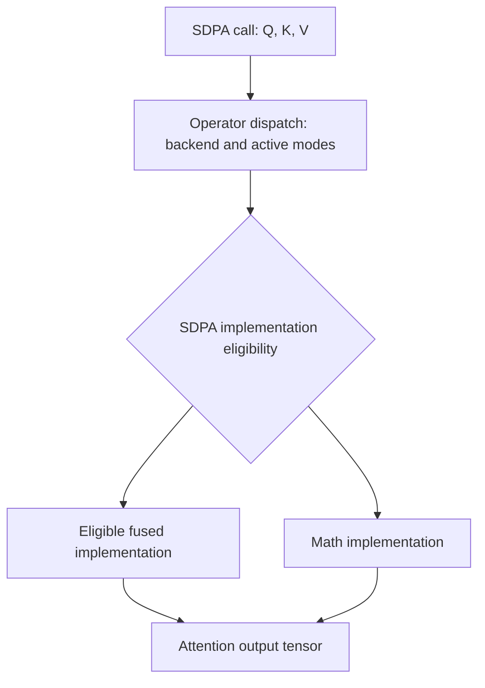
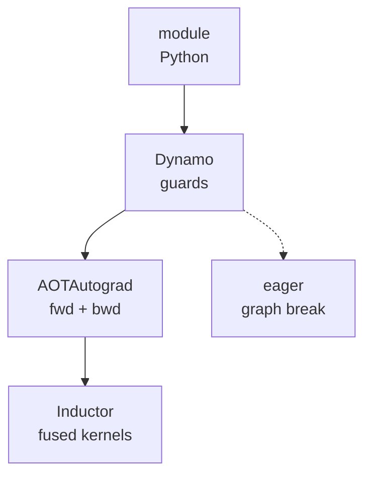
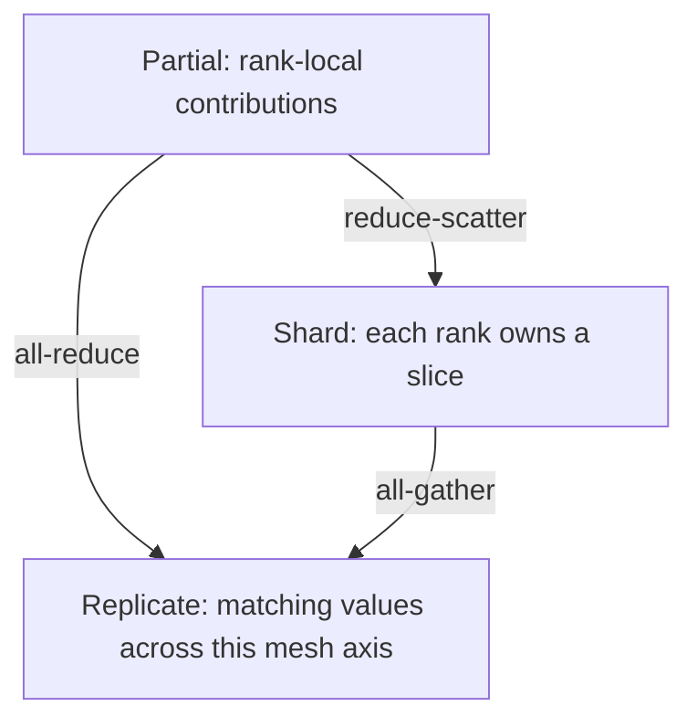
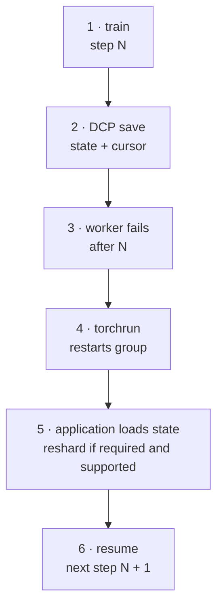

---
{
  "id": "deep-dive-pytorch",
  "title": "Deep Dive - PyTorch",
  "slug": "deep-dive-pytorch",
  "section": "Project Deep Dives",
  "category": "Fine-Tuning & Training",
  "difficulty": "Hard",
  "order": 11,
  "coverImage": "illustrations/_generated/tensor_view_strides_dark.png",
  "companies": [
    "PyTorch Foundation",
    "Meta AI",
    "Linux Foundation",
    "Microsoft",
    "AWS",
    "Google"
  ],
  "shortDescription": "A transpose shares storage, then the next kernel slows down. Follow that change through PyTorch views, dispatch, autograd, and sharded training.",
  "keyConceptsTested": [
    "TensorImpl, storage, strides, and views",
    "Operator schemas, code generation, and dispatch keys",
    "Reverse-mode autograd and in-place versioning",
    "torch.compile with Dynamo, AOTAutograd, and Inductor",
    "Scaled dot-product attention and kernel selection",
    "c10d, DeviceMesh, DTensor, FSDP2, and tensor parallelism",
    "Pipeline stages, microbatches, and schedules",
    "Distributed checkpointing and elastic worker restart",
    "LLM training and inference ownership layers",
    "Graph breaks, memory pressure, and distributed failures"
  ],
  "prerequisites": [
    "pytorch-training-loops",
    "transformer-architecture-end-to-end",
    "distributed-training-fsdp-deepspeed-zero",
    "deep-dive-megatron"
  ]
}
---

Transpose a matrix in <span data-glossary="pytorch">PyTorch</span> and its rows become columns without moving a single byte. Then the very next operation slows down. Nothing changed in the math, yet execution took a different path.

PyTorch exposes every layer between Python and hardware kernels, so you can trace that detour directly. Follow one layout change through scaled dot-product attention (SDPA), views, dispatch, autograd, `torch.compile`, sharded training, and distributed recovery.[^pytorch2019][^pytorchSdpaDocs2026]

## Eager Python, compiled kernels

Deep-learning research wants line-by-line Python debugging alongside fused hardware kernels and multi-GPU collectives. PyTorch reconciles both with an imperative tensor API, dynamic reverse-mode autograd, and modular C++ and Python dispatch layers.[^pytorch2019][^pytorch2026repo]

The same code spans distinct memory models: Apple silicon's <span data-glossary="mps-backend">Metal Performance Shaders (MPS) backend</span> shares a <span data-glossary="unified-memory">unified-memory</span> pool with the CPU,[^pytorchMpsBackend2026][^appleMetalPytorch2026] whereas discrete NVIDIA GPUs require <span data-glossary="host-to-device-transfer">host-to-device transfers</span> over PCIe for <span data-glossary="cuda-kernel">CUDA kernels</span>.[^cudaProgrammingGuide2026] Diagnosing a slowdown starts with knowing which layer handled the call:

| Layer | Responsibility | LLM consequence |
| --- | --- | --- |
| Python API | Modules, <span data-glossary="optimizer">optimizers</span>, tensor expressions | Model code stays inspectable |
| ATen operators | Typed schemas and <span data-glossary="tensor">tensor</span> kernels | `mm`, `view`, `softmax`, and SDPA share one surface |
| Dispatcher and c10 | Backend, autograd, and mode routing | One call routes to CUDA, CPU, tracing, or fake tensors |
| Autograd | Dynamic reverse-mode tape | Control flow can branch on data every step |
| Compiler stack | Bytecode capture, joint graph, lowering | Stable regions fuse into C++ or Triton kernels |
| c10d and distributed | Process groups, meshes, sharding | Parameters and activations span clusters |

<!-- leetllm: edition:reference:start -->

```checkpoint
What is the first useful question when an LLM operation is slower than expected?
---
Identify its execution path: eager or compiled, backend, dtype and stride layout, attention kernel, and any blocking collective or host-device sync.
```

<!-- leetllm: edition:reference:end -->

## The tensor is metadata plus storage

A dense strided `torch.Tensor` is a thin handle over a `TensorImpl` pointing at a flat device byte buffer. Multiple tensors can view the same bytes through different coordinate maps defined by **storage** (raw allocation), **sizes and strides** (dimension lengths and element steps), **storage offset** (element zero), and **device, dtype, and autograd metadata**.

Take six `int64` values `[0, 1, 2, 3, 4, 5]` shaped `[2, 3]` with strides `(3, 1)`: index `(i, j)` maps to `offset + 3i + j`. Calling `x.t()` creates a `[3, 2]` view with strides `(1, 3)` and copies zero bytes. Value `3` is simultaneously `x[1, 0]` and `y[0, 1]`, both at element offset 3 (byte offset 24).

<figure>
  
  <figcaption>The six storage cells never move. Transpose only rewrites the index map, so x[1, 0] and y[0, 1] alias the same 3. A downstream kernel requiring contiguous input can still copy after this zero-copy view.</figcaption>
</figure>

Strides and `storage_offset()` count **elements**, not bytes. Mutating `y` mutates `x`, `view(-1)` rejects the non-contiguous layout, and `reshape(-1)` allocates a fresh contiguous copy:

<!-- leetllm: test deps=torch output=show -->
```python title="view_strides.py"
import torch

torch.set_num_threads(1)
x = torch.arange(6, dtype=torch.int64).reshape(2, 3)
y = x.t()
assert x.stride() == (3, 1) and y.stride() == (1, 3)
assert x.untyped_storage().data_ptr() == y.untyped_storage().data_ptr()
assert x[1, 0].item() == y[0, 1].item() == 3
assert x.untyped_storage().nbytes() == 48
print("x:", x.tolist(), "strides:", x.stride())
print("y:", y.tolist(), "strides:", y.stride())
print("storage bytes:", x.untyped_storage().nbytes())
try:
    y.view(-1)
except RuntimeError:
    print("view(-1): incompatible strides")
else:
    raise AssertionError("This transpose cannot be flattened with view")
flat = y.reshape(-1)
assert flat.tolist() == [0, 3, 1, 4, 2, 5]
assert flat.untyped_storage().data_ptr() != y.untyped_storage().data_ptr()
y[0, 1] = 30
assert x[1, 0].item() == 30 and flat[1].item() == 3
print("alias changed x; copied reshape stayed unchanged")
```

<!-- leetllm: output:start -->
```text title="Output" output compact
x: [[0, 1, 2], [3, 4, 5]] strides: (3, 1)
y: [[0, 3], [1, 4], [2, 5]] strides: (1, 3)
storage bytes: 48
view(-1): incompatible strides
alias changed x; copied reshape stayed unchanged
```
<!-- leetllm: output:end -->

> **Key insight:** Permuting attention `Q`, `K`, and `V` from `[B, S, H, D]` to `[B, H, S, D]` is an $O(1)$ metadata view, yet a downstream matmul expecting contiguous inputs can silently allocate a copy, and stride-keyed compiler guards can recompile when layouts shift.[^pytorchTensorViews2026]

## Operator schemas and the dispatcher

Calls like `torch.mm(x, w)` enter ATen through formal operator schemas specifying argument types, overloads, returns, and mutability. The dispatcher builds a `DispatchKeySet` from tensor backends (CPU, CUDA, MPS) and active modes (autograd, functionalization, batching, Python tracing), invokes the highest-priority handler, and redispatches down to a concrete kernel.[^pytorchSourceSnapshot2026]



Context managers rewrite dispatch dynamically: `torch.no_grad()` disables autograd keys, `torch.inference_mode()` also drops view and version tracking, functionalization turns in-place ops into pure ops during tracing, and fake tensors propagate shapes without device allocations. Custom ops plug into this same dispatcher, so they must uphold dtype, stride, and aliasing rules alongside numerical math.

<!-- leetllm: edition:reference:start -->

```checkpoint
Why can a custom operator that computes correct values still be wrong?
---
It can violate dtype, device, stride, aliasing, mutation, autograd, or dispatch requirements relied on by downstream views, compiler guards, and distributed wrappers.
```

<!-- leetllm: edition:reference:end -->

## Autograd records a dynamic execution tape

When any input sets `requires_grad=True`, PyTorch records each forward op onto a dynamic DAG of backward nodes, saving only the tensors needed for local Jacobian-vector products. `loss.backward()` traverses that graph in reverse topological order, accumulates gradients on leaf parameters, and frees intermediates as soon as their consumers finish. Because the tape builds live during execution, Python loops and data-dependent branches work without graph recompilation.

### Views and in-place mutation

Backward math assumes saved forward activations remain unchanged. PyTorch tracks a version counter on each tensor implementation (omitted inside `torch.inference_mode()`): every in-place write increments it, and if a backward node sees a newer version on a saved tensor, autograd raises a `RuntimeError` instead of silently computing corrupt gradients.[^pytorch2026autograd]

Because views share storage, mutating a view bumps its parent's version counter too, so an in-place write can fail far later inside `backward()`. Mutating a grad-requiring leaf fails immediately in forward.

> **Common mistake:** `x.detach()` stops autograd from tracking future ops, yet it still aliases `x`'s storage. For $L = x^2$ at $x = 3$, `x.detach().add_(1.0)` invalidates the saved `x` and crashes `backward()`, whereas `x.detach().clone().add_(1.0)` isolates memory and preserves $\frac{dL}{dx} = 2x = 6$.

Use `torch.autograd.gradcheck` on small `float64` tensors to verify custom analytical backward methods against finite differences before deploying them at scale; activation checkpointing likewise requires deterministic forward replay.[^pytorch2026autograd]

<!-- leetllm: edition:reference:start -->

Verify the valid gradient, the rejected detached-alias write, and the isolated clone directly:

<!-- leetllm: test deps=torch output=show -->
```python title="autograd_alias.py"
import torch

torch.set_num_threads(1)
x = torch.tensor([3.0], dtype=torch.float64, requires_grad=True)
x.square().sum().backward()
assert x.grad.item() == 6.0
print("gradient at x=3:", x.grad.item())

x = torch.tensor([3.0], dtype=torch.float64, requires_grad=True)
loss = x.square().sum()
x.detach().add_(1.0)  # Shares storage with the saved x.
try:
    loss.backward()
except RuntimeError as error:
    assert "modified by an inplace operation" in str(error)
    print("detached alias mutation: rejected during backward")
else:
    raise AssertionError("Expected a saved-value version mismatch")

x = torch.tensor([3.0], dtype=torch.float64, requires_grad=True)
loss = x.square().sum()
independent = x.detach().clone()
independent.add_(1.0)
loss.backward()
assert x.item() == 3.0 and independent.item() == 4.0
assert x.grad.item() == 6.0
assert torch.autograd.gradcheck(lambda t: t.square().sum(), (x,))
print("independent clone: original gradient preserved; gradcheck passed")
```

<!-- leetllm: output:start -->
```text title="Output" output compact
gradient at x=3: 6.0
detached alias mutation: rejected during backward
independent clone: original gradient preserved; gradcheck passed
```
<!-- leetllm: output:end -->

```checkpoint
A view and its base share storage. Why does `view.add_(1)` sometimes fail only during backward?
---
The in-place write increments the shared version counter. A backward node detects the mismatch only when it reads the saved tensor, surfacing the error away from the mutation site.
```

<!-- leetllm: edition:reference:end -->

## Attention is a kernel-selection problem

For $Q$, $K$, and $V$ shaped `[B, H, S, D]`, scaled dot-product attention computes:

$$
A = \operatorname{softmax}\left(\frac{QK^T}{\sqrt{D}} + M\right)V,
$$

where $M$ adds `0` to kept positions and $-\infty$ to masked keys.

Naive attention writes the $B \times H \times S \times S$ score matrix to HBM. Even at $B=1, H=2, S=8192$, that intermediate alone holds $1 \times 2 \times 8192^2 = 134{,}217{,}728$ elements. Fused kernels like FlashAttention-2 tile $Q$, $K$, and $V$ into on-chip SRAM, fusing matmul and online softmax per tile and recomputing scores in backward to avoid HBM traffic.[^dao2023]

<!-- leetllm: edition:reference:start -->

<!-- leetllm: test output=show -->
```python title="score_cells.py"
batch, heads, sequence = 1, 2, 8192
score_cells = batch * heads * sequence * sequence
print(score_cells)
assert score_cells == 134_217_728
```

<!-- leetllm: output:start -->
```text title="Output" output compact
134217728
```
<!-- leetllm: output:end -->

<!-- leetllm: edition:reference:end -->

`F.scaled_dot_product_attention` dispatches across FlashAttention, memory-efficient attention, cuDNN, and a math fallback based on hardware, dtype, head dimension, strides, grouped-query head counts, and mask structure; `sdpa_kernel` selects or restricts backends explicitly.[^pytorchSdpaEnum2026][^pytorchSdpaBackends2026][^pytorchSdpaDocs2026] For custom patterns like sliding windows or document masks, FlexAttention lowers Python score modifiers and block-sparse masks straight to fused Triton kernels.[^pytorchFlexAttention2026]

> **Common mistake:** Three SDPA traps break `nn.MultiheadAttention` migrations:
> 1. `dropout_p` ignores `model.eval()`: pass `dropout_p=0.0` explicitly at eval time.
> 2. Boolean `attn_mask` uses `True` = **keep** (opposite of `key_padding_mask`, where `True` masks out).
> 3. For non-square shapes (1 decode query against $K$ cached keys), `is_causal=True` aligns to the **upper-left**, seeing only key 0 instead of the full cached prefix.[^pytorchSdpaDocs2026]

Check forward math, Q/K/V gradients, boolean mask polarity, and 1-query causal vs cached-prefix semantics in `float64`:

<!-- leetllm: test deps=torch output=show -->
```python title="attention_math.py"
import math
import torch
import torch.nn.functional as F
from torch.nn.attention import SDPBackend, sdpa_kernel

torch.set_num_threads(1)
q = torch.tensor([[[[1.0, 0.0], [0.0, 1.0]]]], dtype=torch.float64, requires_grad=True)
k = q.detach().clone().requires_grad_()
v = torch.tensor([[[[10.0, 0.0], [0.0, 20.0]]]], dtype=torch.float64, requires_grad=True)
with sdpa_kernel(SDPBackend.MATH):
    actual = F.scaled_dot_product_attention(q, k, v, dropout_p=0.0)
reference = (q @ k.transpose(-2, -1) / math.sqrt(2)).softmax(dim=-1) @ v
torch.testing.assert_close(actual, reference)
actual_grads = torch.autograd.grad(actual.square().sum(), (q, k, v))
reference_grads = torch.autograd.grad(reference.square().sum(), (q, k, v))
for actual_grad, expected_grad in zip(actual_grads, reference_grads):
    torch.testing.assert_close(actual_grad, expected_grad)

keep_first = torch.tensor([[True, False], [True, False]])
with sdpa_kernel(SDPBackend.MATH):
    masked = F.scaled_dot_product_attention(q, k, v, attn_mask=keep_first, dropout_p=0.0)
expected = torch.tensor([[[[10.0, 0.0], [10.0, 0.0]]]], dtype=torch.float64)
torch.testing.assert_close(masked, expected)
print("CPU math: forward and all Q/K/V gradients match the formula")
print("True means keep:", masked.detach().tolist())

with sdpa_kernel(SDPBackend.MATH):
    upper_left = F.scaled_dot_product_attention(q[:, :, :1], k, v, is_causal=True)
    cached_last = F.scaled_dot_product_attention(q[:, :, :1], k, v, is_causal=False)
torch.testing.assert_close(upper_left, expected[:, :, :1])
torch.testing.assert_close(cached_last, reference[:, :, :1])
assert not torch.allclose(upper_left, cached_last)
print("one query, two keys: upper-left causal sees key 0; cached-last sees both")
```

<!-- leetllm: output:start -->
```text title="Output" output compact
CPU math: forward and all Q/K/V gradients match the formula
True means keep: [[[[10.0, 0.0], [10.0, 0.0]]]]
one query, two keys: upper-left causal sees key 0; cached-last sees both
```
<!-- leetllm: output:end -->

Short sequences can be launch-latency bound, arbitrary masks can fall back to math, and non-contiguous strides can trigger copies; profile actual kernel dispatches before assuming a fused path ran.

<!-- leetllm: edition:reference:start -->

| Call-site signal | What it reveals |
| --- | --- |
| Q/K/V strides + allocation trace | Whether a view triggered a layout copy |
| Dtype and head dimension | Fused kernel eligibility versus math fallback |
| Causal flag vs arbitrary mask | Dedicated fused path versus generic masked matmul |
| Sequence length and autograd state | Tiling efficiency, launch cost, and backward path |
| Profiler kernel trace | Which implementation actually ran |

```checkpoint
For `S=8192`, why is avoiding the materialized score matrix more important than shaving one Python call?
---
The score matrix scales as `S²`, so tiled fusion cuts peak memory and HBM bandwidth dramatically while Python dispatch stays nearly constant.
```

<!-- leetllm: edition:reference:end -->

## `torch.compile`: capture, transform, lower

`torch.compile` lowers eager Python into fused device code in three stages:[^ansel2024pytorch2][^pytorch2026compile]

1. **TorchDynamo**: intercepts CPython frame evaluation, captures tensor ops into an FX graph, and installs guards on shapes, strides, dtypes, and Python scalars.
2. **AOTAutograd**: functionalizes in-place ops, decomposes into core ATen primitives, and traces joint forward/backward graphs to plan saved activations.
3. **TorchInductor**: fuses elementwise ops and reductions into C++ loops (CPU) or Triton kernels (GPU).



Compile cohesive side-effect-free boundaries, such as a transformer block, aligned with DDP or FSDP2 hooks so collectives stay unfragmented.[^pytorchCompileDocs2025]

### Graph breaks and recompilation

Data-dependent branches (`if tensor.item() > 0:`), `print()`, or opaque third-party calls force a **graph break**: Dynamo compiles the prefix, returns to eager Python for the unsupported logic, and starts a fresh graph afterward. Outputs stay exact, but fusion stops at every break.

Guards recompile whenever a call changes shape, stride, dtype, or a guarded Python scalar; inspect causes with `TORCH_LOGS="graph_breaks,guards,recompiles"`.[^pytorch2026compiletroubleshooting]

> **Key insight:** AOTAutograd assumes backward uses the same autocast context as forward (`backward_pass_autocast="same_as_forward"`). When forward runs inside `torch.autocast` and `loss.backward()` runs outside it, patch `backward_pass_autocast="off"` so compiled backward gradients match eager.[^pytorchCompileAutograd2026]

<!-- leetllm: edition:reference:start -->

This script isolates Dynamo capture (2 captured graphs across 3 calls as the Python scale changes) and verifies `aot_eager` forward/backward parity, including CPU BF16 autocast alignment:

<!-- leetllm: test deps=torch output=show -->
```python title="compile_boundaries.py"
import torch
import torch._functorch.config

torch.set_num_threads(1)
torch.compiler.reset()
captures = []

def counting_backend(graph, inputs):
    captures.append(graph)
    return graph.forward

def scaled_square(x, scale):
    return x.square() * scale

compiled = torch.compile(scaled_square, backend=counting_backend, fullgraph=True, dynamic=False)
x = torch.tensor([1.0, 2.0], dtype=torch.float64)
torch.testing.assert_close(compiled(x, 2.0), torch.tensor([2.0, 8.0], dtype=torch.float64))
compiled(x, 2.0)
assert len(captures) == 1
torch.testing.assert_close(compiled(x, 3.0), torch.tensor([3.0, 12.0], dtype=torch.float64))
assert len(captures) == 2

def loss_fn(value):
    return value.sin().square().sum()

a = x.clone().requires_grad_()
b = x.clone().requires_grad_()
staged = torch.compile(loss_fn, backend="aot_eager", fullgraph=True)
eager_loss, staged_loss = loss_fn(a), staged(b)
eager_loss.backward()
staged_loss.backward()
torch.testing.assert_close(eager_loss, staged_loss)
torch.testing.assert_close(a.grad, b.grad)

# Match the compiler's backward assumption to backward outside autocast.
torch.manual_seed(0)
inputs = torch.randn(4, 3)
weight = torch.randn(3, 2, requires_grad=True)
staged_weight = weight.detach().clone().requires_grad_()
def amp_loss(value):
    return (inputs @ value).square().mean()
with torch.autocast("cpu", dtype=torch.bfloat16):
    eager_amp_loss = amp_loss(weight)
eager_amp_loss.backward()
with torch._functorch.config.patch(backward_pass_autocast="off"):
    compiled_amp_loss = torch.compile(amp_loss, backend="aot_eager", fullgraph=True)
    with torch.autocast("cpu", dtype=torch.bfloat16):
        staged_amp_loss = compiled_amp_loss(staged_weight)
    staged_amp_loss.backward()
torch.testing.assert_close(eager_amp_loss, staged_amp_loss, rtol=0, atol=0)
torch.testing.assert_close(weight.grad, staged_weight.grad, rtol=0, atol=0)
print("guarded Python scales: 2 captured graphs for 3 calls")
print("aot_eager: forward and backward gradients match eager")
print("CPU BF16 autocast: backward outside autocast matches with assumption off")
```

<!-- leetllm: output:start -->
```text title="Output" output compact
guarded Python scales: 2 captured graphs for 3 calls
aot_eager: forward and backward gradients match eager
CPU BF16 autocast: backward outside autocast matches with assumption off
```
<!-- leetllm: output:end -->

```checkpoint
What does a graph break mean for correctness, and what does it usually cost?
---
It returns unsupported code to eager Python, keeping math exact while adding transition overhead, possible syncs, and lost cross-boundary fusion.
```

<!-- leetllm: edition:reference:end -->

## Distributed PyTorch: process groups first

`torch.distributed` coordinates $N$ ranks in process groups via <span data-glossary="nccl">NCCL</span> on NVIDIA GPUs and Gloo on CPUs.[^pytorch2026distributed] Ranks in a group must issue matching collectives in identical order; a mismatch deadlocks until timeout.

| Collective | Result | LLM use |
| --- | --- | --- |
| `all_reduce` | Every rank gets the reduced tensor | <span data-glossary="data-parallelism">Data-parallel</span> gradient sum or TP reduction |
| `reduce_scatter` | Reduce, then hand each rank one slice | <span data-glossary="fsdp">FSDP2</span> gradient sharding |
| `all_gather` | Every rank collects all slices | Rebuilding sharded weights or activations |
| `all_to_all` | Ranks exchange distinct slices | <span data-glossary="mixture-of-experts">MoE</span> token routing or sequence parallelism |
| `broadcast` | One rank sends to all | Initial weights or control metadata |

## DeviceMesh and DTensor make placement explicit

`DeviceMesh` organizes ranks into an $n$-dimensional grid like `(dp=2, tp=4)`, and `DTensor` attaches one placement per mesh axis (`Replicate()`, `Shard(dim)`, or `Partial()`) so collectives arise automatically from layout transitions.[^pytorch2026distributed][^pytorchDTensor2026]

Suppose two ranks hold sum-`Partial` vectors `[1, 2]` and `[10, 20]`, representing logical `[11, 22]`. Converting `Partial()` to `Replicate()` runs `all_reduce` (`[11, 22]` on both ranks); converting `Partial()` to `Shard(0)` runs `reduce_scatter` (`[11]` on rank 0, `[22]` on rank 1). Concatenating raw `Partial` buffers instead invents the wrong four-element tensor. On `mesh = (dp=2, tp=4)`, sharding a `[4096, 16384]` weight as `Shard(1)` over `tp` places `[4096, 4096]` per TP rank. FSDP2 builds on the same placements, defaulting to `Shard(0)` on a 1D mesh or hybrid `(Replicate(), Shard(0))` on a 2D mesh.[^pytorchFsdp2Docs2025]



## Tensor and pipeline parallelism split different work

Tensor parallelism (TP) shards individual linear layers via `parallelize_module` with `ColwiseParallel` and `RowwiseParallel`. In a transformer MLP, `ColwiseParallel` splits output features (storage dim 0 of `[out_features, in_features]`) with zero communication, and `RowwiseParallel` splits input features followed by `all_reduce` or `reduce_scatter`.[^pytorchTensorParallel2026][^pytorchSourceSnapshot2026]

Pipeline parallelism (PP) assigns consecutive layer blocks to stages and streams microbatches through GPipe, 1F1B, or interleaved 1F1B schedules in `torch.distributed.pipelining`, trading pipeline bubbles against activation memory.[^pytorchPipeline2026]

| Axis | What each rank owns | Main communication | When to use it |
| --- | --- | --- | --- |
| FSDP2 / data | Parameter, gradient, optimizer shards | Parameter `all_gather`, gradient `reduce_scatter` | Full model state exceeds one GPU |
| Tensor | Slice of one layer's weight or activation | In-layer `all_reduce` / `reduce_scatter` / `all_gather` | One layer is too wide for a single GPU |
| Pipeline | Consecutive model stages | Forward activations, backward gradients | Model depth spans nodes or slower links |

> **Common mistake:** Under 1F1B with equal microbatches and mean-reduced losses, `scale_grads=True` divides accumulated gradients by the microbatch count automatically. Dividing each microbatch loss manually divides twice; for sum-reduced losses, pass `scale_grads=False`.[^pytorchPipeline2026]

<!-- leetllm: edition:reference:start -->

```checkpoint
Why can't adding pipeline stages fix a tensor-parallel collective bottleneck by itself?
---
Pipeline stages pass activations and gradients between consecutive blocks; tensor-parallel collectives still run inside each sharded layer until the tensor layout or mesh changes.
```

<!-- leetllm: edition:reference:end -->

## <span data-glossary="fsdp">FSDP2</span> shards parameters around the forward

FSDP2 stores parameters as DTensor shards at rest. Applying `fully_shard` bottom-up to transformer blocks overlaps communication with compute: pre-forward hooks `all_gather` full weights for the active block, post-forward hooks optionally reshard them, and backward gathers weights again before `reduce_scatter` delivers each rank its local gradient shard.[^pytorchFsdp2Docs2025]

> **Common mistake:** Call `model(input)`, not `model.forward(input)`. Invoking `forward` directly bypasses pre-forward unsharding hooks unless you call `model.unshard()` or register custom methods with `register_fsdp_forward_method`.

`reshard_after_forward` trades VRAM against backward communication: `True` frees weights right after forward, `False` keeps them until backward (typical on the root module), `None` picks `True` for submodules and `False` for root, and an integer reshards to a smaller subgroup.

<figure>
  
  <figcaption>With <code>reshard_after_forward=True</code> on four ranks, each rank holds P/4 at rest, gathers all P elements during forward, and frees the full view afterward. Peak memory still includes activations, gradients, prefetched blocks, and temporary buffers.</figcaption>
</figure>

A $P$-element parameter across shard degree $d$ occupies $P/d$ at rest, yet peak memory includes gathered compute weights, prefetched blocks, activations, gradients, <span data-glossary="optimizer-state">optimizer state</span>, and communication buckets.[^pytorchFsdp2Docs2025]

<!-- leetllm: edition:reference:start -->

```checkpoint
Why does <span data-glossary="fsdp">FSDP2</span> not mean every parameter is permanently absent from every rank?
---
Each module needs unsharded weights to compute, so <span data-glossary="fsdp">FSDP2</span> gathers around forward and backward and reshards afterward, bounding how many blocks are materialized at once while keeping optimizer and gradient state sharded.
```

<!-- leetllm: edition:reference:end -->

## Checkpoint and restart form one recovery loop

PyTorch Distributed Checkpoint (DCP) writes and loads sharded tensors concurrently across ranks into preallocated buffers using canonical parameter keys, so a checkpoint saved on 8 GPUs reloads cleanly onto 4 or 16 GPUs.[^pytorch2026dcp][^pytorchFsdp2Tutorial2025]

Weights and optimizer moments alone are incomplete: persist the LR scheduler, grad scaler, RNG states, step counter, and data-loader cursor so resumed runs neither replay data nor reset learning-rate decay. `torchrun` restarts failed worker processes, while training code reloads the latest complete checkpoint and restores data cursors.[^pytorchTorchrun2026]



<!-- leetllm: edition:reference:start -->

This example saves a linear model and Adam state with DCP after one step, reloads them into fresh objects, and verifies that the next update matches an uninterrupted run bit for bit:

<!-- leetllm: test deps=torch output=show -->
```python title="distributed_checkpoint.py"
import tempfile
import torch
from torch.distributed.checkpoint import load, save
from torch.distributed.checkpoint.state_dict import get_state_dict, set_state_dict

torch.set_num_threads(1)
torch.manual_seed(7)
inputs = torch.tensor([[1.0, 2.0], [2.0, -1.0]], dtype=torch.float64)
targets = torch.tensor([[0.5], [-0.5]], dtype=torch.float64)

def make_model():
    model = torch.nn.Linear(2, 1).double()
    return model, torch.optim.Adam(model.parameters(), lr=0.01)

def update(model, optimizer):
    optimizer.zero_grad(set_to_none=True)
    loss = (model(inputs) - targets).square().mean()
    loss.backward()
    optimizer.step()
    return loss.detach().clone()

model, optimizer = make_model()
update(model, optimizer)
model_state, optim_state = get_state_dict(model, optimizer)
state = {"model": model_state, "optimizer": optim_state, "step": 1}
with tempfile.TemporaryDirectory() as directory:
    save(state, checkpoint_id=directory, no_dist=True)
    expected_loss = update(model, optimizer)
    expected_params = [p.detach().clone() for p in model.parameters()]
    expected_optim = get_state_dict(model, optimizer)[1]

    resumed, resumed_optimizer = make_model()
    model_state, optim_state = get_state_dict(resumed, resumed_optimizer)
    restored = {"model": model_state, "optimizer": optim_state, "step": 0}
    load(restored, checkpoint_id=directory, no_dist=True)
    set_state_dict(resumed, resumed_optimizer,
                   model_state_dict=restored["model"],
                   optim_state_dict=restored["optimizer"])
    assert restored["step"] == 1
    actual_loss = update(resumed, resumed_optimizer)
    torch.testing.assert_close(actual_loss, expected_loss, rtol=0, atol=0)
    for actual, expected in zip(resumed.parameters(), expected_params):
        torch.testing.assert_close(actual, expected, rtol=0, atol=0)
    actual_optim = get_state_dict(resumed, resumed_optimizer)[1]
    for name, expected_state in expected_optim["state"].items():
        for key, expected in expected_state.items():
            torch.testing.assert_close(actual_optim["state"][name][key], expected, rtol=0, atol=0)
print("restored step: 1")
print("second update: loss, parameters, Adam moments and counters match exactly")
```

<!-- leetllm: output:start -->
```text title="Output" output compact
restored step: 1
second update: loss, parameters, Adam moments and counters match exactly
```
<!-- leetllm: output:end -->

## A PyTorch LLM training path

One training step traverses the full stack: data loader emits laid-out token IDs -> sharded embeddings -> SDPA backend dispatch -> ATen/Inductor MLP and norm kernels -> autograd backward tape -> FSDP2 `all_gather` and gradient `reduce_scatter` -> local shard optimizer step -> DCP checkpoint with scheduler, RNG, and data cursors.

| Application | PyTorch owns | Another system may own |
| --- | --- | --- |
| Fine-tuning | Modules, autograd, optimizer, collectives | Dataset streaming, experiment tracking |
| Pretraining | Kernels, compilation, sharding, DCP state | Cluster scheduling, object storage |
| Native inference | Tensor math, SDPA, quantized modules | HTTP serving, batching, KV cache, <span data-glossary="autoscaling">autoscaling</span> |
| vLLM / <span data-glossary="sglang">SGLang</span> | Model components or exported weights | Request scheduling, paged KV blocks, sampling |
| RL post-training | Actor loss, gradient update, model state | <span data-glossary="rollout">Rollout</span> orchestration, reward service, trainer mesh |

## Strengths and weaknesses

| Dimension | Strength | Tradeoff |
| --- | --- | --- |
| Research loop | Eager Python and dynamic control flow | Eager and compiled paths both need profiling |
| Operators | One schema spans CPU, CUDA, autograd, tracing | Custom ops must match stride, dtype, and aliasing rules |
| Performance | Fused kernels, SDPA, Inductor lowering | Small or irregular workloads pay compile/launch overhead |
| Autograd | Dynamic reverse-mode tape | Views and in-place writes surface late in backward |
| Distributed | c10d, DeviceMesh, DTensor, FSDP2, TP, PP, DCP | Collective order, mesh alignment, and full recovery add surface |
| Deployment | Export, `inference_mode`, <span data-glossary="quantization">quantization</span>, ExecuTorch[^pytorch2026executorch] | Production serving queues live in a dedicated engine |

## Failure-oriented debugging loop

Isolate one variable at a time on a single device before scaling out: fix seeds and shapes -> log device, dtype, strides, and offset -> compare eager vs `TORCH_LOGS="graph_breaks,guards,recompiles"` -> verify `sdpa_kernel` backend -> remove in-place writes and run `gradcheck` -> test collectives on two ranks -> profile `all_gather`/allocator peaks -> kill a rank after checkpoint $N$ and verify step $N+1$.

| Symptom | First suspect | Useful proof |
| --- | --- | --- |
| Unexpected copy before attention | Stride or memory format | `.stride()` and profiler copy event |
| "Modified by an inplace operation" | View alias or saved version | Remove write and run <span data-glossary="anomaly">anomaly</span> detection |
| Many compile variants | Shape, stride, dtype, or scalar guard | Recompilation and guard log |
| Fused SDPA unavailable | Mask, dtype, head dim, or device | Backend eligibility trace |
| <span data-glossary="fsdp">FSDP2</span> OOM at layer entry | Parameter `all_gather` peak | Peak allocation around `fully_shard` |
| Distributed hang | Collective mismatch across ranks | Per-rank logs and two-rank reproducer |
| Restart replays data or resets step | Missing state or cursor | Restored step, scheduler, RNG, cursor |

## Project identity

PyTorch evolved from Torch in 2016 with Meta AI backing and broad open-source collaboration;[^pytorch2022foundation] Paszke et al. (2019) formalized its imperative design.[^pytorch2019] Hosted by the PyTorch Foundation under the Linux Foundation with open maintainer governance,[^pytorch2026governance] core source uses BSD 3-Clause while bundled components include Apache, MIT, and LLVM-exception licenses.[^pytorch2026license][^pytorch2026packagelicense] Framework licenses apply to code separately from external weights or datasets.[^pytorch2026repo]

| Source | Core idea | Codebase connection |
| --- | --- | --- |
| Paszke et al. (2019) | Imperative tensors + tape autograd | Python API, ATen, autograd[^pytorch2019] |
| PyTorch 2 (2024) | Graph capture preserving eager semantics | Dynamo, AOTAutograd, Inductor[^ansel2024pytorch2] |
| FlashAttention-2 | Tiled SRAM attention | SDPA backend selection[^dao2023] |
| FSDP2 & Distributed docs | DTensor sharding and collectives | `fully_shard`, `DeviceMesh`, `torch.distributed`[^pytorchFsdp2Docs2025][^pytorch2026distributed] |

## A source-reading path

Trace the codebase from Python tensors down to distributed recovery:[^pytorchSourceSnapshot2026]

1. `torch/_tensor.py`, `c10/core/TensorImpl.h`, `torch/overrides.py` (tensor metadata and interception).
2. `aten/src/ATen/core/dispatch/Dispatcher.h`, `c10/core/DispatchKey.h` (dispatch routing).
3. `aten/src/ATen/native/native_functions.yaml`, `torchgen/` (schema codegen).
4. `torch/autograd/graph.py`, `torch/csrc/autograd/engine.cpp`, `saved_variable.cpp` (backward tape and version counters).
5. `torch/nn/functional.py` (`scaled_dot_product_attention` backend filters).
6. `torch/_dynamo/eval_frame.py`, `torch/_functorch/aot_autograd.py`, `torch/_inductor/compile_fx.py` (compile pipeline).
7. `torch/distributed/device_mesh.py`, `tensor/parallel/`, `fsdp/`, `pipelining/` (meshes, TP, FSDP2, PP).
8. `torch/distributed/checkpoint/`, `torch/distributed/run.py` (DCP and `torchrun`).

<!-- leetllm: edition:reference:end -->

## What to remember

Keep three boundaries sharp: a zero-copy view versus a downstream layout copy, a dispatch key versus the kernel that actually ran, and a loaded weight versus a training step that truly resumed.

- **Views index shared bytes.** Flipped strides are free until a kernel copies or a guard recompiles.
- **One dispatcher serves every mode.** `DispatchKeySet` routes CPU, CUDA, autograd, functionalization, and tracing over one schema surface.
- **Autograd guards saved tensors by version.** Mutating a view or `detach()` alias crashes `backward()`; isolate writes with `detach().clone()`.
- **SDPA is backend dispatch.** Boolean `True` keeps, `dropout_p=0.0` must be explicit, and non-square `is_causal=True` aligns upper-left.
- **`torch.compile` separates Dynamo, AOTAutograd, and Inductor.** Watch graph breaks, guard churn, and `backward_pass_autocast`.
- **DTensor placements make collectives explicit.** `Partial -> Replicate` is `all_reduce`, `Partial -> Shard` is `reduce_scatter`, `Shard -> Replicate` is `all_gather`.
- **FSDP2, TP, PP, and DCP compose cleanly.** Call `model(input)` for FSDP2 hooks, budget peak memory beyond `P/d`, and persist full training state alongside `torchrun` restarts.

## Mastery check

<!-- leetllm: edition:reference:start -->

### Evaluation rubric

- Show transpose storage sharing, `reshape` copying, and detached-alias backward version errors.
- Verify SDPA forward/backward math, boolean mask polarity, and 1-query causal alignment.
- Trace Dynamo captures, `aot_eager` autocast alignment, FSDP2 live-memory residency, and full DCP checkpoint resume.

### Follow-up questions

```checkpoint
A transpose has the right shape and values, yet attention slows down. How do you separate the view from a downstream layout copy?
---
Shared data pointers and flipped strides confirm the view. Check profiler allocation and copy events around SDPA, then benchmark against a contiguous input including conversion time.
```

```checkpoint
After single-process DCP save/load passes, what remains for real multi-rank crash recovery?
---
Kill a rank on the sharded mesh, rebuild the group, and verify weights, optimizer shards, scheduler, grad scaler, RNG, data cursor, and the next update (plus resharding if world size changes).
```

```checkpoint
Why are Dynamo capture counts and `aot_eager` checks separate from Inductor speedup?
---
Counting backends run FX graphs eagerly and `aot_eager` skips Inductor codegen. Benchmark compiled Inductor across warmup and steady-state steps under realistic shapes and autocast settings.
```

<!-- leetllm: edition:reference:end -->

```mastery-quiz
[
  {
    "question": "A contiguous int32 tensor x has shape [3, 4] and offset 0. Its transpose y has shape [4, 3] and strides [1, 4]. After z = y.reshape(-1) copies y, you set y[3, 2] = 99 (originally 11). What is y[3, 2]'s byte offset in x's storage, and what do x[2, 3] and z[11] read?",
    "options": [
      "44 bytes, x[2, 3] = 99 and z[11] = 99.",
      "88 bytes, x[2, 3] = 99 and z[11] = 11.",
      "44 bytes, x[2, 3] = 99 and z[11] = 11.",
      "44 bytes, x[2, 3] = 11 and z[11] = 11."
    ],
    "answer": "44 bytes, x[2, 3] = 99 and z[11] = 11.",
    "explanation": "y[3, 2] sits at element 0 + 3*1 + 2*4 = 11, or byte 44 for 4-byte int32 (88 assumes 8 bytes). y aliases x so x[2, 3] becomes 99, while the earlier copy z[11] stays 11."
  },
  {
    "question": "For scalar x = 2 requiring grad, forward computes y = 3*x and loss = y^2. Run A executes y.detach().add_(1) before backward; Run B executes y.detach().clone().add_(1). What happens in backward?",
    "options": [
      "A fails with a saved-tensor version error; B gives x.grad = 36.",
      "A gives x.grad = 36; B fails with a saved-tensor version error.",
      "A fails with a saved-tensor version error; B gives x.grad = 12.",
      "A gives x.grad = 42; B gives x.grad = 36."
    ],
    "answer": "A fails with a saved-tensor version error; B gives x.grad = 36.",
    "explanation": "Squaring saves y. In A, y.detach() aliases y's storage, so add_(1) bumps the saved version and fails backward. In B, clone() isolates the write so y stays 6 and d(loss)/dx = 2y * 3 = 36."
  },
  {
    "question": "An nn.MultiheadAttention layer uses boolean key_padding_mask [False, True, False] and training dropout 0.3. For one query, pre-mask scores are all 0 and values are [2, 8, 20]. Which SDPA mask and dropout_p match eval(), and what is returned?",
    "options": [
      "Keep the flags, dropout_p=0.0, output 8.",
      "Invert the flags, dropout_p=0.3, output 11.",
      "Keep the flags, dropout_p=0.3, output 8.",
      "Invert the flags, dropout_p=0.0, output 11."
    ],
    "answer": "Invert the flags, dropout_p=0.0, output 11.",
    "explanation": "key_padding_mask masks out True, whereas SDPA keeps True. Inverting keeps values 2 and 20 (mean 11), and dropout_p=0.0 is required because functional SDPA ignores eval()."
  },
  {
    "question": "A compiler guard tracks (dtype, stride, Python scale). Five calls pass (float64, 1, 2), (float64, 1, 2), (float64, 2, 2), (float64, 2, 3), (float64, 1, 2) with varying tensor values. What capture/reuse trace and total captures occur?",
    "options": [
      "Capture, reuse, reuse, capture, reuse; total 2.",
      "Capture, reuse, capture, capture, reuse; total 3.",
      "Capture, capture, capture, capture, capture; total 5.",
      "Capture, reuse, capture, reuse, capture; total 3."
    ],
    "answer": "Capture, reuse, capture, capture, reuse; total 3.",
    "explanation": "Calls 2 and 5 reuse entry 1. Stride change on call 3 adds entry 2, and scalar change on call 4 adds entry 3. Tensor values stay inside the guard and never trigger captures."
  },
  {
    "question": "Two ranks hold sum-Partial vectors [2, -1] and [-3, 5]. What results from redistributing to Replicate vs two-rank Shard(0)?",
    "options": [
      "Replicate: both [-1, 4]; Shard: rank 0 [-1], rank 1 [4].",
      "Replicate: both [2, -1, -3, 5]; Shard: rank 0 [2, -1], rank 1 [-3, 5].",
      "Replicate: both [-0.5, 2]; Shard: rank 0 [-0.5], rank 1 [2].",
      "Replicate: rank 0 [2, -1], rank 1 [-3, 5]; Shard: both [-1, 4]."
    ],
    "answer": "Replicate: both [-1, 4]; Shard: rank 0 [-1], rank 1 [4].",
    "explanation": "Sum-Partial adds matching coordinates to [-1, 4]. Replicate runs all_reduce (both get [-1, 4]); Shard(0) runs reduce_scatter (rank 0 gets [-1], rank 1 gets [4])."
  },
  {
    "question": "An nn.Linear(9, 12) layer runs on 3 ranks under ColwiseParallel TP versus FSDP2 default dim-0 sharding. On one rank, what is the stored TP weight shard shape and the FSDP2 weight shape during forward compute?",
    "options": [
      "TP [12, 3] and FSDP2 [4, 9].",
      "TP [12, 3] and FSDP2 [12, 9].",
      "TP [4, 9] and FSDP2 [12, 9].",
      "TP [4, 9] and FSDP2 [4, 9]."
    ],
    "answer": "TP [4, 9] and FSDP2 [12, 9].",
    "explanation": "nn.Linear stores [out_features, in_features] = [12, 9]. ColwiseParallel shards output rows to [4, 9]. FSDP2 also rests at [4, 9] but all-gathers all 12 rows to [12, 9] for forward compute."
  },
  {
    "question": "Three equal microbatches yield mean-loss gradients 3, 6, and 9 under a pipeline schedule with scale_grads=True. What gradient results with no manual division versus dividing each loss by 3 beforehand?",
    "options": [
      "No manual division 18; extra division 6.",
      "No manual division 6; extra division 6.",
      "No manual division 2; extra division 6.",
      "No manual division 6; extra division 2."
    ],
    "answer": "No manual division 6; extra division 2.",
    "explanation": "The schedule sums to 18 and divides once by 3 to give 6. Dividing each microbatch loss by 3 while scale_grads=True is active divides twice, giving 2."
  },
  {
    "question": "A complete DCP checkpoint at step 80 stores a 12-element tensor formerly sharded across 3 ranks. After failing at step 87, the job restarts on 2 ranks with equal contiguous sharding. What shard size and resume step apply?",
    "options": [
      "4 elements per rank; resume step 80 and replay 7 steps.",
      "6 elements per rank; resume step 87 without replay.",
      "4 elements per rank; resume step 87 without replay.",
      "6 elements per rank; resume step 80 and replay 7 steps."
    ],
    "answer": "6 elements per rank; resume step 80 and replay 7 steps.",
    "explanation": "DCP reshards 12 elements across 2 ranks as 6 elements per rank. Recovery reloads the last complete checkpoint (step 80) and replays the 7 unsaved steps from the restored data cursor."
  }
]
```

> **Next:** Continue to [Deep Dive - Transformers](/learn/deep-dive-transformers). PyTorch owns tensors, kernels, autograd, compilation, and distributed placement. Hugging Face Transformers layers model families, tokenizers, generation, and checkpoint interoperability on top of that substrate, turning a model repository into a forward pass running on the mechanisms you just traced.
